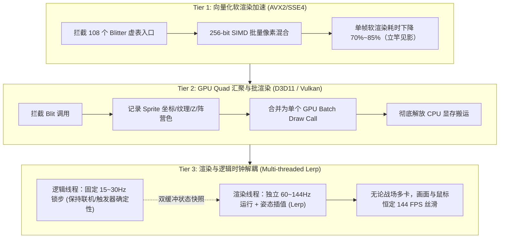

# RA2 / 尤里的复仇：L1 渲染接管与现代 GPU 批渲染架构设计

> 目标：**终结“多单位即掉拍”的 25 年历史积弊，将 108 个 CPU 软件 Blitter 升级为现代向量化与 GPU 批绘制，并将渲染时钟从 15Hz 逻辑循环中彻底解耦。**

---

## 0. 现场证据与设计出发点

在刚刚完成的 **M0 基线测量与 U200 / U800 重载实测** 中，我们捕获了决定性的现场证据：
1. **单核 CPU 并没有跑满（空闲率高达 85%~98%）**：
   现代 CPU 单核算力过剩，但玩家在 200/800 单位下体感**极其卡顿（严重掉帧、动作变慢）**。
2. **病根在于单线程锁步与软件 Blit 堆积**：
   - 游戏逻辑时钟（Tick）与画面渲染完全串行在同一个主线程内，每个 Tick 预算仅有 33~66ms。
   - 单位增多时，CPU 逐像素搬运软件 Sprite（`BlitTransXlatAlphaZRead` 等）的耗时急剧上升（忙时占比从 11% 飙升至近 30%）。
   - 只要渲染稍微耗时超标，当帧便发生严重的**时钟掉拍（Tick Miss）**，导致画面瞬间暴跌至十几帧。

---

## 1. L1 阶段的三层演进架构

为了在保证原版像素级一致性（美术、调色板、遮挡顺序绝对正确）的前提下以最快速度取得收益，L1 采取三级递进策略：



---

## 2. 关键拦截点与调用约定规格（Reverse-Engineered ABI）

基于 `ra2re rtti` 提取的 988 个类及 `out/reverse/m1_blit_targets.txt`，两类核心 Blitter 的接口规格已完全逆向确认：

### 2.1 `BlitterCore::Blit`（负责坦克、建筑、弹道、半透明与阴影）
- **虚表地址（以第一热点 `?$BlitTransXlatAlphaZRead@G` 为例）**：`0x007E56F0`
- **目标虚函数**：`vtable[1]`（函数地址 `0x00494B60`）
- **调用约定**：`__thiscall`（`this` 位于 `ecx`，参数平栈 `ret 0x20`，共 8 个 32-bit 参数）
- **函数签名**：
  ```cpp
  void __thiscall Blit(
      void *dst,            // 目标像素缓冲区 (16-bit RGB 565/555)
      byte *src,            // 源 Sprite 图像像素流
      unsigned int length,  // 本行像素长度 (Run Length)
      WORD zMin,            // 最小 Z 深度
      WORD *zBuf,           // 目标 Z-Buffer 指针
      WORD *aBuf,           // 目标 Alpha 缓冲指针
      WORD aLvl,            // Alpha 混合等级
      int warpOffset        // 超时空扭曲偏移
  );
  ```

### 2.2 `RLEBlitterCore::Blit`（负责步兵与压缩动画）
- **虚表地址（以第二热点 `?$RLEBlitTransXlat@E` 为例）**：`0x007E5B00`
- **目标虚函数**：`vtable[1]`（函数地址 `0x00491820`）
- **调用约定**：`__thiscall`
- **函数签名**：
  ```cpp
  void __thiscall Blit(
      void *dst,
      byte *src,
      byte Length,
      int EncodedLen,
      int a6, int a7, int a8, int a9, int a10, int a11
  );
  ```

---

## 3. 安全注入与零侵入拦截机制

1. **虚表劫持（VTable Redirection）而非代码段 Patch**：
   - 原版 `gamemd.exe` 代码段（`.text`）有 CRC 和完整性自检敏感点。
   - 我们**不修改任何汇编指令（0 bytes patch in .text）**。
   - 只对 `0x007E5000` 范围内的 `.rdata` 虚表指针调用 `VirtualProtect(..., PAGE_READWRITE)`，将 `vtable[1]` 指向我们的加速实现。
   - 随时可一键复原，具备 100% 确定性与高稳定性。
2. **加载通道**：
   - 方式 A：编写注入 DLL `ra2render.dll`，由 `ra2opt` 启动器通过 `CreateRemoteThread` 或 IAT 加载。
   - 方式 B：通过游戏目录已存在的 `cnc-ddraw` 或代理 DLL 链式加载。

---

## 4. 实施排期路线

- [ ] **Step 1：构建 Tier 1 实验性加速 DLL (`ra2render`)**
  - 实现 `BlitTransXlatAlphaZRead_Fast` 现代 SIMD 展开；
  - 实现安全的 `vtable[1]` 替换逻辑与回滚卸载机制。
- [ ] **Step 2：U800 重载对局验收**
  - 在 800 单位重载对局中复测帧生成时间与卡顿感，对比 CPU 渲染时间压缩比。
- [ ] **Step 3：Tier 2 GPU 批渲染与 Tier 3 双缓冲插值解耦推进**。
