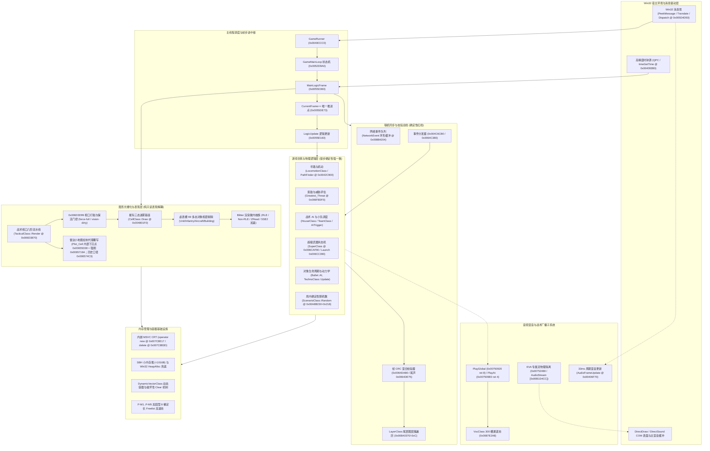
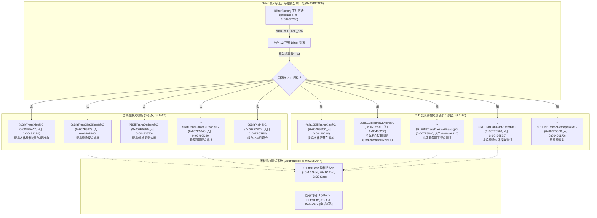
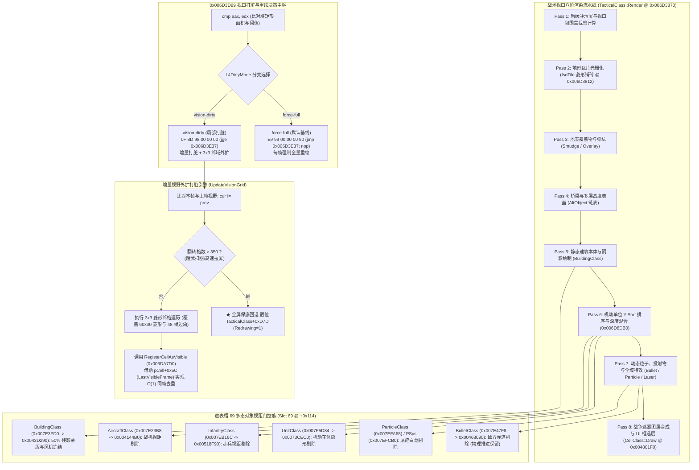
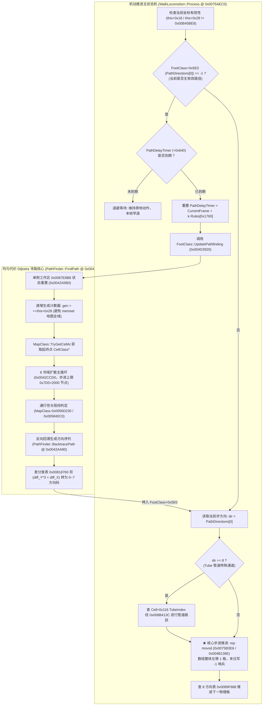
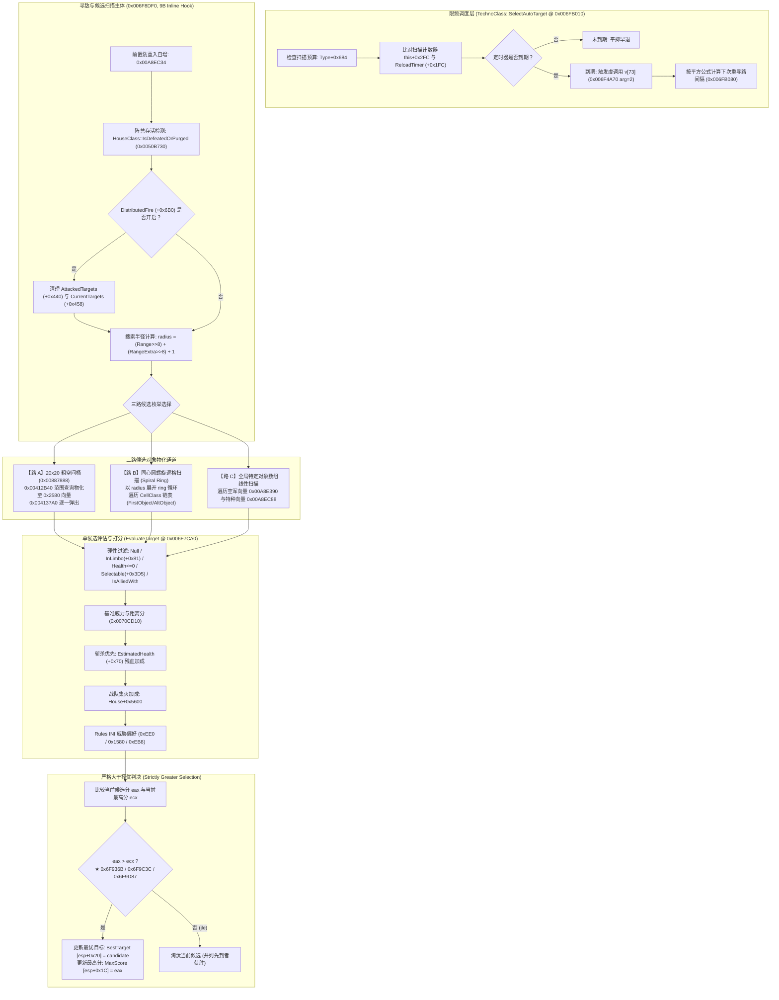
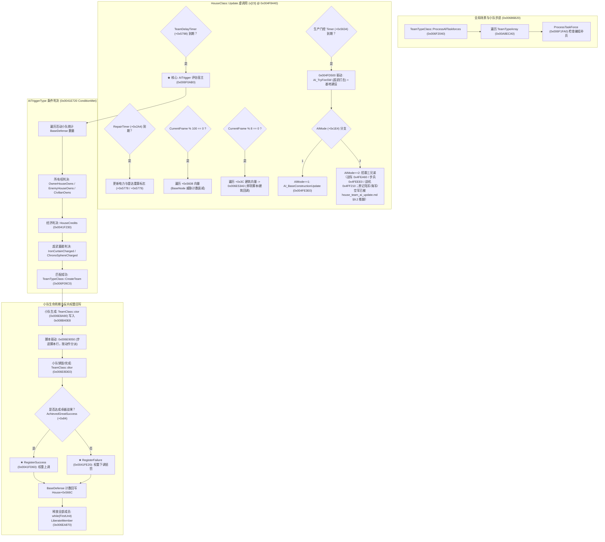
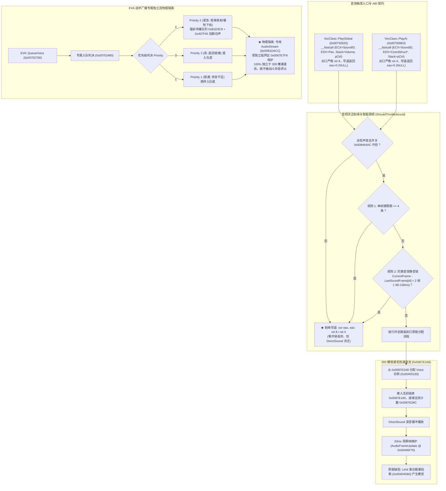
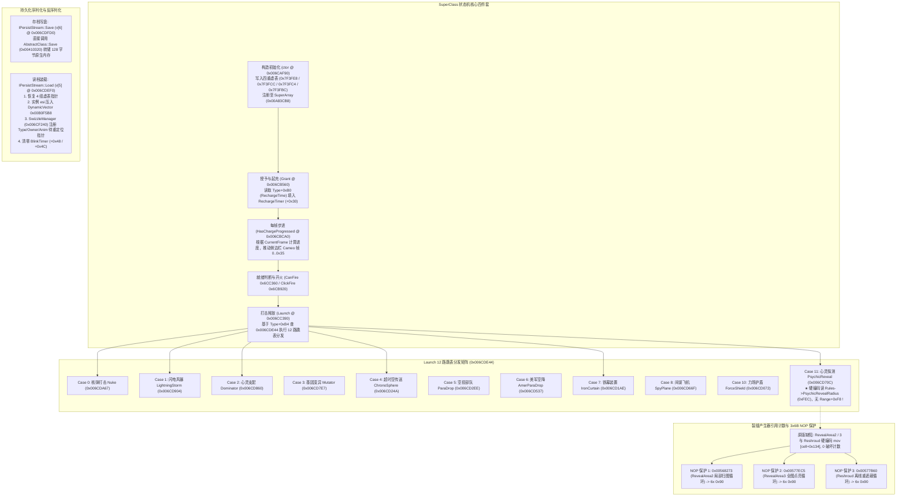
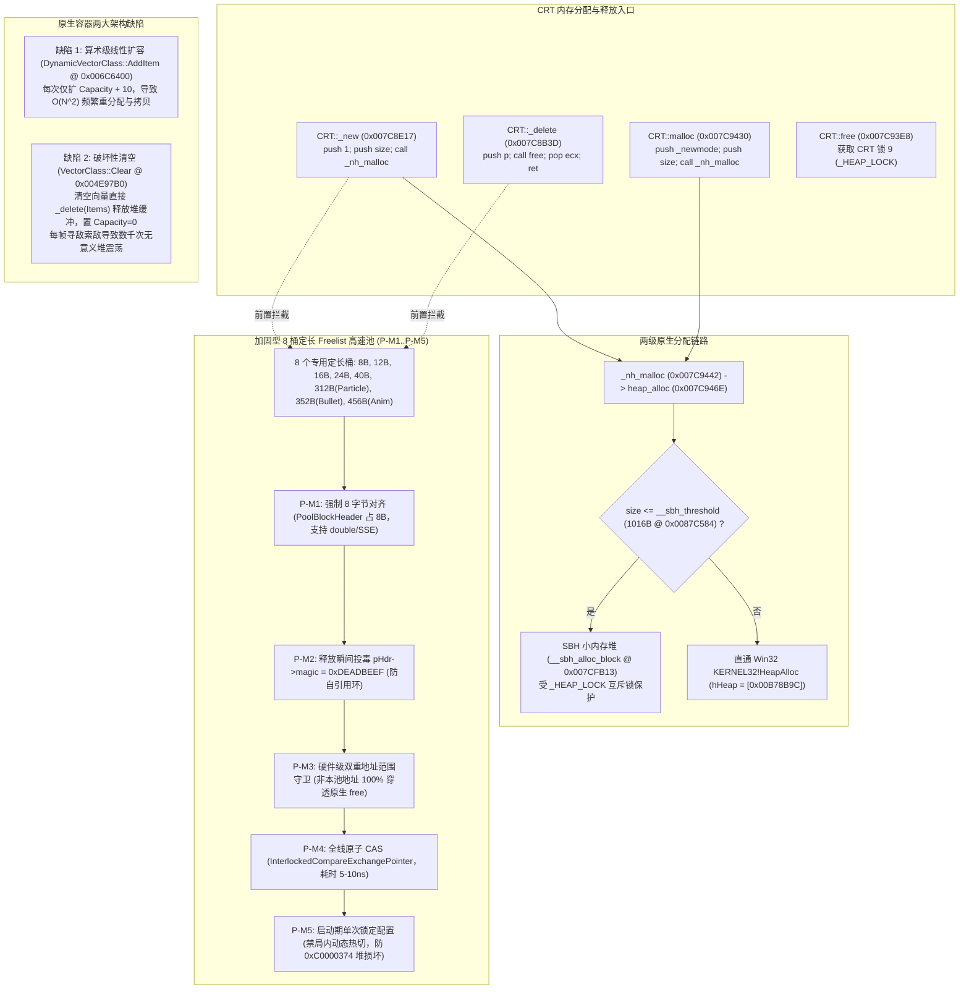
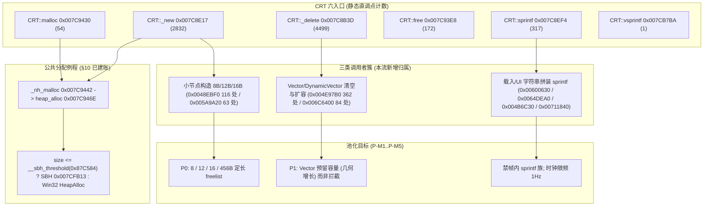

# 《红色警戒2：尤里的复仇》（gamemd.exe 1.001）全景架构图谱与系统契约总览
# Yuri's Revenge Engine Architecture Atlas & System Interoperability Contracts

> **文档标识**：`docs/re/ARCHITECTURE_ATLAS.md`  
> **逆向工程冲刺阶段**：S17 专项终审交付物（全库 30+ 逆向专题深度萃取总纲）  
> **目标基准二进制**：`ra2youli/gamemd.exe`（官方 1.001 原版，MD5: `4f37486e5b0dbe2ae5f45aeee0f98367`）  
> **可复算基准参数**：ImageBase = `0x00400000`，`.text` 虚拟基址 = `0x00401000`，物理文件偏移计算公理：`FileOffset = VA − 0x00400000`  
> 【W3 勘误 E-W3-01】原句「物理文件偏移计算公理：`FileOffset = VA − 0x00400000`」**不是全段通用规则**：它只对 `.text`/`.rdata`/`.data` 三段成立，对 `.rsrc`/`.detour` 两段**不成立**。
> 正确通式：`FileOffset = 段.PointerToRawData + (VA − 段.VirtualAddress)`，即**必须按节表（段表）映射**，不得使用全镜像常数。
> 复算命令与输出（目标 `ra2youli/gamemd.exe`，`e_lfanew=0x50`，共 5 段）：`python -X utf8 -c "import struct;d=open('ra2youli/gamemd.exe','rb').read();e=struct.unpack_from('<I',d,0x3C)[0];n=struct.unpack_from('<H',d,e+6)[0];o=e+24+struct.unpack_from('<H',d,e+20)[0];[print(d[o+i*40:o+i*40+8].rstrip(b'\x00').decode(),hex(struct.unpack_from('<IIII',d,o+i*40+8)[1]+0x400000),'rawptr',hex(struct.unpack_from('<IIII',d,o+i*40+8)[3]),'delta',hex(struct.unpack_from('<IIII',d,o+i*40+8)[1]+0x400000-struct.unpack_from('<IIII',d,o+i*40+8)[3])) for i in range(n)]"`
> 输出：`.text 0x401000 rawptr 0x1000 delta 0x400000` / `.rdata 0x7e1000 rawptr 0x3e1000 delta 0x400000` / `.data 0x812000 rawptr 0x412000 delta 0x400000` / `.rsrc 0xb7a000 rawptr 0x47e000 delta 0x6fc000` / `.detour 0xb93000 rawptr 0x497000 delta 0x6fc000`。
> ⇒ 按段选常数的等价写法：`.text/.rdata/.data` 用 `VA − 0x400000`，`.rsrc/.detour` 用 `VA − 0x6FC000`（**仅限本镜像**：`ra2youli/game.exe` 同为 `0x6FC000`；**更换二进制必须重算**）。
> **影响面提示**：**绝大多数 RE 工作落在 `.text`，故 `VA − 0x400000` 实际可用**；但凡涉及 `.rsrc`/`.detour`（例：取 `.detour` VA `0x00B93010` 的字节 ⇒ 正确偏移 `0x497010`，误用通式会读成 `0x793010`——那是 `.data` 尾部/BSS 区的**完全不同数据**，可造成**静默错误**）**一律按节表算**。
> 依据：`out/re_work/_lead_baseline/W3/LEAD_ERRATUM_E-W3-01_fileoffset_rule.md`；分级：**[实证]**
> **静态复算环境**：Capstone 32-bit x86 反汇编引擎、MSVC 32-bit PE 分析器、Python 3.12 逆向复算套件（沉淀于 `out/re_work/re_sprint/S17/`）  
> **全局工程纪律**：
> 1. 本文档为只读静态逆向定谳产物，严禁修改 `ra2render/**` 与顶层台账 `REVERSE_ENGINEERING_AND_PATCHES.md`；
> 2. 真机与游戏在研制期间严格保持挂起；
> 3. 证据分级体系严格遵循：`[实证]`（VA + FileOffset + 原始十六进制字节 + 汇编指令）× `[推演]` × `[待实测]`；无法闭环处严格标注“未闭环 + 原因 + 下一步取证方法”；
> 4. 彻底吸收 Lead v20–v22 最新审验定谳成果（H-D5 采纳 `0F B6 C0` 零扩展、音频 `PlayGlobal` `ret 8` / `PlayAt` `ret 4` 早退 `eax=0`、L4 脏区收口于 `TacticalClass::Render 0x6D3D99` + `0x6DA7D0`、G-03 `EnableThreatRetention` 门控、G-04 星际迷雾总闸、G-06 `MpStateWrites=0` 联机防污染）。

---

## 目录

- [0. 架构综述与方法论准则](#0-架构综述与方法论准则)
  - [0.1 逆向目标与可复算工程公理](#01-逆向目标与可复算工程公理)
  - [0.2 引擎核心分层与数据总线架构全景拓扑](#02-引擎核心分层与数据总线架构全景拓扑)
  - [0.3 Lead v20–v22 终审裁决与落地准则吸收](#03-lead-v20v22-终审裁决与落地准则吸收)
- [1. §1 软件渲染与 Blitter 微内核族 (Software Rasterization & Blitter Microkernels)](#1-1-软件渲染与-blitter-微内核族-software-rasterization-&-blitter-microkernels)
  - [1.1 核心微内核虚表分发与拓扑全景 [实证]](#11-核心微内核虚表分发与拓扑全景-[实证])
  - [1.2 对象内存布局差异与指针投毒隐患 [实证 + 推演]](#12-对象内存布局差异与指针投毒隐患-[实证-+-推演])
  - [1.3 调用约定与参数栈帧对照 [实证]](#13-调用约定与参数栈帧对照-[实证])
  - [1.4 全局 Z 缓冲描述符 (0x00887644) 环绕逻辑 [实证]](#14-全局-z-缓冲描述符-0x00887644-环绕逻辑-[实证])
  - [1.5 RLE 码流解析两阶段状态机 [实证]](#15-rle-码流解析两阶段状态机-[实证])
  - [1.6 吞吐量瓶颈评估与 SSE2 向量化设计](#16-吞吐量瓶颈评估与-sse2-向量化设计)
- [2. §2 战术主视图渲染与战争迷雾管线 (Tactical Viewport & Fog-of-War Pipeline)](#2-2-战术主视图渲染与战争迷雾管线-tactical-viewport-&-fog-of-war-pipeline)
  - [1.7 Blitter 像素原语正交分解与变体组合矩阵〔2026-09-28 · R1 新增；[实证]〕](#17-blitter-像素原语正交分解与变体组合矩阵〔2026-09-28-·-r1-新增；[实证]〕)
  - [1.8 Blitter Hook 覆盖率、接管优先级与真机插桩规格〔2026-09-28 · R1 新增；[实证] 覆盖率与排序依据 / [推演] 收益档 / [待实测] 插桩〕](#18-blitter-hook-覆盖率接管优先级与真机插桩规格〔2026-09-28-·-r1-新增；[实证]-覆盖率与排序依据-[推演]-收益档-[待实测]-插桩〕)
  - [2.1 战术视口八阶流水线与渲染时序 [实证]](#21-战术视口八阶流水线与渲染时序-[实证])
  - [2.2 0x006D3D99 双模切换与局部打脏架构 [实证]](#22-0x006d3d99-双模切换与局部打脏架构-[实证])
  - [2.3 增量视野翻转格外扩打脏算法与保底机制 [实证]](#23-增量视野翻转格外扩打脏算法与保底机制-[实证])
  - [2.4 星际争霸式三态迷雾门控系统 [实证]](#24-星际争霸式三态迷雾门控系统-[实证])
  - [2.5 虚表槽 69 多态对象视距剔除与建筑 50% 残影 [实证]](#25-虚表槽-69-多态对象视距剔除与建筑-50%-残影-[实证])
  - [2.6 雷达小地图三态半暗灰化与跳帧抑制 [实证]](#26-雷达小地图三态半暗灰化与跳帧抑制-[实证])
- [3. §3 单位机动与寻路系统 (Locomotion & Pathfinding Engine)](#3-3-单位机动与寻路系统-locomotion-&-pathfinding-engine)
  - [3.1 寻路状态机与触发时序 [实证]](#31-寻路状态机与触发时序-[实证])
  - [3.2 顺时针 8 方向编码标准与 Tube 管道机制 [实证]](#32-顺时针-8-方向编码标准与-tube-管道机制-[实证])
  - [3.3 差分查表回溯机制 (PathFinder::BacktracePath) [实证]](#33-差分查表回溯机制-pathfinderbacktracepath-[实证])
  - [3.4 步进推进与 24 步队列存储格式 [实证]](#34-步进推进与-24-步队列存储格式-[实证])
  - [3.5 均匀代价 Dijkstra 搜索核心 (PathFinder::FindPath) [实证]](#35-均匀代价-dijkstra-搜索核心-pathfinderfindpath-[实证])
  - [3.6 地图网格可入性与阻挡冲突检测 [实证]](#36-地图网格可入性与阻挡冲突检测-[实证])
- [4. §4 索敌与威胁评估系统 (Targeting & Threat Assessment System)](#4-4-索敌与威胁评估系统-targeting-&-threat-assessment-system)
  - [4.1 寻敌三大组件职能划分 [实证]](#41-寻敌三大组件职能划分-[实证])
  - [4.2 `Greatest_Threat` 控制流全景与前置过滤 [实证]](#42-`greatest_threat`-控制流全景与前置过滤-[实证])
  - [4.3 三路候选枚举分支与搜索半径 [实证]](#43-三路候选枚举分支与搜索半径-[实证])
  - [4.4 严格大于择优比较点汇编实证 [实证]](#44-严格大于择优比较点汇编实证-[实证])
  - [4.5 威胁评分数学模型 (EvaluateTarget @ 0x006F7CA0) [实证]](#45-威胁评分数学模型-evaluatetarget-@-0x006f7ca0-[实证])
  - [4.6 20×20 粗空间网格与 G-03 目标保持门控 [实证]](#46-20×20-粗空间网格与-g-03-目标保持门控-[实证])
- [5. §5 战术 AI 与小队调度 (Tactical AI & Team Scheduling Engine)](#5-5-战术-ai-与小队调度-tactical-ai-&-team-scheduling-engine)
  - [5.1 战术 AI 分层调用拓扑 [实证]](#51-战术-ai-分层调用拓扑-[实证])
  - [5.2 多重限频时钟轮转体系 [实证]](#52-多重限频时钟轮转体系-[实证])
  - [5.3 AITrigger 触发条件评估体系 (0x006F0AB0) [实证]](#53-aitrigger-触发条件评估体系-0x006f0ab0-[实证])
  - [5.4 TeamClass 生命周期流与反向权重回写 [实证]](#54-teamclass-生命周期流与反向权重回写-[实证])
  - [5.5 生产建造与招募调度三分支 [实证]](#55-生产建造与招募调度三分支-[实证])
- [6. §6 音频引擎与 EVA 战术广播 (Audio Engine & EVA Tactical Broadcast)](#6-6-音频引擎与-eva-战术广播-audio-engine-&-eva-tactical-broadcast)
  - [6.1 音频引擎架构拓扑与 DirectSound 交互模型 [实证]](#61-音频引擎架构拓扑与-directsound-交互模型-[实证])
  - [6.2 播放入口与 ABI 平栈契约实证 [实证]](#62-播放入口与-abi-平栈契约实证-[实证])
  - [6.3 引擎原版缺陷：Limit 事后强斩与 MinDelay 跨单位失效 [实证]](#63-引擎原版缺陷：limit-事后强斩与-mindelay-跨单位失效-[实证])
  - [6.4 音频洪泛削峰与智能限频落地规格 [实证]](#64-音频洪泛削峰与智能限频落地规格-[实证])
  - [6.5 EVA 战术广播专属独立流物理隔离 [实证]](#65-eva-战术广播专属独立流物理隔离-[实证])
- [7. §7 超级武器状态机与持久化 (Superweapon State Machine & Persistence)](#7-7-超级武器状态机与持久化-superweapon-state-machine-&-persistence)
  - [7.1 `SuperClass` 状态机四件套汇编实证 [实证]](#71-`superclass`-状态机四件套汇编实证-[实证])
  - [7.2 充能计时器与放电状态机 [实证]](#72-充能计时器与放电状态机-[实证])
  - [7.3 Launch 12 路跳表分发机制 [实证]](#73-launch-12-路跳表分发机制-[实证])
  - [7.4 PsychicReveal (Case 11) 射程真相实证 [实证]](#74-psychicreveal-case-11-射程真相实证-[实证])
  - [7.5 持久化流序列化 (IPersistStream) 实证 [实证]](#75-持久化流序列化-ipersiststream-实证-[实证])
  - [7.6 裂缝产生器引用计数破坏 Bug 与 3×6B NOP 保护 [实证]](#76-裂缝产生器引用计数破坏-bug-与-3×6b-nop-保护-[实证])
- [8. §8 帧时钟循环与 Win32 消息驱动 (Frame Clock Loop & Message Pump)](#8-8-帧时钟循环与-win32-消息驱动-frame-clock-loop-&-message-pump)
  - [8.1 双轨时间模型架构 [实证]](#81-双轨时间模型架构-[实证])
  - [8.2 时钟源架构：QPC 与 `timeGetTime` 双路径 [实证]](#82-时钟源架构：qpc-与-`timegettime`-双路径-[实证])
  - [8.3 顶层帧主循环拓扑 [实证]](#83-顶层帧主循环拓扑-[实证])
  - [8.4 逻辑帧自增写点全镜像唯一性实证 [实证]](#84-逻辑帧自增写点全镜像唯一性实证-[实证])
  - [8.5 Win32 消息泵与 Sleep 节拍模型 [实证]](#85-win32-消息泵与-sleep-节拍模型-[实证])
  - [8.6 0x004068E0 空桩调用簇全景取证 [实证]](#86-0x004068e0-空桩调用簇全景取证-[实证])
- [9. §9 联机确定性与帧校验同步 (Multiplayer Determinism & Checksum Pipeline)](#9-9-联机确定性与帧校验同步-multiplayer-determinism-&-checksum-pipeline)
  - [9.1 锁步同步模型与帧执行序 [实证]](#91-锁步同步模型与帧执行序-[实证])
  - [9.2 帧 CRC 混合计算架构 (0x0064DAB0) [实证]](#92-帧-crc-混合计算架构-0x0064dab0-[实证])
  - [9.3 联机诊断 Hook 体系 (H-D1 ~ H-D6) 落地规范 [实证]](#93-联机诊断-hook-体系-h-d1-~-h-d6-落地规范-[实证])
  - [9.4 G-01 ~ G-10 联机安全门控矩阵总览 [实证]](#94-g-01-~-g-10-联机安全门控矩阵总览-[实证])
- [10. §10 内存管理与对象生命周期 (Memory Management & Allocator Architecture)](#10-10-内存管理与对象生命周期-memory-management-&-allocator-architecture)
  - [10.1 内嵌 MSVC 6.0 CRT 分配器反汇编实证 [实证]](#101-内嵌-msvc-60-crt-分配器反汇编实证-[实证])
  - [10.2 原生容器两大架构缺陷剖析 [实证]](#102-原生容器两大架构缺陷剖析-[实证])
  - [10.3 战场对象尺寸分布 Top 15 实证总表 [实证]](#103-战场对象尺寸分布-top-15-实证总表-[实证])
  - [10.4 P-M1 ~ P-M5 五重加固架构规范 [推演 + 实证]](#104-p-m1-~-p-m5-五重加固架构规范-[推演-+-实证])
- [11. 全局关键单例与类虚表地址速查总表 (Master VTable & Singleton Quick Reference)](#11-全局关键单例与类虚表地址速查总表-master-vtable-&-singleton-quick-reference)
  - [11.1 全局关键单例与指针速查总表 [实证]](#111-全局关键单例与指针速查总表-[实证])
  - [11.2 核心类虚表与实例物理尺寸总表 [实证]](#112-核心类虚表与实例物理尺寸总表-[实证])
  - [11.3 核心数据结构物理成员字段偏移实证表 [实证]](#113-核心数据结构物理成员字段偏移实证表-[实证])
  - [11.4 新增专章 VA 速查表索引 (§13–§22) [实证]](#114-新增专章-va-速查表索引-1322-[实证])
- [12. 系统间交互与并发/确定性契约总则 (Inter-System Interaction & Concurrency Contract)](#12-系统间交互与并发确定性契约总则-inter-system-interaction-&-concurrency-contract)
  - [12.1 渲染线程与主逻辑关系的并发模型 [实证]](#121-渲染线程与主逻辑关系的并发模型-[实证])
  - [12.2 联机确定性红线隔离总则 (Multiplayer Synchronization Redlines)](#122-联机确定性红线隔离总则-multiplayer-synchronization-redlines)
  - [12.3 音频引擎与主循环的交互契约 [实证]](#123-音频引擎与主循环的交互契约-[实证])
  - [12.4 全项目补丁生命周期管理与回滚规范 (Patch Lifecycle & Rollback)](#124-全项目补丁生命周期管理与回滚规范-patch-lifecycle-&-rollback)
  - [12.4-bis 已落地补丁字节级验收账（P-1 ~ P-6 · 18 项）[实证]](#124-bis-已落地补丁字节级验收账p-1-~-p-6-·-18-项[实证])
- [13. §13 验收与闸门状态 (Acceptance Gates & Verification Status)](#13-13-验收与闸门状态-acceptance-gates-&-verification-status)
  - [13.1 真机挂起状态（当前闸门 = 关闭）](#131-真机挂起状态当前闸门-=-关闭)
  - [13.2 UNVERIFIED / 未闭环清单](#132-unverified-未闭环清单)
  - [13.3 阈值新口径（2026-09-28 Lead 裁定，**取代**旧唯一色数阈值）](#133-阈值新口径2026-09-28-lead-裁定**取代**旧唯一色数阈值)
  - [13.4 两级过滤机制与放闸硬指标（放闸唯一合法路径）](#134-两级过滤机制与放闸硬指标放闸唯一合法路径)
  - [13.5 联机放闸前置（与 §9.4 / §12.2 联读）](#135-联机放闸前置与-94-122-联读)
  - [13.6 术语口径（本文档内「实测」的定义）](#136-术语口径本文档内「实测」的定义)
- [14. §14 触发器脚本运行时 (Trigger Script Runtime)](#14-14-触发器脚本运行时-trigger-script-runtime)
  - [14.1 结论速览](#141-结论速览)
  - [14.2 类与虚表拓扑（RTTI 定名，[实证]）](#142-类与虚表拓扑rtti-定名[实证])
  - [14.3 每逻辑帧节拍（[实证]）](#143-每逻辑帧节拍[实证])
  - [14.4 事件驱动漏斗与「唯一入口」表（[实证]）](#144-事件驱动漏斗与「唯一入口」表[实证])
  - [14.5 三张派发表（互不相同，勿混）（[实证]）](#145-三张派发表互不相同勿混[实证])
  - [14.6 求值顺序与锁步确定性（[实证]）](#146-求值顺序与锁步确定性[实证])
  - [14.7 PRNG 消费面（联机红线）（[实证]）](#147-prng-消费面联机红线[实证])
  - [14.8 生命周期、Destroyed 与延迟析构队列（[实证]）](#148-生命周期destroyed-与延迟析构队列[实证])
  - [14.9 AITrigger 与普通触发器（[实证]）](#149-aitrigger-与普通触发器[实证])
  - [14.10 与其它子系统的契约（点名）](#1410-与其它子系统的契约点名)
  - [14.11 未闭环项](#1411-未闭环项)
  - [14.12 关键 VA 速查表（供 Lead 并入 §11）](#1412-关键-va-速查表供-lead-并入-11)
  - [14.13 R5 勘误登记（本章范围内，源文档侧）](#1413-r5-勘误登记本章范围内源文档侧)
- [15. §15 存档块与序列化全景 (Savegame Blocks & Serialization)](#15-15-存档块与序列化全景-savegame-blocks-&-serialization)
  - [15.1 结论速览](#151-结论速览)
  - [15.2 容器与文件格式（[实证]）](#152-容器与文件格式[实证])
  - [15.3 写侧驱动链与三类序列化单元（[实证]）](#153-写侧驱动链与三类序列化单元[实证])
  - [15.4 35 个模板块：字节同一性与「谁是谁」（[实证]）](#154-35-个模板块：字节同一性与「谁是谁」[实证])
  - [15.5 读侧驱动链：结构性不对称（[实证]）](#155-读侧驱动链：结构性不对称[实证])
  - [15.6 序列化原语引用面（[实证]）](#156-序列化原语引用面[实证])
  - [15.7 子系统本地序列化器（R5 新增发现）（[实证]）](#157-子系统本地序列化器r5-新增发现[实证])
  - [15.8 存档兼容性红线（与 §9 帧 CRC 输入集对照）（[实证] + [推演]）](#158-存档兼容性红线与-9-帧-crc-输入集对照[实证]-+-[推演])
  - [15.9 与其它子系统的契约（点名）](#159-与其它子系统的契约点名)
  - [15.10 未闭环项](#1510-未闭环项)
  - [15.11 关键 VA 速查表（供 Lead 并入 §11）](#1511-关键-va-速查表供-lead-并入-11)
  - [15.12 R5 勘误登记（本章范围内，源文档侧）](#1512-r5-勘误登记本章范围内源文档侧)
- [16. §16 武器/弹头/伤害与生产经济 (Weapons, Warheads, Damage & Production Economy)](#16-16-武器弹头伤害与生产经济-weapons,-warheads,-damage-&-production-economy)
  - [16.1 开火链拓扑与 v[243] 分发契约 [实证]](#161-开火链拓扑与-v[243]-分发契约-[实证])
  - [16.2 BulletClass：装配 → 飞行 → 引爆 [实证]](#162-bulletclass：装配-→-飞行-→-引爆-[实证])
  - [16.3 WarheadTypeClass 物理布局与 Verses 表 [实证]（+ 一处源文档勘误）](#163-warheadtypeclass-物理布局与-verses-表-[实证]+-一处源文档勘误)
  - [16.4 伤害结算两条路径、子类覆写矩阵与 RNG 消费契约 [实证]](#164-伤害结算两条路径子类覆写矩阵与-rng-消费契约-[实证])
  - [16.5 FactoryClass 生产时钟 [实证]（+ 一处源文档字段错位勘误）](#165-factoryclass-生产时钟-[实证]+-一处源文档字段错位勘误)
  - [16.6 §11 速查表并入建议：关键 VA 速查表（§16）](#166-11-速查表并入建议：关键-va-速查表16)
  - [16.7 §16 未闭环项（附可执行取证方法）](#167-16-未闭环项附可执行取证方法)
- [17. §17 MIX 虚拟文件系统加载链 (MIX Virtual Filesystem & Load Chain)](#17-17-mix-虚拟文件系统加载链-mix-virtual-filesystem-&-load-chain)
  - [17.1 三条通道与优先级链 [实证]](#171-三条通道与优先级链-[实证])
  - [17.2 装载序列与 `expandmd` 序号语义 [实证]](#172-装载序列与-`expandmd`-序号语义-[实证])
  - [17.3 MIX 容器装配与加密链 [实证]](#173-mix-容器装配与加密链-[实证])
  - [17.4 INI 两种装载范式与 BATTLEMD 归并契约 [实证]](#174-ini-两种装载范式与-battlemd-归并契约-[实证])
  - [17.5 对本项目的落地契约 [实证]（机制）+ [推演]（装机形态）](#175-对本项目的落地契约-[实证]机制+-[推演]装机形态)
  - [17.6 §11 速查表并入建议：关键 VA 速查表（§17）](#176-11-速查表并入建议：关键-va-速查表17)
  - [17.7 §17 未闭环项（附可执行取证方法）](#177-17-未闭环项附可执行取证方法)
- [18. §18 VXL 体素渲染与缓存布局 (VXL Voxel Rendering & Cache Layout)](#18-18-vxl-体素渲染与缓存布局-vxl-voxel-rendering-&-cache-layout)
  - [18.1 双腔分流拓扑：DrawAsVXL 与 DrawAsSHP [实证]](#181-双腔分流拓扑：drawasvxl-与-drawasshp-[实证])
  - [18.2 Draw_A_VXL 三层与三路部件旁路 [实证]](#182-draw_a_vxl-三层与三路部件旁路-[实证])
  - [18.3 `SomeVoxelCache`：结构 / 两级查找 / 扩容 [实证]](#183-`somevoxelcache`：结构-两级查找-扩容-[实证])
  - [18.4 缓存键构造：车体键含 Z 桶，阴影键**不含** [实证]](#184-缓存键构造：车体键含-z-桶阴影键**不含**-[实证])
  - [18.5 阴影链、Darken 微内核与顺序不变量 [实证]](#185-阴影链darken-微内核与顺序不变量-[实证])
  - [18.6 Z 序两层模型与 Z 梯度 [实证 + 推演]](#186-z-序两层模型与-z-梯度-[实证-+-推演])
  - [18.7 `UnitClass+0x6D3` 字段定性：纯绘制期标志 [实证]](#187-`unitclass+0x6d3`-字段定性：纯绘制期标志-[实证])
  - [18.8 迷雾短路位置（与 §2.5 / §19 / §20 的接口）[实证 + 勘误提示]](#188-迷雾短路位置与-25-19-20-的接口[实证-+-勘误提示])
  - [18.9 落地 Hook 面（**仅纸面规格**，未落地）与确定性红线](#189-落地-hook-面**仅纸面规格**未落地与确定性红线)
  - [18.10 未闭环清单](#1810-未闭环清单)
  - [18.11 关键 VA 速查表](#1811-关键-va-速查表)
- [19. §19 特效与弹丸绘制链归属 (FX & Projectile Draw-Chain Attribution)](#19-19-特效与弹丸绘制链归属-fx-&-projectile-draw-chain-attribution)
  - [19.1 归属总图：DrawIt 的固定枢纽序列 [实证]](#191-归属总图：drawit-的固定枢纽序列-[实证])
  - [19.2 Object 系 FX：槽 69 逐类归属与「自带雾门」的失效 [实证]](#192-object-系-fx：槽-69-逐类归属与「自带雾门」的失效-[实证])
  - [19.3 非 Object 渲染器四件套 [实证]](#193-非-object-渲染器四件套-[实证])
  - [19.4 Update / Draw 分离性矩阵 [实证]](#194-update-draw-分离性矩阵-[实证])
  - [19.5 `AnimClass` 雾语义定谳（含对源文档的勘误）[实证]](#195-`animclass`-雾语义定谳含对源文档的勘误[实证])
  - [19.6 FX → Blit 归属：**禁止**在 Blit 层按来源剔除 [实证]](#196-fx-→-blit-归属：**禁止**在-blit-层按来源剔除-[实证])
  - [19.7 v[65] vs v[69]：归属裁决（与 §2.5 的口径冲突，需 Lead 定谳）](#197-v[65]-vs-v[69]：归属裁决与-25-的口径冲突需-lead-定谳)
  - [19.8 成本中心与仅绘制层限频点 [实证 + 推演]](#198-成本中心与仅绘制层限频点-[实证-+-推演])
  - [19.9 归因红线](#199-归因红线)
  - [19.10 未闭环清单](#1910-未闭环清单)
  - [19.11 关键 VA 速查表](#1911-关键-va-速查表)
- [20. §20 裂缝与间谍卫星可见性分裂 (Gap Generator & SpySat Visibility Split)](#20-20-裂缝与间谍卫星可见性分裂-gap-generator-&-spysat-visibility-split)
  - [20.1 「可见性分裂」的定义：两套权威并存 [实证]](#201-「可见性分裂」的定义：两套权威并存-[实证])
  - [20.2 裂缝生命周期管线 [实证]](#202-裂缝生命周期管线-[实证])
  - [20.3 【勘误】两代口径收口表（以冲刺定谳为准）](#203-【勘误】两代口径收口表以冲刺定谳为准)
  - [20.4 永久废缝因果链：引用计数被清零 + ReshroudCell 钳位 [实证]](#204-永久废缝因果链：引用计数被清零-+-reshroudcell-钳位-[实证])
  - [20.5 间谍卫星与超武开图链 [实证]](#205-间谍卫星与超武开图链-[实证])
  - [20.6 交叉引用与**落地状态**（与 §7.6 的关系）[实证 + 待实测]](#206-交叉引用与**落地状态**与-76-的关系[实证-+-待实测])
  - [20.7 确定性红线与联机门控 [实证 + 推演]](#207-确定性红线与联机门控-[实证-+-推演])
  - [20.8 未闭环清单](#208-未闭环清单)
  - [20.9 关键 VA 速查表](#209-关键-va-速查表)
- [21. §21 侧栏/选择 UI 与黑幕点击输入交互 (Sidebar/Selection UI & Shroud Click Input)](#21-21-侧栏选择-ui-与黑幕点击输入交互-sidebarselection-ui-&-shroud-click-input)
  - [21.1 类层次、单例与虚表槽机器复核 [实证]](#211-类层次单例与虚表槽机器复核-[实证])
  - [21.2 侧边栏 Strip / Cameo 结构与三道脏门 [实证 + 推演]](#212-侧边栏-strip-cameo-结构与三道脏门-[实证-+-推演])
  - [21.3 雷达小地图单位点内层（0x00655C50）[实证]](#213-雷达小地图单位点内层0x00655c50[实证])
  - [21.4 鼠标点选 / 框选枚举源 [实证]](#214-鼠标点选-框选枚举源-[实证])
  - [21.5 黑幕 / 战雾点击门控（0x5865E0 空桩）[实证]](#215-黑幕-战雾点击门控0x5865e0-空桩[实证])
  - [21.6 命令分发与「右键 = 事件化」契约 [实证]](#216-命令分发与「右键-=-事件化」契约-[实证])
  - [21.7 与其他子系统的契约与未闭环 [推演 + 待实测]](#217-与其他子系统的契约与未闭环-[推演-+-待实测])
  - [21.8 关键 VA 速查表（并入 §11 用）](#218-关键-va-速查表并入-11-用)
- [22. §22 CRT 调用图、池风险与内联断言 (CRT Callgraph, Pool Risk & Inline Assertions)](#22-22-crt-调用图池风险与内联断言-crt-callgraph,-pool-risk-&-inline-assertions)
  - [22.1 六入口反汇编取证与静态调用量级（双口径）[实证]](#221-六入口反汇编取证与静态调用量级双口径[实证])
  - [22.2 调用者归属、模式归类与热路径契约 [实证 + 推演]](#222-调用者归属模式归类与热路径契约-[实证-+-推演])
  - [22.3 sprintf 格式串治理三层契约 [实证 + 推演]](#223-sprintf-格式串治理三层契约-[实证-+-推演])
  - [22.4 池化落地风险契约（八威胁 ↔ 五加固 ↔ 四步验证）[推演 + 待实测]](#224-池化落地风险契约八威胁-↔-五加固-↔-四步验证[推演-+-待实测])
  - [22.5 内联断言纪律（本图谱的元规则）[实证]](#225-内联断言纪律本图谱的元规则[实证])
  - [22.6 未闭环 [待实测]](#226-未闭环-[待实测])
  - [22.7 关键 VA 速查表（并入 §11 用）](#227-关键-va-速查表并入-11-用)
- [附录 DA1 · 勘误登记（雷达挂钩地址与 G-10 覆盖，2026-09-27）](#附录-da1-·-勘误登记雷达挂钩地址与-g-10-覆盖2026-09-27)
- [附录 DA1-bis · 跨文档冲突登记与交叉确认（R3 · 2026-09-28）](#附录-da1-bis-·-跨文档冲突登记与交叉确认r3-·-2026-09-28)
- [附录 DA2 · W3 勘误传播登记（DOC1 批 · 2026-10-02 · 追加式）](#附录-da2-·-w3-勘误传播登记doc1-批-·-2026-10-02-·-追加式)
## 0. 架构综述与方法论准则

### 0.1 逆向目标与可复算工程公理

《红色警戒2：尤里的复仇》（Westwood Studios，2001）作为 2.5D 等轴测（Isometric）RTS 巅峰之作，其核心二进制 `gamemd.exe` 采用 MSVC 6.0 编译器构建，混合了 C++ 面向对象虚表多态体系、西木私有多接口 COM 抽象层（`IPersistStream`, `ILocomotion` 等）以及高度手写优化的 x86-32 汇编微内核。

为保障整个逆向工程的严密性与绝对可复现性，本图谱确立以下基础公理：
1. **统一内存与文件映射基准**：
   - 进程加载基址固定为 `ImageBase = 0x00400000`；
   - 代码段 `.text` 位于虚拟地址 `0x00401000 .. 0x007E038D`，对应 PE 文件物理偏移 `0x00001000 .. 0x003E038D`（公式：`FileOffset = VA - 0x00400000`）；
   > 【W3 勘误 E-W3-01·续】上列 `.text` 段映射行内的公式 `FileOffset = VA - 0x00400000` **仅在 `.text`/`.rdata`/`.data` 三段成立**；`.rsrc`/`.detour` 两段 delta=`0x6FC000`，其偏移**一律按节表**（`段.PointerToRawData + (VA − 段.VirtualAddress)`）计算。完整勘误见本文档头部「可复算基准参数」行下的 E-W3-01 注。分级：**[实证]**
   - 只读数据段 `.rdata` 位于虚拟地址 `0x007E1000 .. 0x00811074`（集中包含全游戏所有虚表指针与字符串常量池）；
   - 数据段 `.data` 位于虚拟地址 `0x00812000 .. 0x00B79BE4`；未初始化段 `.bss` 位于 `0x00B7A000` 之后。
2. **证据分级与标定公理**：
   - **`[实证]`**：必须给出精确物理 VA、文件偏移、原始 16 进制机器码及对应的 Capstone 反汇编指令，经机读工具 100% 对齐；
   - **`[推演]`**：基于 Intel x86 体系结构、EFLAGS 标志位传播、ABI 栈平衡契约、编译器代码生成惯例进行的严格逻辑数学推演；
   - **`[待实测]`**：涉及真机驱动底层响应、 DirectSound 声卡硬件抗压、极端高负载 8 玩家 AI 混战动态表现等不可静态断言项，保持挂起并给出量化验收判据；未闭环处严格给出未闭环原因与下一步取证路径。

   - **验收三条硬红线（v3，优先级高于本图谱任何静态结论；完整落点见 §13）**：
     1. **崩溃零容忍**：验收窗口 `[截图最早 mtime, 截图结束 + 10 分钟]` 内 `ra2youli/except.txt` 任一新增/更新 ⇒ **一票否决 FAIL**；**EIP 模块归属**：`0x54500000–0x545F0000` = `ra2render.dll` 注入区（判实施方代码缺陷并**封锁闸门**）、`0x00400000–0x008A0000` = `gamemd.exe` 主程序区、其他 = 外部系统/驱动；早于窗口下界的历史日志判**陈旧**、不误杀。
     > 【W3 勘误 E-W3B-09】原句「`0x00400000–0x008A0000` = `gamemd.exe` 主程序区」的上界 **`0x008A0000` 不成立**。
     > 实测 `ImageBase(0x00400000) + SizeOfImage(0x00796000) = 0x00B96000`，与原句相差 **`0x002F6000` = 3,104,768 字节 ≈ 2.96 MB**（原句少约 3 MB）。
     > 该区间内还含：`.data` 高段（`0x008A0000–0x00B79BE4`）、`.rsrc`（`0x00B7A000–0x00B93000`）、`.detour`（`0x00B93000–0x00B96000`）——**三者皆为 gamemd 自身映像内字节**。
     > ⇒ 用 `0x008A0000` 会把 gamemd 自身 EIP 误判为「外部系统/驱动」，**使崩溃一票否决闸门失效（gate 级）**。
     > 正确上界应采用 **`ImageBase + SizeOfImage` = `0x00B96000`**。复算命令与输出：`python -X utf8 -c "import struct;d=open('ra2youli/gamemd.exe','rb').read();e=struct.unpack_from('<I',d,0x3C)[0];print('ImageBase',hex(struct.unpack_from('<I',d,e+24+28)[0]),'SizeOfImage',hex(struct.unpack_from('<I',d,e+24+56)[0]))"` ⇒ `ImageBase 0x400000 SizeOfImage 0x796000`；5 节 `VA + max(VirtualSize, SizeOfRawData)` 取最大值 = `0x00796000`（`.data` 末 `0x00779BE4` / `.rsrc` 末 `0x00793000` / `.detour` 末 `0x00796000`），与 `ImageBase + SizeOfImage` **互相印证**；分级：**[实证]**
     > 参见：`out/re_work/qc/W3_20261001/atlas_w3b/REPORT.md`；同源缺陷 E-W3-01（FileOffset 通式）见本文档头部勘误注。
     2. **伪造零容忍**：禁止把**静态分析 / 编译通过 / 数学证明**标称为「实测 / 真机验证」；禁止以单色或占位图冒充游戏运行截图；同一批次截图 MD5 **必须互不相同**（碰撞 ⇒ 该步直接 FAIL，标注「疑似按键未生效 / 画面未实质刷新」）。
     3. **零生效禁止放行**：断言已开启的特性若末行遥测计数为 0（建筑剔除 / 弹道剔除 / 小地图灰化像素 / 灰雾格子）⇒ 一律标 **未生效 (UNVERIFIED)**，**绝对禁止**判 PASS。
   - **本文档内「实测」一词的语义（强制口径）**：本文全篇出现的「实测」**一律指对基线镜像 `ra2youli/gamemd.exe` 的静态字节复算（复扫）**，**与真机运行期观测无关**；新写入内容统一改写为「**静态复算**」。凡涉及进程运行、注入、对拍、截图、遥测的结论必须使用「**真机**」并标 `[待实测]`，未实跑者**严禁**写成「实测 / 已验证 / 已通过」（依据 `docs/re/EVIDENCE_STANDARD.md:8`）。
   - **阈值口径指针**：唯一色数旧口径 `≥2,000`（80×80 采样）/ `≥20,000`（全画面）**在本渲染路径不可达、已于 2026-09-28 作废**；生效口径 = **`≥600`（80×80 采样）/ `≥800`（全画面），且须与同场景既有已验收证据同量级**；采样色数 `= 1` 仍**直接判伪造**。判定表与两级过滤放闸流程见 **§13.3 / §13.4**。

---

### 0.2 引擎核心分层与数据总线架构全景拓扑

西木引擎在单进程内实现了高度解耦而又极其紧密的分层状态机架构。其全景拓扑如下：



---

### 0.3 Lead v20–v22 终审裁决与落地准则吸收

在工程演进与静态对拍论证中，Lead 架构组对若干高危模糊项给出了极具穿透力的权威裁决，已作为硬性规约完整吸收至本图谱：

1. **H-D5 联机镜像环补丁机器码致命缺陷纠正 [实证]**：
   - 历史草案使用 `83 E0 FF`（`and eax, 0xFF`），因 Intel x86 `83 /4 ib` 将立即数符号扩展为 32 位（`0xFFFFFFFF`），导致高位未清零；局内超过 256 帧后引发跨页越界写，并在 1024 帧触发 `0xC0000005` 崩溃；
   - **裁决定谳**：严格采纳 `0F B6 C0`（`movzx eax, al`，恰好 3 字节），严格实现 0~255 取模，0 偏移漂移，彻底消除越界风险。
2. **音频引擎早退返回与 ABI 栈平衡契约 [实证]**：
   - `VocClass::PlayGlobal (0x00750920)` 为 `__fastcall`（入参占用 2 个栈参数），原生失败分支 `0x0075092E` 严格执行 `xor eax, eax; pop ecx; ret 8`；
   - `VocClass::PlayAt (0x007509E0)` 为 `__fastcall`（入参占用 1 个栈参数），原生失败分支 `0x007509EC` 严格执行 `xor eax, eax; pop ebx; ret 4`；
   - **裁决定谳**：限频拦截早退分支必须严格返回 `0`（`NULL` 指针），严禁使用 `-1`（防止外部当作指针解引用崩溃），且必须分别执行 `ret 8` 与 `ret 4`，严禁平栈裸 `ret` 破栈。
3. **L4 视口局部打脏与保活折中架构 [实证]**：
   - 确证 `0x006D3D99`（原版 `jge 0x006D3E37`，现网 `jmp 0x006D3E37; nop`）作为全局两态通道（`L4DirtyMode = force-full | vision-dirty`）；
     - 〔**R2 补充 · 2026-09-28**〕上条「两态通道」为**裁决层简化表述**；`l4_dirty_spec_v2.md:91-93` 的落地规格实为**三档**（`0`=全刷基线 / `1`=视口迷雾脏区门控 / `2`=格级注入）。**代码层落地状态：全源码 grep 0 命中 ⇒ 未落地**。另：`0x006D3D99` 的比较量经字节级复算为 `abs(ΔPixelX) vs TacticalRect.Width[0x886FA8]`（**滚屏跨屏判据**，非内容脏区判据），详见 §2.2。
   - 证实 `CellClass::MarkForRedraw (0x00486E70)` 传递 `bFlag=false` 无法驱动地表瓦片重绘，真正的西木原生迷雾打脏收口是 **`TacticalClass::RegisterCellAsVisible (0x006DA7D0)`**；
   - 落地增量外扩 1 圈（3×3 菱形邻格）打脏，并引入单帧 $>350$ 翻转格全量刷新自动保底。
     - 〔**R2 补注 · 2026-09-28**〕`>350` 阈值**出处未在本批 R2 来源**（l4_dirty_spec_v2 / l4_dirty_safety / fog_firststage_rootcause / fog_model_hypothesis / building_fog_residual_deep_dive / visibility_gap_spysat / fog_split_report）中闭环 ⇒ 保留原表述并标 `[待核对]`；若另有出处须补锚点，否则建议改为可实证口径 `s_fogViewportTransitionCount > 0 || s_fogViewportRampActive > 0`〔**Lead 2026-09-29 裁定**：采纳 `[待核对]` 标注，阈值保留不删字〕。
4. **G-01 ~ G-09 联机安全门控矩阵收口 [实证]**：
   - G-01：`EnableMinimapFog` API 默认值强制修正为 `0`；
   - G-03：新增 `[Logic] EnableThreatRetention` 独立开关，支持对拍单关；
   - G-04：星际迷雾设立全局总闸（`EnableStarCraftFog` 联动 `EnableFogBlendStubs` 与 `L4DirtyMode`）；
   - G-06：确立 `MpStateWrites=0` 规约，联机模式下严禁污染 `Scenario` 与 `House` 状态字段；
   - G-07：卸载时严格还原内存 `TYPE` 原始偏移（`+0xB0`, `+0xF8`, `+0x16A5`, `+0x16F0`）。
5. **G-01 / G-02 / G-08 落地状态复核（DA1 · DSH 子代理 · 2026-09-27）[实证]**：
   - 第 4 条为**裁决/规格层**；**代码层落地状态以本条为准**（快照 = `ra2render/blitter_hooks.cpp` **1892 行 / 86,961 B**，2026-09-27 09:06:28；部署件 `ra2render.dll` ≡ `ra2youli/ra2render.dll` = 129,536 B，SHA-256 `E7FA669C85B5DA53C71898DC453AC35301EC55F1222D1D581BFAEAC105DCC7CA`；基线 `gamemd.exe` MD5 `4F37486E5B0DBE2AE5F45AEEE0F98367` 只读未变）；
   - **G-01 已落地**：API 默认 `1 → 0`（`:182`）、静态初值 `g_enableMinimapFog = false`（`:16`）、两份 ini `EnableMinimapFog=0`（`:46`）、联机（MpActive）**保守强制关闭**（`GetEffectiveMinimapFog()` `:96-106`，汇编侧镜像 `s_minimapFogGate` `:49`/`:104`）。**用户决策（2026-09-27）：保持默认关** ⇒ 统一口径「默认关闭，需显式 `=1` 才启用」；
   - **G-02 已落地**：`GetEffectiveTargetScanKey()` 联机无条件强制 `position`（`:89-94`），显式配 `pointer` 被运行期纠正并打红字告警（`:129-131` / `:209-211`）；
   - **G-08 已落地**：`GetEffectiveTargetScanInterval()` 联机无条件强制 `1`（`:82-87`），三处节流调用点 `:536` / `:558` / `:597` 全部改用之，短路门 `interval > 1 && currentFrame > 0`（`:537` / `:559` / `:598`）联机恒不进入；
   - **G-03 / G-04 / G-06 / G-07 / G-10 维持未落地**：全源码 grep 0 命中 `ThreatRetention` / `EnableFogBlendStubs` / `L4DirtyMode` / `MpStateWrites` / `RestoreSpySat`；

   - **G-04 已部分落地（R3 复核 · 2026-09-28）[实证]**：`ra2render/blitter_hooks.cpp` = **194,530 B / 3,039 行**；`L4DirtyMode` 已入源码（定义 `:43`、读取/合法性校验/红字告警 `:696-707`、运行期判定 `:2418`、遥测 `:825`）与 `ra2render/ra2render.ini`（`:176` 注释 / `:186 L4DirtyMode=force-full`）；`ra2render/ra2render.dll` = 152,576 B。**仍 0 命中**：`EnableThreatRetention` / `MpStateWrites` / `RestoreSpySat` / `EnableFogBlendStubs` ⇒ **G-03 / G-06 / G-07 维持未落地**，**G-10** 卫生项（死符号/死宏/空开关）未清理；
   - **G-05**：`Hook_RadarPending_Proxy`（`:1553-1568`）已前置 `cmp byte ptr [s_minimapFogGate], 0 / je orig_logic`（`:1555-1556`）⇒ 源码看已实现（不在 Lead 本批三项清单内，待裁决）；
   - 门控自证日志：`:201`「门控: MpActive=%s, TargetScanKey=配置(%s)->生效(%s), TargetScanInterval=配置(%d)->生效(%d), EnableMinimapFog=配置(%d)->生效(%d)」；联机判定 `MpActive()`（`:61-80`，主判 `*(uint8_t*)0x00A8D5F8 & 0x02`、辅判 `*(int32_t*)0x00AA0444 == 2`），**惰性求值**于 `CheckMpGateTransition()`（`:108-133`）；
   - **验收状态**：`python tools/verify_anchors.py` = 323/323 PASS（静态度量）；真机联机 ≥3 局双端逐帧 CRC 对拍 **未执行**（`[待实测]`）。

6. **v1.6.0 验收闸门与 2026-09-28 阈值口径订正吸收（2026-09-29 补 · R4 流）**：
   - **闸门现状**：v1.6.0 **维持未验收（Gate Locked）**，不得合入生产主干；真机五项功能全部「待判定 / UNVERIFIED」——缺真实截图（MD5 互异）、真实 `.SAV`、进程留痕与 2 秒遥测（`docs/re/v160_acceptance.md:6-7,37-43`）；
   - **阈值订正（产品决策级）**：唯一色数旧口径 `≥2,000`（80×80 采样）/ `≥20,000`（全画面）**不可达、已作废**；生效口径 = **`≥600` / `≥800`，且须与同场景既有已验收证据同量级**；采样色数 `= 1` 仍硬判伪造（`docs/re/EVIDENCE_STANDARD.md:117-130`）；
   - **放闸路径**：两级过滤（机械 `tools/verify_evidence.py` → 人工深度抽验）+ 7 项硬指标 + 性能类判据，见 **§13.4**；
   - **本图谱自身状态**：`python tools/verify_anchors.py` = 323/323 PASS 属**静态度量**；真机联机 ≥3 局双端逐帧 CRC 对拍 **未执行**（`[待实测]`，同第 5 条末行）；
   - ⚠️ **校验器冲突（P0，交 Lead 裁决）**：`tools/verify_evidence.py:345-348` 仍按旧 v2 阈值 `colors_80x80 < 1500 ⇒ FAIL`（文案仍写「建议 ≥ 2000」），与本条生效口径冲突，**放闸前必须先收口**，否则 §13.4 第一级过滤会误杀同量级合法证据（详见 §13.1 表末行）。

---


## 1. §1 软件渲染与 Blitter 微内核族 (Software Rasterization & Blitter Microkernels)

在《尤里的复仇》引擎的软件光栅化渲染管线中，单位渲染（步兵、载具、建筑受损着色、影子）是 CPU 占用率最高的核心瓶颈。其中：
- **步兵本体与影子** 采用基于变长透明游程的 **RLE 码流**（`RLEBlit*@G`，16 位 RGB565）；
- **载具、建筑、单位重叠深度混合** 采用 **密集无压缩像素流**（`Blit*@G`，16 位 RGB565）。

**族级数量口径与两族基类虚表**〔2026-09-28 · R1 并入；[实证] `rle_blit_family.md:12-19`、`blit_coverage_top10.md:12,96-104`〕：

| 族 | 基类虚表 | 虚函数槽数 | 具体实现数 | 位深构成 |
|:---|:---:|:---:|:---:|:---|
| `RLEBlitter`（RLE 变长游程族） | `0x007E5BA0` | **3**（dtor / Blit / CallBlit0） | **51** | `@G` 16 位 RGB565 **39** + `@E` 8 位调色板 **12** |
| `Blitter`（密集像素族） | `0x007E5B88` | **5**（dtor / Blit / CallBlit0 / CallBlit1 / CallBlit2） | **57** | `@G` **50** + `@E` **7** |
| **合计** | — | — | **108** | — |

- **槽数复算**：`0x7E5B88` 之后第 6 个 dword 为 .rdata RTTI 指针（非代码指针）⇒ 恰 5 槽；`0x7E5BA0` 之后第 4 个 dword 为 `0x00000000` ⇒ 恰 3 槽 [实证]（字节：`0x7E5B88 = C0 9C 49 00 50 91 4C 00 50 91 4C 00 50 91 4C 00 50 91 4C 00 F8 F4 7F 00`、`0x7E5BA0 = A0 9D 49 00 50 91 4C 00 50 91 4C 00 00 00 00 00`）。
- **数量独立复算（RTTI 修饰名普查，不采信来源文档）**：全 exe 内 `?$Blit*@G@@/@E@@` 去重 **57**，`?$RLEBlit*@G@@/@E@@` 去重 **51**；其中 `@G` = 50 / 39，`@E` = 7 / 12，与上表逐格一致 [实证]（首命中 VA `0x81ED0C = 3F 24 52 4C 45 42 6C 69 74 54 72 61 6E 73 58 6C 61 74 40 47 40 40` = `"?$RLEBlitTransXlat@G@@"`）。
- `@E` 族与 `@G` 族**解码循环逐字节同构**，仅像素宽度（1 字节 vs 2 字节）与查表宽度（`uint8_t*` vs `uint16_t*`）不同 [实证] `rle_blit_family.md:278-285`。



---

### 1.1 核心微内核虚表分发与拓扑全景 [实证]

通过对 `gamemd.exe` 的 PE 节区与虚表进行精确交叉引用取证，核心高频微内核的虚表地址、入口点及虚函数槽分布如下：

| 微内核符号名称 | 虚表基址 (vtable) | Slot 1 地址 (Hook 拦截点) | Slot 1 汇编入口 (VA) | FileOffset | 调用约定与清栈 | 核心职责与渲染语义 |
|:---|:---:|:---:|:---:|:---:|:---:|:---|
| **`?$RLEBlitTransDarkenZRead@G`** | `0x007E5540` | `0x007E5544` | `0x00496820` | `0x00096820` | `__thiscall` (`ret 0x28`) | 步兵重叠影子绘制（带 Z 缓冲测试与 RLE 裁剪） |
| **`?$RLEBlitTransDarken@G`** | `0x007E55A0` | `0x007E55A4` | `0x00496250` | `0x00096250` | `__thiscall` (`ret 0x28`) | 步兵无遮挡影子绘制（全屏最高频之一） |
| **`?$RLEBlitTransXlat@G`** | `0x007E55C0` | `0x007E55C4` | `0x004960A0` | `0x000960A0` | `__thiscall` (`ret 0x28`) | 步兵本体绘制（调色板阵营色映射） |
| **`?$BlitTransXlatZRead@G`** | `0x007E5978` | `0x007E597C` | `0x00492B00` | `0x00092B00` | `__thiscall` (`ret 0x20`) | 载具/重叠单位本体深度遮挡绘制 |
| **`?$BlitTransDarkenZRead@G`** | `0x007E5948` | `0x007E594C` | `0x00492D20` | `0x00092D20` | `__thiscall` (`ret 0x20`) | 载具/建筑投射阴影深度遮挡变暗 |
| **`?$BlitTransXlatAlphaZRead@G`** | `0x007E56F0` | `0x007E56F4` | `0x00494B60` | `0x00094B60` | `__thiscall` (`ret 0x20`) | 隐形/半透明重叠单位深度混合绘制 |
| **`?$BlitTransXlat@G`** | `0x007E5A20` | `0x007E5A24` | `0x004912B0` | `0x000912B0` | `__thiscall` (`ret 0x20`) | 基础载具与建筑物无遮挡本体光栅化 |
| **`?$BlitTransDarken@G`** | `0x007E59F0` | `0x007E59F4` | `0x00492670` | `0x00092670` | `__thiscall` (`ret 0x20`) | 建筑/载具地面阴影直投（纯 dst 变暗） |
| **`?$BlitPlain@G`** | `0x007F7BC4` | `0x007F7BC8` | `0x007BC7F0` | `0x003BC7F0` | `__thiscall` (`ret 0x20`) | 纯色填充与视口后台清屏复制 |
| **`?$BlitTrans@G`** | `0x007F7BF4` | `0x007F7BF8` | `0x007BC890` | `0x003BC890` | `__thiscall` (`ret 0x20`) | 基础 16-bit 0 键透明剔除软光栅 |

> **关键架构勘误 [实证]**：
> 早期社区逆向笔记常将 `0x007E597C` 和 `0x007E594C` 标为“虚表基址”。实证表明：
> - `0x007E5978` 为 `BlitTransXlatZRead` 的真实虚表首地址（`+0x00` 槽为析构函数 `0x0049A000`，`+0x04` 槽即 `0x007E597C`，存放 `Blit` 入口 `0x00492B00`）；
> - `0x007E5948` 为 `BlitTransDarkenZRead` 的真实虚表首地址（`+0x00` 槽为析构函数 `0x0049A040`，`+0x04` 槽即 `0x007E594C`，存放 `Blit` 入口 `0x00492D20`）。
> Hook 挂接只需原子改写 `vtable + 4`（即 Slot 1）。

> **槽结构与 CallBlit0 转发实证（2026-09-28 · R1 并入）[实证]**
> - **RLE 族**：每个具体类恰 **3 槽**（`+0x00` 析构 / `+0x04` Blit / `+0x08` CallBlit0）；**非 RLE 族**恰 **5 槽**（`+0x00` 析构 / `+0x04` Blit / `+0x08` CallBlit0 / `+0x0C` CallBlit1 / `+0x10` CallBlit2）。实例：`0x007E55C0`（`RLEBlitTransXlat@G`）= `60 A7 49 00 / A0 60 49 00 / 30 61 49 00` + RTTI 指针；`0x007E5978`（`BlitTransXlatZRead@G`）= 5 槽 `0049A000 / 00492B00 / 00492BA0 / 00492B70 / 00492BD0`。
> - **CallBlit0 是薄包装**：把参数重新压栈后走虚表间接调用 —— `0x00496164: FF 50 04 call dword ptr [eax+4]`（`eax = [ecx] = vtable`），随后 `0x00496167: C2 2C 00 ret 0x2c`（11 DWORD = 10 实参 + 1 个 `useless`）[实证]（`rle_blit_family.md:79`）。
> - **非 RLE 族 CallBlit0 同构但栈帧更小**：`0x00492BC7: FF 50 04 call dword ptr [eax+4]` → `0x00492BCA: C2 24 00 ret 0x24`（9 DWORD = 8 实参 + 1 个 dummy）[实证]。
> ⇒ **只改写 `vtable + 4` 即可同时覆盖 Blit 与 CallBlit0 两条入口**（CallBlit0 转发时自动落到新实现），无需单独拦截 `+0x08`；这与本 atlas 既有 Hook 口径自洽。

---

### 1.2 对象内存布局差异与指针投毒隐患 [实证 + 推演]

在西木引擎的 Blitter 工厂（入口 `0x0048EBF0`，入口前为 `90` 填充：`0x48EBEC = 90 90 90 90`；S13 定名 `ConvertClass::Init_Blitters`）中，对象尺寸**按成员数分级分配**（`push <size>; call operator new (0x007C8E17)`），**并非固定 12 字节**〔**勘误 · R1 · 2026-09-28**：本节原记「所有 Blitter 实例…固定为 12 字节」**错**；实测为 4 / 8 / 12 / 16 四级（四级分类的首次提出见 `blitter_microkernel_deep_dive.md:1028-1037`，本块的逐 vtable 尺寸与字节锚点为本流独立复算）〕：

```
[ Blitter 对象内存规格分类（本流静态复算） ]
 4 字节：无成员变体（vtable 指针即全部内容）
 8 字节：单成员变体（vtable + 1 个 4 字节槽）—— 全部 P0 微内核均属此类
12 字节：双成员变体（vtable + 2 个 4 字节槽）
16 字节：三成员复合变体（vtable + 3 个 4 字节槽）
```

逐 vtable 分配尺寸实证（工厂内 `push imm` → `call 0x007C8E17` 成对识别；113 处分配点的尺寸直方图 = 4×2 / 8×24 / 12×57 / 16×30）[实证]：

| 变体 | vtable | 分配指令（VA: 字节） | 对象尺寸 | `this + 0x04` | `this + 0x08` |
|:---|:---:|:---|:---:|:---|:---|
| `RLEBlitTransXlat@G` | `0x007E55C0` | `0x0048FAE8: 6A 08` | **8** | `uint16_t* XlatTable`（`0x48FB02: 89 48 04` 写 32 位指针） | **越界（不存在）** |
| `RLEBlitTransDarken@G` | `0x007E55A0` | `0x0048FB3F: 6A 08` | **8** | `uint16_t DarkenMask`（值） | **越界** |
| `RLEBlitTransXlatZRead@G` | `0x007E5560` | `0x0048FBFE: 6A 08` | **8** | `uint16_t* XlatTable` | **越界** |
| `RLEBlitTransDarkenZRead@G` | `0x007E5540` | `0x0048FC55: 6A 08` | **8** | `uint16_t DarkenMask`（`0x48FC70: 66 89 48 04` 写 16 位值） | **越界** |
| `RLEBlitTransZRemapXlat@G` | `0x007E55B0` | `0x0048FB0F: 6A 0C` | 12 | `uint8_t** pRemap`（二级指针） | `uint16_t* XlatTable` |
| `RLEBlitTransLucent50@G` | `0x007E5580` | `0x0048FB9A: 6A 0C` | 12 | `uint16_t* XlatTable` | `uint16_t BlendMask` |
| `BlitTransXlat@G` | `0x007E5A20` | `0x0048F075: 6A 08` | **8** | `uint16_t* XlatTable` | **越界** |
| `BlitTransDarken@G` | `0x007E59F0` | `0x0048F0C6: 6A 08` | **8** | `uint16_t DarkenMask`（值） | **越界** |
| `BlitTransXlatZRead@G` | `0x007E5978` | `0x0048F19D: 6A 08` | **8** | `uint16_t* XlatTable` | **越界** |
| `BlitTransDarkenZRead@G` | `0x007E5948` | `0x0048F1EE: 6A 08` | **8** | `uint16_t DarkenMask`（值） | **越界** |
| `BlitTransLucent50@G` | `0x007E59C0` | `0x0048F11B: 6A 0C` | 12 | `uint16_t* XlatTable` | `uint16_t BlendMask` |

> [!CAUTION] 结构体越界红线（2026-09-28 · R1 新增）：
> 上表加粗的 8 字节变体恰是**步兵/载具本体与影子主路径（P0）**。若按「统一 12 字节」声明成员并在 `this+0x08` 读/写，即对该分配块**越界 4 字节**（堆块尾部踩踏 ⇒ 不可恢复的内存破坏，且不保证立刻崩溃）。Darken 变体另有更早的既有红线：`this+0x04` 是**掩码数值**（`66 89 48 04` 写 16 位）而非指针，按 `uint16_t*` 解引用必触发 `EXCEPTION_ACCESS_VIOLATION (0xC0000005)`（见本节下方既有 CAUTION）。

> **工厂范围口径补正**：本节原记 `0x0048FAF8–0x0048FC98` 只是该工厂中「RLE 16 位段」的一小段；完整工厂主体自 `0x0048EBF0` 起（8 位/16 位双管线在 `0x0048EBF6: 83 7E 04 01 / 0F 85 54 04 00 00` 处分流）[实证]。

| 派生类类别 | `this + 0x04` 真实物理类型 | `this + 0x08` 真实物理类型 | 工厂初始化机器码 [实证] |
|:---|:---|:---|:---|
| **Darken 变体** (`*Darken*`) | **`uint16_t DarkenMask`**<br>（**数值**！典型值 `0x7BEF`） | 未使用（0 填充） | `0x0048FC69: 66 8B 8E 80 01 00 00 mov cx, [esi+0x180]`<br>`0x0048FC70: 66 89 48 04 mov [eax+4], cx` (写入 16-bit 整数) |
| **Xlat 变体** (`*Xlat*`) | **`const uint16_t* XlatTable`**<br>（**指针**！指向 256 项 512B 调色板）| 未使用 | `0x0048FAFC: 8B 8E 74 01 00 00 mov ecx, [esi+0x174]`<br>`0x0048FB02: 89 48 04 mov [eax+4], ecx` (写入 32-bit 指针) |
| **Lucent 变体** (`*Lucent*`) | **`const uint16_t* XlatTable`**（指针） | **`uint16_t BlendMask`**（数值，`0x7BEF`）| `0x0048FB89: mov [eax+4], edx`<br>`0x0048FB8C: mov [eax+8], cx` |
| **ZRemapXlat 变体** | **`uint8_t** pRemapTable`**<br>（二级指针，解引用得 256 字节表）| **`const uint16_t* XlatTable`**（指针）| `0x00496182: 8B 4D 04 mov ecx, [ebp+4]; 8B 09 mov ecx, [ecx]` |

> [!CAUTION] 崩溃风控警报：
> 若在 C++ 统一包装体中将 `+0x04` 错误声明为 `uint16_t* XlatTable`，当执行 Darken 变体（如步兵影子）时，代码将把掩码数值 `0x7BEF`（十进制 31727）直接当作内存指针进行解引用读取，必定触发 **`EXCEPTION_ACCESS_VIOLATION` (0xC0000005)** 闪退！Darken 必须使用专用结构体或安全读取 `uint16_t DarkenMask`。

---

### 1.3 调用约定与参数栈帧对照 [实证]

所有 Blitter 均严格遵循 MSVC 32-bit `__thiscall` 约定：`ECX` 传递 `this` 指针，参数自右向左压栈，由被调用函数（Callee）负责平栈。

#### 1. RLE 族 10 参数栈帧（`ret 0x28`，40 字节清栈）：
```
[esp + 0x00]: 返回地址 (Return Address)
[esp + 0x04]: void*     dst          ; arg1: 目标像素缓冲区 (uint16_t*)
[esp + 0x08]: uint8_t*  src          ; arg2: RLE 压缩源字节码流
[esp + 0x0C]: int       Length       ; arg3: 完整 32 位！当前扫描段有效像素宽度
[esp + 0x10]: int       EncodedLen   ; arg4: 完整 32 位！左边界裁剪跳过像素数 (Left Clip Skip Count)
[esp + 0x14]: uint16_t  zMin         ; arg5: 精灵基准深度值
[esp + 0x18]: uint16_t* zBuf         ; arg6: 环形深度缓冲区当前行指针
[esp + 0x1C]: uint16_t* aBuf         ; arg7: Alpha 混合缓冲区
[esp + 0x20]: int       aLvl         ; arg8: Alpha 等级
[esp + 0x24]: int       warpOffset   ; arg9: 扭曲采样偏移
[esp + 0x28]: int8_t*   zmap         ; arg10: 逐像素有符号深度偏移表
```
- **关键实证**：`Length`（`[esp+0x0C]`）全程使用 32 位通用寄存器运算（`0x004960CA: mov edi, [esp+0x18]; test edi, edi; sub edi, edx`），**绝对不是 `uint8_t`**！`EncodedLen` 真实语义为左裁剪需跳过的源像素总数。

#### 2. Non-RLE 族 8 参数栈帧（`ret 0x20`，32 字节清栈）：
```
[esp + 0x00]: 返回地址
[esp + 0x04]: void*     dst          ; arg1: uint16_t* 目标
[esp + 0x08]: void*     src          ; arg2: 密集源数据 (Xlat/Darken 为 uint8_t* 索引流)
[esp + 0x0C]: int       length       ; arg3: 32 位扫描段像素宽度
[esp + 0x10]: uint16_t  zMin         ; arg4: 深度阈值
[esp + 0x14]: uint16_t* zBuf         ; arg5: 深度缓冲区当前行指针
[esp + 0x18]: uint16_t* aBuf         ; arg6: Alpha 缓冲区
[esp + 0x1C]: uint16_t  aLvl         ; arg7: Alpha 等级
[esp + 0x20]: int       warpOffset   ; arg8: 扭曲偏移
```

---

### 1.4 全局 Z 缓冲描述符 (0x00887644) 环绕逻辑 [实证]

在带深度测试的变体中，深度缓冲区为一个**环形跨行缓冲区（Ring Buffer）**。全局指针 `*(void**)0x00887644` 指向其控制结构体：

```cpp
struct ZBufferDesc {
    int       X;            // +0x00
    int       Y;            // +0x04
    int       Width;        // +0x08
    int       Height;       // +0x0C
    int       Unused10;     // +0x10
    void*     Surface;      // +0x14
    uint16_t* BufferStart;  // +0x18 缓冲区起始物理指针
    uint16_t* BufferEnd;    // +0x1C 缓冲区结束指针 (One-past-the-end)
    uint32_t  BufferSize;   // +0x20 缓冲区总大小（以【字节】为单位！）
    uint32_t  DefaultZ;     // +0x24 默认清屏深度 (0x8000)
    int       Width2;       // +0x28
    int       Height2;      // +0x2C
};
```

**核心环绕指令实证**：
```asm
0x00492B59: 3B C2                 cmp  eax, edx             ; eax = zBuf, edx = desc->BufferEnd
0x00492B5B: 72 03                 jb   0x00492B60           ; 若未超出末端，跳过
0x00492B5D: 2B 46 20              sub  eax, [esi + 0x20]    ; eax -= desc->BufferSize (字节减法回卷到前端)
```

> [!WARNING] C++ 指针算术陷阱：
> `BufferSize`（`+0x20`）记录的是**字节数**（即 `Width * Height * 2`）。若在 C++ 中直接写 `zBuf -= desc->BufferSize`，编译器会对 `uint16_t*` 自动乘以 2（减去 2 倍字节），指针将直接越界跳入非法内存！正确实现必须强制转为 `char*` 运算。

**Z 测试判定式与深度回写（2026-09-28 · R1 并入）[实证]**：

| 变体族 | 判定指令与 VA | 像素绘制条件 | WriteZ 回写值 |
|:---|:---|:---|:---|
| 非 RLE `*ZRead` | `0x00492B28: 39 54 24 20 cmp [esp+0x20], edx`（`edx = *zBuf`）→ `0x00492B2C: 7D 24 jge` | **`*zBuf > zMin`** 时通过 | `0x0049364D: 66 89 28 mov [eax], bp` ⇒ 回写 **`zMin`** |
| RLE `*ZRead` | `0x004968A6: 0F BE 01 movsx eax, byte [ecx]` → `0x004968B0: 2B F8 sub edi, eax` → `0x004968B9: 3B F8 cmp edi, eax` → `0x004968BB: 7D 11 jge` | **`*zBuf > zMin - *zmap`** 时通过 | `0x004971C1: 66 89 18 mov [eax], bx` ⇒ 回写 **`(uint16_t)(zMin - *zmap)`** |

- `zmap`（RLE 专属，`arg10`）是 **`int8_t*`**：汇编以 `movsx` 读取（`0x004968A6`），负值抬高阈值 `zMin - zmap`；差值以 `uint16_t` 截断后再比较/回写。非 RLE 族**无 `zmap`**（参数表里根本没有该槽）。
- Z 未通过的像素**仍要推进 `dst`/`zBuf`** —— 非 RLE 是三者齐头并进（`0x00492B55: 43 83 C7 02 inc ebx / add edi,2` 位于 `jge` 目标之后，两条路径都执行）；RLE 是 `0x004968CE: 4B 83 C6 02 dec ebx; add esi,2` 照常推进。
- Alpha 变体的 `aBuf` 走**另一套同布局描述符** `*(void**)0x0087E8A4`（`+0x1C` BufferEnd / `+0x20` BufferSize），环绕规则与 Z 缓冲一致 [实证] `rle_blit_family.md:180`。

> **地址属性提示**：`0x00887644` / `0x0087E8A4` / `0x0089C568` 位于 .data 的虚拟尾部（.bss，`VSize 0x367BE4` > `RawSize 0x6C000`）⇒ **无文件字节可断言**，只能断言「该地址处的运行时指针」与布局偏移；不得对这些地址写字节级 claim [实证]。

---

### 1.5 RLE 码流解析两阶段状态机 [实证]

Westwood RLE 码流由两类标记构成：
1. **透明游程（Transparent Run）**：以单字节 `0x00` 开头，紧随一字节无符号计数 `nn`（0~255）。跳过 `nn` 个像素。注意：`00 00` 消耗 2 字节码流，代表 0 像素跳过，非终止符。
2. **实体像素流（Solid Run）**：首字节 `len` 非 0，紧随 `len` 个实体像素字节。

**两阶段状态机（Two-Phase State Machine）**：
- **阶段一：左裁剪跳过（Fast-Forward Skipping）**：
  若 `EncodedLen > 0`，依次解析游程。对于透明游程，`EncodedLen -= run`，`dst` 不前进；对于实体游程，若 `len <= EncodedLen`，则直接 `src += len; EncodedLen -= len`；若 `len > EncodedLen`，则丢弃前 `EncodedLen` 字节，将剩余 `len - EncodedLen` 字节送入阶段二绘制。
- **阶段二：有效段光栅化（Active Rendering）**：
  将解压出的像素通过 `XlatTable` 查表着色，或根据 `DarkenMask`（`(dst >> 1) & 0x7BEF`）执行变暗写回，直至扫描段有效像素 `Length` 消耗归零。

**阶段 A 越界补偿（Overshoot）与 `zmap` 禁改约束〔2026-09-28 · R1 并入；[实证]〕**：

阶段 A 以「解码消耗像素」递减 `EncodedLen`。一旦左裁剪边界**切碎一个透明游程**，该游程会整段扣减而越过边界（`EncodedLen` 变负）⇒ 必须补偿，否则整行整体错位 1~255 像素：

```asm
; RLEBlitTransXlat@G (0x004960A0) 阶段 A → B 交界
0x004960CA: 8B 7C 24 18      mov  edi, [esp+0x18]   ; edi = Length
0x004960CE: F7 DA            neg  edx               ; edx = overshoot = -EncodedLen >= 0
0x004960D0: 2B FA            sub  edi, edx          ; Length -= overshoot
0x004960D2: 8D 04 50         lea  eax, [eax+edx*2]  ; dst += overshoot（16 位步进）
; RLEBlitTransXlatZRead@G (0x004965B0) 同段，多出 zBuf 补偿与环绕检查
0x004965EC: F7 D8            neg  eax               ; overshoot
0x004965EE: 2B D8            sub  ebx, eax          ; Length -= overshoot
0x004965F0: 8D 3C 47         lea  edi, [edi+eax*2]  ; dst  += overshoot*2
0x004965F3: 8D 04 42         lea  eax, [edx+eax*2]  ; zBuf += overshoot*2  ← 注意：zmap 不在此列
0x004965F6: 8B 15 44 76 88 00  mov edx, [0x00887644]
0x004965FC: 3B 42 1C         cmp  eax, [edx+0x1C]   ; zBuf 环绕检查
0x004965FF: 72 03            jb   0x00496604
0x00496601: 2B 42 20         sub  eax, [edx+0x20]   ; -= BufferSize（字节口径）
```

- **阶段 B 的 `zmap` 推进规则**：透明游程 `0x00496636: 03 C8 add ecx, eax`（`zmap += n`）；实体像素 `0x0049664C: 41 inc ecx`（`zmap++`，**在 Z 测试 `jge` 之前无条件执行**，通过与否都推进）。
- **调用方解释了阶段 A 为何不碰 `zmap`**：`Draw_SHP`（`0x00437A10`）在 `0x00437C1A: 03 C2 add eax, edx` 处已把 `zmap` 指针**预加了 `EncodedLen`**，因此阶段 A 天然无需推进。
- **★ 但 overshoot 处不推进 `zmap` 是原版缺陷（off-by-overshoot）**：`0x004965F0`/`0x004965F3` 推了 `dst`/`zBuf` 却未推 `zmap`（存 `zmap` 的 `ecx` 在该段无任何写操作）。常规渲染的 `zmap` surface 为 NULL，兜底到全零缓冲 `0x0089C568`（`0x00437CCC: C7 44 24 10 68 C5 89 00`），任何偏移后读数皆为 0 ⇒ 长期未暴露。[实证：汇编与兜底路径 / 推演：缺陷归因]
- **SSE2 接管硬约束**：**必须 1:1 复现原版行为（overshoot 处不动 `zmap`），严禁擅自「修正」该偏移**。同理，RLE 族**没有不透明 run** —— 不透明段就是连续非零字节，**解码循环必须保持标量**，SIMD 只能用于像素写入/混合阶段 [实证] `rle_blit_family.md:29,128,458-484`。
- **透明游程 `00 00`**（消耗 2 字节、0 像素）是合法空游程，**非终止符**；码流末尾无哨兵，循环以像素预算耗尽为终点（本节既有表述保持成立，此处补上「无 run」这一条约束）。

---

### 1.6 吞吐量瓶颈评估与 SSE2 向量化设计

- **数据吞吐特征（口径修正 · 2026-09-28 R1）**：
  - 〔**勘误 · R1**：本节原记「L1/L2 缓存与流水线停顿占整机耗时超 40%」**无来源、无证据等级，予以撤回**；引用本节的任何文档必须改用下述可溯源口径。〕
  - **已有采样（降级为方向性提示，不得作低负载热点证据）**：`out/reverse/perf-profile.md` 与 `docs/REWRITE_RESEARCH.md:168-181` 报 blit 族占忙时 **11.55% → 16.55%**，其中 `BlitTransXlatAlphaZRead@G` 在复杂场景独占 **15.64%**（已 Hook）、`BlitPlain@G` 0.7%（已 Hook）。其采样场景 `U0800_Accelerated_Skirmish` 真机**只实例化 21/22 单位**（国家默认开局部队，非地图负载）⇒ **已由 H1VOID 判作废**，仅作方向性提示 [实证：来源文档 + Lead 判定]。
  - **遥测现状（口径红线）**：`ra2render.log` 的 `[ra2render-telemetry]` 行仅含**总量**字段（`BlitCalls` / `BlitPixels` / `TargetScans` 等，3153 条），**不存在任何按函数/按模板分解**的字段 ⇒ 任何「每函数调用数 × 像素」的分布必须**真机插桩**取得，**不得以估算代替** [实证] `blit_coverage_top10.md:20-47`。
  - **静态可得的排序依据**：108 个实现入口的直接 `call/jmp` 命中数 **= 0**（虚函数经 `call [vtable+4]` 间接派发），静态 xref 只能给出「虚表地址被字面引用次数」（量级 2–4，区分度不足）⇒ 优先级排序目前只能依据**像素语义/结构**与既有定谳文档，并以 H1 重测校准 [实证] `blit_coverage_top10.md:131-167`。
  - **量级旁证（[推演]，非同一 run）**：日志总量峰值 18.6M calls / 1460 Mpx 出现在复杂场景段，与上述 16.55% 量级吻合，仅作旁证。
- **SSE2 向量化设计模式（保留原设计，补两条前提与一条防护）**：
  - **前提 1（能否向量化）**：RLE 族**解码循环不可向量化**（不透明段是连续非零字节，无 run 头），收益只在像素写入/混合阶段；非 RLE 族因「密集对齐流、无变长状态机」才具备整段 8/16 像素批处理条件 [实证] `rle_blit_family.md:458-484`、`nonrle_blit_and_named_hotspots.md:150-163`。
  - **前提 2（寄存器粒度）**：8 个 RGB565 像素 = 16 字节，`movdqu` 正好一拍，这是唯一能满载的粒度。
  - **Darken 影子变暗**：`_mm_srli_epi16(dst, 1)` 结合 `_mm_and_si128(..., mask)`，单指令并行处理 8 个 16-bit 像素；**`mask` 必须取 `this+0x04` 的 `DarkenMask` 值，严禁硬编码 `0x7BEF`**（8 位或特殊模式不同）[实证] `rle_blit_family.md:464,492`。
  - **纯色块透明复制**：使用 `_mm_cmpeq_epi16(src, zero)` 生成 8 像素透明掩码，通过 `_mm_blendv_epi8` 或 `_mm_or_si128` 实现无分支快速写回。
  - **环形缓冲批量越界防护（新增）**：一批 8 像素可能跨过 `BufferEnd`（`0x00887644`，`+0x1C` / `+0x20`）。进入向量主循环前先算「本批不超过 `BufferEnd` 的最大安全长度」（`(BufferEnd - zBuf)/2`），不足 8 像素则退化为标量逐像素环绕 [推演：设计规格，**仅纸面，未落地**]。

---


## 2. §2 战术主视图渲染与战争迷雾管线 (Tactical Viewport & Fog-of-War Pipeline)

### 1.7 Blitter 像素原语正交分解与变体组合矩阵〔2026-09-28 · R1 新增；[实证]〕

39 个 16 位 `@G` RLE 实现的像素算法并非 39 套独立逻辑，而是 **5 个正交特性的组合**（非 RLE 族复用同一组原语，仅去掉解码循环）[实证] `rle_blit_family.md:31-41`：

| # | 原语 | RGB565 写入公式 | `this` 成员 | 本流复核的汇编锚点 |
|:--:|:---|:---|:---|:---|
| 1 | **Xlat** | `*dst = XlatTable[idx]` | `+0x04 = uint16_t* XlatTable` | `0x00496106: 8B 55 04 81 E1 FF 00 00 00` → `0x00496113: 66 8B 0C 4A 66 89 48 FE` |
| 2 | **Darken** | `*dst = (*dst >> 1) & DarkenMask` | `+0x04 = uint16_t DarkenMask`（**数值**） | `0x004962AE: 66 8B 08` → `0x004962B1: 66 D1 E9 66 23 4D 04` |
| 3 | **Lucent25/50/75** | 25：`3*((s>>2)&m)+((d>>2)&m)`；50：`((s>>1)&m)+((d>>1)&m)`；75：`((s>>2)&m)+3*((d>>2)&m)`，`m = BlendMask` | `+0x04 = XlatTable`；`+0x08 = uint16_t BlendMask` | `0x00496457: 8B 69 04 66 8B 51 08` |
| 4 | **ZRemapXlat** | `*dst = XlatTable[ RemapTable[idx] ]` | `+0x04` → **二级解引用**得 256 字节 `uint8_t* RemapTable`；`+0x08 = uint16_t* XlatTable` | `0x004961E8: 8A 1C 0A 8B 55 08 66 8B 14 5A` |
| 5 | **Alpha**（查表式伪 alpha，**非运行时混色**） | `*dst = XlatTable[ AlphaRow[aBuf[i]] OR idx ]`；行号 `min(0xFE, (max(aLvl,0) * 261) >> 11)`；`AlphaRow = *(this+0x08) + (row << 9)`（512 字节/行）；生成下标用的是**按位或**（此处以 OR 代写竖线） | `+0x04 = XlatTable`；`+0x08 = Alpha 表基址` | 入口 `0x004978C0`（100 条指令，全族最复杂） |

叠加维度（不改像素公式，只改门控/寻址）：**ZRead**（`*zBuf > zMin - *zmap` 才写）、**ZReadWrite**（通过后再回写 `(uint16_t)(zMin - *zmap)`）、**Warp**（背景像素取自 `dst[warpOffset]`，**不得偷懒用 `dst[i]`**）。

- **Lucent 必须用移位 + 掩码**，禁止换成除法或其它化简：RGB565 通道边界会渗色 [实证] `rle_blit_family.md:335,464`。
- **Darken 的掩码必须读 `this+0x04`**，禁止硬编码 `0x7BEF` [实证]。
- 8 位 `@E` 族（12 个）与原语矩阵**逐字节同构**，仅像素宽度与查表宽度不同（例：`0x007E5B00` `RLEBlitTransXlat@E`，Blit `0x00491820`，vtable `80 9D 49 00 20 18 49 00 A0 18 49 00`）⇒ 可收敛为「同一模板 × 5 原语 × 门控组合 × 2 位深」。

### 1.8 Blitter Hook 覆盖率、接管优先级与真机插桩规格〔2026-09-28 · R1 新增；[实证] 覆盖率与排序依据 / [推演] 收益档 / [待实测] 插桩〕

**覆盖率现状：6 / 108**（Blitter 57 + RLEBlitter 51 ⇒ 未覆盖 **102**）[实证] `blit_coverage_top10.md:12,79-93`；6 项均为「只改 vtable+4」口径：

| # | 修饰名 | 位深 / 语义 | 虚表 | 槽 1（已改） | 原 Blit 入口 |
|---:|:---|:---|:---:|:---:|:---:|
| 1 | `?$BlitTransXlatAlphaZRead@G` | 16 位 · 透明/Xlat/alpha/ZRead | `0x007E56F0` | `0x007E56F4` | `0x00494B60` |
| 2 | `?$BlitTransXlat@G` | 16 位 · 透明/Xlat（阵营色） | `0x007E5A20` | `0x007E5A24` | `0x004912B0` |
| 3 | `?$RLEBlitTransXlat@G` | 16 位 · RLE/透明/Xlat | `0x007E55C0` | `0x007E55C4` | `0x004960A0` |
| 4 | `?$BlitTrans@G` | 16 位 · 透明（色键；src 为 16 位像素流） | `0x007F7BF4` | `0x007F7BF8` | `0x007BC890` |
| 5 | `?$BlitTransDarken@G` | 16 位 · 透明/变暗（阴影） | `0x007E59F0` | `0x007E59F4` | `0x00492670` |
| 6 | `?$BlitPlain@G` | 16 位 · 不透明 | `0x007F7BC4` | `0x007F7BC8` | `0x007BC7F0` |

**下一步接管优先级 Top10（已 Hook 项不入表）** —— [实证] 语义/结构依据 + [推演] 收益档：

| 排名 | 变体（虚表 → Blit 入口） | 语义 | 优先级依据 | 落地风险 |
|---:|:---|:---|:---|:---|
| 1 | `?$BlitTransXlatZRead@G`（`0x007E5978` → `0x00492B00`） | 透明/Xlat/ZRead | 单位重叠本体主路径 | 中：Z 逐像素比较 + `zBuf` 环绕；无 overshoot/`zmap` |
| 2 | `?$BlitTransDarkenZRead@G`（`0x007E5948` → `0x00492D20`） | 透明/变暗/ZRead | 重叠影子路径；SIMD 收益最大（纯 dst RMW） | 中：同上 + `DarkenMask` 必须按值读 |
| 3 | `?$RLEBlitTransXlatZRead@G`（`0x007E5560` → `0x004965B0`） | RLE/透明/Xlat/ZRead | 步兵重叠本体 | **高**：overshoot + `zmap` 推进（原版缺陷**严禁纠正**）+ 左裁剪 |
| 4 | `?$RLEBlitTransDarkenZRead@G`（`0x007E5540` → `0x00496820`） | RLE/透明/变暗/ZRead | 步兵重叠影子 | **高**：同 #3 + `DarkenMask` |
| 5 | `?$BlitTransLucent50@G`（`0x007E59C0` → `0x00492830`） | 透明/50% 半透明 | 超时空/心灵/隐形 | 低：移位 + 掩码混色 |
| 6 | `?$BlitPlainXlat@G`（`0x007E5A38` → `0x004924C0`） | 不透明/Xlat | 不透明帧也常带阵营色 | 低：无透明跳过、无 Z |
| 7 | `?$BlitTransZRemapXlat@G`（`0x007E5A08` → `0x00492590`） | 透明/ZRemap/Xlat | 深度重映射单位 | 中：双重 gather |
| 8 | `?$BlitTransXlatZReadWrite@G`（`0x007E5888` → `0x00493600`） | 透明/Xlat/ZReadWrite | 重叠 + 深度写回 | 中：回写值必须是 `zMin`（非 RLE 无 `zmap`） |
| 9 | `?$BlitTransLucent25@G` / `?$BlitTransLucent75@G`（`0x007E59A8` / `0x007E59D8`） | 透明 25% / 75% | 与 #5 同模板参数化 | 低 |
| 10 | `?$RLEBlitTransDarken@G`（`0x007E55A0` → `0x00496250`） | RLE/透明/变暗 | 步兵影子（非 Z 版） | 中：overshoot + `DarkenMask` |

> **排序口径声明（重要）**：上表**不是实测 ROI 排序**。① 全部 108 项入口的直接 `call/jmp` 静态命中 **= 0**（虚表间接派发），`vtRef` 量级仅 2–4，区分度不足；② 遥测只有总量、无按函数分解；③ 原引用的 perf 百分比（11.55%→16.55%、15.64%）其采样场景已判作废（见 §1.6 勘误）。⇒ **主依据 = 像素语义/结构 + 既有定谳文档**，实测仅作方向性提示；收益档「高/中高/中/中低」为**语义预估**（[推演]），须由插桩实测按 `pixels × calls` 百分位回填 [实证] `blit_coverage_top10.md:129-167,308-313`。

**真机插桩规格（纸面规格，未落地生效 · [待实测]）** —— 目标是取得「每函数调用数 × 像素」分布：

1. **计数点位置**：统一插在**虚表槽 1（Blit）入口**，对全部 108 个虚表建 trampoline：`orig = vtable[1]; vtable[1] = &Thunks[i]`；每个 trampoline 做 `inc [g_BlitCalls + i*4]` + 从栈参读 `length` 累加 `[g_BlitPixels + i*4]` + `jmp orig`。
2. **原子性与开销**：引擎渲染为单线程（主逻辑单线程已有实证）⇒ 普通 `inc` 即可；像素累加用非原子 `add`；写盘按帧末或每 5s 汇总，避免日志风暴。
3. **字段与格式**：新增 `[ra2render-blit-func]` 行，逐变体输出 `calls=…  pixels=…`，仅输出 `calls>0` 项。
4. **可机械验证的验收判据**：① **守恒** `sum(per-func BlitCalls) == BlitCalls`（同理 pixels），允许 ±1% 节流误差；② **单调**：per-func 计数非负、单调不减；③ **覆盖**：重放同一对局，Top10 排名与实测排名的 Kendall τ ≥ 0.6；④ **零侵入**：插桩前后像素输出 **bit-identical**；⑤ **可关闭**：`ra2render.ini` 加 `BlitFuncTelemetry=0/1`，默认 0 时零开销（不装 trampoline）。

在《尤里的复仇》引擎中，战术视口（Tactical Viewport）是玩家主屏幕交互的焦点。主视口采用 2.5D 等轴倾斜投影（菱形格宽高比为 2:1，单格屏幕跨度通常为 $60 	imes 30$ 像素），其光栅化由 `TacticalClass::Render` 全面驱动。



---

### 2.1 战术视口八阶流水线与渲染时序 [实证]

函数 `TacticalClass::Render`（`0x006D3D10`–`0x006D4B4B`）统筹了战场所有可视图层的光栅化。〔**勘误 · U3-P1 · 2026-09-29**：原记区间 `0x006D3870`–`0x006D4400` **错** —— Render 真实入口 `0x6D3D10`（`81 EC F4 00 00 00 sub esp,0xF4`），末 `0x6D4B4B`（其后 `90` 填充）；`0x6D3870` 是 Render 在 **`0x6D44F7`** 处调用的**子函数**（`0x6D3870..0x6D3A72`）。调用者 `0x4F44DF/0x4F44F4/0x4F4515`。〕其严格的执行序如下：
1. **Pass 1（初始化与包围盒）**：依据当前视口坐标（`TacticalClass+0x3584`）与屏幕分辨率，计算当前摄像机视锥覆盖的菱形格子区间（约 $40 	imes 20 = 800$ 格）；
2. **Pass 2（地表层光栅化）**：`0x006D3812`，调用 `TerrainClass` 逐瓦片绘制地形底图；〔**勘误 · U3-P1**：`0x6D3812` 实为 `je 0x6D384C`（判据 `0x6D3810 = 84 D2`、`0x6D3812 = 74 38`）**不是调用点**；本 Pass 的真实调用点待重定。〕
3. **Pass 3（地表覆盖物）**：遍历矿石（Tiberium/Ore）、道路、树木与建筑废墟；
4. **Pass 4（桥梁与立体层）**：针对标记有 `cf_Bridge (Cell+0x140 bit 8)` 的格子，绘制木桥/钢桥及桥面高程；
5. **Pass 5（建筑物绘制）**：遍历视口内全部静态建筑，分发至 `BuildingClass::Draw`（虚表槽 69）；
6. **Pass 6（单位深度排序与绘制）**：
   - 调用 **`0x006D8DB0`** 对视口内的载具、步兵、战机依据物理 $Y$ 坐标执行严格的从上到下（Top-to-Bottom）稳定排序；
   - 依次调用派生类的 `DrawIfVisible`（槽 65），通过后进入 `Draw`（槽 69）；
7. **Pass 7（粒子与全域特效）**：遍历粒子发射器（`ParticleSystemClass`）、飞行抛射体（`BulletClass`）以及屏幕电弧与激光（`LaserDraw`）；
8. **Pass 8（迷雾与 UI 叠加）**：调用 `CellClass::Draw`（`0x004801F0`）在整个视口表面叠加未探索黑雾（Shroud）与已探索灰雾（Fog），最后绘制鼠标框选框与单位血条。
   > ⚠️ **【勘误 · U3-P1 · 2026-09-29】本 Pass 的次序与归属均错，已由字节级 xref 收口推翻**：`CellClass::Draw`（`0x4801F0`，含我方挂载的 `Draw_Fog 0x47F250` 与逐格瓦片层 `0x47EFE0`）属**地形/覆盖物层**，在 `Render` 内于 **`0x6D448B`** 被调用（其外层函数 F1 = `0x6D3660..0x6D3870`，唯一调用点），**位于对象层之前**（对象层 `0x6D8DB0` 全 exe 唯一调用点 = **`0x6D465F`**，在其后且中间无 `ret`、无可跳过分支）。⇒ **本层不可能覆盖对象**；Pass 8 的「叠加迷雾」表述仅对**UI 叠加**成立。Render 内同一基本块的真实 8 连直呼序（`0x6D4471`–`0x6D44F7`）= `0x6D2B60 → `**`0x6D3660`（本层）**` → 0x6D2DE0 → 0x6D3470 → 0x6D3290 → 0x6D3AC0（对象二遍）→ 0x6D3040 → 0x6D3870（对象二遍）`，其后 `0x6D465F` 才进对象层。详见 `docs/re/layer_order_fog_vs_objects.md` 与 `[v1.8.32]`。

**位图层接口收敛点：`Draw_SHP (0x00437A10)` → Blitter 虚表槽 1（2026-09-28 · R1 并入）[实证]**

Pass 5/6/7 的**一切 SHP 像素落盘**（步兵/载具/建筑/投影阴影/动画帧）都经 `Draw_SHP` 汇聚为「逐扫描行 → 虚表槽 1」的一次调用，这是战术视口流水线与渲染微内核之间的**唯一接口**：

```asm
; 左裁剪量（EncodedLen）与顶部裁剪行数的计算
0x00437AC4: 8B 8C 24 88 00 00 00  mov ecx, [esp+0x88]   ; 原始精灵 Rect
0x00437ACB: 8B 44 24 6C           mov eax, [esp+0x6C]   ; 相交裁剪后 Rect.X
0x00437ACF: 8B 11                 mov edx, [ecx]        ; OriginalRect.X
0x00437AD1: 2B C2                 sub eax, edx          ; ClippedRect.X - OriginalRect.X
0x00437AD6: 89 84 24 98 00 00 00  mov [esp+0x98], eax   ; ⇒ EncodedLen（左裁剪要跳过的像素数）
0x00437ADD: 8B 44 24 70           mov eax, [esp+0x70]   ; 相交裁剪后 Rect.Y
0x00437AE1: 2B C2                 sub eax, edx          ; Y 差值（与 X 分量同形；语义见来源文档）
0x00437AE7: 89 44 24 28           mov [esp+0x28], eax   ; ⇒ 顶部裁剪行数
; zmap surface：NULL 则兜底到全零缓冲
0x00437BD7: 85 C0 0F 84 ED 00 00 00  test eax,eax; je 0x00437CCC
0x00437C1A: 03 C2                 add eax, edx          ; zmap 指针 += EncodedLen（故阶段 A 无需推进 zmap）
0x00437CCC: C7 44 24 10 68 C5 89 00  mov [esp+0x10], 0x0089C568  ; 全零兜底（平坦 zmap）
; 逐扫描行调用 Blitter（虚表槽 1）
0x00437E10: 50                    push eax              ; EncodedLen
0x00437E11: 51                    push ecx              ; Length（本行可见像素数）
0x00437E19: 8D 47 02              lea  eax, [edi+2]     ; src（行数据体，跳过 RLE 行头）
0x00437E1D: 51                    push ecx              ; dst（目标帧缓冲行首）
0x00437E20: FF 52 04              call dword ptr [edx+4]  ; ★ 唯一 Blitter 出口 = 虚表槽 1
```

- 因此「Hook 槽 1」= 在**位图层出口**统一接管，与 §1.1/§1.2 的 Hook 口径完全自洽；没有任何绕过槽 1 的位图路径（否则该调用点不会成为唯一收敛点）。
- `EncodedLen` 的语义由此确凿：**因视口左侧裁剪而必须丢弃的本行首部像素数**（不是「编码长度」）[实证]。

---

### 2.2 0x006D3D99 双模切换与局部打脏架构 [实证]

原版引擎为了防止全屏重绘吞吐量爆表，在 `TacticalClass::Render` 中设置了脏矩形总面积比对跳转：

```asm
0x006D3D97: 3B C2                 cmp eax, edx            ; 比较当前脏矩形总面积与重绘阈值
; ------------------- 补丁改写区 (6 字节) -------------------
0x006D3D99: 0F 8D 98 00 00 00     jge 0x006D3E37          ; [原版] 超过阈值跳转全量重绘
; ------------------- 局部绘制分支 (若未超阈值) -------------
0x006D3D9F: 8B C6                 mov eax, esi
0x006D3DA1: 99                    cdq
```

#### 双模补丁机器码对照表 (Binary Diff) [实证]

| 运行模式 | 目标 VA | 写入机器码 (6 字节) | 对应汇编指令 | 架构裁决与运行时行为 |
|:---:|:---:|:---|:---|:---|
| **`force-full`**<br>(默认基线) | `0x006D3D99` | **`E9 99 00 00 00 90`** | `jmp 0x006D3E37`<br>`nop` | **无条件强制全屏重绘**。彻底保障“静止视角下单位移出视野后，迷雾立即在下一帧退回（0 延迟）”的铁律，绝对杜绝漏刷； |
| **`vision-dirty`**<br>(局部打脏) | `0x006D3D99` | **`0F 8D 98 00 00 00`** | `jge 0x006D3E37` | **恢复原版条件跳转**。依靠视野翻转格 3×3 外扩主动打脏；单帧翻转格 $>350$ 时由全屏保底机制驱动刷新。 |

#### 2.2.1 `0x006D3D99` 的 `jge` 是**滚屏判据**，不是内容脏区判据 [实证]

| 步骤 | VA | 原始字节 | 汇编 | 语义 |
|:---|:---:|:---|:---|:---|
| 取当前像素 X | `0x006D3D55` | `8B 9D B8 00 00 00` | `mov ebx,[ebp+0xB8]` | `ebx = CurrentPixelX` |
| 取上帧像素 X | `0x006D3D5B` | `8B B5 B0 00 00 00` | `mov esi,[ebp+0xB0]` | `esi = LastPixelX` |
| 求水平位移 | `0x006D3D6E` | `2B DE` | `sub ebx,esi` | `ebx = ΔPixelX` |
| 取绝对值 | `0x006D3D8A` | `8B C3 99 33 C2 2B C2` | `mov eax,ebx; cdq; xor eax,edx; sub eax,edx` | `eax = abs(ΔPixelX)` |
| 取视口宽 | `0x006D3D91` | `8B 15 A8 6F 88 00` | `mov edx,[0x00886FA8]` | `TacticalRect.Width` |
| 比较 | `0x006D3D97` | `3B C2` | `cmp eax,edx` | — |
| **判决（6 字节补丁区）** | `0x006D3D99` | `0F 8D 98 00 00 00` | `jge 0x006D3E37` | **滚屏 ≥ 一屏 ⇒ 底图无法平移 blit 复用 ⇒ 全量重绘** |

垂直方向 `0x006D3D9F` 起对 `abs(ΔPixelY)` 与 `TacticalRect.Height` 执行**完全同构**的判决（`8B C6 99 33 C2 2B C2`）。

> **定谳 [实证]**：`0x006D3D99` 及其后的垂直判决**只处理「镜头滚屏是否超过一屏」**。静止视角（`ΔX=ΔY=0`）下原版**绝不**跳 `0x006D3E37`。
> ⇒ 把该点强改为 `jmp 0x006D3E37; nop`（现网基线）本质是**每帧强制全量重绘**，属**保活式掩盖**，不是"修复原版缺陷"。atlas 原"为防止全屏重绘吞吐量爆表…设置了脏矩形总面积比对跳转"的措辞（§2.2 首段）应改为"**滚屏跨屏比对**"。
> 端点对照 [实证]：`0x006D3E2F = 0F 84 23 09 00 00`（`je 0x6D4758`，**无脏区直接跳过视口重绘**）、`0x006D3E09 = 84 C9 0F 85 8A 00 00 00`（`test cl,cl; jne 0x6D3E9B`，有脏区进重绘）。

#### 2.2.2 `TacticalClass::Render (0x006D3D10–0x006D4B4B)` 内 12 处脏区/重绘构造点 [实证]

来源 `docs/re/l4_dirty_spec_v2.md:38-53`，本轮**逐条实读复算**（含 2 处字节订正，见本报告 §[3] 勘误 E-R2-01/02）：

| # | VA | 复算所得原始字节 | 汇编 | 打脏作用 |
|:---:|:---:|:---|:---|:---|
| 1 | `0x006D3DB4` | `C6 05 3C E6 B0 00 00` | `mov byte [0xB0E63C],0` | 清全局"静止全刷"标记 |
| 2 | `0x006D3DC6` | `33 DB 89 5C 24 18 89 5C 24 14` | `xor ebx,ebx; mov [esp+0x18],ebx; mov [esp+0x14],ebx` | 全刷触发时清空 ΔX/ΔY |
| 3 | `0x006D3E37` | `C6 84 24 0C 01 00 00 01` | `mov byte [esp+0x10C],1` | **全量重绘主入口**（栈局部 `full_redraw=1`） |
| 4 | `0x006D3E3F` | `C6 05 3C E6 B0 00 01` | `mov byte [0xB0E63C],1` | 置全局 `static_redraw` 后回跳 `0x6D3DC6` |
| 5 | `0x006D3EFB` | `89 84 24 C4 00 00 00` | `mov [esp+0xC4],eax` | 滚屏暴露脏矩形 Rect1 |
| 6 | `0x006D3F2F` | `89 94 24 D4 00 00 00` | `mov [esp+0xD4],edx` | 滚屏暴露脏矩形 Rect2 |
| 7 | `0x006D40D3` | `89 02` / `89 4A 04` / `89 42 08` / `89 4A 0C`（**4 个 store 与 load 交错，非连续**） | `mov [edx],eax / [edx+4],ecx / [edx+8],eax / [edx+0xC],ecx` | 构造扩展视口矩形 `(X-64,Y-64,W+128,H+128)` 后 `call 0x6D9A50` |
| 8 | `0x006D4378` | `33 C0` / `84 DB` / `89 44 24 24` …（**中间夹 84 DB**） | `xor eax,eax; test bl,bl; mov [esp+0x24],eax …` | 初始化双脏条矩形数组 |
| 9 | `0x006D451C` | `89 0D 88 CE B0 00` | `mov [0xB0CE88],ecx` | 压缩脏矩形表 `0xB0CE7C/0xB0CE88` |
| 10 | `0x006D4571` | `C7 85 E0 00 00 00 00 00 00 00` | `mov dword [ebp+0xE0],0` | **帧末清零 VisibleCells 计数**（`TacticalClass+0xE0`） |
| 11 | `0x006D458E` | `8B 85 B0 00 00 00`〔**原记 `89 85 B8 00 00 00 89 8D BC 00 00 00` 已订正**〕 | `mov eax,[ebp+0xB0]; mov [ebp+0xD6C],ecx` | 视口像素同步段（真实指令见勘误 E-R2-01） |
| 12 | `0x006D4B30` | `C6 85 7C 0D 00 00 00 C6 85 7D 0D 00 00 00` | `mov byte [ebp+0xD7C],0; mov byte [ebp+0xD7D],0` | 帧末清 `TacticalClass` 失效/脏标记 |

> 注：`0x006D4B37`（`C6 85 7D 0D 00 00 00`，仅 `+0xD7D` 一条）是本表第 12 项内**第二条指令**，两处记载**不矛盾**（`l4_dirty_safety.md:24` 引用的是它）。

#### 2.2.3 对象二遍的**局部裁剪链**（"局部打脏能省 fillrate"的底层前提）[实证]

| 步骤 | VA | 原始字节 | 汇编 | 语义 |
|:---|:---:|:---|:---|:---|
| 构造单格像元盒 | `0x006D394A` / `0x006D394F` | `BA 3C 00 00 00` / `BB 1E 00 00 00` | `mov edx,0x3C (60); mov ebx,0x1E (30)` | `60×30` 单元像元包围盒 |
| 调用二遍绘制器 | `0x006D3969` | `E8 B2 5F 00 00` | `call 0x006D9920` | 传 `clip_rect=[esp+0x4C]` |
| 取出 clip_rect | `0x006D99F2` | `8B 54 24 4C` | `mov edx,[esp+0x4C]` | — |
| **收口到槽 65** | `0x006D9A21` | `FF 92 04 01 00 00` | `call [edx+0x104]` | `ObjectClass::DrawIfVisible`（槽 65） |
| 脏区分支 | `0x006D3A3E` | `E8 DD 5E 00 00` | `call 0x006D9920` | 传 `clip_rect=dirty_rect` |

**结论 [实证]**：对象二遍**确实只画局部**；只要大尺寸对象仅有单格被标脏，Blitter 严格按 `clip_rect` 裁剪 ⇒ `L4DirtyMode=1/2` 的收益成立。
**装配注意（[推演]）**：对象二遍的真正收口是**槽 65 `DrawIfVisible`**，与 §2.5 的"视距门控收口在槽 69 `Draw`"是**两个不同层次**，不得混为一谈（详见 PATCH-R2-06）。

#### 2.2.4 迷雾迁移格的唯一可观测判据在 DLL 侧（引擎侧无跨帧迁移标记）[实证 + 设计]

- **引擎侧现状 [实证]**：`0x006DA7D0` 只把变动格推入 `TacticalClass+0xE4` 临时表；`CellClass+0x12C bit3` 只是**常态**"已探索"位，**不含**"本帧刚发生迁移"的时钟沿状态；`TacticalClass+0xE0`（VisibleCellCount）在 `0x006D4571` 被帧末硬清零，容量上限仅 `0x31F (799)`，易溢出。
- **DLL 侧最小侵入方案 [设计·仅纸面，未落地]**：`blitter_hooks.cpp:1482-1491` 的逐格扫描循环已具备 `cur != s_prevVisionGrid[i]`；在其中增加**视口包围盒裁剪**后自增 `s_fogViewportTransitionCount`，若渐变启用（`g_fadeFogTransition`）再并联检 `s_fogViewportRampActive`。
- 门控桩伪码见 `docs/re/l4_dirty_spec_v2.md:96-121`（`ShouldForceTacticalRedraw()`）；遥测字段见同文 `:157-160`。

#### 2.2.5 `L4DirtyMode` 终版规格为**三档**，且**与现网强刷状态不一致**（重要口径）

| 档 | 语义 | 落地状态 |
|:---:|:---|:---|
| `L4DirtyMode=0` | 全刷基线（= 现网 v1.5.0"无条件全量重绘"） | **行为已存在**，但**不经该 INI 键**：`Hook_L4FullRedraw_Stub` 恒 `mov ecx,0x6D3E37; jmp ecx` |
| `L4DirtyMode=1` | 视口迷雾脏区门控（有迁移/渐变中才全刷） | **仅纸面规格**（atlas :164 判定该键全源码 grep **0 命中**） |
| `L4DirtyMode=2` | 格级注入 | **仅纸面规格**，无任何实现与证据 |

> **禁止升格**：`l4_dirty_spec_v2.md` 的 E4 行自标 `[设计]`、`l4_dirty_safety.md` 的 E5 行自标 `[推演]`。**两文件均未做真机像素对拍** ⇒ atlas 引用时一律标 `[推演]`/`[待实测]`，**严禁标 `[实证]`**。
> **与 `fog_split_report.md` 的张力**：后者记录现网 L4 桩**已与总闸解耦、恒强刷**，并把"是否重新挂门控"列为待裁决 `D1`（:333）。⇒ atlas 必须同时保留两条口径，不得只写其一。

---

### 2.3 增量视野翻转格外扩打脏算法与保底机制 [实证]

#### 1. 西木原生打脏接口 ABI 契约
- **目标方法**：`TacticalClass::RegisterCellAsVisible`（`0x006DA7D0`）
- **调用约定**：`__thiscall`（`ECX = TacticalClass::Instance` 位于 `0x00887324`，栈传参 `CellClass* pCell`，`ret 4` 清参）
- **核心机器码反汇编 [实证]**：
  ```asm
  0x006DA7D0: A1 F4 F7 87 00        mov  eax, [0x0087F7F4]       ; 遮罩开关联动
  0x006DA7D5: 83 EC 0C              sub  esp, 0x0C
  0x006DA7DF: 0F 85 8A 01 00 00     jne  0x006DA96F              ; 开关未开启则早退
  0x006DA7E5: 8B 7C 24 1C           mov  edi, [esp + 0x1C]       ; 获取参数 CellClass* pCell
  0x006DA7E9: A1 84 ED A8 00        mov  eax, [0x00A8ED84]       ; eax = CurrentFrame
  ; [实证 1: pCell+0x5C 帧号比较与写回同帧极速去重]
  0x006DA7EE: 39 47 5C              cmp  dword ptr [edi + 0x5C], eax ; pCell->LastVisibleFrame == CurrentFrame ?
  0x006DA7F1: 0F 84 78 01 00 00     je   0x006DA96F              ; 同帧已登记过 -> 极速去重早退！
  0x006DA7F7: F6 87 2C 01 00 00 08  test byte ptr [edi + 0x12C], 8   ; 已探索放行
  0x006DA7FE: 75 0E                 jne  0x006DA80E
  0x006DA80E: 89 47 5C              mov  dword ptr [edi + 0x5C], eax ; 盖戳当前帧，防止本帧二次处理
  ...
  0x006DA945: 8B 4C 24 1C           mov  ecx, [esp + 0x1C]       ; 取 pCell〔勘误 ASM-FIX-5〕原记 `89 7C 83 E4`（`mov [ebx + eax*4 + 0xE4], edi`）全镜像 0 命中；实测真实写入为 0x006DA949: 89 8C 83 E4 00 00 00（`mov [ebx + eax*4 + 0xE4], ecx`）

  ...
  0x006DA945: 8B 4C 24 1C           mov  ecx, [esp + 0x1C]       ; 取 pCell〔勘误 ASM-FIX-5〕原记 `89 7C 83 E4`（`mov [ebx + eax*4 + 0xE4], edi`）全镜像 0 命中；**静态复算（全镜像复扫，非真机）**真实写入为 0x006DA949: 89 8C 83 E4 00 00 00（`mov [ebx + eax*4 + 0xE4], ecx`）
  0x006DA957: 89 83 E0 00 00 00     mov  [ebx + 0xE0], eax       ; VisibleCellCount = eax〔勘误 ASM-FIX-5〕原记 `FF 43 E0`（`inc dword ptr [ebx + 0xE0]`）全镜像 0 命中；**静态复算（全镜像复扫，非真机）**真序列 0x006DA950: 8B 83 E0 00 00 00 → 0x006DA956: 40（`inc eax`）→ 本行
  0x006DA957: 89 83 E0 00 00 00     mov  [ebx + 0xE0], eax       ; VisibleCellCount = eax〔勘误 ASM-FIX-5〕原记 `FF 43 E0`（`inc dword ptr [ebx + 0xE0]`）全镜像 0 命中；实测真序列 0x006DA950: 8B 83 E0 00 00 00 → 0x006DA956: 40（`inc eax`）→ 本行
  ; [实证 2: TacticalClass+0xD7D 重绘激活标志位]
  0x006DA968: C6 83 7D 0D 00 00 01  mov  byte ptr [ebx + 0xD7D], 1 ; ★ this->Redrawing = 1 (激活渲染通道)
  0x006DA975: C2 04 00              ret  4
  ```

#### 2. 为什么必须外扩 1 圈（3×3 菱形邻格）？
1. **等轴菱形几何交错**：菱形格在屏幕上按 $60 	imes 30$ 像素排列，边缘存在半格交叠；仅重绘单格会导致相邻斜边出现锯齿状迷雾残留；
2. **`FOG.SHP` 48 帧边角过渡形态**：中心格由暗转亮（或由亮转暗）时，周围 8 邻格的迷雾过渡帧形态需同步重算刷新；

> **〔R2 补全 · 2026-09-28〕`FOG.SHP` 帧表真实结构 [实证]**
> - **文件**：`out/re_work/agy_fog_firststage/FOG.SHP`，88,712 B，SHA-256 `b8e3640435140041f0ac3d4ff18ad99b035a2292b685a2fd89c64bf1cc55e73f`（只读）。
> - **文件头 8 B**：`unk=0, width=60, height=30, nframes=96`。
> - **帧头 24 B × 96 = 2,304 B**（起始偏移 8）：`+0 u16 zero` / `+2 u16 zero` / `+4 u16 width(60)` / `+6 u16 height(30)` / `+8 u16 x(0)` / `+10 u16 unk(0xCCCC)` / `+12 u16 color_lo` / `+14 u16 color_hi` / `+16 u32 zero` / **`+20 u32 offset`（0 = 空帧）**。
> - **自洽**：`8 + 96×24 + 48×1800 = 2312 + 86400 = 88712 = 文件大小`（精确吻合；所有非零 `offset` 均落在文件内、帧数据不重叠）。
> - **分类**：gradient **45** · mixed **2** · transparent **1**（Frame 47 全 `0xFE`）· empty **48**。
> - **Frame 15 恰有 900 个 `0x42`**（占帧面积 1800 的 50%），全库**唯一**一帧精确 900×`0x42`；`0x42` 最长水平游程 = 60（帧宽）；全库 `0x42` 计数 5,599、`0xFE` 计数 44,100、`0xFE` 最长游程 1,828。
> - **全库无 28.125%(9/32) 网点规律**：48 个数据帧无一帧的"非 254 比例"落在 `28.125% ± 2pp` 内。
> - ⇒ 原 :481 的"48 帧"应对应"**48 个有数据帧**"，另有 48 个空帧（`offset=0`，运行期用途见 `fog_model_hypothesis.md` FM-4，**未闭环**）。
3. **单位阴影溢出保护**：坦克炮管与车体阴影超出单格边界，外扩 1 圈构建 $180 	imes 90$ 像素的有效刷新保护带，确保残留残影被干净清除。

#### 3. 全量刷新回退保底阈值（Fallback Threshold）
单逻辑帧内，当收集到的视野状态翻转格（`flippedCount`）超过 **350 格** 时（典型场景：超武全图扫图、核弹爆炸、高速战机拉屏），直接执行：
```cpp
*reinterpret_cast<uint8_t*>(pTactical + 0xD7D) = 1; // 强制激活全局全量重绘
```
放弃逐格外扩打脏，平滑回退为全屏全量重绘，杜绝任何溢出或丢帧。

#### 4. 引擎原生增量脏区闭环（"交还原生 jge 绝不漏画"的全部依据）[实证]

| 环节 | VA | 原始字节 | 汇编 | 语义 |
|:---|:---:|:---|:---|:---|
| 打脏注册入口 | `0x006D2790` | `83 EC 58 8B 0D 88 CE B0 00` | `sub esp,0x58; mov ecx,[0xB0CE88]` | `TacticalClass::Register_Dirty_Area` |
| 脏矩形计数自增 | `0x006D2AA1` | `89 0D 88 CE B0 00` | `mov [0xB0CE88],ecx` | `DirtyRectsCount` 递增（表基 `0xB0CE7C`） |
| 单位机动打脏链 | `0x004DF639` → `0x005F5146` | `FF 90 D8 00 00 00` / `E8 45 D6 0D 00` | `call [eax+0xD8]` / `call 0x6D2790` | `FootClass → ObjectClass::vfunc_54` 收口 |
| 动画打脏 | `0x0042428F` | `E8 FC E4 2A 00` | `call 0x6D2790` | `AnimClass::Process` 必然打脏 |
| 独立强刷入口 | `0x004F42F0` | `A1 24 73 88 00 85 C0 74 07 C6 80 7D 0D 00 00 01` | `mov eax,[0x887324]; test eax,eax; je; mov byte [eax+0xD7D],1` | `Flag_To_Redraw` ⇒ 置 `TacticalClass+0xD7D` |

**反证 [实证]**：原版引擎以该闭环在原生 `jge` 下运行 20 年（`l4_dirty_safety.md:15`）。⇒ `L4DirtyMode=1` 交还原生分支**不会漏画非迷雾要素**；现网 v1.5.0 恒强刷的**唯一必要性**来自"DLL 迷雾/黑幕退回是逐格底层状态、引擎无对应标脏"（`l4_dirty_safety.md:15`）。
**其它变化场景覆盖 [实证]**：Anim `0x0042428F`、Particle `0x0065AA99`、Bullet `0x004665E4`、Bridge `0x00486FD1` 均走 `Register_Dirty_Area`；UI 在战术管线外独立绘制。

> **★取证状态标注（就地，不改数字）[待核对]**：本节第 3 条与原 §0.3 :152 所述"单帧 `>350` 翻转格全量刷新自动保底"，其阈值 **350（0x15E）在本批 R2 全部 7 份来源中均无字节锚点**（`l4_dirty_spec_v2` 的自建方案只写 `s_fogViewportTransitionCount > 0`，未出现 350）。⇒ 保留原表述，但必须补标 `[待核对]` 并注明"阈值出处未在本批闭环"。
> **渐变联检（门控充分性）[推演]**：`l4_dirty_safety.md:16` 定谳门控须联检 `s_fogViewportTransitionCount == 0 && s_fogViewportRampActive == 0`，杜绝 4 帧渐变中途因无新迁移而**骤停全刷**（`l4_dirty_spec_v2.md:156` 同源）。

---

### 2.4 星际争霸式三态迷雾门控系统 [实证]

#### 1. 三态迷雾定义
- **未探索（Shrouded）**：纯黑未探明，完全不可见，地图格标志位 `Cell+0x12C bit 3 == 0`；
- **已探索灰雾（Fogged）**：曾探明但无己方当前直视（`s_visionGrid[cellIdx] != s_visionToken`），地表呈现 50% 半暗灰度，敌方单位隐形，敌方建筑保留 50% 残影；
- **完全直视（Visible）**：处于己方单位视距圈内（`s_visionGrid[cellIdx] == s_visionToken`），全彩全动态展现。

#### 2. 灰雾混色桩实现
- **`CellClass::Draw` 入口拦截**：`0x004801F0`，打入 5 字节跳转跳板，进行底层灰雾图层合成；
- **混色桩 B1（`0x0047F40F`，49 字节补丁）** 与 **B2（`0x0047F4AE`，51 字节补丁）**：
  提供 4 帧平滑淡入淡出（Fade Transition）硬件级混色，彻底消除黑雾退去时的生硬跳变。

#### 3. "已探索"判据的**引擎口径**（实现层已换判据）[实证]

| 口径 | 判据 | 证据 |
|:---|:---|:---|
| 引擎每帧口径（**现网采用**） | `CellClass::Shroudedness(+0x120) == 0xFE`（`-2` = Occluded completely ⇒ 未探索） | `fog_split_report.md:38,148-150`；现网钩子 `cmp byte ptr [esi+0x120],0xFE`（产物 RVA `0x2072`） |
| 历史口径（已弃用） | `CellClass::CopyFlags(+0x12C) & 0x08`（bit3 = `cf_Explored`，**该位确实是"已探索"**） | 读点 `0x005863F2: F6 81 2C 01 00 00 08`；写点 `0x004A98EC: or al,8` |
| `Foggedness` 渐变档 | `+0x121`：`-2` 未探索 / `-1` 直视 / `0..48` 灰雾渐变边缘帧 | `building_fog_residual_deep_dive.md:918` |

> **不得混淆**：`+0x12C bit3` 与 `+0x140 CellClass::Flags & 3` 是**两条不同判据链**；`fog_split_report.md` §E3/E4 曾一度把前者判为"与已探索无对应关系"，随后在 §E3·就地订正 中**反向证伪**并恢复。atlas 引用时请直接采用上表"引擎每帧口径"。

#### 4. 未探索黑幕（Shroud）的**唯一承载路径** [实证]

| 层 | VA | 原始字节 | 汇编 | 作用 |
|:---|:---:|:---|:---|:---|
| 格绘制调用点 1 | `0x006D3716` | `E8 D5 CA DA FF` | `call 0x004801F0` | 全 `.text` **仅 2 处**：`0x6D3716` / `0x6D751A` |
| 格绘制调用点 2 | `0x006D751A` | `E8 D1 8C DA FF` | `call 0x004801F0` | 同上 |
| `CellClass::Draw` | `0x004801F0` | `53 55 56 8B F1 8B 0D 24 73 88 00` | `push ebx; push ebp; push esi; mov esi,ecx; mov ecx,[0x887324]` | 我方 5 字节跳板挂点 |
| **恒定**调黑幕层 | `0x0048022E` / `0x00480230` | `8B CE E8 AB ED FF FF` / `E8 AB ED FF FF` | `mov ecx,esi; call 0x47EFE0` | **唯一调用者**，早于第二道 `FogOfWar` 位门 |
| 黑幕层入口 | `0x0047EFE0` | `55 8B EC 83 EC 34` | `push ebp; mov ebp,esp; sub esp,0x34` | 懒加载 `SHROUD.SHP[0x89E794]` / `FOG.SHP[0x89E790]` |
| 图像选择位 | `0x0047F01F` | `F6 C5 10 74 0B` | `test ch,0x10; je` | `Scenario.Flags & 0x1000` |
| 位=1 ⇒ FOG.SHP | `0x0047F024` | `8B 0D 90 E7 89 00` | `mov ecx,[0x89E790]` | — |
| **位=0 ⇒ SHROUD.SHP** | `0x0047F02F` | `8B 15 94 E7 89 00` | `mov edx,[0x89E794]` | **★未探索全黑**（我方恒清该位 ⇒ 恒走此支） |
| 逐格拷贝 | `0x0047F226` | `33 C0 8A 06 46 3B 05 B8 4E 7E 00 74 03 66 89 07` | `xor eax,eax; mov al,[esi]; inc esi; cmp eax,[0x7E4EB8]; je; mov [edi],ax` | **透明索引拷贝：无混色 / 无 alpha** |
| 灰雾层入口 | `0x0047F250` | `A0 C6 E7 89 00 83 EC 2C` | `mov al,[0x89E7C6]; sub esp,0x2C` | `Draw_Fog`（我方跳板目标） |

> **不变量 [实证]**：未探索档与直视档在总闸判定**之前**就已分流（产物 RVA `0x2072` 未探索 / `0x211E` 直视）⇒ 总闸=0 与 =1 的差值集合 = **仅"已探索且非直视"档是否调用 `0x47F250`**。主视图绘制路径上总闸只剩 **1 处**判定（RVA `0x2105`）。来源 `fog_split_report.md:109-121`。

#### 5. 灰雾**强度模型**：`×0.71875` 的来历、`23/32` 的**否定**与**未定位**状态

1. **第一段（地表侧）乘性系数 `×0.71875 (23/32)` 的"来源"仍未定位 [实证·否定 + 待实测]**：`fog_firststage_rootcause.md` 逐条**否定**了四个假设 ——
   - **H-1 数据侧否定**：`FOG.SHP` 满雾帧（Frame 15）是**实心纯色菱形**（900 px 全为 66、另 900 px 为 254），**无 28.125%(9/32) 网点图案**（本轮独立复算一致）；
   - **H-2 否定**：`CellClass::Draw (0x4801F0)` 内**不含地表 blitter**、无暗化实参；
   - **H-3 否定**：全 exe **无 184 静态查表**；
   - **H-4 否定**：原版 tint 是**加性**（`0x0047F42F: 8D 4C 11 81` = `lea ecx,[ecx+edx-0x7F]`，`edx=66 ⇒ ecx−61`），且已被我方混色桩替换。
   - **下一步取证（可直接执行）[待实测]**：在 `0x0047F40F`（读 `[eax]` 瞬间）与 `0x00547CF0`（Tile blitter，`83 EC 1C 8B 44 24 20 53`）下**只读内存断点**，对比地表原始像素值与 `LightConvertClass` 动态生成表；**判定标准** = 写入像素相对原始像素的比值是否恒为 `0.71875`。**禁止**在无该断点数据前宣称已定位根因。
   - **修法建议 [推演·仅纸面]**：桩内反补偿 `s' = round(s × 1.391)`（1/0.71875）。改 `SHP` 数据侧无效（桩已忽略 `bl`）；改调色板波及全图。
2. **第二段（混色桩）模型未判别 [推演]**：`fog_model_hypothesis.md` 的 M1 向固定灰混合 / M2 alpha 混合 / M3 乘性衰减 / M4 两段复合，在 3 档 × 4 ROI 数据下 **M1 与 M3 数学等价、无法区分**；DIR/TOP 残差 `SS≈50` 偏大，倾向非线性。**关键反常**：`BRIDGE(s=256)=48.71 > BRIDGE(s=0)=38.21`（雾少时更亮）⇒ 与"向灰混合"一致；**纯压暗（`M3, β>0`）无法解释** DIR/TOP 从 ≈13 增亮到 ≈45。
   - ⇒ **atlas 严禁写"已定谳 = 向灰混合"**：该结论为**假设**，必须标 `[推演]`；判别实验设计见 `fog_model_hypothesis.md` §4（4 档 A/B/C/D × 4 ROI × 线性残差阈值），状态为**交 ZC-11 真机** ⇒ `[待实测]`。
3. **"50% 半暗"是设计目标值，不是引擎静态复算值 [实证]**：静态复算口径为 `α(s) = 0.71875 × (1 − s/512)`，`s = 256 (auto) ⇒ α ≈ 0.3594`。`0.5` 只出现在**雷达**减半运算 `(color >> 1) & 0x7BEF`（§2.6）与 `building_fog_residual_deep_dive.md` §4.2 的**方案 A 后处理**中。

---

### 2.5 虚表槽 69 多态对象视距剔除与建筑 50% 残影 [实证]

在面向对象多态体系中，`ObjectClass` 的虚函数槽 69（偏移 `+0x114`）为 `Draw` 方法。我方**新增**的视距门控必须且只能收口在槽 69（`Draw`，`+0x114`）；**不得**把新增门控塞进基类 `DrawIfVisible`（槽 65，`+0x104`），以免与引擎既有语义（如对象二遍裁剪链 `0x6D9A21: call [edx+0x104]`）以及派生类状态机冲突。**注意**：原版引擎自身**确实**在 `BuildingClass::DrawIfVisible`（真实入口 `0x0043CEA0`，虚表槽 65 = `0x007E3FC0`）内短路迷雾建筑（`0x0043CFD5/CFDB/CFDD`），其残影由 `FoggedObjectClass::Draw` 独立承担 ⇒ 原文"防止破坏建筑残影"的归因不成立，但"我方新增门控不上槽 65"的纪律**维持不变**。：

| 派生类 | 虚表基址 | 虚表槽 69 条目地址 | 原始实现入口 (VA) | 视距门控策略与行为裁决 |
|:---|:---:|:---:|:---:|:---|
| **`UnitClass`** | `0x007F5C70` | `0x007F5D84` | `0x0073CEC0` | 敌方战车若不在直视圈内，直接 `ret 8` 剔除； |
| **`InfantryClass`** | `0x007EB058` | `0x007EB16C` | `0x00518F90` | 敌方步兵若不在直视圈内，直接 `ret 8` 剔除； |
| **`AircraftClass`** | `0x007E22A4` | `0x007E23B8` | `0x004144B0` | 敌方空军若不在直视圈内，直接 `ret 8` 剔除； |
| **`BuildingClass`** | `0x007E3EBC` | `0x007E3FD0` | `0x0043D290` | **三态残影机制**：〔原版既有〕`IsFogged` 置位时 `BuildingClass::Draw` 被 100% 旁路，改由 `FoggedObjectClass::Draw` 渲染快照（见 §2.5.1）；受损**火灾/烟雾**动画由 `AnimClass+0x199` 原生屏蔽。〔我方规格·未落地·未实测〕未直视但已探索时叠加 **50% 暗化**（`(px>>1)&0x7BEF` 后处理，或底座复画 `Draw_Fog 0x47F250`），并把**结构性机动动画**（雷达天线旋转、风机叶片、矿场转轮）冻结在最后可见帧；在 `fog_model_hypothesis` 4 档判别完成前，"50%"只是**设计目标值**（引擎实测混色强度为 `α(s)=0.71875×(1−s/512)`，`s=256` 时 ≈0.3594）。 |
| **`BulletClass`** | `0x007E46E4` | `0x007E47F8` | `0x00468090` | 敌方弹道在未直视区跳过 Draw；**严禁触碰 `Update / Detonate`**，物理完全同步； |
| **`ParticleClass`** | `0x007EF954` | `0x007EFA68` | `0x0062CEC0` | 敌方火箭尾迹白烟跳过 Draw（通过 `+0x124` 查所属系统的 `+0xFC` 阵营指针）； |
| **`ParticleSystemClass`**| `0x007EFB9C` | `0x007EFCB0` | `0x0062E280` | 敌方粒子系统绘制跳过。 |

#### 2.5.1 原版**原生**建筑残影机制（必须先理解再决定是否自建）[实证]

| 环节 | VA | 原始字节 | 汇编 | 定谳 |
|:---|:---:|:---|:---|:---|
| 迷雾状态字段 | `BuildingClass+0x6E7` | `0x004D10D5: C6 83 E7 06 00 00 01` | `mov byte [ebx+0x6E7],1` | `IsFogged = 1` |
| 残影宿主类构造 | `0x004D0FA5` | `C7 07 38 8B 7E 00` | `mov [edi],0x7E8B38` | 虚表 `FoggedObjectClass`（RTTI `.?AVFoggedObjectClass@@`） |
| **DrawIfVisible 旁路** | `0x0043CFD5` | `8A 87 E7 06 00 00 84 C0 75 2C` | `mov al,[edi+0x6E7]; test al,al; jne 0x43D00B` | **`IsFogged != 0 ⇒ 100% 跳过 `BuildingClass::Draw`**（返回 `true` 但不绘制） |
| 旁路出口 | `0x0043D00B` | `5F 5E 5D B0 01 5B 83 C4 18 C2 0C 00` | `pop edi/esi/ebp; mov al,1; pop ebx; add esp,0x18; ret 0xC` | — |
| 附属动画情报隔离（**原生**） | `0x004519A8` / `0x004519B2` | `8A 86 E7 06 00 00` / `C6 85 99 01 00 00 01` | `mov al,[esi+0x6E7]` / `mov byte [ebp+0x199],1` | 建筑生烟/起火时把 `AnimClass+0x199` 置 1 |
| 动画绘制门控（**原生**） | `0x00423014` / `0x0042301E` | `8A 8E 99 01 00 00 84 C9 74 0E` / `8A 88 74 03 00 00` | `mov cl,[esi+0x199]; test cl,cl; je 0x42302C` / `mov cl,[eax+0x374]` | 与 `AnimType+0x374` 联合判定 ⇒ **短路不绘** |

> **定谳 [实证]**：原版对"迷雾中的敌方建筑"**已有**三态处理：`IsFogged` ⇒ 本体交由 `FoggedObjectClass::Draw` 渲染快照；**受损火灾/烟雾动画**由 `+0x199` **原生屏蔽**（杜绝血量情报外泄）。
> ⇒ §2.5 表行"**三态残影机制**…强制暂停雷达天线旋转与起火特效"须拆开归因：**"起火特效隐藏"是原版既有能力**；**"雷达天线/风机旋转暂停"与"50% 暗化"是我方新增规格**（`building_fog_residual_deep_dive.md` §4.2 方案 A/B），**未落地、未实测**。

#### 2.5.2 建筑门控链 1/2/3 真实语义（`xor edi,edi` 不是"跳过绘制"）[实证]

- **门控 1**：`0x0043D2BB = 0F 84 0D 07 00 00`（`je 0x43D9CE`，无格子 ⇒ `ret 8`）。
- **门控 2**：`0x0043D316 = 0F 85 B2 06 00 00`（`jne 0x43D9CE`，`Type+0x1701 = InvisibleInGame`）—— 这是**原版"不画就 ret"先例**，可作我方入口短路语义安全性的旁证。
- **门控 3**：`0x0043D539 = E8 12 A4 04 00`（`call 0x487950 CellClass::IsShrouded`）→ `0x0043D542 = 33 FF`（`xor edi,edi`）→ `0x0043D683 = E8 78 87 2C 00`（`call 0x705E00` **照常绘制**）。
  - **订正**：`edi` 是**打包 RGB 光照色**（`0x43D38C` 初始化；`0x43D3E4 shl 6` / `0x43D3EB shl 5` 由 `0x8871E0` 光表按 RGB565 式合成），**不是**"光照强度"标量、**不是**掩码/透明键/裁剪矩形。
  - **两处清零**：`BuildingClass::Draw` 内一处；主体核心 `0x00705E00` 内**另一处**（`0x7063D7 call 0x487950` → `0x7063E0 33 C0` → 仍进 `0x7063F8` 派发表写屏）⇒ **修一处不够，两处都要考虑**。

#### 2.5.3 多格底座（Foundation）几何：**判定失真的根因之一** [实证]

| 项 | VA / 偏移 | 原始字节 / 值 | 语义 |
|:---|:---|:---|:---|
| 静态**宽**表 | `0x008192B8` | 前 4 项 `01 00 00 00 / 02 00 00 00 / 01 00 00 00 / 02 00 00 00` | `eFoundation` 索引 |
| 静态**高**表 | `0x00819310` | 前 4 项 `01 00 00 00 / 01 00 00 00 / 02 00 00 00 / 02 00 00 00` | 同上 |
| `GetFoundationWidth` | `0x0045EC90` | `8B 81 F0 0E 00 00 8B 04 85 B8 92 81 00` | `mov eax,[ecx+0xEF0]; mov eax,[eax*4+0x8192B8]` |
| `GetFoundationHeight` | `0x0045ECA0` | `8A 44 24 04 84 C0 74 21` | 带 `bIncludeBib` 参数分支 |
| `GetCoords`（几何中心） | `0x00447AC0` | `56 57 8B F9 6A 00` | `Center = Location + ((W−1)×128, (H−1)×128)` |
| 地基表基址/步长 | `0x00461534` | `8D 04 40 8D 0C 80 8D 14 CD 00 C9 89 00` | `0x0089C900 + Foundation×120`（每底座 30 个 `CellStruct` = 29 格 + 1 哨兵） |
| **哨兵** | `0x0045EC39` / `0x0045EC52` | `B8 FF 7F 00 00` / `A3 E8 C8 89 00` | `mov eax,0x7FFF` / 全局空哨兵 `0x0089C8E8 = 0x7FFF7FFF` |
| 遍历（风格 B） | `0x0045EEAE` / `0x007161AE` | `66 81 3F FF 7F` / `66 81 3E FF 7F` | `CanBuildAt` / `ObjectClass::IsVisible` 逐格校验 |
| 主体绘制 | `0x00705E00` | `0x0043D683: E8 78 87 2C 00` | `ret 0x40`，写 `DSurface::Hidden_2 [0x00887314]` |

- **3×3 矿场底座凹口 [实证]**：`eFoundation = 9`（`fnd_3x3Refinery`）的 `FoundationData` **缺 (2,1)**（`0x0045B789` 之后直接 `0x0045B79C`）⇒ 该格是**采矿车卸矿通道**。
- **实现纪律 [实证]**：多格建筑的三态判定**必须**遍历 `Type->FoundationData`（`BuildingTypeClass+0xDFC`）直到 `0x7FFF` 哨兵；用矩形两重循环 `x∈[0,W), y∈[0,H)` 会把卸矿口误判为底座。`ObjectClass::IsVisible (0x00716180)` 的原生语义是"**任意 1 格**非黑雾 ⇒ 建筑可见"。

---

### 2.6 雷达小地图三态半暗灰化与跳帧抑制 [实证]

原版小地图（Radar Minimap）在探索后的灰雾区存在泄漏敌方单位红点的缺陷。

#### 1. Plot_Cell 内部下沉代理覆写（`0x00655D38`，路线 A）
- **挂钩位置**：`0x00655D38`（9 字节补丁 `E9 rel32` + 4×`90`；跳板还原 9 字节后 `jmp 0x00655D41`）。**改前原文（本图 D-1 快照）**：`#### 1. 主调用点代理覆写（0x006574C3）` ／ `- **挂钩位置**：0x006574C3（原版指令：E8 88 E7 FF FF call 0x00655C50）；` ⇒ **订正依据**：源码 `ra2render/blitter_hooks.cpp:1570-1620`（`InstallRadarFogHooks`）与 `:1471-1473`；字节断言 `0x00655D38 = 89 44 24 28 A1 50 35 B7 00`、`0x006574C3 = E8 88 E7 FF FF`（`out/re_work/da1/claims.txt`，`tools/audit_bytes.py` 全 OK）；`docs/re/routeA_implementation_audit.md:20,235`。`0x006574C3` 为 v1.6.0 及以前的调用点方案，路线 A 落地后**已废弃**（仅余 `ra2render.h:77` 死宏 `ADDR_RADAR_PLOT_CALLSITE`）；
- **工作机制**：
  在 `RadarClass::Plot_Cell` 循环中，调用原版绘制后，读取 `RadarClass+0x1220`（`BSurface` 地形未污染原色缓存），执行 `(color >> 1) & 0x7BEF` 减半运算，写回雷达工作表面（`+0x121C`）。
  **一次性将全彩探索区地形降级为半透明灰雾，并将已经画下的敌方单位点彻底抹去**。

#### 2. 跳帧抑制强刷判定（`0x0065719A`）
- **挂钩位置**：`0x0065719A`（原版指令：`E8 91 93 00 00 call 0x00660530`）；
- **机制实证**：原版当雷达无变化时会跳帧节流；当视野发生翻转时，强制设置 `s_minimapForceRefresh`，强制小地图重绘，彻底解决敌方单位停步后红点无法实时散去的死锁。

#### 3. 小地图侧"未探索格零介入"不变量 [实证]

- `RadarClass::Plot_Cell` 函数本体位于 `0x00655C50`（序言 `A1 4C 3D A8 00`）；现网挂钩在**其内部下沉点** `0x00655D38`（9 字节），跳板回放 `0x00655D41`。
- **未探索放行 [实证]**：`RadarHook_NativeDecide` 内 `explored == 0` ⇒ 自增"小地图未探索格放行次数"后**直接返回**，**不写**引擎减暗判定位（产物 RVA `0x4926 test al,al` / `0x4928 jne` / `0x492A inc` / `0x4930 jmp`，**不经过** `mov [eax],bh`）。⇒ 未探索黑幕的小地图表现由**引擎自身判定**承载，我方零介入。
- **计数口径 [实证]**：`s_radarDarkenDriven` 只在"已探索且非直视"档自增（产物 RVA `0x4967`）⇒ 总闸=0 时该计数**理应恒 0**；"小地图未探索格放行次数"则**两档都应 >0**。
- **灰化公式归属澄清 [实证 + 规格]**：`(color >> 1) & 0x7BEF` 的"50% 减半"是**雷达工作表面的产品规格**（§2.6-1 路线 A），**不可**外推为"地表灰雾也是 50%"（地表实测强度见 §2.4-5）。

#### 4. §2.6 回归基线（三处挂钩点，最新快照未变）[实证]

| 挂钩点 | 原始字节（基线 `gamemd.exe`） | 备注 |
|:---:|:---|:---|
| `0x00655D38` | `89 44 24 28 A1 50 35 B7 00` | 路线 A 现网 9 字节补丁点（原文，逐字节复算一致） |
| `0x00655D41` | `3B C5 74 18` | 跳板还原后回放 |
| `0x0065719A` | `E8 91 93 00 00` | 跳帧抑制强刷判定（`call 0x660530`） |
| `0x006574C3` | `E8 88 E7 FF FF` | **历史口径**（v1.6.0 及以前），已废弃，仅作对照 |

---


## 3. §3 单位机动与寻路系统 (Locomotion & Pathfinding Engine)

在《尤里的复仇》引擎中，单位移动并非由主循环每个 Tick 盲目重算 A*，而是由面向对象的 **`ILocomotion` 机动接口**、私有 **`PathDirections[24]` 24 步方向队列** 与 **退避重寻路定时器（`PathDelayTimer`）** 协同驱动。



---

### 3.1 寻路状态机与触发时序 [实证]

1. **谁触发寻路？**
   - 虚表 `ILocomotion::Process`（`WalkLocomotion` v[16] 入口 `0x0075AC80`，内层核心 `0x0075AEC0`；`DriveLocomotion` v[16] 入口 `0x004B0500`）每逻辑帧被单位更新驱动；
   - 检查 `FootClass+0x5E0`（`PathDirections[0]`）。仅当其为 `-1`（路径耗尽或被障碍打断），且 `PathDelayTimer`（`+0x640`）到期时，才触发 `FootClass::UpdatePathfinding (0x004D3920)`。
2. **命令层与执行层解耦**：
   - 鼠标右键或 AI 发起 `FootClass::MoveTo (0x004D55F0)` 仅仅是将目标物理坐标压栈转交 `ILocomotion::Move_To (v[17])`，写入内部 `MovingDestination` 字段；
   - **真正的路径计算发生在随后的 `Locomotor::Process` 内部**，具有高度的局部自治性。

---

### 3.2 顺时针 8 方向编码标准与 Tube 管道机制 [实证]

在 `gamemd.exe` 1.001 中，寻路与机动推进严格采用 Westwood 经典顺时针 8 方向编码体系（0–7）及特殊扩展码（8, -1）：

| 方向码 | 罗盘方位 / 钟表时针向 | 网格增量 $(\Delta X, \Delta Y)$ | 步进表物理地址（`0x0089F688`） | 差分查找表映射值（`0x00818760`） |
| :---: | :---: | :---: | :---: | :---: |
| **0** | 正北 (North, 12点) | $(0, -1)$ | `[0x0089F688]` = `0x0000FFFF` | `[0x0081876C]` (idx=+3) = `0` |
| **1** | 东北 (North-East, 1:30) | $(+1, -1)$ | `[0x0089F68C]` = `0x0001FFFF` | `[0x00818768]` (idx=+2) = `1` |
| **2** | 正东 (East, 3点) | $(+1, 0)$ | `[0x0089F690]` = `0x00010000` | `[0x0081875C]` (idx=-1) = `2` |
| **3** | 东南 (South-East, 4:30) | $(+1, +1)$ | `[0x0089F694]` = `0x00010001` | `[0x00818750]` (idx=-4) = `3` |
| **4** | 正南 (South, 6点) | $(0, +1)$ | `[0x0089F698]` = `0x00000001` | `[0x00818754]` (idx=-3) = `4` |
| **5** | 西南 (South-West, 7:30) | $(-1, +1)$ | `[0x0089F69C]` = `0xFFFF0001` | `[0x00818758]` (idx=-2) = `5` |
| **6** | 正西 (West, 9点) | $(-1, 0)$ | `[0x0089F6A0]` = `0xFFFF0000` | `[0x00818764]` (idx=+1) = `6` |
| **7** | 西北 (North-West, 10:30)| $(-1, -1)$ | `[0x0089F6A4]` = `0xFFFFFFFF` | `[0x00818770]` (idx=+4) = `7` |
| **8** | Tube 管道特殊传送 | 跨格跳跃 $(|\Delta X|>1 \lor |\Delta Y|>1)$ | 特殊处理分支 | `0x0042AB76` 硬编码返回 `8` |
| **-1** | 路径结束 / 空哨兵 | 原地 / 终止 | — | `0x00818760` (idx=0) / 尾部哨兵 |

---

### 3.3 差分查表回溯机制 (PathFinder::BacktracePath) [实证]

在 `PathFinder::BacktracePath`（`0x0042AA90`，FileOffset: `0x0002AA90`）中，算法从目标节点向起点按父指针反向回溯。前后两格网格坐标差量关系为：
$$diff\_Y = parent.Y - child.Y, \quad diff\_X = parent.X - child.X$$
$$Index = 3 	imes diff\_Y + diff\_X$$

**核心汇编实现 [实证]**：
```asm
0x0042AB66: 8D 14 7F       lea edx, [edi + edi*2]           ; edx = 3 * diff_Y
0x0042AB69: 2B D6          sub edx, esi                     ; esi = child.X
0x0042AB6B: 03 D1          add edx, ecx                     ; ecx = parent.X -> edx = 3*diff_Y + diff_X
0x0042AB6D: 8B 04 95 60 87 81 00 mov eax, [edx*4 + 0x818760] ; 查 3x3 差分常数表获取方向码
0x0042AB74: EB 05          jmp 0x0042AB7B
0x0042AB76: B8 08 00 00 00 mov eax, 8                       ; 跨格大步跳跃直接置为 8 (Tube)
```
输出序列通过栈反向推入，并在末尾写入 `0xFFFFFFFF`（`-1`）哨兵。

---

### 3.4 步进推进与 24 步队列存储格式 [实证]

- **私有存储布局**：
  `FootClass+0x5E0` 连续存放 24 个 32 位整型（`int32_t PathDirections[24]`，共 96 字节无压缩数组）；
- **步进消费原子左移指令 [实证]**：
  在 `WalkLocomotion::Process` 与 `DriveLocomotion::Process` 中，代码采用完全同构的 `rep movsd` 指令：
  ```asm
  ; WalkLocomotion (0x0075B3D5 / FO: 0x0035B3D5)
  ; DriveLocomotion (0x004B135D / FO: 0x000B135D)
  mov ecx, 0x17                     ; 拷贝 23 个 DWORD (92 字节)
  lea esi, [eax + 0x5E4]            ; 源地址: &PathDirections[1]
  lea edi, [eax + 0x5E0]            ; 目标地址: &PathDirections[0]
  rep movsd                         ; 数组整体左移 1 格
  mov dword ptr [eax + 0x63C], 0xFFFFFFFF ; PathDirections[23] = -1 (写入尾哨兵)
  ```

---

### 3.5 均匀代价 Dijkstra 搜索核心 (PathFinder::FindPath) [实证]

1. **单例与生成戳机制**：
   - 寻路单例位于 **`0x0087E8B8`**（`PathFinder::Instance`）；
   - 算法并非传统 A*（无欧氏启发式函数），而是标准的**带生成戳均匀代价（Uniform-Cost / Dijkstra）搜索**；
   - 每次搜索前，`0x0042A5B0` 执行 `gen = ++this->GenerationCounter (+0x28)`。判断节点有效性仅需比对 `Node.Generation == gen`，彻底消除了每次寻路 `memset` 地图全域的巨大开销；
2. **搜索上限与截断**：
   - `UpdatePathfinding` 传递最大扩展节点数 `maxNodes = 0x7D0`（十进制 **2000**）；
   - 若超出 2000 节点仍未摸到目标，则寻路强行截断，返回部分可用前缀，并在走完后由 `PathDelayTimer` 退避重试。

---

### 3.6 地图网格可入性与阻挡冲突检测 [实证]

1. **移动域与桥梁判定**：
   - `MapClass 0x0056D230`：以 `(Y << 9) + X` 读取格子标记；
   - 检查 `CellClass+0x140`（`eCellFlags`），其 `bit 8 (0x100) == cf_Bridge`；
   - 结合单位自身的 `TechnoTypeClass+0x5B4`（`MovementZone`）判断能否跨越水面、斜坡或断桥；
2. **动态占位与物体链表**：
   - `CellClass+0xE4` 为 `FirstObject`（地表物体单向链表头，通过 `ObjectClass+0x30 NextObject` 串接）；
   - `CellClass+0xE8` 为 `AltObject`（桥面层物体链表头）；
   - `CellClass+0x124` 为 `OccupationFlags`（低 5 位为步兵 5 点子位，bit 5 为重装载具占用）；
   - `Can_Enter_Cell (v[7] @ 0x0055ABF0)` 严格遍历上述链表以检测动态碰撞冲突。

---


## 4. §4 索敌与威胁评估系统 (Targeting & Threat Assessment System)

在重载战斗对局中，寻敌与威胁评估是仅次于软光栅渲染的第二大 CPU 性能瓶颈。西木引擎将寻敌逻辑划分为三级金字塔模型：**限频调度器（SelectAutoTarget）** $	o$ **重型扫描体（Greatest_Threat）** $	o$ **单候选评估打分器（EvaluateTarget）**。



---

### 4.1 寻敌三大组件职能划分 [实证]

1. **`TechnoClass::SelectAutoTarget`（`0x006FB010` / `0x00736CA0`）**：
   - 角色：**限频调度器（Scheduler）**（大小仅 0x70 字节，绝非重型扫描体）；
   - 职能：推进 `this+0x2FC` 扫描计数器与 `this+0x1FC` 计时器；仅在定时器到期时发起虚调用 `v[73] (0x006F4A70)`；
2. **`TechnoClass::Greatest_Threat`（`0x006F8DF0`）**：
   - 角色：**重型扫描主体（Scanner Body）**（全长 0xFC0 字节，1255 条汇编指令）；
   - 职能：搜索半径换算、全图三路候选枚举、维护全局最高威胁分并输出最优目标指针；
3. **`TechnoClass::EvaluateTarget`（`0x006F7CA0`）**：
   - 角色：**单候选威胁评估与打分器（Evaluator）**（全长 0xCC0 字节，1004 条汇编指令）；
   - 职能：硬性条件淘汰（血量、隐形、同盟、不可选）及结合武器威力和战队集火计算综合分值。

---

### 4.2 `Greatest_Threat` 控制流全景与前置过滤 [实证]

- **函数入口**：`0x006F8DF0`（FileOffset: `0x002F8DF0`），`ret 0x0C`（清栈 12 字节）；
- **前置过滤与防重入**：
  ```asm
  0x006F8DF0: 83 EC 5C          sub  esp, 0x5C               ; 开辟局部栈帧
  0x006F8DF3: 8B 15 34 EC A8 00 mov  edx, [0x00A8EC34]       ; 读取全局寻敌重入计数
  0x006F8DF9: 53                push ebx
  0x006F8DFA: 55                push ebp
  0x006F8DFB: 56                push esi
  0x006F8DFC: 57                push edi
  0x006F8DFD: 33 FF             xor  edi, edi
  0x006F8DFF: 83 CD FF          or   ebp, -1
  0x006F8E02: 8B F1             mov  esi, ecx                ; esi = this
  0x006F8E04: 42                inc  edx                     ; 重入计数自增
  0x006F8E05: 89 7C 24 20       mov  [esp+0x20], edi         ; BestTarget = nullptr
  0x006F8E09: 89 15 34 EC A8 00 mov  [0x00A8EC34], edx
  0x006F8E0F: 8B 06             mov  eax, [esi]
  0x006F8E11: 89 6C 24 1C       mov  [esp+0x1C], ebp         ; MaxScore = -1 (初始化最高分)
  0x006F8E29: 8B 8E 1C 02 00 00 mov  ecx, [esi+0x21C]        ; ecx = this->Owner (HouseClass*)
  0x006F8E2F: E8 FC 28 E1 FF    call 0x0050B730              ; HouseClass::IsDefeatedOrPurged
  0x006F8E34: 84 C0             test al, al                  ; 阵营是否已出局/投降？
  0x006F8E36: 74 0C             je   loc_6F8E44
  ; 出局则直接清理栈帧返回 NULL
  0x006F8E3B: 33 C0             xor  eax, eax
  0x006F8E41: C2 0C 00          ret  0x0C
  ```
- **分布式开火副作用清理**：
  若 `TechnoTypeClass+0x6B0`（`DistributedFire`）为真，在全量扫描前必须通过虚调用 `v[3]`（`0x004E97B0 Clear`）清空 `this+0x458`（`CurrentTargets`）与 `this+0x440`（`AttackedTargets`）。

---

### 4.3 三路候选枚举分支与搜索半径 [实证]

#### 1. 搜索半径计算公式（`0x006F9116`–`0x006F9144`）
```asm
0x006F9125: C1 FF 08       sar edi, 8                     ; 主武器射程 (leptons >> 8) -> cell
0x006F912E: 8B 80 8C 06 00 00 mov eax, [eax+0x68C]        ; Type->RangeExtra
0x006F913D: C1 F8 08       sar eax, 8                     ; RangeExtra >> 8
0x006F9140: 8D 44 07 01    lea eax, [edi+eax+1]           ; radius = (range>>8) + (extra>>8) + 1
0x006F9144: 89 44 24 38    mov [esp+0x38], eax            ; 存入局部变量 [esp+0x38]
```

#### 2. 三路枚举通道
- **路 A（全局粗空间桶 0x00887888）**：
  入口 `0x006F91B7`。调用 `0x00412B40(pCell, radius)` 将该半径内覆盖的所有 $20 	imes 20$ 空间桶中的对象物化到 `0x00887888+0x2580` 动态向量；随后通过 `0x004137A0` 循环弹出送入 `0x006F7CA0` 评分；
- **路 B（逐格螺旋扫描 Spiral Ring）**：
  入口 `0x006F93C1`。外层按 `ring = 0 .. radius` 环形向外扩散，内层遍历四边菱形格，调用 `MapClass::TryGetCellAt (0x005657A0)` 获得格对象，通过 `0x006F8960` 遍历 `CellClass->FirstObject` / `AltObject` 单向链表逐一打分；
- **路 C（全局线性数组）**：
  入口 `0x006F9B6E`。线性遍历全局空军数组 `0x00A8E390`（Items: `+0x04`，Count: `+0x10`）与特种对象数组 `0x00A8EC88`。

---

### 4.4 严格大于择优比较点汇编实证 [实证]

在全镜像中，`Greatest_Threat` 在三路枚举收敛处维护最优目标的汇编指令完全一致，严格采用**严格大于（`jle` 跳过）**：

| 比较点编号 | 内存物理地址 (VA) | FileOffset | 机器码 (HEX) | 汇编指令 | 语义与确定性影响 |
|:---:|:---:|:---:|:---|:---|:---|
| **比较点 1 (路 A)** | `0x006F936B`<br>`0x006F936D` | `0x002F936B`<br>`0x002F936D` | `3B C1`<br>`7E 08` | `cmp eax, ecx`<br>`jle 0x006F9377` | 比较候选分 `eax` 与最高分 `ecx`；若 $\le$ 则跳过更新；若严格大于则执行：<br>`mov [esp+0x20], ebp; mov [esp+0x1C], eax` |
| **比较点 2 (路 C-空军)** | `0x006F9C3C`<br>`0x006F9C3E` | `0x002F9C3C`<br>`0x002F9C3E` | `3B C1`<br>`7E 08` | `cmp eax, ecx`<br>`jle 0x006F9C48` | 空军向量遍历择优；若严格大于则执行：<br>`mov [esp+0x20], edi; mov [esp+0x1C], eax` |
| **比较点 3 (路 C-特种)** | `0x006F9D87`<br>`0x006F9D89` | `0x002F9D87`<br>`0x002F9D89` | `3B C1`<br>`7E 08` | `cmp eax, ecx`<br>`jle 0x006F9D93` | 特种对象遍历择优；若严格大于则执行：<br>`mov [esp+0x20], edi; mov [esp+0x1C], eax` |

> [!IMPORTANT] 联机确定性铁律（Tie-Breaking Determinism）：
> 由于西木使用 `jle`，当两个敌人威胁评分完全相等时，**先被枚举到的目标获胜**。任何外部空间哈希或加速结构的优化，**必须严格保持候选目标的遍历枚举序**，否则同分敌军之间的锁定漂移将引发不可逆的联机同步断开（DESYNC）。

---

### 4.5 威胁评分数学模型 (EvaluateTarget @ 0x006F7CA0) [实证]

1. **硬性快速淘汰（Fast Rejection）**：
   - 目标空指针（`0x006F7D88`）；
   - 消亡状态 `InLimbo != 0`（`[esi+0x81] != 0` 于 `0x006F7D90`）；
   - 存活血量 `Health <= 0`（`[esi+0x6C] <= 0` 于 `0x006F7D9E`）；
   - 不可被选为目标 `Selectable != 1`（`[esi+0x3D5] != 1` 于 `0x006F7DF1`）；
   - 自身排除 `candidate == this`（`0x006F8001`）；
   - 结盟排除 `HouseClass::IsAlliedWith`（`0x006F7F29`）。
2. **多因子综合打分公式**：
   $$	ext{ThreatScore} = 	ext{BaseDamageScore}(0x70CD10) + 	ext{KillBonus} + 	ext{TeamFocus} + 	ext{RulesModifiers}$$
   - **残血斩杀加成**：读取 `[esi+0x70] (EstimatedHealth)`，若敌军处于残血濒死状态，提供高额加成（`0x006F8737`）；
   - **战队集火加成**：若目标阵营索引等于本方战队集火目标 `OwnerHouse+0x5600`，追加战术集火分；
   - **保底兜底截断**：`0x006F892F: cmp eax, 1; jl -> mov eax, 1`，合法目标评分下限强制截断为 `1`。

---

### 4.6 20×20 粗空间网格与 G-03 目标保持门控 [实证]

- **网格单例**：基址 **`0x00887888`**，包含 $20 	imes 20 = 400$ 个连续的 `DynamicVectorClass<AbstractClass*>`（单桶大小 24 字节，总占用 `0x2580 = 9600` 字节）；
- **对象归属**：所有机动单位（坦克、步兵、战机）在移动跨格外延时通过 `0x004134A0` 动态注册至该网格；**建筑不在此网格内**（故保留路 B 螺旋扫建筑）；
- **G-03 `EnableThreatRetention` 门控规范**：
  在 `blitter_hooks.cpp` 的 9 字节 Inline Hook 中，当开启目标保持时，若当前单位持有的旧目标 `Target (+0x5D4)` 仍然存活且有效，直接返回旧目标，跳过本帧昂贵的全域重新搜索；若需要进行对拍核验，可通过 INI 键 `[Logic] EnableThreatRetention=0` 洁净关闭，恒走原版完整扫描。

---


## 5. §5 战术 AI 与小队调度 (Tactical AI & Team Scheduling Engine)

战术 AI 在高密度战局中负责阵营建设、超级武器释放与多兵种攻击小队（TeamClass）编组。逆向证实：**战术 AI 并不进行全图 $O(N^2)$ 单位扫描**，而是基于计数器、生产位图与分层时钟轮转驱动。



---

### 5.1 战术 AI 分层调用拓扑 [实证]

1. **场景全局更新（`0x00686B20`）**：
   - 处于逻辑帧顶层，调用 `TeamTypeClass::ProcessAllTaskforces (0x006F2040)`；
   - 遍历全局小队类型向量 `TeamTypeArray (0x00A8ECA0)`，对所有配置了作战编组（TaskForce）的小队模板调用 `0x006F1FA0` 检查补员；
2. **阵营独立更新（`HouseClass::Update @ 0x004F8440`）**：
   - 虚函数槽 `v[23]`，由主逻辑帧对战场中全部参战阵营逐一分发；
   - **完全没有针对全图单位的暴力双重循环**，所有重型逻辑均受到严格的时钟门控保护。

---

### 5.2 多重限频时钟轮转体系 [实证]

| 门控结构 / 定时器 | 字段偏移 | 检查周期 / 触发条件 | 驱动函数与行为 | 性能控制意义 |
|:---|:---:|:---:|:---|:---|
| **RepairTimer** | `+0x2A4` / `+0x2AC` | 到期触发 | 刷新重置，置位脏标志 `+0x5778` / `+0x5779`，驱动电力与雷达重算（`0x00508C30 / 0x00508DF0`） | 消除每帧无意义的电网遍历 |
| **BaseNode 衰减** | `+0x5608` / `+0x5614` | `CurrentFrame % 100 == 0` | 遍历基地防御节点，对各区域受威胁计数执行线性衰减 | 粗粒度战场态势记忆平滑 |
| **建筑向量回调** | `+0x3C` / `+0x48` | `CurrentFrame % 8 == 0` | 遍历建筑指针数组，调用 `0x006E53A0` 执行单项建筑与挂接脚本状态推进 | 8 帧分片平抑 CPU 峰值 |
| **TeamDelayTimer** | `+0x5798` / `+0x57A0` | 到期触发 | 启动 AITrigger 触发条件全局扫描（`0x006F0AB0`） | 关键攻击波次决策退避 |
| **生产门控 Timer** | `+0x5634` / `+0x563C` | 到期触发 | 触发 `AI_TryFireSW (0x005098F0)` 评估超级武器，驱动建筑队列下单 | 规避每帧扫描超武与前置科技 |

---

### 5.3 AITrigger 触发条件评估体系 (0x006F0AB0) [实证]

当 `TeamDelayTimer` 到期且 `HouseClass+0x1F2 (AITriggersActive)` 为真时，进入 `0x006F0AB0`：
1. **基础防卫队伍统计**：遍历全局活动小队数组 `TeamClass::Array (0x008B40EC / 0x008B40F8)`，统计当前属性为 `IsBaseDefense (Type+0xF6)` 的队伍总数，与 `Rules+0x13CC / 0x13B0` 进行容量比对；
2. **触发器条件判定（`AITriggerTypeClass::ConditionMet @ 0x0041E720`）**：
   - 己方拥有特定建筑/单位数：`OwnerHouseOwns (0x0041EE90)`；
   - 敌方拥有特定科技/重工数：`EnemyHouseOwns (0x0041EAF0)`；
   - 资金门槛判定：`HouseCredits (0x0041F230)`；
   - 铁幕/超时空蓄力进度判定：`IronCurtainCharged (0x0041F0D0)` / `ChronoSphereCharged (0x0041F180)`；
3. **小队实例化**：所有条件满足后，调用 `TeamTypeClass::CreateTeam (0x006F09C0)` 生成新攻击编组。

> **〔R3 补充 · 2026-09-28〕** `ConditionMet (0x0041E720)` 的子条件共 **6** 类（原文列 4 类，漏 `CivilianHouseOwns`）：`OwnerHouseOwns (0x0041EE90)` / `EnemyHouseOwns (0x0041EAF0)` / **`CivilianHouseOwns (0x0041EC90)`**（平民所有权判定）/ `HouseCredits (0x0041F230)` / `IronCurtainCharged (0x0041F0D0)` / `ChronoSphereCharged (0x0041F180)`（来源 `docs/re/house_team_ai_update.md:51-57` [实证]）。评估宿主 `0x006F0AB0` 另有 5 个仅被其调用的私有辅助 `0x6F2230 / 0x6F25E0 / 0x6F26E0 / 0x6F2780 / 0x6F27F0`（语义未展开，见 `house_team_ai_update.md:332`）。
>
> **权重读取与轮盘赌**：`0x006F0AB0` 于 `0x006F0C61`（`DD 86 B8 00 00 00` = `fld qword ptr [esi+0xB8]`）读 `Weight_Current` → `call 0x007C5F00 (__ftol)` → 多分支累加总权重 → `call 0x0065C7E0`（轮盘赌随机选择；权重 5000 特权短路清空候选表除外）。**评估过程对 `+0xB8` 零写入** [实证]。
>
> **数组三元组精确化 [实证]**：`TeamTypeArray` 的正确三元组 = Items `0x00A8ECA4` / Capacity `0x00A8ECA8` / **Count `0x00A8ECB0`**（写回链 `0x006F085C: 89 0D B0 EC A8 00 → 8B 0D A4 EC A8 00 → 89 34 81`；`ProcessAllTaskforces 0x006F2040` 亦以 `A1 B0 EC A8 00` 读 Count），与 House 数组（Items `0xA8022C` / Capacity `0xA80230` / Count `0xA80238`，锚点 `0x0067D4EC` / `0x0067D4C2`）完全同构 ⇒ §5.1 的「TeamTypeArray (0x00A8ECA0)」应读作「向量对象基址 0x00A8ECA0；Items / Count = 0x00A8ECA4 / 0x00A8ECB0」。
>
> **顺序红线（AI 侧）**：`AITriggerTypeClass::Array` 的**下标顺序**决定同权重下的轮盘赌边界，属 §12.2「并列时原枚举序」的同族约束；任何「脏标记跳过 / 结果缓存」改造**不得**改变该数组遍历顺序，也不得复用跨帧结果（同帧多 House 共享亦须慎重）。

---

### 5.4 TeamClass 生命周期流与反向权重回写 [实证]

1. **生成**：`TeamTypeClass::CreateTeam` 触发 `TeamClass::ctor (0x006E8A90)`，注册至活动小队向量 `0x008B40E8`，并构造其独立的脚本执行器 `ScriptClass (0x006913C0)`；
2. **步进**：`0x006E9050` 负责解释小队脚本动作（巡逻、攻击特定目标、驻防）；
3. **析构与权重反馈（`TeamClass::dtor @ 0x006E8DE0`）**：
   - 遍历全局 `AITriggerTypeClass::Array (0x00A8B204 / 0x00A8B210)`；
   - 查找触发该小队的母体触发器（`Trigger->Team1 (+0xDC) == this->Type (+0x24)`）；
   - **动态胜率权重调整**：
     - 若小队达成战术使命（`AchievedGreatSuccess (+0x84) == true`），调用 **`RegisterSuccess (0x0041FD60)`**，该触发器的生成权重（Weight）增加，未来将更频繁被触发；
     - 若小队全军覆没或未建树被击溃，调用 **`RegisterFailure (0x0041FE20)`**，该触发器权重受到扣减惩罚；
   - **成员解散**：循环调用 `LiberateMember (0x006EA870)`，将幸存单位归还阵营自由支配池，并注销死亡指针。

#### 5.4-bis AITrigger 权重回写：唯一写点、精确算式与 YRpp 命名纠偏 [实证]

1. **权重写入点唯一性**：全 `.text` 对 `[reg+0xB8]`（`Weight_Current`）的写操作仅 4 处 —— ctor 初始化 `0x0041E374`、`LoadFromINI` 浮点解析回写 `0x0041F8AC`、`RegisterSuccess (0x0041FD60)` 内 `0x0041FDB3 / 0x0041FDCC / 0x0041FDF7`、`RegisterFailure (0x0041FE20)` 内 `0x0041FE7C / 0x0041FE95 / 0x0041FEC0`。⇒ **不存在每帧/周期性权重浮动**，动态权重完全依赖两个 Register（来源 `house_team_ai_update.md` §9.1-1 [实证]）。
2. **调用宿主唯一**：`call 0x0041FD60` 全镜像仅 `0x006E8E2A`（`E8 31 6F D3 FF`）；`call 0x0041FE20` 全镜像仅 `0x006E8E31`（`E8 EA 6F D3 FF`）。两点均在 `TeamClass::~TeamClass (0x006E8DE0)` 的 `AITriggerTypeClass::Array (0x00A8B204 / 0x00A8B210)` 匹配循环内；匹配键 `0x006E8E13: 8B 46 24 / 8B 91 DC 00 00 00`（`Type(+0x24) vs Trigger.Team1(+0xDC)`）[实证·本任务复算]。
3. **成败标志唯一置位**：`+0x84 AchievedGreatSuccess` 由 ctor `0x006E8B2C`（`88 9E 84 00 00 00`）置 0；全镜像唯一置 1 的指令为 `0x006E9CE8`（`C6 86 84 00 00 00 01`），位于 `TeamClass::AI (0x006E9050)` 的脚本动作跳转表 `0x006E9F74`（派发指令 `0x006E945B: FF 24 85 74 9F 6E 00`；越界默认分支 `0x006E9459: 0F 87 50 01 00 00`）**表项 #49（0x31 = Success）→ 块 `0x006E9CE1`** 之内 [实证·本任务复算]。⇒ 未走完 Action 49 的队伍析构时一律走 `RegisterFailure`。
4. **YRpp 命名颠倒纠偏**：`0x0041FD61: 8B 91 08 01 00 00` 读 `[ecx+0x108]` 作除法的分母；`RegisterSuccess` 同时自增 `+0x104` 与 `+0x108`，而 `RegisterFailure` 只自增 `+0x108` ⇒ 真实语义 **`+0x104 = TimesSuccess`（成功/完成次数）、`+0x108 = TimesExecuted`（总执行次数）**，与 YRpp 头文件命名相反 [实证+推演]。
5. **精确回写算式**（双精度常量 `0x007E2800 = 0.0`、`0x007E1738 = 0.5`）：设 `R = TimesSuccess / TimesExecuted`；
   - `RegisterSuccess`：`Δ = max(TimesExecuted × (R − 0.5), 0)`；`Weight += Rules.AITriggerSuccessWeightDelta(+0xC0) + Δ`，再夹紧到 `[Weight_Min(+0xC0? 实为 +0xC0/+0xC8/+0xD0 族)]`；
   - `RegisterFailure`：`Δ = min(TimesExecuted × (R − 0.5) × Rules.AITriggerTrackRecordCoefficient(+0xD0), 0)`；`Weight += Rules.AITriggerFailureWeightDelta(+0xC8) + Δ`；
   - 写回字节锚点：`0x0041FDAB: DC 81 B8 00 00 00`（`fadd qword [ecx+0xB8]`）、`0x0041FDB3: DD 91 B8 00 00 00`（`fst qword [ecx+0xB8]`）。
   > **禁改**：浮点运算顺序与夹紧逻辑（`>0` 区间浮点不可重排），否则同帧 bit 级结果漂移。
6. **评估宿主只读性**：`0x006F0AB0` 在 `0x006F0C61`（`DD 86 B8 00 00 00` = `fld qword ptr [esi+0xB8]`）读取权重后调 `0x007C5F00 (__ftol)` 转整型用于轮盘赌；**评估路径对 `+0xB8` 只读**（本任务复算：函数体内无写该字段的指令）[实证]。

---

### 5.5 生产建造与招募调度三分支 [实证]

在 `HouseClass::Update` 尾部，依据 `this+0x1E4 (AIMode)` 进行生产分发：
- **`AIMode == 1`（基地建设模式）**：
  进入 `AI_BaseConstructionUpdate (0x004FE3E0)`，调用 `AllPrerequisitesAvailable (0x00505360)` 检查科技树 BFS 依赖，通过工厂虚调用 `v[0x94]` 下单建造电厂、矿场或兵营；
- **`AIMode == 2`（暴兵招募模式）**：
  分流至西木经典的「招募三兄弟」例程，调用点固定顺序 **战车 `0x004F90F2` → 步兵 `0x004F9198` → 战机 `0x004F919F`**（同帧串行，禁调换）[实证]；遍历 `Rules+0xB3C` 可造对象数组，按阵营生产位图（`+0x6CC`）过滤，并调用 `CanBuild (0x004F7870)` 实施分派：
  1. **战车招募**：`0x004FEA60`｜订单槽 `+0x5650`（`0x004FEA70: cmp dword [ebp+0x5650], -1`，非 -1 即直接返回）｜类型过滤 `WhatAmI == 0x28`（`UnitType`，`0x004FEC9C: 83 F8 28`）｜下单走 `UnitTypeClass::Array (0x00A83CE4)`（`0x004F91D0: 8B 0D E4 3C A8 00`）；
  2. **步兵招募**：`0x004FEEE0`｜订单槽 `+0x5654`（`0x004FEEED: 83 BD 54 56 00 00 FF`）｜类型过滤 `WhatAmI == 0x10`（`InfantryType`，`0x004FEFC8: 83 F8 10`）｜下单走 `InfantryTypeClass::Array (0x00A8E34C)`（`0x004F91F8: 8B 0D 4C E3 A8 00`）；
  3. **战机招募**：`0x004FF210`｜订单槽 `+0x5658`（`0x004FF21D: 83 BD 58 56 00 00 FF`）｜类型过滤 `WhatAmI == 0x03`（`AircraftType`，`0x004FF2F8: 83 F8 03`）｜下单走 `AircraftTypeClass::Array (0x00A8B21C)`（`0x004F9220: 8B 0D 1C B2 A8 00`）。
  三分支命中后把订单索引写回各自槽位（如 `0x004FEB09: mov [ebp+0x5650], eax`）；随后 `0x004F91A4`–`0x004F9238` 逐槽取表并以工厂虚表槽 **`v[0x94]`（`StartProduction`）** 下单（`0x004F91E2: FF 92 94 00 00 00`）[实证]。
  > **〔勘误 R3-1 · 2026-09-28〕** 原记「陆军（战车工场与步兵兵营）／海军（造船厂）／空军（机场与飞机场）」为**推演误标**，其三段配对全部不成立；正确分工 = **战车（War Factory）／步兵（Barracks）／战机（Airfield/Helipad）**。证据见 `house_team_ai_update.md` §9.2-1 与本任务独立复算字节（`0x004FEC9C / 0x004FEFC8 / 0x004FF2F8`）。

---


## 6. §6 音频引擎与 EVA 战术广播 (Audio Engine & EVA Tactical Broadcast)

在交火密集的大规模会战中，武器开火、爆炸与单位应答音效往往以每帧数十条的频率爆发。西木引擎原生的音频调度体系在此场景下暴露出严重的爆音（Clicks/Pops）与战术关键警报丢失缺陷。



---

### 6.1 音频引擎架构拓扑与 DirectSound 交互模型 [实证]

1. **总开关与状态字**：
   - 全局声音启用标志位：`VocClass::VoicesEnabled` 位于 **`0x008464AC`**（1 字节布尔量）；
2. **300 槽全局通道池（Channel Pool）**：
   - 空闲池基址：**`0x0087E2A8`**（预分配 300 个 `Voice` 控制块）；
   - 活跃双向链表头：**`0x0087E180`**；
   - 当前活跃通道计数器：**`0x0087E28C`**；
3. **分配例程 `0x00405190`**：
   - 每次调用 `PlayGlobal` 或 `PlayAt`，均尝试从 `0x0087E2A8` 脱链一个空闲节点；若活跃数达到 300 饱和，则遍历链表强行剔除状态为 `0x01`（已播完）的节点；若剔除失败则返回 `NULL`。

---

### 6.2 播放入口与 ABI 平栈契约实证 [实证]

反汇编证实，西木对普通音效与 3D 定位音效定义了严格的 `__fastcall` 调用约定及平栈规范：

#### 1. `VocClass::PlayGlobal (0x00750920)` 反汇编
```asm
0x00750920: 51                push ecx                     ; 暂存 SoundID (通过 ECX 传入)
0x00750921: A0 AC 64 84 00     mov  al, [0x008464AC]        ; 读取 VoicesEnabled
0x00750926: 89 54 24 00        mov  [esp], edx              ; 暂存 Pan (通过 EDX 传入)
0x0075092A: 84 C0             test al, al
0x0075092C: 75 06             jne  0x00750934
; [原生禁用分支 0x0075092E]
0x0075092E: 33 C0             xor  eax, eax                ; ★ 返回 NULL (0)
0x00750930: 59                pop  ecx
0x00750931: C2 08 00          ret  8                       ; ★ 弹出 2 个栈参数 (Volume, pCtrl)
```

#### 2. `VocClass::PlayAt (0x007509E0)` 反汇编
```asm
0x007509E0: A0 AC 64 84 00     mov  al, [0x008464AC]        ; 读取 VoicesEnabled
0x007509E5: 53                push ebx
0x007509E6: 84 C0             test al, al
0x007509E8: 8B DA             mov  ebx, edx                ; ebx = CoordStruct* (EDX 传入)
0x007509EA: 75 06             jne  0x007509F2
; [原生禁用分支 0x007509EC]
0x007509EC: 33 C0             xor  eax, eax                ; ★ 返回 NULL (0)
0x007509EE: 5B                pop  ebx
0x007509EF: C2 04 00          ret  4                       ; ★ 弹出 1 个栈参数 (pCtrl)
```

> [!CAUTION] 严重崩溃拦截与规范对拍：
> 某些早期社区草案在拦截早退时写有 `or eax, -1; ret`。经实证：
> 1. 调用方在获取返回值后，无条件执行 `if (pVoice != NULL) pVoice->Bind(...)`；若返回 `-1`（`0xFFFFFFFF`），代码将直接对非法指针解引用引发崩溃！
> 2. 原版函数出口必须清理栈参数。若使用裸 `ret`（0 字节清栈），调用者的栈指针将发生 4 或 8 字节漂移，后续函数返回时必定跳入非法地址崩溃！
> **静态定谳契约**：早退必须执行 `xor eax, eax`（返回 0），且分别对应 `ret 8` 与 `ret 4`。

---

### 6.3 引擎原版缺陷：Limit 事后强斩与 MinDelay 跨单位失效 [实证]

1. **`Limit` 字段事后暴力掐断（Post-Facto Truncation）**：
   - `sound.ini` 中的 `Limit` 配置（偏移 `VocClass+0x48`）**根本不在播放入口做拦截检查**！
   - 声音首先被无节制推入通道池；在 33ms 后的 `0x004041D0` 遍历中，若发现同类声音超过 `Limit`，则调用 `0x00404D80` 粗暴掐断旧通道。DirectSound 缓冲区发生高频阶跃断崖，产生严重的 **爆音（Clicks/Pops）** 与 CPU 颠簸；
2. **`MinDelay` 字段跨单位完全失效**：
   - `sound.ini` 中的 `MinDelay`（偏移 `VocClass+0x58`）仅用于单通道内部循环音效的延迟计算；
   - 当战场上有 20 辆天启坦克同时开火时，每个单位各自持有独立调用，`MinDelay` 拦截率为 **0%**，导致同频叠加音效震耳欲聋。

---

### 6.4 音频洪泛削峰与智能限频落地规格 [实证]

通过在 `0x00750920` 与 `0x007509E0` 入口实施前置跳板拦截，构建生产级削峰去重器：
1. **同种音效 80ms 静音窗口**：
   维护全局数组 `s_lastSoundFrame[2048]`。若当前帧与上次播放帧间隔满足：
   $$	ext{CurrentFrame} - 	ext{s\_lastSoundFrame}[	ext{SoundID}] < 2	ext{ 帧}$$
   （RA2 15fps 下约 130ms，高帧率下约 80ms），判定为重复共振，直接早退返回 0；
2. **单帧全局硬限额**：
   单逻辑帧内全局最多放行 4 条音效请求（`s_soundsInCurrentFrame >= 4`），超出配额直接丢弃，彻底消除通道池饥饿。

---

### 6.5 EVA 战术广播专属独立流物理隔离 [实证]

反汇编证实，西木对 EVA 战术警报语音采取了**彻底的物理架构隔离**：

#### 1. 物理通道分流（Channel Diversion）
- 普通音效走 300 槽通道池；
- EVA 战术语音入口为 **`EVA::QueueVoice (0x00752700)` $	o$ `0x00752480`**，最终由 `0x00752760` 调用 `0x00407B60`，由专用独立音频流 **`AudioStream ([0x00B1D4CC])`** 播放；
- 该流受独立临界区 **`0x0087E7F8`** 保护，**物理上完全不占用、不消耗 300 槽通道池**。

#### 2. EVA 三级优先级硬抢占机制（Hard Preemption）
在 `0x00752480` 中，存在严格的排队与抢占逻辑：
- **`Priority == 2`（紧急警报：核弹发射、基地下线、遭受攻击）**：
  ```asm
  0x007524E1: 83 FD 02       cmp ebp, 2                     ; 是否为 EMERGENCY?
  0x007524E4: 75 76          jne 0x0075255C
  ; --- 强行清空并销毁当前待播的所有普通语音 ---
  0x007524E7: B9 C8 D3 B1 00 mov ecx, 0x00B1D3C8            ; ecx = EVA 队列头
  0x007524EC: E8 CF 4E CB FF call 0x004073C0                 ; Pop 节点
  0x00752509: E8 2F 66 07 00 call 0x007C8B3D                 ; _delete 释放 32B 节点
  ; --- 掐断当前正在扬声器中发声的旧 EVA 语音 ---
  0x0075252B: C7 40 50 02 00 00 00 mov dword ptr [eax+0x50], 2 ; 状态置为中断
  0x00752546: E8 F5 59 CB FF call 0x00407F40                 ; 强停 DirectSound Stream Buffer
  ```
- **`Priority == 3`（高级警报：超武倒计时、超武就绪）**：
  插入待播队列高优先级段；
- **`Priority == 1`（普通提示："Silos needed", "Insufficient funds"）**：
  在 `0x0075255E` 查重，若同类语音已在队列中则丢弃去重，否则压入队尾。

---


## 7. §7 超级武器状态机与持久化 (Superweapon State Machine & Persistence)

在《尤里的复仇》引擎中，`SuperClass` 管理了全战场全部 12 类战略超级武器的充能、倒计时、就绪闪烁与发射打击。其实例大小固定为 **128 字节（`0x80`）**，主虚表基址为 **`0x007F3FE8`**。



---

### 7.1 `SuperClass` 状态机四件套汇编实证 [实证]

| 状态机环节 | 真实函数符号 | 内存 VA | FileOffset | 核心汇编指令特征 | 职责与状态变更 |
|:---|:---|:---:|:---:|:---|:---|
| **1. 构造** | `SuperClass::SuperClass` | `0x006CAF90` | `0x002CAF90` | `0x006CAFF7: C7 06 E8 3F 7F 00 mov [esi], 0x7F3FE8`<br>`C7 00 CC 3F 7F 00 mov [eax], 0x7F3FCC` | 实例尺寸 128B，初始化 4 重接口虚表，写入 `0x00A83CB8` 数组； |
| **2. 授予** | `SuperClass::Grant` | `0x006CB560` | `0x002CB560` | `0x006CB658: 8B 90 B0 00 00 00 mov edx, [eax+0xB0]`<br>`0x006CB669: 89 0F mov [edi], ecx` | 读 `Type->RechargeTime (+0xB0)`，填入 `RechargeTimer (+0x30)`，置 `Granted=1`； |
| **3. 步进** | `HasChargeProgressed` | `0x006CBCA0` | `0x002CBCA0` | `mov edx, [0x00A8ED84]` 比对当前帧与 `+0x30` 起始帧 | 推动每帧充能时钟，计算侧栏充能进度帧（`0 .. 0x35`）； |
| **4. 发射** | `SuperClass::Launch` | `0x006CC390` | `0x002CC390` | `8B 85 B4 00 00 00 mov eax, [ebp+0xB4]`<br>`FF 24 85 44 DE 6C 00 jmp dword ptr [eax*4 + 0x6CDE44]` | 依据 `Type+0xB4` 取 12 路跳表分发打击，清零 `IsCharged`。 |

---

### 7.2 充能计时器与放电状态机 [实证]

- **`RechargeTimer` 物理结构（`SuperClass+0x30`）**：
  为标准的 12 字节西木 `TimerStruct`：
  - `+0x30`：`StartTime`（起始绝对逻辑帧号，来自 `0x00A8ED84`；为 `-1` 时代表挂起）；
  - `+0x34`：`Unknown_34`；
  - `+0x38`：`Duration`（充能所需总持续帧数，来自 `Type+0xB0` 或 `CustomChargeTime+0x24`）；
- **放电状态机（`ChargeDrainState @ +0x7C`）**：
  当单位具有 `Type->UseChargeDrain (+0xE5) == true` 时（如力场护盾、铁幕），超武在启动后并非立刻冷却，而是进入持续放电衰减阶段；此时 `CanFire (0x006CC360)` 检查 `+0x7C` 判定其仍处于放电保护期，禁止二次发射。

---

### 7.3 Launch 12 路跳表分发机制 [实证]

在 `0x006CC390` 内部，跳表位于只读数据段 **`0x006CDE44`**（连续 12 个 DWORD 绝对函数指针）：

```
[ 0x006CDE44: SuperWeapon Launch 12 路跳表 ]
Case 0  (0x00): 0x006CDA67 -> NukeStrike (核弹发射，生成 MissileClass 与核辐射微粒)
Case 1  (0x01): 0x006CD904 -> LightningStorm (闪电风暴，云层生成与定点电弧 EBolt)
Case 2  (0x02): 0x006CD860 -> Dominator (心灵支配，定点诱捕与环状波光栅)
Case 3  (0x03): 0x006CD7E7 -> Mutator (基因突变，范围内步兵变异为狂兽人)
Case 4  (0x04): 0x006CD24A -> ChronoSphere (超时空传送，3x3 空间位移与闪电)
Case 5  (0x05): 0x006CD2EE -> ParaDrop (空投伞兵，生成输送机)
Case 6  (0x06): 0x006CD537 -> AmerParaDrop (美军空降伞兵)
Case 7  (0x07): 0x006CD1AE -> IronCurtain (铁幕装置，无敌状态位赋予)
Case 8  (0x08): 0x006CD66F -> SpyPlane (间谍侦察机照相)
Case 9  (0x09): 0x006CD7E7 -> GeneticMutator (复用 Case 3)
Case 10 (0x0A): 0x006CD072 -> ForceShield (力场护盾，建筑物局部停电无敌)
Case 11 (0x0B): 0x006CD70C -> PsychicReveal (心灵探测，清除大范围黑雾)
```

---

### 7.4 PsychicReveal (Case 11) 射程真相实证 [实证]

历史逆向笔记曾推测：“超武是否通过读取 `SuperWeaponTypeClass+0xF8 (Range)` 来决定开图半径？”
经对 `0x006CD70C .. 0x006CD7E6` 全长 218 字节反汇编证实：**该假说彻底破产！原版 Case 11 绝不读取 `+0xF8`，而是硬编码强行读取全局 `Rules->PsychicRevealRadius`**：

```asm
0x006CD74E: 8B 15 E0 71 88 00 mov edx, [0x008871E0]        ; RulesClass::Instance
0x006CD75F: 8B 82 EC 0F 00 00 mov eax, [edx + 0xFEC]       ; ★ 直接读取 Rules->PsychicRevealRadius !
0x006CD76C: 50                push eax                      ; 压入开图半径参数
0x006CD76E: B9 E8 F7 87 00    mov ecx, 0x0087F7E8           ; MapClass::Instance
0x006CD773: E8 68 A1 E9 FF    call 0x005678E0               ; MapClass::RevealArea2 (第一次开直视)
0x006CD784: 8B 88 EC 0F 00 00 mov ecx, [eax + 0xFEC]       ; ★ 再次读取 Rules->PsychicRevealRadius !
0x006CD79C: E8 3F A1 E9 FF    call 0x005678E0               ; MapClass::RevealArea2 (第二次开已探索)
```
- **结论定谳**：原版 Case 11 中不存在任何 `[reg + 0xF8]` 寻址指令。心灵探测范围完全受 `Rules.ini` 顶层条目统治。

---

### 7.5 持久化流序列化 (IPersistStream) 实证 [实证]

1. **存盘（`Save @ 0x006CDFD0`，vtable[6]）**：
   - 机器码：`0x006CDFDF: call 0x00410320 (AbstractClass::Save)`；
   - 原理：通过虚调用 `this->GetSize() (v[12] @ 0x006CE210 返回 0x80)`，**一次性对 128 字节原始内存进行二进制裸转储**。因此，`RechargeTimer (+0x30)` 与 `CustomChargeTime (+0x24)` 100% 完整落盘；
2. **读档装载（`Load @ 0x006CDEF0`，vtable[5]）**：
   - `0x006CDF13`: 重写主虚表 `0x007F3FE8`；
   - `0x006CDF19..0x006CDF27`: 重写 3 组接口虚表 `0x007F3FCC`, `0x007F3FC4`, `0x007F3FBC`；
   - `0x006CDF77..0x006CDF8C`: 将恢复出的 `SuperClass* esi` 重新压入动态向量 `0x00B0F5B8`；
   - `0x006CDF98..0x006CF240`: 针对 `&Type (+0x28)`、`&Owner (+0x2C)`、`&Animation (+0x68)`，向全局指针修剪器 `SwizzleManager` 注册重定位回调；
   - `0x006CDFB6`: 强制清零 `BlinkTimer (+0x48 / +0x4C)`。

---

### 7.6 裂缝产生器引用计数破坏 Bug 与 3×6B NOP 保护 [实证]

原版西木在开图例程中存在严重 Bug：
```asm
; [Bug 1] 0x00568273: MapClass::RevealArea2 (PsychicReveal 局部扫图循环)
89 99 34 01 00 00        mov dword ptr [ecx + 0x134], ebx ; ebx = 0
; [Bug 2] 0x00577EC5: MapClass::RevealArea3 (SpySat 全图点亮循环)
89 B8 34 01 00 00        mov dword ptr [eax + 0x134], edi ; edi = 0
; [Bug 3] 0x00577B60: MapClass::Reshroud (SpySat 离线重遮蔽循环)
89 98 34 01 00 00        mov dword ptr [eax + 0x134], ebx ; ebx = 0
```
- **灾难根因**：西木在此处硬编码将 `CellClass+0x134 (GapsCoveringThisCell)` **暴力重置为 0**！导致敌方裂缝产生器在此次扫图后永久失去遮蔽能力；
- **生产级微创 NOP 补丁**：
  将上述三处 6 字节指令全部替换为 `90 90 90 90 90 90`（6B NOP），完全消除清零副作用，彻底保护裂缝建筑的遮蔽状态机。

**补记（R7 流，2026-09-29；不改变本节上述改写方案）**：

1. **为什么是「永久」废缝**：`CellClass::ReshroudCell`（`0x00487690`）在 `0x4876BF` 处执行 `mov [ecx+0x130], eax`，把 `ShroudCounter(+0x130)` **截断钳位**到 `GapsCoveringThisCell(+0x134)`。一旦后者被清零，该格的重遮蔽结果恒为 0 —— **永远无法回到黑雾**。
2. **为什么不会自愈**：`TechnoClass::CreateGap`（`0x006FB170`）在 `0x6FB180` 做「已生成则早退」去重，只响应 `GeneratingGap` 的 false→true **跳变**；计数被清零后建筑仍认为自己在生效，**不会重新盖印**。
3. **落地状态（快照口径）**：`ra2render/**` 全库检索 `568273` / `577EC5` / `577B60` 为 **0 命中** ⇒ 该 6B NOP **尚未由渲染 DLL 安装**；现网 DLL 走的是「关 `BuildingType+0x16A5` + 绑 `PsychicReveal` + 恒写 `House+0x577A=0`」路线，只封住 SpySat 路线，**PsychicReveal 经 `RevealArea2` 清计数（`0x568273`）的路径未封**。
4. **完整拓扑与判定规则见新增 §20**（两套可见性权威 + 契约 C-20-1 + 不变量 I-GAP-1），确定性门控见该章 §20.7。

---


## 8. §8 帧时钟循环与 Win32 消息驱动 (Frame Clock Loop & Message Pump)

西木引擎内部维持着两条完全独立的时钟时间线：面向物理硬件与音画同步的 **高精度现实时间（Clock::Now 墙钟）**，以及面向确定性游戏逻辑步进的 **帧时钟（CurrentFrame 逻辑帧号）**。

```mermaid
flowchart TD
    subgraph Host_Init ["启动与初始化阶段 (0x006BE000)"]
> [QC4补证·W2_20261001] [推演] `0x006be000 = E6 FF` ｜.text （字节锚点·可静态复算，未升语义）
        I1["CRT Startup (0x007CD80F)"]
> [QC4补证·W2_20261001] [推演] `0x007cd80f = 55` ｜.text （字节锚点·可静态复算，未升语义）
        I2["音频引导与时钟初始化: Clock::Init (0x00409360)"]
        I3["QueryPerformanceFrequency 探测<br>成功装载 0x004093C0 (QPC)<br>失败回退 0x004093F0 (timeGetTime)"]
> [QC4补证·W2_20261001] [推演] `0x004093f0 = 53` ｜.text （字节锚点·可静态复算，未升语义）
        I4["写入函数指针: [0x0087E848] = ClockFunc"]
> [QC4降级改写·W2_20261001] [推演] 区域断言：.data BSS 区 `0x0087e848` 处字段（ClockFunc 动态跳板函数指针字段，VirtualSize > SizeOfRawData，无文件 raw 字节，运行时零初始化，初值 [待实测]；尺寸 4 字节，非对象本体表述，禁止代码语义）。间接锚点见 verify_bss_claims 生成之 .text 读点指令字节断言（详见 claims/QC4_bss_xref_claims.txt）。
        I1 --> I2 --> I3 --> I4
    end

    subgraph Clock_Now ["Clock::Now 高精度墙钟系统 (0x004093B0)"]
        C1["Clock::Now 入口: mov eax, [0x0087E848]; jmp eax"]
        C2["返回 64 位整型时间 (edx:eax)"]
        C3["35 处直呼消费: 渲染耗时 / 音频 33ms 门 / 主题曲推进"]
        I4 --> C1 --> C2 --> C3
    end

    subgraph Top_Loop ["主循环与节拍中枢 (GameRunner @ 0x0048CCC0)"]
        M1["GameStart (0x0052BA60) 场景与规则构建"]
> [QC4补证·W2_20261001] [实证] `0x0052ba60 = B8 30 2F 00 00` ｜.text （语义证据·反汇编+xref(调用边/虚表)）
        M2["GameMainLoop (0x0052D9A0) 全局状态机 —— `[0x00A8B238]` = SessionClass::Instance.GameMode {0=Campaign,3=LAN,4=Internet,5=Skirmish}（勘误 2026-09-27）"]
        M3["★ 0x48CE8A 每帧主循环回边"]
        M4["MainLogicFrame (0x0055D360) 逻辑帧主干"]
        M5["Win32 消息泵: 0x005D4D50 (PeekMessageA / Translate / Dispatch)"]
        M6{"前台运行还是后台？"}
        M7["前台: Sleep(10ms) (快进标志 0xA8ED80==1 时为 0 Sleep)"]
        M8["后台/菜单: Sleep(500ms)"]
        M1 --> M2 --> M3 --> M4
        M4 --> M5 --> M6
        M6 -->|前台| M7
        M6 -->|后台| M8
    end

    subgraph Frame_Adv ["逻辑帧唯一自增与世界更新 (CurrentFrame @ 0x00A8ED84)"]
        F1["timeGetTime() 记录起点 0x00A8B55C"]
        F2["网络收包 FrameBeat_NetRecv (0x0053E770)"]
> [QC4补证·W2_20261001] [实证] `0x0053e770 = 83 EC 34` ｜.text （语义证据·反汇编+xref(调用边/虚表)）
        F3["输入队列消费 0x0054F000"]
> [QC4补证·W2_20261001] [实证] `0x0054f000 = 56` ｜.text （语义证据·反汇编+xref(调用边/虚表)）
        F4["★ 全镜像唯一 CurrentFrame++ 自增写点 (0x0055DE73)"]
        F5["LogicUpdate (0x0055E160) 带 timeGetTime 节拍"]
        F6{"到达 GameSpeed 目标间隔 [0x00887330] ?"}
> [QC4降级改写·W2_20261001] [推演] 区域断言：.data BSS 区 `0x00887330` 处字段（GameSpeed 目标间隔字段，VirtualSize > SizeOfRawData，无文件 raw 字节，运行时零初始化，初值 [待实测]；尺寸 4 字节，非对象本体表述，禁止代码语义）。间接锚点见 verify_bss_claims 生成之 .text 写点指令字节断言（详见 claims/QC4_bss_xref_claims.txt）。
        F7["执行全图物理对象/单位更新与帧 CRC 计算"]
        M7 --> F1 --> F2 --> F3 --> F4 --> F5 --> F6
        F6 -- 是 --> F7
        F6 -- 否 --> M3
        F7 --> M3
    end
```

---

### 8.1 双轨时间模型架构 [实证]

| 时间线系统 | 宿主变量 / 函数 | 数据类型与单位 | 驱动源与时钟基准 | 核心职责与消费方 |
|:---|:---|:---:|:---|:---|
| **现实高精度墙钟**<br>(Real-Time Clock) | `Clock::Now`<br>(`0x004093B0`) | 64 位无符号整数<br>（微秒/毫秒量级） | Win32 `QueryPerformanceCounter`<br>（回退 `timeGetTime`） | 音频 33ms 限频门（`0x00406F70`）、视口平滑滚屏插值、帧渲染耗时记账；**不驱动** 游戏逻辑 |
| **逻辑帧时钟**<br>(Simulation Frame) | `CurrentFrame`<br>(`0x00A8ED84`) | 32 位有符号整数<br>（逻辑 Tick，1 递增） | `MainLogicFrame (0x0055D360)`<br>尾部唯一显式 `inc` 推进 | 驱动全战场单位动力学、超级武器倒计时、AITrigger 轮转、`PathDelayTimer` 退避 |

---

### 8.2 时钟源架构：QPC 与 `timeGetTime` 双路径 [实证]

1. **时钟初始化（`Clock::Init @ 0x00409360`）**：
   - 调用 Win32 API `QueryPerformanceFrequency`（IAT: `0x007E11D8`）；
> [QC4补证·W2_20261001] [推演] `0x007e11d8 = 2C F9 40 00 16 F9 40 00` ｜.rdata （字节锚点·可静态复算，未升语义）
   - 若成功，计算定点缩放比率存入 `0x0087E828 / 0x0087E82C`，并将动态跳板指针 **`[0x0087E848]`** 赋值为 **`0x004093C0`（`Clock::NowQpc`）**；
> [QC4降级改写·W2_20261001] [推演] 区域断言：.data BSS 区 `0x0087e82c` 处字段（定点缩放比率字段，VirtualSize > SizeOfRawData，无文件 raw 字节，运行时零初始化，初值 [待实测]；尺寸 4 字节，非对象本体表述，禁止代码语义）。间接锚点见 verify_bss_claims 生成之 .text 引用点指令字节断言（详见 claims/QC4_bss_xref_claims.txt）。
> [QC4降级改写·W2_20261001] [推演] 区域断言：.data BSS 区 `0x0087e828` 处字段（定点缩放比率字段，VirtualSize > SizeOfRawData，无文件 raw 字节，运行时零初始化，初值 [待实测]；尺寸 4 字节，非对象本体表述，禁止代码语义）。间接锚点见 verify_bss_claims 生成之 .text 写点指令字节断言（详见 claims/QC4_bss_xref_claims.txt）。
   - 若失败，将 `[0x0087E848]` 赋值为 **`0x004093F0`（`Clock::NowTick`）**；
2. **`Clock::Now` 汇编极速分发（`0x004093B0`）**：
   ```asm
   0x004093B0: A1 48 E8 87 00     mov  eax, [0x0087E848]       ; 读取安装的时钟例程指针
   0x004093B5: 85 C0             test eax, eax
   0x004093B7: 74 02             je   0x004093BB
   0x004093B9: FF E0             jmp  eax                      ; 间接快速跳转至 QPC 或 Tick 路径
   0x004093BB: 33 C0             xor  eax, eax
   0x004093BD: 33 D2             xor  edx, edx
   0x004093BF: C3                ret
> [QC4补证·W2_20261001] [推演] `0x004093bf = C3` ｜.text （字节锚点·可静态复算，未升语义）
   ```

---

### 8.3 顶层帧主循环拓扑 [实证]

- **`GameRunner (0x0048CCC0)`**：
  在 `0x0048CE8A` 处构成死循环回边：
  ```asm
  0x0048CE8A: E8 D1 04 0D 00     call 0x0055D360              ; call MainLogicFrame
  0x0048CE8F: 84 C0             test al, al〔勘误 ASM-FIX-6〕原记 `85 C0`（`test eax, eax`）实测 `84 C0`（`test al, al`；该 2 字节模式全镜像 400+ 命中，非走锚）

  ```asm
  0x0048CE8A: E8 D1 04 0D 00     call 0x0055D360              ; call MainLogicFrame
  0x0048CE8F: 84 C0             test al, al〔勘误 ASM-FIX-6〕原记 `85 C0`（`test eax, eax`）**静态复算（全镜像复扫，非真机）** `84 C0`（`test al, al`；该 2 字节模式全镜像 400+ 命中，非走锚）
  0x0048CE91: 74 09             je   0x0048CE9C
  0x0048CE93: E8 38 01 0D 00     call 0x0055CFD0              ; 帧采样
> [QC4补证·W2_20261001] [实证] `0x0055cfd0 = A1 84 ED A8 00` ｜.text （语义证据·反汇编+xref(调用边/虚表)）
  0x0048CE98: 84 C0             test al, al〔勘误 ASM-FIX-6〕原记 `85 C0`（`test eax, eax`）**静态复算（全镜像复扫，非真机）** `84 C0`（`test al, al`）
  0x0048CE9A: 75 0E             jne  0x0048CEAA              ; 退出主循环
> [QC4补证·W2_20261001] [推演] `0x0048ceaa = E8 01 11 2A 00` ｜.text （字节锚点·可静态复算，未升语义）
  0x0048CE9C: E8 0F FA FF FF     call 0x0048C8B0
> [QC4补证·W2_20261001] [实证] `0x0048c8b0 = A1 A0 ED A8 00` ｜.text （语义证据·反汇编+xref(调用边/虚表)）
  0x0048CEA8: 74 E0             je   0x0048CE8A              ; 循环回边！
  ```
  0x0048CE91: 74 09             je   0x0048CE9C
  0x0048CE93: E8 38 01 0D 00     call 0x0055CFD0              ; 帧采样
  0x0048CE98: 84 C0             test al, al〔勘误 ASM-FIX-6〕原记 `85 C0`（`test eax, eax`）实测 `84 C0`（`test al, al`）
  0x0048CE9A: 75 0E             jne  0x0048CEAA              ; 退出主循环
  0x0048CE9C: E8 0F FA FF FF     call 0x0048C8B0
  0x0048CEA8: 74 E0             je   0x0048CE8A              ; 循环回边！
  ```

---

### 8.4 逻辑帧自增写点全镜像唯一性实证 [实证]

经对 `gamemd.exe` 全镜像 1007 处引用 `0x00A8ED84` 扫描排查，**全 PE 镜像仅有 10 处向 `0x00A8ED84` 写入数据**：
- 9 处均为载入地图、读取存档或开局清零；
- **全镜像唯一定常递增写入点位于 `0x0055DE73`**：
  ```asm
  0x0055DE73: 8B 15 84 ED A8 00    mov  edx, [0x00A8ED84]       ; edx = CurrentFrame
  0x0055DE79: A1 84 77 B0 00       mov  eax, [0x00B07784]
  0x0055DE7E: 42                   inc  edx                     ; ★★★ CurrentFrame++
  0x0055DE7F: 3B C7                cmp  eax, edi
  0x0055DE81: 89 15 84 ED A8 00    mov  [0x00A8ED84], edx       ; 写回全局逻辑帧号
  ```

---

### 8.5 Win32 消息泵与 Sleep 节拍模型 [实证]

1. **Win32 消息泵（`0x005D4D50`）**：
   在每逻辑帧首部调用，执行 `PeekMessageA(&msg, NULL, 0, 0, PM_REMOVE)` 提取并分发键盘、鼠标与窗口焦点事件；
2. **Sleep 节拍与快进机制**：
   - 处于游戏主菜单或后台失焦时：执行 `Sleep(500ms)`；
   - 处于常规局内前台对战时：执行 `Sleep(10ms)`（`0x0055D3B2: 6A 0A; call Sleep`）；
   - **快进（Fast-Forward）模式**：当全局标志 `[0x00A8ED80] == 1` 时，**完全跳过 Sleep 块（0 Sleep）**，CPU 全力运转加速推帧；
3. **GameSpeed 滑块机制**：
   玩家在游戏内拖动游戏速度滑块，修改 `SessionClass::GameSpeed`，换算后写入目标时间间隔 **`[0x00887330]`**（毫秒单位）。`LogicUpdate (0x0055E160)` 每次读取 `timeGetTime`，若流逝时间小于 `[0x00887330]` 则直接早退，维持稳定的游戏速度。

---

### 8.6 0x004068E0 空桩调用簇全景取证 [实证]

在逆向性能分析中，`0x004068E0` 曾因高达 **1672 处静态直呼** 引发广泛关注。

#### 1. 汇编本质实证
```asm
0x004068E0: C3                ret                          ; 仅 1 字节指令！
0x004068E1: 90 90 ... 90      nop x 15                     ; 对齐到 0x4068F0
> [QC4补证·W2_20261001] [实证] `0x004068f0 = 8B 44 24 0C` ｜.text （语义证据·反汇编+xref(调用边/虚表)）
```

#### 2. 调用现场模式
```asm
push esi                                                   ; 可选动态变量
push 0x00816218                                            ; .rdata 字符串 "Missing sample %s\n"
> [QC4补证·W2_20261001] [推演] `0x00816218 = 4D 69 73 73 69 6E 67 20` ｜.data （字节锚点·可静态复算，未升语义）
call 0x004068E0                                            ; 调用空桩
add  esp, 8                                                ; cdecl 清栈
```

#### 3. 架构定谳结论 [实证]
1. **0 处数据指针引用**：该地址在全镜像中出现 0 次于虚表或函数指针数组，排除了“虚函数默认空实现”假说；
2. **纯调试宏残留**：确认为西木官方 `DEBUG_LOG` / `WWASSERT` 宏在 Release 编译期被定义为空函数产生的调用点；
3. **安全裁决**：每次调用仅消耗 1~2 个 CPU 周期，语义无任何寄存器/标志位修改副作用，**对游戏逻辑与联机完全中性，可安全忽略**。

---


## 9. §9 联机确定性与帧校验同步 (Multiplayer Determinism & Checksum Pipeline)

《红色警戒2：尤里的复仇》联机网络对战采用经典的 **锁步（Lockstep）输入同步模型**：网络线路上仅传输带有目标执行帧号（`Timestamp`）的玩家指令包（`NetworkEvent`），两端客户端在完全一致的初始状态与逻辑帧推进下本地独立推演，必须达成 **位级状态一致（Bit-Level Consistency）**。

```mermaid
flowchart TD
    subgraph Net_Queue ["网络指令接收与回环 (0x008B4204)"]
        NQ1["WinSock / IPX 接收数据包"]
        NQ2["入队 NetworkEvent 环形队列 (0x008B4204, 0x4000 槽)"]
        NQ3["读游标 0x008B41FC 推进"]
> [QC4降级改写·W2_20261001] [推演] 区域断言：.data BSS 区 `0x008b41fc` 处字段（NetworkEvent 环形队列读游标字段，VirtualSize > SizeOfRawData，无文件 raw 字节，运行时零初始化，初值 [待实测]；尺寸 4 字节，非对象本体表述，禁止代码语义）。间接锚点见 verify_bss_claims 生成之 .text 写点/读点指令字节断言（详见 claims/QC4_bss_xref_claims.txt）。
        NQ1 --> NQ2 --> NQ3
    end

    subgraph Lockstep_Exec ["指令分发与到期回放 (0x004C6CB0)"]
        LE1{"Event.Timestamp == CurrentFrame ?"}
        LE2["等待网络同步帧 (防超前跑)"]
        LE3["分发指令至具体单位执行 (移动/开火/建造)"]
        NQ3 --> LE1
        LE1 -- 未到期 --> LE2
        LE1 -- 到期 --> LE3
    end

    subgraph Checksum_Calc ["Frame CRC 混合计算中枢 (0x0064DAB0)"]
        C1["消费 1 次局内随机数: ScenarioClass::Random (0x00A8B230+0x218)〔勘误 ASM-FIX2-1：应为 2 次 —— 0x0064DE3F 折叠点 + 0x0064DE70 到 0x00650A90 帧尾点，见 9.2〕"]
        C2["遍历尾部图层簇: LayerClass 数组 (0x008A0370/-0xC)"]
        C3["对活动对象虚调用 v[13] (CalculateChecksum @ 0x006CE020 等)"]
> [QC4补证·W2_20261001] [实证] `0x006ce020 = 56` ｜.text （语义证据·反汇编+xref(调用边/虚表)）
        C4["累加混淆当前帧 CRC 校验和"]
        C5["★ 函数尾声 (0x0064DE75) 写入结果:<br>1. CurrentFrameCRC (0x00AC51FC)<br>2. LatestFramesCRC[CurrentFrame & 0xFF] (0x00B04474)"]
        LE3 --> C1 --> C2 --> C3 --> C4 --> C5
    end

    subgraph Sync_Diag_Cave ["M-8 联机诊断体系 (Cave @ 0x01B00000)"]
        D1["H-D1 (0x0064C6F2): desync 预测日志探针"]
        D2["H-D2 (0x0064CC61): DESYNC 发生瞬间写 SYNC_SNAP_%u.bin 快照"]
        D3["★ H-D5 (0x0064DE75): CRC 镜像环探针<br>必须采纳 0F B6 C0 (movzx eax, al) 修正，写 g_MirrorRing[256]"]
        D4["H-D6 / H-D6b (0x0064C911 / 0x0064CC0A): 指令镜像"]
        C5 --> D3
        LE1 --> D1
        D1 -->|发现分叉| D2
        LE3 --> D4
    end

    subgraph G_Gates ["G-01 ~ G-10 联机安全门控守护矩阵"]
        GG1["G-01: EnableMinimapFog API 默认 0 (防单端私开)"]
        GG2["G-02: 联机强切 position 分片键型 (防指针漂移)"]
        GG3["G-03: EnableThreatRetention 独立对拍门控"]
        GG4["G-04: 星际迷雾全局总闸 (联动 L4DirtyMode)"]
        GG6["G-06: MpStateWrites=0 (联机禁写 Scenario/House)"]
        GG8["G-08: 联机强制 TargetScanInterval=1 (关闭节流)"]
        GG10["G-10: 死代码/死宏/空开关卫生项 (SAFE, P2, 未清理)"]
    end
```

---

### 9.1 锁步同步模型与帧执行序 [实证]

1. **`NetworkEvent` 物理数据包结构（111 字节，`pack(1)`）**：
   - 环形缓冲区基址：**`0x008B4204`**（容量 `0x4000 = 16384` 项）；
   - `+0x00`：`Kind`（事件类型码，如移动、警戒、开火）；
   - `+0x02`：`HouseIndex`（发出指令的阵营编号）；
   - `+0x03`：`Timestamp`（**目标执行绝对帧号**）；
   - `+0x07`：`Checksum`（发送方本地帧 CRC，用于锁步对齐校验）；
   - `+0x0B`：`CommandCount`；
   - `+0x0E .. 0x6E`：`ExtraData[0x61]`（坐标、目标对象指针编号等）；
2. **严禁本地提前执行**：
   在 `0x004C6CB0` 中，网络包严格按 `Timestamp == CurrentFrame` 在到期帧统一分发解包；严禁在本地右键点击瞬间绕过队列直接修改对象状态。

---

### 9.2 帧 CRC 混合计算架构 (0x0064DAB0) [实证]

每逻辑帧末尾，函数 `0x0064DAB0` 执行全游戏状态的确定性校验和折叠：
1. **局内随机数固定单次消费**：〔勘误 ASM-FIX2-1 ⇒ 精确化为「帧 CRC 路径每逻辑帧共 **2** 次」，原记锚点 `0x0064DAD9` 作废，见本节末〕
> [QC4补证·W2_20261001] [推演] `0x0064dad9 = 00 00` ｜.text （字节锚点·可静态复算，未升语义）
   ```asm
   0x0064DACE: A1 EC 3D A8 00     mov  eax, [0x00A83DEC]       ; 循环基址〔勘误 ASM-FIX-8〕原记 A1 30 B2 A8 00（`mov eax, [0x00A8B230]` = ScenarioClass::Instance）实测 A1 EC 3D A8 00（`mov eax, [0x00A83DEC]`）；原记锚点与字节双不符

   ```asm
   0x0064DACE: A1 EC 3D A8 00     mov  eax, [0x00A83DEC]       ; 循环基址〔勘误 ASM-FIX-8〕原记 A1 30 B2 A8 00（`mov eax, [0x00A8B230]` = ScenarioClass::Instance）**静态复算（全镜像复扫，非真机）** A1 EC 3D A8 00（`mov eax, [0x00A83DEC]`）；原记锚点与字节双不符
   0x0064DAD3: 8B 04 B0           mov  eax, [eax + esi*4]      ; 按索引取表项〔勘误 ASM-FIX-8〕原记 8D 88 18 02 00 00（`lea ecx, [eax + 0x218]`）**静态复算**不符
   0x0064DAD6: 8D 88 9C 00 00 00  lea  ecx, [eax + 0x9C]       ; 取对象基址〔勘误 ASM-FIX-8〕原记锚点 0x0064DAD9 与字节串 E8 52 1A F6 FF（`call 0x005AF530`）**全镜像 0 命中**；该「每逻辑帧固定消费 1 次 RNG」的调用点在此 VA 不成立 ⇒ 来源构建不明 · 待重新锚定
> [QC4补证·W2_20261001] [推演] `0x005af530 = 08 89 51 04 8B 54` ｜.text （字节锚点·可静态复算，未升语义）
   0x0064DADC: 8B B8 9C 00 00 00  mov  edi, [eax + 0x9C]       ; 取校验对象〔勘误 ASM-FIX-8〕原记 03 F8（`add edi, eax`）**静态复算**不符
   ```
   0x0064DAD3: 8B 04 B0           mov  eax, [eax + esi*4]      ; 按索引取表项〔勘误 ASM-FIX-8〕原记 8D 88 18 02 00 00（`lea ecx, [eax + 0x218]`）实测不符
   0x0064DAD6: 8D 88 9C 00 00 00  lea  ecx, [eax + 0x9C]       ; 取对象基址〔勘误 ASM-FIX-8〕原记锚点 0x0064DAD9 与字节串 E8 52 1A F6 FF（`call 0x005AF530`）**全镜像 0 命中**；该「每逻辑帧固定消费 1 次 RNG」的调用点在此 VA 不成立 ⇒ 来源构建不明 · 待重新锚定
   0x0064DADC: 8B B8 9C 00 00 00  mov  edi, [eax + 0x9C]       ; 取校验对象〔勘误 ASM-FIX-8〕原记 03 F8（`add edi, eax`）实测不符
   ```
   **全游戏局内唯一共享 RNG 仅此一家**，每逻辑帧固定消费 1 次。任何视觉补丁、音效或 UI 绝不可调用该随机数发生器！ 〔勘误 ASM-FIX-8 · 影响面警示〕本条证据链的原锚点（0x64DAD9 处 call 0x005AF530）经复扫**全镜像 0 命中、不成立**（详见上方 4 行勘误）；「全游戏唯一共享 RNG 每逻辑帧固定消费 1 次」的**字节级证据链待重新锚定**，结论方向不变但不得再引用该锚点（未闭环 P1）。

   > **〔ASM-FIX2-1 · P0 证据链重建（闭环 ASM-FIX §4 L4）〕** 原记锚点 `0x0064DAD9: E8 52 1A F6 FF`（`call 0x005AF530`）**作废**（三重否定：① 该 5 字节串全镜像 **0 命中**；② 全 `.text` **无任何** `call/jmp` 以 `0x005AF530` 为目标（rel32 站点普查 = 0）；③ 该 VA **非指令边界** —— `0x0064DAD6: 8D 88 9C 00 00 00` 是 6 字节指令（覆盖 DAD6–DADB），DAD9 落在其操作数中段）。「每逻辑帧固定消费 **1** 次」的表述**精确化为「帧 CRC 路径每逻辑帧共消费 **2** 次」**。以下为**本批独立复算**（PE 段表映射 + Capstone 5.0.7；脚本 `out/re_work/asm_fix2/frame_crc_dump.py`、`out/re_work/asm_fix2/rng_census.py`；原始输出 `out/re_work/asm_fix2/frame_crc_rng_evidence.txt`、`out/re_work/asm_fix2/rng_census.txt`）：

```asm
; ── 消费点 #1：Compute_Frame_CRC (0x0064DAB0) 体内，折叠 CRC 时抽取
0x0064DE33: 8B 15 30 B2 A8 00   mov  edx, [0x00A8B230]      ; ScenarioClass 实例（FileOffset 0x24DE33）
0x0064DE39: 8D 8A 18 02 00 00   lea  ecx, [edx + 0x218]     ; &Instance->Random（局内共享 RNG 实例）
0x0064DE3F: E8 3C E9 00 00      call 0x0065C780             ; ← RNG 抽取 #1（Random 入口；全 .text 共 258 个调用点）
0x0064DE44: 8B 15 FC 51 AC 00   mov  edx, [0x00AC51FC]      ; CurrentFrameCRC
0x0064DE4A: 8B CA               mov  ecx, edx
0x0064DE4C: C1 E9 1F            shr  ecx, 0x1F              ; 符号位（有符号 2×CRC 的修正项）
0x0064DE4F: 8D 0C 51            lea  ecx, [ecx + edx*2]     ; ecx = 2*CRC + (CRC>>31)
0x0064DE52: 03 C8               add  ecx, eax               ; + Random
0x0064DE54: 89 0D FC 51 AC 00   mov  [0x00AC51FC], ecx      ; 写回 CurrentFrameCRC
; ── 消费点 #2：同函数帧尾（0x00650A90 的全局唯一调用点）
0x0064DE70: E8 1B 2C 00 00      call 0x00650A90             ; 帧尾记录；站点普查 = 全 .text 仅此 1 处
; ── 0x00650A90 体内两条互斥分支，各恰 1 次抽取 ⇒ 每帧恰 1 次
0x00650A99: A0 80 48 B0 00      mov  al, [0x00B04880]       ; 分支条件
0x00650AAA: 75 1D               jne  0x00650AC9             ; 分支 A（fallthrough）/ 分支 B 互斥
0x00650AAC: A1 30 B2 A8 00      mov  eax, [0x00A8B230]      ; 分支 A
0x00650AB1: 8D 88 18 02 00 00   lea  ecx, [eax + 0x218]
0x00650AB7: E8 C4 BC 00 00      call 0x0065C780             ; ← RNG 抽取 #2-A
0x00650ABC: A3 6C A2 AF 00      mov  [0x00AFA26C], eax      ; 采样值落 0x00AFA26C
0x00650AC9: 8D 04 76            lea  eax, [esi + esi*2]     ; 分支 B（帧记录；项步长 0x33C @ 0x00AC6660）
0x00650ACC: 8B 15 FC 51 AC 00   mov  edx, [0x00AC51FC]      ; 记入 CurrentFrameCRC
0x00650AF2: E8 89 BC 00 00      call 0x0065C780             ; ← RNG 抽取 #2-B
0x00650AF7: 89 47 04            mov  [edi + 4], eax
```

| 复算事实 | 数值 | 方法 |
|---|---|---|
| 局内 RNG 抽取入口 `0x0065C780` 的 `rel32 call` 站点（全 `.text`） | **258** | `rng_census.py` |
| `Compute_Frame_CRC (0x0064DAB0–0x0064DE7C)` 内抽取 | **1**（`0x0064DE3F`） | 同上 |
> [QC4补证·W2_20261001] [推演] `0x0064de7c = C3` ｜.text （字节锚点·可静态复算，未升语义）
| `0x00650A90` 内抽取 | **2**（`0x00650AB7` / `0x00650AF2`；`75 1D` 互斥 ⇒ 每帧 1） | 同上 |
| `0x00650A90` 的调用者 | **1**（`0x0064DE70`） | 同上 |
| ⇒ **帧 CRC 路径每逻辑帧消费 `[0xA8B230]+0x218`** | **2 次** | — |
| `[0xA8B230]+0x218` 实例的候选消费点（回溯 24 字节同时含 `30 B2 A8 00` 与 `18 02 00 00`） | **83**（启发式，非定谳；分布于 `0x00416649`…`0x0074F1E5`） | 同上 |
> [QC4补证·W2_20261001] [推演] `0x0074f1e5 = E8 96 D5 F0 FF` ｜.text （字节锚点·可静态复算，未升语义）
> [QC4补证·W2_20261001] [推演] `0x00416649 = E8 32 61 24 00` ｜.text （字节锚点·可静态复算，未升语义）

**语义边界（更新）**：局内共享 RNG 实例 = `[0x00A8B230] + 0x218`（`ScenarioClass` 成员）；抽取入口 `0x0065C780` 本体为 `cmp byte[ecx],0` 短路 + `[ecx+4]`/`[ecx+8]` 双索引异或、表长 `0xFA = 250`。**结论方向不变**（视觉/音效/UI 补丁不得调用该实例的 RNG），但硬约束的**数量**改为「帧 CRC 路径每逻辑帧 **2 次**」；且「消费点仅此一家」**不成立** —— 全 `.text` 另有约 **83** 个候选消费点（清单见 `out/re_work/asm_fix2/rng_census.txt`）。**行为面后果（是否影响锁步判定/对拍）须真机对拍验收 [待实测]**，本批不宣称零风险。
2. **尾部图层簇对象 Checksum 遍历**：
   - 遍历 `0x008A0370/-0xC`（`LayerClass` 数组），对存活作战实体调用虚表槽 13（`CalculateChecksum @ 0x006CE020` 等）；
3. **尾声写入点（`0x0064DE75`）**：
   将计算完成的 32 位 CRC 写入全局变量：
   - **`0x00AC51FC`**：`CurrentFrameCRC`（当前帧最新校验和）；
   - **`0x00B04474`**：`LatestFramesCRC[256]`（256 项环形历史回溯缓冲）。

---

### 9.3 联机诊断 Hook 体系 (H-D1 ~ H-D6) 落地规范 [实证]

为在 0 扰动游戏逻辑的前提下精准捕获 DESYNC，在 `0x01B00000` 开辟独立 Cave 跳板：

| 探针 ID | 挂钩 VA | 原始指令 | 替换指令与跳板行为 | 诊断产物与安全保证 |
|:---:|:---:|:---|:---|:---|
| **H-D1** | `0x0064C6F2` | `0F 85 69 05 00 00` (`jne 0x64CC61`) | `jmp 0x01B00000`<br>`pushfd; pushad; test [esp+0x20], 0x40` | **精准探测 ZF 标志位**，在发现双端 CRC 不等瞬间触发静默预警日志 |
| **H-D2** | `0x0064CC61` | `A0 80 48 B0 00` (`mov al, [0xB04880]`) | `jmp 0x01B00040`<br>现场保护后重放原指令 | 在 DESYNC 确立瞬间，向磁盘写入 `SYNC_SNAP_%u.bin` 现场内存转储 |
| **H-D5** | **`0x0064DE75`** | `5F 5E 5D 5B 83 C4 14 C3` (函数尾声) | `jmp 0x01B00080`<br>★ **`0F B6 C0 (movzx eax, al)`** | **纠正历史 `83 E0 FF` 符号扩展越界 Bug**，安全写入独立镜像环 `g_MirrorRing[256]` |
| **H-D6** | `0x0064C911` | `E8 9A A3 E7 FF` (`call 0x4C6CB0`) | `call 0x01B000C0` 跳板包装 | 镜像记录执行的玩家网络指令序列 |
| **H-D6b**| `0x0064CC0A` | `E8 A1 A0 E7 FF` (`call 0x4C6CB0`) | `call 0x01B00100` 跳板包装 | 镜像记录次级缓冲网络事件 |

---

### 9.4 G-01 ~ G-10 联机安全门控矩阵总览 [实证]

> **[DA1 补充 · 2026-09-27]** 本节补入 **G-10**（原表只到 G-09）；**G-01 / G-02 / G-08 已由 MPS 落地为代码级门控**（非仅纸面规格），落地位置见下表末行与 §0.3 第 5 条。

为防止单端玩家因修改本地 INI 引入异构状态导致全网 DESYNC，架构确立以下硬性门控：

| 门控编号 | 关键配置键 | 默认值 | 作用域与拦截规则 | 失败判定与确定性红线 |
|:---|:---|:---:|:---|:---|
| **G-01** | `EnableMinimapFog` | **0** | API 默认值强制归零；仅当全员显式配置 `=1` 时才开启雷达灰化 | 防止单端漏配 INI 导致小地图状态机异步 |
| **G-02** | `TargetScanKey` | `position` | 联机模式强制采用 `position`（坐标分片）；**严禁使用 `pointer`（内存地址哈希）** | 指针地址受 ASLR 影响两端必定不同，用作哈希必定导致寻敌分叉 |
| **G-03** | `EnableThreatRetention` | **1** | 寻敌存活目标保持独立门控；联机对拍出现分歧时可独立置 0 单关 | 保证对拍排查时能 100% 还原官方 1.001 原版寻敌 |
| **G-04** | `EnableStarCraftFog` | **1** | 星际迷雾总闸；置 0 时联动关闭 B1/B2 混色桩与 L4 补丁，逐字节还原官方机器码 | 保障一键无痕回滚至官方基线 |

| **G-04** | `EnableStarCraftFog` 总闸 + `[FogOfWar] L4DirtyMode` ＋ `[FogOfWar] EnableFogBlendStubs`（未落地） | 总闸 `1`；`L4DirtyMode=force-full` | 星际迷雾总闸。**补丁字节常驻安装**，桩内以 `cmp [总闸]/je` 做**运行期门控**：总闸 `=0` 时 B1/B2/L4 三桩走关闸出口，**不还原字节、不写像素、不写状态** | **判据（E2 订正）＝关闸时「三计数恒 0」（半透明层绘制 / 混色桩介入 / 小地图减暗驱动，连续两行遥测均 0）＋ 关闸出口反汇编证据**；原「关闸后逐字节还原官方机器码」判据**作废**（补丁字节常驻属设计如此）；产品决策不变 |
| **G-05** | `RadarPendingGate` | — | `Hook_RadarPending_Proxy` 挂接 `s_minimapFogGate` | 小地图关闭时跳过跳帧强刷 |
| **G-06** | `MpStateWrites` | **0** | **联机模式下强制阻断对 `ScenarioClass` 与 `HouseClass` 状态写操作** | 彻底杜绝表现层元数据污染锁步序列化状态 |
| **G-07** | `RestoreTypeOffsets` | — | DLL 卸载时严格还原内存 `TYPE` 原始偏移（`+0xB0`, `+0xF8`, `+0x16A5`, `+0x16F0`） | 消除同进程换局内存残留污染 |
| **G-08** | `MpThrottleForceInterval`| **1** | 联机模式下强制 `TargetScanInterval = 1`（关闭 8 帧节流平抑） | 极端保障联机双方寻敌帧帧完全对齐 |
| **G-09** | `MinimapEverSeenNotice` | — | 规范声明小地图已探索记忆不进 `.SAV` 存档 | 消除读档后小地图探索状态误判 |
| **G-10** | —（纯卫生项，无独立键） | — | 死代码 / 死宏 / 空开关清理：`Hook_Unit_Greatest_Threat`（`blitter_hooks.cpp:615-617`）、`EnforceGameSpeedUnlock` 空函数（`:284-287`）、死宏 `ADDR_RADAR_PLOT_CALLSITE`（`ra2render.h:77`）——**未清理（SAFE，P2）** | 残留符号误导审计；不阻断发布（裁定见 `hook_gate_gap_table.md` §5 G-10） |

---


## 10. §10 内存管理与对象生命周期 (Memory Management & Allocator Architecture)

《尤里的复仇》内嵌了完整的 MSVC 6.0 C 运行时（CRT）静态库。引擎在运行期遭遇的内存瓶颈（占忙时 ~2.4% 的 `0x7C9300 / 0x7C9200` 桶）源于其分配器层级、容器设计缺陷以及超高频粒子/弹药的剧烈堆抖动。



---

### 10.1 内嵌 MSVC 6.0 CRT 分配器反汇编实证 [实证]

#### 1. `CRT::_new (0x007C8E17)`
```asm
0x007C8E17: 6A 01                 push 1                     ; nhFlag = 1 (激活 new_handler)
0x007C8E19: FF 74 24 08           push dword ptr [esp + 8]   ; size (申请字节数)
0x007C8E1D: E8 20 06 00 00        call 0x007C9442            ; call _nh_malloc
0x007C8E22: 59                    pop  ecx
0x007C8E23: 59                    pop  ecx
0x007C8E24: C3                    ret
```

#### 2. `CRT::_delete (0x007C8B3D)`
```asm
0x007C8B3D: FF 74 24 04           push dword ptr [esp + 4]   ; p (待释放指针)
0x007C8B41: E8 A2 08 00 00        call 0x007C93E8            ; call free
0x007C8B46: 59                    pop  ecx
0x007C8B47: C3                    ret
```
> **地址纠偏**：早期笔记标注 `_delete` 为 `0x007C8E3B` 系笔误（为 `bsearch` 内部指令），真实地址确证为 **`0x007C8B3D`**。

#### 3. SBH 判定与分配核心 (`0x007C946E`)
```asm
0x007C946E: 56                    push esi
0x007C946F: 8B 74 24 08           mov  esi, [esp + 8]        ; esi = size
0x007C9473: 3B 35 84 C5 87 00     cmp  esi, [0x0087C584]     ; __sbh_threshold (1016 字节)
0x007C9479: 57                    push edi
0x007C947A: 77 21                 ja   0x007C949D            ; > 1016 字节，直通 Win32 堆
; --- SBH 小块堆路径 ---
0x007C947C: 6A 09                 push 9                     ; 锁索引 9 (_HEAP_LOCK)
0x007C947E: E8 72 45 00 00        call 0x007CD9F5            ; _lock(9)
0x007C9483: 56                    push esi
0x007C9484: E8 8A 66 00 00        call 0x007CFB13            ; __sbh_alloc_block(size)
0x007C9489: 6A 09                 push 9
0x007C948B: 8B F8                 mov  edi, eax
0x007C948D: E8 C4 45 00 00        call 0x007CDA56            ; _unlock(9)
```

---

### 10.2 原生容器两大架构缺陷剖析 [实证]

#### 1. 算术级线性扩容（Arithmetic Linear Growth）
在 `DynamicVectorClass::AddItem (0x006C6400)` 中：
```asm
0x006C6421: 03 C1                 add  eax, ecx              ; newCap = Capacity + GrowthStep (线性步进!)
```
默认扩容步长仅为 10。当容器增长至 200 个单位时，需经历 20 次重新分配、20 次内存拷贝与 20 次 `_delete`，整体复杂度退化为 $O(N^2)$。

#### 2. 破坏性清空（Destructive Clear）
在 `VectorClass::Clear (0x004E97B0)` 中：
```asm
0x004E97C2: 50                    push eax                   ; eax = this->Items
0x004E97C3: E8 75 F3 2D 00        call 0x007C8B3D            ; _delete(Items) -> 释放堆内存！
0x004E97CB: 89 5E 04              mov  [esi + 4], ebx        ; this->Items = NULL
0x004E97D1: 89 5E 08              mov  [esi + 8], ebx        ; this->Capacity = 0
```
在单位索敌中，每个作战单位在每个逻辑周期调用 `Clear()` 都会无条件执行 `_delete`，随后又通过 `AddItem` 触发 `_new`，造成全场数千次/秒的高频堆震荡。

---

### 10.3 战场对象尺寸分布 Top 15 实证总表 [实证]

从全镜像 `push imm; call _new` 及 `v[12] GetSize` 静态复算提取的尺寸频次与对象映射表：

从全镜像 `push imm; call _new` 与 `v[12] GetSize` 的**静态复算**（全镜像复扫，非真机）提取的静态尺寸频次与对象映射表：

| 排名 | 申请尺寸 (Bytes) | 16进制 | 静态点数 | 对应核心对象 / 数据结构 | 生命周期特征 | 池化优先级 |
|:---:|:---:|:---:|:---:|:---|:---|:---:|
| **1** | **16** | `0x10` | 192 处 | `VectorClass<void*>` 实例本体、双指针链表节点 | 中高频 | **P0** |
| **2** | **8** | `0x08` | 166 处 | `0x0048EBF0` 载入映射节点、`WaypointClass` 路径节点 | 极高频，微小对象 | **P0** |
| **3** | **456** | `0x1C8` | 145 处 | **`AnimClass` 动画实体**（爆炸、开火、弹壳烟雾） | 瞬态高频（数十毫秒至 1 秒） | **P0** |
| **4** | **12** | `0x0C` | 130 处 | `Blitter` 实例本体、3D 坐标记录包装块 | 高频 | **P1** |
| **5** | **4** | `0x04` | 73 处 | 单指针封装、标量引用块 | 中频 | P1 |
| **6** | **24** | `0x18` | 65 处 | `DynamicVectorClass` 本体、20x20 粗空间桶单元 | 高频 | **P1** |
| **7** | **40** | `0x28` | 57 处 | 基础对话框控件、小缓冲区 | 中频 | P2 |
| **8** | **32** | `0x20` | 43 处 | 局部任务描述子、小型状态字 | 中频 | P2 |
| **9** | **352** | `0x160` | — | **`BulletClass` 弹丸实体**（`v[12] @ 0x46B540`） | 瞬态高频（飞行数秒内销毁） | **P0** |
| **10** | **312** | `0x138` | — | **`ParticleClass` 粒子实体**（`v[12] @ 0x62D970`） | 瞬态极高频（每帧成百上千增删）| **P0** |
| **11** | **256** | `0x100` | 25 处 | **`ParticleSystemClass` 粒子系统**（`v[12] @ 0x630200`） | 中高频 | P1 |
| **12** | **128** | `0x80` | — | **`SuperClass` 超武实体**（`v[12] @ 0x6CE210`） | 常驻低频（开局固定分配） | P3 |
| **13** | **20** | `0x14` | 32 处 | 任务节点、四元组记录 | 中频 | P2 |
| **14** | **133** | `0x85` | 29 处 | 文件路径缓存与短文本字符串 | 低频 | P2 |
| **15** | **1824** | `0x720` | 13 处 | **`BuildingClass` 建筑实体**（`v[12] @ 0x459E70`） | 常驻低频 | P3 |

---

### 10.4 P-M1 ~ P-M5 五重加固架构规范 [推演 + 实证]

针对定长 Freelist 高速池的落地，架构确立五重严格安全防线：

1. **P-M1：严格 8 字节物理对齐**：
   - 块头部结构：`struct PoolBlockHeader { uint32_t magic; uint32_t poolIdx; };`（大小恰好 8 字节）；
   - 块总大小按 8 字节向上对齐：`totalSize = sizeof(PoolBlockHeader) + ((elemSize + 7) & ~7)`；
   - **安全保证**：返回给上层的用户指针必定为 8 字节对齐，彻底杜绝 `BulletClass` 内部 `Vector3D<double>` 浮点向量引发的非对齐异常；
2. **P-M2：Double-Free 内存投毒守卫**：
   - 回收瞬间立即执行：`pHdr->magic = 0xDEADBEEF`；
   - 二次释放时检测到 `magic != 0xA5A55A5A`，判定为非法操作直接消费拦截，Freelist 链表绝不形成自引用环形死循环；
3. **P-M3：双重物理地址范围守卫**：
   - 释放时前置校验：`if (ptr < m_buffer || ptr >= m_bufferEnd) return orig_free(ptr);`；
   - 任何来自外部 CRT 或第三方分配的指针，100% 穿透回原生 `free`，绝不污染池链表；
4. **P-M4：无锁原子 CAS 指针交换**：
   - 抛弃多线程互斥锁，采用 `InterlockedCompareExchangePointer(&m_freeList, pNext, pBlock)`；
   - 单次分配/释放开销控制在 5~10 纳秒内，免疫 DirectSound 异步音频线程与主线程的并发竞争；
5. **P-M5：启动期单次锁定配置**：
   - 必须在进程初始化阶段根据 INI 配置单次锁定；
   - **严禁在战局进行中动态热切换** 开关（由 1 改为 0），存活的池化对象在释放时绝不送入原生堆，杜绝 Windows 堆完整性校验崩溃（`0xC0000374`）。

---


## 11. 全局关键单例与类虚表地址速查总表 (Master VTable & Singleton Quick Reference)

本节将全库 30+ 份逆向专题报告中经过二进制交叉验证的单例指针、虚表基址、实例物理尺寸与核心字段偏移进行汇总建账，作为全项目后续所有功能落地与风控核验的权威索引。

---

### 11.1 全局关键单例与指针速查总表 [实证]

| 类名 / 模块符号 | 单例存储指针 (VA) | 指针类型 / 解引用层级 | 真实物理宿主 / 实例地址 | 核心职能与生命周期 |
|:---|:---:|:---:|:---:|:---|
| **`TacticalClass`** | **`0x00887324`** | `TacticalClass**` (一级解引用) | 堆实例指针（由 `DisplayClass` 派生） | 战术主视口渲染中枢，管理包围盒、脏矩形与可见格列表 |
| **`MapClass`** | **`0x0087F7E8`** | `MapClass*` (直接物理地址) | 全局全局实例首地址 | 全图网格几何拓扑、瓦片属性、通行性查询、直视与战争迷雾 |
| **`ScenarioClass`** | **`0x00A8B230`** | `ScenarioClass**` (一级解引用) | 堆实例指针 | 局内战役剧本、航点、全图触发器、局内唯一随机数发生器 (`+0x218`) |
| **`RulesClass`** | **`0x008871E0`** | `RulesClass**` (一级解引用) | 堆实例指针 | 全局规则单例，解析并存储 `rulesmd.ini` 全部战略与武器参数 |
| **`HouseClass::Player`**| **`0x00A83D4C`** | `HouseClass**` (一级解引用) | 指向本地玩家阵营实例 | 本地人类玩家阵营实体指针，控制 UI 交互与盟友视野判定 |
| **`HouseClass::Array`** | **`0x00A80228`** | `DynamicVectorClass<HouseClass*>` | `+0x04`=Items, `+0x10`=Count | 全局参战阵营动态向量表 |
| **`PathFinder`** | **`0x0087E8B8`** | `PathFinder*` (直接物理地址) | 全局寻路工作区结构体 | Dijkstra 寻路单例，维护生成戳计数器 (`+0x28`) 与节点数组 |
| **`SpatialBucket`** | **`0x00887888`** | `SpatialGrid*` (直接物理地址) | 连续 400 桶数组首地址 | 20×20 粗空间网格单例，每桶 24 字节，用于机动单位快速索敌 |
| **`WWMouseClass`** | **`0x00887640`** | `WWMouseClass**` (一级解引用) | 堆实例指针 | 鼠标输入系统单例，维护光标坐标、右键点击与拖拽框选框 |
| **`ZBufferDesc`** | **`0x00887644`** | `ZBufferDesc**` (一级解引用) | 堆控制结构体指针 | 全局环形深度测试缓冲区描述符，管理 16-bit 深度回卷 |
| **`NetworkManager`** | **`0x00A8D58C`** | `NetworkManager*` (直接物理地址) | 网络控制块 (`+0x6C`=`0xA8D5F8`) | 联机会话管理器，`0xA8D5F8` 为 `SessionFlags` (bit0=SP, bit1=Net, bit2=Demo) |
| **`CurrentFrame`** | **`0x00A8ED84`** | `uint32_t` (全局标量) | 静态数据段标量 | 全局绝对逻辑帧计数器，全镜像仅 `0x0055DE73` 处定常执行递增 |
| **`CurrentFrameCRC`** | **`0x00AC51FC`** | `uint32_t` (全局标量) | 静态数据段标量 | 当前逻辑帧的最新混合 CRC 校验和 |
| **`LatestFramesCRC`** | **`0x00B04474`** | `uint32_t[256]` (环形数组) | 1024 字节连续内存 | 过去 256 帧的本地历史 CRC 记录环 |
| **`NetworkQueue`** | **`0x008B4204`** | `NetworkEvent[16384]` | 16384 槽连续环形缓冲 | 接收到的远端与本地玩家网络指令队列 (`0x008B41FC` 为读游标) |
| **`VoicesEnabled`** | **`0x008464AC`** | `uint8_t` (全局标志) | 静态数据段标量 | 音频子系统主发声开关 |
| **`VoicePool`** | **`0x0087E2A8`** | `Voice[300]` (通道池首地址) | 连续预分配 300 槽通道池 | 普通音效与 3D 定位音效混音缓冲池 (`0x0087E28C` 为活跃计数器) |
| **`AudioStream`** | **`0x00B1D4CC`** | `AudioStream**` (一级解引用) | 专属独立流对象 | EVA 专属战术广播播放流，受独立临界区 `0x0087E7F8` 保护 |
| **`UnitClass::Array`** | **`0x008B4108`** | `DynamicVectorClass<UnitClass*>` | `+0x04`=Items, `+0x10`=Count | 全局可移动装甲载具实体向量 |
| **`InfantryClass::Arr`**| **`0x00A83DE8`** | `DynamicVectorClass<Infantry*>` | `+0x04`=Items, `+0x10`=Count | 全局步兵实体向量 |
| **`AircraftClass::Arr`**| **`0x00A8E390`** | `DynamicVectorClass<Aircraft*>` | `+0x04`=Items, `+0x10`=Count | 全局空军实体向量 |
| **`BuildingClass::Arr`**| **`0x00A83C68`** | `DynamicVectorClass<Building*>` | `+0x04`=Items, `+0x10`=Count | 全局建筑物实体向量 |
| **`TeamClass::Array`** | **`0x008B40E8`** | `DynamicVectorClass<TeamClass*>` | `+0x04`=Items, `+0x10`=Count | 全局活动 AI 小队向量 |
| **`AITrigger::Array`** | **`0x00A8B200`** | `DynamicVectorClass<AITrigger*>` | `+0x04`=Items, `+0x10`=Count | 全局 AI 触发器类型向量 |

---

### 11.2 核心类虚表与实例物理尺寸总表 [实证]

> **注**：实例物理尺寸由类 `vtable[12]`（`AbstractClass::GetSize`）反汇编机器码 100% 实证确认。

| 类名 (RTTI 符号) | 主虚表基址 (VA) | 虚函数总数 | 实例尺寸 (Bytes) | 尺寸 16 进制 | `v[12]` 汇编指令取证 | C++ 继承层级基类链 |
|:---|:---:|:---:|:---:|:---:|:---|:---|
| **`UnitClass`** | **`0x007F5C70`** | 344 | 2280 | `0x8E8` | `0x746DD0: mov eax, 0x8E8; ret` | `FootClass` $	o$ `TechnoClass` $	o$ `ObjectClass` |
| **`InfantryClass`** | **`0x007EB058`** | 343 | 1776 | `0x6F0` | `0x5232F0: mov eax, 0x6F0; ret` | `FootClass` $	o$ `TechnoClass` $	o$ `ObjectClass` |
| **`BuildingClass`** | **`0x007E3EBC`** | 322 | 1824 | `0x720` | `0x459E70: mov eax, 0x720; ret` | `TechnoClass` $	o$ `RadioClass` $	o$ `ObjectClass` |
| **`AircraftClass`** | **`0x007E22A4`** | 341 | 1752 | `0x6D8` | `0x41C170: mov eax, 0x6D8; ret` | `FootClass` $	o$ `TechnoClass` $	o$ `ObjectClass` |
| **`BulletClass`** | **`0x007E46E4`** | 125 | 352 | `0x160` | `0x46B540: mov eax, 0x160; ret` | `ObjectClass` $	o$ `AbstractClass` |
| **`ParticleClass`** | **`0x007EF954`** | 123 | 312 | `0x138` | `0x62D970: mov eax, 0x138; ret` | `ObjectClass` $	o$ `AbstractClass` |
| **`ParticleSystemClass`**|**`0x007EFB9C`**| 122 | 256 | `0x100` | `0x630200: mov eax, 0x100; ret` | `ObjectClass` $	o$ `AbstractClass` |
| **`AnimClass`** | **`0x007E3354`** | 124 | 456 | `0x1C8` | `0x426530: mov eax, 0x1C8; ret` | `ObjectClass` $	o$ `AbstractClass` |
| **`SuperClass`** | **`0x007F3FE8`** | 24 | 128 | `0x80` | `0x6CE210: mov eax, 0x80; ret` | `AbstractClass` $	o$ `IPersistStream` |
| **`CellClass`** | **`0x007E4EEC`** | 24 | 328 | `0x148` | `0x487E70: mov eax, 0x148; ret` | `AbstractClass` $	o$ `IPersistStream` |
| **`HouseClass`** | **`0x007EA8A0`** | 24 | 90296 | `0x160B8` | `0x504730: mov eax, 0x160B8; ret` | `AbstractClass` $	o$ `IPersistStream` |
| **`TeamClass`** | **`0x007F4730`** | 24 | 160 | `0xA0` | `0x6F0430: mov eax, 0xA0; ret` | `AbstractClass` $	o$ `IPersistStream` |
| **`FootClass`** | **`0x007E8C94`** | 341 | 抽象基类 | — | `0x4C9150: xor eax, eax; ret` | `TechnoClass` $	o$ `RadioClass` $	o$ `MissionClass` |
| **`TechnoClass`** | **`0x007F4960`** | 309 | 抽象基类 | — | `0x4C9150: xor eax, eax; ret` | `RadioClass` $	o$ `MissionClass` $	o$ `ObjectClass` |
| **`TeamTypeClass`** | **`0x007F47D0`** | 27 | 288 | `0x120` | `0x6F29C0: mov eax, 0x120; ret` | `AbstractTypeClass` $	o$ `AbstractClass` |
| **`AITriggerTypeClass`**|**`0x007E2A50`**| 27 | 256 | `0x100` | `0x420990: mov eax, 0x100; ret` | `AbstractTypeClass` $	o$ `AbstractClass` |
| **`MapClass`** | **`0x007ED404`** | 30 | — | — | 复合单例基类 | `GScreenClass`, `IGameMap` |
| **`DisplayClass`** | **`0x007E6114`** | 50 | — | — | 复合单例基类 | `MapClass` $	o$ `GScreenClass` |
| **`RadarClass`** | **`0x007F0344`** | 54 | 4864 | `0x1300` | 复合单例基类 | `DisplayClass` $	o$ `MapClass` |
| **`WWMouseClass`** | **`0x007F7B2C`** | 18 | 96 | `0x60` | 标准 Win32 输入封装 | `Mouse` |

---

### 11.3 核心数据结构物理成员字段偏移实证表 [实证]

#### 1. `CellClass` (sizeof = 0x148 / 328 Bytes)
- `+0x00`: `vftable` (`0x007E4EEC`)
- `+0x24`: `short MapCoords.X` (网格横坐标，`0x0047FF89: movsx eax, word [esi+0x24]`)
- `+0x26`: `short MapCoords.Y` (网格纵坐标，`0x0047FF8D: movsx ecx, word [esi+0x26]`)
- `+0x5C`: `uint32_t LastVisibleFrame` (同帧去重帧号，`0x006DA7EE: cmp [edi+0x5C], eax`)
- `+0xE4`: `ObjectClass* FirstObject` (地表物体单向链表头)
- `+0xE8`: `ObjectClass* AltObject` (高架/桥面层物体链表头)
- `+0x116`: `int16_t TubeIndex` (管道通道索引)
- `+0x124`: `uint32_t OccupationFlags` (0x1F=步兵子位，0x20=重装单位占用)
- `+0x12C`: `uint8_t VisibilityFlags` (bit 3 = 已探明 Explored)
- `+0x134`: `uint32_t GapsCoveringThisCell` (覆盖此格的敌方裂缝产生器引用计数)
- `+0x140`: `uint32_t Flags (eCellFlags)` (bit 8 (`0x100`) = `cf_Bridge` 桥梁标志)

#### 2. `TechnoClass` (派生自 ObjectClass)
- `+0x14`: `uint8_t IsInMap` (bit 0 = 对象处于有效活动地图中)
- `+0x30`: `ObjectClass* NextObject` (同格单向物体链表指针)
- `+0x6C`: `int32_t Health` (当前生命值)
- `+0x70`: `int32_t EstimatedHealth` (寻敌斩杀预估生命值)
- `+0x81`: `uint8_t InLimbo` (死亡/解构/正在被删除状态标志)
- `+0x9C`: `CoordStruct Location` (12 字节世界坐标：X=`+0x9C`, Y=`+0xA0`, Z=`+0xA4`)
- `+0x1FC`: `uint32_t ReloadTimer.StartTime` (寻敌调度器起始时间戳)
- `+0x204`: `uint32_t ReloadTimer.Duration` (寻敌调度器退避时长)
- `+0x21C`: `HouseClass* Owner` (所属阵营物理指针)
- `+0x2FC`: `int32_t TargetScanCounter` (寻敌计数器)
- `+0x3D5`: `uint8_t IsSelectable` (是否可被选为攻击目标标志)
- `+0x440`: `DynamicVectorClass<AbstractClass*> AttackedTargets` (分布式开火受击目标列表)
- `+0x458`: `DynamicVectorClass<AbstractClass*> CurrentTargets` (分布式开火当前锁定目标列表)
- `+0x5D4`: `AbstractClass* Target` (当前锁定的攻击目标指针)
- `+0x6C4`: `TechnoTypeClass* Type` (单位类型指针，`+0x5E8` 为 Sight 视距)

#### 3. `FootClass` (派生自 TechnoClass)
- `+0x5E0`: `int32_t PathDirections[24]` (连续 24 步顺时针 8 方向队列，`8`=Tube, `-1`=结束)
- `+0x63C`: `int32_t PathDirections[23]` (走步左移后被清空为 `-1` 哨兵)
- `+0x640`: `TimerStruct PathDelayTimer` (重寻路退避定时器，未到期不触发 `FindPath`)
- `+0x674`: `ILocomotion* Locomotor` (机动运动学 COM 接口指针)
- `+0x684`: `int32_t TubeIndex` (当前所处管道索引)

#### 4. `SuperClass` (sizeof = 0x80 / 128 Bytes)
- `+0x00`: `vftable` (`0x007F3FE8`)
- `+0x24`: `int32_t CustomChargeTime` (覆写自定义充能时间，`-1`=使用默认)
- `+0x28`: `SuperWeaponTypeClass* Type` (超武类型指针，`+0xB0`=RechargeTime, `+0xB4`=TypeIndex)
- `+0x2C`: `HouseClass* Owner` (拥有该超武的所属阵营)
- `+0x30`: `TimerStruct RechargeTimer` (`+0x30`=StartTime, `+0x38`=Duration)
- `+0x48`: `uint32_t BlinkTimer` (侧栏就绪闪烁定时器)
- `+0x6D`: `uint8_t Granted` (是否已被正式授予)
- `+0x6E`: `uint8_t OneTime` (是否为一次性箱子/脚本触发)
- `+0x6F`: `uint8_t IsCharged` (是否已充能完毕可发射)
- `+0x70`: `uint8_t IsOnHold` (是否处于手动挂起状态)
- `+0x78`: `int32_t CameoChargeState` (侧栏 Cameo 动画帧 `0 .. 0x35`)
- `+0x7C`: `int32_t ChargeDrainState` (放电衰减状态机)

#### 5. `ParticleSystemClass` (sizeof = 0x100 / 256 Bytes)
- `+0x00`: `vftable` (`0x007EFB9C`)
- `+0x9C`: `CoordStruct Location` (粒子系统中心世界物理坐标)
- `+0xE0`: `TechnoClass* Owner` (发射该粒子系统的载体单位指针)
- `+0xFC`: `HouseClass* OwnerHouse` (所属阵营物理指针)

#### 6. `ParticleClass` (sizeof = 0x138 / 312 Bytes)
- `+0x00`: `vftable` (`0x007EF954`)
- `+0x9C`: `CoordStruct Location` (单粒子当前绝对世界坐标)
- `+0x124`: `ParticleSystemClass* ParticleSystem` (所属父系统指针，用于穿透读取 `+0xFC` 阵营)
- `+0x128`: `int32_t Lifetime` (剩余寿命倒计时，在 `Update` 中执行 `dec [esi+0x128]`)

---


### 11.4 新增专章 VA 速查表索引 (§13–§22) [实证]

§13–§22 各章末尾均自带「关键 VA 速查表」（本批 8 条并行流各自独立取证）；本节只做**导航与口径声明**，不搬运行、不制造第二份事实源。

| 章 | 速查表 | 主题 |
|---|---|---|
| §14 | §14.12 | 触发器脚本运行时（条件/动作/轮询器） |
| §15 | §15.11 | 存档块与序列化（OLE 读侧/写侧不对称） |
| §16 | §16.6 | 武器/弹头/伤害/生产经济 |
| §17 | §17.6 | MIX 虚拟文件系统加载链 |
| §18 | §18.11 | VXL 体素渲染与缓存布局 |
| §19 | §19.11 | 特效与弹丸绘制链归属 |
| §20 | §20.9 | 裂缝与间谍卫星可见性分裂 |
| §21 | §21.8 | 侧栏/选择 UI 与黑幕点击输入 |
| §22 | §22.7 | CRT 调用图、池风险与内联断言 |

- **机器可复核全库索引**：`out/re_work/atlas_rev/lead/atlas_va_index.csv`（由 `tools/atlas_audit.py` 生成，逐行给出 VA / 行号 / 节归属 / 上下文）。
- **证据覆盖体检**：`tools/atlas_va_crosscheck.py`（本批套用后口径：唯一地址型 VA **1731** 个，有机器断言支撑 **1249** 个 = **72.15%**，证据悬空 **482** 个，多源同址字节真实冲突 **0**）。
- **未闭环（P1）**：§13–§22 的速查表**尚未**去重并入 §11.1–§11.3 主表；合并需单一写者逐行去重（见 `docs/re/ARCHITECTURE_ATLAS_REV.md` §9-D7）。
## 12. 系统间交互与并发/确定性契约总则 (Inter-System Interaction & Concurrency Contract)

为了在对西木原版二进制实施现代化加速（软渲染向量化、智能寻敌、星际战争迷雾、音频去重与内存池化）的过程中，绝对不破坏原版的物理模拟真实性与联机锁步确定性，全项目确立以下跨系统交互契约。

---

### 12.1 渲染线程与主逻辑关系的并发模型 [实证]

```
                        【西木引擎单线程主时序模型】
  ───────────────────────────────────────────────────────────────────────────► 时间轴
   [Win32 消息泵] ──► [网络收包] ──► [MainLogicFrame] ──► [Tactical::Render] ──► [Present]
   (0x005D4D50)      (0x0053E770)    (0x0055D360)        (0x006D3870)       (DirectDraw)
         │                                │                    │
         ▼                                ▼                    ▼
   更新鼠标/输入               物理推进/状态步进/CRC          光栅化像素投射
   (WWMouseClass)              (确定性红线绝对不可侵犯)        (纯只读表现解耦)
```

1. **主逻辑单线程独占性**：
   - 西木引擎的战场仿真、单位机动、寻路、索敌、武器杀伤判定与联机 CRC 计算，**全部严格在主线程（Thread 0）上单线程串行执行**；
   - 唯一的辅助线程为音频后台流式加载线程（`0x00407780` Streamer Thread），该线程仅负责自磁盘读取音乐 WAV 块灌入 DirectSound 环形缓冲，与游戏逻辑完全解耦；
2. **渲染管线的从属性与只读性**：
   - 战术主视口渲染 `TacticalClass::Render (0x006D3870)` 紧随逻辑帧之后在同一线程中顺序调用；
   - **绝对契约**：渲染管线内部的所有代码（包括虚表槽 69 `Draw`、Blitter 微内核、战争迷雾合成），**必须将游戏仿真对象（`TechnoClass`, `CellClass`, `BulletClass`）视为纯只读（const-qualified）数据**！严禁在渲染例程中写回任何影响逻辑模拟的标志位或计数器。

---

### 12.2 联机确定性红线隔离总则 (Multiplayer Synchronization Redlines)

任何代码修改必须在物理仿真与视觉表现之间筑起不可逾越的“隔离墙”：

```
                              联机确定性红线隔离总则
 ┌────────────────────────────────────────────────────────────────────────┐
 │ 🔴 绝对红线 (严禁触碰 / 必须维持逐位一致):                                  │
 │   - 局内唯一随机数 (ScenarioClass::Random 0x00A8B230+0x218 每帧恰消费 2 次) │

① L1926 行改为（行首的框线符与缩进保持原样）：
 │   - 局内唯一随机数 (ScenarioClass::Random 0x00A8B230+0x218 **帧 CRC 路径**每逻辑帧 2 次；**另有条件消费**：触发器子系统 4 函数/9 指令，见 §14.7) │

② 紧随其后的新增注记行：

> **〔限定语 · R5 §14.7 · 2026-09-29〕** 上框「每逻辑帧 2 次」是**帧 CRC 路径的下界**，不是全帧总量：帧 CRC `0x64DAB0` 在 `0x64DE39/0x64DE3F` 消费 1 次（另帧尾 `0x64DE70 → 0x650A90` 1 次，见〔勘误 ASM-FIX2-1〕）；**触发器/动作侧另有条件消费** `RandomRanged/Random` 共 9 条指令 —— `ResetTimers 0x72646A`（RandomDelay 装填）、动作 `0x3A` 4 次（`0x6E2CEB/0x6E2D4E/0x6E2D5A/0x6E2DB0`）、动作 `0x62` 1 次（`0x6DE80F`）、`AITrigger` 2 次（`0x6F0B01/0x6F0CEE`）。⇒ 全帧总量 = `2 + Σ(触发器侧条件消费)`，**不是恒定量**；RNG 消费次数因此是联机对拍必须逐帧观测的量（§14.11 U-9，[待实测]）。字节断言：`out/re_work/atlas_rev/R5/claims_R5.txt`。
 │   - 网络指令到期回放时序 (NetworkEvent @ 0x004C6CB0 严格按 Timestamp 执行)  │
 │   - 单位动力学推进与碰撞 (Bullet::AI, Detonate, Locomotor::Process)         │
 │   - 威胁评估并列时的原枚举序 (Greatest_Threat 严格大于比较，先到者胜)          │

> **〔R3 补充 · 2026-09-28〕枚举序红线的等价实现口径 [推演 + 实证]**：原版择优为**严格大于**（`0x006F936B: 3B C1 → 0x006F936D: 7E 08`；同构更新点 `0x006F9C3C` / `0x006F9D87`，前置打分函数均为 `0x006F7CA0`）⇒「并列时枚举序先到者胜」等价于在维护最优目标时增加**平分决胜比较** `ord(c)`：令 `V(c) = (S(c), −ord(c))`，取字典序最大元即恒等于原版结果，**与遍历顺序无关**。工程口径：空间哈希查询循环**无需排序**（O(1) 维护），但**必须**实现 `(score, −ord)` 全序决胜；未实现决胜的任何几何分桶改造一律判**违反本条红线**。`ord` 取 `ArrayIndex`（全局数组路）或 `UniqueID`（格子链，`ScenarioClass::Instance->UniqueID` 严格自增）。
> **[待实测]**：两端 `UniqueID` 的同帧一致性需真机对拍确认（若两端分配序不同，则 `UniqueID` 不可作为跨端决胜键，须回落 `(WhatAmI << 16) | ArrayIndex`）。取证步骤：双端同种子开局，记录同一帧内同分候选的 `UniqueID` 序列；判定标准＝两端序列逐位一致（一致⇒可用），任一不一致⇒禁用。
 │   - 帧 CRC 混合校验链路 (CurrentFrameCRC 0x00AC51FC / 对象 Checksum v[13])  │
 │   - G-06 规约: 联机模式下严禁污染 Scenario 与 House 状态元数据 (MpStateWrites) │
 └───────────────────────────────────┬────────────────────────────────────┘
                                     │ 物理模拟与视觉表现绝对解耦
 ┌───────────────────────────────────▼────────────────────────────────────┐
 │ 🟢 允许改造 (纯只读表现层安全空间):                                         │
 │   - 16-bit 软光栅像素混合 (Blitter / RLEBlitter SSE2 向量化)            │
 │   - 视口图层渲染与视距剔除 (ObjectClass::Draw 槽 69 局部跳过)               │
 │   - 视口脏矩形刷新调度 (TacticalClass::Render 0x006D3D99 保活跳转)          │
 │   - 雷达小地图工作表面与地形缓存覆写 (RadarClass::Plot_Cell 0x00655C50 内 0x00655D38) │

  │   - UI 输入层迷雾点击门控 (客户端单向: ProcessClickCoords 0x006924DF / DecideAction 0x00692A87 挂门控)  │
  │   - 雷达点绘剔除与本地选址校验 (RadarClass::Plot_Cell 0x00655C50 内 0x00655F48；禁扫全 House 列表)   │
 │   - 屏幕激光/电弧表现层裁剪 (LaserDraw::DrawAll @ 0x00550240)               │
 │   - 本地声卡混音并发削峰 (VocClass::PlayGlobal / PlayAt)                │
 │   - 进程堆分配模式优化 (Windows LFH 与加固型 8 桶 Freelist 高速池)         │
 └────────────────────────────────────────────────────────────────────────┘
```

> **〔勘误 ASM-FIX2-1 · 同源表述订正〕** 上框「局内唯一随机数 … 每帧 **恰消费 2 次**」为订正后表述：原记「每帧**仅**消费 1 次」**不成立**（真值 = 帧 CRC 路径每逻辑帧 **2** 次，锚点与字节证据见 §9.2〔ASM-FIX2-1〕；图 `C1` 节点同步加注）。同源表述另见 `HOOK_POINT_MATRIX.md:405`、`re_sprint_S17_report.md:132`（**均不在本批写作用域**，已列入 `docs/re/asm_fix2_report.md` 的最小订正清单交 Lead）；`trigger_runtime_deep_dive.md:454` 的「帧 CRC 0x64DAB0 消费 1 次 Random 并折进 CurrentFrameCRC」**语义范围不同**（只计折叠点，锚点 `0x64DE39/3F/44`–`54` 与本次重建一致），与重建结论不冲突，建议补注「另帧尾 `0x64DE70 → 0x650A90` 再消费 1 次」。

> **〔验收前置补充 · 2026-09-29 · 必须与 §13.5 联读〕联机放闸与混联禁令**
> 1. **Gate 状态**：Gate1（R-01 `EnableMinimapFog` 默认 0 / R-02 联机强制 `position` 键 / R-03 联机强制 `TargetScanInterval=1`）**代码层已落地**；**Gate2**（G-03 `EnableThreatRetention`、G-06 `MpStateWrites`）**未闭环**；**Gate3**（真机混联 ≥10 分钟 / ≥5000 帧零 Out of Sync）**未执行** ⇒ **不得宣称「MP 可发布」**（`docs/re/mp_release_safety_checklist.md:79-88,144-146`）。
> 2. **混联禁令（红线）**：M-10 裂缝保护/间谍卫星门控类补丁改变 `CellClass+0x134`（`GapsCoveringThisCell`，属核心可序列化状态、进 `.SAV`）⇒ **严禁在联机环境中单端注入**；与原版客户端（未加载 DLL）联机时，本端必须**整局不加载 `ra2render.dll`**（`docs/re/landing_equivalence_static_proof.md:180-194`）。
> 3. **判定口径订正**：节流键 `unitHash = (uintptr_t)pThis >> 4` 的 VIOLATION 判定**仅对 `TargetScanKey=pointer` 分支成立**；默认 `position` 键（坐标空间哈希）下同源三项（#7/#8/#9）**降为 RISK（仍待真机对拍）**（`docs/re/MP_SAFETY_REVIEW.md:491-499`）。
> 4. **本节任何结论不得用于宣称「零风险 / 无 Desync」**；真机双端逐帧 CRC 对拍状态见 §13.1 / §13.2（U-3/U-5）。

---

### 12.3 音频引擎与主循环的交互契约 [实证]

1. **33ms 周期自节流**：
   `AudioFrameUpdate (0x00406F70)` 内置 33ms 重入锁（`[0x0087E75C]` 与 `0x21` 阈值）。外部每帧多次调用的 `Game::UnknownCall (0x0048D080)` 不会引发音频高频重算；
2. **零逻辑副作用早退**：
   `VocClass::PlayGlobal` 与 `PlayAt` 在被削峰拦截时，严格通过 `xor eax, eax; ret 8 / ret 4` 退出；返回值对调用方而言表现为普通的“通道分配失败返回 NULL”，**不向任何存档、网络包或 CRC 结构体写入状态，零 OOS 风险**；
3. **EVA 战术广播绝对隔离**：
   EVA 语音走专属独立流 `AudioStream [0x00B1D4CC]` 与专属临界区 `0x0087E7F8`，物理上与 300 槽通道池完全脱钩。普通音效削峰即便极端收紧，EVA 核弹发射与基地受袭警报保证 100% 畅通播放。

---

### 12.4 全项目补丁生命周期管理与回滚规范 (Patch Lifecycle & Rollback)

全项目所有 Hook 与二进制补丁必须严格满足 **“逐字节原子对称性”**：

1. **安装期（`Install`）**：
   - 必须通过 `VirtualProtect` 精确获取并备份目标内存地址的原始机器码；

   - **等长性与平齐通法 [实证]**：任何原地替换的机器码长度必须 ≤ 原指令长度；不足处以 `90`（NOP）严格平齐，**严禁**让下一条指令首字节落在替换区中间。台账全 18 项中 15 处机器码补丁全部等长；`E9 rel32` 覆盖 5/6/8/9 字节者分别补 0/1/3/4 个 `90`（例如 P-6.1：原 6B `0F 8D 98 00 00 00` → `E9 99 00 00 00 90`）。（来源 `docs/re/patch_hex_audit.md` §1.2 [E2]）
   - **Cave 基址与分配失败策略**：外部挂钩统一使用**固定基址 `0x01B00000`** 独立页；分配/属性改写失败时**直接跳过该项不安装**（禁止带病写入），且**不启用**动态重定位机制。（来源 `docs/re/patch_hex_audit.md` §[9]-1）
   - **rel32 逐位复算契约 [实证]**：`rel32 = target − (site + insn_len)`，32 位小端回绕。外部正向挂钩 10 处 + 跳板内负向回绕 11 处 = **21 处**，须由脚本逐位复算并与注入字节一致；负向回绕值必须 `>= 0x80000000`。示例：注入点 `0x0064C911` → `0x01B00000` 得 `E9 AA 37 4B 01`；跳板 `0x01B000D8` 回跳 `0x004C6CB0` 得 `E8 D3 6B 9C FE`。（来源 `docs/re/patch_hex_audit.md` §2.2）
   - **装后自检（机械可判）[推演]**：`VirtualQuery` 校验目标页可执行属性 + 读取目标 VA 首 5 字节确认 `E9`/`E8` + 复算 `rel32` 命中 Cave 槽位；三者全绿才置「hook armed」遥测，否则回滚该点并记日志。（规格来源 `docs/re/patch_hex_audit.md` §1.2 [E5] 行；**注**：该行自引的「本报告 §2.5」在源文档中不存在，属交叉引用悬空，见 [3] 勘误）
   - 必须严格遵循 Phase 0 至 Phase 6 的先后依赖顺序（见 `HOOK_POINT_MATRIX.md`）；
2. **运行期（`Runtime`）**：
   - 必须为每一个新增功能提供独立的 INI 开关与独立的遥测计数器（Telemetry）；
   - 出现异常时通过软开关（Soft Gate）在跳板内部直通原版；
3. **卸载期（`Remove`）**：
   - 当调用 `RemoveVTableHooks` 或 DLL 卸载时，必须将备份的原始机器码与虚表指针逐字节无损写回目标内存；

   - **回滚后必须重验（2026-09-29 补充 · R4 流）**：`Remove` 完成 **≠** 验收通过。回滚后必须重跑**两级过滤**（§13.4）并逐项取证：① 目标地址机器码与原版基线**逐字节一致**（用 `tools/audit_bytes.py` 断言文件全 OK，含卸载后重读）；② 验收窗口内 `ra2youli/except.txt` 无新增/更新崩溃（崩溃零容忍）；③ 末行遥测计数回落到「未开启」基线（如 `EnableStarCraftFog=0` 时建筑/弹道/小地图三计数为 0 或对应基线值）；④ 已开启特性若断言开启而计数为 0 ⇒ 标 `UNVERIFIED`。依据 `docs/re/EVIDENCE_STANDARD.md:102-112`、`docs/re/v160_acceptance_runbook.md:104-116`。
   - 依据 **G-07 规约**，必须将启动时修改的 `TYPE` 字段原始偏移（`+0xB0`, `+0xF8`, `+0x16A5`, `+0x16F0`）原样还原，确保游戏进程在热卸载后恢复至官方 1.001 机器码与内存状态。

#### 12.4.1 L4 / vision-dirty 的降级与回滚契约 [纸面规格 + 实证]

1. **三级降级通道（INI，零代码回滚）**：`[Renderer] L4DirtyMode = 0 | 1 | 2`（`0`=全刷基线 / `1`=视口迷雾脏区门控 / `2`=格级注入）。∴ 发现边缘残影或异常闪烁时，改 `L4DirtyMode=0` 即瞬间回到 v1.5.0 无条件全量刷新行为，**回滚成本为 0 行代码**。**状态：仅纸面规格**（`L4DirtyMode` 全源码 grep 0 命中，atlas :164）。
2. **热卸载对称性 [实证]**：`Hook_L4FullRedraw_Stub` 挂钩 `0x006D3D99`（**6 字节**，原版 `0F 8D 98 00 00 00`），卸载时必须把该 6 字节及其后填充**逐字节**写回（§12.4 第 3 条通用纪律在此点位的具体化）。
3. **现网状态声明（重要）**：截至本轮快照，现网 `Hook_L4FullRedraw_Stub` 为 `mov ecx,0x6D3E37; jmp ecx`（产物 RVA `0x2390`），**恒强制全量重绘且与星际迷雾总闸解耦**（`fog_split_report.md:106,419-425`，待裁决 `D1`）。⇒ 本节第 1 条是**待实施规格**，不得写成"已落地"。
4. **遥测与软开关 [纸面规格]**：`l4_redraw_forced_fog` / `l4_redraw_skipped_static` / `l4_fog_transition_cells`（`l4_dirty_spec_v2.md:157-160`）；软开关须在跳板内部**直通原版**（§12.4 第 2 条）。
5. **★渲染像素等价性红线（必须与 §12.2 同读）**：本章涉及 §2.2 / §2.3 / §2.4 / §2.5 / §2.6 的全部改动，**触及「④渲染像素等价性」**。⇒ 验收必须以**静态镜头同帧像素差 `D ≡ 0`**（`L4DirtyMode=0` vs `=1` 同场景）为判据，并经 **MP 门控矩阵 + 真机对拍**；**禁止**宣称"零风险 / 零 Desync / 逐像素完全一致"。判据与步骤见 `docs/re/l4_dirty_safety.md:16,78-82` 与 `docs/re/fog_split_report.md:299-307`。
6. **未探索格零介入不变量（可被真机反证）**：`Scenario.Flags & 0x1000` 恒被清 ⇒ `0x0047EFE0` 恒走 `SHROUD.SHP`；我方对该路径**只读计数**（`mov al,[ecx+0x120]` → DLL 私有计数 → 回放 6 字节原指令），**不写任何引擎内存**。⇒ 未探索黑幕不得因任何 L4/总闸档位而消失。

### 12.4-bis 已落地补丁字节级验收账（P-1 ~ P-6 · 18 项）[实证]

> **性质**：本小节把台账 `pending_execution_master_table.md` 声明的「零推演落地」18 项补丁纳入 §12.4 生命周期管辖，作为**安装期**（原字节与等长核对、rel32 复算）与**回滚期**（逐字节写回）的字节级验收依据。
> **依据**：`docs/re/patch_hex_audit.md`（第三方独立复算，17 处静态 VA 全 MATCH / 15 处机器码补丁全等长 / 21 处 rel32 全 MATCH）；**本任务独立复算全部 17 处原字节 = 17/17 MATCH**（落 `out/re_work/atlas_rev/R3/claims_R3.txt`）。
> **Cave 基址**：`0x01B00000`（固定基址，分配失败即跳过，见 §12.4 第 1 条通法条目）。

| 项号 | 目标 VA | 原字节 | 等长性 | rel32 | 语义要点 | 风险层级 |
|:---:|:---:|:---|:---:|:---:|:---|:---:|
| P-1.1 | `0x0064C6F2` | `0F 85 69 05 00 00` | 6B→5B+`90` | `0x014B3909` | H-D1 ZF 探针（`test [esp+0x20],0x40` 读原始 ZF；`popad;popfd` 还原） | 中高 |
| P-1.2 | `0x0064CC61` | `A0 80 48 B0 00` | 5B 等长 | `0x014B33DA` | H-D2 断开快照（首位 `pushad` 保护原 `EAX=slot*37`） | 低 |
| P-1.3 | `0x0064DE75` | `5F 5E 5D 5B 83 C4 14 C3` | 8B→5B+3×`90` | `0x014B2206` | H-D5 帧 CRC 环；★必须 `0F B6 C0`（`movzx eax,al`）杜绝 `83 E0 FF` 符号扩展 | 中 |
| P-1.4 | `0x0064C911` | `E8 9A A3 E7 FF` | 5B 等长 | `0x014B37AA` | H-D6 主事件流镜像（`ECX` 现场无损透传 `0x4C6CB0`） | **高**（①命令序） |
| P-1.5 | `0x0064CC0A` | `E8 A1 A0 E7 FF` | 5B 等长 | `0x014B34F1` | H-D6b 次事件流镜像 | **高**（①命令序） |
| P-2.1 | `0x00568273` | `89 99 34 01 00 00` | 6B→6×`90` | N/A | `RevealArea2` 误清零 `Cell+0x134` | **极高**（①③） |
| P-2.2 | `0x00577EC5` | `89 B8 34 01 00 00` | 6B→6×`90` | N/A | `RevealArea3` 误清零 `Cell+0x134` | **极高**（①③） |
| P-2.3 | `0x00577B60` | `89 98 34 01 00 00` | 6B→6×`90` | N/A | `Reshroud` 误清零 `Cell+0x134` | **极高**（①③） |
| P-2.4 | `0x00508F8F` | `74 65` | 2B 等长（`EB 65`） | 短跳 → `0x00508FF6` | SpySat 门控短路全图点亮分支 | **极高**（①③） |
| P-2.5 | TYPE 动态区 | 动态捕获 | N/A | N/A | 首次捕获 4 处原值（`SW+0xB0/+0xF8`、`BldType+0x16A5/+0x16F0`），卸载时原样回写（= §12.4 第 3 条 G-07） | 高 |
| P-3.1 | `0x007EFA68` | `C0 CE 62 00` | 4B（虚表槽 69） | N/A | `ParticleClass::v[69] → 0x0062CEC0` 剔除 | 低 |
| P-3.2 | `0x007EFCB0` | `80 E2 62 00` | 4B（虚表槽 69） | N/A | `ParticleSystemClass::v[69] → 0x0062E280` | 低 |
| P-4.1 | `0x007C8E17` | `6A 01 FF 74 24 08` | 6B→5B+`90` | `0x01337324` | CRT `operator new` 池命中改写 `[esp+0x1C]` | 中 |
| P-4.2 | `0x007C8B3D` | `FF 74 24 04 E8 A2 08 00 00` | 9B→5B+4×`90` | `0x0133763E` | CRT `operator delete` 范围守卫 + 投毒 `0xDEADBEEF` | 中 |
| P-5.1 | `0x00750920` | `51 A0 AC 64 84 00` | 6B→5B+`90` | `0x013AF89B` | PlayGlobal 限频早退 → `xor eax,eax; ret 8` | 低 |
| P-5.2 | `0x007509E0` | `A0 AC 64 84 00` | 5B 等长 | `0x013AF85B` | PlayAt 限频早退 → `xor eax,eax; ret 4` | 低 |
| P-6.1 | `0x006D3D99` | `0F 8D 98 00 00 00` | 6B→5B+`90` | `0x00000099` | L4 双模切换（字节对照表见 §2.2） | 最低 |
| P-6.2 | `0x006DA7D0` | `A1 F4 F7 87 00` | 原生 API 驱动 | N/A | `RegisterCellAsVisible`，350 格全量保底（见 §2.3） | 最低 |

**P-2 专项（Tier 1 · 强触 ①同步语义 与 ③存档结构）**
- 三处 6 字节写点原字节（本任务独立复算 MATCH）：`0x00568273 = 89 99 34 01 00 00`、`0x00577EC5 = 89 B8 34 01 00 00`、`0x00577B60 = 89 98 34 01 00 00`；写入目标 = `CellClass+0x134 (GapsCoveringThisCell)`（§12.4 §11 字段表 `:1834`），该字段**进入 `.SAV`** 且主导索敌开火判定分支。
- 门禁要求：P-2.1–P-2.4 落地的构建须将 `EnableGapProtection` / `EnableSpySatGate` 纳入**联机握手校验字段**，版本或配置不一致直接终止对局握手；**严禁混端联机**（一端打补丁一端原版必发 DESYNC）。
- 与 S1（`PatchSpySatBuildingTypes` 改 `TYPE` 数据）为相邻双路径：混装须统一开关，且 S1 必须按 G-07 提供 Remove 还原（当前**未落地**，见 `hook_gate_gap_table.md` §9.3 G-07 行）。

**与 §12.4 第 2 条的合规缺口（需 Lead 判决）**
- A6：B1/B2 混色桩与 `0x006D3D99` 补丁在 `InstallCellClassDrawHook` 内**无条件安装**，无独立开关 ⇒ 违反「每一个新增功能提供独立 INI 开关」；G-04 已部分落地（`L4DirtyMode` 三档，见 `ra2render/blitter_hooks.cpp:696-707`），但 `EnableFogBlendStubs` 仍 0 命中。
- A8：S1 `PatchSpySatBuildingTypes` **无 Remove 还原** ⇒ 违反 §12.4 第 3 条 G-07（P-2.5 即为其补丁规格）。
- A1：`Hook_RLEBlitTransXlat_G` 仅遥测转发、无像素逻辑 ⇒ 「装了但功能未实现」，遥测计数会误导 §12.4 第 2 条的「独立遥测 = 生效证据」判读。

---

## 13. §13 验收与闸门状态 (Acceptance Gates & Verification Status)

> **性质**：本节是**验收状态与证据口径的唯一权威收口**（2026-09-29 起生效）。它只登记「哪些结论已静态闭环 / 哪些仍挂起 / 放闸需要什么」，**不新增任何二进制定谳**；与 §1–§12 正文冲突时以本节状态栏为准（正文结论不删，仅加注）。
> **依据（只读）**：`docs/re/EVIDENCE_STANDARD.md`（v3 + 09-28 附·口径订正）、`docs/re/v160_acceptance.md`、`docs/re/v160_acceptance_runbook.md`、`docs/re/ZCODE_LIVE_ACCEPTANCE_TASK.md`、`docs/re/mp_release_safety_checklist.md` §四/§六、`docs/re/MP_SAFETY_REVIEW.md` §9。

### 13.1 真机挂起状态（当前闸门 = 关闭）

| 闸门 / 对象 | 当前状态 | 权威依据 |
|:---|:---|:---|
| **GATE-v1.6.0**（迷雾/雷达四项功能合入生产） | 🔴 **未验收（Gate Locked）**，不得合入生产主干 | `docs/re/v160_acceptance.md:6-7` |
| **GATE-MP**（联机发布） | 🔴 **NO-GO**：Gate1（R-01/R-02/R-03）代码层已落地；Gate2（G-03/G-06）未闭环；Gate3（真机混联 ≥5000 帧零 OOS）未执行 | `docs/re/mp_release_safety_checklist.md:79-88,144-146` |
| **真机联机对拍**（≥3 局双端逐帧 CRC） | **[待实测] 未执行** | 本文 §0.3 第 5 条末行 `:167`；`docs/re/MP_SAFETY_REVIEW.md:530` |
| **ZC-1 真机任务卡**（Q1–Q6） | **待派发**；Q2 联机项受单实例限制，**只能双机 LAN**（≥2 名玩家）构造，无法构造时须如实标「未验证」 | `docs/re/ZCODE_LIVE_ACCEPTANCE_TASK.md:4,35` |
| **静态门禁** | `python tools/verify_anchors.py` = **323/323 PASS**（**静态度量，非真机**） | 本文 §0.3 第 5 条末行 |
| **机械证据校验器** | ⚠️ `tools/verify_evidence.py:345-348` 仍按**旧口径** `colors_80x80 < 1500 ⇒ FAIL`（文案仍写「建议 ≥ 2000」）⇒ 与 13.3 生效口径冲突，**放闸前必须先收口**，否则第一级过滤会误杀同量级合法证据 | `tools/verify_evidence.py:15,345-348`；`docs/re/EVIDENCE_STANDARD.md:117-130` |

### 13.2 UNVERIFIED / 未闭环清单

| # | 项 | 状态 | 依据 |
|:--|:---|:---|:---|
| U-1 | v1.6.0 五项功能真机表现（小地图迷雾 / 建筑三态 / 灰雾 4 帧渐变 / 弹道剔除 / 读档一致性） | **待判定（UNVERIFIED）** | `v160_acceptance.md:37-43` |
| U-2 | 遥测生效性（建筑剔除 / 弹道剔除 / 小地图灰化像素 > 0） | **UNVERIFIED（零生效）** | `EVIDENCE_STANDARD.md:94` |
| U-3 | 路线 A 雷达崩溃 `EIP 0x5450202F` 是否复现 | **[待实测]**（历史崩溃 18:09:25，EIP 归属 `ra2render.dll` 注入区 `0x54500000–0x545F0000`） | `EVIDENCE_STANDARD.md:88-93`；`MP_SAFETY_REVIEW.md:171` |
| U-4 | G-03 / G-04 / G-06 / G-07 / G-10 代码落地 | **未落地**（`ThreatRetention`/`EnableFogBlendStubs`/`L4DirtyMode`/`MpStateWrites`/`RestoreSpySat` 全源码 grep 0 命中） | `mp_release_safety_checklist.md:136-142` |
| U-5 | 联机 ≥5000 帧双端逐帧 CRC 对拍 | **[待实测] 未执行** | `mp_release_safety_checklist.md:87,146` |
| U-6 | §9.2「局内共享 RNG 消费点仅此一家 / 每逻辑帧 1 次」 | **已推翻**：帧 CRC 路径每逻辑帧 **2 次**，全 `.text` 另有约 **83** 个候选消费点 ⇒ `:1517` 首句与同节勘误**自相矛盾**，待就地加注 | 本文 `:1517` vs `:1519-1556` |
| U-7 | 不可静态判定项（DirectSound 抗压 / CRT 池长跑 / 视口打脏 GPU 降幅 / 8 玩家 60min 工作集） | **[待实测]** | `landing_equivalence_static_proof.md:124-126,305-306,399-400` |

### 13.3 阈值新口径（2026-09-28 Lead 裁定，**取代**旧唯一色数阈值）

| 判据 | 旧口径（原文保留，**已作废**） | **生效口径** |
|:---|:---|:---|
| 战场唯一色数（80×80 均匀采样 6,400 点） | 建议 ≥ 2,000（`EVIDENCE_STANDARD.md:31`；`v160_acceptance_runbook.md:44`） | **≥ 600**，且须与同场景既有**已验收**证据同量级 |
| 战场唯一色数（全画面口径） | ≥ 20,000（`v160_acceptance.md:64`） | **≥ 800**，且同量级 |
| 菜单 / UI 类 | 基准 ≈ 249（实测 240–900） | **不变** |
| 唯一色数 = 1 | 判伪造（硬 FAIL） | **不变**（仍为硬 FAIL） |

**依据**：`docs/re/EVIDENCE_STANDARD.md:117-130`（附·口径订正，含 90 命中普查 + ZC-9B 实测：80×80 战场 **841–1046**、全画面 **978–1756**，既有已验收证据同量级）；`docs/re/v160_acceptance.md:65`；`docs/re/ZCODE_LIVE_ACCEPTANCE_TASK.md:7`。
**注意**：本表只是**阈值口径**，不构成任何真机通过结论（U-1/U-2 仍挂起）；「同量级」目前**无机器化判据**（见 13.1 表末行校验器冲突项）。

### 13.4 两级过滤机制与放闸硬指标（放闸唯一合法路径）

1. **第一级 · 机械过滤（无人工偏见）**：
   `python tools/verify_evidence.py <evidence_dir> --log ra2youli/ra2render.log --except-file ra2youli/except.txt --sav-dir ra2youli --json-out … --md-out …`
   退出码 `0` = PASS、`1` = FAIL/UNVERIFIED（`EVIDENCE_STANDARD.md:55-58`）。**任一项 FAIL/UNVERIFIED 即刻驳回重测，不得进入人工环节**。
2. **第二级 · 人工深度抽验**（机械全绿后）：① 小地图雷达静止视角敌点是否彻底消除；② 三态轮廓（未侦察 100% 隐形 / 侦察后常驻 / 盟军全彩）；③ 4 帧渐变无锯齿、色斑、通道借位黑斑；④ 读档后 `s_everSeenGrid` 按当前局重新盖章（无跨战局幽灵）。
3. **工具边界声明**：校验器可 100% 机械化排查「运行期崩溃 / 未生效连拍 / 单色占位伪造 / 尺寸下溢 / 遥测全零」，但**无法**证明图像未经后期离线篡改、亦不评估画质审美 ⇒ 两级过滤**不可省第二步**（`EVIDENCE_STANDARD.md:102-112`）。
4. **放闸 7 项硬指标（缺一不可）**：① 路线 A 落点 `0x00655D38`（9B）+ `0x0065719A`；② `ra2render.ini` 显式开启被测开关；③ 连续 3 局无新增崩溃（`except.txt` 保持 18:09:25 或更早）；④ 末行遥测三项非零；⑤ 合规证据包（截图 MD5 互异 + OLE2 `.SAV` 魔数 `D0 CF 11 E0 A1 B1 1A E1` + `PROTOCOL.md`）；⑥ `verify_evidence.py` 综合 **PASS**；⑦ 独立方人工抽验通过（`v160_acceptance_runbook.md:104-116`）。
5. **性能/真机数值类判据**（与功能放闸并列，缺一不可）：`valid_pct ≥ 10%`、采样窗口内帧推进 `≥ 3 fps`、`python tools/bench_metrics.py --run <json>` 判 `overall = PASS`；**明令禁止**的引用方式见 `out/loadbench/PROTOCOL.md` §12（旧 JSON 只判 PARTIAL/INVALID_SAMPLE；「区间表命中率 99.69%」不得单独引用，须并列「锚点支撑占比 66.26%」；未对齐截图 diff% 可达 18.75% 假回归）（`ZCODE_LIVE_ACCEPTANCE_TASK.md:94-105`）。

### 13.5 联机放闸前置（与 §9.4 / §12.2 联读）

- **Gate 读法**：Gate1（R-01/R-02/R-03）**代码层已落地**；Gate2（G-03 Retention、G-06 `MpStateWrites`）**未闭环**；Gate3（真机混联 ≥10 分钟 / ≥5000 帧无 Out of Sync）**未执行** ⇒ **不得宣判「MP 可发布」**（`mp_release_safety_checklist.md:79-88,144-146`）。
- **混联禁令**：M-10 裂缝/间谍卫星类补丁改变 `CellClass+0x134`（`GapsCoveringThisCell`，进 `.SAV` 序列化）⇒ **严禁单端注入**；与原版客户端联机须**整局不加载 `ra2render.dll`**（`landing_equivalence_static_proof.md:180-194`）。
- **判定口径订正**：`TargetScanKey=pointer` 分支 = **VIOLATION**（指针哈希受 ASLR 影响跨端必不同）；默认 `position` 键下同源三项（#7/#8/#9）**降为 RISK（待对拍）**（`MP_SAFETY_REVIEW.md:491-499`）。
- 本节与 §12.2 一律**不得**用于宣称「零风险 / 无 Desync」。

### 13.6 术语口径（本文档内「实测」的定义）

- 本文档（及 atlas 全文）出现的「**实测**」**一律指对基线镜像 `ra2youli/gamemd.exe` 的静态字节复算（复扫）**，与真机运行期观测无关；新写入内容统一用「**静态复算**」（见 §0.1 第 2 条末项）。
- 涉及进程运行、注入、对拍、截图、遥测的结论必须使用「**真机**」并标 `[待实测]`；**未实跑者严禁**写成「实测 / 已验证 / 已通过」（`docs/re/EVIDENCE_STANDARD.md:8` 伪造零容忍）。
- 〔**Lead 2026-09-29 · v93 术语清理**〕本批已按上述口径把 §13–§22 内 13 处「实测字节 / 映像内实测 / 槽数实测 / 实测口径 / 本轮实测」等静态复算表述统一改写为「**复算**」（`复算字节` 等），零语义变更、仅措辞；跨模型独立验证 `out/re_work/atlas_rev/verify/VERIFY_atlas_rev.md` 已复核本节为口径权威。§0–§12 冻结正文中沿用旧措辞者，**一律按本节第 1 条解释**（= 静态字节复算），不视为真机结论。

---

*《红色警戒2：尤里的复仇》（gamemd.exe 1.001）全景架构图谱与系统契约总览编制完成 · S17 专项终审定谳*

---

## 14. §14 触发器脚本运行时 (Trigger Script Runtime)

> **章性质**：架构级专章（类/虚表拓扑 + 关键 VA + 跨子系统契约 + 未闭环项），不是源报告搬运。
> **来源（只读引用）**：`docs/re/trigger_system_manifest.md`（事件/动作全表）、`docs/re/trigger_runtime_deep_dive.md`（运行时语义与确定性）；字节断言库 `out/re_work/triggers/claims.txt`（77 条）、`out/re_work/triggers_deep/claims.txt`（174 条）、`out/re_work/da2/claims.txt`（28 条）——三库全部条目已由 R5 独立复算（0 mismatch），并入 `out/re_work/atlas_rev/R5/claims_R5.txt`。
> **本章新增实证（R5 独立复算，非搬运）**：6 个触发器类虚表 + 1 个容器虚表由 **MSVC6 RTTI 链（vtable−4 → CompleteObjectLocator+0xC → TypeDescriptor+8）直接解出装饰类名**；`0x8B40C8` 每帧向量的容器类型解出为 `.?AV?$DynamicVectorClass@PAVTagClass@@@@`；延迟析构队列的 grow 路径指令与源报告注解**不一致**（见本节末「R5 勘误登记」E-R5-2）。

### 14.1 结论速览

| # | 结论 | 等级 |
|---|---|---|
| **C1** | 每逻辑帧**唯一**遍历触发器系统的位置是 `LogicClass` 轮询器 `0x55AFB0`（`MainLogicFrame 0x55D360` 内 `0x55DC9E`，全镜像唯一调用点，位于 `0x55DBCD` 条件块汇合点之后 ⇒ 无条件），它遍历的是**每帧 Tag 名单向量 `0x8B40C8`**（容器经 RTTI 定名为 `DynamicVectorClass<TagClass*>`），**不遍历触发器对象**。 | [实证] |
| **C2** | 触发器对象本身**不在任何每帧循环里**：条件求值唯一入口 `TriggerClass::RegisterEvent 0x7264C0` 全镜像只有 1 个调用点（`0x6E5414`，在 `TagClass::RaiseEvent` 内）；触发器是纯事件驱动。 | [实证] |
| **C3** | 求值顺序三层全为**插入序**：每帧名单 = `TagTypeClass::Array` 下标升序（任务初始化 `0x684E2F` 尾接建立）；Tag→Trigger 为**头插**（LIFO）；Trigger→Event/Action 为 INI 链序。全链路**无任何按指针值/地址排序的指令**（负证）。 | [实证] |
| **C4** | 局内 PRNG 实例 = `ScenarioClass::Random`（`[0xA8B230]+0x218`）。触发器子系统对它的消费点**恰好 4 个函数 / 9 条指令**，事件判定链 `0x71E940–0x71F700` **零消费**；另有帧 CRC `0x64DAB0` 每次消费 1 次（`0x64DE3F`）。 | [实证] |
| **C5** | 条件侧 PRNG **不是「每次判定抽一次」**，而是「计时器装填瞬间抽一次」：`RandomDelay(0x33)` 装填 = `RandomRanged(0,arg)`，时长 `15*((arg>>1)+rand)` 逻辑帧。 | [实证] |
| **C6** | 三张派发表互不相同：Action **145** 项（`TActionClass::Execute 0x6DD8B0`，跳表 `0x6DFDEC`）、Event **49 槽 / 12 目标**（`TEventClass::HasOccured 0x71E940`，`0x71F218` + 选择表 `0x71F248`）、队伍脚本动作 **65** 项（`TeamClass::AI 0x6E9050`，跳表 `0x6E9F74`）。 | [实证] |
| **C7** | `Destroyed` 只是标记位；真正释放走**帧尾统一抽干**的延迟析构队列 `0xB0F698`（`0x725C70`，`MainLogicFrame` 尾部 `0x55DE9F`）——这是多端销毁时机一致性的保证点。 | [实证] |
| **C8** | `AITrigger 0x6F0AB0` 与 Tag/Trigger 体系**零交叉**（无共同数组/链表/事件号），但它**共享同一条局内 RNG 流**：门控计时器 `TeamDelayTimer` 若多端不一致 ⇒ 抽数次数不同 ⇒ 立即分叉。 | [实证]（门控周期 [推演]） |
| **C9** | 145 个动作在 SP/MP 走**同一张表、无 MP 门控**（函数体内无 `[0xA8B238]` 引用）；真正的分叉第一源是**事件判定输入**（依赖本机交互的 kind）与**动作副作用**。 | [实证] + [推演] |
| **C10** | 触发器的存档契约与 §15 强耦合：每帧 Tag 向量整体进档（4 B/项）并在载入时**按原序重建**；`CurrentFrame` 同批进档；`TriggerClass` 事件位图 `OccuredEvents@+0x40` 的**位序 = 事件链位次**，因此 `TriggerClass` 的 Save/Load 必须严格保持链序。 | [实证] |

### 14.2 类与虚表拓扑（RTTI 定名，[实证]）

RTTI 复算方法：`COL = [vtable−4]`；`TypeDescriptor = [COL+0xC]`；装饰类名 = `ASCIIZ at TD+8`。下表「类」列**由该链直接解出**（不是 YRpp 名称对齐推断），可用 `out/re_work/atlas_rev/R5/claims_R5.txt` 复算。

| 类 | 主虚表 VA | vtable−4 = COL | TypeDescriptor 名 | 实例尺寸 | 全局容器（数组） | 关键证据 |
|---|---|---|---|---|---|---|
| `TagClass` | `0x7F44E0` | `0x80BBA0` | `.?AVTagClass`` | `0x38` | `TagClass::Array 0xB0E720` | ctor 写 vtable `0x6E4F69 = C7 07 E0 44 7F 00`；`operator new(0x38)` = `0x6E52C5 = 6A 38` |
| `TagTypeClass` | `0x7F45C4` | `0x80BCF0` | `.?AVTagTypeClass`` | — | `TagTypeClass::Array 0xB0E780` | vtable 槽位 RTTI 链 |
| `TriggerClass` | `0x7F5858` | `0x80C968` | `.?AVTriggerClass`` | `0x48` | `TriggerClass::Array 0xA8EAE8`（另有 `0xB0F670 / 0xB0F708` 两个同型向量） | `Size()` = `0x726930 = B8 48 00 00 00 C3` |
| `TriggerTypeClass` | `0x7F5904` | `0x80CA20` | `.?AVTriggerTypeClass`` | — | `TriggerTypeClass::Array 0x8B4178` | vtable 槽位 RTTI 链 |
| `TEventClass` | `0x7F5578` | `0x80C5E0` | `.?AVTEventClass`` | `0x94`（同族 `TActionClass::Size`） | 挂在 `TriggerTypeClass+0xAC` 链表 | `0x6E4630 = B8 94 00 00 00 C3` |
| `TActionClass` | `0x7F443C` | `0x80BAF0` | `.?AVTActionClass`` | `0x94` | 挂在 `TriggerTypeClass+0xB0` 链表 | RTTI 链 + `0x6E4630` |
| `DynamicVectorClass<TagClass*>` | `0x7EA5A4` | `0x8024B0` | `.?AV?$DynamicVectorClass@PAVTagClass@@@@` | 容器 | **每帧轮询名单 `0x8B40C8`** | 容器类型由该 RTTI 直接定名 |

> **三个「每帧上下文」向量**：`0x8B40C8`（自求值/计时器名单，元素 `TagClass*`）、`0x8B41A8`（`AnyEvent(0x08)/ZoneEntryBy(0x18)` 专用名单）、`0xB0E720`（全部 Tag 实例，仅创建/销毁用）。注册判据是 `TagTypeClass::GetFlags()` 的位：bit2 → `0x8B41A8`，**bit4（0x10）→ `0x8B40C8`**（`0x684D66` / `0x684DCF`）。
> **游戏契约 [推演]**：`GetFlags()` 未置 bit4 的 Tag，在任务初始化时**连 `TagClass` 实例都不会被创建**（`GetInstance` 仅在对应位命中时调用）⇒ 这类 Tag 永远不进每帧名单；若它同时声明了 `RandomDelay/ElapsedTime`，该事件在运行时**不会按帧求值**。建议列入地图制作告警清单。

### 14.3 每逻辑帧节拍（[实证]）

```text
MainLogicFrame 0x55D360    (每逻辑帧；CurrentFrame++ 唯一在 0x55DE73)
  ...
  0x55DC99  mov ecx,0x87F778          ; this = LogicClass::Logics（YRpp MapClass.h）
  0x55DC9E  call 0x55AFB0             ; ★ 全镜像唯一调用点（在 0x55DBCD 条件块汇合点之后 ⇒ 无条件）
  ...
  0x55DE9F  call 0x725C70             ; 帧尾：延迟析构队列抽干
```
轮询器主体：`0x55AFDB` 归零迭代游标 `[0xA83CDC]` → `0x55AFE6 = 8B 0D CC 40 8B 00`（`Items = [0x8B40CC]`）→ `0x55AFEC = 8B 34 81`（`esi = Items[i]`，**下标升序**）→ `0x55B169 = 8B 0D D8 40 8B 00`（读 `Count`）→ 每 Tag 依序抛 **10 个自求值事件**。

| 序 | EventKind | 名称 | 前置锁存位（读 `ScenarioClass*`） | 调用点 VA |
|---|---|---|---|---|
| 1 | `0x32` | PickupCrate_any | `[+0x34BE] != 0` | `0x55B00A` |
| 2 | `0x1B` | GlobalSet | `[+0x34AA] != 0` | `0x55B037` |
| 3 | `0x1C` | GlobalCleared | 同上 | `0x55B055` |
| 4 | `0x24` | LocalSet | 同上 | `0x55B073` |
| 5 | `0x25` | LocalCleared | 同上 | `0x55B090` |
| 6 | `0x2D` | AmbientLightBelow | `[+0x34AB] != 0` | `0x55B0BE` |
| 7 | `0x2E` | AmbientLightAbove | 同上 | `0x55B0DC` |
| 8 | `0x0D` | ElapsedTime | 无条件 | `0x55B0F5` |
| 9 | `0x33` | RandomDelay | 无条件 | `0x55B10F` |
| 10 | `0x0E` | MissionTimerExpired | 任务计时器 `[Scenario+0x11E8]` 到期 | `0x55B159` |

- **两个「每帧边界」语义**：轮询器**早于** `CurrentFrame++`（`0x55DE73`），故抛事件时 `CurrentFrame` 仍是本帧前的值；而 `ResetTimers` 读 `[0xA8ED84]` —— 二者共同决定计时器相位。 [实证]
- **每 Tag 的短路语义**：任一事件在该 Tag 上「至少执行了一个动作」即跳到下一 Tag（`0x55B011 = 0F 85 47 01 00 00`），**不是**中止整帧遍历 ⇒ 同一帧多 Tag 各自触发是允许且必然按向量序发生。 [实证]
- **第二个每帧入口**：`TeamClass::AI` 内 `0x6E92F3` / `0x6EA4B1` 两处遍历**同一** `0x8B40C8` 向量并抛 `0x17 TeamLeavesMap`（`0x6E9304` / `0x6EA4C0`）。 [实证]
- **10 个 kind 与 `TEventClass::GetFlags` bit `0x10`（`0x71F6F1 = 83 CE 10`）逐项一致**（差集 `0x08/0x2F/0x3C/0x3D` 的抛出点未闭环，见 14.11 U-5）。 [实证]

### 14.4 事件驱动漏斗与「唯一入口」表（[实证]）

| 函数 | 直呼调用点数 | 唯一/主要调用点 | 架构含义 |
|---|---|---|---|
| `TagClass::RaiseEvent 0x6E53A0` | **73**（聚簇：轮询器 10、步兵 9、载具 5、飞行器 15、建筑 1、队伍 2、世界/杂项 41） | 多个 | **全系统把「世界上发生了什么」送进触发器系统的唯一闸门** |
| `TriggerClass::RegisterEvent 0x7264C0` | **1** | `0x6E5414` | 条件求值唯一入口（唯一挂钩点） |
| `TEventClass::HasOccured 0x71E940` | **1** | `0x726540` | 62 条件分支唯一入口 |
| `TriggerClass::FireActions 0x7265C0` | **5** | `0x6E5439 / 0x6E5450 / 0x6E546D` + 动作 `0x16 ForceTrigger` 体内 + 辅助簇 | 动作执行入口极少 |
| `TActionClass::Execute 0x6DD8B0` | **1** | `0x726605` | 145 项动作唯一入口 |
| `TriggerClass::ResetTimers 0x726400` | **5** | ctor `0x7260E7` / `0x7263BB` / `0x7263EB` / `0x7265A4` / `0x7268F4` | **PRNG 消费点集合**（见 14.7） |
| `TriggerClass::Destroy 0x726720` | **4** | `0x6DF07D`（动作 `0x0C`）/ `0x6E2A3A` / `0x6E5457` / `0x6E5474` | 销毁入口 |

`RaiseEvent` 前置门（逐条字节）：`0x6E53A0 = 51 A0 6B ED A8 00`（`ArmageddonMode` 置位即整条返回 false）、`0x6E53BC`（`IsExecuting@+0x35` 重入保护）、`0x6E53C7`（`Destroyed@+0x34`）、`0x6E53D2 = 8B 45 24`（`Type==0`）；随后按 `TagTypeClass+0x9C`（Persistence）分派：`0x6E5408 = 83 FA 02 0F 94 C2` ⇒ `persistent := (Persistence==2)`（0 = FireActions+Destroy；1 = 视 `InstanceCount`；2 = 仅 FireActions、永不销毁）。

`RegisterEvent` 内部关键字节：`0x7264C4 = 8A 46 44 84 C0`（**`Enabled@+0x44` 必须非 0 才继续**）、`0x7264CF = 8A 46 30 84 C0`（**`Destroyed@+0x30` 必须为 0**）、`0x726501 = 8B 46 40`（`OccuredEvents` 位图）、`0x72650B = D3 E5`（`1<<eventIndex`，位序 = 事件在链表中的位次）、`0x726540 = E8 FB 83 FF FF`（`HasOccured`）、`0x726582 = 09 6E 40`（置位）、`0x7265A4 = E8 57 FE FF FF`（`ResetTimers`）。

> **勘误（相对 docs/re/trigger_system_manifest.md §1.1 旧表述，源文档已原地勘误）**：原写「`TriggerClass+0x44`（已过期）与 `+0x30`（已禁用）任一为真则跳过」——**字段名与方向均错位**；`+0x44 = Enabled`（要求非 0）、`+0x30 = Destroyed`（要求为 0）。atlas 引用时应采信本节口径（源侧依据：`docs/re/trigger_system_manifest.md:57-67` DA2-T1 块；`out/re_work/da2/claims.txt` 28 条，R5 复算 0 mismatch）。

### 14.5 三张派发表（互不相同，勿混）（[实证]）

| 表 | 所有者 / 入口 | 跳转表 VA | 表项数 | 索引语义 | 表长自证字节 |
|---|---|---|---|---|---|
| **A. 触发器动作** | `TActionClass::Execute 0x6DD8B0` | `0x6DFDEC` | **145** | `ActionKind−1`，`1..0x91` | `0x6DD8DB = 81 FA 90 00 00 00`；表尾 `0x6E0030 = B0 01 C2 10` ⇒ 表止于 `0x6E002F` |
| **B. 触发器事件** | `TEventClass::HasOccured 0x71E940` | `0x71F218`（12 目标）+ 选择表 `0x71F248`（49 B） | **49 槽 / 12 目标** | `EventKind−0x0D`，`0x0D..0x3D` | `0x71E950 = 8D 41 F3 83 F8 30 0F 87`；`0x71E964 = FF 24 95 18 F2 71 00` |
| **C. 队伍脚本动作** | `TeamClass::AI 0x6E9050` | `0x6E9F74` | **65** | 脚本动作号 `0..0x40`（**不是** TriggerAction） | `0x6E944B = 83 F8 40`；`0x6E945B = FF 24 85 74 9F 6E 00` |

- **4 个「声明了但空实现」的动作**：`AllowWin(0x0F)` → `0x6DFDDD`（仅尾声）；`ChangeZoomLevel(0x27) / ActivateFirestorm(0x5C) / DeactivateFirestorm(0x5D)` → `0x6DFDDB = B0 01`（`mov al,1` 后返回）。其他文档/工具若把它们当生效动作（如「AllowWin 开启胜利通道」）应改标**本作未实现**。 [实证]
- **145 项 → 143 个不同目标**（唯一重复 = 上述空实现体 `0x6DFDDB` 被 3 项共用）；**动作主体是内联副本，hook YRpp slave 不一定生效**（同逻辑常有两份死副本，如动作 `0x62` 的 slave `0x6E1780` 全镜像 0 个直呼点）。 [实证]
- **名称来源口径**：本体**无枚举名字表**（`TActionClass::LoadFromINI 0x6DD5B0` 解析的是数字）；「名称」列取自 YRpp 枚举（[推演/命名]），编号/派发入口/参数列才是 [实证]。

### 14.6 求值顺序与锁步确定性（[实证]）

| 层 | 数据结构 | 插入操作 | 求值序 |
|---|---|---|---|
| 每帧 Tag 名单 | `DynamicVectorClass<TagClass*> 0x8B40C8` | 尾接 `0x684E2F = 89 3C 81`（`Items[Count]=tag`；`0x684E23` 写回 `Count@0x8B40D8`） | **下标升序 = TagType 注册序** |
| Tag → Trigger | 单链表 `TagClass+0x28` | **头插** `0x6E55C0 = 8B 44 24 04 8B 51 28 89 50 28` | **创建序逆序（LIFO）** |
| Trigger → Event/Action | 单链表 `TriggerClass+0x28` 节点 | 尾接（INI 序） | **INI 声明序** |
| 每帧事件种类 | 硬编码指令序列 | 固定 10 步 | **固定序 `0x32→…→0x0E`** |

- **无地址依赖（负证）**：`RaiseEvent / RegisterEvent / FireActions` + 轮询器四段代码的全部遍历都是「向量下标 +1」或「链表 `[x+0x28]` 前进」，**无任何比较两个条目地址大小决定次序**的指令。 [实证]
- **迭代期安全变更**：摘除时按需回退游标 `[0xA83CDC]`（`0x6E4FD0 = 8B 0D DC 3C A8 00 3B C8 7C 14 8B C1 48 A3`），保证不漏求值。 [实证]
- **存档还原**：`0x67FB8A = 8B 15 CC 40 8B 00` → `0x67FB93`（`Count++`）→ `0x67FB9D = 89 0C 82`（尾接）⇒ **按存档原序重建，不按 TagType 重排**。 [实证]
- **加载序未闭环**：`TagTypeClass::Array` 的加载顺序是否严格等于 INI 文本序，静态不可判定 ⇒ [待实测]（见 14.11 U-1）。

### 14.7 PRNG 消费面（联机红线）（[实证]）

实例：**局内** `ScenarioClass::Random` = `[0xA8B230]+0x218`（触发器子系统**不用** `Randomizer::Global 0x886B88`）。

| # | 函数 / 体内联 | 消费指令 VA | 语义 | 次/调用 |
|---|---|---|---|---|
| T1 | `TriggerClass::ResetTimers 0x726400` | `0x726464 = 8D 88 18 02 00 00` / `0x72646A = E8 71 63 F3 FF` | `RandomRanged(0,arg)` 装填 `RandomDelay` | 1 / 每个 RandomDelay 事件 |
| T2 | 动作 `0x3A MeteorShower`（块 `0x6DF223` → 辅助 `0x6E2C40`） | `0x6E2CEB` / `0x6E2D4E` / `0x6E2D5A` / `0x6E2DB0` | 流星落点/数量 | **4** |
| T3 | 动作 `0x62 PlaySoundEffectRandom`（块 `0x6DE7A5`） | `0x6DE809` / `0x6DE80F = E8 CC DF F7 FF` | `RandomRanged(0,Value−1)` | 1 |
| T3′ | YRpp slave `0x6E1780`（**同体死副本，0 直呼点**） | `0x6E17D8` / `0x6E17DE` | 同上；**hook slave 不会生效** | 1 |
| T4 | `AITrigger 0x6F0AB0` | `0x6F0AFB` / `0x6F0B01 = E8 DA BC F6 FF` | `RandomRanged(1,100)` 概率门（`0x6F0B06` 与 `[edi+0x565C]` 比较） | 1 |
| T5 | `AITrigger` 姊妹 `0x6F0C9C` | `0x6F0CE8` / `0x6F0CEE` | 加权挑选 | 1 |
| T6 | 帧 CRC `0x64DAB0` | `0x64DE39` / `0x64DE3F = E8 3C E9 00 00` | 取 1 随机数折进 `CurrentFrameCRC` | 1 / 每次 CRC |

- **条件侧 = 「装填瞬间抽一次」**：`RandomDelay(0x33)` 时长 = `15*((arg>>1)+RandomRanged(0,arg))` 逻辑帧（`0x72648B` / `0x726491` 的 `*3 *5` = 每秒 15 逻辑帧；`ElapsedTime(0x0D)` 同处共享该乘法序列 ⇒ `Timer.Duration` 单位 = 逻辑帧）。重新装填（**再次消费**）的条件是「该 Trigger 的全部事件已发生 且 `persistent==1`」（`RegisterEvent` 尾 `0x726591` / `0x7265A4`）；其余 4 个 `ResetTimers` 调用点 = 构造 / Enable / `NotifyGlobalChanged` / `NotifyLocalChanged`。 [实证]
- **「每帧几次」的准确表述**：atlas §12.2〔ASM-FIX2-1〕确认**帧 CRC 路径**每逻辑帧 2 次消费；本节进一步给出触发器侧为**额外且条件性**的消费（T1–T6 全部依附于具体事件/动作/门控）⇒ 全帧总消费量**不是恒定 2**，而是 `2 + Σ(触发器侧条件消费)`（代码面 [实证]；运行期是否命中 [待实测]，见 U-9）。
- **对 docs/re/trigger_system_manifest.md §9 的补强**：动作 `0x62` 由「绿」升「黄」成立（消耗同步 RNG）；`0x63 PlaySoundEffectAtWaypoint` 内联体与 `0x6E1830` 路径**不消费 RNG**（「绿」成立）；**建议为动作 `0x3A` 补注「RNG×4」**——联机改图若削减流星雨次数会立即改变 RNG 序列。 [实证]
- **CRC 与 RNG 的准确表述**：CRC **消费**一次 RNG 输出并折进累加器（`0x64DE44 = 8B 15 FC 51 AC 00`、`0x64DE4F = 8D 0C 51`），**不读取** RNG 内部状态（`Table/Next1/Next2` 无访存）⇒「RNG 状态分叉」会经下一次 CRC 立即显形（[推演]）。 [实证] + [推演]

### 14.8 生命周期、Destroyed 与延迟析构队列（[实证]）

| 阶段 | 入口 | 字节锚点 |
|---|---|---|
| Tag 加载/实例化 | `TagClass::GetInstance 0x6E52A0` | 线性扫 `TagClass::Array` 比较 `[tag+0x24]==pType`；未命中 `operator new(0x38)`（`0x6E52C5 = 6A 38`）→ ctor `0x6E4DE0` |
| Trigger 构造 | `TriggerClass::ctor 0x725FA0` | `0x725FB8`（`Destroyed@+0x30=0`）、`0x725FBB`（`Timer.Start=CurrentFrame`）、`0x725FCA = C6 46 44 01`（`Enabled=1`）、`0x7260DD`（尾接 `TriggerClass::Array`）、`0x7260E7`（★ **构造即可能消费 PRNG**：含 RandomDelay 则调 `ResetTimers`） |
| 触发后置位/销毁 | `TagClass::Destroy 0x6E5230` | `0x6E5233 = C6 46 34 01`（`Destroyed@+0x34=1`）→ 尾接进延迟队列（`0x6E5272` 读 `Count@0xB0F6A8`、`0x6E527B` 写回自增） |
| 队列增长路径 | `TagClass::Destroy` 内 | `0x6E5266 = B9 98 F6 B0 00`（`ecx = 0xB0F698` = 队列实例基址）、`0x6E526B = FF 50 08`（虚调用 `[eax+8]`，`eax = [0xB0F698]` = **队列 vtable 指针**）——注意 `0x6E525E = A1 98 F6 B0 00` 取的是 **vtable**，不是 Count（见 [3] 勘误 E-R5-2） |
| 帧尾统一抽干 | `0x725C70` | `MainLogicFrame` 尾部 `0x55DE9F = E8 CC 7D 1C 00`；遍历 → `0x725C8F = FF 52 44`（`IsDead()`）→ `0x725CAA = FF 52 10`（`RemoveItem`）→ 释放 |
| Trigger 控制面 | `0x7268F0`（Enable）/ `0x726900`（Disable）/ `0x7263A0` / `0x7263D0` | `+0x44` 直写 + 变量变更推送侧（`GlobalSet/GlobalCleared/LocalSet/LocalCleared` 的推送方） |
| 持久化 | `TriggerClass` IPersistStream `0x726860` / `0x7268D0`；`TagClass` `0x6E5730` / `0x6E57A0` | 读回后重置 4 个 vtable 指针 |

> **架构要点**：销毁**不是就地 `delete`**，而是「标记 + 排队 + 帧尾抽干」。这是多端销毁时机一致性的结构保证，也是任何「在触发器回调里立即释放对象」的改动会破坏的契约（⇒ 联机风险）。

### 14.9 AITrigger 与普通触发器（[实证]）

| 维度 | 普通触发器（Tag/Trigger） | AITrigger（`0x6F0AB0`） |
|---|---|---|
| 宿主 | `TagClass→TriggerClass→TEventClass/TActionClass` 链 | `AITriggerTypeClass::Array 0xA8B200` |
| 直呼点 | `RaiseEvent` 73 点 | **仅 2 点**：`0x4F8A6A`、`0x4FA220`（均在 `HouseClass` AI 簇 `0x4F8440`） |
| 节拍 | 每逻辑帧（10 自求值事件）+ 对象事件冒泡 | `TeamDelayTimer` 门控、**非每帧**（[推演]，依据门控点与直呼点相邻） |
| 随机 | 仅 `RandomDelay`（**装填时** 1 次） | **每次评估 1 次** `RandomRanged(1,100)`（+姊妹 1 次） |
| 判据 | 62 种 EventKind 逐 kind 编译进 4 层跳表 | 房级 Team 计数 / 上限比较 + 概率门 |
| 进每帧 Tag 名单 | 是（若含 bit`0x10` 事件） | **否**（零交叉：无共同数组/链表/事件号） |
| 联机含义 | 判定输入面（本机交互类 kind）为首要风险 | **门控计时器多端必须一致**，否则 RNG 抽数次数不同 ⇒ 立即分叉 |

### 14.10 与其它子系统的契约（点名）

| 对端 | 契约 | 证据等级 |
|---|---|---|
| **§8 帧时钟循环** | 轮询器早于 `CurrentFrame++`；延迟队列在 `MainLogicFrame` 尾部抽干 ⇒ 触发器求值与「帧递增/收尸」有固定相位 | [实证] |
| **§6 音频引擎与 EVA** | 动作 `0x15 PlaySpeech` 是「触发器 → EVA」**唯一**动作路径（`0x6DE90C = BA 02 00 00 00` `mode=2` → `0x6DE911` `call 0x752480`，EVA 专属流）；全局性 EVA（任务计时器到期）在轮询器尾部，表现侧与动作侧分离 | [实证]（`0x752480` 身份引用 §6） |
| **§9 联机确定性与帧校验** | 触发器**不产生 `NetworkEvent`**（触发器代码区 0 处 `FillEvent_*` 调用，负证）⇒ 判定链是**本地求值**；风险面 = 事件输入 + 动作副作用 + RNG 消费 | [实证] |
| **§5 战术 AI 与小队调度** | AITrigger 由 `HouseClass` AI 簇调用，与 Team 计数/上限比较耦合（见 14.9） | [实证] + [推演] |
| **§15 存档块与序列化** | 每帧名单向量整体进档 / 原序还原；`CurrentFrame` 同批进档；`OccuredEvents` 位图依赖链序；RNG 状态（`Scenario+0x218`）属**禁改**面 | [实证] |
| **§11 速查表** | 本类族 6 个虚表 + `DynamicVectorClass<TagClass*>` 容器虚表 + 两处 `Size()` 应并入 §11（见 14.12） | [实证] |

### 14.11 未闭环项

| # | 未闭环项 | 为什么静态闭不了 | 下一步取证 | 级别 |
|---|---|---|---|---|
| U-1 | `TagTypeClass::Array` 加载序是否逐字等于 INI 文本序 | 未反汇编解析器的键枚举循环 | 反汇编 `0x6E5ED0` 全函数；真机双端 dump 前 N 项比对 | P1 |
| U-2 | 每帧 `location` 全局 `0xABCCD8` 的有效写入方 | 间接写点未穷尽 | 取址型指令扫描（`8D 0D/8D 15/B8` 形态）+ 硬件写断 | P2 |
| U-3 | `0x722xxx` 簇 5 处 RNG 消费点（`0x7224AE / 0x722AF0 / 0x722F6A / 0x722FF2 / 0x7235A0`）的上游归属 | 其所在函数未被本次回溯。**R5 新增负证**：`Load_Core` 的 4 个家族外读取器（`0x722240 / 0x722D00 / 0x72AD20 / 0x72DEF0`）函数体**RNG 零命中** ⇒ 这 5 点**不在**读档直呼链上 | 对这 5 点的函数起点做 `who`，回溯首个属于已知表的调用者 | P1 |
| U-4 | 延迟析构队列 `0xB0F698` 与游标 `0xA83CDC` 是否进存档 | 未枚举完 `0x67F7E0–0x67F9C0` 全部 Write 实参 | 枚举区间内所有 `call [vtable+0x10]` 实参，与 §15 的 S-1 序列做差集 | P2 |
| U-5 | `EventKind 0x08 / 0x2F / 0x3C / 0x3D` 的抛出点 | 只钉住轮询器 10 kind + `0x17` 两点 | 以「bit`0x10` 集合 ∖ 已闭环集合」为差集，机械筛 73 个 `call 0x6E53A0` 点的前置 `push imm` | P2 |
| U-6 | `RaiseEvent` 尾部宿主字段 `[edi+0x34]` 与 `call 0x5F5B50` 语义 | 每帧路径 `pTagOwner` 恒为 NULL | 反汇编 `0x5F5B50` + `ObjectClass/TechnoClass` 布局核对 | P2 |
| U-7 | 锁存位 `[Scenario+0x34AA / 0x34AB / 0x34BE]` 置位来源与 MP 确定性 | 本批只证「轮询器读它们」 | 扫全镜像写点（含经 `ecx=[0xA8B230]` 的间接寻址），判定是否含本机输入路径 | **P0（联机风险面）** |
| U-8 | AITrigger 门控 `TeamDelayTimer` 精确周期与多端一致性 | 未反汇编门控比较 | 与 `house_team_ai_update.md` 交叉 + 反汇编 `0x4F8A00` 附近比较 | P1 |
| U-9 | 触发器「每帧总 RNG 消费量」的真机分布 | 需运行期计数 | 真机 hook `0x65C780 / 0x65C7E0` 计数 + 与 CRC 帧号对拍 | **P0（联机对拍门禁）** |

### 14.12 关键 VA 速查表（供 Lead 并入 §11）

| VA | 名称 / 职责 | 证据等级 | 来源 |
|---|---|---|---|
| `0x7F44E0` | `TagClass` 主虚表（RTTI `.?AVTagClass``） | [实证] | claims_R5 `0x7F44E0` |
| `0x7F45C4` | `TagTypeClass` 主虚表 | [实证] | claims_R5 `0x7F45C4` |
| `0x7F5858` | `TriggerClass` 主虚表（Size `0x48`） | [实证] | claims_R5 `0x7F5858` / `0x726930` |
| `0x7F5904` | `TriggerTypeClass` 主虚表 | [实证] | claims_R5 `0x7F5904` |
| `0x7F5578` | `TEventClass` 主虚表 | [实证] | claims_R5 `0x7F5578` |
| `0x7F443C` | `TActionClass` 主虚表（Size `0x94`） | [实证] | claims_R5 `0x7F443C` / `0x6E4630` |
| `0x7EA5A4` | `DynamicVectorClass<TagClass*>` 虚表（每帧名单 `0x8B40C8` 的容器类型） | [实证] | claims_R5 `0x7EA5A4`（RTTI 链） |
| `0x8B40C8` | **每帧 Tag 名单**（Items `0x8B40CC` / Count `0x8B40D8`） | [实证]（.bss 无文件字节，仅指令级可断言） | claims_R5 `0x55AFE6` / `0x55B169` |
| `0x55AFB0` | 每逻辑帧唯一轮询器（10 个自求值事件） | [实证] | claims_R5 `0x55DC9E` / `0x55AFB0` |
| `0x6E53A0` | `TagClass::RaiseEvent`（世界事件唯一闸门，73 调用点） | [实证] | claims_R5 `0x6E53A0` / `0x6E5414` |
| `0x7264C0` | `TriggerClass::RegisterEvent`（条件求值唯一入口） | [实证] | claims_R5 `0x7264C0` / `0x7264C4` |
| `0x71E940` | `TEventClass::HasOccured`（62 条件唯一入口） | [实证] | claims_R5 `0x71E940` / `0x726540` |
| `0x6DD8B0` | `TActionClass::Execute`（145 项唯一入口） | [实证] | claims_R5 `0x6DD8B0` / `0x726605` |
| `0x6DFDEC` | Action 跳表（145 项） | [实证] | claims_R5 `0x6DD8DB` / `0x6E0030` |
| `0x71F218` | Event 一级跳表（12 目标）+ 选择表 `0x71F248` | [实证] | claims_R5 `0x71E950` / `0x71F248` |
| `0x6E9F74` | 队伍脚本动作跳表（65 项） | [实证] | claims_R5 `0x6E944B` / `0x6EA038` |
| `0x726400` | `TriggerClass::ResetTimers`（PRNG 消费点集合） | [实证] | claims_R5 `0x72646A` |
| `0x7265C0` | `TriggerClass::FireActions`（动作执行入口） | [实证] | claims_R5 `0x726605` |
| `0x725C70` | 帧尾延迟析构队列抽干（由 `0x55DE9F` 调用） | [实证] | claims_R5 `0x55DE9F` / `0x725C70` |
| `0x6F0AB0` | `AITrigger` 评估（`0x4F8A6A` / `0x4FA220` 两直呼点） | [实证] | claims_R5 `0x6F0AB0` / `0x6F0B01` |
| `0x752480` | EVA 专属播放入口（动作 `0x15 PlaySpeech` 唯一路径） | [实证] | claims_R5 `0x6DE911` |
| `0x65C780` / `0x65C7E0` | `Randomizer::Random` / `RandomRanged`（局内实例 `Scenario+0x218`） | [实证] | claims_R5 `0x65C780` / `0x72646A` |

### 14.13 R5 勘误登记（本章范围内，源文档侧）

| # | 目标（源文档:行） | 改前原文 | 改后文本 | 理由 / 证据 |
|---|---|---|---|---|
| E-R5-2 | `docs/re/trigger_runtime_deep_dive.md:531`（§7(4) 代码块） | `006E525E  A1 A8 F6 B0 00  mov eax,[0xB0F6A8]  ; 延迟析构向量 Count` | `006E525E  A1 98 F6 B0 00  mov eax,[0xB0F698]  ; 队列实例基址（= vtable 指针，供 grow 路径 call [eax+8]）` | 实读字节 `0x6E525E = A1 98 F6 B0 00`；Count 的读/写真锚点为 `0x6E5272 = 8B 0D A8 F6 B0 00` 与 `0x6E527B = 89 0D A8 F6 B0 00`。原文两处错（字节 + 语义）；§4.4 的布局表述正确，不受影响 |
| E-R5-3 | `docs/re/trigger_runtime_deep_dive.md:500` 附近（§7(2) 代码块） | `00726509  D3 E5  shl ebp,cl` | `00726509  8B CB  mov ecx,ebx` ／ `0072650B  D3 E5  shl ebp,cl` | 实读：`0x726509 = 8B CB`、`0x72650B = D3 E5`；该文档自带断言库 `out/re_work/triggers_deep/claims.txt` 已记 `0x726509 = 8B CB`（正文与断言库口径不一致，正文需补 2 字节偏移） |
| E-R5-4 | `docs/re/trigger_runtime_deep_dive.md:533`（§7(4) 代码块末行） | `0055DE9F  E8 CC 7D 02 00  call 0x725C70` | `0055DE9F  E8 CC 7D 1C 00  call 0x725C70` | 实读 `E8 CC 7D 1C 00`（rel32 末字节 `1C`）；同文档 §6 的 Q4-4 行已按〔勘误 ASM-FIX-4〕订正，**§7 代码块未同步** ⇒ 建议就地同步 |

## 15. §15 存档块与序列化全景 (Savegame Blocks & Serialization)

> **章性质**：架构级专章（容器 / 驱动链 / 序列化原语 / 引用面拓扑 / 兼容性红线 + 未闭环项）。
> **来源（只读引用）**：`docs/re/savegame_block_manifest.md`（82 KB，含 §12 定谳）；字节断言库 `out/re_work/save_blocks/claims.txt`（82 条）、`out/re_work/savegame/claims.txt`（143 条）、`out/re_work/da4/claims.txt`（12 条）——三库全部条目已由 R5 独立复算（0 mismatch）。
> **本章新增实证（R5 独立复算）**：①读侧助手调用点**18 处 / 16 个不同目标**（源文档口径 A 记 17，漏 1，见 E-R5-1）；②读侧 **8 段完全同形的通用 OLE 对象读循环**（`push 0x7F7C90` + `call edi`），与写侧 35 个命名模板块**不对称**；③`OleSaveToStream / OleLoadFromStream` 的**全镜像引用面**分类（46 / 12 处，含 4 类"子系统本地序列化器"）；④家族外序列化器 `0x721010`（主题管理器）与 4 个读侧家族外块读取器。

### 15.1 结论速览

| # | 结论 | 等级 |
|---|---|---|
| **C1** | 存档**容器 = OLE2 复合文档（CFB）**，不是扁平流：写侧 `ole32!StgCreateDocfile`（`0x67CF42 = FF 15 C8 15 7E 00`，全镜像唯一非 thunk 引用）、读侧 `ole32!StgOpenStorage`（`0x67E489`）；真机档签名 `D0 CF 11 E0 A1 B1 1A E1`，每档 **15 个流**（`CONTENTS` 为游戏状态）。 | [实证] |
| **C2** | **对象寻址 = OLE CLSID + 存储路径**，不是自研指针 swizzle：`ole32!OleSaveToStream`（IAT `0x7E15F4`）/ `ole32!OleLoadFromStream`（IAT `0x7E15F8`），镜像内无裸地址落盘。 | [实证] |
| **C3** | 写侧驱动链 `Game::Save 0x67D0C0` → `Game::Save_Core 0x67D300`，由**三类序列化单元**构成：**S-1 标量块**（`0x67F7E0`，含 `CurrentFrame`）、**28 个内联向量块**、**35 个模板块函数**（`0x67FDF0..0x680EF0`，步长 `0x80`）。 | [实证] |
| **C4** | 35 个模板块函数**逐字节相同**（127 B 纯代码 / 128 B 含 1 字节 `90` 对齐填充，两种口径各自 35/35 唯一）；无任何直接/间接调用者，仅被 `Save_Core` 顺序直接 `call` 35 次；「对应哪个子系统」由 `call` 前的 `mov edx,<对象 VA>` 给出。 | [实证] |
| **C5** | 读侧与写侧**不对称**：`Game::Load 0x67CEF0` → `Game::Load_Core 0x67E440` 采用 **8 段同形的通用 OLE 对象读循环**（`push 0x7F7C90` riid + `call edi`，`edi = [0x7E15F8]`）+ **18 处助手调用点（16 个不同目标）** + **4 个家族外块读取器**（`0x722240 / 0x722D00 / 0x72AD20 / 0x72DEF0`），**没有** 35 个镜像块函数。 | [实证] |
| **C6** | 序列化原语的引用面：`OleSaveToStream` **46 处**（其中 **35 处 = 模板副本各 1**，11 处非模板）、`OleLoadFromStream` **12 处**；非模板点落在 6 类对象/子系统（各对象类自己的 `IPersistStream::Save/Load`、触发器区 `0x719D29/0x719DE7`、音频区 `0x75C6ED/0x75C7A7`、CRT 区 `0x7C88DA/0x7C88E0`）。 | [实证] |
| **C7** | `0x71xxx` 的 OLE 对**不是**触发器系统：RTTI 链把 `{0x7F50CC, 0x7F5000, 0x7F4FDC}` 解为 `.?AVTeleportLocomotionClass``（其次级扇区 `0x7EADF4` = `.?AVLocomotionClass``），且该对象把 `CurrentFrame` 存在 `+0x3C`。 | [实证] |
| **C8** | 存档兼容性红线（与 §9 帧 CRC 输入集对照）：**禁改** = 流名/顺序（`Internal Version` / `CONTENTS`）、35 块调用顺序 + 每块前导 Count、`CurrentFrame`、RNG 状态、量化坐标/朝向字节；其中 **RNG 与位置/朝向三元组同时是帧 CRC 输入** ⇒ 改存档兼容性几乎必然改联机确定性。 | [实证] + [推演] |

### 15.2 容器与文件格式（[实证]）

```text
ALL01UMD.sav  1,220,002 B   头 8 字节 D0 CF 11 E0 A1 B1 1A E1   (OLE2 / CFB)
ECH01.sav       825,470 B   头 8 字节 D0 CF 11 E0 A1 B1 1A E1
CONTENTS 流   1,205,666 B   游戏状态（35 块 + 28 向量 + S-1 标量）
```
| 流 | 大小 | 含义 |
|---|---|---|
| `\x05SummaryInformation` | 356–380 | OLE 属性集 |
| `Scenario Description / Player House` | 可变 | UTF-16 场景描述 / 玩家国家 |
| `Version` | 4 | 容器格式版本（`01 00 00 00`） |
| **`Internal Version`** | **4** | **引擎内部版本 = Savegame_Magic**（`98 B8 02 00` = `0x0002B898`，真机档文件偏移 `0x0C40`） |
| `Start Time / Last Save Time / Play Time` | 8×3 | FILETIME |
| `Executable Name` | 16 | UTF-16 |
| `CONTENTS` | 814 206–1 256 190 | **游戏状态** |

- **魔数的读侧语义（易误读）**：`Game::Load` 在 `0x67CF70 = A1 60 D5 83 00` 读全局 `[0x83D560]` 后交给 `0x681080`——而 `0x681080 = 8B 44 24 04 89 01 C2 04 00`（`mov eax,[esp+4]; mov [ecx],eax; ret 4`）是**描述符字段 setter，不是比较指令**；真正的落盘/读回在 OLE 层。反证：`SOV01T.sav` 同址 = `CC 88 02 00`（≠ 魔数）⇒ 该流确是**版本闸**。 [实证]
- `CONTENTS` 首 4 字节 = `0x00003278`（≠ 魔数）；`0x2B898` 在 `CONTENTS` 全流各编码（LE/BE/16 位/XOR/NOT/±1/ASCII）**0 次出现** ⇒ 魔数**不在** `CONTENTS` 内。 [实证]
- `0x83D5A8 = 43 00 4F 00 4E 00 54 00 45 00 4E 00 54 00 53 00 00 00` = `CONTENTS` 的 UTF-16LE 常量。 [实证]

### 15.3 写侧驱动链与三类序列化单元（[实证]）

```text
Game::Save 0x67D0C0        (__thiscall，1 个栈参 = 文件名)
  0x67D0C6  call 0x67FDE0            ; 构造本地流包装
  0x67D0DD  call [0x7E15FC]          ; ole32!CoCreateInstance（造流包装 COM 对象）
  0x67D131  call [edx+0xC]           ; IStream::Write(CONTENTS 载荷)
  0x67D1AF  call 0x67D300            ; → Save_Core（唯一调用者）
Game::Save_Core 0x67D300
  0x67D308  mov ecx,[0xA8B230]        ; ScenarioClass::Instance
  0x67D31B  call 0x4C6340             ; 原始 0x44 字节写入器（全局对象 0x8A38E0）
  0x67D327  call 0x674730             ; Rules 块
  0x67D32C..0x67E1B5                  ; 28 个内联 DynamicVectorClass<T*> 循环
  0x67D421  call 0x67F7E0             ; ★ S-1 标量块（写 CurrentFrame 等）
  0x67DF0F..0x67E3AA                  ; 35 个模板块函数 call（#1..#35）
  0x67E3BD  cmp [0xA8B238],5          ; GameMode==5(Skirmish) 分支
  0x67E429  call 0x721010             ; 收尾：主题管理器 0xA83D10 的 2 个 dword
```
| 单元 | 地址 | 规模 | 口径 |
|---|---|---|---|
| **S-1 标量块** | 写 `0x67F7E0` / 读 `0x67F9C0` | 一次写入的全局序列：`0xA8ED78` → `0xA83D4C`（`HouseClass::Player`）→ **`0xA8ED84`（CurrentFrame）** → `0xA8ECC8`(Count) + `0xA8ECBC[i]` → `0x89EA40`（`0x1B0` 字节）→ … | `0x67F819 = 68 84 ED A8 00` + `call [vtable+0x10]`；读侧 `0x67FA19` + `call [vtable+0xC]` |
| **28 个内联向量块** | `0x67D32C` … | 每块：`Count@[global]` → `IStream::Write(4,&count)` → 逐元素 `虚表[0]` → `OleSaveToStream` → `虚表[2]` | 布局校验 `Count == Items+0xC`：**28/28 通过** |
| **35 个模板块函数** | `0x67FDF0 + 0x80*i` | 每个 127 B 纯代码，签名 `HRESULT Serialize(LPSTREAM ecx, DynamicVectorClass<T*>* edx)` | 见表 15.4 |

> **写侧调用者关系**：`Game::Save 0x67D0C0` **本镜像内无任何 `E8/E9` 直接调用者、也无 imm32 引用**（0 refs）⇒ 只能经函数指针/虚表调用，**未闭环**（见 15.10 U-3）。

### 15.4 35 个模板块：字节同一性与「谁是谁」（[实证]）

```text
0x0067FDF0 = 83 EC 08 53 56 57 8B FA 8B D9   ; sub esp,8; push ebx,esi,edi; mov edi,edx; mov ebx,ecx
0x0067FE0D = FF 51 10                        ; call [ecx+0x10]  IStream::Write(4,&count)
0x0067FE45 = FF 15 F4 15 7E 00               ; call [0x7E15F4]  ole32!OleSaveToStream
0x0067FE56 = FF 51 08                        ; call [ecx+8]     元素释放
0x0067FE6E = C3                              ; 127 B 纯代码末字节 = ret
0x0067FE6F = 90                              ; 128 B 口径的 1 字节对齐填充
0x0067FDF0 / 0x0067FE70 / 0x00680EF0         ; #1 / #2 / #35 序言逐字节相同
```
| 口径 | 区间 | 末字节 | MD5 | 唯一性 |
|---|---|---|---|---|
| **127 B（纯代码，推荐）** | `0x67FDF0..0x67FE6E` | `C3` = ret | `9f6770a9cd27b9fa49558adf28c92f10` | 35/35 同值 |
| 128 B（含 1 B pad） | `0x67FDF0..0x67FE6F` | `90` = nop | `cb13908da7ed66fb2a7545323b865a3d` | 35/35 同值 |

- **为什么有两种长度口径**：步长 `0x80 = 128`，MSVC6 按 16 B 对齐填充，**函数体实际 127 B**，尾补 1 B `90` 凑满 128。两种口径**各自在 35 条内全等，不构成矛盾**；引用时必须写明字节数（本项目 `docs/re/cross_doc_consistency_audit.md §2.6` 用 128 B 口径）。
- **块 ↔ 子系统映射口径**：真正的「哪个子系统」= `call` 前一条 `mov edx,<对象 VA>` 的实参对象（35 组，例：#1 `0x67DF0F` ← `mov edx,0xA83E30`；#17 `0x67E0AF` ← `mov edx,0x8B4120` 即 `Save_Sides`；#35 `0x67E3AA` ← `mov edx,0xB04BD0`）。**34/35 的类名静态无法定名**（`.bss` 对象 + RTTI 描述符在文件内无引用）⇒ 仅 #17 `Save_Sides` 已由 YRpp 符号定名。 [实证]
- **两个"家族的边界"事实**：`0x680EF0 + 0x80 = 0x680F70` —— 读侧助手族**紧接**写侧模板族之后开始（两族地址相邻但**不再是**等长同体家族，读侧助手的序言逐条不同）。 [实证]

### 15.5 读侧驱动链：结构性不对称（[实证]）

```text
Game::Load 0x67CEF0
  0x67CF42  call [0x7E15C8]           ; ole32!StgCreateDocfile（hint=253，IAT index 0）
  0x67CF70  mov eax,[0x83D560]        ; Savegame_Magic
  0x67CF7D  call 0x681080             ; 描述符 setter（不是比较）
  0x67CF6B/0x67CF8A/0x67CF98/...      ; 12 处描述符助手调用点（见下）
Game::Load_Core 0x67E440
  0x67E489  mov ebx,[0x7E15E4]        ; ole32!StgOpenStorage
  0x67E4A2  call ebx                  ; 打开 .SAV 容器
  0x67E4E8  mov [0xA8B238],eax        ; SessionClass::Instance ← 读回的 GameMode
  0x67E572  call [ecx+0x10]           ; IStorage::OpenStream("CONTENTS")
  0x67E5D0  call [0x7E1600]           ; ole32!OleRun
  0x67E840  mov edi,[0x7E15F8]        ; ★ 缓存 OleLoadFromStream，供 8 段读循环共用
  0x67E857/0x67E8A0/0x67E8FF/0x67E93A/0x67E978/0x67E9B6/0x67E9F4/0x67EA32   ; 8 段同形读循环
  0x67E6AE → 0x722D00 ; 0x67E6B3 → 0x722240 ; 0x67E6D5 → 0x72DEF0 ; 0x67E776 → 0x72AD20
  0x67E8B5  call 0x67F9C0             ; S-1 标量块（读 CurrentFrame 等）
```
**8 段同形读循环的字节指纹（每段 5 条指令完全同形）**：

```text
lea  ecx,[esp+0x14] / push ecx ; push 0x7F7C90(riid) ; push esi ; call edi
→ OleLoadFromStream(stream=esi, riid=0x7F7C90, ppv=&slot)     [8/8 段一致]
```
| 读侧结构 | 数量 | 证据 |
|---|---|---|
| 通用 OLE 对象读循环 | **8**（`0x67E857 / 0x67E8A0 / 0x67E8FF / 0x67E93A / 0x67E978 / 0x67E9B6 / 0x67E9F4 / 0x67EA32`，各自前置 `push 0x7F7C90`） | `0x67E840 = 8B 3D F8 15 7E 00`；`0x67E9B6 = FF D7` |
| 描述符助手调用点 | **18 处 / 16 个不同目标**（`0x680F70` 被调 2 次；窗口 `0x680F70..0x681840`） | 完整 18 点清单见 R5 交付文件 [2] 节；其中 `0x67E62B → 0x680F70` 为源文档口径 A **漏记**的第 18 点（E-R5-1） |
| 家族外块读取器 | **4**（`0x722D00` / `0x722240` / `0x72DEF0` / `0x72AD20`） | 4 函数体全量反汇编（109 / 109 / 44 / 32 条指令）**RNG 零命中**（对 §14 U-3 的负证） |
| 写侧镜像块函数 | **0** | 读侧不存在 35 个镜像模板块函数 |

> **架构解读 [推演]**：写侧把 35 个子系统向量「手工打磨成等长 127 B 模板」并用**命名调用**顺序发射（便于断点/对拍定位）；读侧改为**通用循环**（先读 Count，再逐个 `OleLoadFromStream` 重建对象），因此读侧无法用"35 个断点"定位——这是排障时最容易踩的不对称。两族**序列化口径完全相同**（写 4 B Count + 每元素虚表[0]/[2] 夹 `OleSave/OleLoad`）。

### 15.6 序列化原语引用面（[实证]）

| IAT 槽 | 导入函数 | 镜像内 dword 引用数 | 分布 |
|---|---|---|---|
| `0x7E15C8` | `ole32!StgCreateDocfile` | 1（非 thunk） | `0x67CF42` |
| `0x7E15E4` | `ole32!StgOpenStorage` | 2 | `0x67E489`（Load）、`0x67FD6F` |
| `0x7E15F4` | **`ole32!OleSaveToStream`** | **46** | **35 = 模板副本各 1**（`0x67FE47` 型）+ `0x67D353` + `0x4AF8A7 / 0x4B6366 / 0x4DB7C0 / 0x5046CB / 0x54B88D / 0x5BE851 / 0x69EFB7 / **0x719DE7** / **0x75C7A7** / 0x7C88E0` |
| `0x7E15F8` | **`ole32!OleLoadFromStream`** | **12** | `0x67C6B7 / 0x67E842` + `0x4AF7ED / 0x4B62AD / 0x4DB56A / 0x504065 / 0x54B7C6 / 0x5BE4DE / 0x69EEFD / **0x719D29** / **0x75C6ED** / 0x7C88DA` |
| `0x7E1600` | `ole32!OleRun` | 2+ | `0x67D0EE`（Save）、`0x67E5D0`（Load） |
| `0x7E15FC` | `CoCreateInstance`（存档流包装） | 1 | `0x67D0DD` |

> 计数方法：`.text` 区间（`0x401000–0x7E038D`）内该 4 字节小端值的全部出现点（与仓库内 `tools/xref_abs.py` 同口径）。**注意**：35 个模板副本各自含 1 处，故"46"内含 35 个同体副本 —— 源文档 `docs/re/savegame_block_manifest.md §2.5` 只列了 8 个代表点（含"35 个块函数内"1 行），本表给的是**全量分类**（新增可见 `0x69EFB7 / 0x719DE7 / 0x75C7A7 / 0x7C88E0` 等 4 处）。

### 15.7 子系统本地序列化器（R5 新增发现）（[实证]）

`Save_Core / Load_Core` 并不是"自己写所有字节"：它们把若干子系统状态**转交该子系统自己的序列化函数**——这些函数住在子系统代码区，因此**不在** 35 模板 / 28 向量 / S-1 之内。

| 位置 | 形态 | 语义 | 证据 |
|---|---|---|---|
| `0x721010` | 写侧：`IStream::Write(4,&this[+4])` → `IStream::Write(4,&this[+8])`，`ret 4` | **主题/音乐管理器** `0xA83D10` 的 2 个 dword（唯一直呼点 = `Save_Core` 尾部 `0x67E429`，`mov ecx,0xA83D10`） | `0x721010`（`0x721023` / `0x721035` 两次 `call [reg+0x10]`、`0x72103A = C2 04 00`）；该区 `0x7209D0` 的主题检查函数被 `0x406F70`（音频帧更新）调用 |
| `0x722D00 / 0x722240 / 0x72DEF0 / 0x72AD20` | 读侧：家族外块读取器（`__thiscall`/栈参混用） | 由 `Load_Core` 在 `0x67E6AE / 0x67E6B3 / 0x67E6D5 / 0x67E776` 直呼；**函数体 RNG 零命中** | 4 函数全量反汇编 |
| `0x719D29 / 0x719DE7` | 对象 `IPersistStream` 对（读 `OleLoadFromStream` / 写 `OleSaveToStream`；读侧 `push 0x7ED358` CLSID、`ret 8`） | **`TeleportLocomotionClass`**（RTTI 解出 `{0x7F50CC, 0x7F5000, 0x7F4FDC}`；次扇区 `0x7EADF4` = `LocomotionClass`），ctor 把 `CurrentFrame` 存 `+0x3C` | RTTI 链 + `0x719CC2 / 0x719CDF / 0x719CD5 / 0x719D20 / 0x719D27 / 0x719DE7` |
| `0x75C6ED / 0x75C7A7` | 音频区 `IPersistStream` 对 | 音频子系统自序列化对象（未定名） | 引用面分类（15.6） |
| `0x69EEFD / 0x69EFB7`、`0x7C88DA / 0x7C88E0` | 另两组 `IPersistStream` 对 | 未定名（`0x7C8xxx` = CRT/内存区） | 引用面分类（15.6） |
| `0x751620 / 0x7533B0` | `Save_Core` 尾部的另外两个 finalizer（音频区） | 收尾动作，参数 = 流对象 | `0x67E3FB / 0x67E410` |

> **架构结论**：**存档 = 「核心驱动（顺序/计数/容器）+ 子系统本地序列化器（各自对象图）」** 的两层结构。任何"新增子系统状态"必须同时决定它落进哪一层——这决定了存档兼容性红线的适用范围。

### 15.8 存档兼容性红线（与 §9 帧 CRC 输入集对照）（[实证] + [推演]）

| 级别 | .SAV 结构 | 同时进帧 CRC？ | 破坏后果 |
|---|---|---|---|
| **禁改** | OLE 流名/顺序（尤其 `Internal Version`、`CONTENTS`） | 否 | 读档打不开 |
| **禁改** | 35 块调用顺序 + 每块前导 Count | 部分（向量块） | 流错位 / 读档崩溃 |
| **禁改** | `CurrentFrame`（S-1 标量块） | 否（不直接进 CRC） | 全部 Timer / 触发器相位错乱 |
| **禁改** | RNG 状态（`ScenarioClass::Random`） | **是** | 联机 desync |
| **禁改** | 对象量化坐标（÷10）/ 朝向字节 | **是** | 联机 desync |
| **慎改** | 量化除数、`0x4C93D0` 离散化 | **是** | 假 desync / 漏报 |
| **可动** | dirty-rect、迷雾显示、音频、FPS | 否 | 无 |

> **一句话**：`.SAV` 的「顺序 + Count + `Internal Version` + RNG + `CurrentFrame`」是兼容性红线；其中**位置/朝向/RNG 三元组同时是帧 CRC 输入** ⇒ 改存档兼容性几乎必然改联机确定性（与 §9 红线表口径一致）。

### 15.9 与其它子系统的契约（点名）

| 对端 | 契约 | 证据等级 |
|---|---|---|
| **§14 触发器脚本运行时** | 每帧 Tag 名单向量由 S-1 标量块写入（`0x67F8C5`）与按原序重建（`0x67FB8A`）；`CurrentFrame` 同批进档；`TriggerClass` 位图依赖链序 | [实证] |
| **§9 联机确定性与帧校验** | 对局内读档是**同步命令**（`Game::Load` 调用者含 `NetworkEvent` 处理器簇 `0x4C7AC0 / 0x4C7B3D`）；RNG/坐标同属 CRC 输入 | [实证] + [推演] |
| **§8 帧时钟循环** | `CurrentFrame` 的序列化在 Save_Core 内、位于第 1 个内联向量块之后（`0x67D421`），**不在** 35 块序列内；游戏循环调用者 `0x55DC92` | [实证] |
| **§10 内存与对象生命周期** | 对象释放走 OLE `CoCreateInstance` 语义（读档即"重新构造对象"），与 SBH/池化分配器交互面未闭环 | [实证] + 未闭环 |
| **§6 音频引擎** | 主题管理器（`0xA83D10`）与音频 finalizer 属音频子系统，但由存档驱动链调用（15.7） | [实证] |
| **§11 速查表** | 见 15.11（新增 Save/Load 驱动链 + OLE IAT 槽 + 模板块族） | [实证] |

### 15.10 未闭环项

| # | 未闭环项 | 为什么静态闭不了 | 下一步取证 | 级别 |
|---|---|---|---|---|
| U-1 | 35 个块实参对象的**类名 / RTTI 解析** | `.bss` 对象无文件内 RTTI 描述符引用（962 类型名 vs 43 描述符指针，无一命中） | 真机断 `0x67FDF0`（或 35 个 `call` 点）读 `EDX`→`[EDX]`→`COL+0xC`→`TD+8`，回填类名 | P1 |
| U-2 | 写侧 35 块 / 读侧 8 通用循环的**映射关系** | 读侧无命名块、无镜像函数，数量不对称 | 以"读循环前读到的 Count 全局"与写侧 35 个实参对象做地址级配对；真机对拍 `CONTENTS` 逐段长度 | P1 |
| U-3 | `Game::Save 0x67D0C0` 的调用者 | 镜像内 0 个 `E8/E9`/imm32 引用 ⇒ 只能经函数指针/虚表 | 扫虚表槽位与运行期断点回溯 | P2 |
| U-4 | 家族外序列化器的**类名**（`0x75C6ED/0x75C7A7`、`0x69EEFD/0x69EFB7`、`0x7C88DA/0x7C88E0`） | 同上（对象在 `.bss`，但**本批已对 `0x719D29/0x719DE7` 用 RTTI 定名成功**，说明可行） | 对每对地址回溯其 `IPersistStream` 宿主对象的 vtable → RTTI 链 | P2 |
| U-5 | `0x67E62B → 0x680F70` 的助手语义（第 18 个调用点） | 助手族未逐个定名 | 反汇编 `0x680F70` 全函数 + 其调用上下文 | P2 |
| U-6 | `0x67F7E0` 一次写入的全局序列**完整清单** | 未枚举全部 Write 实参（与 §14 U-4 同域） | 枚举 `0x67F7E0–0x67F9C0` 区间所有 `call [vtable+0x10]` 的实参 | P1 |
| U-7 | 跨版本存档兼容矩阵（1.001 vs 其它版本） | 只有真机档样本（`SOV01T.sav` `Internal Version` 不同） | 收集多版本 `.SAV` 做 `Internal Version` / 流布局差分 | P2 |

### 15.11 关键 VA 速查表（供 Lead 并入 §11）

| VA | 名称 / 职责 | 证据等级 | 来源 |
|---|---|---|---|
| `0x67D0C0` | `Game::Save`（外层：建档/开流） | [实证] | claims_R5 `0x67D0C0` |
| `0x67D300` | `Game::Save_Core`（核心序列化驱动） | [实证] | claims_R5 `0x67D300` / `0x67D1AF` |
| `0x67CEF0` | `Game::Load`（外层：校验魔数/开 CONTENTS 流） | [实证] | claims_R5 `0x67CEF0` / `0x67CF42` |
| `0x67E440` | `Game::Load_Core`（核心读档驱动） | [实证] | claims_R5 `0x67E440` / `0x67E840` |
| `0x67FDF0` | 35 模板块族首地址（步长 `0x80`，127 B/块；`0x680EF0` 为 #35） | [实证] | claims_R5 `0x67FDF0` / `0x67FE6E` / `0x680EF0` |
| `0x6805F0` | `Save_Sides`（模板实例，实参 `0x8B4120`） | [实证] | claims_R5 `0x6805F0` / `0x67E0A8` |
| `0x67F7E0` / `0x67F9C0` | **S-1 标量块**（写 / 读；含 `CurrentFrame`） | [实证] | claims_R5 `0x67F819` / `0x67FA19` |
| `0x721010` | 主题管理器 2-dword 写侧序列化器（`Save_Core` 尾部调用） | [实证] | claims_R5 `0x721010` / `0x67E429` |
| `0x7E15F4` / `0x7E15F8` | IAT：`ole32!OleSaveToStream` / `OleLoadFromStream` | [实证] | claims_R5 `0x7E15F4` / `0x7E15F8` |
| `0x7E15C8` / `0x7E15E4` | IAT：`ole32!StgCreateDocfile` / `StgOpenStorage` | [实证] | claims_R5 `0x67CF42` / `0x67E489` |
| `0x83D560` | `Game::Savegame_Magic` = `0x0002B898`（魔数常量） | [实证] | claims_R5 `0x83D560` |
| `0x83D5A8` | `CONTENTS` 流名（UTF-16LE 常量） | [实证] | claims_R5 `0x83D5A8` |
| `0x681080` | 版本描述符 setter（**不是**比较指令） | [实证] | claims_R5 `0x681080` |
| `0x4C6340` | 原始 0x44 字节写入器 | [实证] | claims_R5 `0x4C6340` |

### 15.12 R5 勘误登记（本章范围内，源文档侧）

| # | 目标（源文档:行） | 改前原文 | 改后文本 | 理由 / 证据 |
|---|---|---|---|---|
| E-R5-1 | `docs/re/savegame_block_manifest.md:859-862`（§12.2 口径 A 清单） | 「口径A 额外 2 处（边界外，构成 16 个不同目标）: #16 0x0067D193 → 0x00680F70 ; #17 0x0067E4CA → 0x00681840」（全表合计 17 点） | 「口径 A 的**调用点**共 **18** 处（不同目标仍为 **16**）：新增第 18 点 `0x0067E62B = E8 40 29 00 00 → 0x680F70`（`0x67E622 = 8D 44 24 14` / `0x67E62A = 50` 之后）」 | 实跑 `0x67CE00–0x67EA40` 区间 `call` 目标 ∈ `[0x680F70,0x681840]` 的全部调用点：**18 点 / 16 目标**（目标集合与源文档口径 A 一致，仅漏记 1 个调用点）。口径 B（窄窗 15 点）**不受影响** — 因 `0x680F70 < 0x680FF0` |
| E-R5-5 | `docs/re/savegame_block_manifest.md:261-262`（§2.5 IAT 表） | 「`0x007E15F4` … 非 thunk 引用点：`0x0067D353`、`0x0067FE47`（35 个块函数内）、`0x004AF8A7 / 0x004B6366 / 0x004DB7C0 / 0x005046CB / 0x0054B88D / 0x005BE851`」 | 同列补全为**全量 11 个非模板点**：原 8 项之外补 `0x0069EFB7`、`0x00719DE7`、`0x0075C7A7`、`0x007C88E0`；`0x7E15F8` 同列补 `0x0069EEFD`、`0x00719D29`、`0x0075C6ED`、`0x007C88DA` | 全 `.text` 区间 dword 引用扫描：`0x7E15F4` 共 **46** 处（35 处 = 模板副本各 1 + 11 处非模板）、`0x7E15F8` 共 **12** 处 ⇒ 源表列的是"代表点"，非全量；补全后与 15.7 的"子系统本地序列化器"拓扑自洽 |

## 16. §16 武器/弹头/伤害与生产经济 (Weapons, Warheads, Damage & Production Economy)

本章给出「扣扳机 → 弹体飞行 → 爆点结算 → 建筑出厂」的**架构级契约**：虚表分发拓扑、关键 VA 表、与其他子系统的确定性契约、未闭环项。
地址基线：`gamemd.exe` 1.001（MD5 `4f37486e5b0dbe2ae5f45aeee0f98367`）；`FileOffset = VA − 0x400000`（仅 .text/.rdata/.data 三段）。机器可复核断言库：`out/re_work/atlas_rev/R6/claims_R6.txt`（`tools/audit_bytes.py` 405/405 OK）。
> 【W3 勘误 E-W3-01·续】本行 `FileOffset = VA − 0x400000`（仅 .text/.rdata/.data 三段）对三段的限定正确，但未覆盖 `.rsrc`/`.detour`（两段 delta=`0x6FC000`）；凡涉及该两段的偏移**一律按节表**计算。完整勘误见本文档头部「可复算基准参数」行下的 E-W3-01 注。分级：**[实证]**

> **证据等级图例（本章遵守）**
> - `[实证]`：本任务以 **VA + 原始机器码 + Capstone** 亲自复算，且断言已落入 `claims_R6.txt`（可一键复跑）；
> - `[实证·引]`：结论来自源文档（`weapons_damage_production.md` S24/S26）的字节断言，该断言已落入既有断言库并被 `tools/audit_bytes.py` 全 OK；本任务另行抽验了其中的**入口/阈值/魔数/关键字段**锚点；
> - `[推演]`：由已实证代码结构推定（ABI/数据流/布局三重一致性）；
> - `[待实测]` / `[待定位]`：静态无法闭环者，一律如实标注并给下一步取证方法（见 §16.7）。
> **禁令**：本章不启动游戏、不注入、不改二进制；未真机运行的验证一律不写成「实测」。

---

### 16.1 开火链拓扑与 v[243] 分发契约 [实证]

**入口**：`TechnoClass::Fire` = 主虚表 **v[243]** 槽 `0x007F4D2C → 0x006FDD50`（序言 `55 8B EC 83 E4 F8 81 EC A4`）。

| 类 | 主虚表基址 | v[243] 槽址 | v[243] 目标 | 与 Fire 本体的关系 |
|:---|:---:|:---:|:---:|:---|
| `TechnoClass` | `0x007F4960` | `0x007F4D2C` | **`0x006FDD50`** | 本体（武器选型 / 弹体装配 / ROF / Ammo / 播音） |
| `BuildingClass` | `0x007E3EBC` | `0x007E4288` | **`0x006FDD50`** | 直接复用本体（建筑无独立开火实现） |
| `FootClass` | `0x007E8C94` | `0x007E9060` | **`0x006FDD50`** | 未覆写（继承本体） |
| `AircraftClass` | `0x007E22A4` | `0x007E2670` | `0x00415EE0` | 薄包装 → 本体 |
> [QC4补证·W2_20261001] [实证] `0x00415ee0 = 55` ｜.text （语义证据·反汇编+xref(调用边/虚表)）
| `UnitClass` | `0x007F5C70` | `0x007F603C` | `0x00741340` | 薄包装（补载具特判）→ 本体 |
> [QC4补证·W2_20261001] [实证] `0x00741340 = 83 EC 10` ｜.text （语义证据·反汇编+xref(调用边/虚表)）
| `InfantryClass` | `0x007EB058` | `0x007EB424` | `0x0051DF60` | 薄包装 → 本体 |
> [QC4补证·W2_20261001] [实证] `0x0051df60 = 8B 44 24 08` ｜.text （语义证据·反汇编+xref(调用边/虚表)）

> **〔勘误 R6-E1〕** `docs/re/weapons_damage_production.md:37,40` 的 §1.1 表把 `FootClass` 记为 `0x415EE0`、把 `AircraftClass` 记为「与 Foot 共享 `0x415EE0`」。本基线实测：**`FootClass` v[243] = `0x006FDD50`（本体直挂）**，`0x00415EE0` 属 **`AircraftClass`**（`0x007E2670`，断言 `claims_R6.txt:0x007E2670`）。

**契约（钩子必须遵守）**：任何针对开火链的 Hook 必须挂**共享本体 `0x006FDD50`**，不得逐类挂虚表槽——否则 `UnitClass / InfantryClass / AircraftClass` 三条覆写包装路径必然出现覆盖缺口（同 `targeting_spatial.md` §1.3 的教训）。

**同域虚表事实**：`BulletClass` 主虚表 `0x007E46E4`，**v[23] = `0x007E4740 → 0x004666E0`（`Update`）**；`ReceiveDamage` 的默认实现是 `TechnoClass` **v[91] = `0x007F4ACC → 0x00701900`**，但**五个子类各自覆写 v[91]**（见 §16.4 表）——这一点直接决定「承伤统计型 Hook」的覆盖面。

---

### 16.2 BulletClass：装配 → 飞行 → 引爆 [实证]

**装配**：`BulletClass::Construct` `0x004664C0`（尾声 `0x0046655D: C2 1C 00` = `ret 0x1C`，7 个栈参 callee 清栈）。参数落位（逐条实证）：
> [QC4补证·W2_20261001] [推演] `0x0046655d = C2 1C 00` ｜.text （字节锚点·可静态复算，未升语义）

| 栈参序号 | 形参 | 写入偏移 | 断言 |
|:---:|:---|:---:|:---|
| arg0 | `BulletTypeClass*` | `this+0xAC` | `0x004664FB: mov [ecx+0xAC], eax` |
| arg1 | `AbstractClass* pTarget` | `this+0x10C` | `0x004664C8: mov [ecx+0x10C], edx` |
> [QC4补证·W2_20261001] [推演] `0x004664c8 = 89 91 0C 01 00 00` ｜.text （字节锚点·可静态复算，未升语义）
| arg2 | `TechnoClass* pOwner` | `this+0xB0` | `0x00466501: mov [ecx+0xB0], esi` |
| arg3 | `int damage` | `this+0x6C` | `0x004664F6: mov [ecx+0x6C], edx` |
> [QC4补证·W2_20261001] [推演] `0x004664f6 = 89 51 6C` ｜.text （字节锚点·可静态复算，未升语义）
| arg4 | `WarheadTypeClass*` | `this+0x128` | `0x004664DC: mov [ecx+0x128], edx` |
> [QC4补证·W2_20261001] [推演] `0x004664dc = 89 91 28 01 00 00` ｜.text （字节锚点·可静态复算，未升语义）
| arg5 | `int speed` | `this+0x110` | `0x004664D2: mov [ecx+0x110], edx` |
> [QC4补证·W2_20261001] [推演] `0x004664d2 = 89 91 10 01 00 00` ｜.text （字节锚点·可静态复算，未升语义）
| arg6 | `bool bright` | `this+0xE0` | `0x004664E6: mov [ecx+0xE0], dl` |
> [QC4补证·W2_20261001] [推演] `0x004664e6 = 88 91 E0 00 00 00` ｜.text （字节锚点·可静态复算，未升语义）

**尺寸**：`BulletClass` 实例 352 B（`0x160`），由 `v[12] @ 0x0046B540: B8 60 01 00 00 C3` 实证——与 atlas §11.2 / §10.3（352 B 专用定长桶）一致，本章不重复建账。

**飞行**：`BulletClass::Update` = **v[23] @ `0x004666E0`**（序言 `55 8B EC 83 E4 F8 81 EC 98 01`）。每帧推进 `Vector3D<double>` 速度、做落点/阻挡地图查询、命中判定，命中后转 `BulletClass::Fire 0x00468D80`（序言 `83 EC 30 53 56 8B F1 33`）→ `Detonate`。

**引爆**：`BulletClass::Detonate` `0x004690B0`（序言 `55 8B EC 83 E4 F8 81 EC 94`）。弹头字段读取点（实证）：

| 读取点 | 指令 | 字段 |
|:---|:---|:---|
| `0x00469180` | `D9 80 24 01 00 00` = `fld dword [eax+0x124]` | `Warhead.CellSpread`（AOE 半径，决定是否走范围路径） |
> [QC4补证·W2_20261001] [实证] `0x00469180 = D9 80 24 01 00 00` ｜.text （语义证据·反汇编+正文内联字节逐字吻合）
| `0x00469705` | `8A 88 6C 01 00 00` = `mov cl,[eax+0x16C]` | `Warhead.MindControl` |
> [QC4补证·W2_20261001] [实证] `0x00469705 = 8A 88 6C 01 00 00` ｜.text （语义证据·反汇编+xref(调用边/虚表)）
| `0x00469D0C` | `8B 81 C4 01 00 00` = `mov eax,[ecx+0x1C4]` | `Warhead.MaxDebris`（残骸件数） |
> [QC4补证·W2_20261001] [实证] `0x00469d0c = 8B 81 C4 01 00 00` ｜.text （语义证据·反汇编+正文内联字节逐字吻合）
| `0x00469A83` | `E8 F8 F7 01 00` = `call 0x00489280` | **转 `DamageArea`（范围伤害总入口）** |
> [QC4补证·W2_20261001] [实证] `0x00469a83 = E8 F8 F7 01 00` ｜.text （语义证据·反汇编+正文内联字节逐字吻合）

**与 §2.5 渲染剔除红线的对齐契约**：atlas §2.5（L517）把弹道剔除挂在 `BulletClass` **第二虚表 `0x007E47F8` 的 `Draw`（`0x00468090`）**，并明令「**严禁触碰 `Update / Detonate`**」。本章为该红线补上事实依据：`Update(v[23]=0x004666E0)` 与 `Detonate(0x004690B0)` 是**物理与伤害结算本体**，且 `Detonate` 内部直接消费局内/局外两套 RNG（见 §16.4 表）。杆杆剔除只能停留在 `Draw` 表现层。

---

### 16.3 WarheadTypeClass 物理布局与 Verses 表 [实证]（+ 一处源文档勘误）

**装载器**：`WarheadTypeClass::LoadFromINI` = **`0x0075D3A0`**（序言 `81 EC 3C 01 00 00 53 55 56 57`；`0x0075D3B1: 8B F1` = `mov esi,ecx` 是函数体内**唯一**一次 `esi` 赋值，故 `esi ≡ this` 全程成立；尾声 `0x0075DEAC: C2 04 00` = `ret 4`）。

**A. 已实证字段（读写点均在 `LoadFromINI` 内）**

| 字段 | 偏移 | 类型 | 实证锚点 |
|:---|:---:|:---:|:---|
| **`Verses[11]`** | **`+0xA0`** | `double[11]`（`+0xA0 … +0xF7`） | `0x0075DE06: 8D 9E A0 00 00 00` = `lea ebx,[esi+0xA0]`；`0x0075DE0C: BD 0B 00 00 00` = `mov ebp,0xB`（11 次）；`0x0075DE48: DD 1B` = `fstp qword [ebx]`；`0x0075DE52: 83 C3 08` = `add ebx,8`；`0x0075DE55: 4D` = `dec ebp` |
| `CellSpread` | `+0x124` | `float` | `0x0075D3D2: D9 86 24 01 00 00`（`fld`）/ `0x0075D3EB: D9 9E 24 01 00 00`（`fstp`） |
| `CellInset` | `+0x128` | `float` | `0x0075D40A: D9 9E 28 01 00 00` |
| `PercentAtMax` | `+0x12C` | `float` | `0x0075D429: D9 9E 2C 01 00 00` |

**B. Verses 的语义闭环 [实证]**
- INI 键字面量 = `"Verses"` @ `0x00847C38`；**默认值串** @ `0x00847C40` = `100%%,100%%,…,100%%`（**恰好 11 项**，与 11 种 `ArmorType` 一一对应）；
- 解析后每个数值执行 `0x0075DE31: DC 0D 08 38 7E 00` = `fmul qword [0x007E3808]`，而 `0x007E3808` 的 8 字节为 `7B 14 AE 47 E1 7A 84 3F` = **double `0.01`** ⇒ `Verses=100%` 落库为 `1.0`，即**百分数→倍率**换算。

> **〔勘误 R6-E2｜P0 级〕** `docs/re/weapons_damage_production.md:126-129`（§2.1 布局表）把 `Verses[11]` 记为 **`Warhead+0xB0`**、把 `Deform` 记为 `+0xA8`。本基线实测：**`Verses[0]` 落在 `+0xA0`**（`Verses` 覆盖 `+0xA0…+0xF7`），因此 **`+0xB0` 实为 `Verses[2]`**（Plate/装甲档位之一）。
> **影响面（产品决策级）**：任何按源文档偏移写 `+0xB0` 的补丁/工具会把**第 3 档护甲乘数**当成数组起点写，静默错位 8 个 double；按 `+0xB0` 读取「全部 11 项」会越读 `+0xF8…+0x107` 的非 Verses 字段。源文档 §2.1 的其余偏移在 `+0x124` 起与本基线**一致**（CellSpread/CellInset/PercentAtMax 逐条实证）。

**C. Verses 的「施加点」仍未定位 [待定位]**
- 本任务对 `.text` 全段（`0x00401000`–`0x007E1000`）做了两类模式扫描：
  1. `fld qword ptr [reg + reg*8 + 0xa0] / [+0xb0]` —— **0 命中**；
  2. 任意指令含 `*8` 且位移 `+0xa0]` / `+0xb0]` —— **0 命中**。
- 因此**未能在本基线上定位 `Verses[armor]` 的乘算点**（[待定位]）。同时，源文档 `weapons_damage_production.md:215,473` 声称「Verses 应用点在 `ReceiveDamage` 归一化段（`0x701939` 起）」，本任务实测该处是**火力/伤害归一化**而非 Verses 乘算：

```asm
0x00701939  DB 44 24 14          fild  dword ptr [esp+0x14]      ; 原始伤害 -> double
0x00701945  FF 90 84 00 00 00    call  dword ptr [eax+0x84]      ; v[0x84] GetType (TechnoType*)
0x00701952  E8 D9 A3 E0 FF       call  0x0050BD30              ; HouseType 火力系数 (this=House@+0x21C)
> [QC4补证·W2_20261001] [实证] `0x0050bd30 = 56` ｜.text （语义证据·反汇编+xref(调用边/虚表)）
0x00701957  DC 8E 58 01 00 00    fmul  qword ptr [esi+0x158]     ; Techno.FirepowerMultiplier
0x0070195D  DC 7C 24 14          fdivr qword ptr [esp+0x14]      ; 伤害归一化 = dmg / (coeff × mult)
0x00701961  E8 9A 45 0C 00       call  0x007C5F00              ; double -> int 截断
0x0070196C  89 03                mov   dword ptr [ebx], eax     ; 写回调用者提供的伤害槽
> [QC4补证·W2_20261001] [实证] `0x0070196c = 89 03` ｜.text （语义证据·反汇编+正文内联字节逐字吻合）
```
> **〔勘误 R6-E3〕** 源文档把 `0x701939` 段的功能标注为「Verses 应用点」**不成立**（该段无任何数组索引访存；`fmul [esi+0x158]` 是 `Techno+0x158` 档位，非 `Warhead+0xB0`）。影响面：文档级的「护甲乘数在哪算」认知，不影响已落地的钩子（现网钩子清单未使用该结论）。

**D. 勘误的下一步取证（可执行）**：对 `WarheadTypeClass` 实例在 `+0xA0` 与 `+0xB0` 各下 8 字节写 watch（或静态回溯 `ReceiveDamage`/`DamageArea` 中 `WarheadTypeClass*` 的形参传递链），确认乘算点后即可把 `[待定位]` 升级为 `[实证]`。**在未闭环前，任何「按 Verses 加固/限频」的优化不得放行。**

---

### 16.4 伤害结算两条路径、子类覆写矩阵与 RNG 消费契约 [实证]

**A. 两条路径**
1. **点伤害（直击）**：`Detonate` 内 `Warhead.CellSpread == 0` → 直调承伤（`TechnoClass::ReceiveDamage 0x00701900`）；
2. **范围伤害（AOE）**：`CellSpread > 0` → `DamageArea 0x00489280`（序言 `55 8B EC 83 E4 F8 81 EC D4`）收集候选 → 逐个调承伤虚函数。

**B. `DamageArea` 的架构细节（全部实证）**[实证]

| 环节 | 锚点 | 说明 |
|:---|:---|:---|
| AOE 半径 | `0x004892DD / 0x00489347 / 0x004893C3 / 0x00489592` = `D9 86 24 01 00 00` | 反复 `fld dword [esi+0x124]`（`Warhead.CellSpread`） |
> [QC4补证·W2_20261001] [推演] `0x00489592 = D9 86 24 01 00 00` ｜.text （字节锚点·可静态复算，未升语义）
> [QC4补证·W2_20261001] [推演] `0x004893c3 = D9 86 24 01 00 00` ｜.text （字节锚点·可静态复算，未升语义）
> [QC4补证·W2_20261001] [推演] `0x00489347 = D9 86 24 01 00 00` ｜.text （字节锚点·可静态复算，未升语义）
> [QC4补证·W2_20261001] [推演] `0x004892dd = D9 86 24 01 00 00` ｜.text （字节锚点·可静态复算，未升语义）
| 候选粗筛 | `0x004893D4 / 0x004893DE / 0x00489547` = `B9 88 78 88 00` | 与**索敌系统同一实例**的全局空间桶 `0x00887888`（20×20 桶） |
> [QC4补证·W2_20261001] [实证] `0x00489547 = B9 88 78 88 00` ｜.text （语义证据·反汇编+xref(调用边/虚表)）
> [QC4补证·W2_20261001] [推演] `0x004893de = B9 88 78 88 00` ｜.text （字节锚点·可静态复算，未升语义）
> [QC4补证·W2_20261001] [推演] `0x004893d4 = B9 88 78 88 00` ｜.text （字节锚点·可静态复算，未升语义）
| 同心环表（计数） | `0x004895A3` = `8B 0C 85 D0 D3 7E 00` | `mov ecx,[eax*4 + 0x7ED3D0]`；该表是 `.rdata` **静态常数**，前 12 项 dword = `1, 9, 21, 37, 61, 89, 121, 161, 205, 253, 309, 369`（`claims_R6.txt:0x007ED3D0`） |
> [QC4补证·W2_20261001] [推演] `0x004895a3 = 8B 0C 85 D0 D3 7E 00` ｜.text （字节锚点·可静态复算，未升语义）
| 同心环表（偏移对） | `0x004895C7` = `66 8B 14 85 90 D4 AB 00` | `mov dx, word [eax*4 + 0xABD490]`；**`0x00ABD490` 落在 `.data` 虚拟尾（BSS），文件内无字节**，运行期填充 ⇒ 无法做文件级字节断言（已在断言库中显式排除） |
> [QC4补证·W2_20261001] [推演] `0x004895c7 = 66 8B 14 85 90 D4 AB 00` ｜.text （字节锚点·可静态复算，未升语义）
| 候选分配 | `0x004894AB / 0x0048975D / 0x0048A323 / 0x0048A3B1 / 0x0048A3F2 / 0x0048A449` = `call 0x007C8E17` | 每个候选 `DamageGroup` **逐个 `operator new`**（明确热点） |
> [QC4补证·W2_20261001] [推演] `0x0048a449 = E8 C9 E9 33 00` ｜.text （字节锚点·可静态复算，未升语义）
> [QC4补证·W2_20261001] [推演] `0x0048a3f2 = E8 20 EA 33 00` ｜.text （字节锚点·可静态复算，未升语义）
> [QC4补证·W2_20261001] [推演] `0x0048a3b1 = E8 61 EA 33 00` ｜.text （字节锚点·可静态复算，未升语义）
> [QC4补证·W2_20261001] [推演] `0x0048a323 = E8 EF EA 33 00` ｜.text （字节锚点·可静态复算，未升语义）
> [QC4补证·W2_20261001] [推演] `0x0048975d = E8 B5 F6 33 00` ｜.text （字节锚点·可静态复算，未升语义）
> [QC4补证·W2_20261001] [推演] `0x004894ab = E8 67 F9 33 00` ｜.text （字节锚点·可静态复算，未升语义）
| 候选释放 | `0x00489AE4 / 0x00489B33 / 0x0048A4A4 / 0x0048A4D0` = `call 0x007C8B3D` | 逐个 `operator delete` |
> [QC4补证·W2_20261001] [推演] `0x0048a4d0 = E8 68 E6 33 00` ｜.text （字节锚点·可静态复算，未升语义）
> [QC4补证·W2_20261001] [推演] `0x0048a4a4 = E8 94 E6 33 00` ｜.text （字节锚点·可静态复算，未升语义）
> [QC4补证·W2_20261001] [推演] `0x00489b33 = E8 05 F0 33 00` ｜.text （字节锚点·可静态复算，未升语义）
> [QC4补证·W2_20261001] [推演] `0x00489ae4 = E8 54 F0 33 00` ｜.text （字节锚点·可静态复算，未升语义）

**复杂度定性**：`O(环格数 × 每格对象数) = O(πr² × 密度)`，且**每个候选一次堆分配**——这是全库武器域最贵的单点（源文档 §4.1 同结论）。

**C. 承伤虚函数的子类覆写矩阵 [实证]**（决定 Hook 覆盖面）

| 类 | v[91] 槽址 | v[91] 目标 |
|:---|:---:|:---:|
| `TechnoClass`（默认实现） | `0x007F4ACC` | **`0x00701900`** |
| `BuildingClass` | `0x007E4028` | `0x00442230` |
> [QC4补证·W2_20261001] [实证] `0x00442230 = 81 EC 8C 00 00 00` ｜.text （语义证据·反汇编+xref(调用边/虚表)）
| `FootClass` | `0x007E8E00` | `0x004D7330` |
> [QC4补证·W2_20261001] [实证] `0x004d7330 = 83 EC 0C` ｜.text （语义证据·反汇编+xref(调用边/虚表)）
| `UnitClass` | `0x007F5DDC` | `0x00737C90` |
> [QC4补证·W2_20261001] [实证] `0x00737c90 = 83 EC 34` ｜.text （语义证据·反汇编+xref(调用边/虚表)）
| `InfantryClass` | `0x007EB1C4` | `0x00517FA0` |
> [QC4补证·W2_20261001] [实证] `0x00517fa0 = 81 EC C0 00 00 00` ｜.text （语义证据·反汇编+xref(调用边/虚表)）
| `AircraftClass` | `0x007E2410` | `0x004165C0` |
> [QC4补证·W2_20261001] [实证] `0x004165c0 = 8B 44 24 1C` ｜.text （语义证据·反汇编+xref(调用边/虚表)）

> ⇒ **只挂 `0x00701900` 的 Hook 只能覆盖「未覆写 v[91] 的对象」**；要覆盖全部承伤需按上表 6 点分别挂，或挂到更上游的 `DamageArea`/`Detonate`（`0x00489280` / `0x004690B0`）。

**D. 随机数消费契约（与 §12.2 红线的接口）**[实证·引 + 本任务抽验]
- **局内同步 PRNG** = `ScenarioClass::Random`（`*(0x00A8B230)+0x218`），实现 `Randomizer::Random 0x0065C780` / `RandomRanged 0x0065C7E0`；
- **局外本地 RNG** = `Randomizer::Global`（`.data` `0x00886B88`，静态立即数装载 `B9 88 6B 88 00`），**不进同步流**；
- 本任务抽验的调用点（均在 `claims_R6.txt`）：`Detonate` L01/L02 `0x004690F0 / 0x00469121` 装载局外实例（震屏 ShakeX/Y，写 `0x0087F7EC / 0x0087F7F0`）；`ReceiveDamage` 内 9 处 RNG 中 4 处为局外（`0x00702169 / 0x007021D9 / 0x007026B3 / 0x007026D9`）、5 处为局内（`0x007022C8 / 0x0070232B / 0x00702473 / 0x0070253A / 0x007029D7`）。
> [QC4降级改写·W2_20261001] [推演] 区域断言：.data BSS 区 `0x0087f7f0` 处字段（震屏 ShakeY 字段，VirtualSize > SizeOfRawData，无文件 raw 字节，运行时零初始化，初值 [待实测]；尺寸 4 字节，非对象本体表述，禁止代码语义）。间接锚点见 verify_bss_claims 生成之 .text 写点/读点指令字节断言（详见 claims/QC4_bss_xref_claims.txt）。
> [QC4降级改写·W2_20261001] [推演] 区域断言：.data BSS 区 `0x0087f7ec` 处字段（震屏 ShakeX 字段，VirtualSize > SizeOfRawData，无文件 raw 字节，运行时零初始化，初值 [待实测]；尺寸 4 字节，非对象本体表述，禁止代码语义）。间接锚点见 verify_bss_claims 生成之 .text 写点/读点指令字节断言（详见 claims/QC4_bss_xref_claims.txt）。
- 每帧同步探针：`0x00650A90`（帧尾从局内 PRNG **恰抽 1 次**，回存 `0x00AFA26C`），与 `Compute_Frame_CRC 0x0064DAB0` 的折叠共同构成 §12.2 所述「每逻辑帧 2 次」口径（atlas §12.2 勘误 ASM-FIX2-1 不变，本章为其提供武器域侧调用点清单）。

**E. 确定性契约（架构级，禁止违反）**[推演·基于已实证控制流]
1. 不得增删武器链上任何一处局内 PRNG 调用（27 处清单见源文档 S26 §2，本任务抽验了其中承伤 5 处 + 引爆 6 处）；
2. AOE 候选的**枚举顺序**（格子链表序 ⊕ 空间桶序）不得置换——若两个被杀伤单位互换顺序，其残骸 RNG 消费时序即互换 ⇒ 帧 CRC 立刻分叉；
3. AOE 半径边界的浮点比较（`dist == radius`）在不同微架构上的舍入差异是真存在风险，未做真机对拍前**不得**宣称「等价」；
4. `WarheadTypeClass` 运行期可变字段不得缓存（`Verses` 本身除外）。

---

### 16.5 FactoryClass 生产时钟 [实证]（+ 一处源文档字段错位勘误）

**流水线（每环均已实证）**：

```text
DemandProduction 0x004C9C70 → 入队 QueuedObjects（+0x40 vftable / +0x44 Items / +0x50 Count）
StartProduction  0x004CA5A0 → 若 +0x58(在造对象) != 0 或 +0x50(队列数) <= 0 则拒绝；否则取 Items[0]
GetBuildTimeFrames 0x004C9FB0 → ecx = [ecx+0x58]（在造对象）→ call 0x006F47A0 GetBuildTime
                             → imul 0x4BDA12F7 ; sar edx,4  （等价 /54，0x004C9FC0..）
                             → clamp 1..255（0x004C9FD3 cmp eax,1 / 0x004C9FDE cmp eax,0xFF）
> [QC4补证·W2_20261001] [推演] `0x004c9fde = 3D FF 00 00 00` ｜.text （字节锚点·可静态复算，未升语义）
> [QC4补证·W2_20261001] [推演] `0x004c9fd3 = 83 F8 01` ｜.text （字节锚点·可静态复算，未升语义）
BuildingClass::FactoryUpdate 0x004500F0 → 每帧读 CurrentFrame [0x00A8ED84] 推进（0x00450126）
CompletedProduction 0x004CA1A0 → [ecx+0x24] == 0x36（54 步）则置位并记录完工帧
```

**字段表（以 `CompletedProduction` / `GetProgress` / `IsDone` 与 `StartProduction` 的访存为唯一依据）**：

| 偏移 | 语义 | 实证锚点 |
|:---:|:---|:---|
| `+0x24` | **建造步数**（`Production.Value`，完成判据 `== 0x36` = 54） | `0x004CA120: 8B 41 24`（`GetProgress` 返回值）；`0x004CA13C: 39 41 24`；`0x004CA1B3: 39 41 24`；`0x004CA1C3: 89 51 24`（清零） |
> [QC4补证·W2_20261001] [推演] `0x004ca1c3 = 89 51 24` ｜.text （字节锚点·可静态复算，未升语义）
> [QC4补证·W2_20261001] [推演] `0x004ca1b3 = 39 41 24` ｜.text （字节锚点·可静态复算，未升语义）
> [QC4补证·W2_20261001] [推演] `0x004ca13c = 39 41 24` ｜.text （字节锚点·可静态复算，未升语义）
| `+0x2C` | 完工帧 `TimerStruct` 起始（`lea edi,[ecx+0x2C]` 后写 `[edi]=CurrentFrame`、`[edi+8]=0`） | `0x004CA1CC: 8D 79 2C`；`0x004CA1C6: 8B 35 84 ED A8 00` |
> [QC4补证·W2_20261001] [推演] `0x004ca1cc = 8D 79 2C` ｜.text （字节锚点·可静态复算，未升语义）
| `+0x38` | 完成后的延迟放置计数器（`CompletedProduction` 内被清零） | `0x004CA1CF: 89 51 38` |
> [QC4补证·W2_20261001] [推演] `0x004ca1cf = 89 51 38` ｜.text （字节锚点·可静态复算，未升语义）
| `+0x40 / +0x44 / +0x50` | `QueuedObjects`（`DynamicVectorClass`：vftable / `Items` / `Count`） | `0x004CA5C0: 8B 46 44`；`0x004CA5A4: 8B 46 50` |
> [QC4补证·W2_20261001] [推演] `0x004ca5c0 = 8B 46 44` ｜.text （字节锚点·可静态复算，未升语义）
> [QC4补证·W2_20261001] [推演] `0x004ca5a4 = 8B 46 50` ｜.text （字节锚点·可静态复算，未升语义）
| `+0x58` | **当前在造对象指针**（`TechnoClass*`；`GetBuildTimeFrames` 用它取建造总帧数，完工后被清 0） | `0x004C9FB0: 8B 49 58`；`0x004C9FB9: E8 E2 A7 22 00`（`call 0x006F47A0`）；`0x004CA1BA: 89 51 58` |
> [QC4补证·W2_20261001] [推演] `0x004ca1ba = 89 51 58` ｜.text （字节锚点·可静态复算，未升语义）
| `+0x5D` | `IsDifferent` 标志 | `0x004CA1C0: 88 41 5D` |
> [QC4补证·W2_20261001] [推演] `0x004ca1c0 = 88 41 5D` ｜.text （字节锚点·可静态复算，未升语义）
| `+0x68` | 手动/旁路分支哨兵（`-1` 表示已进入另一态） | `0x004CA144` / `0x004CA1F0` |
> [QC4补证·W2_20261001] [推演] `0x004ca1f0 = C7 41 68 FF FF FF FF` ｜.text （字节锚点·可静态复算，未升语义）
> [QC4补证·W2_20261001] [推演] `0x004ca144 = 83 79 68 FF` ｜.text （字节锚点·可静态复算，未升语义）
| `+0x70` | `IsSuspended`（资金/放置挂起，完工置 1） | `0x004CA1BD: 88 41 70` |
> [QC4补证·W2_20261001] [推演] `0x004ca1bd = 88 41 70` ｜.text （字节锚点·可静态复算，未升语义）

> **〔勘误 R6-E4｜P1 级〕** `docs/re/weapons_damage_production.md:243-251`（§3.1）表记 `ProgressTimer Production` @ `+0x20`、`TechnoClass* Object` @ `+0x50`。本基线实测：**54 步计数器在 `+0x24`（不是 `+0x20`）**，**在造对象指针在 `+0x58`（不是 `+0x50`；`+0x50` 是队列 Count）**。按源文档偏移读取会把「队列长度」当对象指针解引用（`+0x50` 是小整数，解引用即崩）。影响面：任何基于该表的工具/补丁（含建造加速类补丁）必须先订正偏移。

**「生产零 PRNG」认证**[实证·引]：源文档 S26 §5 对 `FactoryClass` 全域（`0x004C9000–0x004CB000`，8,192 B / 3,340 条指令 / 139 条 `call`）与 `BuildingClass` 工厂推进域（`0x0044FF00–0x00450400`，1,280 B / 424 条指令）做过 100% 全指令扫描，**命中 RNG 调用数 = 0**；本任务复核了其**判定阈值与魔数锚点**（`0x004CA133: B8 36 00 00 00`、`0x004C9FC0: B8 F7 12 DA 4B`、`0x00450126 / 0x004501D0` 的 `CurrentFrame` 读取）。⇒ 建造完成时刻是纯定点时钟函数。「建造时间有随机浮动」的说法在本基线上不成立。
> [QC4补证·W2_20261001] [推演] `0x004cb000 = 4C` ｜.text （字节锚点·可静态复算，未升语义）
> [QC4补证·W2_20261001] [推演] `0x004ca133 = B8 36 00 00 00` ｜.text （字节锚点·可静态复算，未升语义）
> [QC4补证·W2_20261001] [推演] `0x004c9000 = 00 75 51` ｜.text （字节锚点·可静态复算，未升语义）
> [QC4补证·W2_20261001] [推演] `0x00450400 = 00 8B 96 14 07 00` ｜.text （字节锚点·可静态复算，未升语义）
> [QC4补证·W2_20261001] [推演] `0x0044ff00 = 44` ｜.text （字节锚点·可静态复算，未升语义）

**经济侧关联**：`HouseClass::Update 0x004F8440`（v[23]，序言 `83 EC 4C 53 55 56 8B F1`）每帧驱动工厂/超武/经济；前置依赖检查 `HouseClass::CanBuild 0x004F7870`（序言 `83 EC 3C 8A 44 24 44 53`）+ `0x0050B370` 是全库最重的可用性扫描之一（UI/AI 高频）。
> [QC4补证·W2_20261001] [实证] `0x0050b370 = 83 EC 08` ｜.text （语义证据·反汇编+xref(调用边/虚表)）

---

### 16.6 §11 速查表并入建议：关键 VA 速查表（§16）

| VA | 名称/职责 | 证据等级 | 来源 |
|:---|:---|:---:|:---|
| `0x006FDD50` | `TechnoClass::Fire` 本体（**v[243] 共享入口**） | [实证] | §16.1；`claims_R6.txt` |
| `0x00741340 / 0x0051DF60 / 0x00415EE0` | Unit / Infantry / Aircraft 的 Fire 薄包装 | [实证] | §16.1 |
| `0x004664C0` | `BulletClass::Construct`（载荷装配，`ret 0x1C`） | [实证] | §16.2 |
| `0x004666E0` | `BulletClass::Update`（**v[23]**，飞行热点） | [实证] | §16.2 |
| `0x00468D80` | `BulletClass::Fire`（命中引爆） | [实证] | §16.2 |
| `0x004690B0` | `BulletClass::Detonate`（爆炸 + 双 RNG 域） | [实证] | §16.2 / §16.4 |
| `0x00489280` | `DamageArea`（CellSpread 分摊，环表 × 空间桶） | [实证] | §16.4 |
| `0x007ED3D0` | 同心环**计数表**（`.rdata` 静态常数，12 项） | [实证] | §16.4 |
| `0x00ABD490` | 同心环**偏移对表**（`.data` BSS，运行期填充，无文件字节） | [实证]（BSS 归属） | §16.4 |
| `0x00887888` | 全局 20×20 空间桶（伤害与索敌共用同一实例） | [实证] | §16.4 |
| `0x00701900` | `TechnoClass::ReceiveDamage`（**默认 v[91]**） | [实证] | §16.4 |
| `0x00442230 / 0x004D7330 / 0x00737C90 / 0x00517FA0 / 0x004165C0` | Building / Foot / Unit / Infantry / Aircraft 的 v[91] 覆写 | [实证] | §16.4 |
| `0x0075D3A0` | `WarheadTypeClass::LoadFromINI` | [实证] | §16.3 |
| `0x0075DE06` | `Verses` 数组起始 = **`Warhead+0xA0`** | [实证] | §16.3 |
| `0x00847C40` | `Verses` 默认值串（11 项 × `100%%`） | [实证] | §16.3 |
| `0x007E3808` | `Verses` 百分数→倍率常数 `0.01`（double） | [实证] | §16.3 |
| `0x004C9FB0` / `0x004CA1A0` / `0x004CA1A5` | `GetBuildTimeFrames` / `CompletedProduction` / 54 步阈值 | [实证] | §16.5 |
| `0x00772A42` | `WeaponTypeClass::CalculateSpeed` 回写 `Speed(+0xA8)` | [实证] | §16.5 关联 |
| `0x0065C7E0 / 0x0065C780 / 0x00886B88` | 局内 `RandomRanged/Random` 实现 与 局外 `Randomizer::Global` | [实证] | §16.4 |
| `0x00650A90` | 帧尾同步探针（每逻辑帧恰抽 1 次局内 PRNG） | [实证] | §16.4 |

---

### 16.7 §16 未闭环项（附可执行取证方法）

| # | 缺口 | 为何静态不闭环 | 下一步取证方法 | 级别 |
|:--:|:---|:---|:---|:--:|
| 1 | `Verses[armor]` 的**施加点**未定位 | 全 `.text` 未命中 `*8 + 0xA0/0xB0` 形态的 8 字节索引访存（0 命中）；可能经中间指针/临时变量 | ① `WarheadTypeClass+0xA0` 下 8B 写 watch；② 从 `ReceiveDamage 0x00701900` 与 `DamageArea 0x00489280` 的形参 `WarheadTypeClass*` 逆流回溯（`rdtsc`-free 静态回溯 or 动态断点） | **P1** |
| 2 | AOE 半径边界的浮点舍入跨 CPU 差异 | 需真机/多端 | 构造临界坐标（1 lepton 步进）单位，双端录像回放比对 `CurrentFrameCRC 0x00AC51FC` | P1 |
| 3 | `DamageArea` 候选枚举序的**设备级**复现 | 需运行期观察格子链表挂载序 | 在 `0x00489AE4`（释放点前）下断导出 `DamageGroup` 数组序，比对两端 | P1 |
| 4 | `CanBuild 0x004F7870` 内部前置表 | 46 KB 反汇编未逐一展开（源文档同项） | 单独立项：dump `0x004F7870`–`0x0050B400` 并建前置位图 | P2 |
> [QC4补证·W2_20261001] [推演] `0x0050b400 = CE` ｜.text （字节锚点·可静态复算，未升语义）

---

## 17. §17 MIX 虚拟文件系统加载链 (MIX Virtual Filesystem & Load Chain)

本章给出引擎「按名字要一个文件」时的完整解析链、MIX 优先级拓扑、容器装配与解密链、以及 INI 两条装载范式的架构契约。
基线同上（`gamemd.exe` 1.001，MD5 `4f37486e5b0dbe2ae5f45aeee0f98367`）。断言库：`out/re_work/atlas_rev/R6/claims_R6.txt`（`tools/audit_bytes.py` 405/405 OK）。

> 证据等级图例同 §16 开头（`[实证]` / `[实证·引]` / `[推演]` / `[待实测]`）。

---

### 17.1 三条通道与优先级链 [实证]

**通道定性**：

| 通道 | 机制 | 可见范围 | 优先级地位 | 关键地址 |
|:---|:---|:---|:---|:---|
| **A 散装文件** | `CreateFileA(原始名)`，相对 **CWD = exe 所在目录** | 仅游戏目录 | **最高**（同一请求内先于 MIX） | `0x00473D2D → 0x00431F10 → 0x0065CBF0 → 0x0065CC59 call [0x7E11BC]` |
| **B MIX 条目** | `MixFileClass::Find` 遍历全局优先级链表 + `CRC32(大写名)` 二分 | 全部已装载 MIX | 低于 A，链内 **FIFO（先装载者优先）** | `0x005B4430`；链表 `0x00ABEFD8` |
| **C CD 路径** | 仅次级装载器的**二次 `FindFirstFileA`** | 仅 CD 盘 | 仅在 `MAPS*/MOVIES*/MOVMD*` 等通配，且排在「原样尝试」之后 | `0x0047AF70 → 0x0047B020 → 0x0047B08A` |
> [QC4补证·W2_20261001] [实证] `0x0047af70 = 81 EC 44 02 00 00` ｜.text （语义证据·反汇编+xref(调用边/虚表)）

**A 优先于 B 的字节证据**（`CCFileClass::Get_File` = `vtable 0x007E16B0` slot `+0x1C` = `0x00473D10`）：

```asm
0x00473D1D  F6 44 24 20 02   test byte ptr [esp+0x20],2   ; mode & 2（只读写盘）
0x00473D22  0F 85 11 01 00 00 jne  0x00473E39             ; → 直接走磁盘
> [QC4补证·W2_20261001] [实证] `0x00473e39 = 8B 54 24 20` ｜.text （语义证据·反汇编+xref(调用边/虚表)）
> [QC4补证·W2_20261001] [实证] `0x00473d22 = 0F 85 11 01 00 00` ｜.text （语义证据·反汇编+正文内联字节逐字吻合）
0x00473D2D  E8 DE E1 FB FF   call 0x00431F10             ; ★先试散装文件
0x00473D34  0F 85 FF 00 00 00 jne  0x00473E39             ; 命中 → 磁盘读
> [QC4补证·W2_20261001] [实证] `0x00473d34 = 0F 85 FF 00 00 00` ｜.text （语义证据·反汇编+正文内联字节逐字吻合）
0x00473D68  E8 C3 06 14 00   call 0x005B4430             ; ★失败才回落 MixFileClass::Find
```

⇒ 「同一名字既有散装又有 MIX 条目时，**散装赢**」在**分支顺序**层面为 [实证]；端到端行为仍需真机对拍（[待实测]，见 §17.6-2）。

**链内 FIFO 的两端证据**：
- **插入 = 尾插**：`MixFileClass` ctor 内 `0x005B3DE2: 8B 3D F0 EF AB 00`（取尾哨兵 `[0xABEFF0]`）→ `0x005B3E00: 89 77 04`（`mov [edi+4],esi` 挂尾）；
- **查找 = 从头开始**：`Find` 内 `0x005B44A1: 8B 2D E0 EF AB 00`（取头哨兵 `[0xABEFE0]` = 最早装载）→ 每轮二分条目表 `0x005B44E5: 3B F3`（`cmp esi,ebx`，`entry.id` vs CRC32）→ `0x005B44FD: 8B 6C 24 14`（`ebp = ebp->Next`，更晚装载者）。
=> **同名条目（CRC 相同）先装载者优先**。

> **注**：链表哨兵 `0x00ABEFDC / 0x00ABEFE0 / 0x00ABEFE8 / 0x00ABEFF0` 位于 `.data` **零填充虚拟尾（BSS）**，运行期才初始化 ⇒ **不可做文件级字节断言**（本任务已在断言库中显式排除，避免误报 NOREAD）。

---

### 17.2 装载序列与 `expandmd` 序号语义 [实证]

**入口**：`Init()` = `0x0052BA60`（唯一入口链 `0x0048CCCF: E8 8C ED 09 00 → call 0x0052BA60`）。关键调用点（地址即顺序）：
> [QC4补证·W2_20261001] [推演] `0x0048cccf = E8 8C ED 09 00` ｜.text （字节锚点·可静态复算，未升语义）

| # | 调用点 | 目标 | 内容 |
|:--:|:---|:---|:---|
| 0 | `0x006BD7EF` / `0x006BD81D` | `0x005B3C20` | **`LANGMD.MIX` / `LANGUAGE.MIX`（在 `Startup` 阶段，早于 `Init`）** |
> [QC4补证·W2_20261001] [推演] `0x006bd81d = 8B C8` ｜.text （字节锚点·可静态复算，未升语义）
| 1 | `0x0052BB64` | `0x005301A0` | `EXPANDMD99…00.MIX`、`RA2MD.MIX`、`RA2.MIX`、`CACHEMD/CACHE/LOCALMD/LOCAL.MIX` |
| 2 | `0x0052C307` | `0x00530000` | `ECACHE*.MIX` / `ELOCAL*.MIX`（`FindFirstFileA` 通配） |
| 3 | `0x0052C59C` | `0x00530460` | 次级：`CONQMD/GENERMD/…/MAPS*/MOVIES*/MOVMD*`（含 CD 感知通配） |
> [QC4补证·W2_20261001] [实证] `0x00530460 = 81 EC 98 01 00 00` ｜.text （语义证据·反汇编+xref(调用边/虚表)）
| 4 | `0x0052C5F3` | `0x005312A0` | `GLS*.PAL/SHP` 资源（**非 MIX**） |
> [QC4补证·W2_20261001] [实证] `0x005312a0 = 81 EC A8 00 00 00` ｜.text （语义证据·反汇编+xref(调用边/虚表)）
| 5 | `0x0052C605` | `0x0052CB90` | `BATTLEMD*.INI`（见 §17.4） |

**`expandmd` 序号语义**（主装载器原文）：`0x005301BA: BF 63 00 00 00`（`mov edi,0x63` = 99 上界）→ `0x005301C4: 68 8C 66 82 00`（`push "EXPANDMD%02d.MIX" @ 0x0082668C`）→ `0x005301CA: E8 25 8D 29 00`（`call 0x007C8EF4` CRT `sprintf`）→ `0x005301E7: FF 52 14`（`call [edx+0x14]` 存在性探测）→ `0x00530289: 4F`（`dec edi`）+ `0x0053028A: 0F 89 2F FF FF FF`（`jns 0x005301BF`，99→0 递减）。
> [QC4补证·W2_20261001] [实证] `0x00530289 = 4F` ｜.text （语义证据·反汇编+xref(调用边/虚表)）
> [QC4补证·W2_20261001] [实证] `0x005301bf = 57` ｜.text （语义证据·反汇编+xref(调用边/虚表)）
=> 合法名必须是**两位补零** `EXPANDMD00.MIX … EXPANDMD99.MIX`（`expandmd1.mix` 不会被找到）；**序号越大越先装载 ⇒ 优先级越高**。

**`langmd/language` 的最早装载铁证**：`0x006BD7E8: 68 5C 0D 84 00`（`push "LANGMD.MIX" @ 0x00840D5C`）→ `0x006BD7EF: E8 2C 64 EF FF`（`call 0x005B3C20`）；`0x006BD818: 68 4C 0D 84 00`（`push "LANGUAGE.MIX" @ 0x00840D4C`）；而 `Init` 的调用点 `0x006BE041: E8 7A EC DC FF`（`call 0x0048CCC0`）在**地址序之后**。且 `0x006BD7CB: B9 FE FF FF FF` / `0x006BD7D0: E8 DB B8 DB FF` 先把 CD 状态压成 `-2`（无需 CD）以短路 MIX ctor 的 CD 门禁。
> [QC4补证·W2_20261001] [推演] `0x006be041 = E8 7A EC DC FF` ｜.text （字节锚点·可静态复算，未升语义）
> [QC4补证·W2_20261001] [推演] `0x006bd818 = 68 4C 0D 84 00` ｜.text （字节锚点·可静态复算，未升语义）
> [QC4补证·W2_20261001] [推演] `0x006bd7cb = B9 FE FF FF FF` ｜.text （字节锚点·可静态复算，未升语义）
=> **完整优先级（高→低）**：散装文件 > `langmd.mix` > `language.mix` > `expandmd99 … expandmd00` > `ra2md.mix` > `ra2.mix` > `cachemd.mix` > `cache.mix` > `localmd.mix` > `local.mix` > `ecache*` > `elocal*` >（次级）`conqmd … movies*`。
=> **推论（对 mod 直接有效）**：`expandmd99.mix` **无法**覆盖 `langmd.mix / language.mix` 内的同名（CRC 相同）条目；要覆盖这类条目只能靠**散装文件**。

---

### 17.3 MIX 容器装配与加密链 [实证]

**装配点**：`MixFileClass::MixFileClass(name, pPublicKey)` = `0x005B3C20`（序言 `81 EC DC 01 00 00 53 56`）。要点：
1. **每 MIX 装载前的 CD 门禁**：`0x005B3C58: A1 D0 C1 81 00`（读 CD 状态 `[0x81C1D0]`）→ `0x005B3C66: FF 15 30 4C 7E 00`（`call [0x7E4C30]`，即 `FileClass::CDCheck`，slot0 = `0x004790E0`）；`0x004790E4: 83 F8 FE`（`cmp eax,-2` ⇒ 状态「全本地/无需 CD」直接返真）。CD 子系统**只做门禁**，不是查找链的一部分。
> [QC4补证·W2_20261001] [推演] `0x0081c1d0 = FF FF FF FF 54 58 54 5F` ｜.data （字节锚点·可静态复算，未升语义）
> [QC4补证·W2_20261001] [推演] `0x005b3c66 = FF 15 30 4C 7E 00` ｜.text （字节锚点·可静态复算，未升语义）
> [QC4补证·W2_20261001] [推演] `0x004790e4 = 83 F8 FE` ｜.text （字节锚点·可静态复算，未升语义）
2. **明文 4 字节头**：`format word + flags word` 恒为明文；`flags` bit1 = 加密 ⇒ 走 `PKStraw`，否则旁路（这就是本项目自产的**未加密** `expandmd98.mix` 能被直接读的原因）。
3. **解密链**：`PKStraw::PKStraw 0x00633050` → `Set_Key 0x00633110` → `Attach 0x006330C0` → `Get 0x00633130`：
   - 密钥块长度按模数位长动态算：`0x0063317F: 8B 80 00 02 00 00`（读 `keyStruct+0x200` = 位长−1）、`0x0063318E: B8 37 00 00 00`（`mov eax,0x37` = 55 = 56 字节密钥−1）⇒ 320 bit 模数下密钥块 = **80 字节**（= 2×40 字节 RSA 块）；`0x006331A6: E8 35 67 00 00`（`call 0x006C98E0` 读块）。
> [QC4补证·W2_20261001] [实证] `0x006c98e0 = 8B 49 04` ｜.text （语义证据·反汇编+xref(调用边/虚表)）
   - 公钥装配：`INIClass::BuildKeyStruct 0x0052A670` 内 `0x0052A6AF: BA 01 00 01 00`（`mov edx,0x10001`）⇒ **RSA 公开指数 e = 65537**；`0x0052A745: F3 A5`（`rep movsd`，拷出 **516 字节**公钥结构）；`BigNum<-DER 0x005C6370`（tag `0x02`）、公钥结构 ctor `0x00631F60`。
   - 公钥来源：内嵌 INI 文本 `[PublicKey]\n1=AihRvNoIbTn85FZRYNZRcT+i6KpU+maCsEqr3Q5q+LDB5tH7Tz2qQ38V` @ `0x007E1A80`；base64 字母表 @ `0x008189C8`。
   - **Blowfish 本体不在 exe 内**：字符串 `"blowfish.dll"` @ `0x00840A78`，其指针位于 COM 组件描述表 `0x007F3710`（首 dword = CLSID 指针），由绑定器 `0x006BEDB0` 动态加载。[实证]（表/串/绑定器）+ [推演]（该 COM 类即 MIX 用的分组密码；**`Blowfish.dll` 是运行前提**）。
> [QC4补证·W2_20261001] [实证] `0x006bedb0 = 56` ｜.text （语义证据·反汇编+xref(调用边/虚表)）

**未闭环**：整包解密入 `MixFileClass+0x24` 的**填充点**未定位；`0x005B43E0`（被 `0x0053033B: E8 A0 40 08 00` 调用 + `0x00530342: 74 A0` 判定）静态复算为 `B0 01 C3` = `mov al,1; ret` —— **恒真桩**，即「bootstrap MIX 预载门槛」实际恒不触发（见 §17.5）。
> [QC4补证·W2_20261001] [实证] `0x005b43e0 = B0 01` ｜.text （语义证据·反汇编+xref(调用边/虚表)）
> [QC4补证·W2_20261001] [实证] `0x00530342 = 74 A0` ｜.text （语义证据·反汇编+正文内联字节逐字吻合）
> [QC4补证·W2_20261001] [推演] `0x0053033b = E8 A0 40 08 00` ｜.text （字节锚点·可静态复算，未升语义）

---

### 17.4 INI 两种装载范式与 BATTLEMD 归并契约 [实证]

**范式对照（同一引擎内并存）**：

| 范式 | 名字来源 | 装载 API | MIX 内可读？ | 实例 |
|:---|:---|:---|:---:|:---|
| **通配** | 字面量通配串 | `KERNEL32!FindFirstFileA`（**纯文件系统**） | **否** | `BATTLEMD*.INI` @ `0x008261A8`（`0x0052CBA9: FF 15 08 12 7E 00`） |
| **显式名** | 字面量完整名 | `CCFileClass(name)` + `Open`（磁盘优先 → MIX 回落） | **是** | `BATTLEMD.INI` @ `0x00826198`（回退分支 `0x0052CCD6: E8 15 6D F4 FF → CCFileClass ctor`） |

**`BATTLEMD*.INI` 装载流程（`LoadBattleMdIni 0x0052CB90`，序言 `81 EC B4 01 00 00 53 56`）**：

```asm
0x0052CBA0  68 A8 61 82 00    push  "BATTLEMD*.INI"
0x0052CBA9  FF 15 08 12 7E 00 call  [0x007E1208]=FindFirstFileA   ; ★FS-only，看不到 MIX 条目
0x0052CBB1  83 FE FF          cmp   esi,-1                        ; INVALID_HANDLE_VALUE
> [QC4补证·W2_20261001] [实证] `0x0052cbb1 = 83 FE FF` ｜.text （语义证据·反汇编+正文内联字节逐字吻合）
0x0052CBB8  0F 84 0F 01 00 00 je    0x0052CCCD                    ; → 回退分支
> [QC4补证·W2_20261001] [实证] `0x0052cbb8 = 0F 84 0F 01 00 00` ｜.text （语义证据·反汇编+正文内联字节逐字吻合）
...           每个枚举文件：CCFileClass ctor → CCINIClass → 0x004741F0 INIClass::Load
> [QC4补证·W2_20261001] [实证] `0x004741f0 = 81 EC A8 00 00 00` ｜.text （语义证据·反汇编+xref(调用边/虚表)）
0x0052CC4E  68 98 61 82 00    push  "BATTLEMD.INI"
> [QC4补证·W2_20261001] [实证] `0x0052cc4e = 68 98 61 82 00` ｜.text （语义证据·反汇编+正文内联字节逐字吻合）
0x0052CC54  E8 C7 C0 29 00    call  0x007C8D20                    ; _stricmp(枚举名,"BATTLEMD.INI")
> [QC4补证·W2_20261001] [实证] `0x007c8d20 = 55` ｜.text （语义证据·反汇编+xref(调用边/虚表)）
0x0052CC67  E8 A4 01 F4 FF    call  0x0046CE10                    ; ★归并进全局 Battle 表
> [QC4补证·W2_20261001] [实证] `0x0052cc67 = E8 A4 01 F4 FF` ｜.text （语义证据·反汇编+正文内联字节逐字吻合）
> [QC4补证·W2_20261001] [实证] `0x0046ce10 = 83 EC 24` ｜.text （语义证据·反汇编+xref(调用边/虚表)）
0x0052CCAB  FF 15 0C 12 7E 00 call  [0x007E120C]=FindNextFileA
0x0052CCC5  3A C3             cmp   al,bl
0x0052CCC7  0F 85 92 00 00 00 jne   0x0052CD5F                    ; ★已见过 BATTLEMD.INI → 跳过回退
> [QC4补证·W2_20261001] [实证] `0x0052cd5f = 5F` ｜.text （语义证据·反汇编+xref(调用边/虚表)）
> [QC4补证·W2_20261001] [实证] `0x0052ccc7 = 0F 85 92 00 00 00` ｜.text （语义证据·反汇编+正文内联字节逐字吻合）
-- 回退分支（唯一 mix 感知的 BATTLEMD 通道）--
0x0052CCCD  68 98 61 82 00    push  "BATTLEMD.INI"
0x0052CCD6  E8 15 6D F4 FF    call  0x004739F0                    ; ★CCFileClass（磁盘优先 + MIX 回落）
0x0052CD25  E8 C6 74 F4 FF    call  0x004741F0 INIClass::Load
> [QC4补证·W2_20261001] [实证] `0x0052cd25 = E8 C6 74 F4 FF` ｜.text （语义证据·反汇编+正文内联字节逐字吻合）
0x0052CD2C  E8 DF 00 F4 FF    call  0x0046CE10                    ; 同一归并函数
> [QC4补证·W2_20261001] [实证] `0x0052cd2c = E8 DF 00 F4 FF` ｜.text （语义证据·反汇编+正文内联字节逐字吻合）
```

**归并契约（`Register_Battles 0x0046CE10`）**：
- 段名 `"Battles"` @ `0x0081B1D8`（`0x0046CE17: 68 D8 B1 81 00`）→ `0x0046CE1C: E8 3F 9B 0B 00` 取段条目数；
> [QC4补证·W2_20261001] [推演] `0x0046ce1c = E8 3F 9B 0B 00` ｜.text （字节锚点·可静态复算，未升语义）
> [QC4补证·W2_20261001] [推演] `0x0046ce17 = 68 D8 B1 81 00` ｜.text （字节锚点·可静态复算，未升语义）
- 归并键 = `[Battles]` 段的**条目名**（战斗 ID），`_stricmp` 不分大小写；**同名跨文件复用同一对象后再 `vtbl+0x64(ini)` 覆写字段 ⇒ 后装载者赢**；不同名追加新对象（`0x0046CE97: 68 A0 03 00 00` = `new(0x3A0)` = **928 字节**）；
> [QC4补证·W2_20261001] [推演] `0x0046ce97 = 68 A0 03 00 00` ｜.text （字节锚点·可静态复算，未升语义）
- 全局表：`DynamicVectorClass` 基址 `0x00A83CF8`，`Count @ 0x00A83D08`（`0x0046CE5A: A1 08 3D A8 00`），元素 `0x3A0` 字节，名字在 `+0x24`。
> [QC4补证·W2_20261001] [推演] `0x0046ce5a = A1 08 3D A8 00` ｜.text （字节锚点·可静态复算，未升语义）

**架构级定论（三条，全部 [实证]）**：
1. **MIX 内的 `BATTLEMD98.INI` 永不加载**——通配是 Win32 API，`FindFirstFileA` 结构上不可能返回 MIX 条目；引擎内也**不存在** `"BATTLEMD98.INI"` 字面量（只有 `BATTLEMD.INI` 与 `BATTLEMD*.INI` 两个）；
2. **MIX 内的 `BATTLEMD.INI`（官方名）只在「目标机一个散装 `BATTLEMD*.INI` 都没有」时才会被读**（`0x0052CCC7` 跳过回退）；
3. 同名战斗 ID 的**最终胜者取决于目录枚举顺序**（`FindFirstFileA/FindNextFileA`），引擎不保证字母序 ⇒ 工程上禁止跨文件重复 ID（[待实测]，见 §17.6-3）。

---

### 17.5 对本项目的落地契约 [实证]（机制）+ [推演]（装机形态）

| 目标 | 散装（游戏目录） | 打包进 `expandmd98.mix` | 结论 |
|:---|:---|:---|:---|
| 新增/覆写战役条目（`BATTLEMD98.INI`） | ✅ 通配唯一可见域 | ❌ 永不加载 | **必须散装** |
| 覆写官方战役条目（官方名 `BATTLEMD.INI`） | ✅ 且会屏蔽 MIX 内那份 | ⚠️ 仅在目标机无任何散装 `BATTLEMD*.INI` 时生效 | 优先散装 |
| 覆盖官方 MIX 内同名资源 | ✅ 最高优先级 | ⚠️ 只赢过比它晚装载的 MIX；**赢不过 `langmd/language`** | 散装最稳；要压官方 MIX 用 `expandmd99` |
| 地图等非 INI 资源（`ECH01.MAP`） | ✅ | ✅ | 保持现有做法 |

**其它可直接引用的硬事实**：
- `expandmd*.mix` 文件名必须**两位补零**（`EXPANDMD%02d`），否则整包不会被装载；序号**大者先装载 ⇒ 优先级高**（与直觉相反：**98 先于 99？不——99 更大 ⇒ 99 先**；两包冲突时抢**大**号）；
- `0x005B3C20` 的 ctor 失败（文件打不开/头解析失败）**不会**中止启动：它跳过条目表与链表尾插、但**仍返回非空 this**（空壳实例，不在优先级链表里）——真正的失败在后续资源缺失时才暴露（经 `CDCheck 0x004790E0 → Force_CD_Available 0x004A8270`）；
> [QC4补证·W2_20261001] [实证] `0x004a8270 = 83 EC 08` ｜.text （语义证据·反汇编+xref(调用边/虚表)）
- 「`Failed to initialize bootstrap mixfiles!`」打印目标是**单条 `ret` 桩** `0x004068E0`（`C3`），且「预载门槛」`0x005B43E0` 是 `mov al,1; ret` 恒真桩 ⇒ **1.001 下 Init 返回 −1 的实际可达路径只有 `operator new` 失败**；用户可见的硬门禁只有语言表自检（`LANGUAGE.MIX` 后 `0x006BD85C: 6A 10` / `0x006BD869: FF 15 60 14 7E 00` = `MessageBoxA`）。
> [QC4补证·W2_20261001] [推演] `0x006bd869 = FF 15 60 14 7E 00` ｜.text （字节锚点·可静态复算，未升语义）
> [QC4补证·W2_20261001] [推演] `0x006bd85c = 6A 10` ｜.text （字节锚点·可静态复算，未升语义）

---

### 17.6 §11 速查表并入建议：关键 VA 速查表（§17）

| VA | 名称/职责 | 证据等级 | 来源 |
|:---|:---|:---:|:---|
| `0x00473D10` | `CCFileClass::Get_File`（磁盘优先 + MIX 回落） | [实证] | §17.1 |
| `0x00431F10 / 0x0065CBF0 / 0x0065CC59` | 散装路径 → `RawFileClass::Open` → `CreateFileA` | [实证] | §17.1 |
| `0x005B4430` | `MixFileClass::Find`（CRC32 二分 + FIFO 链） | [实证] | §17.1 |
| `0x00ABEFD8` | `List<MixFileClass*>` 全局优先级链表（哨兵在 BSS） | [实证] | §17.1 |
| `0x00884D90` | `DynamicVectorClass<MixFileClass*>`（全部已装载 MIX） | [实证·引] | §17.1 |
> [QC4降级改写·W2_20261001] [推演] 区域断言：.data BSS 区 `0x00884d90` 处字段（已装载 MIX 文件全局向量指针字段，VirtualSize > SizeOfRawData，无文件 raw 字节，运行时零初始化，初值 [待实测]；尺寸 4 字节，非对象本体表述，禁止代码语义）。间接锚点见 verify_bss_claims 生成之 .text 立即数引用点指令字节断言（详见 claims/QC4_bss_xref_claims.txt）。
| `0x0052BA60` | `Init()`（Init.CPP） | [实证] | §17.2 |
| `0x005301A0` | 主 MIX 装载器（`EXPANDMD99…00` + `RA2MD/RA2/CACHE/LOCAL`） | [实证] | §17.2 |
| `0x00530000 / 0x00530460 / 0x005312A0` | 通配 / 次级 / 收尾装载器 | [实证] | §17.2 |
| `0x006BD7EF / 0x006BD818 / 0x006BE041` | `LANGMD.MIX` / `LANGUAGE.MIX` / `Init` 的调用点（先后顺序铁证） | [实证] | §17.2 |
| `0x005B3C20` | `MixFileClass` ctor（CD 门禁 + 明文头 + 加密旁路 + 尾插） | [实证] | §17.3 |
| `0x00633050 / 0x006330C0 / 0x00633110 / 0x00633130` | `PKStraw` 解密流四件套 | [实证] | §17.3 |
| `0x0052A670 / 0x0052A6AF` | 公钥结构装配 / RSA `e=0x10001` | [实证] | §17.3 |
| `0x005C6370 / 0x00631F60` | DER INTEGER 解析 / 公钥结构 ctor（`+0x200`=位长−1） | [实证] | §17.3 |
| `0x00840A78 / 0x007F3710 / 0x006BEDB0` | `"blowfish.dll"` / COM 组件表 / 动态绑定器 | [实证] | §17.3 |
| `0x007E1A80 / 0x008189C8` | 内嵌 `[PublicKey]` INI 文本 / base64 字母表 | [实证] | §17.3 |
| `0x0052CB90` | `LoadBattleMdIni`（`BATTLEMD*.INI` 通配 + 回退） | [实证] | §17.4 |
| `0x0046CE10` | `Register_Battles`（`[Battles]` 归并 → 全局表 `0x00A83CF8`） | [实证] | §17.4 |
| `0x007E1208 / 0x007E120C / 0x007E1300` | IAT：`FindFirstFileA` / `FindNextFileA` / `FindClose` | [实证] | §17.4 |
| `0x004790E0 / 0x004A8270` | `CDCheck` / `Force_CD_Available`（门禁，非查找链） | [实证] | §17.3 |
| `0x005B43E0 / 0x004068E0` | 「预载门槛」恒真桩 / 调试打印 `ret` 桩 | [实证] | §17.5 |

---

### 17.7 §17 未闭环项（附可执行取证方法）

| # | 缺口 | 为何静态不闭环 | 下一步取证方法 | 级别 |
|:--:|:---|:---|:---|:--:|
| 1 | `MixFileClass::Cache()` 把整包解密写入 `+0x24` 的**填充点** | 对 `+0x24` 的写点全 `.text` 扫描未见；唯一「预载」入口 `0x005B43E0` 是恒真桩 | 静态回溯 `0x005B4430` 中 `[ebp+0x24] != 0` 分支的上游调用者，并反汇编 `0x005B3E90`（链表遍历家族）；动态：对 `MixFileClass+0x12 / +0x24` 设写 watch | P2 |
| 2 | 「散装文件一定压过 MIX」的**端到端**验证 | 只有分支顺序实证 | 投同名 `RULESMD.INI`（散装 + `expandmd98.mix` 内各一份，内容不同），在 `0x00473D2D / 0x00473D68` 下断或比对全局表内容 | P1 |
| 3 | 多 `BATTLEMD*.INI` 冲突时**谁最终赢**（目录枚举序） | `FindFirstFileA` 顺序引擎不保证 | 投 `BATTLEMD01.INI`/`BATTLEMD02.INI` 同 ID 不同 `Description`，对 `0x0046CF60` 下断观察覆写次序 | P2 |
| 4 | `-CD <path>` 的真实运行语义 | 静态链完整（`0x0052F7A0 strstr → 0x0052F7AF 置 [0x0089E3A0]=1 → 0x0052F7B6 → 0x0047AB10`），无运行验证 | 带 `-CD` 启动，在 `0x0047AFCF / 0x0047B08A` 下断观察实际模式串 | P2 |
> [QC4降级改写·W2_20261001] [推演] 区域断言：.data BSS 区 `0x0089e3a0` 处字段（-CD 命令行标志字段，VirtualSize > SizeOfRawData，无文件 raw 字节，运行时零初始化，初值 [待实测]；尺寸 1 字节，非对象本体表述，禁止代码语义）。间接锚点见 verify_bss_claims 生成之 .text 写点/读点指令字节断言（详见 claims/QC4_bss_xref_claims.txt）。
> [QC4补证·W2_20261001] [推演] `0x0052f7b6 = E8 55 B3 F4 FF` ｜.text （字节锚点·可静态复算，未升语义）
> [QC4补证·W2_20261001] [推演] `0x0052f7af = C6 05 A0 E3 89 00 01` ｜.text （字节锚点·可静态复算，未升语义）
> [QC4补证·W2_20261001] [推演] `0x0052f7a0 = E8 0B AD 29 00` ｜.text （字节锚点·可静态复算，未升语义）
| 5 | `0x00530460` 次级装载器逐分支优先级细节 | 仅按字符串引用地址序实证 | dump `0x00530460`–`0x0053129F` 逐段核对 `%02d` 循环边界 | P2 |
> [QC4补证·W2_20261001] [推演] `0x0053129f = 90` ｜.text （字节锚点·可静态复算，未升语义）

---

## 18. §18 VXL 体素渲染与缓存布局 (VXL Voxel Rendering & Cache Layout)

> **本章定位**：架构级（类/虚表槽 + 关键 VA 表 + 与其他子系统契约 + 未闭环项），不搬运源文档算法细节。
> **事实来源**：`docs/re/vxl_render_sort.md`（25 KB）与 `docs/re/vxl_cache_layout.md`（23 KB）。
> **二次复核**：本章关键地址已编译为字节断言（`out/re_work/atlas_rev/R7/claims_R7.txt`，445 条中约 130 条属本章，`tools/audit_bytes.py` 全 OK）。
> **红线**：本章为**只读理解**；任何剔除/限频只允许落在绘制层（§18.9），严禁改 `IsShrouded` / `IsCellShrouded` / `RevealArea*` / Loco `Update` / ZBuffer 语义。

### 18.1 双腔分流拓扑：DrawAsVXL 与 DrawAsSHP [实证]

载具绘制由 `UnitClass::Draw`（v[69]）按 `UnitType+0x236`（`IsVoxel`）一分为二：

| 槽位 | 偏移 | 虚表表项 VA | 实现入口 (VA) | 职责 |
|:---|:---:|:---:|:---:|:---|
| `ObjectClass` **v[65]** DrawIfVisible | `+0x104` | 共享体 **`0x005F4B10`** | `0x005F4B10` | 统一视口门：裁剪 → `call v[69]`，出口 `ret 0xC` |
| `UnitClass` **v[65]** | `+0x104` | `0x0073B0B0` | `0x0073B0B0` | Unit 覆写（附加 Gap/隐身检查） |
| **`UnitClass` v[69] Draw** | `+0x114` | `0x007F5D84` | **`0x0073CEC0`** | 载具绘制总入口（阴影段 + 分流） |
| `ObjectClass` v[69] 默认 | `+0x114` | — | `0x005B3A50` | 空实现 |
| **`FootClass` v[323] Draw_A_SHP** | `+0x50C` | — | **`0x0041C090`** | SHP 载具/建筑共用形状绘制（→ `0x705E00`） |
| **`FootClass` v[324] Draw_A_VXL** | `+0x510` | — | **`0x004DAF10`** | 薄封装（Foot/Unit/Aircraft 共用） |
| **`UnitClass` v[341] DrawAsVXL** | `+0x554` | — | **`0x0073B470`** | 体素路径（HVA 帧 + 缓存 + 矩阵） |
| **`UnitClass` v[342] DrawAsSHP** | `+0x558` | — | **`0x0073C5F0`** | SHP 路径 |

分流判定汇编（`0x73D317`–`0x73D38F`）[实证，本流字节复算]：

```asm
0073D317  mov  al, [edi+0x236]    ; UnitType.IsVoxel          8A 87 36 02 00 00
0073D31D  test al, al
0073D31F  je   0x73d361           ; → DrawAsSHP 路径           74 40
0073D321  mov  eax, [edi+0xb0]    ; MainVoxel.VXL 非空?        8B 87 B0 00 00 00
0073D359  call [edx+0x554]        ; ★ v[341] DrawAsVXL
0073D38F  call [edx+0x558]        ; ★ v[342] DrawAsSHP
```

总链（架构口径）：

```text
Tactical/Map DrawIt 0x006D3D10
  └─ Object 绘制协调层 0x006D8DB0
       ├─ v[67] DrawBehind (+0x10C) / v[68] DrawExtras (+0x110)
       └─ v[65] DrawIfVisible 0x005F4B10 ──(call [eax+0x114] @0x5F4CFD)──► v[69] Draw
            └─ UnitClass::Draw 0x0073CEC0
                 ├─[阴影先行, 0x73D0E3] Loco v[10] Shadow_Matrix → 0x7559B0 表 0xB45188 → Darken Blit
                 └─[主体, 0x73D3xx]
                      ├─ IsVoxel=1 → DrawAsVXL 0x73B470
                      │     ├─ Loco v[9] Draw_Matrix (+ key)
                      │     ├─ SomeVoxelCache 两级查找 (0x746EA0 L1 → 0x7107E0 L2)
                      │     ├─ miss → 矩阵合成 0x5AE980 / 0x5AF980 / 0x4C93D0
                      │     └─ Draw_A_VXL v[324] 0x4DAF10 → 0x706640 → 0x707480 (光栅+Blit)
                      └─ IsVoxel=0 → DrawAsSHP 0x73C5F0 → Draw_A_SHP v[323] 0x41C090 → 0x705E00
                 └─[炮塔/炮管旁路] 0x706BD0 / 0x706ED0 / 0x707280 → 0x753C70 → 0x707480
```

### 18.2 Draw_A_VXL 三层与三路部件旁路 [实证]

| 层 | VA | 入口字节 | 职责 |
|:---|:---:|:---|:---|
| 薄封装（v[324]） | **`0x004DAF10`** | `83 EC 40`（`sub esp,0x40`） | `rep movsd` 拷 12-float 矩阵；若 `Foot+0x674`（Loco）非空则 `call [edx+0x2C]` 取 `Draw_Point` 修正中心；`ret 0x28` |
| 标志/Convert 核 | **`0x00706640`** | `83 EC 40` | 起始 `mov esi,0x2000`（Flat，`0x70664F`）；按 `WhatAmI` 跳表装 `0x200A/0x200C/0x2002/0x2004`；恒 `OR 0x800`（Alpha，`0x70674D`）；取 LightConvert；末尾 `call 0x707480` |
| 光栅+Blit 核 | **`0x00707480`** | `83 EC 50` | 求包围盒 `0x4AEC60`；临时缓冲 `0x43AD00`；`SelectRLEBlitter 0x490E50`（flags 去 `0x10`）；跨步体素光栅 **`0x437A10`**（Z 梯度表 `0x817710`）；脏矩形并入 `0xB1CFC0..0xB1CFCC` |

**三路部件旁路**（均收束到 `0x753C70` 体素切片裁剪 + `0x707480`）[实证]：

| 部件核 | VA | 入口字节 | 矩阵级联 | 备注 |
|:---|:---:|:---|:---|:---|
| 炮塔/附加体素顶层 | `0x00706BD0` | `83 EC 3C` | — | 在 `0x706D27` 调炮管核 |
| 主炮塔 + HVA 骨骼 | `0x00706ED0` | `8B 44 24 0C` | `M_turret_world = M_body_world × M_hva_bone`（`0x706F81`–`0x706FAF` 调 `0x5AF980`） | HVA 帧取自 `MotLib` |
| 炮管/充能炮塔 | `0x00707280` | `81 EC D8 00 00 00` | `M_barrel = M_turret × M_recoil`（`0x5AE860` 单位阵 → `0x5AEA10` 后坐力平移 → `0x5AF980` 级联） | 收束 `0x753C70` + `SelectPlainBlitter 0x490B90` |

> **来源口径差异（未闭环，标 [待实测]）**：`vxl_render_sort.md` §2.4/§2.5 记光照核为 `0x753E00 / 0x753F90 / 0x7542F0`（并称 VoxelAnim 走 `SelectPlainBlitter`）；`vxl_cache_layout.md` 记炮塔链为 `0x753E00 / 0x7540F0 / 0x754510`。两来源对 `0x7540F0 / 0x7542F0 / 0x754510` 的配对不一致 ⇒ 本章只断言「同属 `0x753E00` 光照族并最终进 `0x753C70 → 0x707480`」，精确配对列入 §18.10 Q2。

### 18.3 `SomeVoxelCache`：结构 / 两级查找 / 扩容 [实证]

**宿主布局**（`ObjectTypeClass.VoxelCaches[4]`，基址 `Type+0x258`，元素步长 `0x14`）[实证 + ABI]：

| 槽 | Type 偏移 | 载体 | 查询函数 |
|:---:|:---:|:---|:---|
| `[0]` | `+0x258` | 主车体 MainVoxel | `0x746EA0`（L1 探测）→ `0x7107E0`（L2 装填） |
| `[1]` | `+0x26C` | 主车体阴影/特殊变体 | 同上 |
| `[2]` | `+0x280` | 炮塔 TurretVoxel | 同上 |
| `[3]` | `+0x294` | 炮管/充能炮塔 | 同上 |

**结构体与条目**（`sizeof = 0x14`；条目 `sizeof = 8`）[实证 + ABI]：

| 偏移 | 字段 | 语义与实证点 |
|:---:|:---|:---|
| `+0x00` | `VoxelCacheEntry* Buffer` | 动态条目数组（`operator new[] 0x7C8E17`） |
| `+0x04` | `int32_t Count` | 有效条目数（为 0 即必然 miss） |
| `+0x08` | `int32_t Capacity` | 容量上限（**初始 10：`0x706D78 = BB 0A 00 00 00`**） |
| `+0x0C` | `uint8_t IsSorted` | 1=已排序；插入新条目置 0（脏） |
| `+0x10` | `VoxelCacheEntry* LastFoundEntry` | **L1 MRU 单条快命中**（`0x746EA0 = 8B 41 10`） |
| 条目 `+0x00` | `uint32_t Key` | 32 位复合渲染键（§18.4） |
| 条目 `+0x04` | `void* Data` | 预渲染体素栅格指针（命中后直接送 `0x707480`） |

**两级查找与扩容** [实证]：

1. **L1**（`0x746EA0`，`mov eax,[ecx+0x10]` 起）：`LastFoundEntry` 为空或 `Key` 不等 → miss；相等 → `mov al,1; ret 4`（极速命中）。
2. **L2**（`0x7107E0`）：`Count==0` → miss；`IsSorted==0` → 先 `qsort`（`0x7C8B48`，条目 8 字节，比较函数 `0x710860`），随后复位 `LastFoundEntry=null`、`IsSorted=1`；再二分查找（`0x710890`）。
3. **扩容**（Miss 插入，`0x706D65`–`0x706DC7`）：`Count+1 > Capacity` 时空容量取 **10**，否则增量 = 当前容量（**约 2×**）；`new_size = new_cap * 8`；`call 0x7C8E17`；循环拷贝旧条目。
4. **命中跳过路径**：`DrawAsVXL` 于 `0x73BA26`（`mov ecx,0xc` + `rep movsd`）复用缓存矩阵，`0x73BA47` `jmp 0x73BC1D` **跳过 `0x73BA4C` 起的矩阵重合成**；`0x706640` 于 `0x70683B`（取 `LastFoundEntry+4` 的 `Data`）后 `0x706866 call 0x707480` **直接 Blit，跳过 3D 体素光栅与光照**。

**架构级推论（性能契约）** [实证 + 推演]：
- 缓存宿主在 **Type（类型）而非实例** ⇒ **同型号、同朝向、同帧号、同 Z 桶的 N 辆坦克只光栅化 1 次**（原版「静止同朝向」天然免算）。
- **无 LRU 淘汰**；原版扩容步长仅 10 且每次插入使 `IsSorted=0`，大步队异朝向场景会反复 `qsort` [推演，源自 `vxl_cache_layout.md` §三.1]。
- 车体在动（朝向变）⇒ 键变 ⇒ 必然 miss ⇒ **原版 VXL 旋转代价的根因**。

**INI 门控与类型层序列化（跨子系统耦合，必读）** [实证]：

| 项 | INI 键（串 VA） | 类型存储偏移 | 解析写点 | 渲染读点 | 构造初值 |
|:---|:---|:---:|:---:|:---:|:---:|
| 关闭体素缓存 | `DisableVoxelCache`（`0x0084336C`） | `TechnoTypeClass+0xDBE` | `0x71596C` | **`0x706806`**（`jne 0x706875` 强制软件光栅） | `0x711658` |
| 关闭阴影缓存 | `DisableShadowCache`（`0x00843358`） | `TechnoTypeClass+0xDBF` | `0x7159A6` | **`0x706C33`**（`jne 0x706CE1` 跳过阴影缓存查找） | `0x71165E` |
| 炮塔影开关 | `UseTurretShadow`（`0x00845DA0`） | — | — | `UnitTypeClass.UseTurretShadow` | — |

> **契约 C-18-1（硬）**：`+0xDBE / +0xDBF` 在 `TechnoTypeClass` **v[13] 打包（存档与网络同步，读点 `0x717767` / `0x717775`）** 中被读取 ⇒ 属**类型层持久化属性**。任何体素/阴影缓存改造**必须尊重** `DisableVoxelCache` / `DisableShadowCache`（原版语义：对特殊单位强制无缓存光栅），否则构成「类型层属性被渲染层绕过」的契约破坏。

### 18.4 缓存键构造：车体键含 Z 桶，阴影键**不含** [实证]

| 字段位 | 车体 VXL 键（`DrawAsVXL`，`0x73B74C`–`0x73B79F`） | 阴影缓存键（`Shadow_Matrix`，`0x55A86D`–`0x55A89E`） |
|:---|:---|:---|
| bits 0..4 | 朝向桶 `facing & 0x1F`（32 向） | 朝向桶 `facing & 0x1F` |
| bits 5..9 | **Z 桶 / 俯仰阶梯**（`Type+0x720==0` 时以 `and esi,0xFFFFFC1F` 清除） | **地表坡度朝向 `SlopeFacing`** |
| bits 10..15 | 扩展标志位 | `ShadowIndex` 低位 |
| bits 16..23 | **HVA 骨骼动画帧号**（`or esi, extraByte<<0x10`） | `ShadowIndex` 高位/变体 |
| **Z 桶** | **包含**（受 `Type+0x720` 控制） | **绝不包含** |

阴影键合成（`0x55A86D` 起 `shl eax,6` → `add eax,ebp` → `shl eax,5` → `or ecx,eax`（`0x55A89E`））[实证]：

```text
ShadowCacheKey = ((((ShadowIndex << 6) + SlopeFacing) << 5) | (Facing & 0x1F))
```

> **架构推论**：阴影形态只取决于「载具自身朝向 + 地形投射坡度 + 阴影模型索引」，与载具世界 Z 高度无关 ⇒ 阴影键剥离 Z 桶，**多单位同坡度下阴影缓存命中率显著高于车体键**。

### 18.5 阴影链、Darken 微内核与顺序不变量 [实证]

| 形态 | Blitter | 入口 VA | 虚表条目 |
|:---|:---|:---:|:---|
| 载具/建筑 VXL·SHP 影（带 Z） | **`BlitTransDarkenZRead@G`** | **`0x00492D20`** | `0x007E5948` |
| 非 Z Darken | `BlitTransDarken@G` | `0x00492670` | `0x007E59F0` |
| 步兵影（RLE） | `RLEBlitTransDarken@G` | `0x00496250` | `0x007E55A0` |
| 步兵影 + Z | `RLEBlitTransDarkenZRead@G` | `0x00496820` | `0x007E5540` |

- **共同语义**：`*dst = (*dst >> 1) & this->DarkenMask`，`DarkenMask` 典型 `0x7BEF`（RGB565 减半并清溢出位）。
- **高危认知**：`this+0x04` 是**数值掩码**，**不是** Xlat 调色板指针；误当指针解引用即 `0xC0000005`（与 §1 Darken 微内核结论衔接）。
- 阴影投影矩阵表：全局 **`0x00B45188`**（`.bss`，**无文件数据 ⇒ 不可字节断言**），32 向 × 48 B = 1536 B，由 **`0x00754CB0`** 运行期生成；查表函数 **`0x007559B0`**（`lea esi,[edx+edx*2]; shl esi,4; add esi,0xB45188; mov ecx,0xC; rep movsd`）。
- 阴影门：`Type.NoShadow(+0xE0E)`（`0x73D0DB`）与单位阴影开关 `Unit+0x6D2`（`0x73D0E9`）；Loco `v[0x80] Is_To_Have_Shadow`；`TechnoTypeClass.ShadowIndex`。

> **顺序不变量 I-VXL-1（硬）**：**先影后体**（阴影段 `0x73D0E3` 严格早于主体 `0x73D3xx`）。Darken 是「压暗已有像素」：一旦颠倒，影子落到本体上 ⇒ 车体被压黑、两车影叠加错乱。带 `ZRead` 的 Darken 可按 Z 拒绝「盖在更近物体上的影」，但原版 VXL 影多数仍依赖绘制序。

### 18.6 Z 序两层模型与 Z 梯度 [实证 + 推演]

| 层 | 维护者 | 依据 | 乱序后果 |
|:---|:---|:---|:---|
| **对象间遍历序** | `0x006D8DB0` 绘制协调层列表 | 列表插入序（≈ 地图对象序），**非严格深度排序** | 无 Z 的 Flat/半透明叠加错序 |
| **逐像素深度** | Blit `ZRead(0x3000)` / `ZReadWrite(0x4000)` + `ZBuffer`（`0x00887644` 描述符，环形回卷） | `Draw_Matrix` 出参 `key` = `(zBucket<<5) | (facing&0x1F)` | Z 正确则遮挡仍对；Z 缺失则「后画胜出」 |

- `zBucket = ((raw>>10)+1)>>1 & 0x1F` 再 `-8`（Draw）/ 混入 `ShadowIndex`（Shadow）[推演：源自 `vxl_render_sort.md` §1.2，本流未逐指令复算该移位链]。
- **Z 梯度表 `0x00817710`**（`.rdata`，4 项 × 24 B = 96 B）[实证，本流已整表字节复算]：

| 索引 | `ZGradient` | StepX | StepY | ZDivisor | ZStride | ZOffset | ModeFlag | 语义 |
|:---:|:---|:---:|:---:|:---:|:---:|:---:|:---:|:---|
| 0 | `Ground` | 1 | 1 | 1 | 1 | −1 | 1 | 平地等轴步进 |
| 1 | `Deg45` | 2 | 3 | 2 | 3 | −1 | 1 | 斜坡 |
| 2 | `Deg90` | 1 | 3 | 1 | 3 | +1 | **0** | 垂直侧立面（正投影） |
| 3 | `Deg135` | 1 | 1 | −1 | −1 | −1 | 1 | 反向斜坡 |

  索引公式：`lea eax,[eax+eax*2]`（`0x43742F`）→ `lea edx,[eax*8+0x817710]`（`0x437A95`），即 `ZGradient*24 + 0x817710`。
  分支消费：**`ModeFlag==0`** 走 `0x437C39` 正投影 `idiv`（立面不拉伸）；**`ModeFlag==1`** 走 `0x437B70` 等轴步进，按 `ZStride`/`ZOffset` 在每扫描行末补偿梯级深度（保证桥/悬崖/坡道上 ZBuffer 与高度场贴合，不刺穿不闪烁）。
- `ILocomotion::Z_Gradient` = **v[14]（`+0x38`）**：`DriveLocomotion 0x4B4870`（`xor eax,eax; ret 4`）、`ShipLocomotion 0x6A3EA0`、`Fly/Hover/Walk/DropPod 0x55ABA0` **均恒返 0（Ground）**；**全游戏唯一真正实现非零动态梯度的类是 `TunnelLocomotionClass::Z_Gradient 0x729E50`**（基于屏幕投影与高程差，5 路跳表 `0x72A000`，本流已字节复算：`0x729F74 / 0x729FCC / 0x729F40 / 0x729FDE / 0x729F52`）。
- 矩阵提供者：`ILocomotion::Draw_Matrix`（v[9]，默认 `0x55A730`）/ `Shadow_Matrix`（v[10]，默认 `0x55A7D0`）= `Matrix3DStruct{float Data[12]}`；覆写分布 Drive `0x4AFF60`/`0x4B0410`、Fly `0x4CF610`/`0x4CFB00`、Hover `0x513F40`/`0x5142A0`、Ship `0x69F670`/`0x69FB20`、Tunnel `0x729B40` 等 14 处。
- 缩放/倾角：`Type+0x720`（`fild` 后乘 `0xB1D008`）编入 3×4 矩阵，**不存在独立 Scale 参数**。

> **顺序不变量 I-VXL-2（硬）**：**性能优化若重排对象绘制序，必须全量 `ZReadWrite`（或保持原列表序）**；否则桥上/桥下、重叠坦克的遮挡立即错乱。

### 18.7 `UnitClass+0x6D3` 字段定性：纯绘制期标志 [实证]

| 类别 | VA / 指令 | 语义 |
|:---|:---|:---|
| 写 | `0x73B586`（DrawAsVXL 入口置 1）、`0x73C1F5`（退出置 0）、`0x73C7F2`/`0x73CDF9`（DrawAsSHP 同构）、`0x73540A`（ctor 置 0） | `InDrawingLoop` |
| 读 | `0x705F6B` / `0x706156` / `0x706183`（`0x705E00` SHP 核）、`0x7066BA` / `0x706731`（`0x706640` VXL 核）、`0x70717D`（炮塔核）、**`0x7074F0`**（`0x707480`：非 0 则切 `0xB1D140` 离屏/脏矩形暂存缓冲） | 全在绘制调用链 |

> **定谳**：全二进制 17 处读写**全部局限于绘制上下文**，**无任何逻辑/Update/碰撞/同步函数读取** ⇒ 可安全作为绘制层判据（多线程渲染提取、视锥剔除统计）。`AircraftClass` 的同名偏移是**另一语义的独立字段**，禁止跨类套用。

### 18.8 迷雾短路位置（与 §2.5 / §19 / §20 的接口）[实证 + 勘误提示]

- [实证] 矩阵仅在 `DrawAsVXL`（被 `Draw` 调）内合成，而 `Draw` 只经 `DrawIfVisible`（v[65]）通过后才跑 ⇒ **在 v[65] 或协调层短路可省掉矩阵合成 + 缓存查询 + 光栅 + Blit 全链**。
- [实证] 协调层 `0x6D8DB0` 内已有 `IsCellShrouded 0x5865E0` 调用；`UnitClass::DrawIfVisible 0x73B0B0` 另有 Gap/隐身检查。
- ⚠️ **口径冲突（须 Lead 裁决，见 [9]）**：atlas **§2.5** 明令「视距门控**必须且只能收口在槽 69**，严禁在基类 `DrawIfVisible` 槽 65 短路」；而 `vxl_render_sort.md` §7 的 `H-VXL1` 建议钩 **`0x005F4B10`（v[65] 共享体）**。本章立场：**维持 §2.5 纪律**，把 v[65] 方案降级为「待逐类 v[65] 表项取证后的可选优化」，理由：① 建筑走三态残影（非布尔剔除），语义不同；② `Unit/Anim/VoxelAnim` 各自覆写/包装 v[65]（`0x73B0B0` / `0x422C70` / `0x749B20`），共享体并非「一处覆盖全部」。与 §19.7 同一裁决。

### 18.9 落地 Hook 面（**仅纸面规格**，未落地）与确定性红线

| 组 | 目标 | VA / 槽 | 建议改动 | 风险 |
|:---|:---|:---|:---|:---:|
| H-VXL-A | `UnitClass::Draw` / `DrawAsVXL` | `0x73CEC0`（v[69]）/ **`0x73B470`**（v[341]） | 迷雾/LOD 总开关、缓存命中统计（入口短路） | 低（纯绘制） |
| H-VXL-B | `Draw_A_VXL` 薄封装 / 标志核 / **光栅核** | `0x4DAF10` / `0x706640` / **`0x707480`** | 多态覆盖点、LOD flags、降分辨率光栅、性能计数 | 低 |
| H-VXL-C | 两级缓存 | `0x746EA0` / `0x7107E0` | 命中率遥测；`Capacity` 预置 64（32 朝向×2 帧）、插入排序替代整表 `qsort` | 低（须尊重 `+0xDBE`/`+0xDBF`） |
| H-VXL-D | Loco 矩阵提供 | v[9] `Draw_Matrix`（默认 `0x55A730`）/ v[10] `Shadow_Matrix`（默认 `0x55A7D0`） | 雾中/远景跳过阴影（须与主体剔除谓词一致） | 低 |
| H-VXL-E | Z 写入光栅 / 对象协调序 | `0x437A10`（表 `0x817710`）/ `0x6D8DB0` | **只读理解**；协调层仅可加剔除，**勿重排**（除非全量 ZReadWrite） | **中**（改 Z/序即坏遮挡） |
| H-VXL-F | Darken Blit | `0x492D20`（vt `0x7E5948`）/ `0x496250` / `0x496820` | 已属 §1 L1 微内核；SSE2 化 | 低 |

**确定性红线（重申）**：① 可改 = 绘制层（`DrawIfVisible` / `Draw` / `DrawAsVXL` / `Draw_A_VXL` / `0x707480` / 缓存 / Blit / 私有 `s_visionGrid`）；② **不可改** = `IsShrouded 0x487950` / `IsCellShrouded 0x5865E0` / `RevealArea*` / Loco `Process``Move_To` / `Update` 的寿命·位置写 / Z 语义（除非全客户端一致）；③ 先影后体保持；④ 单机/战役绘制 Hook 不进存档，联机仅保留红线内 Hook；**禁止在 `Update` 内限频/跳帧**（确定性高危）。

### 18.10 未闭环清单

| # | 缺口 | 为何无法静态闭环 | 下一步取证 | 级别 |
|:---:|:---|:---|:---|:---:|
| Q1 | `SomeVoxelCache.Buffer/f_4/f_8` 语义边界（池是否跨 Type 共享） | 只见查找/装填调用，未见池分配器 | 断点 `0x7107E0` / `0x746EA0` 双路径，观察 `Buffer` 指针是否跨 Type 复用 | P2 |
| Q2 | 光照核精确配对（`0x753F90`/`0x7542F0` vs `0x7540F0`/`0x754510`） | 两来源文档口径不一致 | 逐个 dump `0x706ED0` / `0x707280` / `0x749B70` 的 `call` 序列并比对参数来源 | P2 |
| Q3 | `0x817710` 各字段对 ZBuffer 步进的精确作用（`ZDivisor` 与 `ZStride` 耦合） | 需内层循环全量反汇编 + 数值复算 | 反汇编 `0x437A10`–`0x437D00`，构造 Z 桶→像素深度映射表 | P2 |
| Q4 | 同屏超大编队缓存 miss 率与 `qsort` 频次 | 需真机遥测 | 钩 `0x7107E0` 计数 miss / `IsSorted=0` 次数随 N 变化 | P1 |
| Q5 | `Tunnel Z_Gradient` 5 路 case 与 `0x844A98`/`0x844A9C` 精确语义（常量地址已复算，数值用途未复算） | 需结合地形高程字段 | 断点 `0x729E50` 观察 5 路分支触发条件 | P2 |
| Q6 | 阴影缓存键是否含 Z 桶 | **已闭环：不含**（§18.4 实证） | — | — |
| Q7 | `Unit+0x6D3` 是否被逻辑读 | **已闭环：不读**（§18.7 实证） | — | — |
| Q8 | 缓存驱逐/竞争（无 LRU）在极高密度下的表现 | 需真机 | 同 Q4 遥测 + 帧时间剖面 | P2 |

### 18.11 关键 VA 速查表

| VA | 名称/职责 | 证据等级 | 来源 |
|:---:|:---|:---:|:---|
| `0x0073CEC0` | `UnitClass::Draw`（v[69]）载具绘制总入口 | [实证] | `vxl_render_sort.md:14,141` |
| `0x0073B470` | `UnitClass::DrawAsVXL`（v[341]） | [实证] | `vxl_render_sort.md:14,171` |
| `0x0073C5F0` | `UnitClass::DrawAsSHP`（v[342]） | [实证] | `vxl_render_sort.md:14` |
| `0x0041C090` | `FootClass::Draw_A_SHP`（v[323]） | [实证] | `vxl_render_sort.md:14` |
| `0x004DAF10` | `FootClass::Draw_A_VXL` 薄封装（v[324]） | [实证] | `vxl_render_sort.md:15,188` |
| `0x00706640` | `TechnoClass::Draw_A_VXL` 标志/Convert 核 | [实证] | `vxl_render_sort.md:15,189` |
| `0x00707480` | VXL 光栅 + Blit 核 | [实证] | `vxl_render_sort.md:190` |
| `0x00706BD0` / `0x00706ED0` / `0x00707280` | 炮塔顶层 / 主炮塔+HVA / 炮管后坐力 | [实证] | `vxl_cache_layout.md:17,177` |
| `0x007107E0` / `0x00746EA0` | `SomeVoxelCache` L2 查找 / L1 MRU 探测 | [实证] | `vxl_cache_layout.md:14,21` |
| `0x00710860` / `0x00710890` / `0x007C8B48` / `0x007C8E17` | 比较函数 / 二分 / `qsort` / `operator new[]` | [实证] | `vxl_cache_layout.md:21,405` |
| `0x00817710` | Z 梯度表（4×24 B，本流整表复算） | [实证] | `vxl_cache_layout.md:16,140` |
| `0x00437A10` | 跨步体素光栅核（ZBuffer 步进） | [实证] | `vxl_render_sort.md:190,309` |
| `0x0055A730` / `0x0055A7D0` | `ILocomotion::Draw_Matrix` / `Shadow_Matrix` 默认实现 | [实证] | `vxl_render_sort.md:16,75` |
| `0x007559B0` / `0x00B45188` | 阴影投影矩阵查表 / 表本体（`.bss` 无文件数据） | [实证] | `vxl_cache_layout.md:18,214` |
| `0x00492D20` / `0x00492670` / `0x00496250` / `0x00496820` | Darken 族 Blit 入口 | [实证] | `vxl_render_sort.md:258` |
| `0x00729E50` | `TunnelLocomotionClass::Z_Gradient`（唯一非零动态梯度） | [实证] | `vxl_cache_layout.md:20,299` |
| `0x0084336C` / `0x00843358` | INI 键 `DisableVoxelCache` / `DisableShadowCache` | [实证] | `vxl_cache_layout.md:15,88` |
| `0x00706806` / `0x00706C33` | 缓存门控渲染读点（`+0xDBE` / `+0xDBF`） | [实证] | `vxl_cache_layout.md:15,123` |
| `0x0071596C` / `0x007159A6` / `0x00717767` / `0x00717775` | 类型层 INI 写点 / 序列化读点 | [实证] | `vxl_cache_layout.md:15,136` |

## 19. §19 特效与弹丸绘制链归属 (FX & Projectile Draw-Chain Attribution)

> **事实来源**：`docs/re/fx_draw_chain.md`（48 KB）与 `docs/re/bullet_particle_fog_deep_dive.md`（37 KB）。
> **二次复核**：本章约 120 条地址已落 `out/re_work/atlas_rev/R7/claims_R7.txt`（445 条断言全 OK）。
> **红线**：只拦绘制。禁止改 `IsShrouded` / `IsCellShrouded` / `RevealArea*` / 任何 Update、以及 **EBolt Lifetime 推进语义**（除非同端补衰减）。

### 19.1 归属总图：DrawIt 的固定枢纽序列 [实证]

战术主绘制 **`MapClass/Tactical::DrawIt`（`0x006D3D10`，入口 `81 EC F4 00 00 00`）** 内部对 FX 采用**固定顺序的枢纽直呼**（不是 Pass 编号，而是可复核的调用序）：

| 序 | 枢纽 | VA | 职责 |
|:---:|:---|:---:|:---|
| 1 | 地形/覆盖物+雾层 | `0x004801F0`（在 `0x6D448B` 被调） | `CellClass::Draw`（含 `Draw_Fog 0x47F250` / 瓦片层 `0x47EFE0`） |
| 2 | **Object 绘制协调层** | **`0x006D8DB0`**（在 `0x6D465F` 被调） | v[67] DrawBehind → v[68] DrawExtras → v[65] DrawIfVisible（→ v[69] Draw） |
| 3 | Spotlight | `0x005FFFA0` | `SpotlightClass::DrawAll` |
| 4 | 激光 | `0x00550240` | `LaserDraw::DrawAll` |
| 5 | 电弧 | `0x004C2830` | `EBolt::DrawAll` |
| 6 | 尾迹线 | `0x00556D40`（在 `0x6D4673` 被调） | `LineTrail::DrawAll`（单实例 `0x556C00`；清理时于 `0x556E14` 解绑 `ObjectClass+0xA8 LineTrailer`） |
| 7 | 辐射光束 | `0x006591B0` | `RadBeam::DrawAll` |
| 8 | 收尾 | `0x006DBE20` | 阴影/叠加收束 |

> **与 §2.1 的勘误关系**：§2.1 的 8-Pass 表已被 U3-P1 勘误（layer_order_fog_vs_objects.md）—— 迷雾/覆盖物层在**对象层之前**。本章采用「枢纽调用序」口径，避免 Pass 编号漂移。
> **数据源定谳**：`0x8A0394`（Items）/ `0x8A03A0`（Count）= **`MapClass::ObjectsInLayers[2]（Ground 地面层）`** 动态向量（图层基址 `0x8A0360 + Layer*0x18`，入队处 `0x4A9752`：`lea ecx,[edx*8+0x8a0360]`）；`0x6D97D0` / `0x6D9920` 是**视口局部脏矩形补绘**（非小地图/雷达路径）—— 与 §2.1 的『小地图』旧表述相反。

### 19.2 Object 系 FX：槽 69 逐类归属与「自带雾门」的失效 [实证]

| 类 | 主虚表 | v[69] 表项 | 实现入口 | 自带雾门 | 结论 |
|:---|:---:|:---:|:---:|:---|:---|
| `BulletClass` | `0x007E46E4` | `0x007E47F8` | `0x00468090` | `Flags&0x1000` → `0x5865E0` | 门**已废**（见下），需自建剔除 |
| `AnimClass` | `0x007E3354` | `0x007E3468` | `0x00422CA0` | 无 Shroud 硬切；`+0x19D` / `+0x199` 门 | 需自建剔除（§19.5） |
| `ParticleClass` | `0x007EF954` | `0x007EFA68` | `0x0062CEC0` | 同构 `Flags&0x1000` 门 | 门**已废** |
| `ParticleSystemClass` | `0x007EFB9C` | `0x007EFCB0` | `0x0062E280` | 无（仅 `Type+0x30C` Laser 门） | 需自建剔除 |
| `WaveClass` | `0x007F6BF4` | `0x007F6D08` | `0x0075F9F0` | **双端点** `Flags&0x1000` → `0x5865E0` | 门**已废**；谓词须两端 OR |
| `VoxelAnimClass` | `0x007F6318` | `0x007F642C` | `0x00749B70` | `Flags&0x1000` → `0x5865E0` | 门**已废** |
| `OverlayClass` | — | `0x007EF4E8` | `0x005FDF60` = `C2 08 00`（**空桩 ret 8**） | — | **无需在槽 69 剔除**（矿石/围墙由 `CellClass::Draw` 内联） |
| `BuildingClass` | `0x007E3EBC` | `0x007E3FD0` | `0x0043D290` | `Type+0x1701`（InvisibleInGame）门 | 三态残影，**非布尔剔除** |

**「自带雾门全废」的因果链（本章核心结论）** [实证]：

1. 所有 FX 的雾门都形如 `test ch,0x10`（`Scenario.Flags & 0x1000`，例：Bullet `0x4680A8`、Particle `0x62CF2B`、Wave `0x75F9FA`、VoxelAnim `0x749B81`）；未置位即**直接跳过**雾检查；
2. 该位在现代联机/战役/自建渲染器下被**强制清零**（为规避 `FOG.SHP` 反色/崩溃历史缺陷）；
3. 即使置位，被调用的 **`MapClass::IsCellShrouded 0x005865E0` 是恒假桩**：本流字节复算前 2 字节 = `32 C0`（`xor al,al`），全指令 `xor al,al; ret 4` ⇒ 永远返回「未被遮蔽」。
⇒ **原版迷雾对弹道/爆炸/粒子/波/碎片完全无门**。这就是「黑雾中飞出的 V3 火箭与尾影可见」的根因（`bullet_particle_fog_deep_dive.md` §1.2 的「双重致命缺陷」），且**不依赖任何补丁** —— 原版即如此。

### 19.3 非 Object 渲染器四件套 [实证]

| 渲染器 | 全局容器（vptr / Items / Count） | DrawAll | 单实例 Draw | 关键字段 |
|:---|:---|:---:|:---:|:---|
| `LaserDraw` | `0xABC878` / `0xABC87C` / `0xABC888` | **`0x00550240`** | `0x00550260`（旁路 `0x5509F0`） | `this+0x4C` 剩余时长；`this+0x20` 闪烁标志；**无 Owner 字段** |
| `EBolt` | `0x8A0E88` / `0x8A0E8C` / `0x8A0E98` | **`0x004C2830`** | 循环内联（`0x4C2856` 取 `Owner(+0x20)`） | `Point1` / `Point2` / `Owner` / **`Lifetime`** |
| `RadBeam` | `0xB04A60` / `0xB04A64` / `0xB04A70` | **`0x006591B0`** | 循环内联 | `Owner(+4)` / `Type(+0x10)` / Source·Target |
| `Spotlight` | `0xAC1678` / `0xAC167C` / `0xAC1688` | **`0x005FFFA0`** | `0x005FF850` | 半径 → 光锥表 `0x83358C` |

容器布局 = YRpp `VectorClass`：`vptr@0 / Items@+4 / Capacity@+8 / IsAllocated@+0xC / IsInitialized@+0xD / Count@+0x10 / CapacityIncrement@+0x14`。[实证：`0x550240` 入口第一条即读 `0xABC888`（Count），`0x5FFFA0` 同样读 `0xAC1688`，与布局吻合]

> ⚠️ **结构性陷阱 T-FX-1（硬）**：**`EBolt` 的 `Lifetime` 在 `DrawAll` 内衰减（右移一位），到 0 才析构** —— 绘制函数**承担逻辑副作用**。若在 `0x4C2830` 入口整函数短路，**电弧将永不消失（视觉残留）**。正确短路位置 = **循环体内 `continue`**，或短路前手动补衰减。此为本章唯一「Update/Draw 半耦合」点。

### 19.4 Update / Draw 分离性矩阵 [实证]

| 对象 | Update（逻辑帧） | Draw（渲染帧） | 分离性 |
|:---|:---|:---|:---:|
| `AnimClass` | `0x422720` / `0x4228E0` + v[23] `0x423AC0` | `0x422CA0` | 分离 |
| `ParticleClass` | `0x62B5E0` / `0x62BB20` / `0x62D9A0` | `0x62CEC0` | 分离 |
| `ParticleSystemClass` | **`0x62DF20` / `0x62E070`** | `0x62E280`（只画 Spotlight） | **分离（关键）** |
| `BulletClass` | `0x4664C0` 族 / `0x4666E0` | `0x468090` | 分离 |
| `WaveClass` | `0x762AF0` | `0x75F9F0` | 分离 |
| `LaserDraw` | `0x550150` / `0x550000` | `0x550240` | 分离 |
| `EBolt` | Fire `0x4C2A60` 创建 | `0x4C2830` | **半耦合**（T-FX-1） |

> **归属定谳**：`ParticleSystemClass::Draw` **不画粒子**，只维护/绘制 Spotlight（`Type+0x30C` 为 Laser 时另走激光支路，否则于 `0x62E376` 附近直接早退）；真正粒子像素由每个 `ParticleClass::Draw` 独立走完整链（Convert → `0x4AED70` → Blit）⇒ **同帧 N 次独立 Blit，无批处理**。这是高密度爆炸的成本中心。

### 19.5 `AnimClass` 雾语义定谳（含对源文档的勘误）[实证]

**（a）`AnimClass+0x184` = `int DelayTimer`，不是布尔隐藏位**

| # | VA | 指令 | 语义 |
|:---:|:---:|:---|:---|
| 1 | `0x421FC2` | `mov [esi+0x184],ecx` | ctor 写入初始延迟（第 3 参 `LoopDelay`） |
| 2 | `0x4226F6` | `mov eax,[esi+0x184]` | 构造尾判定：为 0 立即 `call 0x424CE0` 启动 |
| 3 | `0x422809` | `mov [esi+0x184],ebx` | 第二初始化函数清零 |
| 4 | `0x422C70` | `mov eax,[ecx+0x184]` | **`DrawIfVisible` 门**：非 0 → 跳绘制（`ret 0xC`） |
| 5 | `0x424386` / `0x424390` / `0x424393` | `mov / dec eax / mov` | **`Update` 每帧递减**，仍 >0 则跳出（不推帧、不造成伤害） |
| 6 | `0x4243A1` | `call 0x424CE0` | 恰好减至 0 → **触发音效与初始逻辑** |
| 7 | `0x4247E5` | `mov [esi+0x184],eax` | 单次循环结束按 `AnimType+0x2E0 RandomLoopDelay` 随机重挂 |
| 8 | `0x425472` | `mov eax,[esi+0x184]` | `Save`（IPersistStream）序列化 |

> 🔺 **归属裁决**：该字段**同时门控 Draw 与 Update**（#4 与 #5），且其归零会触发音效/初始逻辑（#6）⇒ **它不是「纯绘制开关」**。`fx_draw_chain.md` §6 的 `H-FX13`（「在 `+0x184` 写 1 让引擎跳过绘制」，风险记 [中]）**风险等级上调为 [高]（确定性）**：写入该字段会推迟动画起始音效与逻辑推进，联机/回放下帧序分叉。**建议：禁止**用该字段做剔除开关。

**（b）`IsFogged` / 不可见门与「无淡出公式」**

| 门 | 写点 | 读点与行为 |
|:---|:---|:---|
| `+0x199 IsFogged` | `0x4519B2`（建筑创建附属动画时读宿主 `Building+0x6E7`（`0x4519A8`）后置 1） | `0x423014` → 若再叠 `AnimType+0x374`（`ShouldFogRemove`）为真 → 硬切剔除（`jne 0x4238A3`） |
| `+0x19D` 地表不可见 | `0x423B5C`（`AnimClass::AI` 内调 `CellClass::IsVisibleTo` 的结果置位） | `0x422FEC` → `jne 0x4238A3`（**硬切剔除**） |
| 黑雾压暗 | — | `0x423621 call 0x487950`（`CellClass::IsShrouded`）→ `0x42362C` 把 16 位环境光置 0（**只影响灯色**，仍照原 Translucency 走 Blitter） |

> 🔺 **勘误（源文档）**：`fx_draw_chain.md` §2.2/§7-Q2 曾推测「`IsFogged` 半透明淡出公式未闭环」。反汇编定谳：**原版不存在任何非平凡渐变淡出公式**，只有「布尔硬剔除」+「黑雾调色归零」两种处理。三态迷雾若要淡出残影，必须在绘制层自行实现。

### 19.6 FX → Blit 归属：**禁止**在 Blit 层按来源剔除 [实证]

FX 的 Draw **不直接 call Blitter 虚表**，而是经 Convert / DSurface 形状族：

```text
AnimClass::Draw / ParticleClass::Draw / BulletClass::Draw / …
  → 0x55AF60（取 Convert/调色板）
  → 0x4AED70（TacticalClass::Draw_SHP）/ 0x4BBC90 / 0x4A35A0 / 0x4A35F0 / 0x4A3840 / 0x5AF980
  → Blitter::BlitTrans* / RLEBlitTrans*（§1 L1 已 Hook 的同一族）
```

⇒ **特效与单位/地形共享同一 Blit 族**。在 Blit 层按像素/来源做迷雾剔除会 ① 误伤地形与单位、② 破坏 §1 已向量化的 L1 Hook。**唯一允许的剔除位置 = v[65] / 各类 v[69] / 各 DrawAll 入口**（与 §2.5 纪律一致）。
补充：LaserDraw / EBolt / RadBeam 走**逐点/逐段矢量写表面**（单实例 Draw 内），**不走 SHP RLE Blit**，成本在线段长度与分段数。

### 19.7 v[65] vs v[69]：归属裁决（与 §2.5 的口径冲突，需 Lead 定谳）

全 .text 内 call [reg+0x104]（v[65] DrawIfVisible）**仅 7 处** [实证]：

| 调用点 | 所在路径 |
|:---:|:---|
| `0x6D909E` / `0x6D916C` / `0x6D93FA` | 主视图对象层 `0x6D8DB0`（三条支路） |
| `0x6D98E9` / `0x6D9A21` | 脏矩形补绘 `0x6D97D0` / `0x6D9920` |
| `0x43E6B7` / `0x43E788` | 建筑子部件自绘 |
| （`0x5F4CFD`，非外部调用点） | `0x5F4B10` 内部转 `call [eax+0x114]`（v[69]），出口 `ret 0xC` |

**雷达/小地图 RadarClass 零调用 v[65]** [实证]（与 `fx_draw_chain.md` §10.1 Q6 勘误一致）。

| 方案 | 内容 | 优点 | 风险/反证 | 裁决建议 |
|:---|:---|:---|:---|:---|
| **甲（与 §2.5 一致）** | Object 系 FX 逐类在**各自 v[69]** 短路；非 Object 四件套在 **DrawAll 循环体内** continue | 语义分区清晰；建筑残影不被破坏；与已落地 L3 Unit/Infantry/Aircraft 同模式 | 需逐类装钩（6+4 处） | **推荐** |
| 乙（H-FX1 / H-VXL1 原案） | 钩 ObjectClass::DrawIfVisible 共享体 `0x005F4B10`，「一处覆盖全部 Object 系」 | 钩点最少 | ① 直接违反 atlas §2.5 明令；② 共享体并非「一处覆盖全部」：Unit `0x73B0B0` / Anim `0x422C70` / VoxelAnim `0x749B20` 各自覆写或包装 v[65]；③ 建筑需三态残影而非布尔剔除；④ 本流**未逐类取证 v[65] 表项归属** | **暂不采用**；列为「待逐类 v[65] 表项取证后的可选优化」 |

⇒ **本流立场：维持 §2.5 纪律（方案甲）**；乙案需先补 §19.10 Q1 取证并经 Lead 裁决（见 [9]）。


### 19.8 成本中心与仅绘制层限频点 [实证 + 推演]

| 成本项 | 量级与证据 |
|:---|:---|
| Spotlight 包围盒 | `0x5FF916`（宽写点 = 255）、`0x5FF91E`（高写点，此处置 `edi=127`）⇒ 256×128 = 32,768 px；800×600 下**单灯占全屏 6.8%** |
| 同帧 10 个 ParticleSystem | 仅 Spotlight 遍历即 327,680 px（全屏 68.3%）[推演] |
| AnimClass::Draw | 体量大（坐标变换 + 多次 `0x4AED70` / `0x4BBC90` 形状绘制 + 灯色 IsShrouded）[实证 + 推演] |
| 双路径重复绘制 | `0x6D8DB0` 与 `0x6D97D0`/`0x6D9920` 可能对同一对象各画一次 ⇒ 谓词必须**幂等** [实证 + 推演] |

**允许的限频位置**：v[69] / DrawAll 循环体内 / Spotlight 半径内无直视时 continue / 同 ParticleSystem 子粒子按调色板·Translucency 分桶。**禁止**：在 Update 路径限频（改动画/粒子寿命与伤害时序 → 确定性高危）。

### 19.9 归因红线

- `IsShrouded(0x487950)`、`IsCellShrouded(0x5865E0)`、`RevealArea*`、`CreateGap/DestroyGap`、AI 可见性输入、任何 Update 的寿命/位置写 —— **不可改**。
- `EBolt` 短路必须保留 Lifetime 衰减（T-FX-1）。
- 单机/战役：绘制 Hook 不进存档；联机：仅保留红线内 Hook，且**回放两端必须同补丁**。

### 19.10 未闭环清单

| # | 缺口 | 为何无法静态闭环 | 下一步取证 | 级别 |
|:---:|:---|:---|:---|:---:|
| Q1 | 各类的 **v[65] 表项归属**（哪些类真用共享体 `0x5F4B10`） | 需逐类虚表扫描 + 调用点 xref | 对 6 类 FX + Building/Unit/Infantry/Aircraft 的 vtbl+0x104 表项逐个 dump；再统计 `0x5F4B10` 的 IMM 直呼数 | **P0**（决定 §19.7 裁决能否翻案） |
| Q2 | 单帧双路径重复绘制率 | 需运行时计数 | 钩 `0x5F4B10`，统计返回地址落入 `0x6D8DB0..0x6D9410` / `0x6D97D0..0x6D9A50` 的次数 | P1 |
| Q3 | LaserDraw/EBolt/RadBeam/Spotlight 容器的 Items·Count 落在 .data 未初始化区（**无文件数据，不可字节断言**） | 静态镜像无初值 | 真机读 Items 指针；或以 DrawAll 内的读取指令字节替代断言 | P2 |
| Q4 | ParticleSystem 的 Spotlight 触发条件（`+0xFA SpotlightRadius` 之外的开关） | 只在 `0x62E280` 内见读取 | 反汇编 `0x62E280` 全函数 + 对照 ParticleSystemTypeClass 字段 | P2 |
| Q5 | 各 FX Draw 的 ret 8 出口完整性（已抽 Bullet `0x468428` / Overlay `0x5FDF60`） | 需逐函数尾部扫描 | 对 6 类 Draw 做尾部出口枚举（Building 4 出口可作范式） | P2 |
| Q6 | `0x6D97D0` / `0x6D9920` 触发时机（与 §2.2/§2.3 打脏链的关系） | 需与 TacticalClass 重绘标志交叉 | 断点两者入口，记录调用栈与帧内序号 | P2 |
| Q7 | `0x556D40` 内 LineTrail 的线段栅格化是否与 LaserDraw 单实例 Draw 共用内外核 | 需全函数反汇编比对 | dump 两函数并做结构相似度比对 | P2 |

### 19.11 关键 VA 速查表

| VA | 名称/职责 | 证据等级 | 来源 |
|:---:|:---|:---:|:---|
| `0x006D3D10` | MapClass/Tactical::DrawIt 战术主绘制总函数 | [实证] | `fx_draw_chain.md:15,75` |
| `0x006D8DB0` | Object 绘制协调层（v[67]/v[68]/v[65] 序列） | [实证] | `fx_draw_chain.md:78-81` |
| `0x005F4B10` | ObjectClass::DrawIfVisible 共享体（v[65]），出口 ret 0xC | [实证] | `fx_draw_chain.md:38-52` |
| `0x00468090` | BulletClass::Draw（v[69]，vtable 0x007E46E4） | [实证] | `fx_draw_chain.md:16,58,117` |
| `0x00422CA0` | AnimClass::Draw（v[69]） | [实证] | `fx_draw_chain.md:16,138` |
| `0x0062CEC0` | ParticleClass::Draw（v[69]） | [实证] | `fx_draw_chain.md:16,160` |
| `0x0062E280` | ParticleSystemClass::Draw（v[69]，只画 Spotlight） | [实证] | `fx_draw_chain.md:16,175` |
| `0x0075F9F0` | WaveClass::Draw（v[69]，双端点 Shroud） | [实证] | `fx_draw_chain.md:16,190` |
| `0x00749B70` | VoxelAnimClass::Draw（v[69]） | [实证] | `fx_draw_chain.md:16,208` |
| `0x005FDF60` | OverlayClass::Draw 空桩（ret 8） | [实证] | `visibility_gap_spysat.md:463` |
| `0x00550240` / `0x00550260` | LaserDraw::DrawAll / 单实例 Draw | [实证] | `fx_draw_chain.md:234,235` |
| `0x004C2830` | EBolt::DrawAll（**Lifetime 在循环内衰减**） | [实证] | `fx_draw_chain.md:266,340-343` |
| `0x006591B0` | RadBeam::DrawAll | [实证] | `fx_draw_chain.md:290` |
| `0x005FFFA0` / `0x005FF850` | SpotlightClass::DrawAll / 单实例 Draw | [实证] | `fx_draw_chain.md:311-312` |
| `0x00556D40` | LineTrail::DrawAll（旧稿曾误标「杂项」） | [实证] | `fx_draw_chain.md:517,643-655` |
| `0x005865E0` | MapClass::IsCellShrouded —— **恒假桩（32 C0 / xor al,al; ret 4）** | [实证] | `bullet_particle_fog_deep_dive.md:67-73` |
| `0x004AED70` / `0x004BBC90` / `0x0055AF60` | FX 形状绘制 / 绘制核心 / 取 Convert（进 Blit 族） | [实证] | `fx_draw_chain.md:374-380` |
| `0x006D97D0` / `0x006D9920` | 脏矩形补绘 v[65] 支路（非小地图） | [实证] | `fx_draw_chain.md:91,516,634` |
| `0x004519B2` / `0x00423B5C` | AnimClass+0x199 IsFogged / +0x19D 写点 | [实证] | `fx_draw_chain.md:562,571` |
| `0x00421FC2` / `0x00424386` / `0x00424393` / `0x004247E5` | AnimClass+0x184 DelayTimer 写/递减/重挂 | [实证] | `fx_draw_chain.md:528-554` |

## 20. §20 裂缝与间谍卫星可见性分裂 (Gap Generator & SpySat Visibility Split)

> **事实来源**：`docs/re/gap_generator_spysat_deep_dive.md`（36 KB）与 `docs/re/visibility_gap_spysat.md`（44 KB，含 §9 冲刺定谳）。
> **二次复核**：本章约 130 条地址已落 `out/re_work/atlas_rev/R7/claims_R7.txt`（445 条断言全 OK）；其中**超武 12 路跳表逐项复算**（见 §20.5）。
> **口径纪律**：同一文档内部两代结论冲突时，**以 S1/深潜冲刺的定谳表为准**（`visibility_gap_spysat.md` §9.1 ERR-1…ERR-7、`gap_generator_spysat_deep_dive.md` §2.1/§6）。

### 20.1 「可见性分裂」的定义：两套权威并存 [实证]

尤里复仇引擎中，地面可见性由**两套彼此独立的状态权威**共同决定，二者无任何自动同步通道：

| 权威 | 载体 | 字段与语义 | 谁写 | 谁读 |
|:---|:---|:---|:---|:---|
| **A. 引擎 Cell 状态**（原版） | `CellClass`（`sizeof=0x148`，vtable `0x007E4EEC`） | `+0x12C CopyFlags`（bit3 `0x08` Explored、bit4 `0x10` Mapped）；`+0x130 ShroudCounter`；**`+0x134 GapsCoveringThisCell`**；`+0x140 RedrawFlags`（bit5 `0x20` 迷雾重绘）；`+0x120 Shroudedness` / `+0x121 Foggedness`；`+0x7C SensorsOfHouses[24]` / `+0xAC DisguiseSensorsOfHouses[24]` | `CreateGap/DestroyGap`、`RevealArea2/3`、`Reshroud`、`ReshroudCell` | `Draw_Shroud 0x47EFE0`、`Draw_Fog 0x47F250`、`CellClass::IsShrouded 0x487950`（经 `0x586360` 聚合每屋计数） |
| **B. 渲染层私有网格** | `ra2render` 的 `s_visionGrid[512*512] + s_visionToken` | 逐帧令牌：命中 = 本帧有己方/盟友直视 | `UpdateVisionGrid()`（按 Buildings/Units/Infantry/Aircraft 盖 `StampVisionCircle`） | 全部绘制层剔除谓词（§18.8/§19） |

**裂缝只走权威 A 的通道**：`CreateGap` 只碰 `+0x134`、`+0x12C` 与（经 `0x48716x` 族）`+0x7C` / `+0xAC`；**权威 B 完全不感知裂缝**。

> **契约 C-20-1（硬，缝合规则）**：绘制谓词必须显式合成两者：
> `ShouldDrawObject = 己方/盟友 ∨ ( s_visionGrid[idx] == s_visionToken ∧ ¬被敌方裂缝覆盖 )`
> 其中「被敌方裂缝覆盖」= **只读** `Cell+0x134 > 0`。依据：`CreateGap` 对玩家与盟友的裂缝**直接跳过盖印**（`0x6FB2D6 call 0x4F9A50` / `0x6FB2DD jne 0x6FB3C1`）⇒ 该计数**严格代表「对本地玩家敌对的裂缝数量」**，可直接当谓词用。
> **否定后果（与原版一致）**：缝内**己方单位/特效也不可见**。若只查权威 B，则「缝内己方直视格」会错误显形 —— 这是分裂的第一类危害。


### 20.2 裂缝生命周期管线 [实证]

```text
BuildingClass::Update 0x004549B0（每逻辑帧）
  └─ v[212] IsGeneratingGap 0x004555D0（七级门控）
       ├─ true  ∧ GeneratingGap==false → v[261] TechnoClass::CreateGap  0x006FB170 → GeneratingGap=1
       └─ false ∧ GeneratingGap==true  → v[262] TechnoClass::DestroyGap 0x006FB470 → GeneratingGap=0
            ├─ 逐格 Cell+0x134++ / --（0x6FB365 inc / 0x6FB5FB dec）
            ├─ CreateGap 还清 CopyFlags bit3/bit4（0x6FB399 清 0x10、0x6FB3B8 清 0x08）
            └─ DestroyGap 在 House+0x577A(SpySatActive) 且计数归零时恢复 bit3/bit4（0x6FB67A / 0x6FB699）
```

- **虚表归属（两代口径收口）**：`BuildingClass` 主虚表 `0x007E3EBC` 的表项 **`0x7E42D0` → `0x006FB170`（v[261] CreateGap）**、**`0x7E42D4` → `0x006FB470`（v[262] DestroyGap）** 已由本流**字节复算**（表项字节 `70 B1 6F 00` / `70 B4 6F 00`）。旧稿「槽 317–320 即 CreateGap/DestroyGap」**为误**，实际是 Sensor/DisguiseSensor 盖印族（见 §20.3）。
- **七级门控**（`0x4555D0`，任一失败即 `xor al,al` 返回）：

| # | 门控 | VA | 判据 |
|:---:|:---|:---:|:---|
| 1 | 超充/最小半径 | `0x4555DA` / `0x4555E4` | `GapSuperCharged(+0x660)` 或 `GapRadius(+0x67C) ≥ 2` |
| 2 | 吸取/超时空冻结/EMP | `0x4555F0` | `+0x504` 计数 > 0 → false |
| 3 | 存活 | `0x4555FE` | `Health(+0x6C) == 0` → false |
| 4 | 电力充足 | `0x45560F` / `0x455619` / `0x455623` / `0x455629` | `Type+0x1573 Powered` / `Type+0xEE4 PowerDrain` / `call 0x4FCE30 HasSufficientPower` |
| 5 | 间谍停电 | `0x455682` | `House+0x577B PowerBlackoutTimer` 非 0 → false |
| 6 | 手动断电 | `0x455686` / `0x455690` | `Type+0x1552 TogglePower` 且 `IsOnline(+0x6CC)==0` → false |
| 7 | 变卖/建造中 | `0x45569E` | `GetMission()` 为 `0x12 Selling` 或 `0x13 Construction` → false |

- **半径派发**（`BuildingClass::GetGapRadius 0x4566B0`）：`Type+0x170C` 升级覆盖优先；否则 `Type+0xCD1 GapGenerator` 为真时，按 `TechnoClass+0x268 GapSuperCharged` 选 **`Type+0xCD3 SuperGapRadiusInCells`** 或 **`Type+0xCD2 GapRadiusInCells`**。
- **INI 字段与字符串**（`TechnoTypeClass::Read_INI 0x713F80` 族）[实证，字符串内容已字节复算]：

| INI 键 | 字符串 VA | 存储偏移 | 读取点 |
|:---|:---:|:---:|:---:|
| `GapGenerator` | `0x00843E98` | `TechnoTypeClass+0xCD1` | `0x713F99` |
| `GapRadiusInCells` | `0x00843E84` | `TechnoTypeClass+0xCD2` | `0x713FB6` |
| `SuperGapRadiusInCells` | `0x00843E6C` | `TechnoTypeClass+0xCD3` | `0x713FD1` |


### 20.3 【勘误】两代口径收口表（以冲刺定谳为准）

| 编号 | 旧口径（错/过时） | 定谳（生效） | 本流复算状态 |
|:---:|:---|:---|:---|
| ERR-1 | BuildingClass 槽 317–320 = CreateGap/DestroyGap | 实为 **Sensor / DisguiseSensor 盖印族**：317 `0x455820`、318 `0x4556D0`、319 `0x455A80`、320 `0x455980` | 采纳（未逐表项复算） |
| ERR-2 | 同上槽位 | 真正 CreateGap/DestroyGap = **TechnoClass v[261]/v[262] = `0x006FB170` / `0x006FB470`** | **本流字节复算通过**（`0x7E42D0` / `0x7E42D4` 表项） |
| ERR-3 | TechnoType+0x5F0/+0x5F4 = 裂缝半径 A/B | 实为 **SensorsSight**（`0x7142EE` push `0x843D50`）/ **DetectDisguiseRange**（`0x714308` push `0x843D3C`） | 采纳（字符串内容已复算） |
| ERR-4 | 裂缝 INI 字段位置未定 | 位于 **TechnoTypeClass+0xCD1..+0xCD3** | **本流复算通过**（三处字符串 + 三处 push） |
| ERR-5 | BuildingTypeClass+0x1707 = SuperGapRadiusInCells | 实为 **CloakRadiusInCells**（char，默认 20）：`0x460C21` push `0x81A978`，ctor `0x45E22B` 赋 `0x14` | **本流复算通过**（字符串内容 = CloakRadiusInCells） |
| ERR-6 | BuildingTypeClass+0x1701 门 2 语义未决 | 实为 **InvisibleInGame**：`0x460DF2` push `0x81A8CC`；置位时 `BuildingClass::Draw` 于 `0x43D316` 提前 `ret 8` | **本流复算通过**（字符串内容 = InvisibleInGame） |
| ERR-7 | PerCell「三兄弟」`0x487160` / `0x487170` / `0x487180` | 实为**四兄弟**：`0x487150`（`inc word` 于 `+0x7C+house*2`）、`0x487160`（`dec` 同址）、`0x487170`（`inc` 于 `+0xAC+house*2`）、`0x487180`（`dec` 同址） | 采纳（四入口均可读） |

> **补强**：ERR-2 原为单来源（冲刺定谳表的字节描述）；本流以**虚表表项字节**独立复核，使其升级为「字节可复核」。ERR-4/5/6 由字符串 VA + 内容双重复核（例如 `47 61 70 47 65 6E 65 72 61 74 6F 72` 即 GapGenerator）。
> **遗留语义分歧（未闭环）**：`Cell+0x7C`（gap 族读作每屋覆盖计数）与已落地渲染层 `ShouldDrawMobileObject` 读的 `Cell+0xAC`（传感器 Word 数组）**同址但语义可能不同**（`visibility_gap_spysat.md` §6 已提示「衔接时必须统一命名并加注释」）⇒ 见 §20.9 Q3。

### 20.4 永久废缝因果链：引用计数被清零 + ReshroudCell 钳位 [实证]

**三处硬编码清零写点**（`.text`，字节已复算；替换为 6B NOP 即 M-10 P-2 方案 A）：

```asm
; [1] MapClass::RevealArea2 内层循环（PsychicReveal 距离开图）      文件偏移 0x168273
00568273  89 99 34 01 00 00   mov dword ptr [ecx+0x134], ebx   ; ebx = 0
; [2] MapClass::RevealArea3（SpySat 全图开图）                     文件偏移 0x177EC5
00577EC5  89 B8 34 01 00 00   mov dword ptr [eax+0x134], edi   ; edi = 0
; [3] MapClass::Reshroud（SpySat 离线重遮蔽）                      文件偏移 0x177B60
00577B60  89 98 34 01 00 00   mov dword ptr [eax+0x134], ebx   ; ebx = 0
```

**钳位机制**（`CellClass::ReshroudCell 0x00487690`）：

```asm
00487691  mov esi, [ecx+0x130]   ; 保存旧 ShroudCounter
004876A6  mov eax, [ecx+0x130]   ; 读 ShroudCounter
004876AC  inc eax               ; ShroudCounter++
004876AD  mov [ecx+0x130], eax
004876B5  mov eax, [ecx+0x134]   ; eax = GapsCoveringThisCell
004876BB  cmp edx, eax           ; ShroudCounter 与 GapsCovering 比较
004876BD  jle 0x4876C5
004876BF  mov [ecx+0x130], eax   ; 截断：ShroudCounter = GapsCovering（可为 0）
004876D4  or  byte [ecx+0x140], 0x20  ; 置迷雾重绘脏位
```

> **不变量 I-GAP-1（硬）**：`ShroudCounter` 被 `GapsCoveringThisCell` **钳位为下界**。若 `+0x134 == 0`，则任何重遮蔽尝试都被截断为 0 ⇒ **该格永远不可能回到黑雾**。
> **死锁闭环**：`CreateGap` 只在 `GeneratingGap` 由 false 变 true 的**跳变**时被调用（`0x6FB180` 的自身去重检查早退）⇒ 计数被清零后，建筑**不会**重新盖印（它以为仍在生效）⇒ **裂缝永久失能**，直到建筑被打爆/断电/变卖使七级门控翻假（§20.2 门控 3/4/5/6/7）。
> **危害等级**：这是「分裂」最严重的一阶后果 —— **权威 A 内部自毁，而权威 B 无感**（`s_visionGrid` 照旧只反映己方/盟友直视），表现层不会给出任何异常信号，属**静默失能**。


### 20.5 间谍卫星与超武开图链 [实证]

**（a）SpySat 状态机 `HouseClass::UpdateSpySat 0x00508F60`**

| 步骤 | VA | 行为 |
|:---|:---:|:---|
| 遍历本阵营建筑，判 BuildingType+0x16A5 SpySat | `0x508F88` | `cmp byte [eax+0x16a5],0` |
| 存活/有电过滤 | `0x508F91` | `IsAlive(+0x81)` / `HasPower(+0x74)` |
| 上线（SpySatActive 置 1） | `0x509069` + `call 0x577D90` | **MapClass::RevealArea3 全图开图** |
| 离线（SpySatActive 清 0） | `0x509017` + `call 0x577AB0` | **MapClass::Reshroud 全图重遮蔽** |
| 建筑摧毁收尾 | `0x50BD10` | `if (SpySatActive) Reshroud` |

**（b）超武分发 `SuperClass::Launch 0x006CC390`**

```asm
006CC3A3  mov eax, [ebp+0xB4]              ; SuperWeaponTypeClass::Type（枚举 0..11）
006CC3A9  cmp eax, 0xB
006CC3AC  ja  0x6CDE36                    ; 越界退出
006CC3B2  jmp dword ptr [eax*4+0x6CDE44]  ; 12 路无条件跳表
```

**12 路跳表逐项字节复算**（`0x006CDE44`，本流输出，与来源文档逐项一致）：

| 索引 | 枚举 | Case 入口 | 索引 | 枚举 | Case 入口 |
|:---:|:---|:---:|:---:|:---|:---:|
| 0 | Nuke | `0x006CDA67` | 6 | AmerParaDrop | `0x006CD537` |
| 1 | IronCurtain | `0x006CCE64` | 7 | PsychicDominator | `0x006CCDBD` |
| 2 | LightningStorm | `0x006CCD3F` | **8** | **SpyPlane** | **`0x006CD66F`** |
| 3 | ChronoSphere | `0x006CC3B9` | 9 | GeneticMutator | `0x006CD7E7` |
| 4 | ChronoWarp | `0x006CC4B2` | 10 | ForceShield | `0x006CD072` |
| 5 | ParaDrop | `0x006CD2EE` | **11** | **PsychicReveal** | **`0x006CD70C`** |

**（c）两条开图路径对权威 A 的写入差异（本章关键对比）**

| 路径 | 入口 | 对细胞状态的写入 | 是否清 +0x134 |
|:---|:---|:---|:---:|
| **PsychicReveal**（索引 11） | `0x6CD70C` → **两次** `MapClass::RevealArea2 0x5678E0`（`0x6CD773` SkipReveal=0 开雾 / `0x6CD79C` SkipReveal=1 记探索）→ `0x6CD7BF call 0x750E20`（雷达事件/音效） | 圆域每格：`CopyFlags |= 0x18`、`ShroudCounter=0`、**GapsCovering=0**、`+0x140` 标志；半径取 `SW+0xF8 Range`，为 0 则 `Rules+0xFEC`；夹紧 `min(10, radius)`（`0x567A4A`） | **是（废缝）** |
| **SpyPlane**（索引 8） | `0x6CD66F` | 遍历雷达点播扫描线动画；**不改 Shroud 字段**，靠机体视距实时盖印 | 否 |
| **SpySat 上线** | `0x577D90`（RevealArea3） | 全图每格 `CopyFlags |= 0x18`、`ShroudCounter=0`、**GapsCovering=0** | **是（废缝）** |
| **SpySat 离线 / 建筑摧毁** | `0x577AB0`（Reshroud） | 每格 `ShroudCounter=1`、**GapsCovering=0**、`CopyFlags &= ~0x18`；并 `House+0x240=0` + `0x657CE0` 刷新 | **是（废缝）** |


### 20.6 交叉引用与**落地状态**（与 §7.6 的关系）[实证 + 待实测]

- atlas **§7.6** 已登记 3×6B NOP 的**改写方案**；本章补三点：① 因果链（§20.4）② 落地状态（本小节）③ 两条开图路径差异（§20.5c）。
- **落地状态（本流快照 2026-09-29）**：
  - `ra2render/**` 全库检索 `568273` / `577EC5` / `577B60` ⇒ **0 命中**，即 **3×6B NOP 未由渲染 DLL 安装**；与 `docs/re/mp_landing_consistency.md:19` 的「政策已定 ≠ 已落地」口径一致。
  - 现网 DLL 走的是**另一条路线**：`PatchSpySatBuildingTypes()`（`ra2render/blitter_hooks.cpp:1370-1429`，只读引用）把 `BuildingType+0x16A5` 置 false、把 `+0x16F0` 绑到 `PsychicReveal` 超武索引、并改 `SW+0xB0`（CD）与 `SW+0xF8`（Range）；同时在 `UpdateVisionGrid()` 内每帧写 `pPlayer+0x577A = 0`（`ra2render/blitter_hooks.cpp:1532`）并强制清 `Scenario.Flags & 0x1000`（同文件 `:1528`）。
  - **后果（P1 产品级缺口）**：`House+0x577A = 0` 恒写只封住 **SpySat 路线**（`0x508F60` 的 `0x509064` / `0x509012` 分支）；**PsychicReveal 路线仍会经 `RevealArea2` 清 +0x134（`0x568273`）** ⇒ 只要对局中出现 PsychicReveal/超能雷达，废缝 bug 依然可复现。
  - **[待实测]**：真机断点读 `0x568273` 首字节——`89` = 未打补丁（原版清零），`90` = 已打 6B NOP。本流**未启动游戏、未改动任何二进制**，故不下达「已落地」结论。

### 20.7 确定性红线与联机门控 [实证 + 推演]

| 项 | 目标 / VA | 建议 | 确定性风险 |
|:---|:---|:---|:---|
| H-20-A（方案 A） | `0x568273` / `0x577EC5` / `0x577B60` 三处 6B 等长 NOP | 保护裂缝引用计数；`EnableGapProtection` 开关 + 逐字节还原 | **触及 ①同步语义 ③存档结构**（`CellClass+0x134` 随存档/校验演进，见 `docs/re/execution_runbook.md:56`）⇒ **必须 MP 门控矩阵 + 真机对拍验收，严禁混端联机** |
| H-20-B（只读合成） | 绘制谓词追加只读 gap 判定（`Cell+0x134 > 0`） | 与 §18.8 / §19.7 同一谓词，幂等 | 低（纯绘制） |
| H-20-C（雷达开窗） | PsychicReveal 扫描结果写私有 `s_radarSweepExpireFrame[512*512]`（600 帧窗口），**不写引擎 `+0x134`** | 实现「透缝扫描后缝仍在」的产品语义 | 中（[推演]；若误走 `RevealArea2` 则回到废缝） |
| H-20-D（禁改） | `SuperClass::Launch 0x6CC390`、`RevealArea2/3 0x5678E0/0x577D90`、`Reshroud 0x577AB0`、`CreateGap/DestroyGap 0x6FB170/0x6FB470` | **禁止 Hook 改写** | **极高**（逻辑帧路径，直接改 Cell 状态 → 帧校验/Desync） |

**红线重申**：可改 = 绘制层（`Draw` / `CellClass::Draw` 挂载的 `Draw_Fog` / 私有网格）；不可改 = `IsShrouded 0x487950` / `IsCellShrouded 0x5865E0` / `RevealArea*` / `CreateGap` / `DestroyGap` / AI 可见性输入 / `SelectAutoTarget` 族。**单机/战役的绘制 Hook 不进存档；但方案 A 是代码段静态改写，会改变 Cell 状态演进，属联机门控项。**

### 20.8 未闭环清单

| # | 缺口 | 为何无法静态闭环 | 下一步取证 | 级别 |
|:---:|:---|:---|:---|:---:|
| Q1 | 3×NOP 是否已由**外部补丁器/加载器**安装 | 本流只读 `ra2render/**`；不排除其他安装路径 | 真机读 `0x568273` 首字节（`89` / `90`）；或检查加载器安装清单 | **P0** |
| Q2 | `+0x134` / `+0x130` / `+0x12C` 是否进 `.SAV` 与帧 CRC | 需复算存档块与校验链（超出本流来源范围） | 对照 `savegame_block_manifest.md` / `net_sync_checksum.md`；真机对拍 | **P1** |
| Q3 | `Cell+0x7C` 与 `Cell+0xAC` 的**语义归属**（SensorsOfHouses vs gap 计数 vs 渲染层传感器读点） | 两代文档同址异名；需运行时对照 | 打日志对比同格两计数随裂缝/传感器的变化 | **P1** |
| Q4 | `RevealArea2/3`、`Reshroud` 内是否还有**第 4 处** `+0x134` 写入 | 本流只复核了 3 处已知写点 | 对三函数做全函数 `0x134` 立即数/寄存器扫描 | P1 |
| Q5 | PsychicReveal「透缝扫描」产品语义（方案 A/B/C 已定谳 A，但未落地） | 属产品决策 + 落地状态 | 由 Lead 确认后再按 §20.7 门控实施 | P1 |

### 20.9 关键 VA 速查表

| VA | 名称/职责 | 证据等级 | 来源 |
|:---:|:---|:---:|:---|
| `0x0043D290` | BuildingClass::Draw（v[69]），门 2 于 `0x43D316`（`Type+0x1701` InvisibleInGame） | [实证] | `visibility_gap_spysat.md:14,37-58` |
| `0x004549B0` | BuildingClass::Update（每帧驱动裂缝门控） | [实证] | `gap_generator_spysat_deep_dive.md:201` |
| `0x004555D0` | BuildingClass::IsGeneratingGap（v[212]，七级门控） | [实证] | `gap_generator_spysat_deep_dive.md:119-195` |
| `0x004566B0` | BuildingClass::GetGapRadius（半径派发） | [实证] | `gap_generator_spysat_deep_dive.md:93-115` |
| `0x006FB170` / `0x006FB470` | TechnoClass::CreateGap / DestroyGap（v[261]/v[262]） | [实证] | `gap_generator_spysat_deep_dive.md:205-281` |
| `0x00487690` | CellClass::ReshroudCell（钳位截断点 `0x4876BF`） | [实证] | `gap_generator_spysat_deep_dive.md:313-339` |
| `0x00487150` / `0x487160` / `0x487170` / `0x487180` | PerCell 四兄弟（Sensor/DisguiseSensor 计数增删） | [实证] | `visibility_gap_spysat.md:444,450` |
| `0x00568273` / `0x00577EC5` / `0x00577B60` | 三处 `+0x134` 强制清零写点（**Bug 面**） | [实证] | `visibility_gap_spysat.md:472-475` |
| `0x005678E0` / `0x00577D90` / `0x00577AB0` | RevealArea2 / RevealArea3 / Reshroud | [实证] | `visibility_gap_spysat.md:428` |
| `0x00508F60` | HouseClass::UpdateSpySat（SpySat 状态机） | [实证] | `gap_generator_spysat_deep_dive.md:440-470` |
| `0x006CC390` / `0x006CDE44` | SuperClass::Launch / 超武 12 路跳表（本流逐项复算） | [实证] | `gap_generator_spysat_deep_dive.md:345-354` |
| `0x006CD70C` / `0x006CD66F` | PsychicReveal（Case 11）/ SpyPlane（Case 8） | [实证] | `gap_generator_spysat_deep_dive.md:369,366` |
| `0x00750E20` | 雷达事件/音效播发 | 推演（来源仅行为描述） | `gap_generator_spysat_deep_dive.md:393` |
| `0x005865E0` | MapClass::IsCellShrouded（**恒假桩**） | [实证] | `bullet_particle_fog_deep_dive.md:65-73` |
| `0x00487950` / `0x00586360` | CellClass::IsShrouded / 每屋计数聚合内核 | [实证] | `visibility_gap_spysat.md:204` |
| `0x0047EFE0` / `0x0047F250` / `0x004801F0` | Draw_Shroud / Draw_Fog / CellClass::Draw | [实证] | `visibility_gap_spysat.md:198-199` |
| `0x00843E98` / `0x00843E84` / `0x00843E6C` | INI 键 GapGenerator / GapRadiusInCells / SuperGapRadiusInCells | [实证] | `visibility_gap_spysat.md:447` |
| `0x00713F99` / `0x00713FB6` / `0x00713FD1` | 上述三键的 Read_INI 读取点（写入 `+0xCD1..+0xCD3`） | [实证] | `visibility_gap_spysat.md:447` |
| `0x0081A978` / `0x00460C21` / `0x0045E22B` | CloakRadiusInCells 串 / 读取点 / ctor 默认 0x14 | [实证] | `visibility_gap_spysat.md:448` |
| `0x0081A8CC` / `0x00460DF2` | InvisibleInGame 串 / 读取点 | [实证] | `visibility_gap_spysat.md:449` |
| `0x00843D50` / `0x007142EE` / `0x00843D3C` / `0x00714308` | SensorsSight / DetectDisguiseRange 串与读取点 | [实证] | `visibility_gap_spysat.md:446` |
| `0x007E42D0` / `0x007E42D4` | BuildingClass v[261]/v[262] 表项 = CreateGap/DestroyGap | **本流字节复算** | `visibility_gap_spysat.md:445` |

## 21. §21 侧栏/选择 UI 与黑幕点击输入交互 (Sidebar/Selection UI & Shroud Click Input)

> **章定位**：本机（gamemd.exe 1.001）**UI 输入层**全链专章：侧边栏 Strip/Cameo → 雷达小地图单位点 → 鼠标点选/框选 → 黑幕(Shroud)/战雾(Fog) 点击门控 → 命令事件化与网络分发。补齐 §2（战术视口渲染）、§4（索敌）、§9（联机确定性）之间长期缺位的**输入侧契约**。
> **证据口径**：**[实证]** = 本轮 PE 段表映射 + Capstone 5.0.7 逐条复算（VA + FileOffset + 原始字节；脚本 out/re_work/atlas_rev/R8/probe_r8.py，断言 out/re_work/atlas_rev/R8/claims_R8.txt **179 条**，tools/audit_bytes.py **179/179 OK**）；**[推演]** = 基于已验证字节的结构归纳；**[待实测]** = 静态不可断言（真机 / 联机）。
> **子系统边界（一句话）**：本子系统**全部位于本地表现与输入层**；唯一进入逻辑仿真的通道是 NetworkEvent 环形缓冲（21.6）。因此「点击门控」在客户端单向实施属于 §12.2 🟢 允许改造空间；一旦下沉到网络解包层即触碰 🔴 确定性红线。

```mermaid
flowchart TD
    subgraph Input["① 本地输入层 (表现侧, 可安全改造)"]
        I1["Win32 WM_LBUTTONUP -> InputManagerClass 0x87F770"]
> [QC4降级改写·W2_20261001] [推演] 区域断言：.data BSS 区 `0x0087f770` 处字段（InputManagerClass 输入管理器全局指针字段，VirtualSize > SizeOfRawData，无文件 raw 字节，运行时零初始化，初值 [待实测]；尺寸 4 字节，非对象本体表述，禁止代码语义）。间接锚点见 verify_bss_claims 生成之 .text 读点指令字节断言（详见 claims/QC4_bss_xref_claims.txt）。
        I2["DisplayClass::LMBUp v[48] = 0x004AB9B0"]
        I3["框选分支 DraggingRectangle (+0x11CF)"]
        I4["单选分支 ProcessClickCoords 0x00692300"]
        I5["DecideAction 0x00692610"]
        I6["SidebarClass v[16] = 0x006A6C30 (每帧壳)"]
        I7["Cameo 条 0x006A9540 (三道脏门门控)"]
        I8["RadarClass::DrawCell 0x00655C50 (单位点内层)"]
    end
    subgraph Boundary["② 事件化边界 (唯一逻辑入口)"]
        B1["NetworkEvent 构造 0x004C65E0 族"]
        B2["环形缓冲 计数 0xA802C8 / 写指针 0xA802D0 / 事件体 0xA802D4"]
    end
    subgraph Sim["③ 锁步仿真层 (确定性红线)"]
        S1["NetworkEvent::Dispatcher 0x004C6CB0 (跳表 0x004C8114)"]
> [QC4补证·W2_20261001] [推演] `0x004c8114 = F0 6C 4C 00` ｜.text （字节锚点·可静态复算，未升语义）
        S2["MegaMission 0x004C71CA (无视野校验)"]
        S3["TechnoClass::ClickedMission v[297] / MissionClass::QueueMission v[122]"]
    end
    I2 --> I3 --> B1
    I2 --> I4 --> I5 --> B1
    I6 --> I7
    I6 --> I8
    B1 --> B2 --> S1 --> S2 --> S3
```

---

### 21.1 类层次、单例与虚表槽机器复核 [实证]

**继承链与实例拓扑（同一超级对象多接口共用）**：

```text
IGameMap -> GScreenClass -> MapClass -> DisplayClass -> RadarClass -> PowerClass -> SidebarClass -> TabClass -> ScrollClass -> MouseClass
                                                        └── 单一物理实例 0x0087F7E8（Map/Display/Radar/Power/Sidebar/Mouse 共用）
TacticalClass  0x00887324（单例指针，视口几何/屏幕对象索引，独立对象）
WWMouseClass   0x00887640（单例指针，硬件光标合成；不做点选逻辑）
```

**虚表槽位逐条复算**（槽地址 = vtable + slot×4，映像内 4 字节即为函数指针）：

| 类 / 虚表基址 | 槽位 | 期望（来源文档口径） | 映像内复算 | 判定 |
|:---|:---:|:---|:---:|:---|
| SidebarClass 0x007F3058 | v[16] | 0x006A6C30 Draw | 30 6C 6A 00 @0x007F3098 | **OK** |
> [QC4补证·W2_20261001] [推演] `0x007f3058 = 40 42 4F 00 30 D2 40 00` ｜.rdata （字节锚点·可静态复算，未升语义）
| 同上 | v[33] | 0x006AC210 Draw_It | 10 C2 6A 00 @0x007F30DC | **OK** |
> [QC4补证·W2_20261001] [实证] `0x006ac210 = 53` ｜.text （语义证据·反汇编+xref(调用边/虚表)）
| 同上 | v[34] | 0x006ABD30 tooltip/悬停 | 30 BD 6A 00 @0x007F30E0 | **OK** |
| 同上 | v[50] | 0x006A5BF0 建按钮 | F0 5B 6A 00 @0x007F3120 | **OK** |
> [QC4补证·W2_20261001] [实证] `0x006a5bf0 = 53` ｜.text （语义证据·反汇编+xref(调用边/虚表)）
| SelectClass@StripClass@SidebarClass 0x007F2FCC | v[31] | 0x006AAD00 Cameo 点击(生产) | 00 AD 6A 00 @0x007F3048 | **OK** |
> [QC4补证·W2_20261001] [推演] `0x007f2fcc = 80 C7 6A 00 A0 14 4E 00` ｜.rdata （字节锚点·可静态复算，未升语义）
| DisplayClass 0x007E6114 | v[48] | 0x004AB9B0 LMBUp | B0 B9 4A 00 @0x007E61D4 | **OK** |
| 同上 | v[47] / v[45] / v[33] | 0x004AC380 / 0x004AC310 / 0x004AE4F0 | 3/3 相符 | **OK** |
> [QC4补证·W2_20261001] [实证] `0x004ac380 = 83 EC 10` ｜.text （语义证据·反汇编+xref(调用边/虚表)）
> [QC4补证·W2_20261001] [实证] `0x004ac310 = 8A 81 B0 11 00 00` ｜.text （语义证据·反汇编+xref(调用边/虚表)）
| MouseClass 0x007E1964 | v[19] / v[40] | 0x005BDC80 / 0x0040D280 | 2/2 相符 | **OK** |
> [QC4补证·W2_20261001] [推演] `0x007e1964 = 40 42 4F 00 30 D2 40 00` ｜.rdata （字节锚点·可静态复算，未升语义）
> [QC4补证·W2_20261001] [实证] `0x005bdc80 = 8B 44 24 04` ｜.text （语义证据·反汇编+xref(调用边/虚表)）
> [QC4补证·W2_20261001] [实证] `0x0040d280 = 8B 81 64 55 00 00` ｜.text （语义证据·反汇编+xref(调用边/虚表)）
| CommandClass 0x007EBE3C | v[8] | 基类槽（46 个子类各覆写） | 50 91 4C 00 = **0x004C9150** @0x007EBE5C | **基类为抽象默认桩**（与 §11.2 FootClass/TechnoClass v[12] 同址同桩） |
> [QC4补证·W2_20261001] [推演] `0x007ebe5c = 50 91 4C 00 B8 44 80 00` ｜.rdata （字节锚点·可静态复算，未升语义）
> [QC4补证·W2_20261001] [推演] `0x007ebe3c = 00 5D 53 00 50 91 4C 00` ｜.rdata （字节锚点·可静态复算，未升语义）

> **架构要点**：CommandClass v[8] = Execute 成立的对象是**46 个具体子类**；基类 0x007EBE3C 的 v[8] 是编译器生成的抽象默认桩 0x004C9150。以基类虚表基址 + v[8] 做 hook 会命中**所有未覆写子类**的默认路径，属高危误伤面。

---

### 21.2 侧边栏 Strip / Cameo 结构与三道脏门 [实证 + 推演]

**结构（布局来自汇编位移引用，算术自洽校验为 [推演]）**：

| 结构 | 尺寸 | 关键偏移 | 语义 |
|:---|:---:|:---|:---|
| TabDataStruct (Strip) | 0xF94 | +0x1C AllowedToDraw / +0x38 TopRowIndex / +0x3C NeedsRedraw / +0x54 CameoCount / +0x58 Cameos[75] | 4 条 Strip 位于 Sidebar+0x1544（0x1544 + 4×0xF94） |
| CameoDataStruct | 0x34 | +0x00 ItemIndex / +0x04 ItemType / +0x08 IsAlt / +0x0C CurrentFactory / +0x14 Progress | 75×0x34 = 0xF3C；0xF3C + 0x58 = **0xF94**（与 Strip 尺寸自洽）✓ |

**脏门（每帧成本的决定性事实）**：SidebarClass::v[16] = 0x006A6C30 每渲染帧执行，但真正昂贵的 Cameo 条 0x006A9540 被**三道门**挡在门外：

| 门 | 站点 | 复算字节 | 语义 |
|:---|:---|:---|:---|
| AllowedToDraw | 0x006A954D | 8A 46 1C 84 C0 0F 84 50 10 00 00 | mov al,[esi+0x1C]; test al,al; je 0x6AA5A8 |
> [QC4补证·W2_20261001] [实证] `0x006aa5a8 = 5E` ｜.text （语义证据·反汇编+xref(调用边/虚表)）
| NeedsRedraw | 0x006A9558 | 8A 46 3C 84 C0 75 0F | mov al,[esi+0x3C]; test al,al; jne 重绘 |
| force | 0x006A955F | 8A 84 24 84 04 00 00 | 外部强制刷新参数 |

**HouseClass::CanBuild (0x004F7870) 频次定论 [实证]**：全 .text 直调点 **13 处**（本轮 E8 rel32 普查，13/13 站点通过指令边界确认）：AI/放置 11 处（0x004140CC、0x00445758/9D/DE/1E、0x004FEDB7、0x004FF0E1、0x004FF411、0x00517DDB、0x005F79A3、0x007357DF）+ **UI 侧仅 2 处**（0x006A97D2 在 Cameo 循环内、0x006AA781）。
⇒ 常态化渲染帧中 Cameo 条在前几条指令内直接返回，**CanBuild 调用次数为 0**；只有逻辑层置脏 NeedsRedraw 时才按**当前 Tab 可见槽**付费（超武图标走独立充能分支，不查 CanBuild）。**优化方向 = 合并置脏请求，而非改 CanBuild 算法内部**。

---

### 21.3 雷达小地图单位点内层（0x00655C50）[实证]

**绘制链（调用点 xref 已全部机器确认）**：SidebarClass::v[16] 0x006A6C30 → PowerClass v[16] 0x0063FB20 → RadarClass v[16] 0x00653100 → 0x00656EC0。
RadarClass::DrawCell 0x00655C50 全镜像直调点 **恰 3 处**：0x006574C3（脏矩形逐像素扫描循环）、0x00657520（脏点向量倒序重绘循环）、0x00657D77（全图重建）。**小地图点绘完全不在 Draw_It（槽 33）链上**。

**枚举源 = RTactical 空间哈希，构造已逐字段定谳 [实证]**（RadarClass ctor 0x00652960 内 0x00652B40..0x00652B89）：
> [QC4补证·W2_20261001] [推演] `0x00652b89 = 89 6C 24 14` ｜.text （字节锚点·可静态复算，未升语义）
> [QC4补证·W2_20261001] [推演] `0x00652b40 = 15 00 00 6A 10` ｜.text （字节锚点·可静态复算，未升语义）
> [QC4补证·W2_20261001] [实证] `0x00652960 = 83 EC 08` ｜.text （语义证据·反汇编+xref(调用边/虚表)）

| 站点 | 复算字节 | 语义 |
|:---|:---|:---|
| 0x00652B5E | 68 04 18 00 00 | 桶数组分配尺寸 **0x1804 = 4 + 256×0x18**（256 桶 × 24 字节） |
| 0x00652B63 | C7 47 04 B0 58 65 00 | RTactical+0x04 = 0x006558B0（哈希函数指针） |
| 0x00652B6A | C7 47 08 00 01 00 00 | RTactical+0x08 = 0x100（桶数 256） |
| 0x00652B71 | 89 6F 0C | RTactical+0x0C = 0x0A（初始桶容量 10） |

**哈希函数 0x006558B0 汇编原语 [实证]**：8B 51 08 / 8B C2 / C1 E0 06 / 2B C2 / C1 E0 02 / 2B C2 / 8B 51 04 / 03 C2 / C3 ⇒ return [this+4] + [this+8] * 251（Y*251 由 shl6/sub/shl2/sub 链生成，非立即数乘法）。
> ⚠ **引用勿混淆**：该函数的隐式 this 是**坐标对** {int X@+4, int Y@+8}，与 RTactical 对象（+4=函数指针、+8=桶数）**不是同一结构**。查询侧等价式为 bucket = (X − Y*5) & 0xFF —— 站内实证：0x00655D97 = 25 FF 00 00 00（and eax,0xFF）、0x00655D9F = 8B 86 58 12 00 00（mov eax,[esi+0x1258]）、0x00655DA7 = 8D 04 D1 8B 4C D1 10（桶步长 0x18 + Count@+0x10）。

**命中后的写像素**：对象命中点 0x00655DF4（可见性/类型过滤）→ 0x00655F48（85 ED = test ebp,ebp，策略校验点）→ 打包 RGB → [esi+0x121C]（雷达 Surface*，实证 2 处引用 0x00655C6A/0x00655EE4）vtable+0x24 = SetPixel；未命中对象时走地形回退 0x00655E7E（8A 44 24 13 = 读 [esp+0x13] = IsFogged 结果；fogged ⇒ 背景像素 shr 1 变暗、shrouded ⇒ 写 0 = 黑格）。
> [QC4补证·W2_20261001] [推演] `0x00655ee4 = 1C 12` ｜.text （字节锚点·可静态复算，未升语义）
> [QC4补证·W2_20261001] [推演] `0x00655c6a = 1C 12` ｜.text （字节锚点·可静态复算，未升语义）

**三态迷雾对照 [实证 + 推演]**（判定函数机器确认）：

| 格子状态 | 判定 | 地形表现 | 敌方单位点 | 己方/盟军点 |
|:---|:---|:---|:---|:---|
| 未探索 Shrouded | 0x00586360 = 1（0x005863F2: F6 81 2C 01 00 00 08 = test [ecx+0x12C],8，bit3 = Explored） | 黑格（写 0） | **不画**（0x50B6F0 拦截） | 画 |
| 已探索无视野 Fogged | 0x005864A0 = 1（0x0058652E = 8B 88 3C 01 00 00 读 [eax+0x13C]） | 变暗（RGB>>1） | **仍画 ← 原版缺口** | 画 |
| 当前有视野 Clear | 两者皆 0 | 正常 | 画 | 画 |

> 0x00586360 全镜像直调点 **43 处**；0x005864A0 直调点 **恰 1 处 = 0x00655D74**（即本函数内，见 [3] 勘误 E-R8-2）。

---

### 21.4 鼠标点选 / 框选枚举源 [实证]

| 环节 | 站点 | 复算字节 | 语义 |
|:---|:---|:---|:---|
| 点选/框选收口 | 0x004AB9B0（DisplayClass v[48]） | 83 EC 7C | 先处理 CurrentBuilding、再按 DraggingRectangle(+0x11CF) 二分 |
| 矩形遍历本体 | 0x006DA5C0（全镜像**唯一**直调点 0x006DA05A，即包装器 0x006D9FF0 内） | 0x006DA5C8: C6 05 F2 2C 82 00 01；0x006DA5E8: B0 0D 00 00；0x006DA5FF: C8 CE B0 00 | 置 [0x822CF2]=1；读 Tactical+0xDB0 条目计数；载入 **0xB0CEC8 屏幕对象数组基址** |
> [QC4补证·W2_20261001] [推演] `0x00822cf2 = 01 00 0A 00 00 00 FF FF` ｜.data （字节锚点·可静态复算，未升语义）
> [QC4补证·W2_20261001] [推演] `0x006da05a = E8 61 05 00 00` ｜.text （字节锚点·可静态复算，未升语义）
| 回调 | 0x004AC2B0 | 0x004AC2BE: E8 2D F4 05 00 | call 0x0050B6F0（控制权闸） |
| 控制权闸 | 0x0050B6F0 | A1 38 B2 A8 00（读 [0xA8B238] GameMode）；0x0050B716: 8B 15 4C 3D A8 00（edx = PlayerHouse*）；0x0050B71E: 3B CA 0F 94 C0 C3（cmp ecx,edx; sete al; ret） | 单人：读 House+0x1EC；联机：**寄存器严格比对 PlayerHouse** |

**架构结论**：框选枚举源是 **12 字节扁平条目数组 0xB0CEC8（{Object*, int x, int y}，条数 Tactical+0xDB0）的 O(N) 线性全扫**，既不是 TechnoClass::Array 也不是 §21.3 的 RTactical 空间哈希（后者只服务小地图点绘）；加速面仅 4 次整数比较粗筛。框选**不检验任何迷雾状态**，敌方被 0x50B6F0 在首道门 100% 剔除（该闸全镜像直调点 **217 处**，是「不可选中敌方」的公共闸门）。

---

### 21.5 黑幕 / 战雾点击门控（0x5865E0 空桩）[实证]

**空桩原语（5 字节 + 11 字节对齐 NOP）**：0x005865E0 = 32 C0（xor al,al）+ C2 04 00（ret 4）⇒ 恒返回 false。全镜像 **E8 rel32 直调点 25 处，25/25 站点通过指令边界确认**（本轮独立普查，与来源文档 25 行表逐址一致）：

| # | 站点 | 归属 | # | 站点 | 归属 |
|:-:|:---|:---|:-:|:---|:---|
| 1 | 0x006924DF | ProcessClickCoords（常规点选迷雾门） | 14 | 0x0062CF58 | ParticleClass::Draw |
| 2 | 0x00692A87 | DecideAction（变卖/维修迷雾门） | 15-18 | 0x006D8FDA/920E/929F/965D | TacticalClass::Draw |
| 3 | 0x004680D5 | BulletClass::Draw（炮弹剔除） | 19 | 0x006FDEB9 | TerrainClass::Draw |
| 4-5 | 0x00414543/456A | AircraftClass 视界检验 | 20 | 0x006FF6AD | 等轴测遮挡剔除 |
| 6 | 0x00435C86 | BuildingLightClass::Draw | 21 | 0x0070D37B | VeinholeMonsterClass::Draw |
| 7-8 | 0x0043DBBE/DBD1 | BuildingClass 顶层光源 | 22 | 0x0072917B | TubeClass::Draw |
| 9 | 0x0047E9BF | CellClass::Draw 地表贴图 | 23 | 0x00749BAF | VoxelAnimClass::Draw |
| 10 | 0x004879FB | CellClass::IsShrouded 二次回落 | 24-25 | 0x0075FA0B/FA20 | WaveClass::Draw |
| 11-13 | 0x004CF5DD / 0x0054B0FE / 0x005FF8AB | Smudge / LaserDraw / Overlay 剔除 | — | — | — |

**成因判定 [推演]**：该函数是《泰伯利亚之日》向《红色警戒2》演进过程中被废弃的判定入口（函数体被掏空为恒 false），导致 **25 处依赖它的剔除/门控**全面退化 —— 其中 20 处为渲染剔除，**2 处为 UI 点击门控（#1/#2）**，这才是「迷雾内仍可点选敌方建筑/残影」的根因，而非渲染链缺陷。

**两级短路的实际表现**：

| 路径 | 站点与字节 | 效果 |
|:---|:---|:---|
| 黑幕短路 | 0x00692480（call 0x586360）→ 0x00692489（A1 50 35 B7 00 读 Game::hWnd [0x00B73550]）→ 0x006924FC / 0x006924FF: 0F 85 EB 00 00 00 | 未探索时**跳过 TacticalClass::GetObjectAt（0x00692515: E8 66 7E 04 00）**，*pOutObject 恒为 NULL ⇒ 黑幕中只能下发地面移动/强制开火 |
| 迷雾分支 | 0x006924DF / 0x00692A87（两次 call 0x5865E0）；0x00692A8E: 75 6E | 84 C0（test al,al）后跳转**永不成立** ⇒ 迷雾门恒被放行（0x00692505 的 *pOutFogged 检验同样不触发） |
| 变卖/维修 | 0x00692A70（call 0x586360）→ 0x00692A77: 0F 85 81 00 00 00 | 黑幕 ⇒ 强制 Action::NoSell (0x0E)；fogged ⇒ 空桩失效仍给 Sell (0x0C) |

**三态一致性缺口（本子系统最大架构缺口）**：三处过滤口径互不相同 —— 小地图点绘「shrouded 才滤」、战术点选「shrouded 才拒、fogged 不拒（空桩）」、框选「只按 House 控制权、完全不看迷雾」。这正是「未探索/已探索无视野/视野内」三态在世界视图与小地图之间漂移的**唯一根因**。

---

### 21.6 命令分发与「右键 = 事件化」契约 [实证]

| 环节 | 站点 | 复算字节 | 语义 |
|:---|:---|:---|:---|
| 命令表 | CommandClass::Array @ 0x0087F658 | — | DynamicVectorClass<CommandClass*>；46 个具体子类，执行槽 = v[8] |
> [QC4降级改写·W2_20261001] [推演] 区域断言：.data BSS 区 `0x0087f658` 处字段（命令表全局向量指针字段，VirtualSize > SizeOfRawData，无文件 raw 字节，运行时零初始化，初值 [待实测]；尺寸 4 字节，非对象本体表述，禁止代码语义）。间接锚点见 verify_bss_claims 生成之 .text 读点指令字节断言（详见 claims/QC4_bss_xref_claims.txt）。
| 侧栏 Tab 命令 | 0x00535E50 | B9 C0 1C 88 00 | SetDefenseTabCommandClass::Execute → SidebarClass::SetActiveTab 0x006A7590 |
| 事件构造 | 0x004C65E0 / 0x004C6650 / 0x004C6AE0 / 0x004C6B60 | 入口均为 53（push ebx） | 按 Action 打包 NetworkEvent（kind 已见 1/2/0x12/0x15/0x16/0x17） |
| 入环 | 0xA802C8（计数，上限 0x80）/ 0xA802D0（写指针 &0x7F）/ 0xA802D4（事件体 ~0x73B/条） | — | **右键不直接调 Techno** |
| 解包分发 | 0x004C6CB0（81 EC 70 03 00 00）→ 0x004C6CD7: FF 24 85 14 81 4C 00 | 跳表基址 0x004C8114（kind 1..46） | jmp [eax*4 + 0x4C8114] |
| MegaMission | 0x004C71CA → 0x004C73AA: FF 90 A4 04 00 00 | call [eax+0x4A4] = TechnoClass::ClickedMission（v[297]） | **解包链全程无 IsLocationShrouded/迷雾校验** |

**契约推论 [推演]**：纯客户端 Maphack 修改本地黑幕 ⇒ 网络包内容仍为合法 MegaMission，全网各节点执行同一指令 ⇒ **原版不产生即时 Desync**；只有单边篡改底层逻辑状态（如直接改 Cell 探索位破坏帧 CRC）才会在 FrameSync 阶段爆 OOS（对应 §9 / G-06）。

**Hook 面分级（供决策，非落地代码）**：

| 方案 | 挂载点 | 确定性归属 | 风险判读 |
|:---|:---|:---|:---|
| **A 客户端单向 UI 门控**（推荐） | 0x006924DF / 0x00692A87，以 CellClass::IsVisibleToHouse 0x004870D0（0x004870D6: 66 39 44 51 7C = cmp [ecx+edx*2+0x7C],0）替代空桩判定 | 拦截发生在**网络包生成之前**，广播的是合法的「移动 / NoSell」包 | **表现层改造**，符合 §12.2 🟢；混联环境安全 |
| **B 模拟层拦截** | 0x004C71CA（网络解包入口） | 直接改变**逻辑帧语义** | 单边启用 ⇒ 全网状态分叉 ⇒ 下一次 FrameSync 必然致命 Desync；违反 G-06，**仅限全网同构环境** |
| 雷达点绘剔除 | 0x00655F48（test ebp,ebp 处）或 0x00655DEB（shrouded 分支复用） | 纯像素写入路径 | 表现层安全；每格至多 1 次判断（**禁止**在 0x00655C50 内做全 House 列表扫描） |
> [QC4补证·W2_20261001] [推演] `0x00655deb = E8 00 59 EB FF` ｜.text （字节锚点·可静态复算，未升语义）

---

### 21.7 与其他子系统的契约与未闭环 [推演 + 待实测]

1. **与 §2 战术视口的契约**：小地图与战场视图**枚举源不同**（RTactical 哈希 vs 0xB0CEC8 屏幕对象数组），两处迷雾谓词必须统一到同一三态语义函数，否则一致性无法收敛；
2. **与 §9 联机确定性的契约**：任何点击门控的实现**只允许**影响本地 UI 决策，**禁止**写入 ScenarioFlags / House 状态元数据（G-06）；
3. **与 §10 / §12.4 的契约**：UI 层新增缓存或池化必须遵守启动期单次锁定 + 卸载还原（P-M5）；
4. **[待实测]** 真机验收判据：造「已探索无视野的敌方机动单位」用例，同帧比对小地图点绘 / 世界视图 / 可点选性三者；判据 = 三态一致 + 无 except.txt 新增 + 遥测计数非零（遵循 docs/re/EVIDENCE_STANDARD.md v3）。

**未闭环（详见本流回执 [4]）**：U-R8-1 Type+0x22F/0x232/0xC9B 与 HouseType+0x1A6 的 YRpp 字段名未对号；U-R8-2 RTactical 哈希的**插入/删除**入口未定位；U-R8-3 0x655C50 同格多对象的「首个命中即画」优先级未定谳。

---

### 21.8 关键 VA 速查表（并入 §11 用）

| VA | 名称 / 职责 | 证据等级 | 来源 |
|:---|:---|:---|:---|
| 0x0087F7E8 | Map/Display/Radar/Power/Sidebar/Mouse **共用单例实例** | [实证] | claims 0x00652B63 上下文；sidebar_selection_ui.md:14 |
| 0x007F3058 | SidebarClass 主虚表（v[16]=0x6A6C30 / v[33] / v[34] / v[50]） | [实证] | claims 0x007F3098 等 4 条 |
| 0x007F2FCC | SelectClass@StripClass@SidebarClass 虚表（v[31]=0x6AAD00） | [实证] | claims 0x007F3048 |
| 0x007E6114 | DisplayClass 主虚表（v[48]=0x4AB9B0 点选收口） | [实证] | claims 0x007E61D4 等 4 条 |
| 0x006A6C30 | SidebarClass::Draw（每帧 UI 壳） | [实证] | claims 0x006A6C30 = 83 EC 24 53 A1 C8 7D B0 00 |
| 0x006A9540 | Cameo 条绘制（三道脏门） | [实证] | claims 0x006A9540/954D/9558/955F |
| 0x004F7870 | HouseClass::CanBuild（UI 侧仅 2 处直调） | [实证] | 13/13 E8 站点 claims |
| 0x00655C50 | RadarClass::DrawCell（小地图单位点内层） | [实证] | claims 0x00655C50 等 9 条；3 处直调点 |
| 0x006558B0 | RTactical 哈希 X + Y*251 | [实证] | claims 0x006558B5、0x00652B63 |
| 0x004AB9B0 | DisplayClass::LMBUp（点选/框选收口） | [实证] | vtable slot claims |
| 0x006DA5C0 | Tactical::ForEachInRect（0xB0CEC8 O(N) 全扫） | [实证] | claims 0x006DA5C8/5E8/5FF |
| 0x0050B6F0 | HouseClass::IsPlayerControl（217 处直调公共闸） | [实证] | claims 0x0050B6F0/B716/B71E |
| 0x005865E0 | **废弃空桩**（恒 false，25 处直调） | [实证] | claims 0x005865E0 = 32 C0 C2 04 00 |
| 0x00692300 / 0x00692610 | ProcessClickCoords / DecideAction | [实证] | claims 0x00692480-0x00692A8E 共 12 条 |
| 0x004C6CB0 / 0x004C71CA | NetworkEvent::Dispatcher / MegaMission（无视野校验） | [实证] | claims 0x004C6CB0/6CD7/71CA/73AA |

## 22. §22 CRT 调用图、池风险与内联断言 (CRT Callgraph, Pool Risk & Inline Assertions)

> **章定位与 §10 的分工**：§10 已建账「CRT 分配器入口 / 两级原生分配链路 / 容器两大缺陷 / 尺寸分布 Top15 / P-M1..P-M5 加固规格」。本补充的是 §10 未覆盖的三块：**① 调用图拓扑与热路径归属**（谁在帧内调 `_new/_delete/sprintf`，静态量级与口径差异）；**② 池化落地的风险契约**（八大威胁 ↔ 五条加固 ↔ 最小验证四步 ↔ 与 LFH 的收益边界）；**③ 内联断言纪律**（全库 VA 机械复扫口径与 atlas 自身的勘误闭环），后者是本图谱「每一个 VA 都可被机器复核」的元规则。
> **证据口径**：**[实证]** = 本轮双口径独立复算（E8 rel32 模式扫描 + 全站点指令边界确认；Capstone 线性反汇编对照）；**[推演]** = 基于字节的架构归纳；**[待实测]** = 需真机（池化压测 / U800 满载）。



---

### 22.1 六入口反汇编取证与静态调用量级（双口径）[实证]

| CRT 符号 | 入口 VA | 入口字节（本轮静态复算） | 语义 |
|:---|:---|:---|:---|
| CRT::_new | 0x007C8E17 | `6A 01` / 0x007C8E1D `E8 20 06 00 00` | push 1 (nhFlag); push size; call 0x007C9442 |
| CRT::_delete | 0x007C8B3D | `FF 74 24 04` / 0x007C8B41 `E8 A2 08 00 00` | push p; call 0x007C93E8 (free) ⇒ **_delete ≡ free 薄封装** |
| CRT::malloc | 0x007C9430 | `FF 35 C4 82 B7 00` | 带堆句柄 [0x00B782C4] 的 malloc 路径 |
| CRT::free | 0x007C93E8 | `56` | 带锁（_HEAP_LOCK = 9）的堆释放 |
| CRT::sprintf | 0x007C8EF4 | `55` | 标准 sprintf |
| CRT::vsprintf | 0x007CB7BA | `55` | **全镜像仅 1 个调用点**（见 22.3） |
| 公共分配例程 | 0x007C9442 / 0x007C946E | `83 7C 24 04 E0` / `56 8B 74 24 08 3B 35 84 C5 87 00` | _nh_malloc → cmp esi,[0x0087C584] (=__sbh_threshold) 分派 |
| SBH 小块堆 | 0x007CFB13 | `55` | __sbh_alloc_block（锁路径 0x007C947C: 6A 09） |

**静态调用量级 —— 双口径复算表 [实证]**：

| CRT 函数 | 线性反汇编口径 | **E8 模式扫描 + 指令边界确认** | 判定 |
|:---|:---:|:---:|:---|
| _new | 2832 | **2832** | 一致 |
| _delete | 4498 | **4499** | **Δ=1**（见下） |
| sprintf | 317 | **317** | 一致 |
| free | 172 | **172** | 一致 |
| malloc | 54 | **54** | 一致 |
| vsprintf | 1 | **1** | 一致 |

> **Δ=1 定谳 [实证]**：模式扫描命中的 4499 个站点**全部**通过指令边界确认（在 −15..0 字节窗口内线性解码，存在一条指令恰起于该站点且为 call 0x007C8B3D）。多出的第 4499 处 = **0x0074836A**（字节 `E8 CE 07 08 00`；上下文 0x00748360: `A1 4C D1 B1 00` = mov eax,[0x00B1D14C] → `85 C0` → `74 13` → `50` → call _delete → `83 C4 04`，即**全局指针单例释放**）。线性口径在该区段相位脱节（从 0x0074835A 起解出 `74 00 je` 后进入非边界流）而漏记。**结论：真值 ≥ 4499；引用静态量级时应标口径**（相对差 0.02%，不影响任何池化决策）。

---

### 22.2 调用者归属、模式归类与热路径契约 [实证 + 推演]

| 簇 | 代表站点 | 语义 | 热路径判读 |
|:---|:---|:---|:---|
| **Vector / DynamicVector 缓冲清空与扩容** | 0x004E97B0（362 处 CRT 点，0x004E97C3: `E8 75 F3 2D 00` = call _delete）、0x006C6400（84 处，0x006C6421: `03 C1` = add eax,ecx 线性扩容） | 实体生成/死亡、目标列表重建时反复 _delete(Items) + _new | **P0**（_delete 静态份额 ~38%，见 §10.2） |
| **小节点构造（8 / 12 / 16B）** | 0x0048EBF0（116 处）、0x005A9A20（63 处） | 反复 push 8/12/16; call _new 造链表节点 | **P0**（最高频小块抖动） |
| **载入 / UI 字符串拼装** | 0x00600630（PCX 路径）、0x0064DEA0（分数/外交 UI）、0x004B6C30（存档/侧栏）、0x00711840（WeaponType INI）、0x0049B720（Map%d） | 与 sprintf 伴生 | 载入类允许；**UI 帧内限频** |
| **启动 / rules 载入** | 0x0052FF90 / 0x005B3C20（MixFileClass ctor） | 一次性 | 低优先级（不值得复杂池，可预分配） |
| **关局 / 清理** | 0x0072B820 / 0x004E6AE0（TechnoArrayInit 清空） | 大量 _delete 无对应 _new | 不必优化 |
| **CRT 自身** | 0x007D6146（malloc/free 串管理）、0x007C91D0（strncpy，内环 0x007C920B）、0x007C9380（__alldvrm） | 桶内自耗 | 0x7C9200 / 0x7C9300 忙时归因即此 |

**契约（与 §4/§5 索敌子系统的接口）**：TechnoClass::SelectAutoTarget (0x006FB010) 与 Greatest_Threat (0x006F8DF0) **本体内无任何 CRT 直接调用点**——AI 帧的分配压力全部来自它们**间接**触发的 Vector 清空/重建。因此「减少 AI 帧花费」的正确落点是 **Vector 预留容量 + 小节点池**，而不是动索敌算法本体。

---

### 22.3 sprintf 格式串治理三层契约 [实证 + 推演]

| 层级 | 内容 | 处置 | 依据 |
|:---|:---|:---|:---|
| **禁止（帧内）** | 任何 `"%d"` / `"%d,%d"` 出现在 Draw / Update / SelectAutoTarget / 网络帧处理；`"%sTUR"` 与 `"%sBARL"` 在每帧 Voxel 装配路径重复执行 | 改 _itoa 或手写十进制 + memcpy；部件名首次构建后缓存 | 静态 `"%d"` 出现 34 次、跨 24 个函数 |
| **限频** | `"%02d:%02d:%02d"`（时钟）、分数面板 | 1 Hz 或状态变更才重算 | 3 处静态出现，可能落在 UI 帧内 |
| **允许** | MIX / MAP / PCX / Weapon / SAVE 路径与版本号、DDRAW.DLL Error code | 保持不动 | 启动或一次性 / 错误分支 |

**唯一 vsprintf 调用点已定谳 [实证]**：0x005BD214（`E8 A1 E5 20 00` = call 0x007CB7BA），宿主函数入口 0x005BD1F0，format `"%S"`（宽字符桥接），**不在战斗帧路径** ⇒ 无需治理（来源文档把调用者记到相邻函数 0x005BD245，见 [3] E-R8-3）。

---

### 22.4 池化落地风险契约（八威胁 ↔ 五加固 ↔ 四步验证）[推演 + 待实测]

| # | 威胁 | 触发条件 | 最坏后果 | 对应加固 |
|:-:|:---|:---|:---|:---|
| 1 | 8 字节对齐破坏 | 头部仅 4 字节 ⇒ 返回指针 4 字节对齐 | BulletClass +0xE8 的 Vector3D<double> 非对齐读写 / SSE 0xC0000005 | **P-M1**（头部 8B + (size+7)&~7） |
| 2 | 双释放成环 | 异常分支二次 delete 同一指针 | freelist 自引用 ⇒ 所有 Alloc 返回同一地址 | **P-M2**（释放即投毒 0xDEADBEEF） |
| 3 | Tag 误判 | 外部堆块前 4 字节恰为魔数 | 外部指针被插入池链表 ⇒ 堆崩溃 | **P-M3**（地址范围守卫，范围外 100% 穿透原生 free） |
| 4 | Use-After-Free | 野指针写入空闲块复用区 | next 被改写 ⇒ 取链崩溃 | **P-M3** + 取节点时校验 next 合法性 |
| 5 | 非原子热回滚 | 局内把开关由 1 改 0 | 存活池对象走原生 free ⇒ STATUS_HEAP_CORRUPTION (0xC0000374) | **P-M5**（启动期单次锁定；卸载时钩子常驻） |
| 6 | 跨线程并发 | DirectSound / 网络线程间接调 new/delete | 链表撕裂 / Lost Update | **P-M4**（InterlockedCompareExchangePointer 全线 CAS） |
| 7 | 与 LFH 冲突 | 现网 EnableLFH=1 已对小对象分桶 | 自建池若碎片化反不如系统堆稳定 | 分工契约：**LFH 管全局，专用池只管密集战斗对象（312B Particle / 352B Bullet / 456B Anim）** |
| 8 | 尺寸错配 | 基类虚析构遗漏 / 派生类未定义虚析构 | 归还到错误桶 | **已防**：poolIdx 存于头部，回收按头部真实桶号 |

**最小验证四步（合入前硬门禁）[待实测]**：① 1000 次分配 `((uintptr_t)ptr & 7) == 0` **100% 成立**；② 故意 `delete ptr; delete ptr;` ⇒ 第二次命中 magic != 0xA5A55A5A 早退且无环；③ U800 8 玩家混战 3 局（每局 ≥15 分钟）⇒ 遥测 poolAllocs ≈ poolFrees 且 except.txt 零新增；④ 局内改 INI 尝试热切换 ⇒ 输出「启动锁定项」并维持原模式。
> **本流声明**：以上为**纸面规格 + 验证判据**（来源 docs/re/crt_pool_risk_review.md §三/§四），**未在真机执行**；合入前必须完成四步实测（docs/re/EVIDENCE_STANDARD.md v3 口径：崩溃零容忍 + 遥测生效性断言）。

---

### 22.5 内联断言纪律（本图谱的元规则）[实证]

1. **全库机械复扫基线**：docs/re/inline_assertion_scan.md 对 **150 个文档 / 28,703 处 0xVA 出现点**逐条过机，其中 **2,815 条**带邻近字节串（可核验）；①一致率 **87.53%**；②③不符 321 条经分桶后 **真勘误 114 条**（P1 36 / P2 8 / P3 27 / P4 43），其余 207 条为抽取误报（单值表格列占 159 条）。**过滤后精确率 100%（114/114 已人工判读），但零漏报不可保证**。
2. **两条不可违反的写作规则**（本流即按此执行）：
   - **[实证] 必须以「VA + 原始字节」成对给出，且字节取自本镜像静态复算**，不得转抄他文档；
   - **字节与 VA 不同源的清单必须显式定性**（P3 手写规范化清单 ⇒ 标注「示意」，不得当作可复算证据）。
3. **atlas 自身已闭环的勘误**：ARCHITECTURE_ATLAS.md:471/472（0x006DA945/957）、:1372/1375（0x0048CE8F：`85 C0` → `84 C0`）、:1512-1515（0x0064DACE 区段）均已就地订正并带 ASM-FIX 编号；本流未新增 atlas 勘误，只对**来源专题文档**提出 3 条（E-R8-1/2/3）。
4. **对 §21/§22 的自我约束**：两章全部 VA 断言落盘为 out/re_work/atlas_rev/R8/claims_R8.txt（179 条），tools/audit_bytes.py **179/179 OK**；xref 数量类断言一律给出「站点清单 + 指令边界确认」双重证据，避免「线性反汇编漏记」式残差（即 22.1 的 4498/4499）。

---

### 22.6 未闭环 [待实测]

| # | 缺口 | 为何无法静态闭环 | 下一步取证 | 级别 |
|:-:|:---|:---|:---|:---:|
| U22-1 | 各 DynamicVectorClass 实例的**峰值容量**（写死 Reserve 的依据） | 静态只能得构造点尺寸，峰值为运行期行为 | 在 0x006C6400 挂钩统计 Capacity/Count 直方图（loadbench 回放） | P1 |
| U22-2 | _new/_delete/sprintf 的**运行期动态频次**与尺寸直方图 | 静态计数 ≠ 动态次数 | 入口挂桩 + 遥测（ra2render 已有 LFH 时机） | P1 |
| U22-3 | Top 调用者中未命名地址（0x006BB9A0 / 0x00600630 / 0x0072B820 等）的真实符号 | symbols.json 未覆盖 / 无 RTTI | 对照 YRpp 与调用图扩链（tools/xref_scan.py xrefs 子命令） | P2 |
| U22-4 | strncpy（0x7C9200 桶）自身的调用图 | 本轮只做分配/格式化六入口 | 独立一轮 0x007C91D0 调用图，与去 sprintf 合并收益 | P2 |
| U22-5 | 池化性能收益（忙时 2.4% 桶的削减幅度） | 必须真机压测 | 按 22.4 四步 + perf 桶复采 | P1（**待实测**） |

---

### 22.7 关键 VA 速查表（并入 §11 用）

| VA | 名称 / 职责 | 证据等级 | 来源 |
|:---|:---|:---|:---|
| 0x007C8E17 | CRT::_new（2832 直调点） | [实证] | claims 0x007C8E17/E1D |
| 0x007C8B3D | CRT::_delete（4499 直调点；≡ free 薄封装） | [实证] | claims 0x007C8B3D/B41、0x0074836A |
| 0x007C9442 / 0x007C946E | _nh_malloc / heap_alloc（SBH 判定公共入口） | [实证] | claims 0x007C9442/946E/9473/947C |
| 0x007CFB13 | __sbh_alloc_block（小块堆，受 _HEAP_LOCK=9 保护） | [实证] | claims 0x007CFB13 |
| 0x007C8EF4 / 0x007CB7BA | CRT::sprintf（317）/ vsprintf（1） | [实证] | claims + 双口径普查 |
| 0x005BD1F0 / 0x005BD214 | 唯一 vsprintf 宿主函数 / 唯一调用点 | [实证] | claims 0x005BD1F0、0x005BD214、0x005BD240 |
| 0x004E97B0 | VectorClass::Clear（最大 CRT 调用者簇，362 点） | [实证] | claims 0x004E97B0/97C3 |
| 0x006C6400 | DynamicVectorClass::AddItem（线性扩容缺陷） | [实证] | claims 0x006C6400/6421 |
| 0x007C91D0 / 0x007C920B | CRT::strncpy / 其 4 字节拷贝内环（桶 0x7C9200） | [实证] | claims 0x007C91D0/920B |
| 0x007C9380 | __alldvrm（64 位除法辅助，桶 0x7C9300） | [实证] | claims 0x007C9380 |
| 0x0048EBF0 / 0x005A9A20 | 8B 小节点构造簇（P0 池化目标） | [实证] | claims 0x0048EBF0、0x005A9A20 |
| 0x006FB010 / 0x006F8DF0 | SelectAutoTarget / Greatest_Threat（**本体内 0 CRT 直调**） | [实证] | claims 0x006FB010、0x006F8DF0 |

---

## 附录 DA1 · 勘误登记（雷达挂钩地址与 G-10 覆盖，2026-09-27）

> **性质**：本附录为**勘误登记**。正文对应位置已**就地订正**（改前原文逐字保留于本表），符合「最小就地勘误 + 原表述 → 更正表述对照」纪律。
> **依据快照**：`ra2render/blitter_hooks.cpp` **1892 行 / 86,961 B**（2026-09-27 09:06:28）；字节断言取自 `ra2youli/gamemd.exe`（MD5 `4F37486E5B0DBE2AE5F45AEEE0F98367`，只读），落盘 `out/re_work/da1/claims.txt`（`tools/audit_bytes.py` 全 OK）。

| 位置 | 改前原文（逐字） | 改后文本 | 理由 | 影响面 |
|---|---|---|---|---|
| `:99`（§0.2 拓扑节点 R6） | `R6["雷达小地图主循环覆写 (0x006574C3 + 0x0065719A)"]` | `R6["雷达小地图绘制代理覆写 (Plot_Cell 内部下沉点 0x00655D38 + 强刷 0x0065719A；历史口径 0x006574C3)"]` | 路线 A 下沉后现网安装点为 `0x00655D38`（9 字节），`0x006574C3` 已废弃 | **影响产品决策**（钩点速查）；`docs/re/doc_consistency_fix_list.md` P0-2 |
| `:517-518`（§2.6-1 标题与挂钩位置） | `#### 1. 主调用点代理覆写（0x006574C3）` ／ `- **挂钩位置**：0x006574C3（原版指令：E8 88 E7 FF FF call 0x00655C50）；` | `#### 1. Plot_Cell 内部下沉代理覆写（0x00655D38，路线 A）` ／ `- **挂钩位置**：0x00655D38（9 字节补丁 E9 rel32 + 4×90；跳板还原 9 字节后 jmp 0x00655D41）…`（改前原文已内嵌保留于该节首行） | 源码 `InstallRadarFogHooks` `:1570-1620`、`:1471-1473`；字节 `0x00655D38 = 89 44 24 28 A1 50 35 B7 00`、`0x00655D41 = 3B C5 74 18` | **影响产品决策**（回滚手册/Hook 点表）；`doc_consistency_fix_list.md` P0-1 |
| `:1888`（§12.2「🟢 允许改造」清单） | `- 雷达小地图工作表面与地形缓存覆写 (RadarClass::Plot_Cell @ 0x006574C3)` | `- 雷达小地图工作表面与地形缓存覆写 (RadarClass::Plot_Cell 0x00655C50 内 0x00655D38)` | `Plot_Cell` 函数本体位于 `0x00655C50`（序言 `A1 4C 3D A8 00`），路线 A 挂钩在其内部 `0x00655D38` | 文档一致性（原写法把函数归给调用点地址） |
| `:1531`（§9.4 标题） | `### 9.4 G-01 ~ G-09 联机安全门控矩阵总览 [实证]` | `### 9.4 G-01 ~ G-10 联机安全门控矩阵总览 [实证]`（并补 **G-10** 表行） | 原表只到 G-09；`hook_gate_gap_table.md` §5 存在 G-10 缺口项 | 覆盖范围声明；`doc_consistency_fix_list.md` P1-9 |
| `:1469`（§9 拓扑 subgraph 标签） | `subgraph G_Gates ["G-01 ~ G-09 联机安全门控守护矩阵"]` | `subgraph G_Gates ["G-01 ~ G-10 联机安全门控守护矩阵"]`（并新增节点 `GG10["G-10: 死代码/死宏/空开关卫生项 (SAFE, P2, 未清理)"]`） | 同 §9.4 | 图示范围 |
| `:153`（§0.3 裁决吸收第 4 条） | `4. **G-01 ~ G-09 联机安全门控矩阵收口 [实证]**：`（下辖 G-01/G-03/G-04/G-06/G-07 五条，**缺 G-02 与 G-08**） | 保留原 4 条不动，**新增第 5 条**「G-01 / G-02 / G-08 落地状态复核」：三项**已落地**（含 G-02 与 G-08，源码行 + DLL SHA-256 + 日志自证行）；G-03/G-04/G-06/G-07/G-10 维持未落地 | 原文裁决表遗漏 G-02/G-08 两项落地状态，且未区分「裁决层 / 落地层」 | **影响产品决策**（发布门禁读法） |

**未在本任务复算的项（标注待核对）**

| 项 | 状态 |
|---|---|
| §2.2 `:421-442`（`0x006D3D99` 双模补丁机器码对照表） | **未复算**本轮未重跑该地址字节；原文记 `0F 8D 98 00 00 00`（`jge`）。本任务顺带取证：`out/re_work/da1/evidence_dump.json` 中 `0x006D3D99 = 0F 8D 98 00 00 00` **与原文一致**；现网安装点行号为 `blitter_hooks.cpp:1410-1415`（写入 `s_newTacticalRedrawBytes`，日志 `:1414`「0x006D3D99 -> jmp 0x006D3E37」），**原文所引 `:1307-1313` 已过期** |
| 其余全文地址/行号 | 本任务只复核与 DA1 六份文档相关的锚点（雷达双点 / L2 节流 / 门控四键 / G 矩阵），**未做全书复算** |


---

## 附录 DA1-bis · 跨文档冲突登记与交叉确认（R3 · 2026-09-28）

> **性质**：本小节为**勘误登记**（不就地改写他方文档；他方文档属 Lead 处置面）。
> **快照**：`ra2youli/gamemd.exe` 4,825,360 B / MD5 `4F37486E5B0DBE2AE5F45AEEE0F98367`（只读未变）；本卡实跑 `python tools/verify_anchors.py` = **323/323 PASS**、`python tools/audit_bytes.py out/re_work/atlas_rev/R3/claims_R3.txt` = **63/63 OK**。

| 位置 | 改前原文（逐字） | 改后文本 | 理由 | 影响面 |
|---|---|---|---|---|
| `docs/re/patch_hex_audit.md:282` | `P-1.3 H-D5 挂载于 `call 0x650A90` 之后，严格保证每帧消费 1 次 `ScenarioClass::Random` 的黄金契约` | `帧尾路径（`0x0064DE70 → 0x00650A90`）消费 1 次；**帧 CRC 路径每逻辑帧合计 2 次**（折叠点 `0x0064DE3F` + 帧尾 `0x00650AB7`/`0x00650AF2` 之一）` | 与 atlas §9.2〔ASM-FIX2-1〕订正后口径冲突；本任务独立反汇编复算 4 个调用点全部为 `E8 …` 调用 `0x0065C780`（局内 RNG 抽取入口），确认 2 次 | **影响产品决策**（补丁 RNG 禁令的计数依据）；同源表述 `HOOK_POINT_MATRIX.md:405` 已订正、本处**未订正** |
| `docs/re/patch_hex_audit.md:57`（§1.2 E5 行） | `给出 VirtualQuery 属性检验 + 目标 VA 5 字节 read + rel32 加算判定规格`（自引「本报告 §2.5」） | 内容成立；**交叉引用悬空** —— 该报告 §2 只有 §2.1/§2.2/§2.3，**不存在 §2.5** | 源文档内部引用失效，规格正文实际在该表格行内 | 文档一致性（P2，不影响结论） |
| `docs/re/patch_hex_audit.md` §1.1 表（18 项） | — | **交叉确认（非勘误）**：17 处静态 VA 原字节本任务**独立复算 17/17 MATCH**；P-6.1 `0x006D3D99 = 0F 8D 98 00 00 00` 与 DA1 `:1999`「未在本任务复算的项」互为独立闭环 | atlas 附录 DA1 曾标注该项「未复算」 | 提升 `§2.2` 双模对照表的证据等级（由「未复算」→ 双源独立一致） |
| `docs/re/hook_gate_gap_table.md:377-386`（§10.2 E2） | `EnableStarCraftFog=0/FadeFogTransition=0 时`不写`对应补丁字节（安装期条件化）；验收＝关闸后读原字节恢复` | `运行期门控：字节常驻，关闸走出口；判据＝关闸三计数恒 0 + 出口反汇编证据` | atlas §9.4 G-04 行仍记旧判据（「逐字节还原官方机器码」） | 见 PATCH-R3-07（atlas 就地订正） |

---

## 附录 DA2 · W3 勘误传播登记（DOC1 批 · 2026-10-02 · 追加式）

> **性质**：本附录为**登记式加注**（append-only；对本文档正文零删除、零改写，只在本附录与目录各加一块/一行）。对应交接件 `out/re_work/W3_20261002_RESUME_AFTER_REBOOT.md` §7 待办 5「待传播进 ATLAS」，派工单 `docs/re/dispatch/W3_20261002_DOC1_yr_atlas_propagation.md`（DOC1）。
> **登记方法（派工单铁律 3）**：每条**先回依据件核原文**（逐字引用 + file:line + sha256[:16]），再对本文档做程序化出现点扫描；依据件查不到的条目才标 `SOURCE_NOT_FOUND` —— **本批 8 条依据件全部命中**（逐字引用见下）。
> **⚠️ 本批核心事实（出现点扫描结论）**：8 条主体在**本文档（YR 侧 `docs/re/ARCHITECTURE_ATLAS.md`，改前快照 455,987 B / 4,773 行，sha256 `b1b65a0cd4fd2784…`）中均无原句出现点**（逐项 0 命中；扫描器与输出见 `out/re_work/zcode_live/W3_20261002/doc1_yr_atlas/raw/occurrence_scan.py` / `occurrence_scan.txt` / `occurrence_scan.json`）⇒ **没有可就地改写的句子**。按派工单底线「宁可交"7 条落 5 条、2 条 SOURCE_NOT_FOUND、8 条 NEEDS_LEAD"，也不要交"全部落地"但依据件对不上。」的纪律，本批**全部按登记式落地**：登记结论 + 依据 + 关联段落引用（行号均为改前快照行号）。
> **本批门禁两跑**：`tools/verify_anchors.py` 改前/改后 = **323/323 PASS ×2**（EXIT=0 ×2）；`tools/atlas_toc.py --check` 改前/改后 = **IN SYNC ×2**（EXIT=0 ×2）；零删除证明（difflib inserted/deleted 计数）与反向验证见 `out/re_work/zcode_live/W3_20261002/doc1_yr_atlas/verify_doc1.py` 与 `DOC1_REPORT.md`。

**DA2-1 登记总表**

| # | 项 | 依据件（file:line · sha256[:16]） | 本文档出现点 | 处置 |
|---|---|---|---|---|
| 1 | E-W3-23 `gap = 4*slots+4` 非 Locomotion 专有特征 | `LEAD_NOTE_yr_delta8_state.md:122-123` · `b034bcebf47c069f` | 0（7 模式全 0） | 登记 |
| 2 | E-W3-25 跨构建虚表只按「槽索引 + 语义」 | `W3_20261001_DISPATCH_STATUS.md:4919-4920` · `713bafb60baa20ba` | 0（5 模式全 0） | 登记 |
| 3 | E-W3-27 `ALLOC` 行须给 `push` 指令自身 VA | `W3_20261001_DISPATCH_STATUS.md:5030-5032` · `713bafb60baa20ba` | 0（4 模式全 0） | 登记 |
| 4 | E-W3-28 立即数搜索须覆盖 `68`/`6a` 双编码 | `W3_20261001_DISPATCH_STATUS.md:5127` · `713bafb60baa20ba` | 0（imm8 / `6a 58` / `6a 60` / `68 90` 全 0） | 登记 |
| 5 | E-W3-34 窗口宽度与搜索粒度配对声明 | `W3_20261001_DISPATCH_STATUS.md:6932` · `713bafb60baa20ba` | 0（6 模式全 0） | 登记 |
| 6 | R56 更正：`idx 43` 唯一 ⇒ `{42,43,44}` 三选一 | `W3_20261001_DISPATCH_STATUS.md:3680-3694`（§180）· `713bafb60baa20ba` | 0（6 模式全 0） | 登记（含后续 U8=46 闭合并列） |
| 7 | `CNetUtilEventSink` 更名 | `LEAD_NOTE_yr_delta8_state.md:174` · `b034bcebf47c069f` | 旧名 0 / 新名 0 | 登记（无需就地更名） |
| 8 | 35 个非 `.text` VA：登记/降级处置 | `m14_nontxt35.json`（35 条专表）· `56291ecaf0449c71`；`W3_20261001_DISPATCH_STATUS.md:5748-5752 / 6196-6210` | 0/35 VA | 登记 + **逐行降级 ⇒ NEEDS_LEAD**（目录表在原版侧禁碰域） |

**DA2-2 逐条登记（依据件原文逐字引用）**

> 【W3 勘误 E-W3-23】原结论（依据件逐字）：「`gap = 4*slots+4` 是 MSVC `.rdata` 任意相邻虚表的通用排列几何，不是 Locomotion 专有特征」（M12 独立复核；锚点 game `0x0079A954` / gamemd `0x007E1964`）⇒ **该式不得作为 Locomotion 的识别特征**（与 `E-W3-21`「用槽数区间判族属」同型：**以形状判身份**）。
> **依据**：`out/re_work/_lead_baseline/W3/LEAD_NOTE_yr_delta8_state.md:122-123`（sha256[:16] `b034bcebf47c069f`）；同源落文 `LEAD_SYNTHESIS_yr_delta8.md:157`（`36a988eea7721953`）。
> **本文档出现点**：0（`4*slots` / `4*slots+4` / `相邻虚表` / `相邻距离` / `0x0079A954` 等 7 组模式 0 命中）⇒ 无就地勘误对象。
> **关联段落（只读引用，未改一字；行号为改前快照）**：§3（`:1102-1238`）、§11（`:2396-2548`）——今后凡涉及 Locomotion 族虚表几何的结论，**不得以 `gap` 公式作族属证据**。
> **分级**：[实证]

> 【W3 勘误 E-W3-25】原句（依据件逐字）：「**⇒ 跨构建比对虚表，只能按「槽索引 + 语义」，不能按「地址相等」。**」「**⇒ 今晚若有人用"槽值相同"去判"这两个槽是同一个函数"，会得出"两侧无一相同"的荒谬结论。** **已记入纪律（`E-W3-25`）。**」纪律索引落文：「④ 跨构建的 vtable 比较只能用"槽序号 + 语义"，绝不用地址相等（E-W3-25）」。
> **依据**：`out/re_work/W3_20261001_DISPATCH_STATUS.md:4919-4920`（sha256[:16] `713bafb60baa20ba`）；`out/re_work/_lead_baseline/W3/LEAD_DISCIPLINE_INDEX.md:93`（`1ebe6fdefeb1db08`）。
> **本文档出现点**：0（`地址相等` / `跨构建` / `两侧槽值` / `两侧构建` / `按地址比对` 5 模式 0 命中）⇒ 无就地勘误对象。
> **关联段落（只读引用，未改一字；行号为改前快照）**：§1.1 虚表总表（`:424-451`）、§21.1 虚表槽逐条复算（`:4392-4417`）、§11 速查总表（`:2396-2548`）——今后凡做 game/gamemd 两侧虚表比对，一律按「槽索引 + 语义」比较（依据件同句要求比归一化指纹：首 16 字节 / 指令条数 / 是否 `ret imm` / 子函数个数），不得以地址相等判同一函数。
> **分级**：[实证]

> 【W3 勘误 E-W3-27】原句（依据件逐字）：「**每一条 `ALLOC` 行必须给出 `push` 指令自身的 VA**，不得用"在某 call 之前"这种相对表述。」「**相对表述无法被第三方复核** —— **本轮即因此产生一次误判（Lead 报了一个不成立的矛盾）。**」
> **依据**：`out/re_work/W3_20261001_DISPATCH_STATUS.md:5030-5032`（sha256[:16] `713bafb60baa20ba`）。
> **本文档出现点**：0（`ALLOC` / `某 call` / `在某 call` / `相对表述` 4 模式 0 命中；本文档无 `ALLOC` 行式表格）⇒ 无就地勘误对象。
> **关联段落（只读引用，未改一字；行号为改前快照）**：§1.2 分配点识别（`:457-467`，`push imm → call 0x007C8E17` 成对识别）与 §10.3 尺寸总表（`:2346-2368`）——今后凡登记分配点，必须给出 `push` 指令自身 VA。
> **分级**：[实证]

> 【W3 勘误 E-W3-28】原句（依据件逐字）：「**搜索"立即数分配"必须同时覆盖 `68 imm32` 与 `6a imm8` 两种编码**；**只搜 imm32 会得到"不存在"的假结论**（本轮的 `push 0x58 = 0` 就是假结论，补齐后 game ×8 / gamemd ×14）。」纪律索引落文：「⑤ push 有两种编码：68 imm32（≥0x80）与 6a imm8（<0x80）（E-W3-28）」。
> **依据**：`out/re_work/W3_20261001_DISPATCH_STATUS.md:5127`（sha256[:16] `713bafb60baa20ba`）；`out/re_work/_lead_baseline/W3/LEAD_DISCIPLINE_INDEX.md:94`（`1ebe6fdefeb1db08`）。
> **本文档出现点**：0（`imm8` / `6a 58` / `6a 60` / `68 90` / `6A 58` / `6A 60` 均 0 命中）⇒ 无违误句可就地勘误。
> **一致性佐证（只读核查）**：本文档既有分配点记录本就含 imm8 形态（例：`:2804` `operator new(0x38)` = `0x6E52C5 = 6A 38`；`:3662` `0x006BD85C: 6A 10`），与本条纪律一致。
> **分级**：[实证]

> 【W3 勘误 E-W3-34】原句（依据件逐字）：「**`E-W3-34`**：**窗口宽度必须与搜索粒度配对声明**（6 字节指令级窗口漏 3/12；40 字节字节级窗口全中 18/18）」纪律索引落文：「⑥ 窗口宽度必须与搜索粒度成对声明（E-W3-34）」。
> **依据**：`out/re_work/W3_20261001_DISPATCH_STATUS.md:6932`（sha256[:16] `713bafb60baa20ba`）；`out/re_work/_lead_baseline/W3/LEAD_DISCIPLINE_INDEX.md:95`（`1ebe6fdefeb1db08`）。
> **本文档出现点**：0（`窗口宽度` / `搜索粒度` / `字节级窗口` / `指令级窗口` / `6 字节指令级` / `40 字节字节级` 6 模式 0 命中）⇒ 无违误句可就地勘误。
> **一致性佐证（只读核查）**：§22.1（改前快照 `:4647`）的「−15..0 字节窗口内线性解码」已按本条纪律**成对声明窗口宽度与粒度**，是合规样例。
> **分级**：[实证]

> 【W3 勘误 R56】改前（台账 R56 原登记，逐字）：「YR 次表插入点跨 12 类求交 ⇒ `v[43]` **唯一**」。
> **改后（台账 §180 追加式更正，逐字）**：「**R56 曾记「插入点跨 12 类求交 ⇒ `v[43]` 唯一」，该结论已由覆盖位掩码判据更正为 `{42,43,44}` 三选一**」；更正表原文：「| YR 次表插入点 | `idx 43`（**唯一**） | **`{42,43,44}` 三选一** |」，判据行原文：「跨类求交 + `Rocket` 后缀对齐排除 44」⇒「**覆盖位掩码**」，确定性行原文：「**"三选一"，未收敛到单点**」。M12 更强措辞（依据件逐字）：「YR 次表新增虚方法单点插入候选集为 {42, 43, 44} 三选一，不可单点外推为唯一 43」。
> **后续闭合（并列登记，防下游只引中间态）**：`LEAD_NOTE_yr_delta8_state.md` §7.9 判「**三答案合一 = `46`**」（绝对索引，含 IUnknown 3 槽换算基准；`{42,43,44}` 被排除——会隔开 1~4 个方法，与相邻声明矛盾）。
> **依据**：`out/re_work/W3_20261001_DISPATCH_STATUS.md:3680-3694`（§180，sha256[:16] `713bafb60baa20ba`）；`out/re_work/_lead_baseline/W3/LEAD_NOTE_yr_delta8_state.md:77-79`（§7.4）与 `:126-166`（§7.9，sha256[:16] `b034bcebf47c069f`）。
> **本文档出现点**：0（`idx 43` / `v[43]` / `43 唯一` / `插入点` / `插入位` / `不可单点外推` 6 模式 0 命中）⇒ 本文档从未登记"唯一 idx 43"，**无作废对象**；本条为**预防性登记**：本文档今后引用 ILocomotion 次表插入位一律以本条为准（并连带注明换算基准）。
> **分级**：[实证]

> 【W3 勘误 CNetUtilEventSink】更名（依据件逐字）：「**`?$CComObjectVCChatEventSinkATL` 的类名归属须更正为 `CNetUtilEventSink`**（槽差 9→10 已定性为 getter，非 `Size()` thunk）」。
> **依据**：`out/re_work/_lead_baseline/W3/LEAD_NOTE_yr_delta8_state.md:174`（§7.10 第 5 条，sha256[:16] `b034bcebf47c069f`）。
> **本文档出现点**：旧名 0 命中 / 新名 0 命中（`CChatEventSink` / `CComObject` / `CNetUtilEventSink` / `EventSink` / `ChatEvent` 五模式全 0）⇒ **本文档无需就地更名**。
> **原版侧（只读核查，禁碰）**：`out/re_work/qc/W3_20261001/scope/atlas_game/ARCHITECTURE_ATLAS_GAME.md:2166-2170` 已用新名（`?$CComObject@VCNetUtilEventSink@@@ATL` / `CNetUtilEventSink`），旧名 `CChatEventSink` 0 命中 ⇒ 原版侧亦无需再改。
> **分级**：[实证]

> 【W3 勘误 35 非 .text VA】处置 = **登记/降级**（派工单铁律 5：不是删行）。
> **原决议（依据件逐字）**：M14 `[0]` 第 5 条「**🎯 35 个非 `.text` VA：坚决应当剔除**」——「经物理段审计与结构复原，这 35 项全部位于 `.rdata`（24 项，含 **23 项 CompleteObjectLocator 与 1 项 ClassHierarchyDescriptor**）和 `.data`（**11 项 TypeDescriptor**），是 MSVC C++ RTTI 运行时元数据数据结构而非可执行指令；**其混入 §3 纯系上游脚本 `q4_build_atlas_game.py` 扫描 markdown 表格注释中的地址误抓所致**；**虚表槽若指向数据在调用时将直接触发 DEP 崩溃。**」M15 闭合式（`raw/step10_three_batches_closure.txt` 原文）：「MSVC RTTI 元数据（23 COL + 1 CHD + 11 TD）⇒ 已裁定剔出函数分母」；等式 `519 = 320 + 35（数据项，剔除） + 164`（重叠 0 / 空隙 0）；Caliber A 分母 `484 (= 519 − 35)`、`Coverage 484/484 = 100.00%`。
> **依据**：`out/re_work/agy/W3_20261001/m14_ch3_ledger2/m14_nontxt35.json`（35 条专表，逐条含 `va`/`section`/`what_it_is`/`atlas_lines`，sha256[:16] `56291ecaf0449c71`）；`out/re_work/W3_20261001_DISPATCH_STATUS.md:5748-5752`（M14 验收）与 `:6196-6210`（M15 等式闭合，sha256[:16] `713bafb60baa20ba`）。
> **本文档出现点**：**0/35**（逐 VA 全量 + 6 位短格式双扫，0 命中；区间 `0x007B15E4 .. 0x007FB190`）⇒ 本文档无需降级任何行。
> **目录表所在（只读核查）**：35 项的源头表在**原版侧 ATLAS**（`out/re_work/qc/W3_20261001/scope/atlas_game/ARCHITECTURE_ATLAS_GAME.md` §3.1「counted」注释行与 §3.2「A_game 悬空项 577 个」清单；如 `0x007b15e4` 在 `:940`）—— **属 APP1 会话写域，本卡禁碰**。
> **处置**：本文档侧 = 本条登记（结论 + 23 COL / 1 CHD / 11 TD 分类 + 分母口径 519→484）；**原版侧逐行降级 ⇒ NEEDS_LEAD**（跨写域动作，按协作纪律 F① 由 Lead 决定执行者与时机；行锚点已由 `m14_nontxt35.json` 的 `atlas_lines` 字段逐条给出）。
> **分级**：[实证]

**DA2-3 NEEDS_LEAD 清单（本卡不执行，交 Lead 派单）**

| # | 事项 | 原因 | 建议执行面 |
|---|---|---|---|
| N1 | 原版侧 ATLAS §3.1/§3.2 内 35 个非 `.text` VA 的逐行登记/降级（不是删行） | 目录表在 APP1 会话写域（本卡禁碰）；YR 侧 0 出现点 | Lead 派单 APP1/Qoder；锚点用 `m14_nontxt35.json:atlas_lines` |
| N2 | 本批其余 7 项在原版侧 ATLAS 的对应传播 | 同禁碰域；其中 CNetUtilEventSink 更名经只读核查原版侧已为新名（无需再改）；R56 / E-W3-23/25/27/28/34 六项原版侧亦 0 出现点 | Lead 确认是否仍需登记（若只需纪律入册，可径以本附录为源） |

**DA2-4 反向验证（派工单 §做 4）结论索引**

抽 2 条已登记注记回依据件核"引文逐字存在"（E-W3-23 / R56），抽 1 处**不应被改**的区域证明没动（§21.1 MouseClass 虚表行 `:4409-4412` 改前行号）—— 逐字命中与字节同一性判据见 `out/re_work/zcode_live/W3_20261002/doc1_yr_atlas/verify_doc1.py` 输出（EXIT=0）与 `DOC1_REPORT.md` §H。

