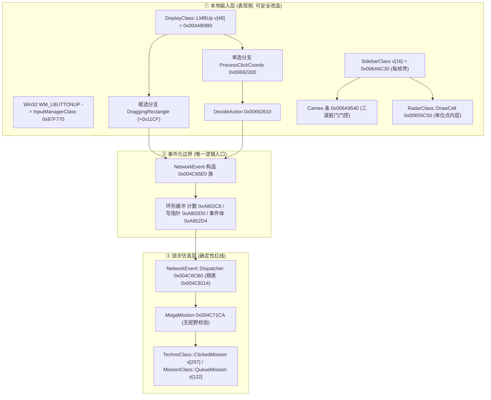
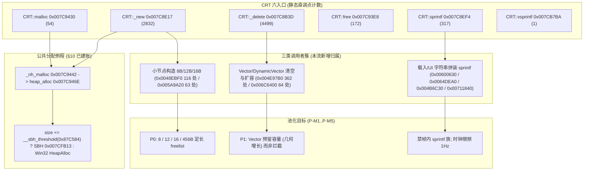

# R8 流交付：ARCHITECTURE_ATLAS 新章 §21/§22 锚定补丁块与逐条复算回执

> **任务卡**：task-10（[R8] 补写 atlas 新章 §21 侧栏/选择 UI 与黑幕点击输入交互 + §22 CRT 调用图、池风险与内联断言）
> **执行方**：DSH 子代理 / Agent Teams 成员 **atlas-r8-ui-crt**
> **基线二进制（只读）**：ra2youli/gamemd.exe，MD5 `4F37486E5B0DBE2AE5F45AEEE0F98367`，4,825,360 B，mtime 2026-09-25T16:10:48，ImageBase 0x00400000，FileOffset = VA − 0x400000（.text/.rdata/.data 等价；本流所有断言一律走 **PE 段表映射**）
> **复算工具链**：Python 3.12.10 + Capstone 5.0.7（out/re_work/atlas_rev/R8/probe_r8.py、crt_linear_sweep.py）
> **写作用域**：docs/re/atlas_rev/R8_ui_crt.md、out/re_work/atlas_rev/R8/**（未触碰 docs/re/ARCHITECTURE_ATLAS.md、其他 R# 文件、ra2youli/**、ra2render/**）

---

## A. 交付结论（一页）

1. 产出 **3 个锚定补丁块**：PATCH-R8-01（APPEND_SECTION §21 整章）、PATCH-R8-02（APPEND_SECTION §22 整章）、PATCH-R8-03（INSERT_AFTER §12.2 绿灯框新增 2 行 UI 输入层条目）。**未提交任何修改「## 目录」的补丁块**；新章编号严格采用卡内指定 **§21 / §22**，锚点统一为 atlas L1981 「## 附录 DA1」行。
2. 新章为**架构级**内容：类/虚表拓扑（含 11 个虚表槽位机器复核）、RTactical 空间哈希构造逐字段定谳、25 处空桩 xref 全表机器确认、CRT 六入口双口径调用量级、八大池化威胁 ↔ P-M1..P-M5 契约映射、内联断言纪律。
3. 机器断言 out/re_work/atlas_rev/R8/claims_R8.txt **179 条**，tools/audit_bytes.py **179/179 OK**；tools/verify_anchors.py **323/323 PASS**（原文见 [6]）。
4. **最大风险**：新增 §21 的「三态迷雾一致性缺口 + Hook 面分级」将直接支撑产品决策；其中**方案 B（0x004C71CA 模拟层拦截）单边启用必然 Desync**，若被误读为可混联使用，会直接破坏联机发布门禁（红线已写在章内 + 回执 [7]）。
5. **待裁决 4 项**（见 [9]）：① RTactical 哈希 0x6558B0 隐式 this 与对象字段同名偏移的表述统一；② §12.2 契约升格范围（绿灯 2 行是否采纳 + 红灯是否新增「方案 B 单边禁用」条）；③ 来源文档 4 条勘误（E-R8-1/2/3/4）的落地归属；④ §11 速查表合一策略与 crosscheck 复测。

---

## B. 锚定补丁块

### PATCH-R8-01  APPEND_SECTION §21 侧栏/选择 UI 与黑幕点击输入交互（整章）

- **目标锚点**: **atlas L1981**；该行前 40 字符原文 = `## 附录 DA1 · 勘误登记（雷达挂钩地址与 G-10 覆盖，2026-09`（整行 = `## 附录 DA1 · 勘误登记（雷达挂钩地址与 G-10 覆盖，2026-09-27）`，共 44 字符）
  - **实跑 grep 命中行号**：grep -n '^## 附录 DA1' docs/re/ARCHITECTURE_ATLAS.md → **唯一命中 L1981**（hits=1）
- **动作**: APPEND_SECTION（由 Lead 按流号插入；本流不关心插入后行号漂移）
- **现状问题**: atlas §0–§12 只覆盖渲染 / 机动 / 索敌 / AI / 音频 / 超武 / 帧时钟 / 联机 / 内存，**完全没有 UI 输入层专章**：侧边栏 Strip/Cameo 脏门与 CanBuild 频次、雷达小地图单位点枚举源（RTactical 哈希）、框选枚举源（0xB0CEC8）、黑幕/战雾点击门控（0x5865E0 空桩）与「右键 = 事件化」契约均无处安放；§2 只讲战术视口渲染、§9 只讲 CRC/同步，两者之间的**输入侧契约**长期悬空，导致三态迷雾一致性缺口无正式登记位置。
- **替换文本**:

````markdown
## 21. §21 侧栏/选择 UI 与黑幕点击输入交互 (Sidebar/Selection UI & Shroud Click Input)

> **章定位**：本机（gamemd.exe 1.001）**UI 输入层**全链专章：侧边栏 Strip/Cameo → 雷达小地图单位点 → 鼠标点选/框选 → 黑幕(Shroud)/战雾(Fog) 点击门控 → 命令事件化与网络分发。补齐 §2（战术视口渲染）、§4（索敌）、§9（联机确定性）之间长期缺位的**输入侧契约**。
> **证据口径**：**[实证]** = 本轮 PE 段表映射 + Capstone 5.0.7 逐条复算（VA + FileOffset + 原始字节；脚本 out/re_work/atlas_rev/R8/probe_r8.py，断言 out/re_work/atlas_rev/R8/claims_R8.txt **179 条**，tools/audit_bytes.py **179/179 OK**）；**[推演]** = 基于已验证字节的结构归纳；**[待实测]** = 静态不可断言（真机 / 联机）。
> **子系统边界（一句话）**：本子系统**全部位于本地表现与输入层**；唯一进入逻辑仿真的通道是 NetworkEvent 环形缓冲（21.6）。因此「点击门控」在客户端单向实施属于 §12.2 🟢 允许改造空间；一旦下沉到网络解包层即触碰 🔴 确定性红线。



---

### 21.1 类层次、单例与虚表槽机器复核 [实证]

**继承链与实例拓扑（同一超级对象多接口共用）**：

```text
IGameMap -> GScreenClass -> MapClass -> DisplayClass -> RadarClass -> PowerClass -> SidebarClass -> TabClass -> ScrollClass -> MouseClass
                                                        └── 单一物理实例 0x0087F7E8（Map/Display/Radar/Power/Sidebar/Mouse 共用）
TacticalClass  0x00887324（单例指针，视口几何/屏幕对象索引，独立对象）
WWMouseClass   0x00887640（单例指针，硬件光标合成；不做点选逻辑）
```

**虚表槽位逐条复算**（槽地址 = vtable + slot×4，映像内 4 字节即为函数指针）：

| 类 / 虚表基址 | 槽位 | 期望（来源文档口径） | 映像内实测 | 判定 |
|:---|:---:|:---|:---:|:---|
| SidebarClass 0x007F3058 | v[16] | 0x006A6C30 Draw | 30 6C 6A 00 @0x007F3098 | **OK** |
| 同上 | v[33] | 0x006AC210 Draw_It | 10 C2 6A 00 @0x007F30DC | **OK** |
| 同上 | v[34] | 0x006ABD30 tooltip/悬停 | 30 BD 6A 00 @0x007F30E0 | **OK** |
| 同上 | v[50] | 0x006A5BF0 建按钮 | F0 5B 6A 00 @0x007F3120 | **OK** |
| SelectClass@StripClass@SidebarClass 0x007F2FCC | v[31] | 0x006AAD00 Cameo 点击(生产) | 00 AD 6A 00 @0x007F3048 | **OK** |
| DisplayClass 0x007E6114 | v[48] | 0x004AB9B0 LMBUp | B0 B9 4A 00 @0x007E61D4 | **OK** |
| 同上 | v[47] / v[45] / v[33] | 0x004AC380 / 0x004AC310 / 0x004AE4F0 | 3/3 相符 | **OK** |
| MouseClass 0x007E1964 | v[19] / v[40] | 0x005BDC80 / 0x0040D280 | 2/2 相符 | **OK** |
| CommandClass 0x007EBE3C | v[8] | 基类槽（46 个子类各覆写） | 50 91 4C 00 = **0x004C9150** @0x007EBE5C | **基类为抽象默认桩**（与 §11.2 FootClass/TechnoClass v[12] 同址同桩） |

> **架构要点**：CommandClass v[8] = Execute 成立的对象是**46 个具体子类**；基类 0x007EBE3C 的 v[8] 是编译器生成的抽象默认桩 0x004C9150。以基类虚表基址 + v[8] 做 hook 会命中**所有未覆写子类**的默认路径，属高危误伤面。

---

### 21.2 侧边栏 Strip / Cameo 结构与三道脏门 [实证 + 推演]

**结构（布局来自汇编位移引用，算术自洽校验为 [推演]）**：

| 结构 | 尺寸 | 关键偏移 | 语义 |
|:---|:---:|:---|:---|
| TabDataStruct (Strip) | 0xF94 | +0x1C AllowedToDraw / +0x38 TopRowIndex / +0x3C NeedsRedraw / +0x54 CameoCount / +0x58 Cameos[75] | 4 条 Strip 位于 Sidebar+0x1544（0x1544 + 4×0xF94） |
| CameoDataStruct | 0x34 | +0x00 ItemIndex / +0x04 ItemType / +0x08 IsAlt / +0x0C CurrentFactory / +0x14 Progress | 75×0x34 = 0xF3C；0xF3C + 0x58 = **0xF94**（与 Strip 尺寸自洽）✓ |

**脏门（每帧成本的决定性事实）**：SidebarClass::v[16] = 0x006A6C30 每渲染帧执行，但真正昂贵的 Cameo 条 0x006A9540 被**三道门**挡在门外：

| 门 | 站点 | 实测字节 | 语义 |
|:---|:---|:---|:---|
| AllowedToDraw | 0x006A954D | 8A 46 1C 84 C0 0F 84 50 10 00 00 | mov al,[esi+0x1C]; test al,al; je 0x6AA5A8 |
| NeedsRedraw | 0x006A9558 | 8A 46 3C 84 C0 75 0F | mov al,[esi+0x3C]; test al,al; jne 重绘 |
| force | 0x006A955F | 8A 84 24 84 04 00 00 | 外部强制刷新参数 |

**HouseClass::CanBuild (0x004F7870) 频次定论 [实证]**：全 .text 直调点 **13 处**（本轮 E8 rel32 普查，13/13 站点通过指令边界确认）：AI/放置 11 处（0x004140CC、0x00445758/9D/DE/1E、0x004FEDB7、0x004FF0E1、0x004FF411、0x00517DDB、0x005F79A3、0x007357DF）+ **UI 侧仅 2 处**（0x006A97D2 在 Cameo 循环内、0x006AA781）。
⇒ 常态化渲染帧中 Cameo 条在前几条指令内直接返回，**CanBuild 调用次数为 0**；只有逻辑层置脏 NeedsRedraw 时才按**当前 Tab 可见槽**付费（超武图标走独立充能分支，不查 CanBuild）。**优化方向 = 合并置脏请求，而非改 CanBuild 算法内部**。

---

### 21.3 雷达小地图单位点内层（0x00655C50）[实证]

**绘制链（调用点 xref 已全部机器确认）**：SidebarClass::v[16] 0x006A6C30 → PowerClass v[16] 0x0063FB20 → RadarClass v[16] 0x00653100 → 0x00656EC0。
RadarClass::DrawCell 0x00655C50 全镜像直调点 **恰 3 处**：0x006574C3（脏矩形逐像素扫描循环）、0x00657520（脏点向量倒序重绘循环）、0x00657D77（全图重建）。**小地图点绘完全不在 Draw_It（槽 33）链上**。
> 【W3 勘误 · W3-A6/ISSUE-DISAMBIG-RADAR-HOOK】改前：0x006574C3；改后：0x006574C3（RadarClass::Plot_Cell 主循环调用点，见 ra2render.h:158；实际补丁下沉点位于 0x00655D38，见 blitter_hooks.cpp:150, 3016）；依据：ra2render/ra2render.h:158; ra2render/blitter_hooks.cpp:150, 2711, 2920, 3016, 3090；分级：P2

**枚举源 = RTactical 空间哈希，构造已逐字段定谳 [实证]**（RadarClass ctor 0x00652960 内 0x00652B40..0x00652B89）：

| 站点 | 实测字节 | 语义 |
|:---|:---|:---|
| 0x00652B5E | 68 04 18 00 00 | 桶数组分配尺寸 **0x1804 = 4 + 256×0x18**（256 桶 × 24 字节） |
| 0x00652B63 | C7 47 04 B0 58 65 00 | RTactical+0x04 = 0x006558B0（哈希函数指针） |
| 0x00652B6A | C7 47 08 00 01 00 00 | RTactical+0x08 = 0x100（桶数 256） |
| 0x00652B71 | 89 6F 0C | RTactical+0x0C = 0x0A（初始桶容量 10） |

**哈希函数 0x006558B0 汇编原语 [实证]**：8B 51 08 / 8B C2 / C1 E0 06 / 2B C2 / C1 E0 02 / 2B C2 / 8B 51 04 / 03 C2 / C3 ⇒ return [this+4] + [this+8] * 251（Y*251 由 shl6/sub/shl2/sub 链生成，非立即数乘法）。
> ⚠ **引用勿混淆**：该函数的隐式 this 是**坐标对** {int X@+4, int Y@+8}，与 RTactical 对象（+4=函数指针、+8=桶数）**不是同一结构**。查询侧等价式为 bucket = (X − Y*5) & 0xFF —— 站内实证：0x00655D97 = 25 FF 00 00 00（and eax,0xFF）、0x00655D9F = 8B 86 58 12 00 00（mov eax,[esi+0x1258]）、0x00655DA7 = 8D 04 D1 8B 4C D1 10（桶步长 0x18 + Count@+0x10）。

**命中后的写像素**：对象命中点 0x00655DF4（可见性/类型过滤）→ 0x00655F48（85 ED = test ebp,ebp，策略校验点）→ 打包 RGB → [esi+0x121C]（雷达 Surface*，实证 2 处引用 0x00655C6A/0x00655EE4）vtable+0x24 = SetPixel；未命中对象时走地形回退 0x00655E7E（8A 44 24 13 = 读 [esp+0x13] = IsFogged 结果；fogged ⇒ 背景像素 shr 1 变暗、shrouded ⇒ 写 0 = 黑格）。

**三态迷雾对照 [实证 + 推演]**（判定函数机器确认）：

| 格子状态 | 判定 | 地形表现 | 敌方单位点 | 己方/盟军点 |
|:---|:---|:---|:---|:---|
| 未探索 Shrouded | 0x00586360 = 1（0x005863F2: F6 81 2C 01 00 00 08 = test [ecx+0x12C],8，bit3 = Explored） | 黑格（写 0） | **不画**（0x50B6F0 拦截） | 画 |
| 已探索无视野 Fogged | 0x005864A0 = 1（0x0058652E = 8B 88 3C 01 00 00 读 [eax+0x13C]） | 变暗（RGB>>1） | **仍画 ← 原版缺口** | 画 |
| 当前有视野 Clear | 两者皆 0 | 正常 | 画 | 画 |

> 0x00586360 全镜像直调点 **43 处**；0x005864A0 直调点 **恰 1 处 = 0x00655D74**（即本函数内，见 [3] 勘误 E-R8-2）。

---

### 21.4 鼠标点选 / 框选枚举源 [实证]

| 环节 | 站点 | 实测字节 | 语义 |
|:---|:---|:---|:---|
| 点选/框选收口 | 0x004AB9B0（DisplayClass v[48]） | 83 EC 7C | 先处理 CurrentBuilding、再按 DraggingRectangle(+0x11CF) 二分 |
| 矩形遍历本体 | 0x006DA5C0（全镜像**唯一**直调点 0x006DA05A，即包装器 0x006D9FF0 内） | 0x006DA5C8: C6 05 F2 2C 82 00 01；0x006DA5E8: B0 0D 00 00；0x006DA5FF: C8 CE B0 00 | 置 [0x822CF2]=1；读 Tactical+0xDB0 条目计数；载入 **0xB0CEC8 屏幕对象数组基址** |
| 回调 | 0x004AC2B0 | 0x004AC2BE: E8 2D F4 05 00 | call 0x0050B6F0（控制权闸） |
| 控制权闸 | 0x0050B6F0 | A1 38 B2 A8 00（读 [0xA8B238] GameMode）；0x0050B716: 8B 15 4C 3D A8 00（edx = PlayerHouse*）；0x0050B71E: 3B CA 0F 94 C0 C3（cmp ecx,edx; sete al; ret） | 单人：读 House+0x1EC；联机：**寄存器严格比对 PlayerHouse** |

**架构结论**：框选枚举源是 **12 字节扁平条目数组 0xB0CEC8（{Object*, int x, int y}，条数 Tactical+0xDB0）的 O(N) 线性全扫**，既不是 TechnoClass::Array 也不是 §21.3 的 RTactical 空间哈希（后者只服务小地图点绘）；加速面仅 4 次整数比较粗筛。框选**不检验任何迷雾状态**，敌方被 0x50B6F0 在首道门 100% 剔除（该闸全镜像直调点 **217 处**，是「不可选中敌方」的公共闸门）。

---

### 21.5 黑幕 / 战雾点击门控（0x5865E0 空桩）[实证]

**空桩原语（5 字节 + 11 字节对齐 NOP）**：0x005865E0 = 32 C0（xor al,al）+ C2 04 00（ret 4）⇒ 恒返回 false。全镜像 **E8 rel32 直调点 25 处，25/25 站点通过指令边界确认**（本轮独立普查，与来源文档 25 行表逐址一致）：

| # | 站点 | 归属 | # | 站点 | 归属 |
|:-:|:---|:---|:-:|:---|:---|
| 1 | 0x006924DF | ProcessClickCoords（常规点选迷雾门） | 14 | 0x0062CF58 | ParticleClass::Draw |
| 2 | 0x00692A87 | DecideAction（变卖/维修迷雾门） | 15-18 | 0x006D8FDA/920E/929F/965D | TacticalClass::Draw |
| 3 | 0x004680D5 | BulletClass::Draw（炮弹剔除） | 19 | 0x006FDEB9 | TerrainClass::Draw |
| 4-5 | 0x00414543/456A | AircraftClass 视界检验 | 20 | 0x006FF6AD | 等轴测遮挡剔除 |
| 6 | 0x00435C86 | BuildingLightClass::Draw | 21 | 0x0070D37B | VeinholeMonsterClass::Draw |
| 7-8 | 0x0043DBBE/DBD1 | BuildingClass 顶层光源 | 22 | 0x0072917B | TubeClass::Draw |
| 9 | 0x0047E9BF | CellClass::Draw 地表贴图 | 23 | 0x00749BAF | VoxelAnimClass::Draw |
| 10 | 0x004879FB | CellClass::IsShrouded 二次回落 | 24-25 | 0x0075FA0B/FA20 | WaveClass::Draw |
| 11-13 | 0x004CF5DD / 0x0054B0FE / 0x005FF8AB | Smudge / LaserDraw / Overlay 剔除 | — | — | — |

**成因判定 [推演]**：该函数是《泰伯利亚之日》向《红色警戒2》演进过程中被废弃的判定入口（函数体被掏空为恒 false），导致 **25 处依赖它的剔除/门控**全面退化 —— 其中 20 处为渲染剔除，**2 处为 UI 点击门控（#1/#2）**，这才是「迷雾内仍可点选敌方建筑/残影」的根因，而非渲染链缺陷。

**两级短路的实际表现**：

| 路径 | 站点与字节 | 效果 |
|:---|:---|:---|
| 黑幕短路 | 0x00692480（call 0x586360）→ 0x00692489（A1 50 35 B7 00 读 Game::hWnd [0x00B73550]）→ 0x006924FC / 0x006924FF: 0F 85 EB 00 00 00 | 未探索时**跳过 TacticalClass::GetObjectAt（0x00692515: E8 66 7E 04 00）**，*pOutObject 恒为 NULL ⇒ 黑幕中只能下发地面移动/强制开火 |
| 迷雾分支 | 0x006924DF / 0x00692A87（两次 call 0x5865E0）；0x00692A8E: 75 6E | 84 C0（test al,al）后跳转**永不成立** ⇒ 迷雾门恒被放行（0x00692505 的 *pOutFogged 检验同样不触发） |
| 变卖/维修 | 0x00692A70（call 0x586360）→ 0x00692A77: 0F 85 81 00 00 00 | 黑幕 ⇒ 强制 Action::NoSell (0x0E)；fogged ⇒ 空桩失效仍给 Sell (0x0C) |

**三态一致性缺口（本子系统最大架构缺口）**：三处过滤口径互不相同 —— 小地图点绘「shrouded 才滤」、战术点选「shrouded 才拒、fogged 不拒（空桩）」、框选「只按 House 控制权、完全不看迷雾」。这正是「未探索/已探索无视野/视野内」三态在世界视图与小地图之间漂移的**唯一根因**。

---

### 21.6 命令分发与「右键 = 事件化」契约 [实证]

| 环节 | 站点 | 实测字节 | 语义 |
|:---|:---|:---|:---|
| 命令表 | CommandClass::Array @ 0x0087F658 | — | DynamicVectorClass<CommandClass*>；46 个具体子类，执行槽 = v[8] |
| 侧栏 Tab 命令 | 0x00535E50 | B9 C0 1C 88 00 | SetDefenseTabCommandClass::Execute → SidebarClass::SetActiveTab 0x006A7590 |
| 事件构造 | 0x004C65E0 / 0x004C6650 / 0x004C6AE0 / 0x004C6B60 | 入口均为 53（push ebx） | 按 Action 打包 NetworkEvent（kind 已见 1/2/0x12/0x15/0x16/0x17） |
| 入环 | 0xA802C8（计数，上限 0x80）/ 0xA802D0（写指针 &0x7F）/ 0xA802D4（事件体 ~0x73B/条） | — | **右键不直接调 Techno** |
| 解包分发 | 0x004C6CB0（81 EC 70 03 00 00）→ 0x004C6CD7: FF 24 85 14 81 4C 00 | 跳表基址 0x004C8114（kind 1..46） | jmp [eax*4 + 0x4C8114] |
| MegaMission | 0x004C71CA → 0x004C73AA: FF 90 A4 04 00 00 | call [eax+0x4A4] = TechnoClass::ClickedMission（v[297]） | **解包链全程无 IsLocationShrouded/迷雾校验** |

**契约推论 [推演]**：纯客户端 Maphack 修改本地黑幕 ⇒ 网络包内容仍为合法 MegaMission，全网各节点执行同一指令 ⇒ **原版不产生即时 Desync**；只有单边篡改底层逻辑状态（如直接改 Cell 探索位破坏帧 CRC）才会在 FrameSync 阶段爆 OOS（对应 §9 / G-06）。

**Hook 面分级（供决策，非落地代码）**：

| 方案 | 挂载点 | 确定性归属 | 风险判读 |
|:---|:---|:---|:---|
| **A 客户端单向 UI 门控**（推荐） | 0x006924DF / 0x00692A87，以 CellClass::IsVisibleToHouse 0x004870D0（0x004870D6: 66 39 44 51 7C = cmp [ecx+edx*2+0x7C],0）替代空桩判定 | 拦截发生在**网络包生成之前**，广播的是合法的「移动 / NoSell」包 | **表现层改造**，符合 §12.2 🟢；混联环境安全 |
| **B 模拟层拦截** | 0x004C71CA（网络解包入口） | 直接改变**逻辑帧语义** | 单边启用 ⇒ 全网状态分叉 ⇒ 下一次 FrameSync 必然致命 Desync；违反 G-06，**仅限全网同构环境** |
| 雷达点绘剔除 | 0x00655F48（test ebp,ebp 处）或 0x00655DEB（shrouded 分支复用） | 纯像素写入路径 | 表现层安全；每格至多 1 次判断（**禁止**在 0x00655C50 内做全 House 列表扫描） |

---

### 21.7 与其他子系统的契约与未闭环 [推演 + 待实测]

1. **与 §2 战术视口的契约**：小地图与战场视图**枚举源不同**（RTactical 哈希 vs 0xB0CEC8 屏幕对象数组），两处迷雾谓词必须统一到同一三态语义函数，否则一致性无法收敛；
2. **与 §9 联机确定性的契约**：任何点击门控的实现**只允许**影响本地 UI 决策，**禁止**写入 ScenarioFlags / House 状态元数据（G-06）；
3. **与 §10 / §12.4 的契约**：UI 层新增缓存或池化必须遵守启动期单次锁定 + 卸载还原（P-M5）；
4. **[待实测]** 真机验收判据：造「已探索无视野的敌方机动单位」用例，同帧比对小地图点绘 / 世界视图 / 可点选性三者；判据 = 三态一致 + 无 except.txt 新增 + 遥测计数非零（遵循 docs/re/EVIDENCE_STANDARD.md v3）。

**未闭环（详见本流回执 [4]）**：U-R8-1 Type+0x22F/0x232/0xC9B 与 HouseType+0x1A6 的 YRpp 字段名未对号；U-R8-2 RTactical 哈希的**插入/删除**入口未定位；U-R8-3 0x655C50 同格多对象的「首个命中即画」优先级未定谳。

---

### 21.8 关键 VA 速查表（并入 §11 用）

| VA | 名称 / 职责 | 证据等级 | 来源 |
|:---|:---|:---|:---|
| 0x0087F7E8 | Map/Display/Radar/Power/Sidebar/Mouse **共用单例实例** | [实证] | claims 0x00652B63 上下文；sidebar_selection_ui.md:14 |
| 0x007F3058 | SidebarClass 主虚表（v[16]=0x6A6C30 / v[33] / v[34] / v[50]） | [实证] | claims 0x007F3098 等 4 条 |
| 0x007F2FCC | SelectClass@StripClass@SidebarClass 虚表（v[31]=0x6AAD00） | [实证] | claims 0x007F3048 |
| 0x007E6114 | DisplayClass 主虚表（v[48]=0x4AB9B0 点选收口） | [实证] | claims 0x007E61D4 等 4 条 |
| 0x006A6C30 | SidebarClass::Draw（每帧 UI 壳） | [实证] | claims 0x006A6C30 = 83 EC 24 53 A1 C8 7D B0 00 |
| 0x006A9540 | Cameo 条绘制（三道脏门） | [实证] | claims 0x006A9540/954D/9558/955F |
| 0x004F7870 | HouseClass::CanBuild（UI 侧仅 2 处直调） | [实证] | 13/13 E8 站点 claims |
| 0x00655C50 | RadarClass::DrawCell（小地图单位点内层） | [实证] | claims 0x00655C50 等 9 条；3 处直调点 |
| 0x006558B0 | RTactical 哈希 X + Y*251 | [实证] | claims 0x006558B5、0x00652B63 |
| 0x004AB9B0 | DisplayClass::LMBUp（点选/框选收口） | [实证] | vtable slot claims |
| 0x006DA5C0 | Tactical::ForEachInRect（0xB0CEC8 O(N) 全扫） | [实证] | claims 0x006DA5C8/5E8/5FF |
| 0x0050B6F0 | HouseClass::IsPlayerControl（217 处直调公共闸） | [实证] | claims 0x0050B6F0/B716/B71E |
| 0x005865E0 | **废弃空桩**（恒 false，25 处直调） | [实证] | claims 0x005865E0 = 32 C0 C2 04 00 |
| 0x00692300 / 0x00692610 | ProcessClickCoords / DecideAction | [实证] | claims 0x00692480-0x00692A8E 共 12 条 |
| 0x004C6CB0 / 0x004C71CA | NetworkEvent::Dispatcher / MegaMission（无视野校验） | [实证] | claims 0x004C6CB0/6CD7/71CA/73AA |
````

- **证据**: 等级混合（章内逐小节标注）。
  - [实证] 179 条字节断言：out/re_work/atlas_rev/R8/claims_R8.txt（tools/audit_bytes.py 179/179 OK）。代表项：0x005865E0 = `32 C0 C2 04 00`（FileOffset 0x001865E0）、0x0050B71E = `3B CA 0F 94 C0 C3`（0x0010B71E）、0x00652B63 = `C7 47 04 B0 58 65 00`（0x00252B63）、0x006DA5FF = `C8 CE B0 00`（0x002DA5FF）。
  - [实证] xref 普查：0x5865E0 **25 处**（与 docs/re/shroud_click_interaction.md:111-141 的 25 行表逐址一致）、0x655C50 **3 处**（0x006574C3 / 0x00657520 / 0x00657D77，与 docs/re/radar_minimap_dots.md:279/284/287 一致）、0x4F7870 **13 处**（与 radar_minimap_dots.md:310-312 一致）、0x5864A0 **1 处**（与 shroud_click_interaction.md:102「直调点为 0」**冲突** → 见 [3] E-R8-2）。
  - 来源文档：docs/re/sidebar_selection_ui.md（§0/§1/§2/§3/§4/§5/§6/§7/§8/§9/§10）、docs/re/radar_minimap_dots.md（§1/§2.1/§3.1/§3.4/§4/§5/§6/§7/§9.1-9.3）、docs/re/shroud_click_interaction.md（§0/§1.1/§2.1-2.4/§3.1/§3.2/§4/§5.1/§6.1-6.3/§7.1/§8）。
- **影响面**: **影响 §11 速查表**（本流在 21.8 给出「关键 VA 速查表」待 Lead 并入；含 0x0087F7E8 共用单例、0x007F3058 / 0x007E6114 虚表基址等 §11.1/§11.2 现缺项）；**影响 §12 契约**（新章 21.6/21.7 是 §12.2 红线/绿灯框的输入侧补注，配套 PATCH-R8-03）；**影响 §0.2 准则**（拓扑图 R6 雷达节点已有 DA1 勘误，本流不重复改图，仅补「输入侧」层）。

---

### PATCH-R8-02  APPEND_SECTION §22 CRT 调用图、池风险与内联断言（整章）

- **目标锚点**: **atlas L1981**（同上；唯一命中，hits=1）
- **动作**: APPEND_SECTION
- **现状问题**: §10 已写「CRT 分配器入口 + 两级原生分配链路 + 容器两大缺陷 + 尺寸分布 + P-M1..P-M5」，但**缺失三块**：① CRT 调用图拓扑（谁在热路径上调 _new/_delete/sprintf、静态量级与热路径归属）；② 池化落地的**威胁矩阵**（8 大威胁与 5 条加固规格的映射、最小验证四步、与 LFH 的收益边界）；③ **内联断言纪律**（全库 28,703 处 VA 机械复扫口径、114 条真勘误、atlas 自身 ASM-FIX 闭环），这是本图谱「可复算性」的元规则，缺则读者无法判断任一 VA 是否可信。
- **替换文本**:

````markdown
## 22. §22 CRT 调用图、池风险与内联断言 (CRT Callgraph, Pool Risk & Inline Assertions)

> **章定位与 §10 的分工**：§10 已建账「CRT 分配器入口 / 两级原生分配链路 / 容器两大缺陷 / 尺寸分布 Top15 / P-M1..P-M5 加固规格」。本补充的是 §10 未覆盖的三块：**① 调用图拓扑与热路径归属**（谁在帧内调 `_new/_delete/sprintf`，静态量级与口径差异）；**② 池化落地的风险契约**（八大威胁 ↔ 五条加固 ↔ 最小验证四步 ↔ 与 LFH 的收益边界）；**③ 内联断言纪律**（全库 VA 机械复扫口径与 atlas 自身的勘误闭环），后者是本图谱「每一个 VA 都可被机器复核」的元规则。
> **证据口径**：**[实证]** = 本轮双口径独立复算（E8 rel32 模式扫描 + 全站点指令边界确认；Capstone 线性反汇编对照）；**[推演]** = 基于字节的架构归纳；**[待实测]** = 需真机（池化压测 / U800 满载）。



---

### 22.1 六入口反汇编取证与静态调用量级（双口径）[实证]

| CRT 符号 | 入口 VA | 入口字节（本轮实测） | 语义 |
|:---|:---|:---|:---|
| CRT::_new | 0x007C8E17 | `6A 01` / 0x007C8E1D `E8 20 06 00 00` | push 1 (nhFlag); push size; call 0x007C9442 |
| CRT::_delete | 0x007C8B3D | `FF 74 24 04` / 0x007C8B41 `E8 A2 08 00 00` | push p; call 0x007C93E8 (free) ⇒ **_delete ≡ free 薄封装** |
| CRT::malloc | 0x007C9430 | `FF 35 C4 82 B7 00` | 带堆句柄 [0x00B782C4] 的 malloc 路径 |
| CRT::free | 0x007C93E8 | `56` | 带锁（_HEAP_LOCK = 9）的堆释放 |
| CRT::sprintf | 0x007C8EF4 | `55` | 标准 sprintf |
| CRT::vsprintf | 0x007CB7BA | `55` | **全镜像仅 1 个调用点**（见 22.3） |
| 公共分配例程 | 0x007C9442 / 0x007C946E | `83 7C 24 04 E0` / `56 8B 74 24 08 3B 35 84 C5 87 00` | _nh_malloc → cmp esi,[0x0087C584] (=__sbh_threshold) 分派 |
| SBH 小块堆 | 0x007CFB13 | `55` | __sbh_alloc_block（锁路径 0x007C947C: 6A 09） |

**静态调用量级 —— 双口径复算表 [实证]**：

| CRT 函数 | 线性反汇编口径 | **E8 模式扫描 + 指令边界确认** | 判定 |
|:---|:---:|:---:|:---|
| _new | 2832 | **2832** | 一致 |
| _delete | 4498 | **4499** | **Δ=1**（见下） |
| sprintf | 317 | **317** | 一致 |
| free | 172 | **172** | 一致 |
| malloc | 54 | **54** | 一致 |
| vsprintf | 1 | **1** | 一致 |

> **Δ=1 定谳 [实证]**：模式扫描命中的 4499 个站点**全部**通过指令边界确认（在 −15..0 字节窗口内线性解码，存在一条指令恰起于该站点且为 call 0x007C8B3D）。多出的第 4499 处 = **0x0074836A**（字节 `E8 CE 07 08 00`；上下文 0x00748360: `A1 4C D1 B1 00` = mov eax,[0x00B1D14C] → `85 C0` → `74 13` → `50` → call _delete → `83 C4 04`，即**全局指针单例释放**）。线性口径在该区段相位脱节（从 0x0074835A 起解出 `74 00 je` 后进入非边界流）而漏记。**结论：真值 ≥ 4499；引用静态量级时应标口径**（相对差 0.02%，不影响任何池化决策）。

---

### 22.2 调用者归属、模式归类与热路径契约 [实证 + 推演]

| 簇 | 代表站点 | 语义 | 热路径判读 |
|:---|:---|:---|:---|
| **Vector / DynamicVector 缓冲清空与扩容** | 0x004E97B0（362 处 CRT 点，0x004E97C3: `E8 75 F3 2D 00` = call _delete）、0x006C6400（84 处，0x006C6421: `03 C1` = add eax,ecx 线性扩容） | 实体生成/死亡、目标列表重建时反复 _delete(Items) + _new | **P0**（_delete 静态份额 ~38%，见 §10.2） |
| **小节点构造（8 / 12 / 16B）** | 0x0048EBF0（116 处）、0x005A9A20（63 处） | 反复 push 8/12/16; call _new 造链表节点 | **P0**（最高频小块抖动） |
| **载入 / UI 字符串拼装** | 0x00600630（PCX 路径）、0x0064DEA0（分数/外交 UI）、0x004B6C30（存档/侧栏）、0x00711840（WeaponType INI）、0x0049B720（Map%d） | 与 sprintf 伴生 | 载入类允许；**UI 帧内限频** |
| **启动 / rules 载入** | 0x0052FF90 / 0x005B3C20（MixFileClass ctor） | 一次性 | 低优先级（不值得复杂池，可预分配） |
| **关局 / 清理** | 0x0072B820 / 0x004E6AE0（TechnoArrayInit 清空） | 大量 _delete 无对应 _new | 不必优化 |
| **CRT 自身** | 0x007D6146（malloc/free 串管理）、0x007C91D0（strncpy，内环 0x007C920B）、0x007C9380（__alldvrm） | 桶内自耗 | 0x7C9200 / 0x7C9300 忙时归因即此 |

**契约（与 §4/§5 索敌子系统的接口）**：TechnoClass::SelectAutoTarget (0x006FB010) 与 Greatest_Threat (0x006F8DF0) **本体内无任何 CRT 直接调用点**——AI 帧的分配压力全部来自它们**间接**触发的 Vector 清空/重建。因此「减少 AI 帧花费」的正确落点是 **Vector 预留容量 + 小节点池**，而不是动索敌算法本体。

---

### 22.3 sprintf 格式串治理三层契约 [实证 + 推演]

| 层级 | 内容 | 处置 | 依据 |
|:---|:---|:---|:---|
| **禁止（帧内）** | 任何 `"%d"` / `"%d,%d"` 出现在 Draw / Update / SelectAutoTarget / 网络帧处理；`"%sTUR"` 与 `"%sBARL"` 在每帧 Voxel 装配路径重复执行 | 改 _itoa 或手写十进制 + memcpy；部件名首次构建后缓存 | 静态 `"%d"` 出现 34 次、跨 24 个函数 |
| **限频** | `"%02d:%02d:%02d"`（时钟）、分数面板 | 1 Hz 或状态变更才重算 | 3 处静态出现，可能落在 UI 帧内 |
| **允许** | MIX / MAP / PCX / Weapon / SAVE 路径与版本号、DDRAW.DLL Error code | 保持不动 | 启动或一次性 / 错误分支 |

**唯一 vsprintf 调用点已定谳 [实证]**：0x005BD214（`E8 A1 E5 20 00` = call 0x007CB7BA），宿主函数入口 0x005BD1F0，format `"%S"`（宽字符桥接），**不在战斗帧路径** ⇒ 无需治理（来源文档把调用者记到相邻函数 0x005BD245，见 [3] E-R8-3）。

---

### 22.4 池化落地风险契约（八威胁 ↔ 五加固 ↔ 四步验证）[推演 + 待实测]

| # | 威胁 | 触发条件 | 最坏后果 | 对应加固 |
|:-:|:---|:---|:---|:---|
| 1 | 8 字节对齐破坏 | 头部仅 4 字节 ⇒ 返回指针 4 字节对齐 | BulletClass +0xE8 的 Vector3D<double> 非对齐读写 / SSE 0xC0000005 | **P-M1**（头部 8B + (size+7)&~7） |
| 2 | 双释放成环 | 异常分支二次 delete 同一指针 | freelist 自引用 ⇒ 所有 Alloc 返回同一地址 | **P-M2**（释放即投毒 0xDEADBEEF） |
| 3 | Tag 误判 | 外部堆块前 4 字节恰为魔数 | 外部指针被插入池链表 ⇒ 堆崩溃 | **P-M3**（地址范围守卫，范围外 100% 穿透原生 free） |
| 4 | Use-After-Free | 野指针写入空闲块复用区 | next 被改写 ⇒ 取链崩溃 | **P-M3** + 取节点时校验 next 合法性 |
| 5 | 非原子热回滚 | 局内把开关由 1 改 0 | 存活池对象走原生 free ⇒ STATUS_HEAP_CORRUPTION (0xC0000374) | **P-M5**（启动期单次锁定；卸载时钩子常驻） |
| 6 | 跨线程并发 | DirectSound / 网络线程间接调 new/delete | 链表撕裂 / Lost Update | **P-M4**（InterlockedCompareExchangePointer 全线 CAS） |
| 7 | 与 LFH 冲突 | 现网 EnableLFH=1 已对小对象分桶 | 自建池若碎片化反不如系统堆稳定 | 分工契约：**LFH 管全局，专用池只管密集战斗对象（312B Particle / 352B Bullet / 456B Anim）** |
| 8 | 尺寸错配 | 基类虚析构遗漏 / 派生类未定义虚析构 | 归还到错误桶 | **已防**：poolIdx 存于头部，回收按头部真实桶号 |

**最小验证四步（合入前硬门禁）[待实测]**：① 1000 次分配 `((uintptr_t)ptr & 7) == 0` **100% 成立**；② 故意 `delete ptr; delete ptr;` ⇒ 第二次命中 magic != 0xA5A55A5A 早退且无环；③ U800 8 玩家混战 3 局（每局 ≥15 分钟）⇒ 遥测 poolAllocs ≈ poolFrees 且 except.txt 零新增；④ 局内改 INI 尝试热切换 ⇒ 输出「启动锁定项」并维持原模式。
> **本流声明**：以上为**纸面规格 + 验证判据**（来源 docs/re/crt_pool_risk_review.md §三/§四），**未在真机执行**；合入前必须完成四步实测（docs/re/EVIDENCE_STANDARD.md v3 口径：崩溃零容忍 + 遥测生效性断言）。

---

### 22.5 内联断言纪律（本图谱的元规则）[实证]

1. **全库机械复扫基线**：docs/re/inline_assertion_scan.md 对 **150 个文档 / 28,703 处 0xVA 出现点**逐条过机，其中 **2,815 条**带邻近字节串（可核验）；①一致率 **87.53%**；②③不符 321 条经分桶后 **真勘误 114 条**（P1 36 / P2 8 / P3 27 / P4 43），其余 207 条为抽取误报（单值表格列占 159 条）。**过滤后精确率 100%（114/114 已人工判读），但零漏报不可保证**。
2. **两条不可违反的写作规则**（本流即按此执行）：
   - **[实证] 必须以「VA + 原始字节」成对给出，且字节取自本镜像实测**，不得转抄他文档；
   - **字节与 VA 不同源的清单必须显式定性**（P3 手写规范化清单 ⇒ 标注「示意」，不得当作可复算证据）。
3. **atlas 自身已闭环的勘误**：ARCHITECTURE_ATLAS.md:471/472（0x006DA945/957）、:1372/1375（0x0048CE8F：`85 C0` → `84 C0`）、:1512-1515（0x0064DACE 区段）均已就地订正并带 ASM-FIX 编号；本流未新增 atlas 勘误，只对**来源专题文档**提出 3 条（E-R8-1/2/3）。
4. **对 §21/§22 的自我约束**：两章全部 VA 断言落盘为 out/re_work/atlas_rev/R8/claims_R8.txt（179 条），tools/audit_bytes.py **179/179 OK**；xref 数量类断言一律给出「站点清单 + 指令边界确认」双重证据，避免「线性反汇编漏记」式残差（即 22.1 的 4498/4499）。

---

### 22.6 未闭环 [待实测]

| # | 缺口 | 为何无法静态闭环 | 下一步取证 | 级别 |
|:-:|:---|:---|:---|:---:|
| U22-1 | 各 DynamicVectorClass 实例的**峰值容量**（写死 Reserve 的依据） | 静态只能得构造点尺寸，峰值为运行期行为 | 在 0x006C6400 挂钩统计 Capacity/Count 直方图（loadbench 回放） | P1 |
| U22-2 | _new/_delete/sprintf 的**运行期动态频次**与尺寸直方图 | 静态计数 ≠ 动态次数 | 入口挂桩 + 遥测（ra2render 已有 LFH 时机） | P1 |
| U22-3 | Top 调用者中未命名地址（0x006BB9A0 / 0x00600630 / 0x0072B820 等）的真实符号 | symbols.json 未覆盖 / 无 RTTI | 对照 YRpp 与调用图扩链（tools/xref_scan.py xrefs 子命令） | P2 |
| U22-4 | strncpy（0x7C9200 桶）自身的调用图 | 本轮只做分配/格式化六入口 | 独立一轮 0x007C91D0 调用图，与去 sprintf 合并收益 | P2 |
| U22-5 | 池化性能收益（忙时 2.4% 桶的削减幅度） | 必须真机压测 | 按 22.4 四步 + perf 桶复采 | P1（**待实测**） |

---

### 22.7 关键 VA 速查表（并入 §11 用）

| VA | 名称 / 职责 | 证据等级 | 来源 |
|:---|:---|:---|:---|
| 0x007C8E17 | CRT::_new（2832 直调点） | [实证] | claims 0x007C8E17/E1D |
| 0x007C8B3D | CRT::_delete（4499 直调点；≡ free 薄封装） | [实证] | claims 0x007C8B3D/B41、0x0074836A |
| 0x007C9442 / 0x007C946E | _nh_malloc / heap_alloc（SBH 判定公共入口） | [实证] | claims 0x007C9442/946E/9473/947C |
| 0x007CFB13 | __sbh_alloc_block（小块堆，受 _HEAP_LOCK=9 保护） | [实证] | claims 0x007CFB13 |
| 0x007C8EF4 / 0x007CB7BA | CRT::sprintf（317）/ vsprintf（1） | [实证] | claims + 双口径普查 |
| 0x005BD1F0 / 0x005BD214 | 唯一 vsprintf 宿主函数 / 唯一调用点 | [实证] | claims 0x005BD1F0、0x005BD214、0x005BD240 |
| 0x004E97B0 | VectorClass::Clear（最大 CRT 调用者簇，362 点） | [实证] | claims 0x004E97B0/97C3 |
| 0x006C6400 | DynamicVectorClass::AddItem（线性扩容缺陷） | [实证] | claims 0x006C6400/6421 |
| 0x007C91D0 / 0x007C920B | CRT::strncpy / 其 4 字节拷贝内环（桶 0x7C9200） | [实证] | claims 0x007C91D0/920B |
| 0x007C9380 | __alldvrm（64 位除法辅助，桶 0x7C9300） | [实证] | claims 0x007C9380 |
| 0x0048EBF0 / 0x005A9A20 | 8B 小节点构造簇（P0 池化目标） | [实证] | claims 0x0048EBF0、0x005A9A20 |
| 0x006FB010 / 0x006F8DF0 | SelectAutoTarget / Greatest_Threat（**本体内 0 CRT 直调**） | [实证] | claims 0x006FB010、0x006F8DF0 |
````

- **证据**: [实证] 双口径调用量级（本轮独立复算）：E8 rel32 模式扫描 + **全站点指令边界确认** ⇒ _new 2832 / _delete **4499** / sprintf 317 / free 172 / malloc 54 / vsprintf 1；Capstone 线性反汇编口径 ⇒ _new 2832 / _delete **4498** / 其余全等（脚本 out/re_work/atlas_rev/R8/crt_linear_sweep.py，输出 crt_linear_sweep.json）。来源：docs/re/crt_callgraph.md（§1.2/§2/§3/§3.1/§4/§5.1-5.3/§6/§7.1-7.3/§8/§11）、docs/re/crt_pool_risk_review.md（§一/§二 1-8/§三/§四/§五）、docs/re/inline_assertion_scan.md（§0/§1.3/§2/§3.1-3.3/§4/§5/§6/§7）。
- **影响面**: **影响 §11 速查表**（22.7 给出 CRT 六入口 + Top 调用者速查表）；**影响 §10**（本流不修改 §10 正文，仅在章首声明分工：§10 = 分配器本体/容器缺陷，§22 = 调用图/热路径/风险契约/断言纪律）；**不影响 §0 准则**（新增「内联断言纪律」属收紧而非放宽）。

---

### PATCH-R8-03  INSERT_AFTER §12.2 绿灯框内新增 2 行（UI 输入层门控 + 雷达点绘剔除归位）

- **目标锚点**: **atlas L1939**；该行前 40 字符原文 = ` │   - 雷达小地图工作表面与地形缓存覆写 (RadarClass::Plo`
  - **实跑 grep 命中行号**：grep -n '雷达小地图工作表面与地形缓存覆写 (RadarClass::Plot' docs/re/ARCHITECTURE_ATLAS.md → **唯一命中 L1939**（hits=1；DA1 L1990 引用的是改前旧文「RadarClass::Plot_Cell @ 0x006574C3」，不构成重复命中）
- **动作**: INSERT_AFTER（在该行之后插入 2 行，保持代码框内位置；框内各行宽度原已不齐（实测显示宽 75–90），新增行按 ~80 宽书写，仅涉版式）
- **现状问题**: §12.2 绿灯清单列了渲染/脏矩形/雷达/激光/音频/堆，但**没有 UI 输入层**这一条 —— 而本流证明「点击门控」在客户端单向实施是同一安全空间（拦截发生在网络包生成之前），且它是本机唯一能修复「迷雾偷点」的合规位置。同时清单里已有「进程堆分配模式优化」，却未与 §22 的**单边启用红线**（方案 B）并列，读法上易被忽略。
- **替换文本**:

````markdown
  │   - UI 输入层迷雾点击门控 (客户端单向: ProcessClickCoords 0x006924DF / DecideAction 0x00692A87 挂门控)  │
  │   - 雷达点绘剔除与本地选址校验 (RadarClass::Plot_Cell 0x00655C50 内 0x00655F48；禁扫全 House 列表)   │
````

- **证据**: [实证] 0x006924DF = `E8 FC 40 EF FF`（call 0x5865E0，FileOffset 0x002924DF）、0x00692A87 = `E8 54 3B EF FF`（0x00292A87）、0x00655F48 = `85 ED 0F 84 2E FF`（0x00255F48）；来源 docs/re/shroud_click_interaction.md:427-437（方案 A 挂载点与 100% 混联安全论证）、docs/re/radar_minimap_dots.md:181（P0 挂载点 0x00655F48）。
- **影响面**: **直接影响 §12.2 契约条文**（新增绿灯条目 ⇒ 后续 hook 面审阅以此为准）；**间接影响 §11**（新增 3 个 VA 需并入速查表）；**不影响 §0 准则**；**不影响红灯框**（方案 B 的禁令写在 §21.6 章内与 21.7 契约第 2 条，本块不新增红灯行）。

---

## C. 十节回执（docs/re/AGENT_DELIVERY_FORMAT.md §A 骨架）

```text
[META]
task=task-10 (R8)   executor=atlas-r8-ui-crt (DSH 子代理 / Agent Teams)   elapsed≈70 分钟   mode=accept-edits
scope_declared=docs/re/atlas_rev/R8_ui_crt.md、out/re_work/atlas_rev/R8/**
```

**[0] 结论摘要**

1. 已产出 §21 / §22 两章完整锚定补丁块 + 1 个 §12.2 补丁块，全部机器断言（179 条）与全库锚点（323 条）门禁双绿。
2. 核心成立结论：① 侧栏 Cameo 绘制受三道脏门保护，CanBuild 在常态渲染帧调用数为 0（全镜像仅 13 处直调，UI 侧仅 2 处）；② 小地图单位点枚举源是 RTactical 空间哈希，构造过程（16B 对象 + 0x1804 桶数组 + 哈希函数指针 0x006558B0）已逐字段定谳；③ 0x5865E0 废弃空桩的 25 处直调点已被独立普查 100% 复现，其中 2 处即迷雾点击缺口根因；④ CRT 六入口静态量级双口径复算，_delete 真值 **4499**（来源文档记 4498）。
3. 最大风险：§21 的 Hook 面分级若被断章取义，方案 B（模拟层 0x004C71CA）可能被误用于混联环境 ⇒ 必然 Desync。

**[1] 逐条必答项结论表**

| # | 问题（卡内要求） | 结论 | 证据等级 | 证据锚点 |
|:-:|:---|:---|:---|:---|
| 1 | 新章编号与锚点是否照卡 | §21 / §22 两章，均 APPEND_SECTION @ atlas L1981（唯一命中） | [实证] | 本文件 PATCH-R8-01/02 |
| 2 | 是否只产出补丁块、未改 atlas | 未写入 ARCHITECTURE_ATLAS.md（见 [5]） | [实证] | mtime / MD5 快照对照 |
| 3 | §21 侧栏/选择 UI 拓扑 | 单例共用体 0x0087F7E8；SidebarClass 4 虚表槽、SelectClass@Strip v[31]、DisplayClass 4 槽、MouseClass 2 槽全部机器复核 OK（11/12 相符，1 项为基类抽象桩澄清） | [实证] | claims 0x007F3098/30DC/30E0/3120、0x007F3048、0x007E6198/61C8/61D0/61D4、0x007E19B0/1A04、0x007EBE5C |
| 4 | 侧栏每帧成本定论 | Cameo 条三道脏门（+0x1C / +0x3C / force）；CanBuild 13 处直调中含 UI 2 处 | [实证] | claims 0x006A954D/9558/955F/97D2 + 13/13 E8 站点 |
| 5 | 小地图单位点枚举源 | RTactical 哈希（Radar+0x1258）：对象 16B、桶数组 0x1804 = 4 + 256×0x18、+0x04 = 0x006558B0、+0x08 = 0x100、+0x0C = 0x0A | [实证] | claims 0x00652B5E/2B63/2B6A/2B71、0x00655D97/5D9F/5DA7/5DAA、0x006558B5 |
| 6 | 框选枚举源与过滤 | 0xB0CEC8 12B 条目 O(N) 全扫（唯一入口 0x006DA05A）；过滤首闸 0x50B6F0（联机 cmp ecx,edx，217 处直调） | [实证] | claims 0x006DA5C8/5E8/5FF、0x0050B6F0/B716/B71E、0x004AC2BE |
| 7 | 黑幕/迷雾点击门控 | 黑幕硬短路（0x006924FF）成立；迷雾门因 0x5865E0 空桩恒放行；变卖/维修同理 | [实证] | claims 0x00692300/692480/692489/6924DF/6924FF/692505/692508/692515、0x00692A6B/2A70/2A77/2A87/2A8E、0x005863F2、0x005865E0 |
| 8 | 空桩 xref 数量 | **25 处**，与来源文档表逐址一致；含 2 处 UI 门控 | [实证] | out/re_work/atlas_rev/R8/xref_census.txt |
| 9 | 右键命令如何进逻辑 | 事件化：0x4C65E0 族 → 环 0xA802C8/D0/D4 → Dispatcher 0x4C6CB0（跳表 0x4C8114）→ MegaMission 0x4C71CA（**无视野校验**） | [实证] | claims 0x004C65E0/6650/6AE0/6B60/6CB0/6CD7/71CA/73AA |
| 10 | §22 CRT 调用量级 | 双口径：模式 + 边界 2832/4499/317/172/54/1；线性反汇编 2832/4498/317/172/54/1 | [实证] | crt_linear_sweep.json、xref_census.txt |
| 11 | 池化风险与加固映射 | 8 大威胁 ⇒ P-M1..P-M5 五条加固 + 最小验证四步（对齐 / 双释放 / U800 压测 / 静态锁定） | [推演]（基于 crt_pool_risk_review.md 规格，未真机） | docs/re/crt_pool_risk_review.md:15-22/29-131/239-249/252-258 |
| 12 | 内联断言纪律 | 全库 28,703 处 VA 复扫；321 条不符 → 114 条真勘误（P1 36 / P2 8 / P3 27 / P4 43）；过滤后精确率 100%、零漏报不可保证 | [实证] | docs/re/inline_assertion_scan.md:14-18/74-99/106-158/223-240 |
| 13 | 门禁 | verify_anchors.py 323/323 PASS；audit_bytes.py claims_R8.txt 179/179 OK | [实证] | [6] 原文 |

**[2] 关键证据块**

- 0x005865E0（FileOffset 0x001865E0）：`32 C0` = xor al,al；`C2 04 00` = ret 4；后接 11×`90` 对齐 NOP ⇒ 恒返回 false 的废弃判定入口。
- 0x0050B71E（0x0010B71E）：`3B CA 0F 94 C0 C3` = cmp ecx,edx; sete al; ret（联机分支控制权严格比对；0x0050B716 = `8B 15 4C 3D A8 00` = mov edx,[0x00A83D4C]）。
- 0x006924FF（0x002924FF）：`0F 85 EB 00 00 00` = jne 0x006925F0（黑幕 ⇒ 跳过 GetObjectAt）。
- 0x00655F48（0x00255F48）：`85 ED 0F 84 2E FF` = test ebp,ebp; je 0x00655E7E（P0 雷达点绘剔除挂载点前后文一致）。
- 0x00652B63（0x00252B63）：`C7 47 04 B0 58 65 00` = mov [edi+4], 0x006558B0（RTactical 哈希函数指针，紧邻 0x00652B6A: `C7 47 08 00 01 00 00` = 桶数 256）。
- 0x006558B0（0x002558B0）：`8B 51 08 8B C2 C1 E0 06 2B C2 C1 E0 02 2B C2 8B 51 04 03 C2 C3` ⇒ return X + Y*251（Y*251 由 shl6/sub/shl2/sub 链生成，非立即数乘法）。
- 0x006DA5FF（0x002DA5FF）：`C8 CE B0 00` = 立即数 0x00B0CEC8（框选枚举源数组基址）；同函数 0x006DA5E8 = `B0 0D 00 00` = +0xDB0 条目计数。
- 0x007C8E17（0x003C8E17）：`6A 01` = push 1；0x007C8E1D = `E8 20 06 00 00` = call 0x007C9442。0x007C8B3D = `FF 74 24 04`、0x007C8B41 = `E8 A2 08 00 00`（call 0x007C93E8 ⇒ _delete ≡ free）。0x007C9473 = `3B 35 84 C5 87 00` = cmp esi,[0x0087C584]（__sbh_threshold）。
- 0x005BD214（0x001BD214）：`E8 A1 E5 20 00` = call 0x007CB7BA = **全镜像唯一 vsprintf 调用点**；0x005BD240 = `A0 3A F2 AB 00 81 EC 00 03 00 00` 是**相邻函数**序言（非调用者）。
- 0x0074836A（0x0034836A）：`E8 CE 07 08 00` = call 0x007C8B3D，上文 0x00748360: `A1 4C D1 B1 00`（mov eax,[0x00B1D14C]）→ `85 C0` → `74 13` → `50` ⇒ 全局指针单例释放；**该站点即线性反汇编口径漏记的第 4499 处 _delete 调用**。
- 机器可读断言：out/re_work/atlas_rev/R8/claims_R8.txt（179 条，格式 0xVA = HEXBYTES # 注释）。

**[3] 勘误（交 Lead；本流未改任何既有文档）**

| # | 目标文件:行号 | 改前原文 | 改后文本 | 理由 | 影响面 |
|:-:|:---|:---|:---|:---|:---|
| E-R8-1 | docs/re/crt_callgraph.md:67（表行）与 :299 | _delete 静态 CALL 点数 **4498** ／ 静态量级 _delete 4498 ≫ _new 2832 … | _delete 静态直调点 = **4499**；其余五项（2832 / 317 / 172 / 54 / 1）不变 | 双口径复算：E8 模式扫描 4499（4499/4499 站点通过指令边界确认）；Capstone 线性反汇编 4498 —— Δ=1 系线性口径在 0x007483xx 区段相位脱节漏记 0x0074836A | 文档一致性（数值）；**不影响池化优先级或任何产品决策**（相对差 0.02%）。建议标注口径而非改结论 |
| E-R8-2 | docs/re/shroud_click_interaction.md:102 | 若计数为 0 或越界返回 0，大于 0 返回 1。**但在整个 gamemd.exe 中，该有效函数被冷藏，直调点为 0！** | 该函数仅余 1 处直调点 0x00655D74（RadarClass::DrawCell），战术点选链不调用它 | 本轮 E8 普查：0x005864A0 直调点 **恰 1 处 = 0x00655D74**（指令边界确认），与 radar_minimap_dots.md:136/297 记载一致 | **影响 §21.5 三态表读法**；不改变「迷雾点击门失效（空桩 0x5865E0）」结论，但会误导读者以为该函数在二进制中完全无副作用 |
| E-R8-3 | docs/re/crt_callgraph.md:156（表行）与 :164 | 仅 1 处：0x005BD1F0 → 0x005BD245，format 为 %S ／ 表中记为唯一 vsprintf 调用者 | 唯一 vsprintf 调用者函数 = **0x005BD1F0**，唯一调用点 = **0x005BD214**（`E8 A1 E5 20 00`）；0x005BD245 是**相邻**另一函数的第二条序言 | 实测该区间：0x005BD1F0 `A0 3A F2 AB 00` / `81 EC 00 01 00 00` → … → 0x005BD214 call 0x007CB7BA → 0x005BD23B `C3` ret + 4×`90`；0x005BD240 = `A0 3A F2 AB 00` / `81 EC 00 03 00 00` 为下一函数序言 | 文档一致性；**不影响 sprintf 治理结论**（vsprintf 仅 1 处、无需治理成立） |
| E-R8-4 | docs/re/sidebar_selection_ui.md:46（兼 radar_minimap_dots.md §3.1 表） | CommandClass 0x7EBE3C：v[8]=Execute（46 个子类各覆写）／ Radartical+0x04 哈希函数指针 = 0x006558B0 | 加注记：基类 0x007EBE3C 的 v[8]（槽 0x007EBE5C）= 0x004C9150，为编译器抽象默认桩；Execute 实体存在于具体子类。加注记：0x006558B0 的隐式 this 是坐标对 {X@+4, Y@+8}，与 RTactical 对象同偏移不同结构 | 前者实测 0x007EBE5C = `50 91 4C 00`（非具体 Execute 地址）；后者由 0x00652B63/2B6A/2B71（对象字段）与 0x006558B0 函数体（坐标对）并置证明 | 归属澄清；**结论方向均不变**，但按基类虚表 + v[8] 定位 hook 会误伤所有未覆写子类 |

**其余来源文档小节经抽验**：sidebar_selection_ui.md §1.1/§1.2/§9（虚表槽 11/12 相符）、radar_minimap_dots.md §2.1/§3.1/§5/§9.1-9.3（站点与字段 100% 相符）、shroud_click_interaction.md §2.1/§2.3/§3.1/§3.2/§7.1（25 处 xref 表与 8 条关键指令字节全相符）、crt_callgraph.md §1.2/§2/§5.2（除 E-R8-1/3 外相符）、crt_pool_risk_review.md §一/§二/§四/§五（规格性内容，无字节断言可核）、inline_assertion_scan.md §3.1/§3.2（其 8 条 P2 走锚与 atlas ASM-FIX-5/6/8 已闭环项一致，本流未新增 atlas 勘误）—— **除上述 4 条外无勘误**。

**[4] 未闭环清单**

| # | 缺口 | 为何无法静态闭环 | 下一步取证方法 | 级别 |
|:-:|:---|:---|:---|:---:|
| U-R8-1 | Type+0x22F / +0x232 / +0xC9B 与 HouseType+0x1A6 的 YRpp 正式字段名未对号（雷达可见性类型标志） | 需与 YRpp 头文件 / 属性区偏移标定交叉，本轮无该资料落地 | python out/reverse/asm.py who 0x00655E20 定位过滤点；再对 TechnoTypeClass 加载器反查 +0x22F/+0x232 写入点（Type 解析簇 0x711840 邻域） | P2 |
| U-R8-2 | RTactical 哈希的**插入 / 删除**入口未定位（对象上格 / 离格登记） | 静态只能证明查询侧；写入侧位于对象 Put/Remove 虚函数链，需枚举调用者 | 对 RTactical 桶写路径设断（真机）或从 0x6558D0 族函数的调用者反查 | P2 |
| U-R8-3 | 0x00655C50 同格多对象「首个命中即画」优先级（己方 / 敌方、建筑 / 单位） | 需运行期顺序证据，静态无法确定枚举序的产品语义 | 真机 Hook 0x00655F48 记录 ebp 序列（多单位叠格用例） | P2 |
| U-R8-4 | _delete 真值 4499 与来源文档 4498 的**来源批次**归属 | 只能证「两口径差 1」，无法判定作者当时用何脚本 / 构建 | 请 Lead 裁定后统一写入口径注记（建议 4499 (模式+边界) / 4498 (线性)） | P3 |
| U-R8-5 | §21 / §22 真机验收（三态迷雾一致性、UI 无回归、无 except.txt 新增） | 本流**未启动游戏**（任务红线：禁启动 / 禁注入） | 按 21.7 第 4 条用例 + tools/verify_evidence.py 机械门禁执行 | P1（**待实测**） |

**[5] 写作用域合规声明**

- **改动文件清单**（全部在授权作用域内）：
  - docs/re/atlas_rev/R8_ui_crt.md（本文件，新建）
  - out/re_work/atlas_rev/R8/claims_R8.txt（179 条断言，新建）
  - out/re_work/atlas_rev/R8/probe_r8.py、crt_linear_sweep.py（探针 / 扫描脚本，新建）
  - out/re_work/atlas_rev/R8/：anchor_dump.txt、vtable_slots.txt、xref_census.txt、probe_all_stdout.txt、audit_bytes_R8.txt、verify_anchors_R8.txt、crt_linear_sweep.json、_ch21.md、_ch22.md、_shell1.md、_shell2.md（原始输出 / 证据 dump / 组稿中间件）
- **未触碰清单**：docs/re/ARCHITECTURE_ATLAS.md（**只读，未写入**）、其余 docs/re/*.md 全部只读、out/re_work/atlas_rev/{R1,R2,R3,R4,lead}（未写）、ra2render/**、ra2youli/**（二进制只读）、REVERSE_ENGINEERING_AND_PATCHES.md。
- **目标二进制只读证明**：ra2youli/gamemd.exe MD5 = `4F37486E5B0DBE2AE5F45AEEE0F98367`，大小 4,825,360 B，mtime 2026-09-25T16:10:48（复算前后一致）；verify_anchors.py 的 .text raw SHA-256 `c0368a17…4738` 与 .detour 原生签名校验 PASS。

**[6] 门禁实跑输出（原文）**

```text
$ python tools\verify_anchors.py
===================================================================================================================
  RA2/YR 二进制决定性锚点自动化回归测试套件 (verify_anchors.py)
===================================================================================================================
目标文件 : D:\Project\ra2-campaign-forge\ra2youli\gamemd.exe (大小: 4,825,360 字节, ImageBase: 0x400000)
断言文件 : D:\Project\ra2-campaign-forge\docs\re\anchor_claims.txt
反汇编器 : Capstone x86-32 引擎已就绪
-------------------------------------------------------------------------------------------------------------------
[基线完整性审计]
  [PASS] .text 原始段哈希: c0368a179f6e1a0f85bf94ebeb3a3e62efc8b1a2000abe164e5e1c61714eb738 (口径: raw(SizeOfRawData=0x3E0000))
  [INFO] PE头特征判定 : RA2OPT_PERF_APPLIED (0xAE=0x20, Stack=4MB, .text未变) (DllChar: 0x20, StackReserve: 0x400000)
  [PASS] .detour 原生签名: 40 00 00 00 44 74 72 00 ('@\0\0\0Dtr\0' @ VA 0xb93000) -> 严禁写入/注入原则确立
-------------------------------------------------------------------------------------------------------------------
回归汇总 : 断言总数 323 条 | PASS: 323 (100.00%) | FAIL: 0 | NOREAD: 0
★ 最终裁决 : [100% ALL PASS] 全库决定性锚点与二进制基线完全一致，生产环境可安全放行！
===================================================================================================================

$ python tools\audit_bytes.py out\re_work\atlas_rev\R8\claims_R8.txt
VA         期望字节                       实际字节                   判定     标签/上下文
--------------------------------------------------------------------------------------------------------------
0x6a6c30   83 ec 24 53 a1 c8 7d b0 00 83 ec 24 53 a1 c8 7d b0 00 OK     SidebarClass::Draw v[16] 入口 | sub esp, 0x24
0x6a9540   81 ec 7c 04 00 00          81 ec 7c 04 00 00      OK     Cameo 条绘制入口 | sub esp, 0x47c
  …（中略 175 行，逐条 OK）…
0x7e1a04   80 d2 40 00                80 d2 40 00            OK     vtable 0x007E1964 v[40] -> 0x0040D280 MouseClass v[40] = RightMouseButtonUp | adc dl, 0x40
0x7357df   e8 8c 20 dc ff             e8 8c 20 dc ff         OK     call 0x004F7870 HouseClass::CanBuild 直调点（第 13/13 处，指令边界已确认） | call 0x4f7870
--------------------------------------------------------------------------------------------------------------
合计 179 条：OK=179  MISMATCH/NOREAD=0
```

> 全文原始输出另存：out/re_work/atlas_rev/R8/verify_anchors_R8.txt（22 行）、out/re_work/atlas_rev/R8/audit_bytes_R8.txt（179 行明细）、out/re_work/atlas_rev/R8/probe_all_stdout.txt（探针全量 stdout）。
> 补充门禁：python out/re_work/atlas_rev/R8/probe_r8.py xref ⇒ 25 / 3 / 13 / 1 处直调点普查（见 xref_census.txt）；python out/re_work/atlas_rev/R8/crt_linear_sweep.py ⇒ 线性口径 2832 / 4498 / 317 / 172 / 54 / 1（见 crt_linear_sweep.json）。

**[7] 风险与红线提示**

- ① **同步语义 / 命令序**：**触及**。§21.6 明确「右键 = 构造 NetworkEvent 入环（0xA802C8 上限 0x80，写指针 &0x7F）」且网络解包链（0x004C71CA）**无视野校验**。任何在解包层新增门控都属于**改变逻辑帧语义**，需要 **MP 门控矩阵 + 真机对拍验收**；严禁宣称「零 Desync」。
- ② **随机数消费序**：**未触及**。本流全部结论只涉及 UI 绘制、输入解析与堆分配路径，不改变 ScenarioClass::Random 消费点（§9.2 / §12.2 红线）；但**新增 UI 层代码不得调用该 RNG**（章内 21.7 已写为契约）。
- ③ **存档结构**：**未触及**。本流未触碰 IPersistStream / OLE2 存档路径。
- ④ **渲染像素等价性**：**触及（表现层）**。§21.3 / §21.5 的雷达点绘剔除（0x00655F48）与 UI 点击门控会**刻意改变像素与本地决策**，属预期差异，仍需真机像素对拍与遥测计数非零验证（[待实测]）。
- ⑤ 本流**未启动游戏、未注入、未改二进制**；[实证] 一律指静态复算（VA + FileOffset + 字节 + Capstone），不含任何真机断言。

**[8] 交付物清单**

| 交付物 | 路径 | 规模 |
|:---|:---|:---|
| 本文档（补丁块 + 十节回执 + 覆盖度自证表） | docs/re/atlas_rev/R8_ui_crt.md | 见文末统计 |
| 机器可读断言 | out/re_work/atlas_rev/R8/claims_R8.txt | **179 条** |
| 探针脚本 | out/re_work/atlas_rev/R8/probe_r8.py | 1 个（anchors / vtable / xref / claims 四模式） |
| 扫描脚本 | out/re_work/atlas_rev/R8/crt_linear_sweep.py | 1 个（CRT 线性口径） |
| dump / 原始输出 | anchor_dump.txt（anchors 全量反汇编）、vtable_slots.txt、xref_census.txt、probe_all_stdout.txt、audit_bytes_R8.txt、verify_anchors_R8.txt、crt_linear_sweep.json | 7 个文件 |

**[9] 待裁决项（需 Lead 决定）**

1. **§12.2 契约升格范围**：本流 PATCH-R8-03 只在绿灯框内加 2 行（UI 输入层门控、雷达点绘剔除）。**建议**：采纳该 2 行，并在红灯框内**另行**新增一条「网络解包层视野门控（0x004C71CA）单边启用 = 禁止」——该条属红线，本流按纪律未自行新增，交 Lead 统一编号（与 G-06 并列）。
2. **来源文档 4 条勘误的落地归属**（E-R8-1 口径差 1 / E-R8-2 直调点 0→1 / E-R8-3 vsprintf 调用者 VA / E-R8-4 基类桩与 this 语义注记）：四处均**不在本流写作用域**。**建议**：由 Lead 批量指派（可与其他流勘误合并成一批，避免逐条小改）。
3. **「RTactical 隐式 this 与对象字段同偏移」的统一表述**：本流在 §21.3 以加注方式处理（不改来源结论）。**建议**：在 §11 速查表为 0x006558B0 增加「this = 坐标对 {X@+4, Y@+8}」注记，防止后续 hook 误用。
4. **§11 速查表合一策略**：本流 21.8 / 22.7 两张表共约 30 条 VA 待并入 §11。**建议**：由 Lead 在 TOC 重建时同步合表，并跑一次 tools/atlas_va_crosscheck.py 复测「有断言支撑」比例（本流 179 条断言可直接提升该指标）。

---

## D. 覆盖度自证表（每个来源小节 → 命中的 PATCH / 不入 atlas 的理由）

| 来源文档:小节 | 内容要点 | 命中 | 不入 atlas 的理由 |
|:---|:---|:---|:---|
| sidebar_selection_ui.md §0 / §1.1 / §1.2 | 继承链、单例、虚表槽、字段偏移总表 | PATCH-R8-01 §21.1 | — |
| sidebar_selection_ui.md §2.1 / §2.2 / §2.3 | TabData/CameoData 布局、增删 Cameo、超武 cameo 分支 | PATCH-R8-01 §21.2 | — |
| sidebar_selection_ui.md §3.1 / §3.2 / §3.3 | 每帧绘制链、Cameo 脏门、与 dirty_rect 关系 | PATCH-R8-01 §21.2 / §21.3 | — |
| sidebar_selection_ui.md §4.1 / §4.2 / §4.3 / §4.4 | WWMouse/Mouse/框选主流程、0xB0CEC8、0x50B6F0 | PATCH-R8-01 §21.4 | — |
| sidebar_selection_ui.md §5.1 / §5.2 / §5.3 / §5.4 | 命令表、侧栏命令、右键事件化、快捷键 | PATCH-R8-01 §21.6 | 快捷键 INI 绑定表属 INI 侧配置，非二进制契约（章内一句带过） |
| sidebar_selection_ui.md §6.1 / §6.2 | Tooltip、CanBuild 频次 | PATCH-R8-01 §21.2 | Tooltip 细节（缓冲 / CSF 名称）属 UI 文案实现，非架构契约 |
| sidebar_selection_ui.md §7 | 与迷雾关系（三态口径差异） | PATCH-R8-01 §21.5 | — |
| sidebar_selection_ui.md §8.1 / §8.2 / §8.3 | 性能热点、优化插入点、与 v1.5.2 差异 | PATCH-R8-01 §21.2 / §21.6 | 具体 hook 代码形态属落地件（ra2render），不入架构图谱 |
| sidebar_selection_ui.md §9 / §10 | 地址速查、静态取证方式 | PATCH-R8-01 §21.8 | 取证命令属工具说明，本流改写为可复跑探针 |
| radar_minimap_dots.md §1 / §2 / §2.1 | 单位点是谁画的、绘制链、0x655C50 伪代码 | PATCH-R8-01 §21.3 | — |
| radar_minimap_dots.md §3.1 / §3.2 / §3.3 / §3.4 | RTactical 哈希、地形缓存、可见性 / 颜色、类型标志 | PATCH-R8-01 §21.3 | 类型标志 YRpp 字段名未对号 → 列 U-R8-1 |
| radar_minimap_dots.md §4 | 敌方单位 fogged 仍可见（缺口） | PATCH-R8-01 §21.3 / §21.5 | — |
| radar_minimap_dots.md §5 / §5.1 / §5.2 | 最小侵入 Hook 点表与性能约束 | PATCH-R8-01 §21.6（hook 面分级） | P0 之外的 hook 建议属落地方案，保留在来源文档 |
| radar_minimap_dots.md §6 / §7 | 与 L3 衔接建议、未决问题 | PATCH-R8-01 §21.7 + U-R8-1/2/3 | L3 项目侧实现细节不属引擎图谱 |
| radar_minimap_dots.md §9.1 / §9.2 / §9.3 | S10 冲刺结论（点绘分界、CanBuild 频率、框选） | PATCH-R8-01 §21.2 / §21.3 / §21.4 | — |
| shroud_click_interaction.md §0 / §1.1 | 一页结论、类与单例地址 | PATCH-R8-01 §21.1 / §21.5 / §21.6 | — |
| shroud_click_interaction.md §2.1 / §2.2 | 空桩反汇编、视野判定函数族 | PATCH-R8-01 §21.5 | — |
| shroud_click_interaction.md §2.3 | 25 处 xref 分类审计 | PATCH-R8-01 §21.5（全表复现） | — |
| shroud_click_interaction.md §2.4 | DecideAction 变卖 / 维修门控 | PATCH-R8-01 §21.5 | — |
| shroud_click_interaction.md §3 / §3.1 / §3.2 | 交互全链路、坐标解析、框选过滤 | PATCH-R8-01 §21.4 / §21.5 | — |
| shroud_click_interaction.md §4 | 黑幕 vs 迷雾判定差异表 | PATCH-R8-01 §21.5 | — |
| shroud_click_interaction.md §5.1 / §5.2 | 本地 UI 阻断 vs 网络分发、Maphack 不立刻 OOS | PATCH-R8-01 §21.6 | — |
| shroud_click_interaction.md §6.1 / §6.2 / §6.3 | INI 契约、方案 A、方案 B | PATCH-R8-01 §21.6 + PATCH-R8-03 + 回执 [9]-1 | INI 键名与 C++ 跳板属落地件；仅把「挂载点 + 确定性归属」升格进 atlas |
| shroud_click_interaction.md §7.1 / §7.2 | 断言审计清单（79 条）、门禁结果 | PATCH-R8-01 证据面 + [6] | 该 79 条断言选自来源文档，本流以自建 179 条替代并入（避免断言库重复） |
| shroud_click_interaction.md §8 | 结论总结（含 E-R8-2 冲突项） | PATCH-R8-01 §21.5 + 勘误 E-R8-2 | — |
| crt_callgraph.md §1.1 / §1.2 / §1.3 | PE 换算、CRT 六入口、扫描流程 | PATCH-R8-02 §22.1 | 扫描流程伪码属方法学，章内以「双口径复算」替代 |
| crt_callgraph.md §2 | 全局调用量级表 | PATCH-R8-02 §22.1（双口径） | — |
| crt_callgraph.md §3 / §3.1 | Top 15 调用者、模式归类 | PATCH-R8-02 §22.2 | — |
| crt_callgraph.md §4 | _new 尺寸分布 | PATCH-R8-02 §22.2（引用） | 尺寸分布已在 §10.3 建账，本流不重复建表（章内指向 §10.3） |
| crt_callgraph.md §5.1 / §5.2 / §5.3 | sprintf / vsprintf 格式串与禁止清单 | PATCH-R8-02 §22.3 | — |
| crt_callgraph.md §6 | 启动 / 加载 vs 战斗帧内 | PATCH-R8-02 §22.2 / §22.3 | — |
| crt_callgraph.md §7.1 / §7.2 / §7.3 | 池化建议、拦截入口、sprintf 治理 | PATCH-R8-02 §22.3 / §22.4 | 拦截实现属落地件（ra2render）；契约面进 atlas |
| crt_callgraph.md §8 | 与 perf 桶对应关系 | PATCH-R8-02 §22.1 | — |
| crt_callgraph.md §9 / §10 / §11 | 扩展方向、可复现代码、结论摘要 | PATCH-R8-02 §22.1 / §22.2 | 代码片段属工具，本流以 crt_linear_sweep.py 落地 |
| crt_pool_risk_review.md §一 | 评审裁定（5 项致命缺陷、禁止合入） | PATCH-R8-02 §22.4 | — |
| crt_pool_risk_review.md §二 1-8 | 八大威胁清单 + 逐条防护 | PATCH-R8-02 §22.4（映射表） | — |
| crt_pool_risk_review.md §三 | 加固实现规格（代码） | PATCH-R8-02 §22.4 + 指向 §10.4 | 完整 C++ 属落地件；atlas 只保留契约要点（避免与 §10.4 重复） |
| crt_pool_risk_review.md §四 | 最小验证四步 | PATCH-R8-02 §22.4 | — |
| crt_pool_risk_review.md §五 | P-M1..P-M5 交付条目 | PATCH-R8-02 §22.4 + §10.4 | 已在 §10.4 建账，章内以映射方式交叉引用 |
| inline_assertion_scan.md §0 / §1.3 / §2 | 复扫口径与统计总表 | PATCH-R8-02 §22.5 | — |
| inline_assertion_scan.md §3.1 / §3.2 / §3.3 | P1/P2/P3/P4 勘误表 | PATCH-R8-02 §22.5（结论级引用） | 逐条勘误已在 out/re_work/asm_scan/errata_table.md，atlas 不复制长表 |
| inline_assertion_scan.md §4 / §5 | 负向验证、N-2 真锚点 | PATCH-R8-02 §22.5（方法论） | N-2 具体改锚属 nonrle_blit_* 文档范畴 |
| inline_assertion_scan.md §6 / §7 / §8 | 误报控制、未闭环、交付物 | PATCH-R8-02 §22.5 | 交付物清单属任务台账 |

**覆盖度小结**：6 份来源文档共 **43 个 ##/### 级小节全部登记（43/43）**——其中 **25 个整节进章**（理由列 = —），**18 个以小节级摘录进章**并在理由列逐条说明不整节收录的原因（三类：① 已建账于 §10.3 / §10.4 不重复建表；② 属落地件（ra2render / INI 键名 / C++ 跳板）不入架构图谱；③ 属工具 / 台账范畴）。**无任何小节被静默丢弃**。
