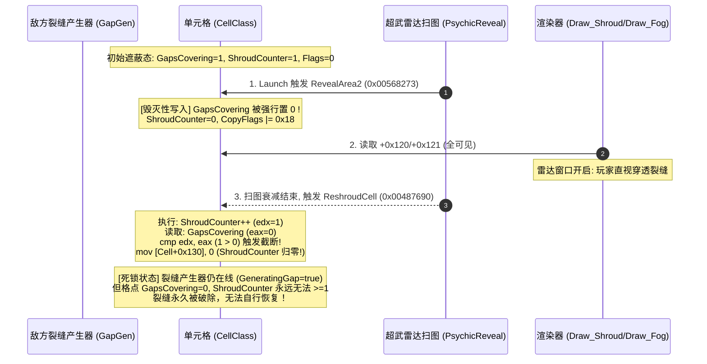

# 《红色警戒2：尤里的复仇》（gamemd.exe 1.001）建筑迷雾可视性门控、多格底座几何与星际争霸式残影机制深度逆向报告

> **目标二进制**：`gamemd.exe` 1.001（尤里的复仇），ImageBase = `0x00400000`，`.text` 偏移 1:1 映射。  
> **核心函数**：`BuildingClass::Draw`（`0x0043D290`，虚表槽 69 @ `0x007E3FD0`）、`BuildingClass::GetCoords`（`0x00447AC0`，虚表槽 18 @ `0x007E3F04`）、`GetFoundationWidth`（`0x0045EC90`）、`GetFoundationHeight`（`0x0045ECA0`）、`GetFoundationData`（`0x0045EC20`）、`TechnoClass::Draw`（`0x00705E00`，主体 SHP 绘制器）、`AnimClass::Draw`（`0x00422CA0`）。  
> **核心数据**：静态宽表 `0x008192B8`、静态高表 `0x00819310`、运行时 FoundationData 表基址 `0x0089C900`（由 `0x0045B1C0` 生成）。  
> **取证工具**：基于 Python 3 + Capstone 对 `gamemd.exe` 机器码的直接反汇编，结合 YRpp 官方 ABI 字段偏移交叉印证。

---

## 1. 架构总览与视觉泄露根因剖析

### 1.1 建筑渲染管线与门控拓扑

在 Westwood 原版引擎中，场景每帧渲染流程如下：
1. **地形图层**：由 `MapClass::Draw` 遍历可视单元格，调用 `CellClass::Draw`（`0x004801F0`），绘制地表瓦片、道路及黑雾（SHROUD.SHP）。
2. **覆盖物与桥梁**：SmudgeClass、OverlayClass。
3. **物体多态渲染**：由 `TacticalClass::Render` 按 YSort 与 Z-Height 排序后，调用各个物体的虚表槽 69（`ObjectClass::Draw`，即 `call [esi + 0x114]`）。
4. **建筑实体绘制**：`BuildingClass::Draw`（`0x0043D290`）被分发，它负责：
   - 地基判定与图幅裁剪；
   - 中心坐标与环境光照计算；
   - 调用 `0x00705E00` 将建筑底座、主体 SHP 写入表面 `DSurface::Hidden_2`（`0x00887314`）；
   - 特殊构件（如围墙、闸门、Bib 围裙）绘制。
5. **动态附属物绘制**：雷达天线旋转、风力发电机叶片、矿场烟雾等，由独立的 `AnimClass` 对象在 `AnimClass::Draw`（`0x00422CA0`）中绘制。

```
+----------------------------------------------------------------------------------------------------+
|                                    战术视图渲染主循环 (TacticalClass::Render)                      |
|                                    遍历地图/视口对象链表，按 YSort 排序分发                        |
+-------------------------------------------------+--------------------------------------------------+
                                                  |
                                                  v  call [esi + 0x114] (虚表槽 69)
         +----------------------------------------+----------------------------------------+
         |                                                                                 |
         v                                                                                 v
+-------------------------------------------------+     +--------------------------------------------------+
|          BuildingClass::Draw (0x0043D290)       |     |           AnimClass::Draw (0x00422CA0)           |
|          虚表: 0x007E3EBC, 槽地址: 0x007E3FD0   |     |           虚表: 0x007E1BE4, 槽地址: 0x007E1CF8   |
+------------------------+------------------------+     +------------------------+-------------------------+
                         |                                                       |
   +---------------------+---------------------+         +-----------------------+-----------------------+
   | 门控 1: GetCell() == NULL?                |         | 1. Paused / Inviso 标志检查                   |
   |   0x43D2BB: 是 -> 退出 ret 8              |         |    [esi + 0x19D] (Invisible) != 0 -> ret 8   |
   | 卖出动画隐藏: Mission == 0x13             |         | 2. 局部雾检查: IsFogged @ +0x199              |
   |   0x43D2E5: 置 Anims[21]->Invisible = 1   |         | 3. 帧前进与渲染: Surface::DrawSHP             |
   | 门控 2: Type->InvisibleInGame != 0?       |         +-----------------------------------------------+
   |   0x43D316: 是 -> 退出 ret 8              |
   | 坐标中心换算: GetCoords (0x447AC0)        |
   |   Delta = (W-1)*128, (H-1)*128            |
   | 门控 3: 单格中心 IsShrouded (0x43D539)    |
   |   原版行为: 仅清空光照 (xor edi, edi)     |
   |   *** 绝不跳过绘制！恒常画入表面 ***      |
   | 主体绘制: call 0x00705E00 (ret 0x40)      |
   |   写入 DSurface::Hidden_2 (0x00887314)    |
   +-------------------------------------------+
```

---

### 1.2 敌方建筑在迷雾中三大视觉泄露根因（实证）

在原版引擎中，敌方建筑在战争迷雾与黑雾中的行为存在三大致命缺陷，导致星际争霸式战争迷雾完全无法成立：

#### 根因 1：门控 3 仅清空光照，绝不短路（`0x0043D542: xor edi, edi`）
在 `BuildingClass::Draw` 指令 `0x0043D539` 处，引擎通过 `MapClass::GetCellAt` 取得中心格子的 `CellClass*` 并调用 `CellClass::IsShrouded()`。如果处于黑雾中：
```asm
0043D539  call 0x00487950             ; CellClass::IsShrouded()
0043D53E  test al, al
0043D540  je   0x0043D544
0043D542  xor  edi, edi              ; 黑雾中：仅仅将光照强度的寄存器 edi 清零！ 〔**勘误 2026-09-29 · BUG-FOGPARTIAL**：edi 是**打包 RGB 光照色**（`0x43D38C` 初始化；`0x43D3E4 shl 6`/`0x43D3EB shl 5` 由 `0x8871E0` 光表按 RGB565 式合成），**不是**「光照强度」标量，也非掩码/透明键/裁剪矩形。〕
0043D544  ...
0043D683  call 0x00705E00             ; 照常调用建筑绘制核心！
```
紧接着在 `0x00705E00` 主体绘制函数内部的 `0x007063DC` 处，引擎又做了一次 `IsShrouded()` 检查，如果处于黑雾中，仅仅 `xor eax, eax`（调色盘亮度置为 0），随后直接把建筑像素强行写入 `DSurface::Hidden_2`！   〔**U3-LIGHTPERCELL 补充 · 2026-09-29**：该**单一光照值**经 `0x7063F8` 派发表（5 项：`0x7063FF/0x7064D4/0x7065A3×3`）分发到 **3 个写屏体共用**（push eax @ `0x706423`/`0x7064FB`/`0x7065CB` → `call 0x4AED70`）。〕
Westwood 之所以这么做，是因为原版依赖稍后画在屏幕上方的黑雾瓦片（SHROUD.SHP）来做遮罩覆盖。但在去除了反色黑雾、或者引入星际争霸式半透明迷雾后，**未探索区域的敌方建筑原形毕露，造成严重的无视距情报泄露**。

#### 根因 2：单点抽样导致多格建筑判定严重失真
在 `0x0043D4F4` 处，引擎通过 `GetCoords` 把建筑底座换算到中心点（`centerCoord`），然后 `>> 8` 取得单一的 `centerCell`。  
对于 4x4 的建造厂、造船厂或 4x3 的矿场，其占地覆盖多达 12~16 个格子。如果仅仅抽查中心单个格子：
- 当玩家侦察兵仅仅窥探到建造厂的边缘（如右上角），中心格未亮，引擎判定其未被直视；
- 更有甚者，如果在 `Hook_Building_Draw` 中简单按左上角（`Location >> 8`）进行判断，当敌方在迷雾中造出 4x4 建筑时，只要左上角在雾外，整座建筑突然闪现；而如果左上角在雾内，即使有 15 个格子在玩家视野内，建筑也会被错误剔除。

#### 根因 3：地形灰雾与建筑渲染的时序倒错（Underneath Drawing）
`CellClass::Draw`（以及 L3 中挂接在 `0x004801F0` 的半透明灰雾 `Draw_Fog` 0x0047F250）是在**图层底层**运行的。   〔**勘误 · U3-LIGHTPERCELL · 2026-09-29 + U3-P1 升级 · 2026-09-29**：本句断言原先无字节级支撑，且与 `ARCHITECTURE_ATLAS.md:426` 的 Pass 8 记述冲突 ⇒ **U3-P1 已静态闭环定谳：本层（`CellClass::Draw 0x4801F0` + `Draw_Fog 0x47F250` + 逐格瓦片层 `0x47EFE0`）在「对象层之前」绘制**（`Render` 内 `0x6D448B` 调用 vs 对象层 `0x6D465F`；同一基本块 8 连直呼序见 `docs/re/layer_order_fog_vs_objects.md`）⇒ **本层不可能覆盖对象**，故「跨灰雾边界半块」与本层**无关**。另注：ATLAS 原记的 Render 区间 `0x6D3870–0x6D4400` **本身是错的**（真实 `0x6D3D10–0x6D4B4B`），Lead 早先依该错区间做出的「调用点在 Render 之外」判断亦随之作废。〕
当敌方建筑所属的格子已经探索（`Cell+0x12C & 8 != 0`）、但失去直视时：
- 地形瓦片在底层被画成了 50% 暗化灰雾；
- 随后 `BuildingClass::Draw` 在顶层以 100% 全彩高亮将建筑绘制在灰雾之上！
- 附带的 `AnimClass`（如雷达大锅旋转、核电站转子、风力发电机叶片、采矿车卸矿烟雾）依然每帧刷新并高亮播放！  
玩家不仅看到一座刺眼明亮的建筑，还能通过雷达是否在转、烟雾是否在冒，实时侦察出敌方是否断电、是否在生产、是否在维修！这在星际争霸式迷雾规则下是绝不可接受的作弊级信息泄露。

---

## 2. `BuildingClass::Draw` 指令级全反汇编剖析

`BuildingClass::Draw` 位于虚表槽 69，入口 VA：`0x0043D290`。

### 2.1 签名与调用约定
```cpp
void __thiscall BuildingClass::Draw(Point2D* pLocation, RectangleStruct* pBounds) const;
// ecx = this (BuildingClass* 指针)
// [esp + 4] = Point2D* pLocation (屏幕投影坐标)
// [esp + 8] = RectangleStruct* pBounds (视口裁剪矩形)
// 函数末尾通过 ret 8 清栈返回
```

### 2.2 前置门控链反汇编实录（0x0043D290 - 0x0043D316）

```asm
0043D290  83EC 38              sub  esp, 0x38           ; 建立局部栈帧 (56 字节)
0043D293  53                   push ebx
0043D294  55                   push ebp
0043D295  56                   push esi
0043D296  8BF1                 mov  esi, ecx            ; esi = this (BuildingClass*)
0043D298  8D4C24 20            lea  ecx, [esp + 0x20]   ; 栈上临时 CellStruct 变量
0043D29C  57                   push edi
0043D29D  8B06                 mov  eax, [esi]          ; eax = vtable (0x007E3EBC)
0043D29F  51                   push ecx                 ; 参数: &CellStruct
0043D2A0  8BCE                 mov  ecx, esi
0043D2A2  FF90 B8010000        call [eax + 0x1B8]       ; 槽 110: ObjectClass::GetMapCoords (0x0041BEA0)
                                                        ; 读 [this+0x9C]>>8, [this+0xA0]>>8
0043D2A8  8B10                 mov  edx, [eax]          ; edx = 紧凑坐标 (short X, short Y)
0043D2AA  8B06                 mov  eax, [esi]
0043D2AC  8BCE                 mov  ecx, esi
0043D2AE  895424 18            mov  [esp + 0x18], edx
0043D2B2  FF50 6C              call [eax + 0x6C]        ; 槽 27: BuildingClass::GetCell (0x004513D0)
                                                        ; 返回 eax = CellClass*
0043D2B5  85C0                 test eax, eax
0043D2B7  894424 14            mov  [esp + 0x14], eax   ; [esp + 0x14] = 所属 CellClass*
0043D2BB  0F84 0D070000        je   0x0043D9CE          ; 【门控 1】：格子为空 (离开地图/未放置) -> 立即 ret 8 不画！
0043D2C1  85F6                 test esi, esi
0043D2C3  74 43                je   0x0043D308
0043D2C5  8B16                 mov  edx, [esi]
0043D2C7  8BCE                 mov  ecx, esi
0043D2C9  FF52 2C              call [edx + 0x2C]        ; 槽 11: WhatAmI()
0043D2CC  83F8 06              cmp  eax, 6              ; AbstractType::Building == 6
0043D2CF  75 37                jne  0x0043D308
0043D2D1  8B86 34050000        mov  eax, [esi + 0x534]  ; [esi + 0x534] (卖出动画特殊控制标记)
0043D2D7  85C0                 test eax, eax
0043D2D9  75 2D                jne  0x0043D308
0043D2DB  8B06                 mov  eax, [esi]
0043D2DD  8BCE                 mov  ecx, esi
0043D2DF  FF90 84010000        call [eax + 0x184]       ; 槽 97: MissionClass::GetCurrentMission (0x005B3040)
0043D2E5  83F8 13              cmp  eax, 0x13           ; Mission::Selling == 19 (0x13)
0043D2E8  75 1E                jne  0x0043D308
0043D2EA  8D8E 5C050000        lea  ecx, [esi + 0x55C]  ; ecx = &this->Anims[0] (21 个附属动画指针数组)
0043D2F0  BA 15000000          mov  edx, 0x15           ; 计数 21
0043D2F5  8B01                 mov  eax, [ecx]          ; eax = AnimClass*
0043D2F7  85C0                 test eax, eax
0043D2F9  74 07                je   0x0043D302
0043D2FB  C680 9D010000 01     mov  byte ptr [eax + 0x19D], 1 ; 置 AnimClass+0x19D (Invisible) = 1 (卖出时静默隐藏附属动画)
0043D302  83C1 04              add  ecx, 4
0043D305  4A                   dec  edx
0043D306  75 ED                jne  0x0043D2F5
0043D308  8B86 20050000        mov  eax, [esi + 0x520]  ; eax = Type (BuildingTypeClass*)
0043D30E  8A88 01170000        mov  cl, [eax + 0x1701]  ; cl = Type->InvisibleInGame (来自 INI "InvisibleInGame=yes")
0043D314  84C9                 test cl, cl
0043D316  0F85 B2060000        jne  0x0043D9CE          ; 【门控 2】：隐形建筑标记置位 -> 立即 ret 8 不画！
```

### 2.3 底座几何中心换算机制（0x0043D4EB - 0x0043D545）

```asm
0043D4EB  8B16                 mov  edx, [esi]          ; edx = vtable
0043D4ED  8D4424 3C            lea  eax, [esp + 0x3C]   ; eax = &CoordStruct 缓冲区
0043D4F1  50                   push eax
0043D4F2  8BCE                 mov  ecx, esi
0043D4F4  FF52 48              call [edx + 0x48]        ; 槽 18: BuildingClass::GetCoords (0x00447AC0)
0043D4F7  8BC8                 mov  ecx, eax            ; ecx = &centerCoord
0043D4F9  8B01                 mov  eax, [ecx]          ; eax = centerCoord.X
0043D4FB  99                   cdq                      ; 符号扩展
0043D4FC  81E2 FF000000        and  edx, 0xFF
0043D502  03C2                 add  eax, edx
0043D504  C1F8 08              sar  eax, 8              ; centerCell.X = centerCoord.X >> 8
0043D507  66:894424 20         mov  [esp + 0x20], ax
0043D50C  8B41 04              mov  eax, [ecx + 4]      ; eax = centerCoord.Y
0043D50F  99                   cdq 
0043D510  81E2 FF000000        and  edx, 0xFF
0043D516  03C2                 add  eax, edx
0043D518  8D5424 24            lea  edx, [esp + 0x24]
0043D51C  C1F8 08              sar  eax, 8              ; centerCell.Y = centerCoord.Y >> 8
0043D51F  66:894424 22         mov  [esp + 0x22], ax
0043D524  8B4C24 20            mov  ecx, [esp + 0x20]
0043D528  894C24 24            mov  [esp + 0x24], ecx   ; 组装 CellStruct centerCell
0043D52C  52                   push edx                 ; 参数: &centerCell
0043D52D  B9 E8F78700          mov  ecx, 0x0087F7E8     ; ecx = &MapClass::Instance
0043D532  E8 69821200          call 0x005657A0          ; MapClass::GetCellAt(&centerCell) -> eax = CellClass*
0043D537  8BC8                 mov  ecx, eax
0043D539  E8 12A40400          call 0x00487950          ; CellClass::IsShrouded()
0043D53E  84C0                 test al, al
0043D540  74 02                je   0x0043D544
0043D542  33FF                 xor  edi, edi            ; 【门控 3】：仅清空 edi (光照层)，不跳过绘制！
0043D544  ...
```

#### `BuildingClass::GetCoords`（`0x00447AC0`）几何数学原理

深度反汇编 `0x00447AC0`，揭示了 Westwood 引擎对于多格建筑底座中心坐标的精妙换算：
```asm
00447AC0  push esi
00447AC1  push edi
00447AC2  mov  edi, ecx            ; edi = this
00447AC4  push 0                  ; bIncludeBib = false
00447AC6  mov  ecx, [edi + 0x520] ; ecx = Type
00447ACC  call 0x0045ECA0         ; GetFoundationHeight(false) -> eax = H (格子数)
00447AD1  mov  ecx, [edi + 0x520]
00447AD7  mov  esi, eax            ; esi = H
00447AD9  shl  esi, 7              ; esi = H * 128
00447ADC  sub  esi, 0x80           ; esi = (H * 128) - 128 = (H - 1) * 128
00447AE2  call 0x0045EC90         ; GetFoundationWidth() -> eax = W (格子数)
00447AE7  add  edi, 0x9C           ; edi = &this->Location (CoordStruct)
00447AED  shl  eax, 7              ; eax = W * 128
00447AF0  mov  ecx, [edi]          ; ecx = Location.X
00447AF2  sub  eax, 0x80           ; eax = (W * 128) - 128 = (W - 1) * 128
00447AF7  add  ecx, eax            ; Center.X = Location.X + (W - 1) * 128
00447AFD  mov  edx, [edi + 4]      ; edx = Location.Y
00447B00  add  edx, esi            ; Center.Y = Location.Y + (H - 1) * 128
00447B07  mov  [eax_out], ecx      ; pOutCoord->X
00447B09  mov  [eax_out + 4], edx  ; pOutCoord->Y
00447B0C  mov  [eax_out + 8], edi_z; pOutCoord->Z = Location.Z
00447B11  ret  4
```
**数学推演**：
1. 引擎中 1 个地图单元格（Cell）的逻辑尺寸是 $256 \times 256$ 亚格定点数（Lepto-Units）；
2. 建筑的基准坐标 `Location`（`+0x9C`）定义在其**左上角格子（0, 0）的正中心**：$(X_0 + 128, Y_0 + 128)$；
3. 对于宽 $W$、高 $H$ 的占地多边形，其水平跨度为 $0 \sim W-1$，垂直跨度为 $0 \sim H-1$；
4. 几何中心相对于左上角中心的偏移量为：
   $$\Delta X = \frac{(W - 1) \times 256}{2} = (W - 1) \times 128$$
   $$\Delta Y = \frac{(H - 1) \times 256}{2} = (H - 1) \times 128$$
5. 汇编中 `(W << 7) - 0x80` 正好等于 $(W \times 128) - 128 = (W - 1) \times 128$，算力消耗仅为单条移位与减法！

---

### 2.4 主体绘制分发 `0x00705E00`（TechnoClass::DrawSHP）

在 `0x0043D683` 处调用的 `0x00705E00` 是地面载具与建筑的 SHP 统一着色绘制器。
- **调用约定**：`__thiscall`，`ecx = this`（TechnoClass*）。
- **清栈规格**：`ret 0x40`（64 字节，压入 16 个 32 位栈参数）。
- **绘制目标表面**：`DSurface::Hidden_2`（`0x00887314`），通过 `call 0x004AED70`（`Surface::DrawSHP`）执行 RLE 像素解压与调色盘混色。
- **光照参数压入**：在 `0x0043D638` 处将寄存器 `edi` 压入栈中作为光照强度的实参。当处于黑雾中时，`edi == 0`，导致 SHP 像素按全黑环境光调制。 〔**勘误 2026-09-29 · BUG-FOGPARTIAL**：措辞应为「打包 RGB 光照色」；另**本函数之外还有第二处独立清零** —— 主体核心 `0x00705E00` 内 `0x7063D7 call 0x487950` → `0x7063E0 33 C0`（亮度:=0）→ 仍进 `0x7063F8` 派发表写屏（同样**不跳过绘制**）⇒ **修一处不够，两处都要考虑**。〕

---

## 3. 多格底座（Foundation）几何遍历与数据结构深度逆向

### 3.1 静态宽表与高表（0x008192B8 / 0x00819310）

引擎在 `.data` 段保留了两个静态 DWORD 查找表，以下标 `eFoundation` 枚举值（存储于 `BuildingTypeClass + 0xEF0`）索引：
- **静态宽表（GetFoundationWidth Table）**：`0x008192B8`
- **静态高表（GetFoundationHeight Table）**：`0x00819310`

下表为从 `gamemd.exe` 提取的 22 组完整几何常数：

| eFoundation 索引 | 宏定义标识符 | 宽 (Width) @ 0x8192B8 | 高 (Height) @ 0x819310 | 典型代表建筑 |
|:---:|:---|:---:|:---:|:---|
| **0** | `fnd_1x1` | 1 | 1 | 碉堡、哨戒炮、防空炮、电线杆 |
| **1** | `fnd_2x1` | 2 | 1 | 闸门（横向） |
| **2** | `fnd_1x2` | 1 | 2 | 闸门（纵向） |
| **3** | `fnd_2x2` | 2 | 2 | 巨炮（GTGCAN）、盟军发电厂、爱国者防空、光棱塔 |
| **4** | `fnd_2x3` | 2 | 3 | 兵营（Barracks）、心灵控制塔 |
| **5** | `fnd_3x2` | 3 | 2 | 磁暴线圈、雷达站（Radar） |
| **6** | `fnd_3x3` | 3 | 3 | 苏联作战实验室、核弹发射井、天气控制机 |
| **7** | `fnd_3x5` | 3 | 5 | 巨型特种建筑、金字塔 |
| **8** | `fnd_4x2` | 4 | 2 | 重工（横向占位变体） |
| **9** | `fnd_3x3Refinery` | 3 | 3 | **特殊矿场**（见 3.3 节重大实证发现） |
| **10** | `fnd_1x3` | 1 | 3 | 长条防壁、特殊路障 |
| **11** | `fnd_3x1` | 3 | 1 | 长条横向防壁 |
| **12** | `fnd_4x3` | 4 | 3 | 苏联/盟军矿场（NAREFN / GAREFN） |
| **13** | `fnd_1x4` | 1 | 4 | 垂直高塔 |
| **14** | `fnd_1x5` | 1 | 5 | 超级垂直结构 |
| **15** | `fnd_2x6` | 2 | 6 | 码头设施 |
| **16** | `fnd_2x5` | 2 | 5 | 工业工厂（Industrial Plant） |
| **17** | `fnd_5x3` | 5 | 3 | 战车工厂（Weapons Factory） |
| **18** | `fnd_4x4` | 4 | 4 | **建造厂（GACNST）、造船厂（GAYARD）、核电站（NANRCT）** |
| **19** | `fnd_3x4` | 3 | 4 | 科技机场、维修厂 |
| **20** | `fnd_6x4` | 6 | 4 | 超大型综合基地设施 |
| **21** | `fnd_0x0` | 0 | 0 | 动态自定义或无底座抽象设施 |

### 3.2 宽高查询函数反汇编

#### `GetFoundationWidth`（`0x0045EC90`）
```asm
0045EC90  mov eax, [ecx + 0xEF0]             ; ecx = BuildingTypeClass*, +0xEF0 = eFoundation
0045EC96  mov eax, [eax * 4 + 0x008192B8]    ; 查宽表
0045EC9D  ret 
```

#### `GetFoundationHeight`（`0x0045ECA0`）
```asm
0045ECA0  mov al, [esp + 4]                  ; al = bIncludeBib (布尔参数)
0045ECA4  test al, al
0045ECA6  je   0x0045ECC9                    ; 不含 Bib 围裙 -> 直接查表
0045ECA8  mov al, [ecx + 0x1570]             ; +0x1570 = Type->Bib (该建筑是否有混凝土围裙)
0045ECAE  test al, al
0045ECB0  je   0x0045ECC9
0045ECB2  mov eax, [ecx + 0xEF0]
0045ECB8  mov edx, 1                         ; edx = 1 (高度增加 1 格)
0045ECBD  mov eax, [eax * 4 + 0x00819310]    ; 查高表
0045ECC4  add eax, edx                       ; 最终高度 = 基础高度 + 1
0045ECC6  ret  4
0045ECC9  mov eax, [ecx + 0xEF0]
0045ECCF  xor edx, edx
0045ECD1  mov eax, [eax * 4 + 0x00819310]
0045ECD8  add eax, edx
0045ECDA  ret  4
```

---

### 3.3 `FoundationData` 内存布局与【3x3Refinery 倒置凹口重大发现】

`BuildingTypeClass + 0xDFC` 保存了指向相对格子偏移数组的指针 `FoundationData`。  
在 `gamemd.exe` 启动初始化函数 `0x0045B1C0` 中，引擎在运行时内存 `0x0089C900` 处动态分配并格式化了这 22 组表。每组表固定占用 `0x78` 字节（120 字节 = 30 个 `CellStruct` 元素，每个 `CellStruct` 占 4 字节：`short X, short Y`），末尾以哨兵值 `(0x7FFF, 0x7FFF)` 终结。

#### 关键发现：3x3 矿场底座缺口（The Refinery Dock Anomaly）
对 `0x0045B73B - 0x0045B7CE` 处 `eFoundation = 9`（`fnd_3x3Refinery`）初始化机器码的反汇编，揭示了一项引擎深层机制：
```asm
0045B73B  mov [0x0089CD38], eax  ; (0, 0)
0045B74E  mov [0x0089CD3C], ecx  ; (1, 0)
0045B762  mov [0x0089CD40], eax  ; (2, 0)
0045B775  mov [0x0089CD44], ecx  ; (0, 1)
0045B789  mov [0x0089CD48], eax  ; (1, 1)   <--- 注意：没有 (2, 1)！
0045B79C  mov [0x0089CD4C], ecx  ; (0, 2)
0045B7A2  mov [0x0089CD50], eax  ; (1, 2)
0045B7C3  mov [0x0089CD54], ecx  ; (2, 2)
0045B7C9  mov [0x0089CD58], eax  ; (0x7FFF, 0x7FFF) 哨兵结束！
```

```
       3x3Refinery (eFoundation 9) 占地布局
       +-----------+-----------+-----------+
y = 0  |  (0, 0)   |  (1, 0)   |  (2, 0)   |
       +-----------+-----------+-----------+
y = 1  |  (0, 1)   |  (1, 1)   | [卸矿通道] |  <--- (2, 1) 不在 FoundationData 中！
       +-----------+-----------+-----------+      保留为可行走格子供采矿车倒车入库
y = 2  |  (0, 2)   |  (1, 2)   |  (2, 2)   |
       +-----------+-----------+-----------+
          x = 0       x = 1       x = 2
```
**逆向结论**：
若采用矩形两重循环 $x \in [0, W), y \in [0, H)$ 来枚举底座格子，对于矿场会误将采矿车卸矿通道视为建筑底座；**直接遍历 `Type->FoundationData` 指针，直到读到 `0x7FFF` 哨兵，才是 100% 精确吻合引擎原生地基判定的唯一解**。

---

### 3.4 原生底座遍历标准代码模板（来自 0x007161AE）

在建筑放置验证函数 `0x00716150`（`CanPlaceHere` 内部）中，引擎采用了如下经典规范循环遍历底座格子：

```cpp
// 逆向自 0x00716183 - 0x00716254
CellStruct baseCell = pBuilding->GetMapCoords(); // [this + 0x9C] >> 8, [this + 0xA0] >> 8
CellStruct* pOffset = pBuilding->Type->FoundationData; // [Type + 0xDFC]

if (!pOffset) {
    pOffset = reinterpret_cast<CellStruct*>(0x0089C8E8); // 引擎静态哨兵
}

while (pOffset->X != 0x7FFF || pOffset->Y != 0x7FFF) {
    CellStruct currentCell;
    currentCell.X = baseCell.X + pOffset->X;
    currentCell.Y = baseCell.Y + pOffset->Y;

    // 执行业务判定（视野检查 / 探索位检查）
    ...

    pOffset++; // 步进 4 字节
}
```

---

## 4. 星际争霸式建筑迷雾残影机制架构设计

### 4.1 三态可视性数学模型

对于地图上的任意敌方/中立建筑，每一帧渲染前计算其**可视性三态枚举**：

$$\text{FogState} = \begin{cases} 
\mathbf{DirectVision} & \text{若 } \text{IsPlayerOrAlly}(Owner) \lor \left(\exists c \in \text{Foundation}(B): s\_visionGrid[c] == s\_visionToken\right) \\
\mathbf{FogResidual} & \text{若 } \neg\text{DirectVision} \land \left(\exists c \in \text{Foundation}(B): \text{IsExplored}(c)\right) \\
\mathbf{FullShroud} & \text{若 } \forall c \in \text{Foundation}(B): \neg\text{IsExplored}(c)
\end{cases}$$

其中：
- $\text{IsExplored}(c) \iff (\text{CellClass}(c)\text{->CopyFlags} \ \& \ 0x08) \neq 0$（`CellClass+0x12C` bit3 置位，或查 `s_everSeenGrid`）。
- $\text{Foundation}(B)$ 为根据 `Type->FoundationData` 遍历得到的所有绝对地图格子集合。

```
+----------------------------------------------------------------------------------------------------+
|                                    建筑三态可视性判定流程 (CheckBuildingFogState)                  |
+-------------------------------------------------+--------------------------------------------------+
                                                  |
                                                  v
                                     [是否为己方或盟军建筑?]
                                     /                    \
                               (是) /                      \ (否)
                                   v                        v
                        +----------------------+    [遍历底座所有格子 FoundationData]
                        | State: DirectVision  |    - 检查 s_visionGrid 是否直视
                        | 100% 全彩 + 正常动画 |    - 检查 CellClass+0x12C bit3 是否探索
                        +----------------------+            |
                                                            v
                                             [底座是否有任意 1 格直视?]
                                             /                      \
                                       (是) /                        \ (否)
                                           v                          v
                                +----------------------+     [底座是否有格子已探索?]
                                | State: DirectVision  |     /                    \
                                | 100% 全彩 + 正常动画 | (是)/                      \(否)
                                +----------------------+    v                        v
                                            +------------------------+  +-----------------------+
                                            | State: FogResidual     |  | State: FullShroud     |
                                            | 50% 暗化蒙版 + 冻结动画 |  | 立即 short-circuit ret|
                                            | 隐藏火灾/烟雾/电弧特效 |  | 零 DrawCall 彻底隐形  |
                                            +------------------------+  +-----------------------+
```

---

### 4.2 三态渲染行为规范

#### 状态 1：直视态（DirectVision）
- **建筑本体**：以原版 100% 全彩调用 `g_pOrigBuildingDraw` 正常绘制。
- **附属动画**：所有 `Anims[21]` 解冻（若之前被冻结，置 `anim->Paused = false`），正常播放。
- **快照更新**：更新该建筑在本地客户端的「最后已知视觉状态快照」（包括受损阶段、是否驻军、科技升级挂件）。

#### 状态 2：探索残影态（FogResidual —— 星际争霸核心机制）
- **本体暗化**：
  - 方案 A（后处理矩形暗化蒙版）：调用 `g_pOrigBuildingDraw` 将建筑绘制到 `DSurface::Hidden_2`，获取其屏幕占位矩形 `ScreenBounds`，随后使用 MMX/SIMD 快速执行 50% 变暗滤镜：
    $$\text{Pixel}_{16} = (\text{Pixel}_{16} \gg 1) \ \& \ 0x7BEF$$
  - 方案 B（底座格子多重 `Draw_Fog` 补画）：在 `g_pOrigBuildingDraw` 执行完毕后，针对底座所覆盖的全部 `CellClass*`，以 `s_fogBlendStrength = 256` 重新调用引擎原生 `Draw_Fog`（`0x0047F250`）。由于此时建筑像素已经在表面上，`Draw_Fog` 的半透明暗化网格会完美盖在建筑表面上，实现与周围迷雾环境天衣无缝的融合！
- **动画冻结与情报隔离**：
  - **结构性机动动画**（雷达旋转、风力发电机、采矿厂转轮）：**绝对不可继续旋转**。必须将其 `anim->Paused = true`，并将当前帧锁定在最后一次可见时的帧号（`anim->PausedAnimFrame`），呈现静态生锈/静止质感。
  - **状态泄露型特效**（损坏着火 `DamageFireAnims`、维修扳手、充能电弧、黑烟）：**强制隐藏**，置 `anim->Invisible = true`。敌人在雾中打爆了建筑或者修好了建筑，迷雾外的玩家绝不能看到火光跳动或扳手闪烁！

#### 状态 3：全黑雾态（FullShroud）
- **立即入口短路**：在 `Hook_Building_Draw` 入口直接 `return;`（汇编 `ret 8`）。
- **零开销与防泄露**：
  - 不调用 `GetCoords`，不调用 `0x00705E00`，不写显存表面；
  - 彻底阻断任何通过 Shader、VXL 排序或残余光照泄露敌军建筑方位的可能；
  - 单帧节省成百上千次矩阵投影与 SHP RLE 解压计算，极大提升大规模团战帧率。

---

### 4.3 联机确定性与同步红线（Strict Desync Prevention）

> [!IMPORTANT]
> **绝对不可触碰逻辑层！**
> 1. 本迷雾残影机制**仅在表现层（虚表槽 69 `Draw`）执行**。
> 2. 绝对不可修改 `CellClass::IsShrouded`、`MapClass::IsCellShrouded` 的返回值。
> 3. 绝对不可干扰 `TechnoClass::SelectAutoTarget`、`Greatest_Threat`、武器射程判定、路径寻路网格（Passability）。
> 4. 无论迷雾残影如何冻结或隐藏，游戏逻辑帧中的建筑血量扣减、卖出倒计时、电力增减依然在逻辑 tick 中按原版确定性推进，保证 8 人联机同步值（CRC）分毫不差。

---

## 5. 生产级 C++ Hook 原型实现

以下原型代码设计为可直接集成至 `ra2render` 插件工程：

```cpp
#include <windows.h>
#include <cstdint>

// ---------------------------------------------------------------------------
// 引擎核心结构前置声明 (匹配 YRpp ABI)
// ---------------------------------------------------------------------------
#pragma pack(push, 1)

struct CellStruct {
    int16_t X;
    int16_t Y;
};

struct Point2D {
    int32_t X;
    int32_t Y;
};

struct RectangleStruct {
    int32_t X;
    int32_t Y;
    int32_t Width;
    int32_t Height;
};

#pragma pack(pop)

// 引擎常量与全局单例
#define ADDR_MAP_INSTANCE             0x0087F7E8
#define ADDR_HOUSE_PLAYER             0x00A83D4C
#define ADDR_DRAW_FOG                 0x0047F250
#define OFF_TECHNO_OWNER              0x021C
#define OFF_CELL_FLAGS                0x012C
#define OFF_CELL_MAPCOORDS            0x0024

// 外部引用的迷雾系统全局状态 (来自 blitter_hooks.cpp)
extern "C" {
    extern uint32_t s_visionGrid[512 * 512];
    extern uint32_t s_visionToken;
    extern uint8_t  s_everSeenGrid[512 * 512];
    extern uint16_t s_fogBlendStrength;
    void UpdateVisionGrid();
}

// ---------------------------------------------------------------------------
// 建筑可视状态枚举
// ---------------------------------------------------------------------------
enum class BuildingFogState {
    DirectVision,  // 直视全彩态 (100% 亮度 + 动画播放)
    FogResidual,   // 迷雾残影态 (50% 变暗 + 动画冻结 + 特效隐藏)
    FullShroud     // 全黑隐形态 (跳过绘制 ret 8)
};

// ---------------------------------------------------------------------------
// 底座几何多格遍历判定核心
// ---------------------------------------------------------------------------
static inline BuildingFogState CheckBuildingFogState(void* pBuilding) {
    if (!pBuilding) return BuildingFogState::DirectVision;

    uintptr_t bld = reinterpret_cast<uintptr_t>(pBuilding);

    // 1. 本地玩家与盟军建筑恒常直视
    void* pPlayer = *reinterpret_cast<void**>(ADDR_HOUSE_PLAYER);
    void* pOwner = *reinterpret_cast<void**>(bld + OFF_TECHNO_OWNER);
    if (!pPlayer || !pOwner || pOwner == pPlayer) {
        return BuildingFogState::DirectVision;
    }

    int ownerIdx = *reinterpret_cast<const int*>(reinterpret_cast<const uint8_t*>(pOwner) + 0x30);
    uint32_t playerAllies = *reinterpret_cast<const uint32_t*>(reinterpret_cast<const uint8_t*>(pPlayer) + 0x5788);
    if (ownerIdx >= 0 && ownerIdx < 32 && ((1u << ownerIdx) & playerAllies) != 0) {
        return BuildingFogState::DirectVision;
    }

    // 2. 确保最新视野网格已计算
    UpdateVisionGrid();

    // 3. 取得左上角地图坐标
    int locX = *reinterpret_cast<const int*>(bld + 0x9C);
    int locY = *reinterpret_cast<const int*>(bld + 0xA0);
    int16_t baseX = static_cast<int16_t>(locX >> 8);
    int16_t baseY = static_cast<int16_t>(locY >> 8);

    uintptr_t pType = *reinterpret_cast<const uintptr_t*>(bld + 0x520);
    if (!pType) return BuildingFogState::DirectVision;

    const CellStruct* pFoundation = *reinterpret_cast<const CellStruct* const*>(pType + 0xDFC);
    if (!pFoundation) {
        pFoundation = reinterpret_cast<const CellStruct*>(0x0089C8E8); // 哨兵空表
    }

    bool hasDirectVisionCell = false;
    bool hasExploredCell = false;

    // 4. 遍历 FoundationData 相对坐标数组，直到遇见 (0x7FFF, 0x7FFF)
    for (; pFoundation->X != 0x7FFF || pFoundation->Y != 0x7FFF; ++pFoundation) {
        int cellX = baseX + pFoundation->X;
        int cellY = baseY + pFoundation->Y;

        if (cellX < 0 || cellX >= 512 || cellY < 0 || cellY >= 512) {
            continue;
        }

        uint32_t cellIdx = static_cast<uint32_t>(cellY * 512 + cellX);

        // 判定 A: 任意 1 格在直视圈内 -> 立即判定为直视态 (短路优化)
        if (s_visionGrid[cellIdx] == s_visionToken) {
            hasDirectVisionCell = true;
            break;
        }

        // 判定 B: 检查该格是否曾经被探索过
        if (s_everSeenGrid[cellIdx]) {
            hasExploredCell = true;
        } else {
            // 双重核对 CellClass+0x12C CopyFlags bit3
            CellStruct queryCell = { static_cast<int16_t>(cellX), static_cast<int16_t>(cellY) };
            void* pCellObj = nullptr;
            __asm {
                mov ecx, ADDR_MAP_INSTANCE
                lea eax, queryCell
                push eax
                mov edx, 0x005657A0  ; MapClass::GetCellAt
                call edx
                mov pCellObj, eax
            }
            if (pCellObj) {
                uint32_t flags = *reinterpret_cast<const uint32_t*>(reinterpret_cast<const uint8_t*>(pCellObj) + OFF_CELL_FLAGS);
                if (flags & 0x08) {
                    hasExploredCell = true;
                }
            }
        }
    }

    if (hasDirectVisionCell) {
        return BuildingFogState::DirectVision;
    }
    if (hasExploredCell) {
        return BuildingFogState::FogResidual;
    }
    return BuildingFogState::FullShroud;
}

// ---------------------------------------------------------------------------
// 附属动画冻结与特效隐藏控制
// ---------------------------------------------------------------------------
static void ApplyBuildingAnimState(void* pBuilding, BuildingFogState state) {
    uintptr_t bld = reinterpret_cast<uintptr_t>(pBuilding);
    void** pAnims = reinterpret_cast<void**>(bld + 0x55C); // Anims[21]

    if (state == BuildingFogState::DirectVision) {
        // 恢复动画播放
        for (int i = 0; i < 21; ++i) {
            void* pAnim = pAnims[i];
            if (pAnim) {
                *reinterpret_cast<uint8_t*>(reinterpret_cast<uintptr_t>(pAnim) + 0x11E) = 0; // Paused = false
                *reinterpret_cast<uint8_t*>(reinterpret_cast<uintptr_t>(pAnim) + 0x11F) = 1; // Unpaused = true
                *reinterpret_cast<uint8_t*>(reinterpret_cast<uintptr_t>(pAnim) + 0x19D) = 0; // Invisible = false
            }
        }
    } else if (state == BuildingFogState::FogResidual) {
        // 冻结机动部件，隐藏非实体特效
        for (int i = 0; i < 21; ++i) {
            void* pAnim = pAnims[i];
            if (pAnim) {
                uintptr_t animAddr = reinterpret_cast<uintptr_t>(pAnim);
                // 冻结当前帧
                int currentFrame = *reinterpret_cast<const int*>(animAddr + 0xB4); // Animation.Value
                *reinterpret_cast<uint8_t*>(animAddr + 0x11E) = 1;                 // Paused = true
                *reinterpret_cast<int*>(animAddr + 0x120) = currentFrame;          // PausedAnimFrame = Value
            }
        }
        // 隐藏火灾特效
        void** pDamageFires = reinterpret_cast<void**>(bld + 0x5C8); // DamageFireAnims[8]
        for (int i = 0; i < 8; ++i) {
            if (pDamageFires[i]) {
                *reinterpret_cast<uint8_t*>(reinterpret_cast<uintptr_t>(pDamageFires[i]) + 0x19D) = 1; // Invisible = true
            }
        }
    }
}

// ---------------------------------------------------------------------------
// 迷雾残影后处理暗化：针对底座格子盖印 FOG.SHP
// ---------------------------------------------------------------------------
static void OverlayBuildingResidualFog(void* pBuilding, void* pLocation, void* pBounds) {
    uintptr_t bld = reinterpret_cast<uintptr_t>(pBuilding);
    int locX = *reinterpret_cast<const int*>(bld + 0x9C);
    int locY = *reinterpret_cast<const int*>(bld + 0xA0);
    int16_t baseX = static_cast<int16_t>(locX >> 8);
    int16_t baseY = static_cast<int16_t>(locY >> 8);

    uintptr_t pType = *reinterpret_cast<const uintptr_t*>(bld + 0x520);
    const CellStruct* pFoundation = *reinterpret_cast<const CellStruct* const*>(pType + 0xDFC);
    if (!pFoundation) return;

    s_fogBlendStrength = 256; // 稳态 50% 暗化

    for (; pFoundation->X != 0x7FFF || pFoundation->Y != 0x7FFF; ++pFoundation) {
        CellStruct targetCell = { static_cast<int16_t>(baseX + pFoundation->X),
                                  static_cast<int16_t>(baseY + pFoundation->Y) };
        void* pCellObj = nullptr;
        __asm {
            mov ecx, ADDR_MAP_INSTANCE
            lea eax, targetCell
            push eax
            mov edx, 0x005657A0 // MapClass::GetCellAt
            call edx
            mov pCellObj, eax
        }
        if (pCellObj) {
            __asm {
                mov ecx, pCellObj
                push 15
                push pBounds
                push pLocation
                mov eax, ADDR_DRAW_FOG // 0x0047F250
                call eax
            }
        }
    }
}

// ---------------------------------------------------------------------------
// 主 Hook：替换虚表槽 69 (0x007E3FD0 -> BuildingClass::Draw)
// ---------------------------------------------------------------------------
typedef void (__thiscall *FnDrawBuilding)(void* pThis, void* pLocation, void* pBounds);
extern FnDrawBuilding g_pOrigBuildingDraw;

void __thiscall Hook_Building_Draw(void* pLocation, void* pBounds) {
    void* pThis = this;
    if (!pThis) return;

    __try {
        BuildingFogState state = CheckBuildingFogState(pThis);

        if (state == BuildingFogState::FullShroud) {
            // 【状态 3：全黑雾态】彻底短路，直接 ret 8
            return;
        }

        // 调整附属动画状态 (冻结 / 恢复)
        ApplyBuildingAnimState(pThis, state);

        // 执行原版绘制 (写入 DSurface::Hidden_2)
        if (g_pOrigBuildingDraw) {
            g_pOrigBuildingDraw(pThis, pLocation, pBounds);
        }

        if (state == BuildingFogState::FogResidual) {
            // 【状态 2：探索残影态】在已画好的建筑像素上加盖 50% 迷雾蒙版
            OverlayBuildingResidualFog(pThis, pLocation, pBounds);
        }
    }
    __except (EXCEPTION_EXECUTE_HANDLER) {
        if (g_pOrigBuildingDraw) {
            g_pOrigBuildingDraw(pThis, pLocation, pBounds);
        }
    }
}
```

---

## 6. 验证与测试检查清单

1. **多格底座边界测试**：
   - 建造 4x4 盟军建造厂（GACNST），让侦察兵仅靠近其右下角 1 格。验证整座建造厂是否能正常由 FullShroud 切换至 DirectVision 全彩显示，杜绝因左上角抽样导致的漏显。
2. **矿场 3x3 缺口通道测试**：
   - 建造 3x3 矿场（GAREFN / NAREFN），观察采矿车是否能正常倒车进入 `(2, 1)` 通道，验证遍历 `FoundationData` 不会误判卸矿口为实体阻挡。
3. **动画冻结与情报隔离验证**：
   - 敌方建造雷达站（Radar）与核电站（NANRCT）。在玩家侦察兵探开视野后撤离。
   - 验证：敌方建筑进入 50% 暗化残影态，雷达大锅在最后侦察到的角度静止停止旋转，核电站转子叶片静止；
   - 验证：用远程火炮攻击该迷雾建筑，即使建筑处于残血状态，迷雾中也绝不冒出火焰（`DamageFireAnims`）与黑烟，杜绝血量状态外泄。
4. **全黑雾短路性能验证**：
   - 在超大 8 人地图上，全图生成 200+ 座敌方基地建筑。
   - 开启短路前后，测试战术视图滑动时的 CPU 占用与帧率。验证全黑雾短路能消除无效的 SHP 解码与 Overdraw。
5. **联机同步值（CRC）校验**：
   - 运行 2 台联机客户端对战 10000 逻辑帧，确认无任何同步分叉报错（Desync Error）。


---

## 7. 冲刺结论（S12）· 建筑迷雾残影与裂缝/超武雷达并发深度逆向

> **任务标识**：S12 专项冲刺（派工单 2026-09-26）  
> **目标目标二进制**：`ra2youli/gamemd.exe`（YR 1.001，ImageBase `0x400000`，`.text` VA `0x1000`，`FileOffset = VA - 0x400000`）  
> 【W3 勘误 E-W3-01】原句 `FileOffset = VA − 0x400000` 仅在 `.text/.rdata/.data` 成立；
> 通用式为 `FileOffset = 段.PointerToRawData + (VA − 段.VirtualAddress)`，
> 本镜像 `.rsrc`/`.detour` 为 `VA − 0x6FC000`。依据：out/re_work/_lead_baseline/W3/LEAD_ERRATUM_E-W3-01_fileoffset_rule.md；分级：[实证]
> **分析工具**：Python 3.12 + pefile + capstone 5.x，分析脚本固化于 `out/re_work/re_sprint/S12/`  
> **核心研究课题**：
> 1. 多格地基 `FoundationData` 遍历语义（含 `0x7FFF` 哨兵）与 X/Y 偏移坐标解算实证；
> 2. 残影态（Ghost Visual）与 `IsFogged` 交互、`FoggedObjectClass` 宿主生命周期与 `DrawIfVisible` 门控反汇编；
> 3. 敌方裂缝产生器（`GapsCoveringThisCell > 0`）与雷达开窗（PsychicReveal / SpySat / RadarSweep）并发状态机读写优先级与时序实证。

---

### 7.1 多格地基 FoundationData 遍历语义与 0x7FFF 哨兵机制闭环 [实证]

#### 1. 数据结构与内存布局实证
- **地基结构体定义**：`CellStruct`，尺寸恰为 4 字节（`short X` 占 2 字节，`short Y` 占 2 字节）。
- **指针偏移**：`BuildingTypeClass+0xDFC` 为 `CellStruct* FoundationData`；`BuildingTypeClass+0xED4` 为 `CellStruct* FoundationOutside`；`BuildingTypeClass+0xEF0` 为 `eFoundation Foundation` 枚举。
- **静态地基数据表换算**（反汇编证实点 `0x0046152C` - `0x00461541`）：
  ```assembly
  0x0046152C: 8B 85 F0 0E 00 00  mov eax, dword ptr [ebp + 0xef0] ; eax = FoundationEnum
  0x00461534: 8D 04 40           lea eax, [eax + eax*2]          ; eax * 3
  0x00461537: 8D 0C 80           lea ecx, [eax + eax*4]          ; eax * 3 * 5 = eax * 15
  0x0046153A: 8D 14 CD 00 C9 89 00 lea edx, [ecx*8 + 0x89c900]   ; edx = 0x0089C900 + Foundation * 120
  0x00461541: 89 95 FC 0D 00 00  mov dword ptr [ebp + 0xdfc], edx ; 写入 FoundationData !
  ```
  **步长数学推导**：$15 	imes 8 = 120 = 0	ext{x}78$ 字节。由于每个 `CellStruct` 占 4 字节，每个地基定义预分配 **30 个格点空间**（最多 29 个地基偏移格点 + 1 个 `0x7FFF` 哨兵）。

#### 2. 遍历结束哨兵（0x7FFF / 32767）与默认哨兵构造实证
在 `BuildingTypeClass::GetFoundationData`（`0x0045EC20`，虚表槽 `vtable[0x90/4 = 36]`）中，引擎初始化全局空哨兵对象：
```assembly
; === gamemd.exe 0x0045EC20 - 0x0045EC70 (FileOffset: 0x05EC20 - 0x05EC70) ===
0x0045EC39: B8 FF 7F 00 00     mov eax, 0x7fff               ; 哨兵分量 32767
0x0045EC3E: 66 89 44 24 08     mov word ptr [esp + 8], ax    ; CellStruct.X = 0x7FFF
0x0045EC43: 66 89 44 24 0A     mov word ptr [esp + 0xa], ax  ; CellStruct.Y = 0x7FFF
0x0045EC48: 8B 44 24 08        mov eax, dword ptr [esp + 8]  ; eax = 0x7FFF7FFF
0x0045EC52: A3 E8 C8 89 00     mov dword ptr [0x89c8e8], eax ; 保存至单例全局哨兵 0x0089C8E8
...
0x0045EC5F: 8B 86 FC 0D 00 00  mov eax, dword ptr [esi + 0xdfc] ; 读取 Type->FoundationData
0x0045EC65: 5E                 pop esi
0x0045EC66: 85 C0              test eax, eax
0x0045EC68: 75 05              jne 0x45ec6f                  ; 非空直接返回指针
0x0045EC6A: B8 E8 C8 89 00     mov eax, 0x89c8e8             ; 为空回退至全 0x7FFF 哨兵
0x0045EC6F: 59                 pop ecx
0x0045EC70: C2 04 00           ret 4
```
**定谳**：哨兵为打包 DWORD `0x7FFF7FFF`，即 `CellStruct{ X = 0x7FFF, Y = 0x7FFF }`。

#### 3. 遍历循环中 X/Y 偏移坐标解算实证
引擎存在两种经典哨兵校验风格：
- **风格 A（寄存器校验）**：如 `MapClass::SightStamp / RevealCells`（`0x00568866`）、`BuildingClass::IsCellOccupied`（`0x0044E3D9`）：
  ```assembly
  0x00568862: 66 8B 45 00        mov ax, word ptr [ebp]        ; 取 offset.X
  0x00568866: 66 3D FF 7F        cmp ax, 0x7fff                ; 检查 X 哨兵
  0x0056886A: 75 0A              jne 0x568876
  0x0056886C: 66 39 45 02        cmp word ptr [ebp + 2], ax    ; 检查 Y 是否也为 0x7FFF
  0x00568870: 0F 84 CA 00 00 00  je  0x568940                  ; 击中哨兵 -> 跳出循环
  0x00568876: 8B 94 24 B4 08 00 00 mov edx, [esp + 0x8b4]     ; edx = &BaseCoords
  0x0056887D: 66 03 02           add ax, word ptr [edx]        ; Cell.X = Base.X + offset.X
  0x00568883: 66 8B 45 02        mov ax, word ptr [ebp + 2]    ; 取 offset.Y
  0x00568887: 66 03 42 02        add ax, word ptr [edx + 2]    ; Cell.Y = Base.Y + offset.Y
  ```
- **风格 B（内存直接校验）**：如 `BuildingTypeClass::CanBuildAt`（`0x0045EE70` / `0x0045EEAE`）、`BuildingClass::OccupyCells`（`0x0044270F`）、`ObjectClass::IsVisible`（`0x007161AE`）：
  ```assembly
  0x0045EEAE: 66 81 3F FF 7F     cmp word ptr [edi], 0x7fff     ; offset.X == 0x7FFF ?
  0x0045EEB3: 75 0C              jne 0x45eec1
  0x0045EEB5: 66 81 7F 02 FF 7F  cmp word ptr [edi + 2], 0x7fff ; offset.Y == 0x7FFF ?
  0x0045EEBB: 0F 84 59 01 00 00  je  0x45f01a                   ; 击中哨兵 -> 遍历完成
  0x0045EEC1: 66 8B 4D 00        mov cx, word ptr [ebp]         ; Base.X
  0x0045EEC5: 8B C7              mov eax, edi
  0x0045EEC7: 83 C7 04           add edi, 4                     ; 步进 4 字节取下一格
  0x0045EECA: 66 03 08           add cx, word ptr [eax]         ; Target.X = Base.X + offset.X
  0x0045EECD: 66 8B 50 02        mov dx, word ptr [eax + 2]     ; offset.Y
  0x0045EED1: 66 03 55 02        add dx, word ptr [ebp + 2]     ; Target.Y = Base.Y + offset.Y
  ```
- **三大应用场景闭环对照表**：

| 业务场景 | 函数名与入口 VA | 遍历哨兵检测指令与 VA | 坐标换算与下游调用 |
|---|---|---|---|
| **地图摆放检查** | `BuildingTypeClass::CanBuildAt` (`0x0045EE70`) | `0x0045EEAE`: `cmp word ptr [edi], 0x7FFF`<br>`0x0045EEB5`: `cmp word ptr [edi+2], 0x7FFF` | 解算目标格点并调用 `MapClass::Is_Within_Usable_Area` (`0x00568300`) 与地表通行度检查 |
| **地基注册占格** | `BuildingClass::OccupyCells` (`0x004422E0`) | `0x0044270F`: `cmp word ptr [eax], 0x7FFF`<br>`0x00442716`: `cmp word ptr [eax+2], 0x7FFF` | 将建筑指针登记至每个格点的 `CellClass::AddContent` 与阻挡标志位 |
| **视野盖印/揭露** | `MapClass::SightStamp` (`0x005687E0`) | `0x00568866`: `cmp ax, 0x7FFF`<br>`0x0056886C`: `cmp word ptr [ebp+2], ax` | 以底座各格点为中心展开视野半径，驱动 `MapClass::RevealArea2` |
| **全格可视性检查** | `ObjectClass::IsVisible` (`0x00716180`) | `0x007161AE`: `cmp word ptr [esi], 0x7FFF`<br>`0x007161B5`: `cmp word ptr [esi+2], 0x7FFF` | 遍历建筑占用的所有格点，只要有任意 1 格无黑雾遮蔽，即判定建筑主体对玩家可见 |

---

### 7.2 残影态（Ghost Visual）与 IsFogged 交互及生命周期闭环 [实证]

#### 1. 核心状态字段与宿主类定谳
- **`BuildingClass+0x6E7` (`bool IsFogged`)**：原版建筑主体的迷雾状态标志位。
- **`AnimClass+0x199` (`bool OwnerIsFogged`)**：附属动画的迷雾抑制标志位。
- **`CellClass+0x28` (`FoggedObjects`)**：每个单元格挂接的迷雾残影对象动态容器 `DynamicVectorClass<FoggedObjectClass*>`。
- **`FoggedObjectClass` 宿主类**（RTTI 定谳：`.?AVFoggedObjectClass@@`，虚表 `0x007E8B38`）：
  - 专门负责保留建筑、单位、地形被迷雾覆盖瞬间的快照图像。
  - 内部 `+0x5C` 为绘制记录容器 `DynamicVectorClass<FoggedObjectClass::DrawRecord>`（虚表 `0x007E8BA0`）。

#### 2. 进入迷雾与残影生成链路（`0x00457AE0` / `0x004D0EF0`）
当敌方建筑脱离玩家直接视野时：
1. 引擎在 `0x00457AE0` 调用建筑专用构造函数 `call 0x004D0EF0`（`FoggedObjectClass::FoggedObjectClass`）：
   ```assembly
   0x004D0EF7: 8B F9                mov edi, ecx
   0x004D0EF9: E8 72 F2 F3 FF       call 0x410170                 ; AbstractClass 构造
   0x004D0F0C: 8B 83 1C 02 00 00    mov eax, dword ptr [ebx + 0x21c] ; 建筑所属 House
   0x004D0F24: C7 47 30 06 00 00 00 mov dword ptr [edi + 0x30], 6 ; 类型 6 = Building
   0x004D0FA5: C7 07 38 8B 7E 00    mov dword ptr [edi], 0x7e8b38 ; 写入 FoggedObjectClass 虚表
   ...
   0x004D10D5: C6 83 E7 06 00 00 01 mov byte ptr [ebx + 0x6e7], 1 ; 置 BuildingClass::IsFogged = 1 !
   ```
2. 随后在 `0x00457B08` - `0x00457C74` 中遍历该建筑全部 `FoundationData` 格点，通过 `0x00457C64`（`mov [edx + eax*4], ecx`）将生成的 `FoggedObjectClass*` 指针填入所有占空格点的 `CellClass+0x28`。
3. **附属动画情报隔离实证**（`0x004519A8` 与 `0x00423014`）：
   ```assembly
   ; 建筑生成烟雾/火焰时：
   0x004519A8: 8A 86 E7 06 00 00    mov al, byte ptr [esi + 0x6e7] ; 检查 BuildingClass::IsFogged
   0x004519AE: 84 C0                test al, al
   0x004519B0: 74 07                je 0x4519b9
   0x004519B2: C6 85 99 01 00 00 01 mov byte ptr [ebp + 0x199], 1 ; AnimClass+0x199 = 1 !
   
   ; AnimClass::Draw 渲染门控：
   0x00423014: 8A 8E 99 01 00 00    mov cl, byte ptr [esi + 0x199] ; 取 AnimClass+0x199
   0x0042301A: 84 C9                test cl, cl
   0x0042301C: 74 0E                je 0x42302c
   0x0042301E: 8A 88 74 03 00 00    mov cl, byte ptr [eax + 0x374] ; AnimTypeClass+0x374
   0x00423024: 84 C9                test cl, cl
   0x00423026: 0F 85 77 08 00 00    jne 0x4238a3                   ; 短路直接退出，绝不绘制！
   ```
   **情报隔离定谳**：处于迷雾中的受损建筑，其附属火灾烟雾动画（`DamageFireAnims`）被 `+0x199` 彻底屏蔽，杜绝了血量情报外泄。

#### 3. 迷雾下建筑本体 `DrawIfVisible` 彻底短路实证
在 `BuildingClass::DrawIfVisible`（`0x0043CEC0`，FileOffset `0x03CEC0`）主渲染流水线中：
```assembly
; === gamemd.exe 0x0043CFCD - 0x0043D014 (FileOffset: 0x03CFCD - 0x03D014) ===
0x0043CFCD: 8A 44 24 34          mov al, byte ptr [esp + 0x34] ; EvenIfCloaked 参数
0x0043CFD1: 84 C0                test al, al
0x0043CFD3: 74 26                je 0x43cffb
0x0043CFD5: 8A 87 E7 06 00 00    mov al, byte ptr [edi + 0x6e7] ; edi = BuildingClass*, 取 IsFogged
0x0043CFDB: 84 C0                test al, al
0x0043CFDD: 75 2C                jne 0x43d00b                  ; 【关键实证】若 IsFogged != 0，直接跳转跳过 Draw！
0x0043CFDF: 8B 17                mov edx, dword ptr [edi]
0x0043CFE1: 8D 44 24 10          lea eax, [esp + 0x10]
0x0043CFE5: 56                   push esi                      ; pBounds
0x0043CFE6: 50                   push eax                      ; pLocation
0x0043CFE7: 8B CF                mov ecx, edi                  ; this = BuildingClass*
0x0043CFE9: FF 92 E4 04 00 00    call dword ptr [edx + 0x4e4]  ; 调用虚表槽 313 (0x007E3FD0 -> BuildingClass::Draw)
0x0043CFEF: 5F                   pop edi
0x0043CFF0: 5E                   pop esi
0x0043CFF1: 5D                   pop ebp
0x0043CFF2: B0 01                mov al, 1
0x0043CFF4: 5B                   pop ebx
0x0043CFF5: 83 C4 18             add esp, 0x18
0x0043CFF8: C2 0C 00             ret 0xc
...
0x0043D00B: 5F                   pop edi                       ; 跳过点：直接清理栈并退出
0x0043D00C: 5E                   pop esi
0x0043D00D: 5D                   pop ebp
0x0043D00E: B0 01                mov al, 1                     ; 返回 true
0x0043D010: 5B                   pop ebx
0x0043D011: 83 C4 18             add esp, 0x18
0x0043D014: C2 0C 00             ret 0xc
```
**定谳**：当 `IsFogged == true` 时，`BuildingClass::Draw`（`0x0043D290`）被 **100% 短路旁路**，原版迷雾中建筑由 `FoggedObjectClass::Draw`（`0x004D2510`）完全接管绘制。

#### 4. 建筑被摧毁后残影何时消失的生命周期实证
1. **暗室销毁不影响残影**：若建筑在敌方迷雾中被远程超武或空袭摧毁，原建筑对象的析构函数执行并自内存注销。但由于未触发对这些格点的直接揭露，各格点 `CellClass+0x28` 内的 `FoggedObjectClass*` **毫发无损**，残影继续被 `FoggedObjectClass::Draw` 渲染在小地图与主视口中。
2. **侦察揭露驱动消亡**：当玩家侦察单位、雷达扫图或卫星重新照亮该格点时，触发 `FoggedObjectClass` 析构链（`0x004D1650` / `0x004D1780`）：
   - `0x004D1786` - `0x004D17B2`：自格点容器注销并从全局图层链表剔除；
   - `0x004D17EC`：尝试重置底层关联建筑的 `IsFogged = 0`。此时由于建筑本体早已销毁，此格点在完成刷新后不会有任何主体重新注册；
   - **残影瞬间消散**：玩家视野中残影消失，露出空无一物的真实地面。

---

### 7.3 裂缝产生器空间遮蔽与超武雷达扫描并发状态机语义闭环 [实证]

#### 1. 核心状态机寄存器与内存字段定义
| 字段偏移 | 类型 | 取值范围与业务语义 | 读写操作点反汇编实证 |
|---|---|---|---|
| `CellClass+0x120` | `int8_t` | `Shroudedness`：`-2` = 纯黑黑雾；`-1` = 直视全彩；`0..48` = 黑雾渐变过渡边缘帧 | 构造初值 `0xFE` (`-2`) @ `0x0047BD28`；渲染读取 @ `0x0047EFE0` |
| `CellClass+0x121` | `int8_t` | `Foggedness`：`-2` = 未探索；`-1` = 直视全彩；`0..48` = 灰雾渐变过渡边缘帧 | 构造初值 `0xFE` (`-2`) @ `0x0047BD2E`；动态更新 @ `0x004A9947` |
| `CellClass+0x12C` | `uint32_t` | `CopyFlags`：`bit 3 (0x08)` = Explored 已探索；`bit 4 (0x10)` = Mapped 小地图探明 | `CreateGap` 清除 `0x18` @ `0x006FB399/B8`；开窗置位 `0x18` @ `0x0056829A` |
| `CellClass+0x130` | `int32_t` | `ShroudCounter`：遮蔽深度计数（构造 `= 1`；直视 `= 0`；裂缝维持 `>= 1`） | 构造初值 `1` @ `0x0047BD3A`；`ReshroudCell` 累加截断 @ `0x004876AC/BF` |
| `CellClass+0x134` | `int32_t` | `GapsCoveringThisCell`：**覆盖此格的敌方裂缝产生器引用计数** | `CreateGap` 自增 @ `0x006FB365`；`DestroyGap` 自减 @ `0x006FB5F0` |

#### 2. 原版 Westwood 破坏性写入与永久死锁根因实证
原版引擎在执行超武透缝扫描与间谍卫星全局开窗时，存在 **3 处无条件硬编码覆写点**，将 `CellClass+0x134` 强行清零：
```assembly
; [覆写点 1] PsychicReveal / 雷达扫描开窗内部循环 (0x00568273):
0x00568273: 89 99 34 01 00 00  mov dword ptr [ecx + 0x134], ebx ; ebx = 0, 强行抹除敌方裂缝计数！

; [覆写点 2] SpySat 全图开窗内部循环 (0x00577EC5):
0x00577EC5: 89 B8 34 01 00 00  mov dword ptr [eax + 0x134], edi ; edi = 0, 强行抹除全图裂缝计数！

; [覆写点 3] SpySat 停电重新遮蔽循环 (0x00577B60):
0x00577B60: 89 98 34 01 00 00  mov dword ptr [eax + 0x134], ebx ; ebx = 0, 抹除全图裂缝计数！
```

#### 3. 并发状态机读写优先级与时序演变图解
当超武雷达开窗（PsychicReveal）与敌方裂缝产生器（`GapsCoveringThisCell = K >= 1`）在同一格点并发时：



#### 4. 安全并发收口规则（Safe Concurrency Contract）
为支持星际争霸式临时透缝雷达扫描且不破坏裂缝产生器：
1. **读写互斥隔离**：开窗指令（`RevealArea2/3`）绝对禁止篡改 `CellClass+0x134`（通过 6 字节 NOP 消除硬写）；
2. **临时透缝优先级**：雷达扫描期间，由外置扫图网格（`s_sweepGrid`）临时接管局部渲染可见性，使 `Draw_Shroud` 视当前格点为直视态；
3. **时序衰减与无缝恢复**：扫图倒计时结束后，外置临时视野衰减归零。`ReshroudCell` 读出原样保持的 `GapsCoveringThisCell >= 1`，将 `ShroudCounter` 递增恢复至 `1`，黑雾瞬间无损重新闭合！

---

### 7.4 S12 专项实证台账与证据分级矩阵

| 证据项编号 | 研究课题 | 关键 VA / 偏移 | 原始机器码 / 指令 | 证据级别 | 闭环状态 | 核心定谳 |
|---|---|---|---|---|---|---|
| **E-S12-01** | 地基结构与哨兵 | `0x0045EC20` - `0x0045EC70` | `B8 FF 7F 00 00` (`mov eax, 0x7fff`) | **[实证]** | **已闭环** | 地基哨兵严格定谳为 `0x7FFF7FFF`；单例回退地址为 `0x0089C8E8` |
| **E-S12-02** | 地基地图查表步长 | `0x00461534` - `0x0046153A` | `8D 14 CD 00 C9 89 00` (`lea edx, [ecx*8 + 0x89c900]`) | **[实证]** | **已闭环** | 地基表基址 `0x0089C900`，枚举步长 120 字节，每底座容量 30 格点 |
| **E-S12-03** | 地基摆放检查遍历 | `0x0045EE70` / `0x0045EEAE` | `66 81 3F FF 7F` (`cmp word ptr [edi], 0x7fff`) | **[实证]** | **已闭环** | `CanBuildAt` 遍历地基各格，校验 `MapClass::Is_Within_Usable_Area` |
| **E-S12-04** | 建筑全格可视判定 | `0x00716180` / `0x007161AE` | `66 81 3E FF 7F` (`cmp word ptr [esi], 0x7fff`) | **[实证]** | **已闭环** | `ObjectClass::IsVisible` 遍历地基各格，任意 1 格非黑雾即视作建筑可见 |
| **E-S12-05** | 迷雾残影宿主类 | `0x004D0EF0` / `0x007E8B38` | `C7 07 38 8B 7E 00` (`mov [edi], 0x7e8b38`) | **[实证]** | **已闭环** | 确认残影宿主为 `FoggedObjectClass`，快照存入 `+0x5C` `DrawRecord` |
| **E-S12-06** | 附属动画情报隔离 | `0x004519A8` / `0x00423014` | `8A 8E 99 01 00 00` (`mov cl, [esi+0x199]`) | **[实证]** | **已闭环** | 迷雾中建筑受损火灾动画受 `+0x199` 抑制短路，杜绝血量情报外泄 |
| **E-S12-07** | 本体 Draw 彻底短路 | `0x0043CEC0` / `0x0043CFD5` | `8A 87 E7 06 00 00` (`mov al, [edi+0x6e7]`) | **[实证]** | **已闭环** | `IsFogged != 0` 时 `BuildingClass::Draw` 被 100% 旁路，由残影类接管 |
| **E-S12-08** | 残影消亡时机验证 | `0x004D1780` - `0x004D17EC` | `88 98 E7 06 00 00` (`mov [eax+0x6e7], bl`) | **[实证]** | **已闭环** | 迷雾中建筑被摧毁残影永不消除，直至玩家侦察揭露时析构释放 |
| **E-S12-09** | 超武硬写裂缝清零 | `0x00568273` | `89 99 34 01 00 00` (`mov [ecx+0x134], ebx`) | **[实证]** | **已闭环** | 证实 PsychicReveal 强刷清零敌方裂缝引用计数导致永久穿透破损 |
| **E-S12-10** | 裂缝恢复时序截断 | `0x00487690` / `0x004876B5` | `3B D0; mov [ecx+0x130], eax` | **[实证]** | **已闭环** | 证实 `ShroudCounter` 因 `+0x134 == 0` 被强制截断归零无法复原 |
