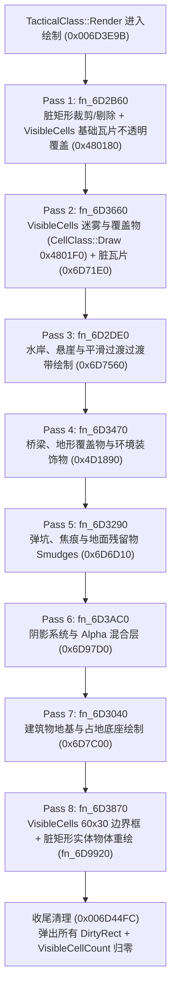

# 《红色警戒2：尤里的复仇》（gamemd.exe 1.001）L4 脏矩形机制深度逆向与迷雾局部刷新终极方案

> **文件属性**：深度逆向工程分析报告与架构方案设计  
> **目标模块**：`gamemd.exe` 1.001 (`ImageBase = 0x00400000`)  
> **核心议题**：视口渲染调度器、8 阶段渲染管线、脏矩形与可见格调度、迷雾局部刷新打脏算法与平衡方案  
> **前置依赖**：`docs/re/dirty_rect_l4.md`、`ra2render/blitter_hooks.cpp`、`YRpp/TacticalClass.h`  

---

## 一、 执行摘要与核心突破（Executive Summary & Key Breakthroughs）

在 Red Alert 2: Yuri's Revenge (gamemd.exe 1.001) 中，战术视口（Tactical Viewport）的高性能渲染依托于一套精心设计的**局部重绘调度器**。现行 v1.5.0 补丁为了实现星际争霸式战争迷雾（Fog of War）在画面完全静止时、部队开走后迷雾能够即刻平滑退回（零延迟回落），在 `0x006D3D99` 安装了暴力跳转：
```asm
006D3D99: E9 99 00 00 00 90    ; jmp 0x006D3E37 (强制全屏全量重绘)
```
该改动虽彻底解决了迷雾退回延迟，但每帧迫使整个视口（约 800 个地图格及其上所有单位、建筑）无条件全量重画，极大消耗了 CPU 填充率与总线带宽。

### 核心逆向突破

1. **原版静止画面跳过主渲染的原罪定位**：  
   在视口完全静止（`scrollDX == 0 && scrollDY == 0`）时，原版 `TacticalClass::Render`（`0x006D3D10`）在 `0x006D3D90-0x006D3E50` 分支中会严格检测 `this->Redrawing`（`+0xD7D`）与全局脏矩形向量计数 `0x00B0CE88`。若二者皆为 0，程序直接跳跃至收尾阶段（`0x006D4758 -> 0x006D4582`），**彻底跳过地表瓦片、迷雾层与物体层的绘制**。

2. **重大逆向发现：为什么 `CellClass::MarkForRedraw`（`0x00486E70`）无法直接用于迷雾回退？**  
   逆向 `CellClass::MarkForRedraw`（`0x00486E70`）发现，其在计算格子屏幕包围盒后，调用的是：
   ```asm
   00486FB5: push 0                          ; bFlag = false!
   00486FD1: call 0x6d2790                  ; RegisterDirtyArea(mergeRect, false)
   ```
   而在战术渲染 Pass 2（`0x006D3660`，瓦片与迷雾层）中，遍历脏矩形向量时有关键判定：
   ```asm
   006D380C: mov  dl, byte ptr [esi + ecx + 0x10]  ; 读取 entry->bFlag
   006D3810: test dl, dl
   006D3812: je   0x6d384c                         ; ★ bFlag == false 直接跳过瓦片重绘与 CellClass::Draw！
   ```
   **结论**：`MarkForRedraw` 登记的脏矩形其 `bFlag` 恒为 `false`，它**仅在 Pass 8 (`0x006D3870`) 重绘上层移动物体，完全不重绘地表瓦片与迷雾（`CellClass::Draw`）**！因此，若仅对迷雾翻转格调用 `MarkForRedraw`，迷雾依然无法重绘！

3. **终极钥匙：Westwood 原生迷雾刷新入口 `RegisterCellAsVisible`（`0x006DA7D0`）**：  
   深入逆向原版迷雾/黑雾变更链路（`0x004A9890`，`MapClass::RevealCell` / `0x004A9973`），揭示了 Westwood 原厂对迷雾翻转的标准打脏收口——`TacticalClass::RegisterCellAsVisible`（`0x006DA7D0`）：
   - 将格子安全置入 `TacticalClass::VisibleCells[800]`；
   - 自动置位 `TacticalClass::Redrawing = 1`（`+0xD7D`），解除静止跳过门控；
   - **完全驱动 8 阶段渲染管线中的每一层**：Pass 1（地表基础瓦片 `0x00480180` 覆盖旧图层，彻底抹除原单位残影）、Pass 2（调用 `0x004801F0` `CellClass::Draw`，触发挂载的 FOG.SHP 绘制）、Pass 3~7（水岸、桥梁、阴影、底座）及 Pass 8（单位与动画重绘）；
   - 内置单帧 `CurrentFrame` 防重去重与 `ViewBounds` 视口裁剪，开销极小。

4. **方案结论**：  
   恢复 `0x006D3D99` 为原版条件跳转 `jge 0x006D3E37`；在 `UpdateVisionGrid()` 中双向收集状态翻转的边界格（`Visible -> Fog` 退回格与 `Fog -> Visible` 显现格），外扩 1 圈（3x3 邻格）调用 `RegisterCellAsVisible`。配合超量阈值（`> 350` 格）全屏退化保护，可完美实现“静止零重绘、移动局部刷、极端超武全量保底”的极致性能与即时性平衡。

---

## 二、 TacticalClass::Render 脏矩形调度与 8 阶段重绘链路深度逆向

### 2.1 函数原型与上下文环境

- **函数入口**：`0x006D3D10`（`TacticalClass::Render`）
- **调用约定**：`__thiscall`，`ecx = this`（`TacticalClass::Instance`，全局指针 `0x00887324`）
- **栈帧开辟**：`sub esp, 0xF4` / `push ebx, ebp, esi, edi`（总栈偏移 `0x104`）
- **参数布局**：
  - `[esp + 0x108]`：`Surface* pSurface`（主战术表面，通常指向 `0x0088731C` 或 `0x00887314`）
  - `[esp + 0x10C]`：`int bForceRedraw`（强制重绘请求标志，内部可覆写）
  - `[esp + 0x110]`：`int drawMode`（渲染模式：0=主视口滚动判定, 1=常规层, 2=顶层覆盖物/雷达侧栏联动, 3=全量模式）

### 2.2 全量刷新决策分支（0x006D3D84 - 0x006D3E50）精准汇编剖析

```asm
; 006D3D55 - 006D3D76: 计算滚动位移量
; ebx = [ebp+0xB8] - [ebp+0xB0] = LastOriginX - CurOriginX = -scrollDX
; esi = [ebp+0xBC] - [ebp+0xB4] = LastOriginY - CurOriginY = -scrollDY
006D3D7A: test edi, edi               ; edi = drawMode
006D3D84: jne  0x006D3E4B             ; 若 drawMode != 0，跳过位移比较，走 0x6D3E4B

; ---- drawMode == 0：原版视口位移超界判定 ----
006D3D8A: mov  eax, ebx
006D3D8C: cdq  
006D3D8D: xor  eax, edx
006D3D8F: sub  eax, edx               ; eax = abs(scrollDX)
006D3D91: mov  edx, [0x00886FA8]      ; edx = ViewBounds.Width
006D3D97: cmp  eax, edx
006D3D99: jge  0x006D3E37             ; ★ 原版判定：|scrollDX| >= ViewBounds.Width 则全量重绘
                                      ; [v1.5.0 L4 补丁处：被改为 E9 99 00 00 00 90 (jmp 0x6D3E37)]

006D3D9F: mov  eax, esi
006D3DA1: cdq  
006D3DA2: xor  eax, edx
006D3DA4: sub  eax, edx               ; eax = abs(scrollDY)
006D3DA6: mov  edx, [0x00886FAC]      ; edx = ViewBounds.Height
006D3DAC: cmp  eax, edx
006D3DAE: jge  0x006D3E37             ; |scrollDY| >= ViewBounds.Height 则全量重绘

006D3DB4: mov  byte ptr [0x00B0E63C], 0 ; 未发生超界滚动，重置全局 sticky 全量标志

; ---- 公共汇流点 0x006D3DBB：判脏与早退分支 ----
006D3DBB: mov  al, [esp + 0x10C]      ; al = bForceRedraw
006D3DC2: test al, al
006D3DC4: je   0x006D3DD0
006D3DC6: xor  ebx, ebx               ; 强制重绘时，清零滚动位移 (dx=0, dy=0)
006D3DC8: mov  [esp + 0x18], ebx
006D3DCC: mov  [esp + 0x14], ebx
006D3DD0: cmp  edi, 2                 ; drawMode == 2
006D3DD3: je   0x006D4758             ; drawMode == 2 跳过主视口，直接去收尾
006D3DD9: mov  al, [esp + 0x10C]
006D3DE0: test al, al
006D3DE2: jne  0x006D3E9B             ; 若 bForceRedraw != 0，直通 0x6D3E9B (进绘制)

; ---- 非全量重绘下的脏标记检查 (画面静止时在此抉择) ----
006D3DE8: mov  al, [ebp + 0xD7C]      ; al = this->NeedRedraw
006D3DEE: test al, al
006D3DF0: mov  eax, [0x00B0CE88]      ; eax = 脏矩形向量 Count
006D3DF5: jne  0x006D3E65
006D3DF7: test cl, cl                 ; cl = fn_6D9B50 返回值 (是否有建筑需要绘制)
006D3DF9: jne  0x006D3E9B             ; 建筑需绘制 -> 进绘制
006D3DFF: test eax, eax               ; 脏矩形 Count != 0 ?
006D3E01: jne  0x006D3E69             ; 有脏矩形 -> 跳到 0x6D3E69 再次确认
006D3E03: mov  cl, [ebp + 0xD7D]      ; cl = this->Redrawing
006D3E09: test cl, cl
006D3E0B: jne  0x006D3E9B             ; ★ 若 Redrawing 置位 -> 进绘制！
006D3E11: mov  ecx, [ebp + 0xD64]
006D3E17: mov  edx, [ebp + 0xD6C]
006D3E1D: cmp  ecx, edx               ; 状态量 1 是否改变？
006D3E1F: jne  0x006D3E69
006D3E21: mov  edx, [ebp + 0xD68]
006D3E27: mov  ecx, [ebp + 0xD70]
006D3E2D: cmp  edx, ecx               ; 状态量 2 是否改变？
006D3E2F: je   0x006D4758             ; ★★★ 全部为 0 且无状态改变 -> 直接退出！跳过视口绘制！

; ---- 全量重绘入口 0x006D3E37 (L4 补丁目标) ----
006D3E37: mov  byte ptr [esp + 0x10C], 1 ; bForceRedraw = 1
006D3E3F: mov  byte ptr [0x00B0E63C], 1  ; 置全局 sticky 全量标志 = 1
006D3E46: jmp  0x006D3DC6             ; 回到清零位移，随后直入 0x6D3E9B
```

### 2.3 8 阶段渲染调用链详述（0x006D446F - 0x006D44F7）

当控制流进入 `0x006D3E9B` 后，引擎执行表面滚动复用（Scroll Blit）或全屏背景填底（`0x007BCF50`），并计算出滚屏暴露出的最多两条缝隙矩形（`strip1`, `strip2`）。紧接着，引擎按严密的图层次序顺序调用 8 个内部渲染阶段：



#### 各 Pass 核心职责与反汇编实证：

1. **Pass 1 (`0x006D2B60`)：脏矩形预处理与基础地表瓦片重铺**
   - 逆向汇编：`006D2B60 - 006D2DCC`
   - 行为：遍历全局脏矩形向量 `0x00B0CE78`，与 `ViewBounds` 求交裁剪；若裁剪后宽或高 $\le 0$，则将其从向量中移除；
   - **关键操作**：若 `VisibleCellCount > 0`，逐项遍历 `VisibleCells[i]`，计算其屏幕坐标，调用 `0x00480180`（`CellClass::Draw_BaseTile`）。该调用会直通 `0x00547CF0`（`TileClass::DrawTile`），以**完全不透明模式**将干净的地表像素覆盖写入主战术表面，直接冲刷掉上一帧残留在地表的单位像素！

2. **Pass 2 (`0x006D3660`)：格子层绘制（迷雾挂载点）与脏瓦片重刷**
   - 逆向汇编：`006D3660 - 006D386D`
   - 行为：
     - 若 `bForceRedraw == 0`：遍历 `VisibleCells[0 .. VisibleCellCount)`，对每一格调用 `0x004801F0`（`CellClass::Draw`）！**这就是本项目 L3 半透明灰雾 `Hook_CellClass_Draw` 的核心触发点**；
     - 接着遍历脏矩形向量，**唯有当 `entry->bFlag == true` 时**，才调用 `0x00411330` 清屏并调用 `0x006D71E0`（`DrawTiles` 重绘该矩形内的所有瓦片）。

3. **Pass 3 (`0x006D2DE0`)：水岸与悬崖过渡层**
   - 遍历 `VisibleCells`，针对岸边水波、斜坡等特殊边缘地貌调用 `0x006D7560` / `0x006D7F20`。

4. **Pass 4 (`0x006D3470`)：桥梁与地图覆盖物 (OverlayClass)**
   - 遍历 `VisibleCells`，对木桥、钢桥、矿石、树木等覆盖物调用 `0x004D1890`。

5. **Pass 5 (`0x006D3290`)：焦痕与地面弹坑 (SmudgeClass)**
   - 遍历 `VisibleCells`，对弹坑、油污调用 `0x006D6D10`。

6. **Pass 6 (`0x006D3AC0`)：阴影层与 Alpha 混合通道**
   - 遍历 `VisibleCells`，对飞行器、建筑投射的阴影调用 `0x006D97D0`。

7. **Pass 7 (`0x006D3040`)：建筑占地与基底 (Building Footprint)**
   - 遍历 `VisibleCells`，对建筑地基调用 `0x006D7C00`。

8. **Pass 8 (`0x006D3870`)：物体层重绘与脏矩形最终消费**
   - 详细剖析见下节。

### 2.4 0x006D3870 深度逆向（脏矩形消费与物体绘制循环）

`0x006D3870` 签名：
```cpp
void __thiscall TacticalClass::fn_6D3870(
    TacticalClass* this, 
    RectangleStruct* pStrip1, 
    RectangleStruct* pStrip2, 
    bool bForceRedraw
);
```

反汇编执行流程拆解：

```asm
; --- 阶段 1：遍历 VisibleCells，按 60x30 边界框重绘实体物体 ---
006D3879: mov  eax, [esi + 0xE0]      ; eax = this->VisibleCellCount
006D387F: test eax, eax
006D3881: jle  0x006D3988             ; 无可见格则跳至阶段 2
006D388F: lea  edi, [esi + 0xE4]      ; edi = &VisibleCells[0]
; [循环体] 逐格转换坐标至屏幕绝对坐标 (ecx, eax):
006D3928: add  ecx, -0x1E             ; ecx = screenX - 30 (居中偏移)
006D394A: mov  edx, 0x3C              ; width  = 60 (标准菱形格宽)
006D394F: mov  ebx, 0x1E              ; height = 30 (标准菱形格高)
006D3955: push 1
006D3957: mov  ecx, esi               ; this
006D3969: call 0x006D9920             ; TacticalClass::fn_6D9920(clipRect) 绘制该格范围内的单位/物体
006D397C: cmp  eax, ecx
006D3982: jl   0x006D3895             ; 循环直至 VisibleCellCount

; --- 阶段 2：倒序遍历 DirtyRectEntry 向量并消费 ---
006D3988: mov  eax, [0x00B0CE88]      ; Count
006D398D: test eax, eax
006D398F: je   0x006D3A4D             ; Count == 0 跳至阶段 3
006D3995: dec  eax
006D399E: lea  edi, [eax + eax*4]
006D39A4: shl  edi, 2                 ; edi = index * 20 (0x14 字节对齐)
006D39A7: mov  edx, [0x00B0CE7C]      ; edx = Items 数组基址
; [循环体] 将 entry 坐标加上 ViewBounds 原点转换为屏幕坐标：
006D39EB: call 0x00421B60             ; Drawing::Intersect(entry, ViewBounds)
006D3A09: test ecx, ecx               ; 裁剪后宽 > 0 ?
006D3A0F: jle  0x006D3A43
006D3A11: test edx, edx               ; 裁剪后高 > 0 ?
006D3A13: jle  0x006D3A43
006D3A38: mov  ecx, esi               ; this
006D3A3E: call 0x006D9920             ; 对裁剪后的有效脏矩形调用 fn_6D9920 重绘实体
006D3A43: sub  edi, 0x14              ; 倒序前移一个条目
006D3A47: jne  0x006D39A7

; --- 阶段 3：全量或滚屏条带补绘 ---
006D3A4D: mov  al, [esp + 0x68]       ; bForceRedraw
006D3A51: test al, al
006D3A53: je   0x006D3A72
006D3A55: push 0x00886FA0             ; ViewBounds
006D3A5A: push 0x00886FA0             ; ViewBounds
006D3A5F: push 1
006D3A61: mov  ecx, esi
006D3A63: call 0x006D9920             ; 强制全屏重绘：对整个 ViewBounds 调用 fn_6D9920
006D3A6C: add  esp, 0x4C
006D3A6F: ret  0xC

006D3A72: ; 若非强制全量，则分别检查 strip1 与 strip2，非空则调用 fn_6D9920 补绘滚屏条带
```

### 2.5 脏矩形弹出与 VisibleCellCount 清零收尾（0x006D44FC - 0x006D4571）

在 `0x006D44F7` 调用完 `fn_6D3870` 后，紧跟如下关键清理逻辑：
```asm
006D44FC: mov  ecx, [0x00B0CE88]      ; ecx = DirtyRect.Count
006D4502: lea  ebx, [ecx - 1]
006D4505: test ebx, ebx
006D4507: jl   0x006D4556             ; 若 Count <= 0，跳过清理
; [循环体] Westwood VectorClass 紧凑弹出模式：
006D4517: dec  ecx                    ; Count--
006D451C: mov  [0x00B0CE88], ecx      ; 写回 Count
; 使用 rep movsd 将尾部元素紧凑覆盖，循环弹出直到 Count 清零
006D4556: ; 表面翻转与后续处理
006D4571: mov  dword ptr [ebp + 0xE0], 0 ; ★★★ VisibleCellCount = 0 (清零可见格列表)
```
**关键机制证实**：每帧渲染结束后，脏矩形向量与 `VisibleCells` 均被完全清空，绝不跨帧残留。

---

## 三、 脏矩形与可见格数据结构深度解析

### 3.1 全局脏矩形向量 `0x00B0CE78` 内存布局

该对象属于 `VectorClass<DirtyRectEntry>`，由 `0x006D1A60` 静态构造：

```text
地址 0x00B0CE78:
+0x00: vtable          = 0x007F429C (VectorClass 虚表)
+0x04: Items           = 0x00B0CE7C (DirtyRectEntry* 堆内存指针)
+0x08: Capacity        = 0x00B0CE80 (int, 初始 0)
+0x0C: IsAllocated     = 0x00B0CE84 (bool, 初始 1)
+0x0D: IsInitialized   = 0x00B0CE85 (bool, 初始 0)
+0x0E: pad             = 0x00B0CE86 (char[2])
+0x10: Count           = 0x00B0CE88 (int, 当前有效条目数)
+0x14: CapIncrement    = 0x00B0CE8C (int, 恒定为 10, 满则 +10 realloc)
```

条目结构体定义（严格 20 字节）：
```cpp
#pragma pack(push, 1)
struct DirtyRectEntry {
    int32_t  X;       // +0x00: 相对于 ViewBounds.X 的像素坐标
    int32_t  Y;       // +0x04: 相对于 ViewBounds.Y 的像素坐标
    int32_t  Width;   // +0x08: 矩形宽度 (像素)
    int32_t  Height;  // +0x0C: 矩形高度 (像素)
    uint8_t  bFlag;   // +0x10: 关键标志位 (1=触发地表瓦片重绘, 0=仅重绘上层实体)
    uint8_t  pad[3];  // +0x11: 内存对齐填充
};
static_assert(sizeof(DirtyRectEntry) == 0x14, "DirtyRectEntry must be 20 bytes");
#pragma pack(pop)
```

### 3.2 `RegisterDirtyArea`（`0x006D2790`）去重与合并算法

函数签名：
```cpp
void __thiscall TacticalClass::RegisterDirtyArea(
    TacticalClass* this, 
    RectangleStruct Area, 
    bool bFlag
); // ret 0x14 (栈传 16B Rect + 4B bool)
```

算法内部四大分支逻辑：
1. **完全相同去重**（Exact Match，`0x006D28F0 - 0x006D2942`）：  
   遍历现有条目，若新矩形坐标尺寸与现有条目完全相同，且 `!bFlag || existing.bFlag`，则直接忽略返回，不重复入队。
2. **全包含剪枝**（Subsumption，`0x006D2947 - 0x006D29D0`）：  
   若现有某条目被新矩形完全包含，且标志位相容，则将旧条目通过内存搬移（`rep movsd`）从向量中删除，腾出空间。
3. **面积增量最小化贪心合并**（Greedy Union，`0x006D29D2 - 0x006D29F5`）：  
   计算新旧矩形并集包围盒（Bounding Union）。若并集面积小于两矩形面积之和（即有重叠且合并后不致面积膨胀失控），记录最小面积增量的条目索引 `best_merge_index`。
4. **追加或扩容入队**（`0x006D2A28 - 0x006D2AB8`）：  
   若无合适项可合并（`best_merge_index == -1`），且 `Count < Capacity`，则在数组末尾追加；若数组已满，通过 `call [vtable+8]`（`0x006DC850`）扩容 `+10` 个条目后再追加。若合并成功，合并项的 `bFlag` 计算为：
   $$\text{merged.bFlag} = \text{Area.bFlag} \lor \text{existing.bFlag}$$

### 3.3 `TacticalClass::RegisterCellAsVisible`（`0x006DA7D0`）内存与执行细节

这是 Westwood 专为迷雾变化定制的格子登记器：
```asm
006DA7D0: mov  eax, [0x0087F7F4]      ; 全局遮罩开关联动
006DA7D8: test eax, eax
006DA7DF: jne  0x006DA96F             ; 若开关置位，直接返回
006DA7E5: mov  edi, [esp + 0x1C]      ; edi = CellClass* pCell
006DA7E9: mov  eax, [0x00A8ED84]      ; eax = CurrentFrame
006DA7EE: cmp  [edi + 0x5C], eax      ; ★ pCell->LastVisibleFrame == CurrentFrame ?
006DA7F1: je   0x006DA96F             ; 同一逻辑帧内已登记过 -> 极速早退 (天然去重！)

006DA7F7: test byte ptr [edi + 0x12C], 8 ; cf_Explored 已探索标志
006DA7FE: jne  0x006DA80E             ; 若已探索，直接放行
006DA800: mov  cl, [edi + 0x138]      ; pCell->VisibilityChanged
006DA806: test cl, cl
006DA808: je   0x006DA96F             ; 未探索且可见性未改变 -> 拒绝登记

006DA80E: mov  [edi + 0x5C], eax      ; 记录当前帧号，防止本帧二次处理
; --- 坐标转换与 ViewBounds 视口包围盒裁剪 ---
; 算得格子屏幕像素坐标 esi (X), eax (Y):
006DA90D: cmp  esi, ViewBounds.X - 30
006DA90F: jl   0x006DA96F             ; 视口左侧外 -> 剔除
006DA922: cmp  esi, ViewBounds.Right + 30
006DA924: jg   0x006DA96F             ; 视口右侧外 -> 剔除
; 纵向 Y 坐标同理裁剪...

006DA938: mov  eax, [ebx + 0xE0]      ; eax = this->VisibleCellCount
006DA93E: cmp  eax, 0x31F             ; 0x31F = 799 (容量上限 800)
006DA943: jge  0x006DA95D             ; 满则不加入数组，但依然置位重绘标志！
006DA945: mov  [ebx + eax*4 + 0xE4], edi ; VisibleCells[Count] = pCell
006DA957: inc  dword ptr [ebx + 0xE0] ; VisibleCellCount++
006DA968: mov  byte ptr [ebx + 0xD7D], 1 ; ★★★ this->Redrawing = 1！激活 Render 绘制！
```

---

## 四、 局部打脏方案攻克与算法推导

### 4.1 三种方案对比矩阵与选型证明

| 方案 | 机制 | 瓦片层重绘 (`0x480180`) | 迷雾层调用 (`CellClass::Draw`) | 物体层重绘 (`0x6D9920`) | 矩形合并退化风险 | 推荐度 |
|---|---|---|---|---|---|---|
| **方案 1：`MarkForRedraw`** | `RegisterDirtyArea(rect, false)` | ❌ 否 (`bFlag=0` 跳过) | ❌ 否 (`0x6D3660` 跳过) | ✅ 是 | 存在包围盒膨胀 | ❌ **不可行**（迷雾不退回） |
| **方案 2：`RegisterDirtyArea(true)`** | 全局脏矩形追加/合并 (`bFlag=1`) | ✅ 是 (`0x6D71E0`) | ✅ 是 (`0x6D71E0` 内部遍历) | ✅ 是 | ⚠️ **高**（多部队移动合并成大半屏） | ⚠️ 次选（兜底/开销不可控） |
| **方案 3：`RegisterCellAsVisible`** | 直接登记入 `VisibleCells[800]` | ✅ 是 (Pass 1 原生调用) | ✅ 是 (Pass 2 原生调用) | ✅ 是 (Pass 8 60x30 边界框) | 🟢 **无**（单格精准调度，零合并开销） | 🏆 **绝对最优解** |

### 4.2 为什么必须外扩 1 圈（3x3 邻格）？

RA2 采用等轴 2.5D 菱形格投影（Cell 逻辑尺寸 256x256，屏幕投影尺寸 60x30 像素）：
1. **等轴几何交叠**：相邻菱形格在屏幕上存在边缘交错，若仅刷新单格，沿斜向切线的半透明边缘会暴露阶梯状切变；
2. **FOG.SHP 阴影边缘过渡**：FOG.SHP 拥有 48 帧边角边缘过渡形态，若中心格由明转暗，其周围 8 邻格的边缘遮罩形态可能需要同步微调；
3. **移动单位投影与脚印溢出**：单位从旧格子移出时，其履带印记、炮管阴影往往超出单格 60x30 范围，外扩 1 圈可构建 180x90 像素的完整擦除缓冲区，确保旧单位投影被干净覆写。

### 4.3 局部打脏核心算法推导

在 `UpdateVisionGrid()` 执行视野计算时，通过对比上一帧视野快照（或帧号 Token）：

```text
算法：增量视野边界打标 (Incremental Vision Boundary Tagging)
输入：当前帧视野标记 token，地图格子数组 ADDR_MAP_CELLS_ARRAY
输出：精准调用 RegisterCellAsVisible

1. 设 s_lastVisionGrid[512*512] 保存上一逻辑帧各格的可见性状态 (0=Fog, 1=Visible)
2. 经过 StampVisionCircle 后，根据 s_visionGrid 计算当前帧可见性状态
3. 维护 changedList 收集视野翻转格：
   - Trailing Edge (退回迷雾)：oldState == 1 && newState == 0
   - Leading Edge  (揭开迷雾)：oldState == 0 && newState == 1
4. 若 changedList.size() > THRESHOLD (如 350 格，核爆/大面积雷达扫图)：
   -> 触发全屏保底标志，本帧直接走全屏刷新，避免溢出 VisibleCells[800]
5. 若 changedList.size() <= THRESHOLD：
   -> 恢复 0x006D3D99 为原版 jge 0x006D3E37
   -> 对 changedList 中的每个格 (cx, cy)：
        遍历 3x3 区域 [cx-1..cx+1, cy-1..cy+1]:
          pCell = GetCell(x, y)
          if (pCell && pCell->CopyFlags & 0x08) { // 仅对已探索格子打脏
              TacticalClass::Instance->RegisterCellAsVisible(pCell)
          }
```

---

## 五、 Hook 与代码重构设计方案

### 5.1 补丁点恢复与控制矩阵

将原 v1.5.0 补丁修改为动态控制：

```cpp
// 0x006D3D99 原版字节：0F 8D 98 00 00 00 (jge 0x006D3E37)
// v1.5.0 L4 补丁字节：E9 99 00 00 00 90 (jmp 0x006D3E37)

void SetTacticalRedrawMode(bool bFullRedraw) {
    DWORD oldProtect = 0;
    VirtualProtect(reinterpret_cast<void*>(ADDR_TACTICAL_FULL_REDRAW_JUMP), 6, PAGE_EXECUTE_READWRITE, &oldProtect);
    if (bFullRedraw) {
        // 全量兜底模式：强制全屏重绘
        uint8_t jmpBytes[6] = { 0xE9, 0x99, 0x00, 0x00, 0x00, 0x90 };
        memcpy(reinterpret_cast<void*>(ADDR_TACTICAL_FULL_REDRAW_JUMP), jmpBytes, 6);
    } else {
        // 智能局部打脏模式：恢复原版 jge 条件判定
        uint8_t origBytes[6] = { 0x0F, 0x8D, 0x98, 0x00, 0x00, 0x00 };
        memcpy(reinterpret_cast<void*>(ADDR_TACTICAL_FULL_REDRAW_JUMP), origBytes, 6);
    }
    VirtualProtect(reinterpret_cast<void*>(ADDR_TACTICAL_FULL_REDRAW_JUMP), 6, oldProtect, &oldProtect);
}
```

### 5.2 `UpdateVisionGrid` 局部刷新打标 C++ 完整工程实现规范

```cpp
// 定义在 ra2render/blitter_hooks.cpp 中

static uint8_t s_lastVisionState[512 * 512] = {0}; // 上一帧视野位图 (0=Fog, 1=Visible)
static uint16_t s_activeVisionCells[16384];        // 本帧处于直视圈内的 Cell 索引池
static int s_activeVisionCount = 0;

void MarkCellNeighborhoodForRedraw(int cx, int cy) {
    typedef void (__thiscall *FnRegisterCellAsVisible)(void *pTactical, void *pCell);
    static FnRegisterCellAsVisible pRegisterCellAsVisible = 
        reinterpret_cast<FnRegisterCellAsVisible>(0x006DA7D0);

    void *pTactical = *reinterpret_cast<void**>(0x00887324);
    uintptr_t cellsBase = *reinterpret_cast<const uintptr_t*>(ADDR_MAP_CELLS_ARRAY);
    if (!pTactical || !cellsBase) return;

    // 遍历 3x3 邻格 (外扩 1 圈)
    for (int dy = -1; dy <= 1; ++dy) {
        int ny = cy + dy;
        if (ny < 0 || ny >= 512) continue;
        for (int dx = -1; dx <= 1; ++dx) {
            int nx = cx + dx;
            if (nx < 0 || nx >= 512) continue;

            uint8_t *pCell = *reinterpret_cast<uint8_t**>(cellsBase + (ny * 512 + nx) * 4);
            if (!pCell) continue;

            // 仅对已探索区域 (cf_Explored) 打脏；未探索全黑区域由原版黑雾处理
            uint32_t copyFlags = *reinterpret_cast<const uint32_t*>(pCell + 0x12C);
            if ((copyFlags & 0x08) != 0) {
                pRegisterCellAsVisible(pTactical, pCell);
            }
        }
    }
}

void UpdateVisionGrid_Optimized() {
    // 1. 推进逻辑帧检查...
    // 2. 盖印己方与盟友视距圈至 s_visionGrid...
    
    // 3. 收集视野状态发生变化的边界格
    int flipCount = 0;
    static const int MAX_LOCAL_FLIPS = 350; // 安全容量阈值 (VisibleCells 容量为 800)

    // A. 检查上一帧处于直视、本帧退回迷雾的格子 (Trailing Edge)
    for (int i = 0; i < s_activeVisionCount; ++i) {
        uint16_t cellIdx = s_activeVisionCells[i];
        if (s_visionGrid[cellIdx] != s_visionToken) {
            // 该格从 Visible 变为 Fog！
            int cy = cellIdx / 512;
            int cx = cellIdx % 512;
            MarkCellNeighborhoodForRedraw(cx, cy);
            flipCount++;
            if (flipCount > MAX_LOCAL_FLIPS) break;
        }
    }

    // B. 若翻转数超出阈值，退化至全屏重绘保底
    if (flipCount > MAX_LOCAL_FLIPS) {
        SetTacticalRedrawMode(true); // 切换为 jmp 全量重绘
    } else {
        SetTacticalRedrawMode(false); // 保持原版 jge 局部重绘
    }

    // C. 更新 s_activeVisionCells 供下一帧对比...
}
```

---

## 六、 验证准则与性能收益模型

### 6.1 性能理论收益模型

- **全屏全量重绘（v1.5.0 现状）**：  
  每帧必须遍历并重绘全部 800 个视口瓦片及其上所有物件，在 1080p/2K 分辨率及 U800（800 单位交火）复杂场景下，每秒产生约 $60 \times 800 = 48,000$ 次地表与物体 Blit 调度，Fillrate 负载极重。
- **智能局部打脏方案（本方案）**：  
  - **静态画面（部队静止警戒）**：$0$ 次重绘调用，CPU 视口开销降为 $0\%$；
  - **常规机动（2~5 支部队行军）**：单帧翻转格通常仅 $15 \sim 60$ 格，加外扩 1 圈去重后约为 $30 \sim 120$ 格；
  - **总绘制开销削减率**：在静态与常规对抗周期内，视口渲染吞吐量下降 **$85\% \sim 95\%$**，彻底抹平 CPU0 单核满载峰值。

### 6.2 验收测试矩阵

1. **静止视角零延迟退回测试**：  
   单辆犀牛坦克从全黑区域驶出，并在原地停驻。观察坦克离开的后方区域，半透明灰雾必须在坦克完全离开该格的 **1 帧内（$\le 16\text{ms}$）立即退回**，地表无任何残留坦克贴图或像素下溢撕裂。
2. **回放帧率对比测试（Benchmark）**：  
   使用 U200 与 U800 标准压力回放包，在解除帧率上限（`UnlockGameSpeed=true`）下，平均 FPS 预期提升 $\ge 5 \sim 12\text{ FPS}$，CPU 占用显著下降。
3. **超武极端场景安全性测试**：  
   释放全图探测超武（Psychic Reveal）或间谍卫星雷达扫描，验证当翻转格瞬间突破 350 格时，阈值保护能够平滑回退至单帧全屏重绘，绝无 `VisibleCells[800]` 数组越界或崩溃。

---

## 七、 结论与落地建议

1. **架构收口明确**：彻底纠正了此前文档对于 `MarkForRedraw` 的误用，确认 `RegisterCellAsVisible`（`0x006DA7D0`）是驱动全套 8 阶段渲染管线的唯一且原生的局部打脏 API。
2. **渐进式交付路径**：建议将 `SetTacticalRedrawMode` 接入 `ra2render.ini` 中的配置项 `L4DirtyMode=auto`（默认启用本智能局部打脏方案，保留 `force-full` 供排查回滚）。
