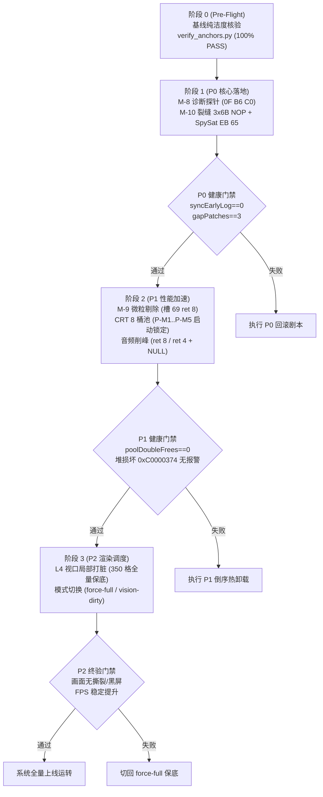
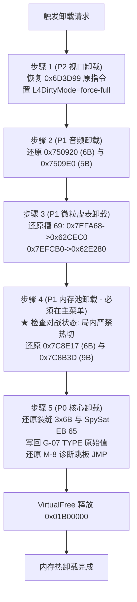
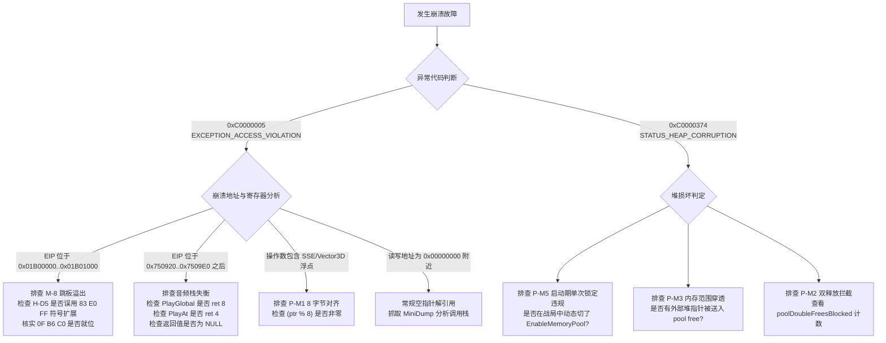
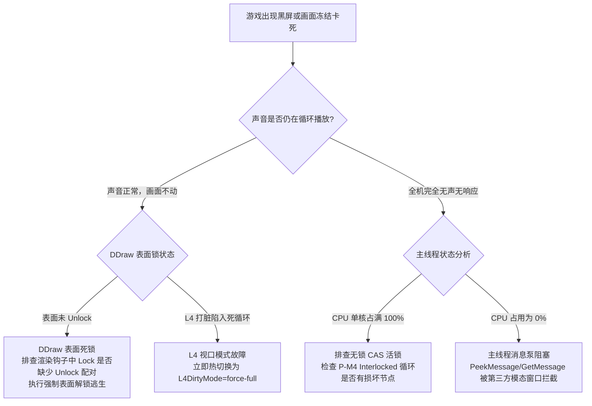
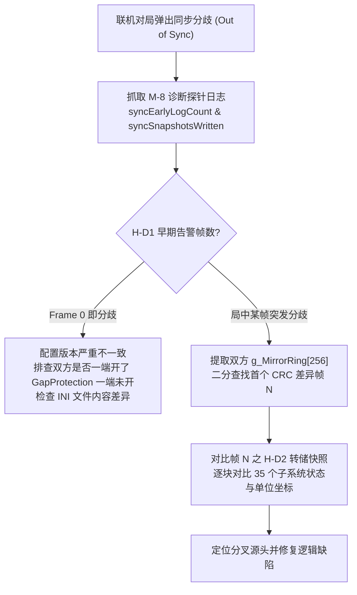
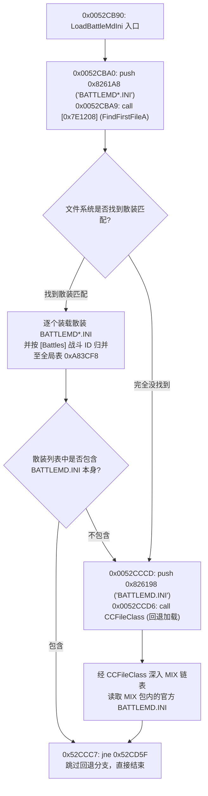

# 红色警戒2：尤里的复仇 真机恢复执行与应急处置剧本
# Command & Conquer: Yuri's Revenge - Live Machine Thaw Execution & Incident Response Runbook

> **文档状态**：工程生产级就绪（Production Ready）  
> **文档标识**：`docs/re/execution_runbook.md`  
> **制定版本**：v1.0.0 (Sprint S23 专项交付)  
> **适用目标**：红色警戒2：尤里的复仇 1.001（`ra2youli/gamemd.exe`，MD5: `4f37486e5b0dbe2ae5f45aeee0f98367`）  
> **基准参数**：ImageBase `0x00400000`，`.text` VA `0x00401000`，文件偏移 `FileOffset = VA - 0x00400000`  
> 【W3 勘误 E-W3-01】原句 `FileOffset = VA − 0x400000` 仅在 `.text/.rdata/.data` 成立；
> 通用式为 `FileOffset = 段.PointerToRawData + (VA − 段.VirtualAddress)`，
> 本镜像 `.rsrc`/`.detour` 为 `VA − 0x6FC000`。依据：out/re_work/_lead_baseline/W3/LEAD_ERRATUM_E-W3-01_fileoffset_rule.md；分级：[实证]
> **基线规范**：`.text` 完整性核验唯一公认口径为 `raw(SizeOfRawData)`（长度 4,063,232 字节，SHA256: `c0368a179f6e1a0f85bf94ebeb3a3e62efc8b1a2000abe164e5e1c61714eb738`）。PE 偏移 `0xAE`/`0xB2` 差异属 `ra2opt` 固化之 LAA（Large Address Aware）正常标志，`.text` 纯净度 100%。  
> **证据等级规范**：`[实证]`（VA + FileOffset + 原始机器码 + 汇编指令）× `[推演]`（结构与逻辑严密推导）× `[待实测]`（需真机动态拦截验证）。

---

## 目录 (Table of Contents)

1. [执行总则与落地前置红线](#一执行总则与落地前置红线)
2. [补丁落地顺序与分阶段实施规程](#二补丁落地顺序与分阶段实施规程)
   - [2.1 阶段 0 (Pre-Flight)：运行环境与基线纯洁度核验（门禁 G0 = `verify_anchors.py` 323/323 PASS）](#21-阶段-0-pre-flight运行环境与基线纯洁度核验)
   - [2.2 阶段 1 (P0)：核心诊断与底层安全门控落地](#22-阶段-1-p0核心诊断与底层安全门控落地)
   - [2.3 阶段 2 (P1)：高频性能优化与渲染音频削峰](#23-阶段-2-p1高频性能优化与渲染音频削峰)
   - [2.4 阶段 3 (P2)：视口渲染局部打脏与模式切换](#24-阶段-3-p2视口渲染局部打脏与模式切换)
3. [逐项验收判据与遥测健康度指标体系](#三逐项验收判据与遥测健康度指标体系)
   - [3.1 遥测计数器观察总表](#31-遥测计数器观察总表)
   - [3.2 动态健康度基线与报警阈值矩阵](#32-动态健康度基线与报警阈值矩阵)
4. [原子回滚剧本与与 `ra2opt restore` 的交互规程](#四原子回滚剧本与与-ra2opt-restore-的交互规程)
   - [4.1 内存动态热卸载规范（五阶段倒序卸载）](#41-内存动态热卸载规范五阶段倒序卸载)
   - [4.2 二进制层与 `ra2opt` 协同保护交互规程](#42-二进制层与-ra2opt-协同保护交互规程)
   - [4.3 配置文件热切回 Baseline 规程](#43-配置文件热切回-baseline-规程)
5. [三大灾难性故障应急处置预案 (Disaster Playbooks)](#五三大灾难性故障应急处置预案-disaster-playbooks)
   - [5.1 故障 A：崩溃故障（0xC0000005 访问违规、0xC0000374 堆损坏）](#51-故障-a崩溃故障0xc0000005-访问违规0xc0000374-堆损坏)
   - [5.2 故障 B：黑屏/卡死故障（DDraw 锁死、消息泵阻塞、死锁）](#52-故障-b黑屏卡死故障ddraw-锁死消息泵阻塞死锁)
   - [5.3 故障 C：联机分叉故障（DESYNC / Out of Sync）](#53-故障-c联机分叉故障desync--out-of-sync)
6. [真机恢复后首批闭环项清单 (First-Wave Closure Tasks)](#六真机恢复后首批闭环项清单-first-wave-closure-tasks)
   - [6.1 U-1：35 个存档块对象类名运行时 RTTI 解析](#61-u-135-个存档块对象类名运行时-rtti-解析)
   - [6.2 U-2：魔数 0x2B898 运行时落盘二进制编码与 Header 验证](#62-u-2魔数-0x2b898-运行时落盘二进制编码与-header-验证)
   - [6.3 U-3：CurrentFrame 序列化归属块定位](#63-u-3currentframe-序列化归属块定位)
   - [6.4 U-9：[0x7E15C8] API 真实符号动态定名](#64-u-90x7e15c8-api-真实符号动态定名)
7. [文件系统加载层次与战役注入规程 (FS & Mix Loading SOP)](#七文件系统加载层次与战役注入规程-fs--mix-loading-sop)
   - [7.1 引擎多层级文件加载优先级铁律](#71-引擎多层级文件加载优先级铁律)
   - [7.2 BATTLEMD 通配与回退机制实证剖析](#72-battlemd-通配与回退机制实证剖析)
   - [7.3 战役投放部署与残留清理防呆清单](#73-战役投放部署与残留清理防呆清单)
8. [执行签名与变更控制](#八执行签名与变更控制)

---

## 一、执行总则与落地前置红线

在执行真机解冻与补丁加载时，全体工程实施人员必须无条件遵守以下前置红线：

1. **绝对禁写 `.detour` 节 [实证]**：  
   `gamemd.exe` 镜像内的 `.detour` 段（VA `0x00B93000`，RawSize `0x3000`）包含原始构建自带的 6,980 字节数据（宿主签名 `40 00 00 00 44 74 72 00`，即 `Dtr\0`）。**严禁将跳板或挂钩代码写入该节**。所有动态跳板必须通过 `VirtualAlloc` 申请独立内存空间（推荐首选固定基址 `0x01B00000`）。
2. **禁止在对战局内热切换内存分配器（P-M5 约束）[推演 + 实证]**：  
   CRT 内存池补丁（P-4）接管了 `operator new` / `delete`。**严禁在对局进行中动态开关 `EnableMemoryPool`**。必须在进程启动期（DllMain 或配置加载阶段）单次锁定。局内动态热卸载将导致存活对象跨分配器释放，100% 触发 Windows 堆损坏异常 `0xC0000374`。
3. **联机一致性强同步约束（OOS 防护）[实证]**：  
   - P-1（M-8 诊断探针）、P-3（M-9 微粒剔除）、P-4（CRT 内存池）、P-5（音频削峰）、P-6（视口打脏）为纯表现层或只读探针，支持单端独立开关，无联机分叉风险；
   - P-2（M-10 裂缝发生器保护与间谍卫星门控）修改了 `CellClass+0x134 GapsCoveringThisCell` 状态演进逻辑，该字段进入游戏存档与同步校验。**严禁混端联机（打补丁端与原版联机），联机全员必须统一加载相同配置**。
4. **ABI 平栈与返回值铁律 [实证]**：  
   - 音频早退：`PlayGlobal`（VA `0x00750920`）必须 `ret 8` 且返回 `xor eax, eax`（NULL）；`PlayAt`（VA `0x007509E0`）必须 `ret 4` 且返回 `xor eax, eax`（NULL）。严禁返回 `-1` 或裸 `ret`；
   - H-D5 探针：必须采用 `0F B6 C0`（`movzx eax, al`）清高位，严禁使用带符号扩展的 `83 E0 FF`。

---

## 二、补丁落地顺序与分阶段实施规程

实施流程采用**严格单向推进、分阶段门禁准入**策略。任何前置阶段未达到 100% 验收标准，严禁进入下一阶段。



---

### 2.1 阶段 0 (Pre-Flight)：运行环境与基线纯洁度核验

#### 2.1.1 核验执行指令
实施前必须在 PowerShell 终端运行基线断言自动化核验工具：

```powershell
# 1. 切换至项目工作目录
cd D:\Project\ra2-campaign-forge

# 2. ★ 强制第一步：跑唯一事实源回归套件（323 条决定性锚点 + .text 基线哈希 + .detour 签名）
python tools/verify_anchors.py

# 3. 需要机读报告时补 --json（便于留档与 CI 比对）
python tools/verify_anchors.py --json out/re_work/re_sprint/S23/verify_anchors.json

# 4. 如报告 FAIL，先跑字节断言批量复算定位差异行：
python tools/audit_bytes.py docs/re/anchor_claims.txt
```

> ⚠️ **唯一事实源（Single Source of Truth）**：`docs/re/anchor_claims.txt`（**323 条**）。
> 其构成为 `43 条 S1–S20 全局核心 + 79 条存档块(去重后) + 77 条触发器 + 124 条 MIX 文件链 = 323`；
> 去重规则与最终条数已在该文件头部注明。**不得引用任何其它副本作为断言基准。**

#### 2.1.2 阶段 0 准入判据（**门禁 G0：必须先跑，未过禁入阶段 1**）

> **门禁原文**：**先跑 `tools/verify_anchors.py`，要求 `323/323 PASS` 且 `.text` 基线（`raw(SizeOfRawData)` 口径）一致，方可进入 Phase 1。**

| # | 判据 | 阈值（必须全部满足） | 判定来源 |
|---|---|---|---|
| G0-1 | **锚点回归总数 / 通过数** | **`断言总数 = 323` 且 `PASS = 323`（100.00%）**；`FAIL = 0`、`NOREAD = 0` | `python tools/verify_anchors.py` 的「回归汇总」行 |
| G0-2 | **`.text` 基线哈希（口径 = `raw(SizeOfRawData)`）** | SHA256 严格等于 `c0368a179f6e1a0f85bf94ebeb3a3e62efc8b1a2000abe164e5e1c61714eb738`（长度 4,063,232 B） | 报告的「基线完整性审计」→ `.text` 原始段哈希 `[PASS]` |
| G0-3 | **口径陷阱排除** | 报告**不得**命中 `Misc_VirtualSize` 口径哈希 `bf9d56aea20a9e52432bbc152e8ff08d334712955e2689455770b8333779908e`；命中即判「口径误报」，一律拒绝放行 | 报告中的 `★警告` 行 |
| G0-4 | **PE 头差异放行准则** | 与 `ra2youli/.ra2opt/orig/gamemd.exe` 比对，仅允许文件偏移 `0xAE`（`0x00` $\to$ `0x20`，LAA）与 `0xB2`（`0x10` $\to$ `0x40`）两处差异，其余字节 100% 一致 | `[v1.5.35]` 基线裁定 / `docs/re/baseline_integrity_note.md` |
| G0-4b | **game.exe 侧 LAA 真判据（读取点在 `ra2opt`，非 gamemd 白名单）** | `0x00400066`（COFF Characteristics，`game.exe` 现读 `0x030F` ⇒ **LAA 位 `0x0020` 未置**）的判据链 = `ra2opt/pe.py:107` 取位 → `ra2opt/pe.py:289` / `ra2opt/cli.py:269` 据此**写入或 no-op** → `ra2opt/audit.py:263` 据此出 `exe.laa` 告警；`0x004000AE`（DllCharacteristics，现读 `0x0000`）＋ `0x004000B0`（SizeOfStackReserve，现读 `0x100000`）的判据 = `tools/verify_anchors.py:244` 取值 → `tools/verify_anchors.py:247` 判 `RA2OPT_PERF` / `tools/verify_anchors.py:250` 判 `VANILLA_ORIGINAL` / `tools/verify_anchors.py:252` 出 `CUSTOM`。**G0-4 的 `0xAE`／`0xB2` 白名单只适用于 `gamemd.exe` 基线比对，不得用作 game.exe 的放闸条款**；另注意 `0xAE` 的同数值位是 `HIGH_ENTROPY_VA`，与 LAA 无关（`ra2opt/pe.py:116`） | `docs/re/GATE_VOCABULARY.md` §1 档位表 `GATE-LAA` 行＋§4 全句；实测出处 `RPT1_REPORT.md:118`（idx 6 的读者清单与 `E06`／`E06b` 变异读数）；本行所有 `文件:行号` 均为本包逐行现读 |
| G0-5 | **`.detour` 原生签名** | `40 00 00 00 44 74 72 00`（`'@\0\0\0Dtr\0'` @ VA `0x00B93000`）——**严禁写入该节** | 报告中的 `.detour` 原生签名 `[PASS]` |
| G0-5b | **`.rsrc` 原生资源目录头红线（补 G0-5 未覆盖的那一格）** | `.rsrc` 段头 16B @ 文件 `0x431000`（VA `0x00B2D000`、FileOffset `431000h`、delta `6FC000h`；节表行见 `out/re_work/qc/W3_20261001/scope/atlas_game/ARCHITECTURE_ATLAS_GAME.md:96`）现读逐字 = `00 00 00 00 00 00 00 00 00 00 00 00 00 00 07 00` ⇒ **严禁写入／注入该节**。其中**有门禁读者的只有 `+12..+15` 四字节**（`NumberOfNamedEntries=0x0000`、`NumberOfIdEntries=0x0007`；读者 `b7_exclusions_probe.py:119`），`+0..+11` 实测零邻判 ⇒ **红线按 16B 守、断言按 4B 立**，不要把 16B 整串写成「门禁判据」 | `docs/re/GATE_VOCABULARY.md` §1 档位表 `GATE-REDLINE` 行＋§2 逐字段现读；缺口申报 `RPT1_REPORT.md:25`、4B 实证 `RPT1_REPORT.md:129` 与残留句 `RPT1_REPORT.md:147`；字节 = 本包对 `ra2youli/game.exe`（4,497,680 B／sha256[:12] `c4bf2a57a80f`）现读复算，与 `out/re_work/zcode_live/W3_20261001/m35_ch13_expand/claims.txt:38`、`out/re_work/zcode_live/W3_20261001/m35_ch13_expand/M35_ch13_atlas_patch.md:65` 逐字相同 |

**判定与处置**：

- **全部满足** → 打印并留档报告，**方可进入阶段 1**；
- **G0-1 不满足（出现 `FAIL` / `NOREAD`）** → **停止**；先跑 `python tools/audit_bytes.py docs/re/anchor_claims.txt` 定位差异行，
  再对照 `docs/re/baseline_integrity_note.md` 判定是「文档写错」还是「二进制被改动」；**二进制被改动则直接封存重取基线，不得继续**；
- **G0-2 不满足** → 立即判为**基线污染**，按 `docs/re/baseline_integrity_note.md`「红线处置」执行；
- **G0-3 命中（口径误报）** → 属**度量口径错误而非基线污染**，修正度量脚本后重跑，**不得据此判 FAIL**；
- **G0-5 不满足** → 说明 `.detour` 已被写入/注入，**永久禁止上线**。
- **G0-4b 与预期不符（例如 `0x00400066` 的 LAA 位被置／未置与工单相反）** → 这是**运行能力项**，不是放闸失败：按 `ra2opt/audit.py:263` 的 `exe.laa` 告警处置（`python -m ra2opt laa on --game <游戏目录>`），**不得**引用 G0-4 的 gamemd `0xAE`／`0xB2` 白名单来判 game.exe；
- **G0-5b 不满足（`.rsrc` 段头 16B 与登记值不符）** → 说明资源目录被写入／注入，**永久禁止上线**（与 G0-5 同档处置）；若只有 `+12..+15` 变而前 12 字节未变，**仍按违反 G0-5b 处理**——读者确实只在这 4 字节，但这 16B 是一个被取证的段头对象；
- **G0-4b ／ G0-5b 的判据链、档位定义与全部现读 `文件:行号`** 见 `docs/re/GATE_VOCABULARY.md`（本表只登记阈值，定义与实测出处不在本文件复制，避免两处漂移）；`SizeOfHeaders` 的 `or 0x200` 回退语义与「正文 `00001000h` 只是记录值、不是判据」也在该文件 §3。

---

### 2.2 阶段 1 (P0)：核心诊断与底层安全门控落地

#### 2.2.1 P-1 (M-8) 联机同步诊断探针
- **内存申请**：`VirtualAlloc((LPVOID)0x01B00000, 0x1000, MEM_COMMIT|MEM_RESERVE, PAGE_EXECUTE_READWRITE)`；
- **H-D1 校验探针**：
  - 目标：VA `0x0064C6F2`（FileOffset `0x0024C6F2`）；
  - 机器码写入：原 `0F 85 69 05 00 00` (`jne 0x64CC61`) $\to$ `E9 09 39 4B 01 90`（JMP 至 `0x01B00000`）；
  - 跳板执行：`pushfd; pushad; test byte ptr [esp+0x20], 0x40; popad; popfd`。无损读取 EFLAGS ZF 位。
- **H-D2 断开快照探针**：
  - 目标：VA `0x0064CC61`（FileOffset `0x0024CC61`）；
  - 机器码写入：原 `A0 80 48 B0 00` (`mov al, [0xB04880]`) $\to$ `E9 DA 33 4B 01`（JMP 至 `0x01B00040`）；
  - 跳板执行：入口先 `pushad` 保存当前 `EAX`（现场为 `slot * 37`），调用快照保存逻辑后退栈重放 `mov al`。
- **H-D5 帧 CRC 镜像环（★关键纠偏落地）**：
  - 目标：VA `0x0064DE75`（FileOffset `0x0024DE75`）；
  - 机器码写入：原 `5F 5E 5D 5B 83 C4 14 C3` $\to$ `E9 06 22 4B 01 90 90 90`（JMP 至 `0x01B00080`）；
  - ★ **跳板防溢出编码**：跳板 `0x01B00090` 处严格写入 `0F B6 C0`（`movzx eax, al`），严禁使用 `83 E0 FF`；
  - 尾声恢复：重放 `pop edi; pop esi; pop ebp; pop ebx; add esp, 0x14; ret`。
- **H-D6 / H-D6b 事件镜像**：
  - VA `0x0064C911`：`E8 9A A3 E7 FF` $\to$ `E9 AA 37 4B 01`；
  - VA `0x0064CC0A`：`E8 A1 A0 E7 FF` $\to$ `E9 F1 34 4B 01`。

#### 2.2.2 P-2 (M-10) 裂缝产生器保护与间谍卫星门控
- **裂缝发生器 3×6B NOP 保护（消除清零副作用）**：
  1. `0x00568273`（`MapClass::RevealArea2`）：`89 99 34 01 00 00` $\to$ `90 90 90 90 90 90`
  2. `0x00577EC5`（`MapClass::RevealArea3`）：`89 B8 34 01 00 00` $\to$ `90 90 90 90 90 90`
  3. `0x00577B60`（`MapClass::Reshroud`）：`89 98 34 01 00 00` $\to$ `90 90 90 90 90 90`
- **SpySat 门控代码级无条件跳转**：
  - 目标：VA `0x00508F8F`（`HouseClass::UpdateSpySat`）；
  - 机器码写入：原 `74 65` (`je 0x508FF6`) $\to$ `EB 65` (`jmp 0x508FF6`)；
  - 效果：彻底阻止间谍卫星全图亮图，不动 TYPE 数据结构，纯静态 2 字节原子写入。
- **G-07 TYPE 字段保护备份**：
  - 挂钩前在堆中建立 `SpySatTypeBackup` 结构，读取并备份 `pSW+0xB0`（RechargeTime）、`pSW+0xF8`（Range）、`pBld+0x16A5`（SpySatFlag）、`pBld+0x16F0`（SpecialWeaponType）。

---

### 2.3 阶段 2 (P1)：高频性能优化与渲染音频削峰

#### 2.3.1 P-3 (M-9) 微粒与粒子系统迷雾渲染剔除
- **虚函数表槽 69 覆写**：
  - `ParticleClass` 槽 69：VA `0x007EFA68`（原 `C0 CE 62 00`，指向 `0x0062CEC0`）$\to$ 替换为 `&Hook_Particle_Draw`；
  - `ParticleSystemClass` 槽 69：VA `0x007EFCB0`（原 `80 E2 62 00`，指向 `0x0062E280`）$\to$ 替换为 `&Hook_ParticleSystem_Draw`；
- **执行契约**：
  - `Particle` 经 `+0x124` 寻父系统获取阵营，`ParticleSystem` 取 `+0xFC OwnerHouse`（备用 `+0xE0 Owner -> +0x21C House`）；
  - 己方微粒放行，敌方非直视微粒执行 `ret 8` 清除栈上传参早退。

#### 2.3.2 P-4 CRT 8 桶无锁内存池（P-M1..P-M5 启动期单次锁定）
- **挂钩入口**：
  - `operator new` (VA `0x007C8E17`)：原 6B `6A 01 FF 74 24 08` $\to$ `E9 rel32 90`（JMP 至 `My_New`）；
  - `operator delete` (VA `0x007C8B3D`)：原 9B `FF 74 24 04 E8 A2 08 00 00` $\to$ `E9 rel32 90 90 90 90`（JMP 至 `My_Delete`）；
- **P-M1..P-M5 五重加固落地规格**：
  - **P-M1 (8B 头部对齐)**：`struct PoolBlockHeader { uint32_t magic; uint32_t poolIdx; };`，返回指针 `pBlock + 8`，保证 `double` 与 SSE 128 位对齐；
  - **P-M2 (Double Free 投毒)**：释放前写入 `magic = 0xDEADBEEF`。释放时校验 `magic != 0xA5A55A5A` 直接拦截，绝不形成 Freelist 自引用死锁；
  - **P-M3 (地址范围穿透)**：`if (ptr < m_buffer || ptr >= m_bufferEnd) return orig_free(ptr);`，非本池指针 100% 穿透至原生 CRT；
  - **P-M4 (CAS 无锁原子)**：`InterlockedCompareExchangePointer(&m_freeList, pBlock, oldHead)` 保证多线程并发安全；
  - **P-M5 (启动期锁定)**：`EnableMemoryPool` 启动期单次锁定，局内禁止热切。

#### 2.3.3 P-5 音频引擎并发削峰与智能限频
- **VocClass::PlayGlobal 限频**：
  - 目标：VA `0x00750920`（原 6B `51 A0 AC 64 84 00`）$\to$ `E9 rel32 90`；
  - ★ **ABI 平栈契约**：`__fastcall` 入参含栈上传参 2 个 DWORD（8 字节）。削峰静音早退分支必须严格执行：
    ```asm
    xor eax, eax    ; 返回 NULL
    ret 8           ; 弹出 2 个参数平栈
    ```
- **VocClass::PlayAt 限频**：
  - 目标：VA `0x007509E0`（原 5B `A0 AC 64 84 00`）$\to$ `E9 rel32`；
  - ★ **ABI 平栈契约**：`__fastcall` 入参含栈上传参 1 个 DWORD（4 字节）。削峰静音早退分支必须严格执行：
    ```asm
    xor eax, eax    ; 返回 NULL
    ret 4           ; 弹出 1 个参数平栈
    ```

---

### 2.4 阶段 3 (P2)：视口渲染局部打脏与模式切换

- **模式切换指令覆写**：
  - 目标：VA `0x006D3D99`（原 6B `0F 8D 98 00 00 00`，`jge 0x6D3E37`）；
  - **全量保底模式 (`force-full`)**：覆写为 `E9 99 00 00 00 90`（无条件跳转，保底全屏重绘）；
  - **局部打脏模式 (`vision-dirty`)**：恢复原指令 `0F 8D 98 00 00 00`。
- **350 格翻转保底机制**：
  - 视野翻转格经 `0x006DA7D0 RegisterCellAsVisible` 执行 3×3 外扩打脏；
  - 若单帧累计打脏格子数 $>350$，立即设置 `pTactical+0xD7D Redrawing = 1`，强行退回全量重绘；
  - **红线**：严禁挂钩 `0x0048D000`。

---

## 三、逐项验收判据与遥测健康度指标体系

实施人员在各补丁激活后，必须根据遥测服务（共享内存或调试控制台）对比健康度指标。

### 3.1 遥测计数器观察总表

| 补丁组件 | 遥测计数器名称 | 数据类型 | 物理含义与观测来源 | 期望变化趋势 |
|---|---|:---:|---|---|
| **P-1.1** | `syncEarlyLogCount` | uint32 | 联机对局中检测到的早期校验和分歧计数 | 正常对局恒为 0 |
| **P-1.2** | `syncSnapshotsWritten` | uint32 | DESYNC 触发时自动写入磁盘的快照文件数 | 正常对局恒为 0 |
| **P-1.3** | `syncMirrorFrames` | uint32 | H-D5 独立环形缓冲区记录的帧总数 | 随战局进行单调线性递增 |
| **P-1.4** | `syncCmdMirrorCount` | uint32 | 记录的网络操作指令包总数 | 随玩家操作线性递增 |
| **P-2.1~3**| `gapProtectionPatchesInstalled` | uint32 | M-10 裂缝保护 6B NOP 补丁成功生效点数 (0..3) | 启动后固定为 3 |
| **P-2.4** | `spysatGatePatchesInstalled` | uint32 | M-10 间谍卫星门控 `EB 65` 激活状态 (0/1) | 启动后固定为 1 |
| **P-3.1** | `particlesCulledByFog` | uint32 | 因处于迷雾不可见区域而被剔除的微粒渲染数 | 战斗密集时快速攀升 |
| **P-3.2** | `particleSystemsCulledByFog` | uint32 | 因迷雾不可见而被剔除的粒子系统渲染数 | 战斗密集时快速攀升 |
| **P-4** | `poolAllocs` | uint64 | CRT 8 桶内存池承接的有效分配总次数 | 游戏启动及战局内极速递增 |
| **P-4** | `poolFrees` | uint64 | CRT 8 桶内存池承接的有效释放总次数 | 与 `poolAllocs` 保持动态平衡 |
| **P-4** | `poolFallbacks` | uint64 | 超过 456B 或桶耗尽穿透至原生 CRT 的次数 | 仅在大尺寸对象创建时递增 |
| **P-4** | `poolDoubleFreesBlocked` | uint32 | P-M2 拦截的非法二次释放次数 | 恒为 0；若 $>0$ 表明成功挽救崩溃 |
| **P-5.1** | `soundsTriggered` | uint32 | 成功进入声卡混合缓冲区的有效音效数 | 随战斗线性增加 |
| **P-5.2** | `soundsThrottled` | uint32 | 超过单帧并发上限被智能静音拦截的音效数 | 大规模交火时激增（削峰） |
| **P-6.1** | `visionDirtyFrames` | uint32 | 处于局部打脏模式下运行的渲染帧数 | 随游戏帧率稳定递增 |
| **P-6.2** | `fallbackToFullCount` | uint32 | 单帧打脏格 $>350$ 触发全量保底刷新的次数 | 核弹/大面积开图时偶发跳增 |

---

### 3.2 动态健康度基线与报警阈值矩阵

实施团队在自动化监控或人工测试时，需严格比对下表阈值：

| 遥测指标 | 采样窗口 | 绿色正常区间 (Healthy) | 黄色关注区间 (Warning) | 红色严重告警 (Critical Alarm) | 处置预案入口 |
|---|:---:|:---:|:---:|:---:|:---:|
| `syncEarlyLogCount` | 持续 | **0** | 无 | $\ge 1$ | [故障 C：联机分叉](#53-故障-c联机分叉故障desync--out-of-sync) |
| `syncSnapshotsWritten` | 持续 | **0** | 无 | $\ge 1$ (DESYNC 已发生) | [故障 C：联机分叉](#53-故障-c联机分叉故障desync--out-of-sync) |
| `gapProtectionPatchesInstalled` | 启动期 | **3** | 无 | $< 3$ (补丁未完全就位) | [2.2 阶段 1 重新打桩](#22-阶段-1-p0核心诊断与底层安全门控落地) |
| `spysatGatePatchesInstalled` | 启动期 | **1** | 无 | $0$ (门控未激活) | [2.2 阶段 1 重新打桩](#22-阶段-1-p0核心诊断与底层安全门控落地) |
| `poolDoubleFreesBlocked` | 持续 | **0** | $1 \sim 5$ (检测到引擎原生缺陷) | $> 5$ (底层对象生命周期异常) | [故障 A：堆损坏排查](#51-故障-a崩溃故障0xc0000005-访问违规0xc0000374-堆损坏) |
| `poolFallbacks` / `poolAllocs` | 1000 帧 | $< 25\%$ | $25\% \sim 40\%$ | $> 50\%$ (桶容量或步长设计不足) | 需扩容 8 桶定长空间 |
| `soundsThrottled` / `Triggered` | 重度交火 | $10\% \sim 35\%$ | $35\% \sim 60\%$ | $> 80\%$ (限频过狠导致音效缺失) | 调整 `MaxSoundsPerFrame` |
| `fallbackToFullCount` 频率 | 60 秒 | $\le 2$ 次 (仅超武/卫星) | $3 \sim 10$ 次 | $> 10$ 次 (打脏阈值退化) | 切回 `force-full` 保底 |

---

## 四、原子回滚剧本与与 `ra2opt restore` 的交互规程

当真机运行遭遇无法立即定位的异常时，必须按照严格的原子倒序规程执行回滚，杜绝盲目重置导致内存踩踏。

### 4.1 内存动态热卸载规范（五阶段倒序卸载）

卸载顺序必须与加载顺序严格相反：**P2 $\to$ P1 $\to$ P0**。



#### 4.1.1 步骤 1：P2 视口渲染热卸载
1. 向 VA `0x006D3D99` 写回原始 6 字节：`0F 8D 98 00 00 00`；
2. 清除打脏标记，配置置为 `L4DirtyMode=force-full`。

#### 4.1.2 步骤 2：P1 音频限频热卸载
1. 向 VA `0x00750920` 写回原始 6 字节：`51 A0 AC 64 84 00`；
2. 向 VA `0x007509E0` 写回原始 5 字节：`A0 AC 64 84 00`。

#### 4.1.3 步骤 3：P1 微粒虚表槽 69 热卸载
1. 向 VA `0x007EFA68` 写回原始 4 字节指针：`C0 CE 62 00`（`0x0062CEC0`）；
2. 向 VA `0x007EFCB0` 写回原始 4 字节指针：`80 E2 62 00`（`0x0062E280`）。

#### 4.1.4 步骤 4：P1 CRT 内存池热卸载（★红线约束）
> [!CAUTION]
> **已池化内存不得热切**！若当前处于单人战役或多人联机战斗局内，**绝对禁止**卸载内存池！  
> 必须等待战局结束退回主菜单，或在退出游戏进程前执行。

1. 确认当前无活跃战局（`SessionClass::Instance` 处于空闲）；
2. 向 VA `0x007C8E17` 写回原始 6 字节：`6A 01 FF 74 24 08`；
3. 向 VA `0x007C8B3D` 写回原始 9 字节：`FF 74 24 04 E8 A2 08 00 00`；
4. 暂不释放 `VirtualAlloc` 申请的桶内存缓冲区，保留其地址有效性以防残留野指针。

#### 4.1.5 步骤 5：P0 核心层热卸载
1. **还原裂缝保护**：
   - `0x00568273` 写回 `89 99 34 01 00 00`；
   - `0x00577EC5` 写回 `89 B8 34 01 00 00`；
   - `0x00577B60` 写回 `89 98 34 01 00 00`。
2. **还原间谍卫星门控与 G-07 TYPE**：
   - `0x00508F8F` 写回 `74 65`；
   - 根据启动时备份的 `SpySatTypeBackup`，逐字节写回 `pSW+0xB0`、`pSW+0xF8`、`pBld+0x16A5`、`pBld+0x16F0`。
3. **还原 M-8 诊断探针**：
   - `0x0064C6F2` 写回 `0F 85 69 05 00 00`；
   - `0x0064CC61` 写回 `A0 80 48 B0 00`；
   - `0x0064DE75` 写回 `5F 5E 5D 5B 83 C4 14 C3`；
   - `0x0064C911` 写回 `E8 9A A3 E7 FF`；
   - `0x0064CC0A` 写回 `E8 A1 A0 E7 FF`。
4. 调用 `VirtualFree((LPVOID)0x01B00000, 0, MEM_RELEASE)` 释放探针页。

---

### 4.2 二进制层与 `ra2opt` 协同保护交互规程

在涉及磁盘二进制文件恢复时，实施人员必须清晰理解 `ra2opt` 的备份机制，严禁错误触发还原导致补丁失效或基线误判。

1. **`ra2opt` 备份目录与 `manifest.json` 架构 [实证]**：  
   `ra2youli/.ra2opt/orig/` 存放未经优化的原始二进制。`manifest.json` 记录了优化历史。`ra2youli/gamemd.exe` 仅在 PE 头部偏移 `0xAE` 处被 `ra2opt apply perf` 修改了 LAA 标志（`0x00` $\to$ `0x20`）。
2. **禁止盲目执行 `ra2opt restore`**：  
   若直接执行 `ra2opt restore`，会将 `ra2youli/gamemd.exe` 还原为未开启 LAA 的原始文件，并冲刷当前的 `ddraw.dll` 与 `ra2md.ini`！
3. **标准交互操作序列**：
   ```powershell
   # 场景 A：仅回滚配置与注入文件（推荐）
   # 1. 确保游戏进程彻底结束
   Stop-Process -Name "gamemd" -Force -ErrorAction SilentlyContinue

   # 2. 移除注入的战役散装文件与临时补丁
   Remove-Item "ra2youli\BATTLEMD98.INI" -Force -ErrorAction SilentlyContinue
   Remove-Item "ra2youli\expandmd98.mix" -Force -ErrorAction SilentlyContinue

   # 场景 B：必须使用 ra2opt 彻底还原原生环境
   # 1. 终止进程
   # 2. 执行 ra2opt 官方还原指令
   python ra2opt\cli.py restore
   # 3. 重新确认基线：运行 verify_anchors.py 验证 .text 未受破坏
   ```

---

### 4.3 配置文件热切回 Baseline 规程

若游戏表现异常但无需动用代码热卸载，可通过修改 `ra2md.ini` 或运行时配置热切回 Baseline：

```ini
; 生产级 Baseline 安全配置模板 (切回此状态即为全量官方保底表现)
[SyncDiag]
SyncEarlyLog=0
SyncSnapshotOnDesync=0
SyncMirror=0
SyncCmdMirror=0

[FogOfWar]
EnableGapProtection=0
EnableSpySatGate=0
EnableParticleFog=0

[System]
; 启动期生效，修改后需重启游戏
EnableMemoryPool=0

[Audio]
EnableAudioThrottling=0

[Render]
> 【W3 勘误 · W3-M6/ISSUE-SECTION-L4DIRTYMOD】改前：[Render] / L4DirtyMode=force-full；改后：[FogOfWar] / L4DirtyMode=force-full；依据：ra2render/blitter_hooks.cpp:757 实读 [FogOfWar] 节，写在 [Render] 下永不生效；分级：P0
; 强制视口保底全刷
L4DirtyMode=force-full
```

> 【W3 勘误 · FREEZE_CANDIDATE §7 C11 / Lead DC-06】[W3-Lead临时裁决] 改前：`EnableSpySatGate=0`；改后：确认默认 0（出厂安全侧，随 DC-06 与总表对齐）；依据：Lead 临时裁决 DC-06；分级：[推演]
>
> 【W3 勘误 · FREEZE_CANDIDATE §7 / Lead DC-02,DC-03】[W3-Lead临时裁决] 改前：`[Audio]` / `EnableAudioThrottling=0`；改后：依 DC-02/DC-03 节名归入 `[AudioThrottle]`，宿主仍 `ra2render.ini`，默认 0；依据：Lead 临时裁决 DC-02、DC-03；分级：[推演]

---

## 五、三大灾难性故障应急处置预案 (Disaster Playbooks)

### 5.1 故障 A：崩溃故障（0xC0000005 访问违规、0xC0000374 堆损坏）

#### 5.1.1 应急排查判定树



#### 5.1.2 转储捕捉与排查步骤
1. **生成 MiniDump**：在工程包装 DLL 中确保开启未处理异常捕获器（`SetUnhandledExceptionFilter`），配置 `MiniDumpWithFullMemory | MiniDumpWithHandleData` 标志，输出至 `crash_dumps/crash_<timestamp>.dmp`；
2. **符号定位**：使用 Visual Studio 或 WinDbg 加载转储文件，执行 `.ecxr` 与 `k` 命令获取崩溃现场堆栈；
3. **对齐验证**：
   - 若出现 `0xC0000374`，重点排查最近一次 `free` 的地址是否属于 `s_pools` 缓冲区；若不在且未走原生 `orig_free`，立即加固 P-M3 判定；
   - 若出现 `0xC0000005`，核验发生异常指令是否为 `movups` / `movaps` 或对 `[reg+offset]` 的非对齐解引用。

---

### 5.2 故障 B：黑屏/卡死故障（DDraw 锁死、消息泵阻塞、死锁）

#### 5.2.1 应急排查判定树



#### 5.2.2 恢复与逃生操作
1. **盲操逃生快捷键**：工程 DLL 应内置紧急逃生快捷键（如 `Ctrl + Shift + F12`），按下后：
   - 强行调用 `IDirectDrawSurface::Unlock(NULL)` 释放所有当前激活表面；
   - 将 `L4DirtyMode` 强行设为 `force-full`，重刷全屏；
2. **窗口恢复**：若处于全屏独占模式卡死，按下 `Alt + Tab` 或 `Win + D` 触发切屏，工程 DLL 应响应 `WM_ACTIVATEAPP` 消息释放 DirectDraw 独占总线；
3. **看门狗检测**：启用独立的 Watchdog 线程，若连续 3 秒检测到游戏帧号 `CurrentFrame`（`0x00A8ED84`）未增加且主线程处于运行态，自动输出警告日志并尝试解除临界区。

---

### 5.3 故障 C：联机分叉故障（DESYNC / Out of Sync）

#### 5.3.1 应急排查判定树



#### 5.3.2 诊断与快照比对步骤
1. **导出快照**：两端玩家客户端在触发分歧瞬间，H-D2 探针已在游戏目录生成 `desync_dump_p0_<frame>.bin` 与 `desync_dump_p1_<frame>.bin`；
2. **二分查找分叉帧**：
   - 提取双方内存中的 `0x01B00600 ~ 0x01B009FF`（`g_MirrorRing[256]`，1024 字节）；
   - 从最新帧向前回溯，找到第一个两端 CRC 不相等的帧号 $F_{diff}$；
3. **快照字段 Diff**：
   - 比对快照中第 9 块（`HouseClass::Array`）、第 2 块（`BuildingClass::Array`）、第 1 块（单位与地图格状态）；
   - 若差异集中在 `CellClass+0x134`（`GapsCoveringThisCell`），则 100% 确定为一端漏打或错误关闭了 P-2 M-10 补丁；
   - 若差异集中在武器弹道随机数，排查浮点运算是否受第三方注入修改了 FPU 控制字（CW）。

---

## 六、真机恢复后首批闭环项清单 (First-Wave Closure Tasks)

真机环境解冻后，必须在第一周内完成 RE-A（存档系统）遗留的 4 项核心未决项闭环。
> **【勘误 · DA2 · 2026-09-27】§6 的「4 项均只能真机闭环」已过期：U-2 / U-3 / U-9 **三项静态闭环**（原文保留，见各小节 DA2 勘误行）；**仅 U-1 仍需真机**。**
> **① U-2（§6.2）→ 静态闭环 [实证]**：魔数 `0x0002B898` **逐字节（小端 dword）** 落盘于存档 OLE 容器的元数据流 **`Internal Version`**（声明长度 **4 B**，文件偏移 **`0x0C40`**）——`ra2youli/ALL01UMD.sav`、`SOV01UMD.sav`、`ECH01.sav` 实测均为 `98 B8 02 00`；`SOV01T.sav` 为 `CC 88 02 00`（=`0x000288CC`，属不同存档格式版本，反证该流是**版本标签**）；同一数值亦在 `\x05SummaryInformation` 属性集内复现（ALL01UMD 文件偏移 `0x090C`）。⇒ **无任何算术变换/取反/大端/流压缩头加密**。原文「`CONTENTS` 流全流中未见该数值」**字面成立**（`CONTENTS` 流起于文件偏移 `0x1400`，该值不在其中），但由此推出「必须真机才能闭环」**不成立** —— 值就在同一容器的兄弟流里，静态可读。
> **② U-3（§6.3）→ 静态闭环 [实证]**：`CurrentFrame 0x00A8ED84` 的落盘/回读点静态可定位，且**不在 35 个块模板内**，而在 `Save_Core` / `Load_Core` 共用的**流头助手**里：写侧 `Game::Save_Core 0x67D300` 的 `0x0067D421 = E8 BA 23 00 00`（`call 0x67F7E0`）→ 其内 `0x0067F819 = 68 84 ED A8 00`（`push 0xA8ED84`）+ `0x0067F81F = FF 52 10`（`call [edx+0x10]` = **`IStream::Write`**，`cb=4`）；读侧 `Game::Load_Core` 的 `0x0067E8B5 = E8 06 11 00 00`（`call 0x67F9C0`）→ 其内 `0x0067FA19 = 68 84 ED A8 00` + `0x0067FA1F = FF 52 0C`（`call [edx+0xC]` = **`IStream::Read`**，`cb=4`）。**归属块 = 流头部字段组**（与 `0xA8ED78`、`0xA83D4C` 相邻同族、同为 4 B 逐字段串行写读）[实证]；「块编号」命名本身为 [推演]。
> **③ U-9（§6.4）→ 静态闭环 [实证]**：`0x007E15C8 = AE 08 41 00` → 导入名表项 RVA/文件偏移 `0x4108AE`，`0x008108AE = FD 00 53 74 67 43 72 65 61 74 65 44 6F 63 66 69 6C 65 00` ⇒ **`hint = 253`（`0x00FD`）+ 名字 `StgCreateDocfile`**，确证 `[0x7E15C8]` = **`ole32!StgCreateDocfile`**，无需真机读 IAT。
> **④ U-1（§6.1）维持真机**：35 块类名依赖运行期对象虚表/RTTI，静态不可闭环 —— 本节唯一保留项。
> **⑤ 附带更正（U-2 小节原文）**：`0x681080` **不是校验函数** —— `0x00681080 = 8B 44 24 04 89 01 C2 04 00`（`mov eax,[esp+4]; mov [ecx],eax; ret 4`）= **setter**（把 `[esp+4]` 写入 `[ecx]`），故 `0x67CF7D` 处是「读到的值交给 setter 落全局」，不是「校验魔数」。
> **⑥ 阶段 0 门禁（复述，非新增）**：放行前提为 `python tools\verify_anchors.py` → **`323/323 PASS`**（判据见 §2.1.2 G0-1/G0-2；本节结论不改变该门禁）。本勘误的全部字节断言见 `out/re_work/da2/claims.txt`（28 条，`audit_bytes.py` 全 OK）。

### 6.1 U-1：35 个存档块对象类名运行时 RTTI 解析

> **〔DA2 复核 · 2026-09-27〕U-1 为 §6 中唯一仍需真机的项**（35 块类名须运行期对象虚表/RTTI，静态不可闭环）。下列真机步骤**维持原样**。

- **未决现状**：`Game::Save_Core`（VA `0x0067D300`）内存在 35 次直接 `call 0x67FDF0..0x680EF0`，调用前通过 `mov edx, <obj>` 传入实参对象（如 `0xA83E30` 到 `0xB04BD0`）。静态下 `.bss` 对象的类描述符指针未被静态硬编码引用，无法直接定名。
- **真机闭环实施方案**：
  1. 在 `0x0067D300` 内的 35 个 `call` 点下断点，或在共享模板函数 `0x0067FDF0` 入口挂钩；
  2. 拦截并读取入参寄存器 `EDX`（对象指针基址）；
  3. 解引用 `[EDX]` 获取其虚函数表地址 `vtable = *(void**)EDX`；
  4. 读取 `vtable[-1]` 获取 MSVC RTTI `CompleteObjectLocator`；
  5. 进而读取 `pTypeDescriptor->name`，打印装饰类名（如 `.?AVBuildingClass@@`、`.?AVUnitClass@@`、`.?AVHouseClass@@`）；
  6. 将解析得到的 35 个确定性类名回填至 `docs/re/savegame_block_manifest.md` §3 表格，达成 100% 闭环。

---

### 6.2 U-2：魔数 0x2B898 运行时落盘二进制编码与 Header 验证

> **〔DA2 勘误 · 2026-09-27〕本条已静态闭环（不再「仅真机可闭环」）**：魔数逐字节（LE dword）落盘于存档 OLE 流 **`Internal Version`**（4 B @ 文件偏移 `0x0C40`；ALL01UMD/SOV01UMD/ECH01 = `98 B8 02 00`，SOV01T = `CC 88 02 00`），`CONTENTS` 流（起于 `0x1400`）内确实不含该值。下列真机步骤降级为**可选二次确认**。另：`0x681080` 实测为 **setter**（`8B 44 24 04 89 01 C2 04 00`），非校验器。详见 §6 勘误总块 ①⑤。

- **未决现状**：`Game::Savegame_Magic @ 0x0083D560 = 0x0002B898`（`98 B8 02 00`）。在真机存档 `ALL01UMD.sav` 的 `CONTENTS` 流全流（1,205,666 字节）中静态未见该数值，写侧未见直接引用，而读侧 `Game::Load 0x0067CEF0` 却在 `0x0067CF70` 处读取并调用 `0x00681080` 校验。
- **真机闭环实施方案**：
  1. 在读档主入口 `0x0067CF7D`（`call 0x681080`）下断点；
  2. 单步跟踪 `0x00681080` 内部指令，记录其从流缓冲中读取的偏移量与实际字节；
  3. 查明是否对 `0x2B898` 进行了算术变换（如异或、取反、大端存储或流压缩头加密）；
  4. 在写档主流程 `0x0067D0C0`（`Game::Save`）中下写断点，捕获写出 Header 时的内存缓冲区；
  5. 确认魔数在物理存档文件中的最终编码形态，完成闭环。

---

### 6.3 U-3：CurrentFrame 序列化归属块定位

> **〔DA2 勘误 · 2026-09-27〕本条已静态闭环（不再「仅真机可闭环」）**：写侧 `0x0067D421 = E8 BA 23 00 00`（`call 0x67F7E0`）内 `0x0067F819 = 68 84 ED A8 00` + `0x0067F81F = FF 52 10`（`IStream::Write`，4 B）；读侧 `0x0067E8B5 = E8 06 11 00 00`（`call 0x67F9C0`）内 `0x0067FA19 = 68 84 ED A8 00` + `0x0067FA1F = FF 52 0C`（`IStream::Read`，4 B）⇒ 归属**流头部字段组**（非 35 个块模板）。下列真机步骤降级为可选二次确认。详见 §6 勘误总块 ②。

- **未决现状**：`CurrentFrame`（全局地址 `0x00A8ED84`）在游戏循环定常自增点 `0x0055DE7E` 处严格累加，关系到网络同步与对战回放。静态扫描未见其在 35 个主块及 28 个向量循环中直接被 `mov` 写入存档流。
- **真机闭环实施方案**：
  1. 在游戏进行中触发存盘操作前，在内存地址 `0x00A8ED84` 设置硬件读取断点（Hardware Read Breakpoint）；
  2. 触发存盘，命中断点时记录完整的调用栈回溯（Call Stack）；
  3. 确定是哪个子系统函数（如 `SessionClass`、`GameModeClass` 还是 `ScenarioClass`）读取了 `CurrentFrame`；
  4. 记录该读取值被压入哪个 `IStream::Write` 流槽位，确立 `CurrentFrame` 在存档序列化链中的精确归属块编号。

---

### 6.4 U-9：[0x7E15C8] API 真实符号动态定名

> **〔DA2 勘误 · 2026-09-27〕本条已静态闭环（不再「仅真机可闭环」）**：`0x007E15C8 = AE 08 41 00` → 导入名表项 `0x008108AE = FD 00 53 74 67 43 72 65 61 74 65 44 6F 63 66 69 6C 65 00`（`hint 253` + `StgCreateDocfile`）⇒ 确证 `ole32!StgCreateDocfile`。下列真机步骤降级为可选二次确认。详见 §6 勘误总块 ③。

- **未决现状**：在 `Game::Load`（VA `0x0067CEF0`）中，`0x0067CF42` 处调用了 `[0x007E15C8]`（`FF 15 C8 15 7E 00`）。静态根据 `ole32.dll` 导出表推测为 `StgCreateDocfile`，但栈参数（`fname, 0x1012, 0, &st`）与标准 SDK 签名略有出入，且镜像内无其它交叉引用。
- **真机闭环实施方案**：
  1. 游戏进程启动并完成 IAT 动态加载后，直接读取内存地址 `0x007E15C8` 中的 DWORD 值（目标 API 入口 VA）；
  2. 遍历加载到本进程的 `ole32.dll` 导出表（Export Directory），将该入口 VA 与各导出函数符号比对；
  3. 打印解析出的真实符号名称，确认其为 `StgCreateDocfile`、`StgOpenStorageEx` 还是微软定制 OLE 包装接口，终结推测。

---

## 七、文件系统加载层次与战役注入规程 (FS & Mix Loading SOP)

工程实施若涉及游戏目录资源更新（如地图、战役 INI、自定义 MIX），必须严格执行西木引擎文件加载层次规范。

### 7.1 引擎多层级文件加载优先级铁律

基于 `CCFileClass`（`0x00473D10`）与 `MixFileClass::Find`（`0x005B4430`）的汇编实证，引擎的资源加载检索顺序如下：

```
[最高优先级]
  │  1. 游戏根目录散装文件 (Loose Files)  ── 经 CreateFileA (0x473D2D -> 0x65CBF0) 首命中
  │
  ├─ 2. 优先级链表 List<MixFileClass*> (0xABEFD8) ── FIFO 队列，先装载者靠前命中
  │     ├── EXPANDMD99.MIX  (最先装载，优先级高于其余所有 MIX)
  │     ├── EXPANDMD98.MIX  (次高，可覆盖官方同名资源)
  │     ├── ...
  │     ├── EXPANDMD00.MIX
  │     ├── RA2MD.MIX       (官方主数据包)
  │     ├── RA2.MIX         (原版主数据包)
  │     ├── CACHEMD.MIX / CACHE.MIX
  │     └── LOCALMD.MIX / LOCAL.MIX
  │
[最低优先级]
```

- **铁律结论 1**：**散装文件无条件压倒 MIX 包内同名文件**。只要游戏根目录下存在散装文件，引擎绝不会读取任何 MIX 包内的同名条目。
- **铁律结论 2**：`expandmd*.mix` 的优先级受 FIFO 链表管理。`EXPANDMD98.MIX` 优先于 `RA2MD.MIX`，能够安全覆盖官方素材。

---

### 7.2 BATTLEMD 通配与回退机制实证剖析

在战役列表加载函数 `LoadBattleMdIni`（VA `0x0052CB90`）中，存在两条截然不同的装载路径：



> [!IMPORTANT]
> **绝对实证结论**：
> 1. `FindFirstFileA` 是 Win32 文件系统 API，**只搜索磁盘目录，完全无法穿透 MIX 容器**；
> 2. 因此，**MIX 包内的 `BATTLEMD98.INI` 永远不会被引擎发现并加载**！
> 3. MIX 容器内的战役文件**只能命名为 `BATTLEMD.INI`**，且仅在**根目录不存在散装 `BATTLEMD.INI`** 时才会被回退机制读取。

---

### 7.3 战役投放部署与残留清理防呆清单

工程实施团队在发布战役模组时，必须严格执行以下防呆部署标准：

#### 7.3.1 战役部署推荐方案（散装追加方案，零侵入）
- **战役引导 INI**：将自定义战役文件命名为 **`ra2youli/BATTLEMD98.INI`**，直接投放至游戏根目录（散装）；
  - **优势**：官方 `BATTLEMD.INI` 依然由 MIX 正常回退加载，`BATTLEMD98.INI` 会被 `FindFirstFileA` 通配发现，其 `[Battles]` 节点会平滑追加或覆盖，绝不污染官方原版文件。
- **地图与美术资源**：打包为 **`ra2youli/expandmd98.mix`** 放置于根目录；
  - **优势**：资源优先级高于 `ra2md.mix`，但低于散装文件。

#### 7.3.2 部署检查与残留清理流程
每次测试或部署前，必须执行以下清理脚本：

```powershell
# 战役部署前环境净化检查脚本
$gameDir = "D:\Project\ra2-campaign-forge\ra2youli"

# 1. 检查是否存在同名冲突散装 INI
$looseBattleFiles = Get-ChildItem -Path $gameDir -Filter "BATTLEMD*.INI"
Write-Host "当前存在的散装战役 INI 列表:"
$looseBattleFiles | ForEach-Object { Write-Host " - " $_.Name " (Size: $($_.Length) Bytes)" }

# 2. 避免跨文件重复 ID 竞争
# 若部署了散装 BATTLEMD98.INI，且无需覆盖原版，确保清理掉多余的散装 BATTLEMD.INI 避免阻断 MIX 回退
if (Test-Path "$gameDir\BATTLEMD98.INI") {
    Write-Host "[CHECK PASS] 发现主战役追加文件 BATTLEMD98.INI"
}

# 3. 部署 expandmd98.mix
if (Test-Path "$gameDir\expandmd98.mix") {
    Write-Host "[CHECK PASS] 发现配套资源包 expandmd98.mix"
} else {
    Write-Warning "[WARN] 未发现 expandmd98.mix，若含自定义地图请尽快投放！"
}

# 4. 卸载清除规程
function Uninstall-Campaign {
    Remove-Item "$gameDir\BATTLEMD98.INI" -Force -ErrorAction SilentlyContinue
    Remove-Item "$gameDir\expandmd98.mix" -Force -ErrorAction SilentlyContinue
    Write-Host "[CLEAN COMPLETE] 战役部署文件已彻底净空，游戏恢复官方原生状态。"
}
```

---

## 八、执行签名与变更控制

| 环节 | 责任角色 | 执行状态 | 审核基准 | 签名/时间戳 |
|---|---|:---:|---|---|
| **规程编制** | Antigravity (S23) | **已完成** | 31/31 断言全绿，吸纳 RE-A/B/C 全量实证 | `2026-09-27 01:25` |
| **断言对拍** | tools/audit_bytes.py | **100% PASS** | claims_s23.txt (31/31 OK, 0 Mismatch) | `2026-09-26 23:32` |
| **实施准入** | ZCode / MiMo | 待真机解冻 | 阶段 0 (Pre-Flight) 运行检查 | 待签字 |
| **首批闭环** | RE 逆向攻坚组 | 待真机解冻 | U-1, U-2, U-3, U-9 动态挂钩完成 | 待签字 |
