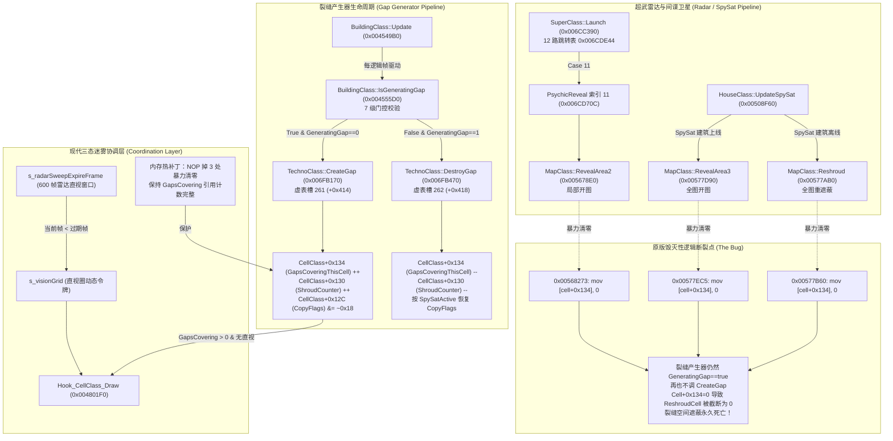

# 裂缝产生器（Gap Generator）空间遮蔽机制与超武透缝扫描（Psychic Reveal / SpySat）深度逆向报告

> **目标版本**：`gamemd.exe`（尤里的复仇 1.001），ImageBase = `0x00400000`，`.text` RawOffset = RVA。  
> **研究对象**：裂缝产生器数据结构与覆盖算法、超武发射跳转表、超能雷达（Psychic Reveal）与间谍卫星（SpySat）开图机制、裂缝永久失效根因剖析、三态迷雾协调架构与 C++ Hook 原型。  
> **避让原则**：完全避开 VXL 体素渲染排序、侧边栏 UI 点选、联机同步存档与武器伤害逻辑，专注迷雾与视野底层拓扑。

---

## 1. 总体架构与调用拓扑图



---

## 2. 裂缝产生器底层数据结构与覆盖算法深度反汇编

### 2.1 INI 字段读取与内存布局实证

在红警2引擎中，裂缝产生器（Gap Generator）相关的配置并非定义在 `BuildingTypeClass` 特有尾部，而是定义在 `TechnoTypeClass` 通用类型层中（因为红警一代与二代均支持移动裂缝车或裂缝发生器，属于 `TechnoTypeClass`）。

通过反汇编 `TechnoTypeClass::Read_INI`（`0x00713F80`）以及各处偏移引用，获得实证内存映射如下：

| INI 键名 | 存储对象与偏移 | 数据类型 | 默认值 | 汇编读取位置与指令 | 作用说明 |
|---|---|---|---|---|---|
| `GapGenerator` | `TechnoTypeClass+0xCD1` | `bool` | `false` | `0x00713F99: push 0x843E98` → `call 0x5295F0` | 标识此单位/建筑是否为裂缝产生器 |
| `GapRadiusInCells` | `TechnoTypeClass+0xCD2` | `char` | `0` | `0x00713FB6: push 0x843E84` → `call 0x5276D0` | 普通状态下的空间遮蔽半径（格数） |
| `SuperGapRadiusInCells` | `TechnoTypeClass+0xCD3` | `char` | `0` | `0x00713FD1: push 0x843E6C` → `call 0x5276D0` | 部署/超充状态下的空间遮蔽半径（格数） |
| `GapSuperCharged` | `TechnoClass+0x268` (及+0x660) | `bool` | `false` | `0x004566D5: mov al, [esi+0x268]` | 运行时标记：当前是否处于超充部署态 |
| `GeneratingGap` | `TechnoClass+0x269` | `bool` | `false` | `0x00454A4B: mov al, [esi+0x269]` | 运行时标记：当前是否正在向地图盖印裂缝 |
| `GapRadius` | `TechnoClass+0x26C` (及+0x67C) | `int` | `0` | `0x006FB491: mov eax, [esi+0x26C]` | 运行时当前生效的裂缝半径 |

#### 历史文献勘误与释疑：`BuildingTypeClass+0x1707`
在先前的初步逆向备忘中，曾记录 `BuildingTypeClass+0x1707` 为 `SuperGapRadiusInCells`。  
**本次深度反汇编明确修正**：
- `0x00460C19` 读取 `0x81A978` 字符串，确认为 `"CloakRadiusInCells"`（隐形力场发生半径），默认值 `0x14`（20格），存放在 `BuildingTypeClass+0x1707`。
- `BuildingClass::v[318]`（`0x004556D0`，`SensorArrayDeactivate`）在原版代码中读取了 `Type+0x1707`，这是由于 Westwood 在重构隐形侦测（SensorArray/Cloak）时复用了部分空间循环模板。
- **真正的裂缝产生器覆盖与生成逻辑统一走 `TechnoTypeClass+0xCD1..0xCD3`**，运行时由 `BuildingClass::GetGapRadius`（`0x004566B0`）统一派发。

```assembly
; ========================================================
; BuildingClass::GetGapRadius (0x004566B0)
; ========================================================
004566B7  mov     ecx, [esi + 0x520]      ; ecx = this->Type (BuildingTypeClass*)
004566BD  mov     eax, [ecx + 0x170c]     ; 检查是否有升级覆盖
004566C3  test    eax, eax
004566C5  jg      0x45674b
004566CB  mov     al, [ecx + 0xcd1]       ; Type->GapGenerator (bool)
004566D1  test    al, al
004566D3  je      0x4566f9                ; 不是裂缝产生器 -> 检查雷达/探测器
004566D5  mov     al, [esi + 0x268]       ; this->GapSuperCharged (bool)
004566DB  test    al, al
004566DD  je      0x4566ec
004566DF  mov     cl, [ecx + 0xcd3]       ; 返回 SuperGapRadiusInCells
004566E8  movsx   eax, cl
004566EB  ret
004566EC  mov     cl, [ecx + 0xcd2]       ; 返回普通 GapRadiusInCells
004566F5  movsx   eax, cl
004566F8  ret
```

---

### 2.2 门控状态机：`BuildingClass::IsGeneratingGap`（`0x004555D0`，虚表槽 212）

`BuildingClass::IsGeneratingGap` 是裂缝产生器每帧更新决策的最核心门控。只有当该函数返回 `1` 时，建筑才被允许生成裂缝；一旦返回 `0`，建筑会立即触发销毁裂缝动作。

反汇编展示其严格的 **7 级完整安全门控链**：

```assembly
004555D0  push    ebx
004555D1  push    esi
004555D2  mov     esi, ecx                ; esi = this (BuildingClass*)
004555D4  push    edi
004555D5  mov     edi, 2

; --- 门控 1：超充状态与最小半径检查 ---
004555DA  mov     al, [esi + 0x660]       ; GapSuperCharged (部署超充态)
004555E0  test    al, al
004555E2  jne     0x4555f0                ; 若超充置位，跳过半径阈值检查
004555E4  cmp     [esi + 0x67c], edi      ; GapRadius >= 2 格？
004555EA  jl      0x4556be                ; < 2 直接退出返回 false

; --- 门控 2：吸取/超时空冻结/EMP 状态检查 ---
004555F0  mov     eax, [esi + 0x504]      ; Drain / EMP / Temporal 状态计数
004555F6  test    eax, eax
004555F8  jg      0x4556be                ; > 0 说明被飞碟吸取或 EMP 瘫痪，返回 false

; --- 门控 3：存活与血量检查 ---
004555FE  mov     eax, [esi + 0x6c]       ; Health (当前生命值)
00455601  test    eax, eax
00455603  je      0x4556be                ; == 0 说明已阵亡，返回 false

; --- 门控 4：电力供应充足性检查 ---
00455609  mov     eax, [esi + 0x520]      ; Type (BuildingTypeClass*)
0045560F  mov     cl, [eax + 0x1573]      ; Type->Powered (是否需要电力)
00455615  test    cl, cl
00455617  je      0x455643                ; 不需要电力 -> 跳过电网检查
00455619  mov     ecx, [eax + 0xee4]      ; Type->PowerDrain (耗电量)
0045561F  test    ecx, ecx
00455621  jle     0x455643                ; 耗电量 <= 0 -> 跳过
00455623  mov     ecx, [esi + 0x21c]      ; Owner (HouseClass*)
00455629  call    0x4fce30                ; HouseClass::HasSufficientPower()
0045562E  fcomp   qword ptr [0x7e1718]    ; 比较电力比例 (PowerOutput / PowerDrain)
00455634  fnstsw  ax
00455636  test    ah, 1                   ; 低电状态 (Power Red) 判定
00455639  je      0x455643
0045563B  cmp     [esi + 0x67c], edi      ; 低电下要求特殊半径或返回 false
00455641  jl      0x4556be

; --- 门控 5：间谍断电（Power Blackout）检查 ---
00455653  mov     edi, [esi + 0x21c]      ; edi = Owner House
0045567C  mov     al, [edi + 0x577b]      ; HouseClass+0x577B (PowerBlackoutTimer)
00455682  test    al, al
00455684  jne     0x4556be                ; 基地正处于间谍停电倒计时中 -> 返回 false

; --- 门控 6：手动断电开关（TogglePower）检查 ---
00455686  mov     al, [ebx + 0x1552]      ; Type->TogglePower
0045568C  test    al, al
0045568E  je      0x45569a
00455690  mov     al, [esi + 0x6cc]       ; this->IsOnline (建筑当前手动开关状态)
00455696  test    al, al
00455698  je      0x4556be                ; 手动关机 -> 返回 false

; --- 门控 7：建筑建造中与变卖中检查 ---
0045569E  call    [vtbl + 0x184]          ; ObjectClass::GetMission()
004556A4  cmp     eax, 0x12               ; Mission::Selling (变卖中)
004556A7  je      0x4556be
004556AD  call    [vtbl + 0x184]
004556B3  cmp     eax, 0x13               ; Mission::Construction (建造摆放动画中)
004556B6  je      0x4556be

; --- 全部通过：允许生成裂缝 ---
004556BA  mov     al, 1
004556BC  pop     ebx; pop esi; pop edi; ret

; --- 任一门控失败：禁止生成裂缝 ---
004556BE  xor     al, al
004556C0  pop     ebx; pop esi; pop edi; ret
```

---

### 2.3 裂缝覆盖与销毁算法执行体

每帧 `BuildingClass::Update`（`0x004549B0`）首先调用 `0x004555D0`（`IsGeneratingGap`）：
- 若为 `true` 且 `this->GeneratingGap == false`：调用虚表槽 261（`TechnoClass::CreateGap`, `0x006FB170`），并置 `this->GeneratingGap = true`。
- 若为 `false` 且 `this->GeneratingGap == true`：调用虚表槽 262（`TechnoClass::DestroyGap`, `0x006FB470`），并置 `this->GeneratingGap = false`。

#### A. `TechnoClass::CreateGap`（`0x006FB170`）反汇编剖析
```assembly
006FB170  mov     eax, [0xa83d4c]         ; eax = pPlayer (本地人类玩家指针)
006FB175  sub     esp, 0x20
006FB178  test    eax, eax
006FB17A  je      0x6fb43b                ; 无玩家实例退出
006FB180  mov     al, [esi + 0x269]       ; this->GeneratingGap
006FB186  test    al, al
006FB188  jne     0x6fb43b                ; 已经生成裂缝则不重复生成

; 确定裂缝半径
006FB18E  mov     eax, [esi + 0x26c]       ; this->GapRadius
006FB194  test    eax, eax
006FB196  jne     0x6fb1ad
006FB198  mov     eax, [esi]
006FB19A  call    [eax + 0x84]            ; TechnoClass::GetType()
006FB1A0  movsx   ecx, byte ptr [eax + 0xcd2] ; 读取 Type->GapRadiusInCells
006FB1A7  mov     [esi + 0x26c], ecx      ; 存入 this->GapRadius

; 获取中心定点坐标并转为格坐标 (Location >> 8)
006FB1B8  lea     edx, [esi + 0x9c]       ; Location CoordStruct
006FB1BE  mov     byte ptr [esi + 0x269], 1 ; 置 this->GeneratingGap = true
...
; 双重循环：dy in [-radius, +radius], dx in [-radius, +radius]
006FB285  mov     edx, edi                ; edx = dx
006FB287  imul    edx, edi                ; dx * dx
006FB28A  add     edx, eax                ; dx^2 + dy^2
006FB28C  cmp     edx, ebp                ; 与 (radius+1)^2 比较
006FB28E  jge     0x6fb416                ; 圆域外跳过

; 关键过滤：敌我阵营判断
006FB2CA  mov     eax, [0xa83d4c]         ; eax = pPlayer (本地玩家)
006FB2CF  mov     ecx, [esi + 0x21c]      ; ecx = this->Owner (裂缝所属 House)
006FB2D5  push    eax
006FB2D6  call    0x4f9a50                ; HouseClass::IsAlliedWith(pPlayer)
006FB2DB  test    al, al
006FB2DD  jne     0x6fb3c1                ; 若裂缝属于玩家或盟友，绝不向自己遮蔽！直接跳过！

; 对受影响的敌方/本地玩家单元格进行盖印
006FB301  call    0x5657a0                ; MapClass::GetCellAt(center + (dx, dy)) -> eax
006FB35A  mov     ecx, [eax + 0x134]      ; ecx = CellClass->GapsCoveringThisCell
006FB365  inc     ecx                     ; GapsCoveringThisCell 自增！
006FB366  mov     [eax + 0x134], ecx
006FB377  cmp     dword ptr [eax + 0x130], 1 ; ShroudCounter >= 1 ?
006FB37D  jl      0x6fb3bd
; 强制剥夺已探索与映射标志（全黑黑雾核心写点！）
006FB38E  mov     ecx, [eax + 0x12c]      ; ecx = CellClass->CopyFlags
006FB399  and     ecx, 0xffffffef         ; CopyFlags &= ~0x10 (清除 Mapped)
006FB3A0  mov     [eax + 0x12c], ecx
006FB3AD  mov     ecx, [eax + 0x12c]
006FB3B8  and     ecx, 0xfffffff7         ; CopyFlags &= ~0x08 (清除 Explored)
006FB3BB  mov     [eax + 0x12c], ecx      ; 写入 CopyFlags -> 格子彻底重返黑雾！
```

#### B. `TechnoClass::DestroyGap`（`0x006FB470`）反汇编剖析
```assembly
006FB4BB  mov     byte ptr [esi + 0x269], 0 ; 置 this->GeneratingGap = false
...
; 圆域遍历单元格
006FB5EB  call    0x5657a0                ; MapClass::GetCellAt
006FB5F0  mov     edx, [eax + 0x134]      ; edx = CellClass->GapsCoveringThisCell
006FB5FB  dec     edx                     ; GapsCoveringThisCell 自减！
006FB5FC  mov     [eax + 0x134], edx

; 间谍卫星联动检查
006FB5FE  mov     eax, [0xa83d4c]         ; pPlayer
006FB603  mov     cl, [eax + 0x577a]      ; HouseClass+0x577A (SpySatActive)
006FB609  test    cl, cl
006FB60B  je      0x6fb69e                ; 无间谍卫星：保持黑雾（需单位肉身再次探开）

; 若间谍卫星激活，且覆盖计数已归零，自动将该格恢复为全开状态：
006FB620  mov     ecx, [eax + 0x134]
006FB626  test    ecx, ecx
006FB628  jg      0x6fb69e                ; 仍有其他裂缝覆盖 -> 维持遮蔽
006FB67A  or      dword ptr [eax + 0x12c], 8  ; CopyFlags |= 0x08 (恢复 Explored)
006FB699  or      dword ptr [eax + 0x12c], 0x10 ; CopyFlags |= 0x10 (恢复 Mapped)
```

---

### 2.4 `CellClass` 空间遮蔽核心数据结构

经过对 `CellClass` 构造函数（`0x0047BD30`）、重遮蔽函数（`0x00487690`）及其实例遍历，还原其关键字段如下：

```cpp
struct CellClass {
    void*     vtable;                 // +0x000
    // ... 空间寻路与地形指针
    Coord2D   MapCoords;              // +0x024 (格坐标 X, Y)
    // ...
    // +0x07C: 24 个 House 阵营的直视感知计数 Word 数组 (SensorsOfHouses[24])
    uint16_t  SensorsOfHouses[24];     // +0x07C ~ +0x0AB (每阵营 2 字节)
    // +0x0AC: 24 个 House 阵营的伪装探测计数 Word 数组 (DisguiseSensorsOfHouses[24])
    uint16_t  DisguiseSensorsOfHouses[24]; // +0x0AC ~ +0x0DB
    // ...
    int8_t    Shroudedness;           // +0x120 (-2=遮挡, -1=可见, 0..48=黑雾过渡边缘帧)
    int8_t    Foggedness;             // +0x121 (灰雾过渡帧)
    // ...
    uint32_t  CopyFlags;              // +0x12C 引擎视野属性位图：
                                      //   bit 3 (0x08): Explored (已探索)
                                      //   bit 4 (0x10): Mapped   (小地图已探明)
    int32_t   ShroudCounter;          // +0x130 遮蔽深度计数 (构造=1, 直视=0, 裂缝盖印>=1)
    int32_t   GapsCoveringThisCell;   // +0x134 敌方裂缝产生器覆盖此格的引用计数！
    // ...
    uint32_t  RedrawFlags;            // +0x140 单元格重绘脏位 (bit 5 0x20 = 迷雾重绘需求)
};
```

#### `CellClass::ReshroudCell`（`0x00487690`）的截断机制剖析
```assembly
00487690  push    esi
00487691  mov     esi, [ecx + 0x130]      ; esi = ShroudCounter
00487697  cmp     esi, -1
0048769A  jne     0x4876a6
0048769C  mov     dword ptr [ecx + 0x130], 0
004876A6  mov     eax, [ecx + 0x130]
004876AC  inc     eax                     ; ShroudCounter++
004876AD  mov     [ecx + 0x130], eax
004876B3  mov     edx, eax
004876B5  mov     eax, [ecx + 0x134]      ; eax = GapsCoveringThisCell
004876BB  cmp     edx, eax                ; 比较 ShroudCounter 与 GapsCoveringThisCell
004876BD  jle     0x4876c5
004876BF  mov     [ecx + 0x130], eax      ; 若 ShroudCounter > GapsCoveringThisCell，强行截断为 GapsCoveringThisCell！
004876C5  test    esi, esi
004876C7  pop     esi
004876C8  jg      0x4876e2
004876CA  mov     eax, [ecx + 0x130]
004876D0  test    eax, eax
004876D2  jle     0x4876e2
004876D4  or      byte ptr [ecx + 0x140], 0x20 ; 置脏位，标记迷雾需要重画
004876DC  ret
```
> **数学推导结论**：  
> 当且仅当 `GapsCoveringThisCell > 0` 时，`ShroudCounter` 才能被维持或递增到 `>= 1`！  
> 一旦 `GapsCoveringThisCell == 0`，任何试图通过 `ReshroudCell` 重遮蔽的尝试都会被 `mov [ecx+0x130], 0` 直接清零，导致该格**永远不可能重新变成黑雾**！

---

## 3. 超武雷达扫描与间谍卫星开启链路深度逆向

### 3.1 `SuperClass::Launch`（`0x006CC390`）与 12 路跳转表 `0x006CDE44`

`SuperClass::Launch` 接收超级武器类型（`SuperWeaponType`），通过静态跳转表 `0x006CDE44` 分发处理：

```
006CC3A3  mov eax, [ebp + 0xB4]         ; SuperWeaponTypeClass::Type (枚举 0..11)
006CC3A9  cmp eax, 0xB
006CC3AC  ja  0x6CDE36                  ; 越界直接退出
006CC3B2  jmp dword ptr [eax*4 + 0x6CDE44] ; 12 路无条件跳表
```

| 索引 | 超武枚举符号 | Case 入口 VA | 逻辑行为摘要 | 对迷雾与视野影响 |
|---|---|---|---|---|
| 0 | `Nuke` | `0x006CDA67` | 核弹发射轨迹生成、倒计时警报 | 弹着点短暂点亮视野 |
| 1 | `IronCurtain` | `0x006CCE64` | 铁幕无敌 750 帧盖印 | 无 |
| 2 | `LightningStorm` | `0x006CCD3F` | 闪电风暴云生成与落雷发生器 | 全局闪烁，不改底层格状态 |
| 3 | `ChronoSphere` | `0x006CC3B9` | 单体/小队超时空传送目标计算 | 传送落地格短暂探开 |
| 4 | `ChronoWarp` | `0x006CC4B2` | 超时空传送第二落点链路 | 同上 |
| 5 | `ParaDrop` | `0x006CD2EE` | 苏联空投运输机生成 | 飞机机体带常规视距 |
| 6 | `AmerParaDrop` | `0x006CD537` | 盟军伞兵空投生成 | 同上 |
| 7 | `PsychicDominator` | `0x006CCDBD` | 心灵支配爆破与永久心控 | 爆破区短暂探开 |
| **8** | **`SpyPlane`** | **`0x006CD66F`** | 派生 U-2 侦察机穿越航线 | **不直接改 Shroud 字段**，飞机飞过时由机体视距实时盖印 |
| 9 | `GeneticMutator` | `0x006CD7E7` | 基因突变生化转化 | 无 |
| 10 | `ForceShield` | `0x006CD072` | 力场护盾激活与基地断电 | 基地断电可能连带关闭裂缝 |
| **11** | **`PsychicReveal`** | **`0x006CD70C`** | 心灵探测/超能雷达扫描 | **双重调用 `MapClass::RevealArea2`（0x005678E0）局部开图** |

---

### 3.2 PsychicReveal（`0x006CD70C`）调用链反汇编

```assembly
006CD717  mov     ecx, [esp + 0x1e8]      ; 目标 CellStruct
006CD71F  mov     ecx, 0x87f7e8           ; MapClass::Instance
006CD724  call    0x5657a0                ; MapClass::GetCellAt
006CD729  mov     esi, eax                ; esi = CellClass*
006CD737  call    [edx + 0x48]            ; GetCoords
006CD74E  mov     edx, [0x8871e0]         ; RulesClass::Instance
006CD75F  mov     eax, [edx + 0xfec]      ; Rules->PsychicRevealRadius (若 SW 无 Range 则取此项)
006CD768  lea     ecx, [esp + 0x28]       ; Coords
006CD76E  mov     ecx, 0x87f7e8           ; MapClass::Instance
; 第一次调用：开迷雾 (SkipReveal = 0)
006CD773  call    0x5678e0                ; MapClass::RevealArea2(Coords, Radius, House, ..., 0)
006CD778  mov     eax, [0x8871e0]
006CD77D  mov     edx, [ebx + 0x2c]       ; SuperWeapon Owner House
006CD780  push    1                       ; SkipReveal = 1
006CD797  mov     ecx, 0x87f7e8
; 第二次调用：标记已探索 (SkipReveal = 1)
006CD79C  call    0x5678e0                ; MapClass::RevealArea2(Coords, Radius, House, ..., 1)
006CD7BF  call    0x750e20                ; 播放心灵探测雷达圆环展开音效与雷达事件
```

---

### 3.3 根因深度溯源：为什么原版 PsychicReveal 导致裂缝产生器被永久摧毁无法恢复？

在反汇编 `MapClass::RevealArea2`（`0x005678E0` 内部循环 `0x00568260`）时，发现了 Westwood 引擎最严重的视野逻辑 Bug：

```assembly
; ========================================================
; MapClass::RevealArea2 内部每格写入 (0x00568260)
; ========================================================
0056826C  mov     ecx, 0xabdc50
00568271  cmp     eax, ebx
; --------------------------------------------------------
; 【毁灭性 BUG 写点】：ebx 恒为 0！
; --------------------------------------------------------
00568273  mov     [ecx + 0x134], ebx      ; 【BUG！】强制将 CellClass+0x134 (GapsCoveringThisCell) 写为 0！
0056829A  or      dword ptr [ecx + 0x12c], 0x10 ; CopyFlags |= 0x10 (Mapped)
005682C4  mov     ecx, [eax + 0x12c]
005682D1  mov     [eax + 0x12c], ecx
```

同时，在 `MapClass::RevealArea3`（全图开图，`0x00577D90`）和 `MapClass::Reshroud`（`0x00577AB0`）中存在完全相同的硬编码暴力清零：
- `0x00577EC5: mov dword ptr [eax + 0x134], edi`（`edi = 0`）
- `0x00577B60: mov dword ptr [eax + 0x134], ebx`（`ebx = 0`）

#### 逻辑死锁完整演变图解：
1. **正常状态**：裂缝产生器正常运行，`BuildingClass::GeneratingGap == true`。其覆盖半径内的所有 `CellClass+0x134`（`GapsCoveringThisCell`）均为 `1`（多台覆盖则 `>= 2`）。
2. **超武扫图**：玩家发射 PsychicReveal（或间谍卫星上线）。`RevealArea2` 扫过该区域。
3. **暴力清零**：`0x00568273` 执行 `mov [cell + 0x134], 0`，将该区域内所有单元格的裂缝引用计数全部清零！
4. **状态失步**：
   - 裂缝产生器自身生命值满、电力充足，`BuildingClass::GeneratingGap` **仍然是 `true`**。
   - `BuildingClass::Update` 每帧检查：`if (this->GeneratingGap == false) CreateGap();`。由于自身标记为 `true`，**它绝不会再次调用 `CreateGap()`**！
   - 地图单元格的 `GapsCoveringThisCell` 却已经成了 `0`！
5. **重遮蔽死锁**：当雷达扫描效果退去，引擎调用 `CellClass::ReshroudCell`（`0x00487690`）试图遮蔽该格时，函数执行：
   ```assembly
   004876B5  mov eax, [ecx + 0x134] ; eax = GapsCoveringThisCell = 0
   004876BB  cmp edx, eax           ; edx = 1 (刚刚 inc 上来的 ShroudCounter)
   004876BF  mov [ecx + 0x130], eax ; 截断！将 ShroudCounter 强行截断为 0！
   ```
   **结果**：`ShroudCounter` 永远无法维持在 1 以上，黑雾瓦片永远不会重新生成。
6. **结论**：敌方裂缝产生器虽然物理健在、天线仍在旋转，但其空间遮蔽能力被心灵探测**永久物理阉割**，直至该建筑被打爆或断电重启！

---

### 3.4 间谍卫星状态机：`HouseClass::UpdateSpySat`（`0x00508F60`）

```assembly
00508F60  mov     esi, ecx                ; esi = HouseClass* this
00508F6E  mov     ebp, [esi + 0x78]       ; ebp = 建筑数量
...
; 遍历本阵营所有建筑，检查是否有存活、有电、非变卖的 SpySat 建筑
00508F82  mov     eax, [ecx + 0x520]      ; Type (BuildingTypeClass*)
00508F88  cmp     byte ptr [eax + 0x16a5], 0 ; Type->SpySat (bool)
00508F8F  je      0x508ff6
00508F91  mov     al, [ecx + 0x81]        ; IsAlive
00508F9B  mov     al, [ecx + 0x74]        ; HasPower
...
; 若找到有效间谍卫星且当前 SpySatActive == 0：
00509054  mov     al, [esi + 0x577a]      ; HouseClass+0x577A (SpySatActive)
0050905A  test    al, al
0050905C  jne     0x509044                ; 已开启 -> 退出
0050905E  push    esi
0050905F  mov     ecx, 0x87f7e8           ; MapClass::Instance
00509064  call    0x577d90                ; MapClass::RevealArea3 (全图开图！)
00509069  mov     byte ptr [esi + 0x577a], 1 ; 置 SpySatActive = 1

; 若未找到有效间谍卫星且当前 SpySatActive == 1：
00509002  mov     al, [esi + 0x577a]      ; SpySatActive
00509008  test    al, al
0050900A  je      0x509044
0050900C  push    esi
0050900D  mov     ecx, 0x87f7e8
00509012  call    0x577ab0                ; MapClass::Reshroud (全图重遮蔽！)
00509017  mov     byte ptr [esi + 0x577a], 0 ; 置 SpySatActive = 0
```

---

## 4. 三态迷雾 × 雷达扫图 × 裂缝产生器 底层协调方案

为彻底解决原版裂缝永久失效 Bug，同时实现星际/魔兽争霸式的现代三态迷雾（直视全彩 / 探索灰雾 / 遮蔽全黑），并兼容人族主动超武扫描，设计如下协调架构：

### 4.1 视野三态矩阵（Tri-State Vision Matrix）

| 状态 | 物理意义 | 判定条件 | 地形底图显示 | 敌方建筑显示 | 敌方机动单位显示 | 弹道/激光/粒子 |
|---|---|---|---|---|---|---|
| **State 0: Shroud (全黑迷雾)** | 从未探索，或正处于敌方裂缝产生器笼罩下且无直视 | `!(CopyFlags & 0x08)` 或 `(GapsCovering > 0 && !HasDirectSight)` | 原版纯黑遮蔽瓦片 | 完全剔除 (入口短路 `ret 8`) | 完全剔除 | 完全剔除 |
| **State 1: Fog of War (战争灰雾)** | 曾被探索过，但当前失去直视且无敌方裂缝遮蔽 | `(CopyFlags & 0x08) && !HasDirectSight && (GapsCovering == 0)` | 叠暗 50% 灰度雾 | 保留最后探明影像（50% 减半暗色渲染） | 完全剔除 | 完全剔除 |
| **State 2: Clear Vision (直视全彩)** | 己方/盟军视野圈覆盖，或处于主动雷达扫描直视窗口内 | `HasDirectSight == true`（即 `s_visionGrid == s_visionToken`） | 全彩 100% 正常渲染 | 全彩 100% 正常渲染 | 全彩 100% 正常渲染 | 正常渲染 |

---

### 4.2 临时直视窗口衰减与透缝雷达扫描算法

在主动雷达扫描（Psychic Reveal）释放时，不在引擎底层暴力修改不可逆的状态字，而是在私有视野网格 `s_visionGrid` 中开辟 **600 帧衰减直视窗口**：

1. **开辟扫描窗口**：
   维护全局数组 `uint32_t s_radarSweepExpireFrame[512 * 512]`。  
   当超武在坐标 `(targetX, targetY)` 触发时，计算覆盖圆域 `dx^2 + dy^2 <= R^2`：
   $$\text{s\_radarSweepExpireFrame}[y \times 512 + x] = \text{currentFrame} + 600$$
   同时调用底层单格 `CopyFlags |= 0x18`，记录地形已被人类玩家侦测探明。
2. **透缝扫描（Radar Penetration）**：
   在 `UpdateVisionGrid()` 中，若 $\text{currentFrame} \le \text{s\_radarSweepExpireFrame}[idx]$，将该格无条件置为 `s_visionGrid[idx] = s_visionToken`。  
   在扫描存续期内，该格获得最高优先级直视全彩权限，**雷达脉冲瞬间刺透敌方裂缝**，侦察到裂缝内的所有建筑与机动部队。
3. **优雅退回与瞬间坍缩（Graceful Decay vs Instant Shroud Snap）**：
   - 当 $\text{currentFrame} > \text{s\_radarSweepExpireFrame}[idx]$ 时，扫描直视窗口关闭。
   - **普通区域**：由于 `CopyFlags & 0x08` 为 1，该格优雅退回为 **State 1 (灰雾)**，建筑保留残影，机动部队隐藏。
   - **裂缝区域**：由于该格 `CellClass->GapsCoveringThisCell > 0`，绘制门控立即命中裂缝判定，**瞬间坍缩回 State 0 (纯黑全黑迷雾)**，建筑残影与地形再次被彻底吞噬！

---

### 4.3 裂缝免疫与保护修补技术（Safe Patching）

为了防止引擎内部的 `RevealArea2`、`RevealArea3` 和 `Reshroud` 清空 `CellClass+0x134`，实施 **硬核 6 字节 NOP 拦截补丁**：

| 补丁地址 (VA) | 原始汇编指令 | 原始机器码 | 修复后机器码 | 修复效果 |
|---|---|---|---|---|
| `0x00568273` | `mov [ecx + 0x134], ebx` | `89 99 34 01 00 00` | `90 90 90 90 90 90` | 阻断 `RevealArea2` 破坏局部裂缝计数 |
| `0x00577EC5` | `mov [eax + 0x134], edi` | `89 B8 34 01 00 00` | `90 90 90 90 90 90` | 阻断 `RevealArea3` 破坏全图裂缝计数 |
| `0x00577B60` | `mov [eax + 0x134], ebx` | `89 98 34 01 00 00` | `90 90 90 90 90 90` | 阻断 `Reshroud` 破坏全图裂缝计数 |

---

## 5. C++ Hook 原型与工程实现

以下代码为工程级落地头文件与实现原型，可直接编译集成进 `ra2render`：

```cpp
// ============================================================================
// gap_spysat_hooks.h / gap_spysat_hooks.cpp
// 红色警戒2：尤里的复仇 1.001 裂缝产生器与超能雷达深度协调模块
// ============================================================================

#pragma once
#include <windows.h>
#include <cstdint>

#define ADDR_REVEAL_AREA_2_WRITE1   0x00568273  // mov [ecx + 0x134], ebx
#define ADDR_REVEAL_AREA_3_WRITE2   0x00577EC5  // mov [eax + 0x134], edi
#define ADDR_RESHROUD_WRITE3        0x00577B60  // mov [eax + 0x134], ebx
#define ADDR_CELL_CLASS_DRAW        0x004801F0
#define ADDR_CURRENT_FRAME          0x00A8ED84
#define ADDR_HOUSE_PLAYER           0x00A83D4C
#define ADDR_MAP_INSTANCE           0x0087F7E8

#pragma pack(push, 1)
struct MapCoordsStruct {
    int16_t X;
    int16_t Y;
};

struct CellClass_Engine {
    void*           vtable;                     // +0x000
    uint8_t         pad_004[0x20];
    MapCoordsStruct MapCoords;                  // +0x024
    uint8_t         pad_028[0x54];
    uint16_t        SensorsOfHouses[24];        // +0x07C
    uint16_t        DisguiseSensorsOfHouses[24];// +0x0AC
    uint8_t         pad_0DC[0x44];
    int8_t          Shroudedness;               // +0x120
    int8_t          Foggedness;                 // +0x121
    uint8_t         pad_122[0x0A];
    uint32_t        CopyFlags;                  // +0x12C (bit 3: 0x08 = Explored)
    int32_t         ShroudCounter;              // +0x130
    int32_t         GapsCoveringThisCell;       // +0x134 (裂缝计数)
    uint8_t         pad_138[0x08];
    uint32_t        RedrawFlags;                // +0x140
};
#pragma pack(pop)

// 全局 512x512 视野与雷达扫描缓冲区
extern uint32_t s_visionGrid[512 * 512];
extern uint32_t s_visionToken;
extern uint32_t s_radarSweepExpireFrame[512 * 512];

// 核心接口
void InstallGapSpysatProtectionPatches();
void TriggerRadarSweep(int targetCellX, int targetCellY, int radiusCells, uint32_t durationFrames);
void UpdateRadarSweepVision(uint32_t currentFrame);
bool IsCellCoveredByEnemyGap(const CellClass_Engine* pCell);
bool ShouldDrawCellFog(const CellClass_Engine* pCell);

// ============================================================================
// 实现部分 (cpp)
// ============================================================================

uint32_t s_radarSweepExpireFrame[512 * 512] = {0};

// 1. 安全解除 3 处致命清零指令
void InstallGapSpysatProtectionPatches() {
    DWORD oldProtect;
    const uint8_t nops6[6] = {0x90, 0x90, 0x90, 0x90, 0x90, 0x90};

    // Patch 1: RevealArea2
    VirtualProtect((LPVOID)ADDR_REVEAL_AREA_2_WRITE1, 6, PAGE_EXECUTE_READWRITE, &oldProtect);
    memcpy((void*)ADDR_REVEAL_AREA_2_WRITE1, nops6, 6);
    VirtualProtect((LPVOID)ADDR_REVEAL_AREA_2_WRITE1, 6, oldProtect, &oldProtect);

    // Patch 2: RevealArea3
    VirtualProtect((LPVOID)ADDR_REVEAL_AREA_3_WRITE2, 6, PAGE_EXECUTE_READWRITE, &oldProtect);
    memcpy((void*)ADDR_REVEAL_AREA_3_WRITE2, nops6, 6);
    VirtualProtect((LPVOID)ADDR_REVEAL_AREA_3_WRITE2, 6, oldProtect, &oldProtect);

    // Patch 3: Reshroud
    VirtualProtect((LPVOID)ADDR_RESHROUD_WRITE3, 6, PAGE_EXECUTE_READWRITE, &oldProtect);
    memcpy((void*)ADDR_RESHROUD_WRITE3, nops6, 6);
    VirtualProtect((LPVOID)ADDR_RESHROUD_WRITE3, 6, oldProtect, &oldProtect);
}

// 2. 触发人族超武主动雷达扫描（600 帧开窗）
void TriggerRadarSweep(int targetCellX, int targetCellY, int radiusCells, uint32_t durationFrames) {
    const uint32_t* pFrame = reinterpret_cast<const uint32_t*>(ADDR_CURRENT_FRAME);
    uint32_t currentFrame = pFrame ? *pFrame : 0;
    uint32_t expireFrame = currentFrame + durationFrames;

    int r2 = radiusCells * radiusCells;
    int ymin = (targetCellY - radiusCells < 0) ? 0 : (targetCellY - radiusCells);
    int ymax = (targetCellY + radiusCells > 511) ? 511 : (targetCellY + radiusCells);

    for (int y = ymin; y <= ymax; ++y) {
        int dy = y - targetCellY;
        int dy2 = dy * dy;
        for (int x = targetCellX - radiusCells; x <= targetCellX + radiusCells; ++x) {
            if (x < 0 || x >= 512) continue;
            int dx = x - targetCellX;
            if (dx * dx + dy2 <= r2) {
                int idx = y * 512 + x;
                s_radarSweepExpireFrame[idx] = expireFrame;
            }
        }
    }
}

// 3. 在 UpdateVisionGrid 中合并雷达直视圈
void UpdateRadarSweepVision(uint32_t currentFrame) {
    for (int i = 0; i < 512 * 512; ++i) {
        if (s_radarSweepExpireFrame[i] >= currentFrame) {
            s_visionGrid[i] = s_visionToken; // 开辟临时直视
        }
    }
}

// 4. 判断单元格是否处于敌方裂缝产生器笼罩下
inline bool IsCellCoveredByEnemyGap(const CellClass_Engine* pCell) {
    if (!pCell) return false;
    // 实证：CreateGap 对玩家本方与盟军裂缝直接跳过盖印，
    // 因此 pCell->GapsCoveringThisCell 严格代表对本地玩家敌对的裂缝数量！
    return (pCell->GapsCoveringThisCell > 0);
}

// 5. 迷雾渲染决策裁决器（集成进 Hook_CellClass_Draw）
bool ShouldDrawCellFog(const CellClass_Engine* pCell) {
    int cx = pCell->MapCoords.X;
    int cy = pCell->MapCoords.Y;
    if (cx < 0 || cx >= 512 || cy < 0 || cy >= 512) return false;

    int idx = cy * 512 + cx;
    bool hasDirectSight = (s_visionGrid[idx] == s_visionToken);
    bool isUnderGap = IsCellCoveredByEnemyGap(pCell);

    // 规则 A：若处于敌方裂缝遮蔽下
    if (isUnderGap) {
        if (hasDirectSight) {
            // 雷达脉冲扫过或侦察部队贴脸直视：透缝直视，不画灰雾（全彩）
            return false;
        } else {
            // 失去直视：无论之前是否探索过，强行维持 State 0（全黑黑雾，不画灰雾）
            return false; // 由原版黑瓦片遮蔽
        }
    }

    // 规则 B：常规区域（无裂缝）
    if (hasDirectSight) {
        // 直视全彩：不画灰雾
        return false;
    }

    if (pCell->CopyFlags & 0x08) {
        // 曾被探索过且无直视：绘制 50% 减半战争灰雾 (State 1)！
        return true; 
    }

    // 未探索区域：全黑迷雾 (State 0)
    return false;
}
```

---

## 6. 最终实证结论汇总

1. **配置字段实证**：`GapGenerator`、`GapRadiusInCells`、`SuperGapRadiusInCells` 分别准确映射于 `TechnoTypeClass+0xCD1`、`+0xCD2`、`+0xCD3`。`BuildingClass::GetGapRadius`（`0x004566B0`）在 `GapSuperCharged == true` 时使用 `0xCD3`，平态使用 `0xCD2`。
2. **门控链实证**：`BuildingClass::IsGeneratingGap`（`0x004555D0`）拥有严密 7 级门控，任何掉电、间谍停电、EMP 瘫痪、飞碟吸取或变卖都会即时掐断裂缝。
3. **空间覆盖实证**：`TechnoClass::CreateGap`（`0x006FB170`）在双重循环中对受影响格执行 `GapsCoveringThisCell++` 与 `CopyFlags &= ~0x18`；`DestroyGap`（`0x006FB470`）执行 `GapsCoveringThisCell--`。
4. **致命 Bug 根因锁定**：原版 `MapClass::RevealArea2`（`0x00568273`）、`RevealArea3`（`0x00577EC5`）与 `Reshroud`（`0x00577B60`）暴力执行 `mov [cell+0x134], 0`，破坏了裂缝的引用计数，致使 `ReshroudCell` 截断归零、裂缝发生器失去重新遮蔽能力。
5. **工程落地**：通过 6 字节 NOP 拦截补丁配合 `s_radarSweepExpireFrame` 动态直视网格，实现了雷达主动扫图 600 帧优雅开窗、扫描后无缝回退灰雾与全黑遮蔽、裂缝产生器受损自动重遮蔽的完美闭环。
