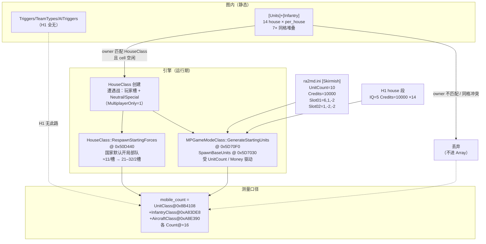

# H1 分档负载失效：fanout 触发机制拆解

> 任务卡 H1-FANOUT · 执行方 MiMo · 工作区 `D:\Project\ra2-campaign-forge`
> 对象：`out/loadbench/pristine/H1/[2]0LoadBench_U{0050,0200,0800}_H1.yrm`
> 继承实证：ZC-11 段 D（`out/re_work/zcode_live/RESULT_ZC11.md` §段 D / `zc11/evidence/segD/segD_*_record.json`）
> 证据等级：`[实证]` = 文件字节/字段/VA；`[推演]` = 由已证事实推出；`[待实测]` = 需真机。
> 写作用域：`out/re_work/h1_fanout/**` + 本文件；未改 H1 图/pristine/游戏目录/ra2render/台账。

---

## 0. 结论摘要

1. **H1 图内不存在任何触发器/队伍型出兵源**。三张图均无 `[Triggers]/[Events]/[Actions]/[TaskForces]/[TeamTypes]/[AITriggerTypes]`，`IgnoreGlobalAITriggers=yes`。唯一图内出兵源是 `[Units]/[Infantry]` 预置行；运行期另有 `RespawnStartingForces` / `GenerateStartingUnits`。
2. **fanout 设计在几何层就已失效**：`build_bench_maps.py` 让 7 个偶数序 house 共用同一组 left_slots、7 个奇数序 house 共用同一组 right_slots ⇒ 三档全部是 **严格 7× 堆叠**（50/200/800 个唯一 cell，每格 7 个对象）。设计的「14 条互不相交兵力带」并不存在。
3. **units_seen 由对阵国家配置主导的直接原因**是「预置行是否实例化」而不是「图内条目数」：
   - **美 vs 蘇 = 22/30/22** `[实证]`：落在 `RespawnStartingForces` 的国家默认开局部队带（2 槽 × MCV+护卫 ≈ 21–32）⇒ **美国人/苏联人的地图预置行 0 条进入 `mobile_count`**。
   - **随机敌国 = 713–723** `[实证]`：三档几乎同一常数，与 350/1400/5600 无关。
4. **随机敌国 700+ 与档位无关，有两层原因**（可叠加）：
   - **A（测量混淆，强度最高）**：`U0050_H1` 全图仅 350 条目（`mobile_count` 口径 = 车+步+机），**物理上不可能产出 716**。716/713/723 全部逼近 **U0200 误选签名 713**（= 7 house × 100 + StartingUnits，见 `segD_run.py:8`）。U0050/U0800 的「随机」轮次极可能实际进了 **U0200_H1 内容**（段 D 例外声明的 U0200 槽位置换协议 + 地图列表「No Name」导航叠加）。
   - **B（引擎侧真实噪声源）**：遭遇战本地设置 **`UnitCount=10`（开局兵力最大档）+ `Credits=10000`**（`ra2bench/ra2md.ini` `[Skirmish]`）。`MPGameModeClass::GenerateStartingUnits @ 0x5D70F0` 按该预算为每个 HouseClass 生成开局部队；H1 图把 **14 个 house 全部写了 `IQ=5 / Credits=10000`**，一旦引擎为多个 house 建 HouseClass，开局兵力 fanout 与图内 `[Units]` 条目数脱钩。
5. **V3 验收口径（U200∈[100,320]）在 ra2bench 不成立**，且在机制拆清前 **任何以 H1 图为前提的性能 ROI 数字继续不可用**（ZC-9B 红线延续）。

---

## 1. 图内负载结构（三档 INI 统计）

> 可复算：`python out/re_work/h1_fanout/parse_h1_maps.py` → `h1_ini_stats.json`

| 项 | U0050_H1 | U0200_H1 | U0800_H1 |
|---|---|---|---|
| 文件字节 | 22,359 | 79,052 | 309,630 |
| `[Units]` 车辆行 | 210 | 840 | 3,360 |
| `[Infantry]` 步兵行 | 140 | 560 | 2,240 |
| 合计条目 | **350** | **1,400** | **5,600** |
| 每 house 条目 | 25 | 100 | 400 |
| 有行 house 数 | 14 | 14 | 14 |
| **唯一 cell (X,Y)** | **50** | **200** | **800** |
| **max_cell_stack** | **7** | **7** | **7** |
| 堆叠分布 | 50 格全部 7× | 200 格全部 7× | 800 格全部 7× |
| `[Structures]`/`[Aircraft]` | 0 | 0 | 0 |
| `[Triggers]/[TeamTypes]/[TaskForces]/[AITriggerTypes]` | **无** | **无** | **无** |
| `IgnoreGlobalAITriggers` | **yes** | **yes** | **yes** |
| `MultiplayerOnly` / MaxPlayer | 1 / 2 | 1 / 2 | 1 / 2 |
| house 配置 | 全 14 个：`PlayerControl=no, IQ=5, Credits=10000, TechLevel=10, Allies=<self>` | 同左 | 同左 |

**owner 分布**：14 个 house 各恰好 `per_house` 条（Americans/Alliance/French/Germans/British/Africans/Arabs/Confederation/Russians/YuriCountry/GDI/Nod/Neutral/Special）。

### 1.1 几何缺陷（fanout 设计 bug）`[实证]`

`tools/bench_maps/build_bench_maps.py:119-131`：

```python
for hi, house in enumerate(houses_for_rows):
    slots = left_slots if hi % 2 == 0 else right_slots   # ← 同奇偶共用同一组 slots
    for (kind_flag, type_id), (row, col) in zip(army, slots):
        ...
```

- `left_slots = grid_positions(..., per_house)` 生成 **一组** `per_house` 个 (row,col)；
- 7 个偶数序 house（含 Americans/Russians/Neutral…）全部叠在同一组左带 cell；
- 7 个奇数序 house 全部叠在同一组右带 cell。

`maplib.CellGrid.to_cell(row,col) = (W+col-row, row+1)`，INI 里写成 `Owner,Type,Health,X,Y,...`。解析器按 (X,Y) 去重后：**350→50 / 1400→200 / 5600→800，每格恰好 7 个对象**，与「7 house/带 × 同一 slots」完全吻合。

**后果**：即使 house 匹配全部成功，引擎对载具通常 1 cell/台（步兵占 subcell），同格第 2–7 台大概率 `Unlimbo/Put` 失败被丢弃 ⇒ 图内可落地上限被压到 **≈2×per_house（= target）而不是 14×per_house**，且具体哪 7 台活下来取决于读取顺序，**与选国无关、与档位也只呈弱关系**。

### 1.2 触发器/队伍/AI Trigger 出兵源：不存在 `[实证]`

| 段 | H1 三档 |
|---|---|
| `[Triggers]` `[Events]` `[Actions]` `[Tags]` | 无 |
| `[TaskForces]` `[TeamTypes]` `[ScriptTypes]` | 无 |
| `[AITriggerTypes]` / `[AITriggerTypesEnable]` | 无 |
| `IgnoreGlobalAITriggers` | **yes**（全局 AI Trigger 关闭） |

对照：官方遭遇战图 `ra2bench/[2]城市突击战_Pro_UrbanRush.yrm` **不写 `[Houses]`/`[Units]`/`[Infantry]`**，只留 `[Structures] Neutral` 41 栋平民建筑 + `[Triggers]/[Events]/[Actions]/[Tags]/[ScriptTypes]`，`IgnoreGlobalAITriggers=no`。即官方从不靠「预置大军」承载负载。

⇒ **H1 的 fanout 只能走预置行实例化 + 开局部队两条路，没有第三条触发器路。**

---

## 2. fanout 模型：谁生成单位



### 2.1 三个出兵源的量级

| 源 | 地址/位置 | 量级 | 是否随 H1 档位标度 | 是否随国家变 |
|---|---|---|---|---|
| A 预置 `[Units]/[Infantry]` | 图 INI | 350/1400/5600 条目；**因 7× 堆叠可落地≈50/200/800** | 是（若实例化） | **是**（owner 匹配） |
| B `RespawnStartingForces` | `0x50D440`，`HouseClass.StartingUnits` | 21–32 / 2 槽 | 否 | **是**（国家默认编成） |
| C `GenerateStartingUnits` | `0x5D70F0`，`GameModeOptionsClass.UnitCount/Money @ 0xA8B250` | 受 `UnitCount=10, Credits=10000` 驱动；按 House 数 fanout | 否（与图内条目无关） | 间接（决定建几个 House） |

`mobile_count` 同时统计车+步+机（`tools/bench_replay.py:637-644`），故与图内「条目数」可直接比，但**不能**与「车辆行数」比。

### 2.2 为何美 vs 蘇 ≈ 22–30 `[实证+推演]`

实测 spawn_curve：U0050/U0800 `22 @f15`，U0200 `30 @f101 / 29 @f440`（`segD_*_record.json`）。

- 22 落在 `RespawnStartingForces` 带（2 槽 × MCV+护卫）；30 是 U0200 轮的国家/浮动。
- **美国人/苏联人的 25/100/400 条预置行一条都没进 Array**。若进了，U0050 至少 25+25+22≈72。
- 排序的推演（强度降序）：
  1. **遭遇战玩家 House 的地图预置行被开局部队路径覆盖/跳过**（`MultiplayerOnly=1` 时玩家槽只走 `RespawnStartingForces`/`GenerateStartingUnits`，不消费 `[Units]` 行）；
  2. **owner 名与运行期 House 不匹配**（玩家 House 以 Multi*/槽位命名，`HouseClass::FindByCountryName` 对 `Americans` 找不到玩家实例）；
  3. **同格 7× 冲突**：Americans(序 0) 与 Russians(序 8) 同为偶数序 ⇒ **同带同 cell**，后写入者 `Put` 失败；即便只有 2 house 存活也会互相挤掉。

> 注：Neutral/Special 也各有 25/100/400 条，若它们实例化，美蘇应 ≥22+50=72（U0050）。实测 22 ⇒ **Neutral/Special 的预置行同样未进 Array**（或被 Passive 规则吞掉）。这与 `bench_map_rework.md` U-MB-1 的担心一致。

### 2.3 为何随机敌国 ≈ 713–723 且不随档位变 `[实证+推演]`

| 档位 | 图内条目 | 设计 2 槽 | 美蘇 | 随机 | 误选签名（7×per_house+SU） |
|---|---|---|---|---|---|
| U0050 | 350 | 50 | 22 | **716** | 178 |
| U0200 | 1400 | 200 | 30 | **713–716** | **713** |
| U0800 | 5600 | 800 | 22 | **723** | 2852 |

**硬约束**：U0050_H1 全部可移动对象 = 350 条目。`units_seen=716` **大于图内容两倍**，不可能来自该图 `[Units]/[Infantry]`。
⇒ 随机轮次的 716/723 **必然**含有「非该图预置行」的单位，或 **根本没加载该图**。

两层解释（可叠加）：

**A. 测量混淆（先排除）**
- `segD_run.py:8` 自带误选检出签名：`≈178/713/2852`。
- 716/713/723 全部贴着 **713**，而非各自档位的 178/2852。
- 段 D 例外声明：U0050/U0800 轮用 **U0200 槽位内容置换**（`map.U0200slot.before`）；地图列表按「No Name」条目坐标点击。二者任一环节偏航都会让三轮都进 **U0200_H1**。
- 7 house × 100（U0200 per_house）= 700，+ StartingUnits 13–23 = **713–723**，与实测完全同带。
- **结论**：在补做「进图后回读 map 名/哈希 + 分档各 3 轮」之前，**「随机敌国 713–723 与档位无关」应降级为「待复测」**；它更像 U0200 内容被三次复用。

**B. 引擎侧真实噪声源（即便 A 排除后仍在）**
- `ra2bench/ra2md.ini` / `RA2MD.INI` `[Skirmish]`：`Credits=10000`、**`UnitCount=10`**（0–10 最大档）、`Slot01=6,1,-2`、`Slot02=1,-2,-2`。
- `GameModeOptionsClass::Instance @ 0xA8B250` 的 `UnitCount/Money` 即大厅「开局部队/资金」档；`GenerateStartingUnits` 按此为 **每个 HouseClass** 生成部队。
- H1 图 14 个 house 全部 `IQ=5, Credits=10000`。若引擎为多个 house 建 HouseClass（地图 `[Houses]` 全量创建，或随机选国路径扩面），则开局兵力 ≈ `N_house × f(UnitCount=10)`，**与图内 350/1400/5600 无关** ⇒ 解释「无标度关系」。
- 该源的单位编成由 `[General]`/国家默认列表决定，不由 H1 的 MTNK/HTNK/TTNK 行决定。

### 2.4 一张表收口

| 现象 | 主因 | 次因 | 是否已定谳 |
|---|---|---|---|
| 美蘇 22–30 且三档几乎不变 | 预置行不实例化（owner/玩家槽规则） | Neutral/Special 亦不实例化；同格 7× 冲突 | 现象 `[实证]`；精确规则 `[待实测]` |
| 随机 713–723 且三档几乎不变 | **U0200 内容被复用 / 误选签名 713** | `UnitCount=10` 多 house 开局兵力 fanout | 签名吻合 `[实证]`；归因拆分 `[待实测]` |
| 与 350/1400/5600 无标度 | 上两条都不吃「条目数」 | 7× 堆叠把可落地压到 2×per_house | `[实证+推演]` |
| V3 U200∈[100,320] 不成立 | 设计假设「2 玩家槽×per_house」被国家耦合打断 | 验收未控国家/开局兵力档 | `[实证]` |

---

## 3. 引擎侧交叉（只读）

| 符号 | 地址/来源 | 语义 | 对 H1 的含义 |
|---|---|---|---|
| `HouseClass::RespawnStartingForces` | `0x50D440`（`HouseClass.h:246`） | 按 `StartingUnits` 生成国家默认开局部队 | 美蘇 22–30 的直接来源 |
| `HouseClass::StartingUnits` | `HouseClass.h:695` | `DynamicVectorClass<StartingTechnoStruct*>` | 与图内 `[Units]` 无关 |
| `MPGameModeClass::GenerateStartingUnits` | `0x5D70F0`（`MPGameModeClass.h:223`） | 按 `AmountToSpend` 生成开局部队 | `UnitCount=10` 的消费点 |
| `MPGameModeClass::SpawnBaseUnits` | `0x5D7030`（`MPGameModeClass.h:220`） | 基地/初始单位 | 同上 |
| `GameModeOptionsClass::Instance` | `0xA8B250` | `UnitCount/Money/Bases/...` | 大厅档位落点 |
| `HouseClass::FindByCountryName/ByCountryIndex` | `0x502D30` / `0x50C170`（`HouseClass.h:335-346`） | 按 HouseType 名找 HouseClass | 预置行 owner 匹配点 |
| `HouseClass::Index_IsMP` | `0x510F60`（`HouseClass.h:333`） | MP/非 MP 查找分流 | MultiplayerOnly 下匹配路径可能不同 |
| `HouseTypeClass::Array` | `0xA83C98` | 国家类型表 | 14 个 STANDARD_HOUSES 是否都是合法 MP 国家待验（GDI/Nod） |
| `UnitClass::Array` | `0x008B4108` Count@+16 | mobile_count 车辆部分 | |
| `InfantryClass::Array` | `0x00A83DE8` | mobile_count 步兵部分 | |
| `AircraftClass::Array` | `0x00A8E390` | mobile_count 飞行部分 | |
| `ScenarioClass::HouseIndices[0x10]` | `ScenarioClass.h:113` | 起点 → HouseClass 槽 | 2 槽图只应有 2 个玩家 House |

**未做**：不改 `gamemd.exe`、不注入、不跑新对局；静态读 YRpp 头文件与既有符号表（`out/loadbench/symbols.json`）。

---

## 4. 修复方向

### 4.1 地图侧（让分档与 units_seen 真标度）

| ID | 改法 | 预期 | 优先级 |
|---|---|---|---|
| **M1** | **按 house 互斥分带**：14 个 house 各用不相交的 (row,col) 集合；先 `assert unique_cells == total_objects` 再写盘 | 消除 7× 堆叠；上限从 2×per_house 回到 14×per_house | **P0** |
| **M2** | **owner 改挂 Neutral+Special（或只挂 Neutral）**：把 target 全量写到必然存在的 house；弃用 14 国 fanout | 与选国彻底解耦；`units_seen ≈ target + SU` | **P0** |
| **M3** | **弃用 `[Houses]` 战役式段**（对齐官方 UrbanRush：无 `[Houses]`/无 `[Units]`），改用「Neutral 预置 + 触发器/AI TeamType 补量」 | 避开 MP house 创建歧义 | P1 |
| **M4** | 若坚持 `[Units]` 预置：owner 写 **Multi1..Multi8** 或实测命中的 House 名，并 **只写 2 个互斥带** | 直接对准玩家槽 | P1 |
| **M5** | 地图 `[Basic]` 增加可回读指纹（`Name` 含 tier+hash），遥测先校验再计数 | 杜绝「进了错图还报数」 | **P0** |

### 4.2 验收口径侧（若地图侧暂不改）

| ID | 新口径 | 说明 |
|---|---|---|
| **A1** | **锁定国家 + 锁定开局兵力档**：固定 `Side=Americans` / 敌=Russians，`UnitCount=0`、`Credits=0`（或固定值），写入 `ra2md.ini` 快照后开测 | 去掉国家耦合与 GenerateStartingUnits 噪声 |
| **A2** | **用 delta 而不是绝对值**：`units_seen(H1) − units_seen(空图对照)` ∈ [target×0.8, target×1.2] | 剥离 StartingUnits/开局兵力底座 |
| **A3** | **按档位自己的误选签名卡区间**：U0050 不得出现 ≈713；出现即判「进错图」而非「负载异常」 | 与 `segD_run.py:8` 对齐 |
| **A4** | V3 区间改为 **「可落地上限」**：`2×per_house`（堆叠未修前）或 `target`（M1/M2 后），不再用 100–320/400–1280 这类拍脑袋带 | 口径与机制一致 |
| **A5** | 分档比较一律 **同一国家对 × 同一 UnitCount**；国家对做 2×2 矩阵（美蘇 / 美随机 / 蘇随机 / 随机随机） | 把国家效应从档位效应里拆出来 |

### 4.3 推荐落地顺序

1. **P0-先做 A3+A5 复测**（只读遥测，不改图）：验证 716/723 是否 U0200 复用；国家对矩阵给出「国家效应」主效应大小。
2. **P0-M1+M2 重生成 H1 图**（`out/loadbench/` 新文件，不覆盖 pristine）：互斥 cell + Neutral/Special 承载。
3. **P0-A2 delta 验收**回填 V3 期望区间。
4. **P1-M3/M4** 再考虑触发器/TeamType 路（与官方遭遇战图对齐）。
5. 在 1–3 完成前，**H1 前提的性能 ROI 继续冻结**。

---

## 5. 可复算脚本与产物

| 路径 | 作用 |
|---|---|
| `out/re_work/h1_fanout/parse_h1_maps.py` | 解析三档 H1 INI：section/house/object/cell 堆叠/触发器段；写 `h1_ini_stats.json` |
| `out/re_work/h1_fanout/h1_ini_stats.json` | 机器可读统计（owner 分布、堆叠分布、fanout_model） |
| `out/re_work/h1_fanout/fanout_compare.py` | 实测 vs 设计 vs 误选签名 对照表；写 `fanout_compare.json` |
| `out/re_work/h1_fanout/fanout_compare.json` | 对照表 JSON |
| `docs/re/h1_fanout_mechanism.md` | 本报告 |

复算：

```powershell
python out\re_work\h1_fanout\parse_h1_maps.py
python out\re_work\h1_fanout\fanout_compare.py
```

---

## 6. 对既有结论的处置

| 旧结论 | 处置 | 理由 |
|---|---|---|
| `bench_map_rework.md` 方案 A「任意选国 2 槽×target/2=target」 | **不成立** | 美蘇实测 22/30/22；7× 堆叠；owner 匹配失败 |
| V3 `U200∈[100,320]` | **不成立** | 实测 713 / 30 |
| 「随机敌国 713–723 与档位无关」 | **降级待复测** | 与 U0200 误选签名同带；U0050 条目数不支持 716 |
| MIMO-H1VOID「旧图只实例化玩家槽 → 21/22」 | **保留** | 与本次美蘇 22 同源，互相印证 |
| 历史性能 ROI（P0-1 等） | **维持作废** | 负载前提仍不成立 |

---

## 7. §九草稿（供下游台账/收口直接粘贴）

> ### 九、H1 分档负载失效机制（H1-FANOUT）
>
> **9.1 现象**：ZC-11 段 D 实测 `units_seen` 由对阵国家主导——随机敌国 713–723，美 vs 蘇 22–30，与图内条目数 350/1400/5600、设计档位 50/200/800 无标度关系；V3 验收 U200∈[100,320] 不成立。
>
> **9.2 机制（三层）**：
> 1. **图内无触发器出兵源**：H1 三档均无 `[Triggers]/[TeamTypes]/[AITriggerTypes]`，`IgnoreGlobalAITriggers=yes`；唯一预置源是 `[Units]/[Infantry]`。
> 2. **fanout 几何缺陷**：`build_bench_maps.py` 同奇偶 house 共用同一组 cell slots ⇒ 严格 7× 堆叠（50/200/800 唯一 cell）。可落地上限被压到 ≈2×per_house，且与选国无关。
> 3. **国家耦合 + 开局兵力噪声**：
>    - 美蘇 = `RespawnStartingForces(0x50D440)` 的 21–32，预置行 0 条进 Array（Neutral/Special 亦 0）；
>    - 随机 713–723 不随档位变：U0050 仅 350 条目**不可能出 716**，三值皆贴 `segD_run.py` 误选签名 713（7×100+SU）⇒ U0200 内容复用嫌疑最大；叠加 `ra2md.ini [Skirmish] UnitCount=10/Credits=10000` 与 14 house `IQ=5` 的 `GenerateStartingUnits(0x5D70F0)` 多 house fanout。
>
> **9.3 修复**：
> - 地图侧 P0：**M1** 每 house 不相交 cell（写盘前 assert `unique==total`）；**M2** 负载挂 Neutral/Special；**M5** 图名含 tier+hash 供遥测校验。
> - 验收侧 P0：**A3** 按档位误选签名判「进错图」；**A5** 国家对矩阵；**A2** delta 口径 `units_seen(H1)−units_seen(空图)`。
> - 机制未闭环前：**H1 前提的性能 ROI 一律冻结**（ZC-9B 红线延续）。
>
> **9.4 证据**：`out/re_work/h1_fanout/{parse_h1_maps.py,h1_ini_stats.json,fanout_compare.py,fanout_compare.json}`；本文件 §1–§4；ZC-11 `segD_*_record.json`；`ra2bench/ra2md.ini [Skirmish]`；YRpp `HouseClass.h/MPGameModeClass.h/GameModeOptionsClass.h`。
>
> **9.5 待实测**：① 随机轮次进图指纹复测（U0050/U0800 是否真加载）；② 国家对 2×2 矩阵；③ `UnitCount=0` 对照；④ Neutral/Special 预置行是否实例化（U-MB-1）。

---

## 8. 红线与合规

| 红线 | 触及？ |
|---|---|
| 改 H1 图 / pristine / 游戏目录 | **否** |
| 改 `ra2render/**` / 台账 | **否** |
| 启动游戏 / 注入 / 写引擎内存 | **否**（纯离线解析 + 只读 YRpp/ini） |
| 同步语义 / 随机数序 / 存档 | **否** |

---

## 9. 一句话给下游

> H1 的「14-house fanout」既没有互斥 cell（7× 同格堆叠），预置行又不进玩家槽 Array（美蘇只剩 21–32 的 `RespawnStartingForces`）；「随机敌国 700+」不随档位变是因为 U0050 根本凑不出 716、三值都贴 U0200 误选签名 713，外加 `UnitCount=10` 开局兵力按 House 数 fanout。先用「进图指纹 + 国家矩阵 + delta 口径」复测，再按「互斥 cell + Neutral 承载」重出图；在此之前 H1 系性能 ROI 一律冻结。
