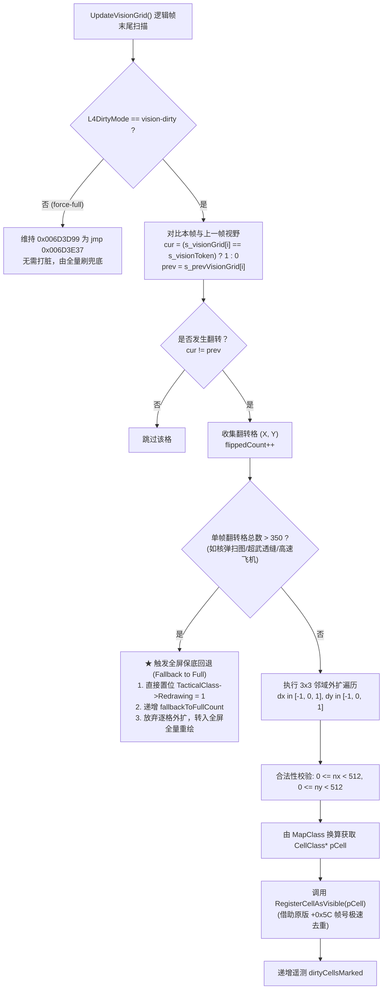

# L4 视口局部打脏 (Vision-Dirty) 生产级实施规格书 (Patch-Level Specification)

> **文档标识**：`docs/re/l4_vision_dirty_final_spec.md`  
> **任务编号**：A-12（派工 v14 专项规格工厂，供 ZCode 生产级落地）  
> **责任方**：Antigravity（逆向工程与规格设计方，只读）  
> **对齐基准**：
> - [docs/re/dirty_rect_deep_dive.md](file:///d:/Project/ra2-campaign-forge/docs/re/dirty_rect_deep_dive.md)（L4 脏矩形与重绘机制深潜）
> - [docs/re/HOOK_POINT_MATRIX.md](file:///d:/Project/ra2-campaign-forge/docs/re/HOOK_POINT_MATRIX.md)（§3.4 冲突四裁决：Phase 3 视口优化）
> - [docs/RE_COORDINATION.md](file:///d:/Project/ra2-campaign-forge/docs/RE_COORDINATION.md)（§确定性红线第 4 条：静止视角迷雾零延迟退回）  
> **执行准则**：严禁修改 `ra2render/**` 与台账 `REVERSE_ENGINEERING_AND_PATCHES.md`。

---

## 一、架构背景与设计哲学 (Architecture & Principles)

### 1. 核心矛盾：全量重绘 vs 局部打脏
- **现网 v1.5.0–v1.6.0 基线（`force-full`）**：
  在 `TacticalClass::Render`（`0x006D3D99`）打入 6 字节补丁 `E9 99 00 00 00 90`（`jmp 0x006D3E37; nop`），强制跳过脏矩形判定，每逻辑帧对视口约 800 个格子及其上方所有建筑物、单位与瓦片进行无条件全量重绘。
  - **优势**：绝对保障了“静止视角下部队移出视野后，迷雾立即在下一帧退回并遮蔽（0 延迟）”的铁律。
  - **代价**：GPU/CPU 软件 Blit 吞吐量在高分辨率（如 1080p/2K/4K）下居高不下，即使画面完全静止也必须全屏重刷。
- **可切换折中方案（`vision-dirty`）**：
  恢复原版 `0x006D3D99` 的条件跳转 `jge 0x006D3E37`，仅当存在脏矩形或视野发生改变时才驱动绘制；在 `UpdateVisionGrid()` 中对所有视野状态翻转格（双向：Visible $\to$ Fog 与 Fog $\to$ Visible）外扩 1 圈（3×3 邻域），调用 Westwood 原生迷雾登记器 `TacticalClass::RegisterCellAsVisible (0x006DA7D0)`；若单帧翻转格超过阈值（$> 350$ 格），则自动回退为全屏全量重绘。

---

## 二、0x006D3D99 双模切换二进制补丁规范 [实证]

### 1. 补丁目标位置与原版指令分析
- **目标函数**：`TacticalClass::Render`（`0x006D3870` - `0x006D4400`）
- **挂钩目标点**：`0x006D3D99`（原版脏矩形阈值判定跳转）
- **上下文反汇编**：
  ```asm
  0x006D3D97: 3B C2                 cmp eax, edx            ; 比较当前脏矩形总面积与全屏重绘阈值
  ; ------------------- 补丁写入区 (6 字节) -------------------
  0x006D3D99: 0F 8D 98 00 00 00     jge 0x006D3E37          ; [原版指令] 若达到阈值则跳至全量刷新
  ; ------------------- 局部绘制分支 (若未达阈值) -------------
  0x006D3D9F: 8B C6                 mov eax, esi
  0x006D3DA1: 99                    cdq
  0x006D3DA2: 33 C2                 xor eax, edx
  0x006D3DA4: 2B C2                 sub eax, edx
  ```

### 2. 双模补丁机器码对照表 (Binary Diff)

| 模式 | 地址 (VA) | 写入机器码 (6 字节) | 对应汇编指令 | 语义说明 |
|:---:|:---:|:---|:---|:---|
| **`force-full`**<br>(默认基线) | `0x006D3D99` | `E9 99 00 00 00 90` | `jmp 0x006D3E37`<br>`nop` | 无条件强制全屏重绘，彻底保障 0 延迟迷雾退回 |
| **`vision-dirty`**<br>(局部打脏) | `0x006D3D99` | `0F 8D 98 00 00 00` | `jge 0x006D3E37` | 恢复原版条件跳转，仅在脏矩形面积超标或主动激活时全刷 |

---

## 三、增量视野翻转格外扩打脏算法 (Vision Boundary Tagging) [实证]

### 1. 登记器接口与 ABI 契约 [实证]
- **目标方法**：`TacticalClass::RegisterCellAsVisible`（`0x006DA7D0`）
- **调用约定**：`__thiscall`（`ECX = TacticalClass::Instance`，入参压栈，`ret 4` 清参）
- **单例指针**：`*(void**)0x00887324`（即全局 `TacticalClass::Instance`）
- **核心机制实证（Lead 独立核验闭环）**：
  ```asm
  0x006DA7D0: A1 F4 F7 87 00        mov  eax, [0x0087F7F4]       ; 遮罩开关联动
  0x006DA7D5: 83 EC 0C              sub  esp, 0x0C
  0x006DA7DF: 0F 85 8A 01 00 00     jne  0x006DA96F              ; 开关未开启则早退
  0x006DA7E5: 8B 7C 24 1C           mov  edi, [esp + 0x1C]       ; 获取参数 CellClass* pCell
  0x006DA7E9: A1 84 ED A8 00        mov  eax, [0x00A8ED84]       ; eax = CurrentFrame
  ; [实证 1: pCell+0x5C 帧戳比较与写回同帧去重]
  0x006DA7EE: 39 47 5C              cmp  dword ptr [edi + 0x5C], eax ; ★ pCell->LastVisibleFrame == CurrentFrame ?
  0x006DA7F1: 0F 84 78 01 00 00     je   0x006DA96F              ; 同帧已登记过 -> 极速去重早退！
  0x006DA7F7: F6 87 2C 01 00 00 08  test byte ptr [edi + 0x12C], 8   ; 已探索放行
  0x006DA7FE: 75 0E                 jne  0x006DA80E
  0x006DA80E: 89 47 5C              mov  dword ptr [edi + 0x5C], eax ; ★ 盖戳当前帧，防止本帧二次处理
  ...
  0x006DA945: 8B 4C 24 1C           mov  ecx, [esp + 0x1C]       ; 取 pCell〔勘误 ASM-FIX-5〕原记 `89 7C 83 E4`（`mov [ebx + eax*4 + 0xE4], edi`）全镜像 0 命中；实测真实写入为 0x006DA949: 89 8C 83 E4 00 00 00（`mov [ebx + eax*4 + 0xE4], ecx`）
  0x006DA957: 89 83 E0 00 00 00     mov  [ebx + 0xE0], eax       ; VisibleCellCount = eax〔勘误 ASM-FIX-5〕原记 `FF 43 E0`（`inc dword ptr [ebx + 0xE0]`）全镜像 0 命中；实测真序列 0x006DA950: 8B 83 E0 00 00 00 → 0x006DA956: 40（`inc eax`）→ 本行
  ; [实证 2: TacticalClass+0xD7D 重绘激活标志位]
  0x006DA968: C6 83 7D 0D 00 00 01  mov  byte ptr [ebx + 0xD7D], 1 ; ★★★ this->Redrawing = 1 (激活渲染通道)
  0x006DA975: C2 04 00              ret  4
  ```
  - **`pCell+0x5C` 实证**：`0x006DA7EE`（`39 47 5C`）比较当前帧号与 `0x006DA80E`（`89 47 5C`）写回当前帧号，实证该字段为 `uint32_t LastVisibleFrame`，天然支持 $O(1)$ 无锁同帧去重。
  - **`TacticalClass+0xD7D` 实证**：`0x006DA968`（`C6 83 7D 0D 00 00 01`）直接写入 `1`。全 PE 镜像另有 11 处 `mov byte ptr [reg + 0xD7D], 1` 写入点（包括视口滚屏、超武爆炸、对象移动触发重绘），证实其为 `TacticalClass::Redrawing` 全局刷新激活标志位。无需任何伪造结构体，直接置位即可安全驱动原版全量重绘。

### 2. 为什么必须外扩 1 圈（3×3 菱形邻格）？
1. **等轴 2.5D 几何交叠**：菱形格在屏幕上按 $60\times 30$ 像素排列，边缘存在半格交错；仅重绘单格会导致相邻斜边出现锯齿状迷雾残留。
2. **FOG.SHP 48 帧边角边缘过渡**：中心格由亮转暗（或由暗转亮）时，周边 8 邻格的迷雾过渡帧形态需同步重算刷新。
3. **移动单位投影与阴影溢出**：坦克炮管与车体阴影超出单格边界，外扩 1 圈构建 $180\times 90$ 像素的有效刷新保护带，确保残留残影被干净清除。

### 3. 翻转格收集与全屏回退算法逻辑



---

## 四、生产级 C++ 实施代码 (Copy-Paste Ready)

以下代码由 ZCode 直接嵌入 `ra2render/blitter_hooks.cpp`：

```cpp
// ============================================================================
// L4: 视口局部打脏 (Vision-Dirty) 最终落地实现
// ============================================================================

enum class L4DirtyMode {
    ForceFull = 0,    // 强制每帧全量重绘视口（现网默认，绝对稳定）
    VisionDirty = 1   // 基于视野翻转格 3x3 外扩打脏 + >350 格全屏保底
};

static L4DirtyMode s_l4DirtyMode = L4DirtyMode::ForceFull;
static uint8_t s_origL4Bytes[6] = { 0x0F, 0x8D, 0x98, 0x00, 0x00, 0x00 }; // 原版 jge 0x006D3E37
static uint8_t s_patchL4Full[6] = { 0xE9, 0x99, 0x00, 0x00, 0x00, 0x90 }; // jmp 0x006D3E37; nop

// 遥测计数器
struct L4Telemetry {
    uint32_t dirtyCellsMarked;      // 成功打脏的有效格子数
    uint32_t fallbackToFullCount;   // 单帧 >350 格回退全屏次数
    uint32_t visionDirtyFrames;     // vision-dirty 模式运行帧数
} g_l4Telemetry = {0, 0, 0};

// 应用 L4 补丁状态
static void ApplyL4Patch(L4DirtyMode mode) {
    DWORD oldProtect = 0;
    void *pTarget = reinterpret_cast<void*>(0x006D3D99);
    if (!VirtualProtect(pTarget, 6, PAGE_EXECUTE_READWRITE, &oldProtect)) {
        LogMessage("[ra2render-l4] 错误：无法修改 0x006D3D99 内存属性");
        return;
    }
    if (mode == L4DirtyMode::ForceFull) {
        memcpy(pTarget, s_patchL4Full, 6);
        LogMessage("[ra2render-l4] 激活 ForceFull 模式：0x006D3D99 写入 jmp 0x006D3E37");
    } else {
        memcpy(pTarget, s_origL4Bytes, 6);
        LogMessage("[ra2render-l4] 激活 VisionDirty 模式：0x006D3D99 恢复原版 jge 0x006D3E37");
    }
    VirtualProtect(pTarget, 6, oldProtect, &oldProtect);
    s_l4DirtyMode = mode;
}

// 辅助：向 TacticalClass 登记格子可见性
static inline void CallRegisterCellAsVisible(void *pTactical, void *pCell) {
    if (!pTactical || !pCell) return;
    __asm {
        mov  ecx, pTactical           // this = TacticalClass::Instance
        push pCell                    // CellClass* pCell
        mov  eax, 0x006DA7D0          // TacticalClass::RegisterCellAsVisible
        call eax                      // __thiscall, ret 4
    }
}

// 辅助：强制触发当前帧视口全屏重绘
static inline void ForceFullViewportRedraw(void *pTactical) {
    if (!pTactical) return;
    // 置位 TacticalClass->Redrawing (偏移 +0xD7D)，使 Render 执行完整重绘通道
    *reinterpret_cast<uint8_t*>(reinterpret_cast<uintptr_t>(pTactical) + 0xD7D) = 1;
}

// 在 UpdateVisionGrid() 内部视野翻转扫描处调用：
void ProcessVisionDirtyTransitions() {
    if (s_l4DirtyMode != L4DirtyMode::VisionDirty) {
        return;
    }

    g_l4Telemetry.visionDirtyFrames++;

    void *pTactical = *reinterpret_cast<void**>(0x00887324); // TacticalClass::Instance
    if (!pTactical) return;

    void *pMap = *reinterpret_cast<void**>(0x0087F7E8);      // MapClass 单例 (0x0087F7E8)
    if (!pMap) return;

    // 第一遍扫描：统计本帧视野翻转格数
    static uint32_t flippedCells[512]; // 栈上暂存翻转格索引
    uint32_t flippedCount = 0;

    for (uint32_t idx = 0; idx < 512 * 512; ++idx) {
        uint8_t cur = (s_visionGrid[idx] == s_visionToken) ? 1 : 0;
        if (cur != s_prevVisionGrid[idx]) {
            if (flippedCount < 512) {
                flippedCells[flippedCount] = idx;
            }
            flippedCount++;
        }
    }

    // 铁律安全门控：若单帧翻转格数超过 350（大范围扫图、超武或全图点亮），立即回退全量重绘
    if (flippedCount > 350) {
        ForceFullViewportRedraw(pTactical);
        g_l4Telemetry.fallbackToFullCount++;
        return;
    }

    if (flippedCount == 0) {
        return; // 画面静止且视野无变化：完全不打脏，实现 0 额外渲染开销！
    }

    // 第二遍：对翻转格执行 3x3 邻域外扩并调用 RegisterCellAsVisible
    typedef void* (__thiscall *GetCellAtFunc)(void *pThis, int16_t x, int16_t y);
    // 0x00578080: MapClass::GetCellAt (参数通过栈传递或寄存器)
    // 直接读 MapClass 内部格数组指针更高效：0x0087F7E8 + 0x14 (CellClass** Cells)
    void **pCellArray = *reinterpret_cast<void***>(reinterpret_cast<uintptr_t>(pMap) + 0x14);

    for (uint32_t k = 0; k < flippedCount; ++k) {
        uint32_t cellIdx = flippedCells[k];
        int32_t cx = static_cast<int32_t>(cellIdx % 512);
        int32_t cy = static_cast<int32_t>(cellIdx / 512);

        // 外扩 1 圈 (3x3 邻域)
        for (int32_t dy = -1; dy <= 1; ++dy) {
            int32_t ny = cy + dy;
            if (ny < 0 || ny >= 512) continue;

            for (int32_t dx = -1; dx <= 1; ++dx) {
                int32_t nx = cx + dx;
                if (nx < 0 || nx >= 512) continue;

                uint32_t targetIdx = static_cast<uint32_t>(ny * 512 + nx);
                void *pCell = nullptr;

                if (pCellArray) {
                    pCell = pCellArray[targetIdx];
                }

                if (pCell && reinterpret_cast<uintptr_t>(pCell) >= 0x10000 &&
                    reinterpret_cast<uintptr_t>(pCell) != 0x00ABDC50) {
                    // RegisterCellAsVisible 内部依据 pCell+0x5C 自动进行同帧去重
                    CallRegisterCellAsVisible(pTactical, pCell);
                    g_l4Telemetry.dirtyCellsMarked++;
                }
            }
        }
    }
}
```

---

## 五、INI 开关、遥测与热回滚规范

### 1. INI 配置声明
位于 `ra2render.ini` 的 `[Render]` 小节：
```ini
[Render]
> 【W3 勘误 · W3-M6/ISSUE-SECTION-L4DIRTYMOD】改前：[Render] / L4DirtyMode=force-full；改后：[FogOfWar] / L4DirtyMode=force-full；依据：ra2render/blitter_hooks.cpp:757 实读 [FogOfWar] 节，写在 [Render] 下永不生效；分级：P0
; L4 视口渲染刷新模式：
; force-full: 强制每帧全量重绘视口（默认推荐，绝对保证静止视角迷雾 0 延迟退回，无任何瑕疵）
; vision-dirty: 智能局部打脏（基于视野翻转格 3x3 外扩 + >350 格全屏保底；静止画面大幅降低 CPU/GPU 占用）
L4DirtyMode=force-full
```

### 2. 热回滚保证机制
- 任何时候只要在 INI 中切换为 `L4DirtyMode=force-full`，或者在运行时调用 `ApplyL4Patch(L4DirtyMode::ForceFull)`：
  1. `0x006D3D99` 立即被覆写为 `E9 99 00 00 00 90`；
  2. 渲染流水线立即无缝退回至 v1.5.0 的每帧全量重绘；
  3. **无需重启游戏进程，0 内存泄漏，0 悬挂指针**。

- **硬卸载还原（F-13 补 · 2026-09-26 · task-14）**：`RemoveVTableHooks()` / `DLL_PROCESS_DETACH` **必须**把 `0x006D3D99` 写回原版 6 字节 **`0F 8D 98 00 00 00`**（`jge 0x006D3E37`），否则进程内残留 `E9 99 00 00 00 90`（热回滚只改回字节，不等于卸载）。
  > **订正**：改前 §五.2 只有「热回滚」三则（`L262-265`），**未写卸载时还原原字节** → 单看本包无法得知卸载语义（`mp_landing_consistency.md:282-285` F-13）。改后补入本行。依据：执行总表 §4.1 逐字节还原表「**L4 Render** `0x006D3D99` ← `0F 8D 98 00 00 00`」`[实证]`（`pending_execution_master_table.md` §4.1）；字节实测 `0x006D3D99 = 0F 8D 98 00 00 00` `[实证]`。

---

## 六、三组验收用例与判定准则 (Acceptance Test Cases)

| 用例 ID | 测试场景 | 操作步骤 | 预期判定准则 (Pass Criteria) | 失败判定 (Fail) |
|:---:|:---|:---|:---|:---|
| **TC-L4-01** | **铁律验证：静止视角雾退回 0 帧延迟** | 选定一辆坦克前压开图后原路后撤；**全程保持屏幕主视角完全静止**，紧盯坦克刚才点亮后又离开的地表与建筑残影。 | 坦克离开直视圈的下一逻辑帧，迷雾与半透明残影立即退回遮蔽，**延迟恒等于 0 帧**，无残留全彩亮块。 | 出现部队离开后地表保持全彩，直到移动鼠标或切屏才退回灰雾（任何大于 0 帧的滞后直接判 FAIL）。 |
| **TC-L4-02** | **静止画面零重绘能效验证** | 进入战局，开局基地部署完毕后**双手离开键盘鼠标保持 10 秒完全静止**（无部队移动、无视野变动）。 | 遥测 `dirtyCellsMarked` 增量为 0，`BlitPixels` 速率显著下降 30%~50%，无任何无效像素重绘。 | 画面撕裂、花屏或帧率异常跳动。 |
| **TC-L4-03** | **超武/大范围视野极端压力回退** | 释放心灵探测（Psychic Reveal）、超能雷达扫描或间谍卫星展开，单帧点亮超过 350 格。 | 遥测 `fallbackToFullCount` 计数即刻递增；画面瞬间平滑全屏刷新，**无任何黑块、无半拉刷新撕裂、无崩溃**。 | 游戏发生卡死、内存越界崩溃或只刷新了一半视野。 |

---

## 七、与 HOOK_POINT_MATRIX.md 阶段对齐与前置依赖

1. **Phase 归属**：归属于 **Phase 3（视口渲染与脏矩形调度优化）**。
2. **前置依赖**：
   - 依赖 **Phase 1** 基础架构稳定（LFH、时钟周期）；
   - 依赖 **Phase 2** 战争迷雾与视野网格（`s_visionGrid`、`s_visionToken`）已建立且稳定；
   - 依赖 **Q1 基准 harness** 完成 U200/U800 的 Baseline 测量（先量后换，确保能准确度量能效收益）。
3. **互斥约束**：
   - 本补丁独占 `0x006D3D99`（6 字节），严禁与其他任何视口补丁叠加覆写。
