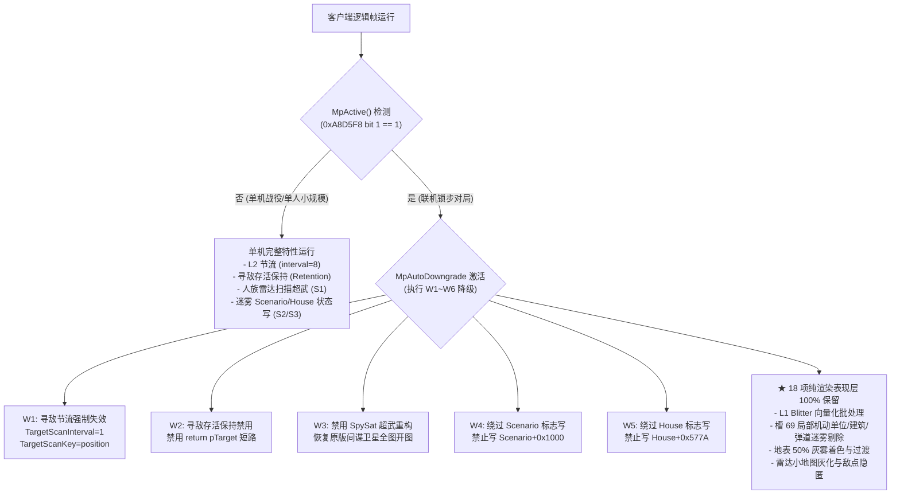
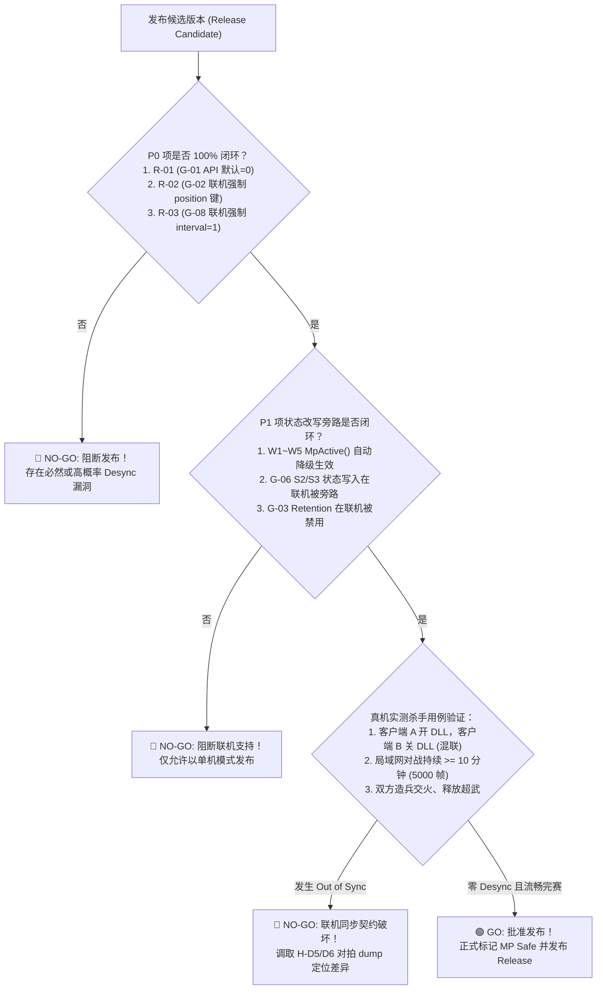

# 联机 (MP) 锁步发布安全核验总清单 (Release Safety Checklist)

> **文档标识**：`docs/re/mp_release_safety_checklist.md`  
> **任务编号**：A-13（派工 v14 跨文档安全收口清单）  
> **责任方**：Antigravity（独立逆向审计与安全规格方，只读）  
> **输入基准**：
> - [docs/re/mp_autodowngrade_spec.md](file:///d:/Project/ra2-campaign-forge/docs/re/mp_autodowngrade_spec.md)（MiMo M-6 联机自动降级白名单 W1–W6 与检测点）
> - [docs/re/hook_gate_gap_table.md](file:///d:/Project/ra2-campaign-forge/docs/re/hook_gate_gap_table.md)（MiMo M-7 Hook 门控覆盖缺口表 G-01…G-10）
> - [docs/re/MP_SAFETY_REVIEW.md](file:///d:/Project/ra2-campaign-forge/docs/re/MP_SAFETY_REVIEW.md)（联机确定性契约审计）
> - [docs/RE_COORDINATION.md](file:///d:/Project/ra2-campaign-forge/docs/RE_COORDINATION.md)（§派工 v14：Lead 政策四项裁定落地口径）  
> **执行准则**：严禁修改 `ra2render/**` 与台账 `REVERSE_ENGINEERING_AND_PATCHES.md`。

---

## 一、Lead 政策四项硬性裁定落地口径 (Lead Authoritative Rulings)

在版本正式发布或合并 MP 联机功能前，以下四项已经由 Lead 做出终局政策裁定，必须在代码中 100% 落地闭环：

| 裁定编号 | 涉及缺口 | Lead 终局裁定内容 | 落地口径（必须执行的改动） | 优先级 |
|:---:|:---:|:---|:---|:---:|
| **R-01** | **G-01** | **`EnableMinimapFog` API 默认值强制改为 `0`** | 在 `blitter_hooks.cpp:103` 中，将 `GetPrivateProfileIntA("FogOfWar", "EnableMinimapFog", 1, ...)` 的默认回落参数由 `1` 改为 `0`；严防玩家或安装包遗漏 INI 键时静默开启小地图迷雾。 | **P0** |
| **R-02** | **G-02** | **联机强制使用 `position` 确定性分片键** | 在 `LoadConfig` 与联机检测门控中，若检测到处于联机状态（`MpActive()` 为真），**硬性禁止回退到 `pointer` 键**；即使用户在 INI 中显式声明 `TargetScanKey=pointer`，也必须强制重定向为 `position`，并在日志输出警告。 | **P0** |
| **R-03** | **G-08** | **联机强制关闭 L2 寻敌节流（`TargetScanInterval=1`）** | 联机状态下即使使用 `position` 键，`interval > 1` 仍会因各客户端帧步调或初始扫描相位差异引入寻敌分叉风险（RISK）；Lead 裁定：**联机环境无条件强制 `g_targetScanInterval = 1`**（回归原版逐帧全量扫描）。 | **P0** |
| **R-04** | **G-05** | **`Hook_RadarPending_Proxy` 必须受 `s_minimapFogGate` 门控** | 在 `0x0065719A` 处的雷达刷新代理入口，必须前置检查 `s_minimapFogGate`；若小地图迷雾关闭（`s_minimapFogGate == 0`），直接走 `orig_logic`（两步解引用），禁止无条件强驱 10 帧小地图刷新。 | **P2** |

---

## 二、联机环境判定与白名单自动降级架构 (MP Auto-Downgrade Framework)

### 1. 联机状态检测点规范（基于 M-6 实证）
在逻辑帧更新与配置载入时，通过以下三级硬件/状态机门控联合判定 `MpActive()`：
1. **一级主判定（M-6 实证）**：
   - 内存读取：`0x00A8D5F8`（会话标志字节，由 `0x00647260` 原版指令 `A0 F8 D5 A8 00` 证实）；
   - 位判定：`(*(uint8_t*)0x00A8D5F8 & 0x02) != 0`（bit 1 为 1 即为局域网/互联网多端联机会话）。
2. **二级辅助判定（DirectPlay 门控）**：
   - `*(int32_t*)0x00AA0444 == 2`（DirectPlay 会话活跃标志，`0x0053E86C` 实证）。
3. **三级保底与逃生舱**：
   - INI 开关：`ForceSinglePlayer=1`（强制将 `MpActive()` 恒定为 false，仅用于单机本地测试）；
   - `MpAutoDowngrade=1`（默认开启，检测到联机时自动执行安全降级白名单）。

### 2. 白名单（W1–W6）降级矩阵



---

## 三、发布前必须收口清单（G-01 … G-10 逐条核验表）

| 编号 | 审计对象 / 缺口来源 | 现网状态 (18:42 构建) | MP 风险判定 | 必须做的改动 (Mandatory Changes) | 验收核验方法 (Verification Method) | 优先级 |
|:---:|:---|:---|:---:|:---|:---|:---:|
| **MP-G01** | `EnableMinimapFog`<br>默认值不一致 | API 默认 `1`；<br>INI 现值 `0` | **VIOLATION**<br>(配置缺失风险) | **执行 Lead 裁定 R-01**：在 `blitter_hooks.cpp:103` 将 `GetPrivateProfileIntA` 默认值改为 `0`。 | 删除 `ra2render.ini` 中该键启动，日志中显示 `EnableMinimapFog=false`，小地图走原版。 | **P0** |
| **MP-G02** | `TargetScanKey`<br>联机回退指针键 | 默认 `position`，<br>但允许配 `pointer` | **VIOLATION**<br>(指针地址随机化必分叉) | **执行 Lead 裁定 R-02**：`LoadConfig` 检测到联机时，无条件强制 `g_targetScanKey = 1`（position），禁止 pointer 键生效。 | 在联机 INI 中写 `TargetScanKey=pointer`，启动后日志输出红字告警并强制使用 position 键。 | **P0** |
| **MP-G03** | Threat Retention<br>存活目标保持 | 无独立开关；<br>绑定在 interval | **RISK**<br>(返回值替代原版择优) | 增设 `[Logic] EnableThreatRetention=0/1`（单机默认 1，联机强制 0）；在 `Hook_Techno_Greatest_Threat` 入口加门控。 | 联机下设置断点/遥测，确认不执行 `return pTarget`，恒定走完整威胁评估循环。 | **P1** |
| **MP-G04** | 混色桩 B1/B2<br>及 L4 补丁残留 | 即使关迷雾，<br>桩代码与全量刷仍装 | **SAFE** (联机)<br>**RISK** (回滚) | 增设 `[Render] L4DirtyMode` 与混色桩安装门控；当总雾开关关闭时，不向 `0x47F40F/0x47F4AE/0x6D3D99` 写入补丁字节。 | 全关迷雾启动后，使用内存探针比对 3 处地址机器码，必须 100% 还原为游戏原版字节。 | **P1** |
| **MP-G05** | `Hook_RadarPending_Proxy`<br>小地图跳帧强驱 | 只看迁移计数器，<br>未看 minimap 门 | **SAFE** (表现层)<br>但破坏原版语义 | **执行 Lead 裁定 R-04**：在 `0x0065719A` 代理入口追加 `cmp [s_minimapFogGate], 0; je orig_logic`。 | 当 `EnableMinimapFog=0` 时，函数执行完全等价于原版 `call 0x00660530`。 | **P2** |
| **MP-G06** | S2/S3 状态写入<br>(Scenario / House) | 无独立开关，<br>随迷雾计算执行 | **RISK**<br>(改写可序列化字段) | 在 `UpdateVisionGrid` 写入 `Scenario` 与 `House+0x577A` 处前置 `if (MpActive()) return;` 旁路保护。 | 联机对局中内存监控 `ScenarioClass` 标志位与 `House+0x577A`，确认本 DLL 零写入。 | **P1** |
| **MP-G07** | S1 SpySat TYPE 补丁<br>无 Remove 还原 | `Install` 修改虚表/字段，<br>`Remove` 未还原 | **RISK**<br>(热卸载不洁净) | 备份 `SWType+0xB0/+0xF8` 与 `BldType+0x16A5/+0x16F0` 原值，在 `RemoveVTableHooks` 中完整写回原值。 | 在游戏进程内切换开关，确认 `BuildingType` 与 `SuperWeaponType` 字段完全复原。 | **P1** |
| **MP-G08** | L2 寻敌节流<br>`TargetScanInterval` | 默认 `8`；<br>联机仍处激活状态 | **RISK**<br>(扫描相位/Tick 抖动) | **执行 Lead 裁定 R-03**：联机状态下无条件强制 `g_targetScanInterval = 1`。 | 联机对局末行遥测中：`TargetScans` 节流率恒等于 `0.0%`，平抑次数为 0。 | **P0** |
| **MP-G09** | everSeen 建筑记忆<br>跨存档/重载丢失 | DLL 私有内存，<br>不写盘不进档 | **SAFE**<br>(体验遗留) | 保持现状；在用户文档中声明“单机读档后敌军已探索建筑记忆将重新根据视野探明”的已知现象。 | 读档后无崩服、无 Desync，不作为发布阻断项。 | **P2** |
| **MP-G10** | 死代码与废弃符号<br>(Unit_GT / 速查宏) | 符号存在但未挂钩，<br>易误导审计 | **SAFE**<br>(卫生项) | 清理 `Hook_Unit_Greatest_Threat` 死函数；清理 `ra2render.h` 中的 `ADDR_RADAR_PLOT_CALLSITE` 死宏。 | 源码编译 0 告警，`verify_hooks.py` 扫描无死宏残留。 | **P2** |

> **[DA1 勘误 · DSH 子代理 · 2026-09-27]** 本表 **MP-G01 / MP-G02 / MP-G08** 三行的「现网状态」「必须做的改动」列**已过时**——三项 R-01/R-02/R-03 已于 2026-09-27 MPS 落地（源码实证）；**MP-G05** 的 R-04 前置门控亦已在源码实现（`:1555-1556`），但未列入 Lead 本批清单。逐项闭环状态与依据（源码行 / ini 行 / DLL SHA-256 / 门控日志自证行）见文末 **§六 勘误**。本表原文逐字保留为审计痕迹。
>
> 【W3 勘误 · FREEZE_CANDIDATE §7 C24】[W3-Lead临时裁决] 针对本表 MP-G04 行：改前：增设 `[Render] L4DirtyMode` 与混色桩安装门控；改后：节名订正为 `[FogOfWar] L4DirtyMode`；依据：`blitter_hooks.cpp:757` 实读节为 `[FogOfWar]`，写在 `[Render]` 下结构性永不命中；分级：[实证]

---

## 四、联机发布发布门禁决策树 (Release Go/No-Go Decision Tree)



---

## 五、最终交付建议与 ZCode 落地指南

1. **第一优先级改动（ZCode 5 分钟极速修改，P0 止血）**：
   - 修改 `ra2render/blitter_hooks.cpp:103`：将 `GetPrivateProfileIntA` 的第 4 个参数改为 `0`（闭环 R-01 / G-01）。
   - 在 `LoadConfig()` 末尾加入联机安全保底逻辑：
     ```cpp
     if (MpActive()) {
         g_targetScanInterval = 1;      // 强制关闭节流 (R-03 / G-08)
         g_targetScanKey = 1;           // 强制使用 position 确定性键 (R-02 / G-02)
         LogMessage("[ra2render-mp] 检测到多端联机环境：强制激活 MP 安全白名单 (Interval=1, Key=Position)");
     }
     ```
   - 在 `Hook_RadarPending_Proxy`（`blitter_hooks.cpp:1453`）前加入：
     ```asm
     cmp byte ptr [s_minimapFogGate], 0
     je  orig_logic
     ```
     （闭环 R-04 / G-05）。
2. **第二优先级改动（P1 模块化解耦）**：
   - 依据 M-6 规格引入 `MpActive()` 并在 `UpdateVisionGrid()` 中对 S2/S3 状态写入加 `if (!MpActive())` 保护。

---

## 六、勘误 · MPS 落地后的闭环状态同步（DA1 · DSH 子代理 · 2026-09-27）

> **性质**：本节只**追加**，**不改动 §一–§五**（L1-109 逐字保留）。
> **双快照**：正文 = 18:42 构建（`ra2render/blitter_hooks.cpp` 1788 行）；本节 = **1892 行 / 86,961 B**（2026-09-27 09:06:28，mtime 实测）。
> **基线（只读未变）**：`ra2youli/gamemd.exe` MD5 `4F37486E5B0DBE2AE5F45AEEE0F98367`；本任务实跑 `python tools/verify_anchors.py` = **323/323 PASS**。
> **部署件（本节依据）**：`ra2render/ra2render.dll` ≡ `ra2youli/ra2render.dll` = 129,536 B，SHA-256 `E7FA669C85B5DA53C71898DC453AC35301EC55F1222D1D581BFAEAC105DCC7CA`；`ra2render.ini` ≡ `ra2youli/ra2render.ini` = 2,996 B / 53 行，SHA-256 `564A265291C3C6CAF0E15CE8CFF00360A0BBD28EAF2E57BA74D1E0E49C0EC64F`。部署 DLL 内含门控日志格式串（file_off `0x16184`）⇒ 部署件与本节源码同代。

### 6.1 MP-G01 / MP-G02 / MP-G08：**已闭环**（本节判定，取代 §三 表 L62 / L63 / L69 的「现网状态」列）

| 编号 | §三 原「现网状态」（行号） | 更正：现网状态（2026-09-27 09:06 快照） | 落地依据 |
|---|---|---|---|
| **MP-G01** `EnableMinimapFog` 默认值 | `L62`「API 默认 `1`；<br>INI 现值 `0`」 | **✅ 已闭环（R-01 落地）**：`GetPrivateProfileIntA` 第 4 参 `1 → 0`；静态初值 `g_enableMinimapFog = false`；两份 ini 显式 `EnableMinimapFog=0`（键位由旧口径 `:44`/`:45` 移至 **:46**）。**用户决策（2026-09-27）**：保持默认关 ⇒ 口径为「**默认关闭，需显式 `=1` 才启用**」；**联机（MpActive）下保守强制关闭** | 源码 `blitter_hooks.cpp:182`（默认值 `0`）、`:16`（`false`）、`:96-106`（`GetEffectiveMinimapFog()`，`:100` 联机恒 false）、`:49`/`:104`（汇编镜像）；ini `:46`；门控日志自证行 `:201`；DLL SHA-256 |
| **MP-G02** `TargetScanKey` 联机回退指针键 | `L63`「默认 `position`，<br>但允许配 `pointer`」 | **✅ 已闭环（R-02 落地）**：`GetEffectiveTargetScanKey()` 在 `MpActive()` 为真时无条件返回 `1`（position），ini 显式 `pointer` 被运行期强制纠正；红字告警两处（迁移期 `:129-131`、启动期 `:209-211`）。ini 现值 `TargetScanKey=position`（`:51`） | 源码 `:89-94`（`:91` 联机 return 1）、`:129-131`、`:209-211`、`:265`（`ThrottleKey` 改走生效键）；ini `:51` |
| **MP-G08** L2 寻敌节流联机强制 | `L69`「默认 `8`；<br>联机仍处激活状态」 | **✅ 已闭环（R-03 落地）**：`GetEffectiveTargetScanInterval()` 联机返回 `1`；三处节流调用点（`:536` / `:558` / `:597`）全部改用该函数，短路条件 `interval > 1 && currentFrame > 0`（`:537` / `:559` / `:598`）⇒ 联机恒不进入 ⇒ 验收判据「`throttledTargetScans` 不增」达标（2s 遥测 `:241`） | 源码 `:82-87`（`:84` 联机 return 1）、`:536` / `:558` / `:597`；遥测 `:241` |

> **§五「第一优先级改动」状态同步**：`L93`（R-01 改默认值）、`L94-101`（`MpActive()` 强制 Interval/Key）、`L102-107`（R-04 前置 gate）**均已落地**；现网实现分布在 `GetEffectiveTargetScanKey/Interval/MinimapFog` 三函数（`:82-106`）与 `CheckMpGateTransition()`（`:108-133`），**未采用 §五 L99 的日志字符串**——现网为 `:201`「门控: MpActive=%s, TargetScanKey=配置(%s)->生效(%s), TargetScanInterval=配置(%d)->生效(%d), EnableMinimapFog=配置(%d)->生效(%d)」，含「配置 → 生效」对照，强于原建议。

### 6.2 其余项：维持未闭环（2026-09-27 全源码 + DLL 字面复核）

| 编号 | 现状复核 | 判定 |
|---|---|---|
| **MP-G03** Threat Retention 独立键 | grep `ThreatRetention` = **0 命中**；短路 `return pTarget`（`:601`）仍绑 `interval` | **未闭环** |
| **MP-G04** B1/B2 + L4 补丁独立键/总闸 | grep `EnableFogBlendStubs` / `L4DirtyMode` = **0 命中**（源码 + DLL + ini）；`InstallCellClassDrawHook`（`:1354-1421`）仍无条件写 `0x47F40F` / `0x47F4AE` / `0x6D3D99` | **未闭环** |
> 【W3 勘误 · W3-M6/ISSUE-STALE-L4-EXIST】改前：grep EnableFogBlendStubs / L4DirtyMode = 0 命中（源码 + DLL + ini） | 未闭环；改后：| **MP-G04** B1/B2 + L4 补丁独立键/总闸 | 【W3 勘误】`L4DirtyMode` 已在 `blitter_hooks.cpp:757` 读取并支持 force-full / vision-dirty 模式；三处 ini 均已配置出厂值；混色桩门控与运行期总闸见 §10.2 (E2) | 部分闭环 |；依据：blitter_hooks.cpp:757 与三处 ini 配置；分级：P0
| **MP-G05** RadarPending gate | §三 `L66` 记「只看迁移计数器，未看 minimap 门」；**源码实证已接门控**：`Hook_RadarPending_Proxy`（`:1553-1568`）前置 `cmp byte ptr [s_minimapFogGate], 0` + `je orig_logic`（`:1555-1556`） | **源码看已实现；不在 Lead 本批三项清单内 ⇒ 本清单不擅自改判，列交付回报 [9] 待裁决** |
| **MP-G06** S2/S3 状态写旁路 | grep `MpStateWrites` = **0 命中**；`UpdateVisionGrid()` 仍每帧写 `ScenarioClass`（`:851`）与 `House+0x577A`（`:855`） | **未闭环** |
| **MP-G07** S1 TYPE 还原 | grep `RestoreSpySat` = **0 命中**；`PatchSpySatBuildingTypes`（`:697-756`）无原值备份，`RemoveVTableHooks`（`:1816-1891`）无还原调用 | **未闭环** |
| **MP-G09** everSeen 不进档 | 维持：`s_everSeenGrid` 为 DLL 私有 `static uint8_t[512*512]`（`:44`），不入 `.SAV` / 不进帧 CRC | **未闭环（体验遗留，不阻断发布）** |
| **MP-G10** 死代码/死宏/空开关 | 未清理：`Hook_Unit_Greatest_Threat`（`:615-617`）+ `ra2render.h:250` 声明；`EnforceGameSpeedUnlock` 空函数（`:284-287`）且 `dllmain.cpp:31-36` 不调用；死宏 `ADDR_RADAR_PLOT_CALLSITE`（`ra2render.h:77`） | **未闭环（SAFE 卫生项）** |

### 6.3 发布门禁（§四）读法不变

§四 决策树 Gate1 的三项（R-01 / R-02 / R-03）**代码层已落地**；**Gate2 / Gate3 仍为未闭环**（G-03 / G-06 未落地；真机 ≥5000 帧双端逐帧 CRC 对拍未执行）⇒ **不得据本节宣判「MP 可发布」**。本节只回答「R-01/R-02/R-03/R-04 的代码落地状态」，真机验收仍记 `[待实测]`；交付回报 [7] 已声明本批结论触及同步语义，须走 MP 门控矩阵 + 真机对拍验收。
