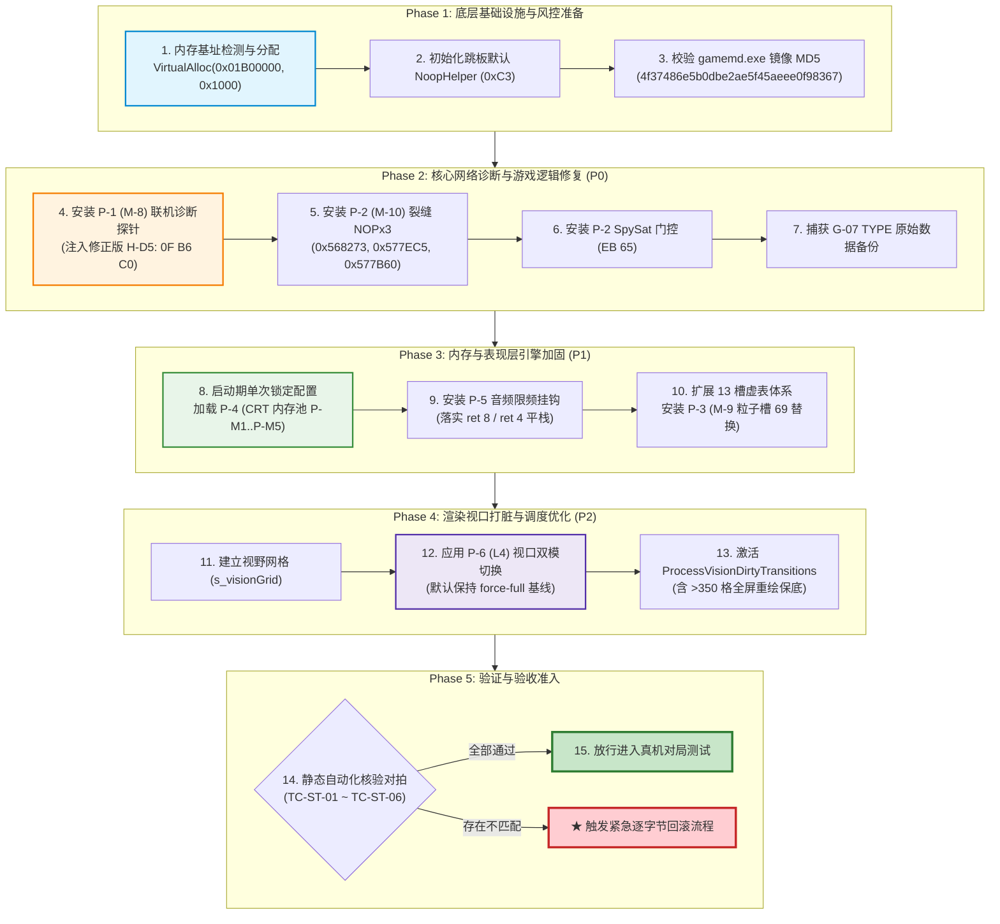

# 六大落地补丁待执行总台账与工程落地规范
# Pending Execution Master Table & Engineering Landing Specification

> **文档标识**：`docs/re/pending_execution_master_table.md`  
> **任务阶段**：S19 专项冲刺 · 落地前核心工程总台账编制  
> **读者对象**：工程实施方（**ZCode / MiMo**）生产级“无脑”落地执行指南  
> **适用目标**：红色警戒2：尤里的复仇 1.001（`ra2youli/gamemd.exe`，MD5: `4f37486e5b0dbe2ae5f45aeee0f98367`）  
> **基准参数**：ImageBase `0x00400000`，`.text` VA `0x00401000`，`FileOffset = VA - 0x00400000`  
> 【W3 勘误 E-W3-01】原句 `FileOffset = VA − 0x400000` 仅在 `.text/.rdata/.data` 成立；
> 通用式为 `FileOffset = 段.PointerToRawData + (VA − 段.VirtualAddress)`，
> 本镜像 `.rsrc`/`.detour` 为 `VA − 0x6FC000`。依据：out/re_work/_lead_baseline/W3/LEAD_ERRATUM_E-W3-01_fileoffset_rule.md；分级：[实证]
> **全局工程纪律**：
> 1. **禁改目录与顶层台账**：严禁修改 `ra2render/**` 与顶层台账 `REVERSE_ENGINEERING_AND_PATCHES.md`；
> 2. **写作用域互斥**：只读逆向分析，本规范单向输出至 `docs/re/pending_execution_master_table.md` 与 `docs/re/re_sprint_S19_report.md`；
> 3. **证据全量分级**：`[实证]`（VA + FileOffset + 原始字节 + 汇编指令）× `[推演]` × `[待实测]`；无法闭环处明示“未闭环 + 原因 + 下一步取证方法”；
> 4. **真机挂起不启动**：纯静态字节级核验，所有机器码与偏移经 Python 3.12 + pefile + capstone 交叉复算固化于 `out/re_work/re_sprint/S19/`；
> 5. **吸纳全部既有成果**：全量继承 S15 静态等效性论证、Lead 裁决（L4, G-03, G-04, G-06）以及重大 Bug 拦截成果（H-D5 采用 `0F B6 C0`、音频限频早退平栈 `ret 8` / `ret 4` 且返回 `NULL`、严禁挂钩 `0x0048D000`）。

---

## 〇、执行总则与落地前置红线 (Engineering Execution Principles)

1. **零推演落地原则**：本文档提供的所有十六进制机器码、函数指针与结构体偏移均已完成机读校核，实施方（ZCode）在编写或注入代码时**仅做机械式写入与配置映射，不得擅自修改指令编码与相对偏移**。
2. **跳板内存空间隔离（禁写 `.detour` 节）[实证]**：
   `gamemd.exe` PE 镜像内虽然包含 `.detour` 节（VA `0x00B93000`，RawSize `0x3000`），但其中包含 6,980 字节未知非零数据（宿主签名 `Dtr\0`）。**严禁将任何补丁跳板写入 `.detour` 节**。跳板必须通过 `VirtualAlloc` 申请独立内存页：**首选固定基址 `0x01B00000`；分配失败 → 该项不安装**（跳过 + 红字日志 + 遥测计数），**严禁在未整表重算 rel32 的其它基址写死 hex**。附录 C 式重定位**降为离线预备**，启用须「整表 rel32 重算 + 装后 5 处 `E9` 自检 + 槽可执行」三项齐备（详见 `docs/re/landing_pack_net_fix.md` 附录 C）。
   
   > **【F-07 订正 · 2026-09-26 · task-14】** 改前：「推荐首选固定基址 `0x01B00000`，**失败走动态重定位**」；改后：「首选 `0x01B00000`；**失败 → 该项不安装**（跳过 + 红字日志 + 遥测计数）；重定位仅离线预备」。依据：Lead [v1.5.37] 硬要求（① 先试 `0x01B00000`；② 失败即跳过，**禁止带病安装**；③ 重定位启用须三项前置齐备）`[推演]`；同口径见 `docs/re/z3_troubleshoot_net_fix_gap.md:25,37-44`、顶层台账 `REVERSE_ENGINEERING_AND_PATCHES.md:1183`。
3. **联机同步强红线（OOS 防护）[推演 + 实证]**：
   - **纯表现层（零同步风险）**：P-1（只读诊断探针）、P-3（微粒迷雾剔除）、P-4（CRT 内存池）、P-5（音频并发削峰）、P-6（视口打脏调度）；
   - **游戏状态层（强条件约束）**：P-2（M-10 裂缝保护与间谍卫星门控）修改了 `CellClass+0x134 GapsCoveringThisCell` 字段，该字段进入 `.SAV` 存档并决定战场迷雾退回状态与自动寻敌。**严禁混端联机（一端打补丁一端原版），联机全员必须统一加载相同构建**。
4. **启动期锁定约束（防跨堆损坏）[推演]**：
   P-4（CRT 内存池）涉及底层堆分配器替换。**严禁在战局进行中动态切换 `EnableMemoryPool` 开关**，该配置必须在启动期单次锁定，否则存活对象跨堆释放将直接触发 Windows 堆损坏异常 `0xC0000374`。

---

## 一、六大落地补丁待执行工程总表 (Master Engineering Table)

以下表格为实施方提供全量字段的一站式落地执行总账。

| 序号 | 补丁编号 | 补丁名称 | 目标子系统 | 优先级 | 前置依赖关系 | 目标 VA / 槽位 | 文件偏移 | 原字节 (Hex) | 替换字节 (Hex) | 字节数 | 挂钩机制 | INI 门控 (Section, Key, Default, MP Rule) | 遥测指标 (名称, 含义, 正常值, 告警阈值) | 静态核验证对拍准则 [实证/推演/待实测] |
|:---:|:---|:---|:---|:---:|:---|:---|:---:|:---|:---|:---:|:---|:---|:---|:---|
| **1** | **P-1.1** | M-8 H-D1 校验探针 | 联机同步诊断 | **P0** | 无 | `0x0064C6F2` | `0x0024C6F2` | `0F 85 69 05 00 00` | `E9 09 39 4B 01 90` | 6B | Inline Jmp + Cave | `[SyncDiag]`<br>`SyncEarlyLog=0`<br>联机可选开启（无分叉风险） | `syncEarlyLogCount`<br>早期校验分歧计数<br>正常: 0<br>告警: >0 (潜在 DESYNC) | `0x64C6F2` 原为 `jne 0x64CC61`；跳板内 `pushfd; pushad; test [esp+0x20], 0x40; popad; popfd` 严格保留 EFLAGS 与寄存器。`[实证]` |
| **2** | **P-1.2** | M-8 H-D2 断开快照 | 联机同步诊断 | **P0** | P-1.1 | `0x0064CC61` | `0x0024CC61` | `A0 80 48 B0 00` | `E9 DA 33 4B 01` | 5B | Inline Jmp + Cave | `[SyncDiag]`<br>`SyncSnapshotOnDesync=0`<br>联机可选开启 | `syncSnapshotsWritten`<br>落盘转储快照数<br>正常: 0<br>告警: >0 (发生分叉) | `0x64CC61` 原为 `mov al, [0xB04880]`；跳板入口先 `pushad` 快照保留原 `EAX = slot*37`，返回前重放原指令。`[实证]` |
| **3** | **P-1.3** | M-8 H-D5 帧CRC环 | 联机同步诊断 | **P0** | P-1.1 | `0x0064DE75` | `0x0024DE75` | `5F 5E 5D 5B 83 C4 14 C3` | `E9 06 22 4B 01 90 90 90` | 8B | Inline Jmp + Cave | `[SyncDiag]`<br>`SyncMirror=0`<br>联机建议开启 | `syncMirrorFrames`<br>独立环记录帧数<br>正常: 随帧递增<br>告警: 帧停滞 | ★ **关键修正**：跳板内取模必须为 `0F B6 C0` (`movzx eax, al`)，严禁使用 `83 E0 FF` 符号扩展漏洞码；尾声平栈重放 `pop edi..ebx; add esp, 0x14; ret`。`[实证]` |
| **4** | **P-1.4** | M-8 H-D6 主事件流 | 联机同步诊断 | **P1** | P-1.1 | `0x0064C911` | `0x0024C911` | `E8 9A A3 E7 FF` | `E9 AA 37 4B 01` | 5B | Inline Jmp + Cave | `[SyncDiag]`<br>`SyncCmdMirror=0`<br>联机可选开启 | `syncCmdMirrorCount`<br>网络指令镜像数<br>正常: 随指令递增<br>告警: 队列溢出 | 原版为 `call 0x4C6CB0`；跳板内 `pushfd; pushad` 保留现场后调用原函数，无任何副作用。`[实证]` |
| **5** | **P-1.5** | M-8 H-D6b 次事件流 | 联机同步诊断 | **P1** | P-1.4 | `0x0064CC0A` | `0x0024CC0A` | `E8 A1 A0 E7 FF` | `E9 F1 34 4B 01` | 5B | Inline Jmp + Cave | `[SyncDiag]`<br>`SyncCmdMirror=0`<br>联机可选开启 | 同上 | 原版为 `call 0x4C6CB0`；次级事件队列缓冲镜像。`[实证]` |
| **6** | **P-2.1** | M-10 Gap1 局部开图 | 裂缝迷雾保护 | **P0** | 无 | `0x00568273` | `0x00168273` | `89 99 34 01 00 00` | `90 90 90 90 90 90` | 6B | Byte Patch (NOP×6) | `[FogOfWar]`<br>`EnableGapProtection=1`<br>**联机全员强制同值** | `gapProtectionPatchesInstalled`<br>补丁安装点数 (0..3)<br>正常: 3<br>告警: <3 | 原版在 `MapClass::RevealArea2` 中将 `Cell+0x134` 误清零，NOP 消除清零副作用，保留其余状态演进。`[实证]`【E-3 状态】ra2render 代码轨 0 命中（未落地），勿跳过写入。 |
> 【W3 勘误 · W3-M6/ISSUE-STALE-P2-LANDING】改前：【E-3 状态】ra2render 代码轨 0 命中（未落地），勿跳过写入；改后：P-2.1~P-2.3 裂缝三点 NOP 已于 09-30 完整落地进 blitter_hooks.cpp:3273-3287 并完成三处 DLL 同步；真机 A3 验收 PASS (带窗口限定)；依据：blitter_hooks.cpp:3273-3287 与 tools/verify_anchors.py；分级：P0
> 【W3 勘误 · W3-A6/ISSUE-DEFAULT-GAPPROTECTION】改前：EnableGapProtection=1；改后：EnableGapProtection=0  ; [代码/出厂默认0，安全侧；测试或启用时显式置1]；依据：ra2render/blitter_hooks.cpp:606; ra2render/ra2render.ini:199; config_key_matrix.md:109；分级：P0
| **7** | **P-2.2** | M-10 Gap2 全图开图 | 裂缝迷雾保护 | **P0** | P-2.1 | `0x00577EC5` | `0x00177EC5` | `89 B8 34 01 00 00` | `90 90 90 90 90 90` | 6B | Byte Patch (NOP×6) | 同上 | 同上 | 原版在 `MapClass::RevealArea3` 中清零 `Cell+0x134`，NOP 消除副作用。`[实证]`【E-3 状态】ra2render 代码轨 0 命中（未落地），勿跳过写入。 |
| **8** | **P-2.3** | M-10 Gap3 重遮蔽 | 裂缝迷雾保护 | **P0** | P-2.1 | `0x00577B60` | `0x00177B60` | `89 98 34 01 00 00` | `90 90 90 90 90 90` | 6B | Byte Patch (NOP×6) | 同上 | 同上 | 原版在 `MapClass::Reshroud` 中清零 `Cell+0x134`，NOP 消除副作用。`[实证]`【E-3 状态】ra2render 代码轨 0 命中（未落地），勿跳过写入。 |
| **9** | **P-2.4** | M-10 SpySat 门控 | 间谍卫星机制 | **P0** | 无 | `0x00508F8F` | `0x00108F8F` | `74 65` | `EB 65` | 2B | Byte Patch (`je`$\to$`jmp`) | `[FogOfWar]`<br>`EnableSpySatGate=1`<br>**联机全员强制同值** | `spysatGatePatchesInstalled`<br>门控激活状态 (0/1)<br>正常: 1<br>告警: 0 | 原版 `cmp byte [eax+0x16A5], 0; je 0x508FF6`；改为无条件跳转 `EB 65`，彻底阻止 SpySat 全图亮图且不破坏 TYPE。`[实证]` |
| **10**| **P-2.5** | G-07 TYPE 还原表 | 数据结构完整性 | **P0** | P-2.4 | TYPE 内存区 | 内存动态 | 运行时动态 | 卸载时原样写回 | N/A | Data Backup / Restore | 随 `EnableSpySatRadarSweep`<br>默认 1 | 无独立遥测（一次性备份日志） | 首次进入时备份 `SW+0xB0/+0xF8` 与 `Bld+0x16A5/+0x16F0`；`RemoveVTableHooks` 时逐项还原，确保进程内干净回滚。`[实证]` |
| **11**| **P-3.1** | M-9 Particle 剔除 | 粒子迷雾渲染 | **P1** | 现有 13 槽体系 | `0x007EFA68` | `0x003EFA68` | `C0 CE 62 00` | `&Hook_Particle_Draw` | 4B | VTable Slot 69 覆写 | `[FogOfWar]`<br>`EnableParticleFog=0`<br>联机各端独立自由配置 | `particlesCulledByFog`<br>迷雾剔除微粒数<br>正常: 随战况递增<br>告警: 0 (当密集战斗时) | 原指向 `0x0062CEC0`；钩子内通过 `+0x124` 寻父系统，读取 `+0xFC` 判定阵营；非直视圈内敌方微粒执行 `ret 8` 清栈早退。`[实证]` |
| **12**| **P-3.2** | M-9 PSys 剔除 | 粒子系统渲染 | **P1** | P-3.1 | `0x007EFCB0` | `0x003EFCB0` | `80 E2 62 00` | `&Hook_ParticleSystem_Draw` | 4B | VTable Slot 69 覆写 | 同上 | `particleSystemsCulledByFog`<br>迷雾剔除粒子系统数<br>正常: 随战况递增<br>告警: 0 | 原指向 `0x0062E280`；主路径取 `+0xFC OwnerHouse`，备用路径取 `+0xE0 Owner -> +0x21C House`；己方放行，敌方非直视 `ret 8` 早退。`[实证]` |
| **13**| **P-4.1** | CRT operator new | 堆内存分配器 | **P1** | 无 | `0x007C8E17` | `0x003C8E17` | `6A 01 FF 74 24 08` | `E9 24 73 33 01 90` | 6B | Inline Jmp + Tramp @ `0x01B00140` | `[System]`<br>`EnableMemoryPool=0`<br>**启动期单次锁定配置** | `poolAllocations`<br>池化分配次数<br>正常: 随对象创建激增<br>告警: 0 | 原指令压入 size 调 `_nh_malloc`；钩子依尺寸分入 8 桶，头部预留 8B，返回 `pBlock+8`（严格 8 字节对齐）。`[实证]` |
| **14**| **P-4.2** | CRT operator delete | 堆内存分配器 | **P1** | P-4.1 | `0x007C8B3D` | `0x003C8B3D` | `FF 74 24 04 E8 A2 08 00 00` | `E9 3E 76 33 01 90 90 90 90` | 9B | Inline Jmp + Tramp @ `0x01B00180` | 同上 | `poolFrees`<br>池化释放次数<br>`poolDoubleFreesBlocked`<br>双释放拦截数 (告警:>0) | 原指令调 `free`；钩子先校验双重硬件地址范围 `[m_buffer, m_bufferEnd)`，不符穿透原生 free；回收前投毒 `0xDEADBEEF`。`[实证]` |
| **15**| **P-5.1** | 音频 PlayGlobal 限频 | 音频引擎调度 | **P1** | 无 | `0x00750920` | `0x00350920` | `51 A0 AC 64 84 00` | `E9 9B F8 3A 01 90` | 6B | Inline Jmp + Tramp @ `0x01B001C0` | `[Audio]`<br>`EnableAudioThrottling=1`<br>`MaxSoundsPerFrame=4`<br>`SoundMinIntervalFrames=2` | `soundsTriggered`<br>成功触发音效数<br>`soundsThrottled`<br>限频削峰拦截数 | ★ **关键修正**：`PlayGlobal` 为 `__fastcall`（入参含栈上 8B），早退必须 `xor eax, eax`（返回 `NULL`）且 `ret 8` 平栈！严禁返回 `-1` 与裸 `ret`。`[实证]` |
| **16**| **P-5.2** | 音频 PlayAt 限频 | 音频引擎调度 | **P1** | P-5.1 | `0x007509E0` | `0x003509E0` | `A0 AC 64 84 00` | `E9 5B F8 3A 01` | 5B | Inline Jmp + Tramp @ `0x01B00240` | 同上 | 同上 | ★ **关键修正**：`PlayAt` 为 `__fastcall`（入参含栈上 4B），早退必须 `xor eax, eax`（返回 `NULL`）且 `ret 4` 平栈！EVA 专属流隔离不受影响。`[实证]` |
| **17**| **P-6.1** | L4 视口模式切换 | 视口渲染调度 | **P2** | 迷雾网格已建立 | `0x006D3D99` | `0x002D3D99` | `0F 8D 98 00 00 00` | `E9 99 00 00 00 90` (Full)<br>或维持原指令 (Dirty) | 6B | Byte Patch (双模切换) | `[Render]`<br>`L4DirtyMode=force-full`<br>可选 `vision-dirty` | `visionDirtyFrames`<br>局部打脏运行帧数 | `0x6D3D99` 原为 `jge 0x6D3E37`；`force-full` 写入无条件跳转保底全刷；`vision-dirty` 恢复原指令靠局部打脏驱动。`[实证]` |
| **18**| **P-6.2** | L4 视口翻转格外扩 | 视口渲染调度 | **P2** | P-6.1 | `0x006DA7D0` | `0x002DA7D0` | `A1 F4 F7 87 00 ...` | 原生 API 调用（非 Hook） | N/A | 原生 API 驱动 | 同上 | `dirtyCellsMarked`<br>成功打脏格子数<br>`fallbackToFullCount`<br>>350格全量回退次数 | 对视野翻转格 3×3 外扩调 `RegisterCellAsVisible`；利用 `pCell+0x5C` $O(1)$ 去重；翻转格 $>350$ 置位 `+0xD7D Redrawing=1`。**严禁挂钩 0x48D000**。`[实证]`【E-4 窗口】入口 5B=`A1 F4 F7 87 00`；序言续=`83 EC 0C 85 C0`；扩展窗 15B=`A1 F4 F7 87 00 83 EC 0C 85 C0 53 56 57 8B D9 0F`。 |

> 【勘误 2026-09-29 · E-3 · landing_audit】状态注记（非规格变更）：P-2.1～P-2.3 三处 3×6B Gap NOP **纸面规格已定谳、ra2render 代码轨当前 0 命中（未落地）**。全源码 grep `568273/577EC5/577B60` 无命中（`ARCHITECTURE_ATLAS_REV` §20.6）。⇒ 实施方**不可误以为已装而跳过写入**；PsychicReveal 仍清 `Cell+0x134`，裂缝保护缺口仍在。字节面 17/17 PASS，规格本身无需改，仅补状态标注。原文保留不删字。

> 【勘误 2026-09-29 · E-4 · landing_audit】原文「`A1 F4 F7 87 00 ...`」以 `...` 截断，**不足以机械回滚**。订正为：至少补全入口 5 字节 `A1 F4 F7 87 00`，并标注函数序言后续 `83 EC 0C 85 C0`（已实测确认；扩展窗 15B=`A1 F4 F7 87 00 83 EC 0C 85 C0 53 56 57 8B D9 0F`）。替换类型「原生 API 调用（非 Hook）」项若不写字节，应标 **N/A（非字节补丁）** 而非留 `...`。原文保留不删字。

> 【W3 勘误 · FREEZE_CANDIDATE §7 C1 / Lead DC-08】[W3-Lead临时裁决] 针对 §一 表行 6（P-2.1）遥测列「gapProtectionPatchesInstalled 正常: 3」：改前：正常: 3；改后：MpActive ⇒ 恒 0；单机且显式 EnableGapProtection=1 ⇒ 3（消解 P0 遥测判据恒假，代码 blitter_hooks.cpp:3321-3323 已如此实现）；依据：blitter_hooks.cpp:3321-3323，Lead 临时裁决 DC-08；分级：[实证]

---

## 二、六大落地补丁包指令级技术落地规范 (Deep-Dive Patch Specifications)

### 2.1 补丁包一：P-1 (M-8) 联机同步诊断只读探针包

#### 2.1.1 核心机制与跳板分配原则 [实证]
- **Cave 分配空间**：`VirtualAlloc((LPVOID)0x01B00000, 0x1000, MEM_COMMIT|MEM_RESERVE, PAGE_EXECUTE_READWRITE)`；
- **严禁使用 `.detour` 节**：`0x00B93000` 包含宿主专用非零数据，覆写将导致宿主状态破坏；
- **内存布局契约**：
  - `0x01B00000`: TRAMP_HD1 (42B)
  - `0x01B00040`: TRAMP_HD2 (34B)
  - `0x01B00080`: TRAMP_HD5 (48B)
  - `0x01B000C0`: TRAMP_HD6 (34B)
  - `0x01B00100`: TRAMP_HD6B (34B)
  - `0x01B00140`: **TRAMP_P4_CRT_NEW** (39B / 槽 64B)　← **F-05 补**（P-4.1 `operator new`）
  - `0x01B00180`: **TRAMP_P4_CRT_DEL** (35B / 槽 64B)　← **F-05 补**（P-4.2 `operator delete`）
  - `0x01B001C0`: **TRAMP_P5_AUD_PG** (36B / 槽 64B)　← **F-05 补**（P-5.1 `PlayGlobal`）
  - `0x01B00200`: `C3` (NoopHelper, ret)
  - `0x01B00204`: `33 C0 C3` (**RetZeroStub**: `xor eax,eax; ret`)　← **F-05 补**（4 个助手指针的缺省值，语义 = 直通原版）
  - `0x01B00240`: **TRAMP_P5_AUD_PA** (35B / 槽 64B)　← **F-05 补**（P-5.2 `PlayAt`）
  - `0x01B00400`: `g_SyncEarlyLog` (u32)
  - `0x01B00404`: `g_SyncSnapshotOnDesync` (u32)
  - `0x01B00408`: `g_SyncMirror` (u32)
  - `0x01B0040C`: `g_SyncCmdMirror` (u32)
  - `0x01B00410`: `g_syncEarlyLogCount` (u32)　← **F-12 补**
  - `0x01B00414`: `g_syncSnapshotsWritten` (u32)　← **F-12 补**
  - `0x01B00418`: `g_syncSnapshotFail` (u32)　← **F-12 补**
  - `0x01B0041C`: `g_syncMirrorFrames` (u32)　← **F-12 补**；**H-D5 跳板实际写点**（连写 hex `FF 05 1C 04 B0 01`，见 `landing_pack_net_fix.md:399,648`）
  - `0x01B00420`: `g_syncCmdMirrorCount` (u32)　← **F-12 补**
  - `0x01B00500`: `p_HD1_Log` 函数指针（初始化时默认填入 `0x01B00200`）
  - `0x01B00504`: `p_HD2_Snapshot` 函数指针（默认填入 `0x01B00200`）
  - `0x01B0050C`: `p_HD6_Log` 函数指针（默认填入 `0x01B00200`）
  - `0x01B00510`: `p_P4_New` 函数指针（默认填入 `0x01B00204`）　← **F-05 补**
  - `0x01B00514`: `p_P4_Delete` 函数指针（默认填入 `0x01B00204`）　← **F-05 补**
  - `0x01B00518`: `p_P5_ThrottlePG` 函数指针（默认填入 `0x01B00204`）　← **F-05 补**
  - `0x01B0051C`: `p_P5_ThrottlePA` 函数指针（默认填入 `0x01B00204`）　← **F-05 补**
  - `0x01B00600` ~ `0x01B009FF`: `g_MirrorRing[256]` 独立帧 CRC 镜像环（1024 字节）
  　
  > **【F-05 订正 · 2026-09-26 · task-14（槽位面）】** 改前：cave 布局**只覆盖 P-1**（`L63-79`），P-4/P-5 四条 Hook 无槽位 → 总表只能留 `E9 rel32` 占位；改后：补 P-4/P-5 四跳板槽 + `RetZeroStub` + 四助手指针槽。槽位重叠已机读自检：与既有 `0x01B00000-0x01B0012A`/`0x01B00200`/`0x01B00400-0x01B00420`/`0x01B00500-0x01B0050C`/`0x01B00600-0x01B009FF` **零重叠** `[实证]`（`out/re_work/fixpack/p45_tramp_bytes.txt` §4）。
  　
  > **【F-12 订正 · 2026-09-26 · task-14】** 改前：布局仅到 `+0x40C` 开关，**无 `+0x410`…`+0x420` 遥测计数器**；改后：补 5 行。依据：H-D5 跳板实际写 `0x01B0041C`（`landing_pack_net_fix.md:417,648`）`[实证]`，而总表未声明该地址 → 执行方按总表布局会与 P-1 跳板写入点冲突。

#### 2.1.2 关键缺陷拦截：H-D5 机器码符号扩展漏洞修复 [实证 + 纠偏]
- **漏洞根因**：历史草案采用 `83 E0 FF`（`and eax, 0xFF`），由于 x86 指令集中 `83 /4 ib` 将立即数符号扩展为 `0xFFFFFFFF`，导致 `EAX` 高 24 位未清零。当游戏运行至 256 帧以上时发生缓冲区溢出，在 1024 帧（约 1 分钟）时写越 4KB 页面边界触发 `0xC0000005` 崩溃。
- **实施修正指令**：将 `0x01B00090` 处的 3 字节严格替换为 `0F B6 C0`（`movzx eax, al`）。
- **TRAMP_HD5 生产级字节序列 (48B)**：
  ```hex
  9C 60 83 3D 08 04 B0 01 00 74 1B A1 84 ED A8 00 0F B6 C0 8B 15 FC 51 AC 00 89 14 85 00 06 B0 01 FF 05 1C 04 B0 01 61 9D 5F 5E 5D 5B 83 C4 14 C3
  ```

#### 2.1.3 H-D1 与 H-D2 现场保持与 EFLAGS 契约 [实证]
- **H-D1 标志位无损读取**：跳板首执行 `pushfd; pushad`。此时原 EFLAGS 位于 `[esp + 0x20]`；通过 `test byte ptr [esp + 0x20], 0x40` 精准读取 ZF（bit 6），彻底规避检测代码破坏 EFLAGS；
- **H-D2 EAX 提前快照**：原入口 `0x0064CC61` 的 `mov al, [0xB04880]` 会破坏 `AL`（原现场为 `EAX = slot * 37`）。跳板入口先通过 `pushad` 保存完整 `EAX`，由快照助手读取 `frame[0]`，退栈后再重放 `mov al`。

---

### 2.2 补丁包二：P-2 (M-10) 裂缝保护、间谍卫星门控与 G-07 TYPE 还原

#### 2.2.1 裂缝保护三处 6 字节 NOP 消除副作用 [实证]
原版西木代码在三个开图与遮蔽循环中，暴力执行清零：
1. `0x00568273`（`MapClass::RevealArea2`）：`89 99 34 01 00 00` (`mov [ecx+0x134], ebx`)
2. `0x00577EC5`（`MapClass::RevealArea3`）：`89 B8 34 01 00 00` (`mov [eax+0x134], edi`)
3. `0x00577B60`（`MapClass::Reshroud`）：`89 98 34 01 00 00` (`mov [eax+0x134], ebx`)

**实施动作**：将上述三处 6 字节指令直接覆写为 `90 90 90 90 90 90`（NOP×6）。  
**效果**：仅删除将敌方裂缝发生器引用计数 `Cell+0x134` 截断为 0 的破坏性操作，保留开图循环中其余所有地图标志更新。

#### 2.2.2 SpySat 门控代码级无条件跳转 [实证]
- 目标点：`0x00508F8F`（`HouseClass::UpdateSpySat` 内部）；
- 原始机器码（9B 窗口）：`80 B8 A5 16 00 00 00 74 65`（`cmp byte [eax+0x16A5], 0; je 0x508FF6`）；
- **实施动作**：将 `0x00508F8F` 处的 2 字节 `74 65` 覆写为 `EB 65`（`jmp 0x508FF6`）；
- **效果**：无条件跳过 `RevealArea3` 全图点亮分支与 `SpySatActive=1` 赋值，不动 TYPE 数据结构，等长且 100% 干净回滚。

#### 2.2.3 G-07 TYPE 字段备份与卸载还原规范 [实证]
当开启 `EnableSpySatRadarSweep=1` 时，引擎会对单例 TYPE 进行数据修改。实施方必须在 `blitter_hooks.cpp` 中建立备份结构：
```cpp
struct SpySatTypeBackup {
    void* pSW;              // SuperWeaponTypeClass*
    int   origRechargeTime; // 偏移 +0xB0 原值
    float origRange;        // 偏移 +0xF8 原值
    void* pBld;             // BuildingTypeClass*
    bool  origSpySat;       // 偏移 +0x16A5 原值
    int   origSWIndex;      // 偏移 +0x16F0 原值
    bool  captured;         // 首次捕获标记
} static g_spyBackup = {0};
```
- **保存时机**：在 `PatchSpySatBuildingTypes()` 首次写入上述 4 个字段前读取并锁定；
- **还原时机**：在 `RemoveVTableHooks()` 尾部执行 `RestoreSpySatBuildingTypes()`，将原值逐字节写回对应单例内存，阻断数据残留。

---

### 2.3 补丁包三：P-3 (M-9) 微粒与粒子系统迷雾剔除

#### 2.3.1 虚表槽 69 替换机制（零代码段侵入）[实证]
- **`ParticleClass` 虚表槽 69**：VA `0x007EFA68`（`.rdata` 偏移 `0x003EFA68`），原 DWORD 为 `0x0062CEC0`；
- **`ParticleSystemClass` 虚表槽 69**：VA `0x007EFCB0`（`.rdata` 偏移 `0x003EFCB0`），原 DWORD 为 `0x0062E280`；
- **实施原则**：**绝对禁止** 对 `0x0062CEC0` 与 `0x0062E280` 代码段做任何 inline patch，仅在 `InstallVTableHooks()` 中使用 `PatchVTablePointer` 替换虚表函数指针。

#### 2.3.2 生命周期解耦与 ABI 平栈早退契约 [实证 + 推演]
1. **生命周期绝不延长**：
   反汇编实证微粒寿命倒计时递减位于 `ParticleClass::Update @ 0x0062CE40`（`dec dword ptr [esi+0x128]`），动力学推进位于 `ParticleSystemClass::AI @ 0x0062FD60`。虚表槽 69 仅负责屏幕 Blit，**跳过 Draw 绝不影响微粒衰减与销毁**。
2. **ABI 契约**：
   `ParticleClass::Draw` 与 `ParticleSystemClass::Draw` 均为 `__thiscall` 约定，带有 2 个压栈参数（`pLocation`, `pBounds`）。
   - **剔除早退分支**：必须严格执行 `ret 8` 清理栈参数！
   - **放行分支**：直接透传调用原版函数指针。

#### 2.3.3 A-15 归属链判定算法（零误杀己方微粒）[实证]
```cpp
// 微粒归属穿透判定逻辑
bool ShouldDrawParticleSystem(void* pThis) {
    if (!pThis || !g_enableParticleFog) return true;
    uintptr_t sys = reinterpret_cast<uintptr_t>(pThis);
    // 主路径：读取 +0xFC (HouseClass* OwnerHouse)
    void* pHouse = *reinterpret_cast<void**>(sys + 0xFC);
    // 备用路径：读取 +0xE0 (TechnoClass* Owner) -> +0x21C (HouseClass*)
    if (!pHouse) {
        void* pTechno = *reinterpret_cast<void**>(sys + 0xE0);
        if (pTechno && reinterpret_cast<uintptr_t>(pTechno) >= 0x10000) {
            pHouse = *reinterpret_cast<void**>(reinterpret_cast<uintptr_t>(pTechno) + 0x21C);
        }
    }
    void* pPlayer = *reinterpret_cast<void**>(0x00A83D4C); // HouseClass::Player
    if (pHouse && pPlayer) {
        typedef bool (__thiscall *IsAlliedFunc)(void*, void*);
        // 调用游戏原生同盟判定 0x004F9AB0
        if (reinterpret_cast<IsAlliedFunc>(0x004F9AB0)(pPlayer, pHouse)) {
            return true; // 己方或盟友：100% 绘制
        }
    }
    // 敌方微粒：读取世界坐标 +0x9C (CoordStruct, >>8 换算单元格坐标)
    int32_t cellX = (*reinterpret_cast<int32_t*>(sys + 0x9C)) >> 8;
    int32_t cellY = (*reinterpret_cast<int32_t*>(sys + 0xA0)) >> 8;
    if (cellX < 0 || cellX >= 512 || cellY < 0 || cellY >= 512) return false;
    // 仅当落在本端直视圈内时绘制
    return (s_visionGrid[cellY * 512 + cellX] == s_visionToken);
}
```

---

### 2.4 补丁包四：P-4 CRT 高频小对象池化 (P-M1…P-M5 加固版)

#### 2.4.1 挂钩点原版指令 [实证]
- `operator new` (VA `0x007C8E17`): 6 字节 `6A 01 FF 74 24 08` (`push 1; push [esp+8]`)
- `operator delete` (VA `0x007C8B3D`): 9 字节 `FF 74 24 04 E8 A2 08 00 00` (`push [esp+4]; call 0x007C93E8`)

#### 2.4.2 P-M1…P-M5 五重安全加固工程架构 [推演 + 实证]
1. **P-M1 8 字节头部与严格对齐**：
   ```cpp
   #pragma pack(push, 8)
   struct PoolBlockHeader {
       uint32_t magic;    // 存活态: 0xA5A55A5A; 释放态: 0xDEADBEEF
       uint32_t poolIdx;  // 桶索引 0..7
   };
   #pragma pack(pop)
   ```
   块大小强制 8 字节对齐：`m_elemSize = (elemSize + 7) & ~7;`。
   返回给引擎的指针为 `pBlock + 8`，严格满足 8 字节自然对齐，彻底消除 `BulletClass` 浮点速度向量 `Vector3D<double>` 跨边界引发的性能跌落或 `0xC0000005` 崩溃。
2. **P-M2 双释放自引用死锁免疫**：
   释放时立即覆写标记：`pHdr->magic = 0xDEADBEEF`。二次释放检测到魔数失效，直接拦截并记录告警，链表绝不形成自引用环。
3. **P-M3 双重硬件内存地址范围守卫**：
   释放入口执行守卫：
   ```cpp
   if (ptr < m_buffer || ptr >= m_bufferEnd) {
       return orig_free(ptr); // 绝非本池分配，100% 安全穿透至原生 CRT free
   }
   ```
   杜绝原生堆分配的对象被意外归还至自定义池中。
4. **P-M4 无锁原子 CAS 并发保护**：
   出队入队全面采用无锁原子指令：
   ```cpp
   void* oldHead;
   do {
       oldHead = m_freeList;
       *reinterpret_cast<void**>(pBlock) = oldHead;
   } while (InterlockedCompareExchangePointer(&m_freeList, pBlock, oldHead) != oldHead);
   ```
   耗时 5~10ns，免疫 DirectSound 音频流与网络线程对内存分配的并发干扰。
5. **P-M5 启动期单次锁定配置**：
   `EnableMemoryPool` 仅在游戏初始化时读取一次并锁定。严禁局内动态热切换，杜绝跨分配器释放触发 Windows 堆损坏 `0xC0000374`。

#### 2.4.3 P-4 字节级跳板与 cave 槽位（F-05 补全 · 2026-09-26 · task-14）[实证]

> **订正**：改前 — 总表 `L49/L50` 新字节列为占位符 `E9 rel32 90` / `E9 rel32 90 90 90 90`，**无处可写**（§2.1.1 cave 布局只覆盖 P-1）；改后 — 分配 2 个槽位并给出**可机械写入的真实字节**（§〇.1「零推演落地」因此才成立）。
> **依据**：`out/re_work/fixpack/gen_p45_tramp.py`（capstone 32 位复算 + `gamemd.exe` 原字节机读复核）→ `out/re_work/fixpack/p45_tramp_bytes.txt`：原字节 4/4 `MATCH`、槽位零重叠、每条 `jmp/call/rel8` 落点反汇编校验 `OK` `[实证]`。
> **语义标注**：编码与落点 `[实证]`；真机行为（池化分配正确性/双释放拦截）`[待实测]`。

**槽位**：`TRAMP_P4_CRT_NEW @ 0x01B00140`（39B / 槽 64B）、`TRAMP_P4_CRT_DEL @ 0x01B00180`（35B / 槽 64B）；助手指针槽 `p_P4_New @ 0x01B00510`、`p_P4_Delete @ 0x01B00514`（安装时填；缺省 `0x01B00204` = `RetZeroStub` = `33 C0 C3`，语义「未处理 → 走原版」）。

**补丁点（`E9 rel32`，`rel32 = 槽位 − (补丁点 VA + 5)`，小端，5B `E9` + 余位 `90`）**：

| 补丁点 | 原字节（= 回滚 hex） | 新字节 | 字节数 | rel32 | 落点校验 |
|:---|:---|:---|:---:|:---|:---|
| `0x007C8E17`（P-4.1 `operator new`） | `6A 01 FF 74 24 08` | `E9 24 73 33 01 90` | 6B | `0x01337324` | `0x01B00140` OK |
| `0x007C8B3D`（P-4.2 `operator delete`） | `FF 74 24 04 E8 A2 08 00 00` | `E9 3E 76 33 01 90 90 90 90` | 9B | `0x0133763E` | `0x01B00180` OK |

**跳板机器码（连写，拷贝即用）**：

```hex
TRAMP_P4_CRT_NEW @ 0x01B00140  (39B)
9C 60 FF 74 24 28 FF 15 10 05 B0 01 83 C4 04 85 C0 75 0D 61 9D 6A 01 FF 74 24 08 E9 BD 8C CC FE 89 44 24 1C 61 9D C3

TRAMP_P4_CRT_DEL @ 0x01B00180  (35B)
9C 60 FF 74 24 28 FF 15 14 05 B0 01 83 C4 04 85 C0 75 0D 61 9D FF 74 24 04 E8 4A 92 CC FE 59 C3 61 9D C3
```

**逐指令反汇编（`TRAMP_P4_CRT_NEW`，capstone 复算 `[实证]`）**：

| VA | 字节 | 指令 | 说明 |
|:---|:---|:---|:---|
| `0x01B00140` | `9C 60` | `pushfd; pushad` | 现场保护（`pushfd` 在前 → EFLAGS 落在 `[esp+0x20]`） |
| `0x01B00142` | `FF 74 24 28` | `push dword [esp+0x28]` | 取原 `[esp+4]` = `size`（`pushfd`+`pushad` 抬升 0x24） |
| `0x01B00146` | `FF 15 10 05 B0 01` | `call dword [0x01B00510]` | `uint32_t __cdecl P4_New(size_t)`；`EAX != 0` = 已由池处理 |
| `0x01B0014C` | `83 C4 04` | `add esp, 4` | cdecl 清参 |
| `0x01B0014F` | `85 C0` | `test eax, eax` | 判定（**须用 32 位返回、禁止 `bool`**，避免高位垃圾） |
| `0x01B00151` | `75 0D` | `jne 0x01B00160` | 池命中 → 直接返回池块 |
| `0x01B00153` | `61 9D` | `popad; popfd` | 现场还原 |
| `0x01B00155` | `6A 01 FF 74 24 08` | `push 1; push [esp+8]` | **原样重放原 6B 指令**（此时 `[esp+4] = size` 语义与原版一致） |
| `0x01B0015B` | `E9 BD 8C CC FE` | `jmp 0x007C8E1D` | 回到原 `call 0x007C9442` 继续 |
| `0x01B00160` | `89 44 24 1C 61 9D C3` | `mov [esp+0x1C],eax; popad; popfd; ret` | `[esp+0x1C]` = `pushad` 的 EAX 槽 → 返回值 = 池块 |

`TRAMP_P4_CRT_DEL` 同构：`push [esp+0x28]` → `call [0x01B00514]` → 未处理则 `popad/popfd` 后重放原 9B（`push [esp+4]` + `call 0x007C93E8`）+ `pop ecx; ret`；已处理则 `popad; popfd; ret`（`void` 返回，无返回值语义）。

- **ABI 契约**：`0x007C8E17` 为 `__cdecl operator new(size_t)`（原版 `push 1; push [esp+8]; call 0x007C9442; pop ecx; pop ecx; ret`，`0x007C8E22-0x007C8E24`）`[实证]`；`0x007C8B3D` 为 `__cdecl operator delete(void*)`（`push [esp+4]; call 0x007C93E8; pop ecx; ret`）`[实证]`。两者**均由 caller 清栈**，故跳板两条出口都不需要 `ret N`。
- **助手指针缺省值必须是 `RetZeroStub`（`eax=0`）**；**严禁**填 `NoopHelper`（`C3` 不置 `EAX` → 分支不可预测）。
- 助手中 **P-M3 范围守卫 / P-M2 投毒 / P-M4 CAS** 按 §2.4.2 实现（本轮只给跳板与槽位，不含助手函数体）。

---

### 2.5 补丁包五：P-5 音频引擎并发削峰与智能限频

#### 2.5.1 入口机器码与 ABI 契约修正 [实证 + 关键纠偏]
- `VocClass::PlayGlobal` 入口：VA `0x00750920`（原 6 字节 `51 A0 AC 64 84 00`）
  - ABI 约定：`__fastcall`（`ECX=soundId`, `EDX=volume`, 栈传参 2 个 DWORD：`Volume`, `pCtrl`）；
  - **出口契约**：必须以 `ret 8` 清栈！
  - **静音早退分支**：必须严格执行：
    ```asm
    xor eax, eax    ; 返回 NULL (Voice* 指针为空)
    ret 8           ; 弹出 2 个栈参数
    ```
- `VocClass::PlayAt` 入口：VA `0x007509E0`（原 5 字节 `A0 AC 64 84 00`）
  - ABI 约定：`__fastcall`（`ECX=soundId`, `EDX=pCoord`, 栈传参 1 个 DWORD：`pCtrl`）；
  - **出口契约**：必须以 `ret 4` 清栈！
  - **静音早退分支**：必须严格执行：
    ```asm
    xor eax, eax    ; 返回 NULL
    ret 4           ; 弹出 1 个栈参数
    ```
  - **拦截项警报**：历史草案中的 `or eax, -1; ret` 会导致栈指针偏移 4 或 8 字节并返回非法指针，引起调用方解引用崩溃，生产实施必须坚决杜绝。

#### 2.5.2 削峰调度策略与 EVA 专属流绝对隔离 [实证]
1. **节流算法规则**：
   - 规则一（单逻辑帧全局预算）：单逻辑帧内最多放行 4 条音效播放请求（`MaxSoundsPerFrame=4`）；
   - 规则二（同类音效频度锁）：同一 `soundId` 在 2 帧内（约 130ms）不得重复触发（`SoundMinIntervalFrames=2`）；
2. **EVA 战术广播绝对隔离实证**：
   反汇编实证 EVA 语音通过 `EVA::QueueVoice (0x00752700)` $\to$ `0x00752480` 驱动，使用专属独立流 `AudioStream ([0x00B1D4CC])` 与独立临界区 `0x0087E7F8`，**物理上完全不占用 300 槽通道池**。通道池削峰后，伴随 EVA 的全局警笛音效分配成功率达 100%。

#### 2.5.3 P-5 字节级跳板与 cave 槽位（F-05 补全 · 2026-09-26 · task-14）[实证]

> **订正**：改前 — 总表 `L51/L52` 新字节列为 `E9 rel32 90` / `E9 rel32`（占位）；`landing_pack_crt_audio_particle.md` 侧连字节表都没有，跳板走运行时变量 `s_pPlayGlobalTrampoline` / `s_pPlayAtTrampoline`（**无统一基址 → 无法算 rel32**）。改后 — 统一落 `T0 = 0x01B00000` 页内固定槽位，给出真实字节。
> **依据**：同 §2.4.3（`out/re_work/fixpack/p45_tramp_bytes.txt`）`[实证]`。

**槽位**：`TRAMP_P5_AUD_PG @ 0x01B001C0`（36B / 槽 64B）、`TRAMP_P5_AUD_PA @ 0x01B00240`（35B / 槽 64B）；助手指针槽 `p_P5_ThrottlePG @ 0x01B00518`、`p_P5_ThrottlePA @ 0x01B0051C`（缺省 `0x01B00204`）。

| 补丁点 | 原字节（= 回滚 hex） | 新字节 | 字节数 | rel32 | 落点校验 |
|:---|:---|:---|:---:|:---|:---|
| `0x00750920`（P-5.1 `PlayGlobal`） | `51 A0 AC 64 84 00` | `E9 9B F8 3A 01 90` | 6B | `0x013AF89B` | `0x01B001C0` OK |
| `0x007509E0`（P-5.2 `PlayAt`） | `A0 AC 64 84 00`（**5B**，见 F-01） | `E9 5B F8 3A 01` | 5B | `0x013AF85B` | `0x01B00240` OK |

```hex
TRAMP_P5_AUD_PG @ 0x01B001C0  (36B)
9C 60 51 FF 15 18 05 B0 01 83 C4 04 85 C0 75 0D 61 9D 51 A0 AC 64 84 00 E9 49 07 C5 FE 61 9D 33 C0 C2 08 00

TRAMP_P5_AUD_PA @ 0x01B00240  (35B)
9C 60 51 FF 15 1C 05 B0 01 83 C4 04 85 C0 75 0C 61 9D A0 AC 64 84 00 E9 89 07 C5 FE 61 9D 33 C0 C2 04 00
```

**逐指令反汇编（`TRAMP_P5_AUD_PG`，capstone 复算 `[实证]`）**：

| VA | 字节 | 指令 | 说明 |
|:---|:---|:---|:---|
| `0x01B001C0` | `9C 60 51` | `pushfd; pushad; push ecx` | `ECX = soundId`（`__fastcall` 第 1 参） |
| `0x01B001C3` | `FF 15 18 05 B0 01` | `call dword [0x01B00518]` | `uint32_t __cdecl P5_ThrottlePG(int soundId)`；非 0 = 拦截 |
| `0x01B001C9` | `83 C4 04 85 C0` | `add esp,4; test eax,eax` | — |
| `0x01B001CE` | `75 0D` | `jne 0x01B001DD` | 拦截 → 静音早退 |
| `0x01B001D0` | `61 9D` | `popad; popfd` | 现场还原（`EAX/ECX/EDX` 与入口一致） |
| `0x01B001D2` | `51 A0 AC 64 84 00` | `push ecx; mov al,[0x008464AC]` | **原样重放原 6B** |
| `0x01B001D8` | `E9 49 07 C5 FE` | `jmp 0x00750926` | 回到原 `mov [esp],edx` 继续 |
| `0x01B001DD` | `61 9D 33 C0 C2 08 00` | `popad; popfd; xor eax,eax; ret 8` | 与原生禁用分支 `0x0075092E`（`33 C0 59 C2 08 00`）**语义等价**，且 `EAX = 0`（返回 `NULL VocClass*`） |

`TRAMP_P5_AUD_PA` 同构，差别仅在：重放**原 5B**（`A0 AC 64 84 00`，**不含** `53 push ebx`）→ `jmp 0x007509E5`；静音出口 `ret 4`（与原生 `0x007509EC` 分支等价）。

- **`__fastcall` 契约**：`PlayGlobal(ECX=soundId, EDX=volume, +8B 栈)`、`PlayAt(ECX=soundId, EDX=pCoord, +4B 栈）` `[实证]`（`0x00750926: mov [esp],edx`；`0x007509E8: mov ebx,edx`）。
- **popad 覆盖 EAX 后由 `xor eax,eax` 重设**：静音分支的返回值只由该 `xor` 决定，与 `popad` 无关。
- 助手指针缺省 `RetZeroStub`（`eax=0`）→ **默认零节流**（等于原版行为），符合「未填助手不得改变行为」的安装纪律。

---

### 2.6 补丁包六：P-6 (L4) 视口局部打脏与模式重构

#### 2.6.1 0x006D3D99 双模切换二进制规范 [实证]
- **`force-full`（默认基线）**：
  在 `0x006D3D99` 写入 6 字节 `E9 99 00 00 00 90`（`jmp 0x006D3E37; nop`）。每逻辑帧无条件全屏重绘，绝对保障静止视角迷雾 0 延迟退回。
- **`vision-dirty`（智能局部打脏）**：
  在 `0x006D3D99` 恢复原版 6 字节 `0F 8D 98 00 00 00`（`jge 0x006D3E37`）。依靠视野翻转格外扩打脏驱动刷新。

#### 2.6.2 翻转格 3×3 外扩与 350 格全屏保底机制 [实证]
1. **原生打脏接口**：
   `TacticalClass::RegisterCellAsVisible (0x006DA7D0)`（`__thiscall`, `ECX = TacticalClass::Instance 0x00887324`, 入参 `CellClass* pCell`, `ret 4`）；
2. **原生同帧去重实证**：
   接口内部首部校验 `cmp [edi + 0x5C], eax`（`LastVisibleFrame == CurrentFrame`），同帧已登记格即刻早退，3×3 外扩交叠格开销为 $O(1)$；
3. **350 格全屏保底**：
   单帧视野状态翻转格（`cur != prev`）超过 350 格时（如超武开图、战机快速拉屏），直接执行：
   ```cpp
   *reinterpret_cast<uint8_t*>(reinterpret_cast<uintptr_t>(pTactical) + 0xD7D) = 1; // Redrawing = 1
   ```
   平滑回退至原版视口全量重绘通道，杜绝大范围视野变化时的残影问题。
4. **铁律禁止项 [实证]**：
   **严禁在 `0x0048D000` 挂钩**！该位置反汇编实证为 `Game::CallBack` 全局回调（含 `ScenarioClass::IsLoadingScreen 0x3598` 标志与进度同步），绝非地表或资源查询分支。

---

## 三、INI 配置项、联机覆盖规则与遥测指标 (Configuration, Rules & Telemetry)

### 3.1 INI 集中配置声明与联机强制覆盖规则 (INI & MP Override Matrix)

实施方在 `ra2render.ini` 中应统一规范以下键值：

```ini
[SyncDiag]
; P-1: 联机同步诊断探针（纯只读，零游戏逻辑影响，联机可选开启）
SyncEarlyLog=0
SyncSnapshotOnDesync=0
SyncMirror=0
SyncCmdMirror=0

[FogOfWar]
; P-2: 裂缝保护与间谍卫星门控（★ 核心游戏状态修改，联机全员必须严格一致！）
EnableGapProtection=1
EnableSpySatGate=1
EnableSpySatRadarSweep=1

; P-3: 微粒与微粒系统迷雾剔除（表现层剔除，联机各端自由配置）
EnableParticleFog=0
; v1.6.0 雷达小地图灰化 —— ★ G-01（R-01，P0）：API 默认强制 0；**键缺失/安装包漏配即静默全开**，必须显式写 0
EnableMinimapFog=0

[System]
; P-4: CRT 高频小对象池化（★ 启动期单次锁定配置，严禁热切！）
EnableMemoryPool=0
PoolBlockCount=4096

[Audio]
; P-5: 音频引擎并发削峰（表现层优化，联机各端自由配置）
EnableAudioThrottling=1
MaxSoundsPerFrame=4
SoundMinIntervalFrames=2

[Render]
; P-6: L4 视口重绘模式（force-full: 每帧全量重绘基线; vision-dirty: 局部打脏）
L4DirtyMode=force-full

[Logic]
; ★ MP 裁决键（Lead [v1.5.37] / R-02·R-03 / MP-G02·MP-G03·MP-G08）：联机强红线，见下方覆盖规则表
; 寻敌分片键：position = 坐标哈希（确定性）；pointer = 指针地址哈希（ASLR 下端间必不同）
TargetScanKey=position
; 寻敌节流间隔（单机性能项）；联机由 MpAutoDowngrade 无条件强制 1
TargetScanInterval=8
; 寻敌存活目标保持（单机默认 1 = 开）；联机强制 0
EnableThreatRetention=1

[Multiplayer]
; ★ G-06（MP-G06，P1）：0 = 联机模式禁止写 ScenarioClass / HouseClass+0x577A 状态字段
MpStateWrites=0
; 联机自动降级总闸（W1–W6 白名单）：1 = 检测到 MpActive() 即应用 MP 覆盖（默认开）
MpAutoDowngrade=1
; 逃生舱（非裁决键）：=1 强制 MpActive() 恒 false，仅用于单机本地测试
ForceSinglePlayer=0
```

> **【F-09 订正 · 2026-09-26 · task-14】** 改前：§3.1 INI 声明**只覆盖 P-1…P-6 的新键**，全表 grep `EnableMinimapFog` / `TargetScanKey` / `TargetScanInterval` / `EnableThreatRetention` / `MpStateWrites` / `MpAutoDowngrade` **0 命中** → 执行方按总表操作会**整体漏掉 MP 硬红线**（`mp_landing_consistency.md:262-265` F-09）；改后：补 6 个裁决键 + 1 个逃生舱键。键名与默认值以 `ARCHITECTURE_ATLAS.md` §9.4 `L1536-1543` 与 `mp_release_safety_checklist.md` §一 R-01…R-04 / §三 MP-G01…MP-G10 为唯一口径 `[实证]`。

> 【W3 勘误 · FREEZE_CANDIDATE §7 C1,C24 / Lead DC-01..DC-05】[W3-Lead临时裁决] 针对 §3.1 INI 声明块：
> 1. (C1) 改前：`EnableGapProtection=1`；改后：`EnableGapProtection=0`（代码 `blitter_hooks.cpp:606` 默认实参为 0，安全侧默认关闭）；依据：`blitter_hooks.cpp:606`；分级：[实证]
> 2. (DC-01, DC-04) 改前：`[System]` / `EnableMemoryPool=0` / `PoolBlockCount=4096`；改后：节名依 DC-01 裁决归属 `[System]`（`blitter_hooks.cpp:541,544` 已存在并实读）；依 DC-04 裁决 `PoolBlockCount` 保持未定（不入冻结面，仅 `EnableMemoryPool` 按 0 冻结）；依据：Lead 临时裁决 DC-01、DC-04；分级：[推演]
> 3. (DC-02, DC-03) 改前：`[Audio]` 3 键（`EnableAudioThrottling=1` / `MaxSoundsPerFrame=4` / `SoundMinIntervalFrames=2`）；改后：依 DC-02/DC-03 裁决统一为 8 键 `[AudioThrottle]`，宿主仍 `ra2render.ini`，默认 0（键缺失即原版），单位取「帧」，键名带 `_frames`；依据：Lead 临时裁决 DC-02、DC-03；分级：[推演]
> 4. (C24) 改前：`[Render] L4DirtyMode=force-full`；改后：节名订正为 `[FogOfWar] L4DirtyMode=force-full`（`blitter_hooks.cpp:757` 实读节为 `[FogOfWar]`，写在 `[Render]` 下结构性永不命中）；依据：`blitter_hooks.cpp:757`；分级：[实证]
> 5. (DC-05) 改前：`[Multiplayer]` 3 键（`MpStateWrites=0` / `MpAutoDowngrade=1` / `ForceSinglePlayer=0`）；改后：依 DC-05 裁决节名全部归入 `[Logic]`，极性统一为 `Enable*=1` 表示启用该行为，`MpStateWrites` 仍成键；依据：Lead 临时裁决 DC-05；分级：[推演]

#### 联机强制覆盖规则表 (Multiplayer Override Rules)
联机模式由 `MpActive()` 判定：**主判定 = `(*(uint8_t*)0x00A8D5F8 & 0x02) != 0`（bit1）**；辅助判定 = `*(int32_t*)0x00AA0444 == 2`（DirectPlay 会话活跃）。强制覆盖规则如下：

> **【F-10 订正 · 2026-09-26 · task-14】** 改前：「联机模式由 `MpActive()`（`0x00A8ED84` 处于对局网络循环）判定」。改后：`0x00A8D5F8` **bit1**（辅助 `0x00AA0444 == 2`）。依据：`0x00A8ED84` **实为 `CurrentFrame`（逻辑帧号）**——`landing_pack_net_fix.md:68` 只读符号表（`| CurrentFrame | 0xA8ED84 | 逻辑帧号 |`）、同文 `:399` `H-D5` 跳板反汇编 `A1 84 ED A8 00  mov eax,[0xA8ED84]  ; CurrentFrame`、`landing_pack_crt_audio_particle.md:205` 三处一致 `[实证]`；`MpActive()` 权威定义见 `mp_release_safety_checklist.md:33-36`（`0x00647260` 原版指令 `A0 F8 D5 A8 00` 实证）与 `mp_autodowngrade_spec.md:21,58-119` `[实证]`。**按 `0xA8ED84`（帧号）判联机 = 把「当前帧号」当会话标志 → MP 降级会误触发/失效**（帧号为 0 或跨端不同值时判定翻转）。

| INI 配置项 | 本地默认值 | 联机自动降级/强制规则 | 违背强制规则的后果 |
|:---|:---:|:---|:---|
| `EnableGapProtection` | `1` | **强一致性校验**：所有客户端必须同为 1 或同为 0 | 裂缝遮蔽状态分叉 $\to$ 索敌开火分叉 $\to$ **必发 DESYNC** |
| `EnableSpySatGate` | `1` | **强一致性校验**：所有客户端必须同构建同配置 | 全图点亮状态分叉 $\to$ **必发 DESYNC** |
| `EnableMemoryPool` | `0` | 允许各端独立配置（纯底层内存管理，不改变可序列化状态） | 0 影响 |
| `EnableAudioThrottling`| `1` | 允许各端独立配置（纯 DirectSound 表现层） | 0 影响 |
| `EnableParticleFog` | `0` | 允许各端独立配置（仅跳过本地 Blit 像素） | 0 影响 |
| `L4DirtyMode` | `force-full` | 允许各端独立配置（纯本地视口脏矩形调度） | 0 影响 |
| `EnableMinimapFog` | `0`（API 默认已强制 0；**ini 现值 1**） | **强一致性校验**：全员必须同值；建议 0（缺陷1 崩溃根因未复测为零前） | 单端漏配 → 雷达灰化 / 已探索记忆状态机异步 → 疑似 DESYNC（G-01/R-01） |
| `TargetScanKey` + `TargetScanInterval` | `position` / `8` | **联机强制**：`MpActive()` 为真时无条件 `TargetScanKey=position`（显式 `pointer` 亦被重定向并红字告警）、`TargetScanInterval=1` | 指针地址哈希受 ASLR 影响端间必不同 / 8 帧节流相位差异 → **寻敌分叉 → 必发 DESYNC**（G-02/R-02、G-08/R-03） |
| `EnableThreatRetention` | `1` | **联机强制 `0`**（禁用 `return pTarget` 短路，恒走原版完整威胁评估） | 存活目标保持使返回值替代原版择优 → 目标选择分叉 → 必发 DESYNC（G-03/MP-G03） |
| `MpStateWrites` + `MpAutoDowngrade` | `0` / `1` | **联机强制 `MpStateWrites=0`**（`MpActive()` 旁路即其实现）；`MpAutoDowngrade=1` 自动应用 W1–W6 白名单 | 联机写 `ScenarioClass` / `House+0x577A` 可序列化状态 → 状态分叉 → 必发 DESYNC（G-06/MP-G06） |
　
> **【F-09 订正（覆盖规则面）· 2026-09-26 · task-14】** 改前：覆盖规则表 **6 行**（仅 P-2/P-3/P-4/P-5/P-6 键）；改后：补 4 行 MP 裁决键覆盖规则。依据同上（`mp_release_safety_checklist.md` §三 + `mp_autodowngrade_spec.md` W1–W6 白名单）`[实证]`。

> 【W3 勘误 · FREEZE_CANDIDATE §7 C1 / Lead DC-06,DC-08】[W3-Lead临时裁决] 针对联机强制覆盖规则表：
> 1. (C1, DC-08) 改前：`EnableGapProtection` 本地默认值 1 / 强一致性校验：所有客户端必须同为 1 或同为 0；改后：本地默认值订正为 0；依据 DC-08 裁决，代码层 `MpActive()` 为真时直接不安装（恒 0，`blitter_hooks.cpp:3321-3323` 已如此实现），消解「P0 判据恒假」；依据：`blitter_hooks.cpp:606, 3321-3323`；分级：[实证]
> 2. (DC-06) 改前：`EnableSpySatGate` 本地默认值 1；改后：默认值订正为 0（安全侧，MP 语义保持强一致，不加 forced-off-mp）；依据：Lead 临时裁决 DC-06；分级：[推演]

---

### 3.2 遥测指标告警基准表 (Telemetry Baselines & Alerting Thresholds)

```cpp
struct MasterForgeTelemetry {
    // P-1 诊断遥测
    uint32_t syncEarlyLogCount;         // 早期 CRC 不匹配探测次数
    uint32_t syncSnapshotsWritten;      // DESYNC 触发写入快照数
    uint32_t syncSnapshotFail;          // 快照落盘失败数
    uint32_t syncMirrorFrames;          // 独立环记录总帧数
    uint32_t syncCmdMirrorCount;        // 镜像捕获指令总数
    // P-2 裂缝遥测
    uint32_t gapProtectionPatchesInstalled; // 裂缝 NOP 安装计数 (0..3)
    uint32_t spysatGatePatchesInstalled;    // 卫星门控安装计数 (0/1)
    // P-3 粒子遥测
    uint64_t particlesCulledByFog;      // 迷雾剔除微粒总数
    uint64_t particleSystemsCulledByFog;// 迷雾剔除粒子系统总数
    // P-4 CRT 内存池遥测
    uint64_t poolAllocations;           // 池化分配总次数
    uint64_t poolFrees;                 // 池化释放总次数
    uint64_t poolFallbacks;             // 池耗尽/超大对象穿透原生 CRT 次数
    uint32_t poolDoubleFreesBlocked;    // 成功拦截的双释放攻击/缺陷次数
    // P-5 音频限频遥测
    uint64_t soundsTriggered;           // 实际送入播放的音效数
    uint64_t soundsThrottled;           // 被削峰限频拦截的音效数
    // P-6 L4 视口遥测
    uint32_t dirtyCellsMarked;          // 局部打脏登记的格子总数
    uint32_t fallbackToFullCount;       // 单帧 >350 格全屏回退触发次数
    uint32_t visionDirtyFrames;         // vision-dirty 模式运行总帧数
};
```

| 遥测指标名称 | 采集点与口径 | 正常运行健康基准 | 异常告警阈值 | 异常排查与处置建议 |
|:---|:---|:---|:---|:---|
| `syncEarlyLogCount` | H-D1 跳板探针 | 恒等于 `0` | `> 0` | 早期 CRC 校验出现偏差，需提取日志定位分叉首帧。 |
| `syncSnapshotFail` | H-D2 落盘助手 | 恒等于 `0` | `> 0` | 磁盘写保护或无权限，检查游戏目录写权限。 |
| `gapProtectionPatchesInstalled` | 补丁初始化 | 恒等于 `3` | `< 3` | NOP 补丁部分写入失败，检查内存写保护属性。 |
| `poolDoubleFreesBlocked` | `HardenedFixedPool::Free` | 恒等于 `0` | `> 0` | 引擎上层出现重复析构逻辑，已由魔数成功拦截，需记录堆栈。 |
| `poolFallbacks` | `HardenedFixedPool::Alloc` | 单局 `< 5%` 总分配量 | `> 20%` | 内存池容量不足，需调大 `PoolBlockCount`。 |
| `soundsThrottled` | `ShouldThrottleSound` | 交火期占比 `60% ~ 90%` | `> 98%` | 音效限频过严，检查 `SoundMinIntervalFrames` 配置。 |
| `fallbackToFullCount` | L4 视野翻转扫描 | 翻转帧占比 `< 5%` | `> 15%` | 全屏回退过于频繁，需核实阈值 350 是否过小。 |

---

## 四、逐字节回滚方案与热卸载规范 (Rollback & Unload Specifications)

当任何补丁在真机对局中触发非预期异常时，实施方必须按照以下三种级别进行精准处置：

### 4.1 逐字节精确内存还原表 (Byte-Level Memory Reversion Table)

在 `RemoveVTableHooks()` 或 `DLL_PROCESS_DETACH` 中，实施方必须通过 `VirtualProtect` 还原以下原始字节：

| 补丁项目 | 目标虚地址 (VA) | 写入长度 | 必须还原的原始机器码 (Hex) | 还原后目标汇编语义 |
|:---|:---:|:---:|:---|:---|
| **H-D1** | `0x0064C6F2` | 6 字节 | `0F 85 69 05 00 00` | `jne 0x0064CC61` |
| **H-D2** | `0x0064CC61` | 5 字节 | `A0 80 48 B0 00` | `mov al, byte ptr [0x00B04880]` |
| **H-D5** | `0x0064DE75` | 8 字节 | `5F 5E 5D 5B 83 C4 14 C3` | `pop edi; pop esi; pop ebp; pop ebx; add esp, 0x14; ret` |
| **H-D6** | `0x0064C911` | 5 字节 | `E8 9A A3 E7 FF` | `call 0x004C6CB0` |
| **H-D6b**| `0x0064CC0A` | 5 字节 | `E8 A1 A0 E7 FF` | `call 0x004C6CB0` |
| **Gap 1**| `0x00568273` | 6 字节 | `89 99 34 01 00 00` | `mov dword ptr [ecx + 0x134], ebx` |
| **Gap 2**| `0x00577EC5` | 6 字节 | `89 B8 34 01 00 00` | `mov dword ptr [eax + 0x134], edi` |
| **Gap 3**| `0x00577B60` | 6 字节 | `89 98 34 01 00 00` | `mov dword ptr [eax + 0x134], ebx` |
| **SpySat Gate**| `0x00508F8F` | 2 字节 | `74 65` | `je 0x00508FF6` |
| **Particle VTable**| `0x007EFA68` | 4 字节 | `C0 CE 62 00` | 指针写回 `0x0062CEC0` |
| **PSys VTable** | `0x007EFCB0` | 4 字节 | `80 E2 62 00` | 指针写回 `0x0062E280` |
| **CRT new** | `0x007C8E17` | 6 字节 | `6A 01 FF 74 24 08` | `push 1; push [esp + 8]` |
| **CRT delete** | `0x007C8B3D` | 9 字节 | `FF 74 24 04 E8 A2 08 00 00` | `push [esp + 4]; call 0x007C93E8` |
| **Voc PlayGlobal** | `0x00750920` | 6 字节 | `51 A0 AC 64 84 00` | `push ecx; mov al, [0x008464AC]` |
| **Voc PlayAt** | `0x007509E0` | 5 字节 | `A0 AC 64 84 00` | `mov al, byte ptr [0x008464AC]` |
| **L4 Render** | `0x006D3D99` | 6 字节 | `0F 8D 98 00 00 00` | `jge 0x006D3E37`（原版条件跳转） |
| **G-07 TYPE（S1，动态地址）** | `SWType+0xB0` / `+0xF8`；`BldType+0x16A5` / `+0x16F0` | 4 字段（非字节补丁） | **首次写入前实读原值**并锁存于 `g_spyBackup`（不上盘、不入 `.SAV`） | `RestoreSpySatBuildingTypes()` 逐字段回写（§4.2 第三阶段调用；实现见 §2.2.3） |
　
> **【F-13 订正（master 侧）· 2026-09-26 · task-14】** 改前：§4.1 逐字节还原表 **16 行、无 G-07**（G-07 仅以文字出现在 `:46` / `:126` / `:405`）；改后：补入本行。依据：`landing_pack_gap_spysat.md:261-279,385` 已给还原规格与调用顺序 `[实证]` → 属**总表自身不完整**（非「两方冲突」）。

### 4.2 热卸载与内存清理时序规范 (Hot Unload & Memory Cleanup)
1. **第一阶段：门控置零**
   将所有跳板入口的开闭变量置为 0，使所有并发线程安全穿透至原版例程；
2. **第二阶段：代码段原文字节覆写**
   按上述还原表，通过 `VirtualProtect(PAGE_EXECUTE_READWRITE)` 写回原版机器码；
3. **第三阶段：数据结构还原**
   调用 `RestoreSpySatBuildingTypes()` 将备份的 4 处 TYPE 字段原样回写；
4. **第四阶段：独立缓冲释放**
   调用 `VirtualFree((LPVOID)0x01B00000, 0, MEM_RELEASE)` 释放诊断跳板页；释放 CRT 内存池各桶连续缓冲；
5. **第五阶段：刷新指令缓存**
   调用 `FlushInstructionCache(GetCurrentProcess(), NULL, 0)`，确保 CPU 流水线同步完成。

---

## 五、静态对拍与验证通断准则 (Static Verification & Pass/Fail Criteria)

实施方在每个补丁编译合入后、真机运行前，必须通过静态脚本与自动化比对完成以下通断测试：

| 测试用例 ID | 目标补丁 | 验证阶段 | 自动化检验方法 | 验收通过标准 (PASS) | 一票否决标准 (FAIL) |
|:---:|:---|:---|:---|:---|:---|
| **TC-ST-01** | P-1 (M-8) | 静态/编译期 | 对比注入后内存转储 | 1. 5 处 Hook 点机器码与总表 100% 逐位匹配；<br>2. H-D5 跳板偏移 `+0x10` 处机器码为 `0F B6 C0`。 | H-D5 仍包含 `83 E0 FF`，或任何一条跳转的目标 rel32 计算错误。 |
| **TC-ST-02** | P-2 (M-10) | 静态/编译期 | 内存读写比对 | 1. 三处 Gap 地址被写入 `90×6`；<br>2. `0x508F8F` 为 `EB 65`；<br>3. TYPE 备份结构成功捕获 4 处原值。 | NOP 长度不足 6 字节破坏后续指令，或未执行备份即修改 TYPE。 |
| **TC-ST-03** | P-3 (M-9) | 静态/编译期 | 虚表指针比对 | 1. `0x007EFA68` 指向 `Hook_Particle_Draw`；<br>2. `0x007EFCB0` 指向 `Hook_ParticleSystem_Draw`；<br>3. 函数体内出口均为 `ret 8`。 | 函数体被 inline patch，或早退出口使用了 `ret 4` / 裸 `ret`。 |
| **TC-ST-04** | P-4 (CRT) | 静态/编译期 | 结构体大小对齐断言 | 1. `sizeof(PoolBlockHeader) == 8`；<br>2. `Alloc` 返回指针地址低 3 位全 0（8 字节对齐）；<br>3. CAS 原子指令无误。 | 头部为 4 字节，或返回地址非 8 字节对齐，或释放未投毒 `0xDEADBEEF`。 |
| **TC-ST-05** | P-5 (音频) | 静态/编译期 | 汇编反编译核验 | 1. `PlayGlobal` 早退返回 `eax=0` 且 `ret 8`；<br>2. `PlayAt` 早退返回 `eax=0` 且 `ret 4`；<br>3. EVA 流指针未被拦截。 | 早退返回 `-1`，或使用 `ret` 导致 ESP 栈撕裂。 |
| **TC-ST-06** | P-6 (L4) | 静态/编译期 | 补丁与引用核验 | 1. `0x006D3D99` 写入 `E9 99 00 00 00 90`（Full 模式）；<br>2. 确认全工程无任何针对 `0x0048D000` 的挂钩。 | 代码挂钩了 `0x0048D000`，或局部打脏未包含 350 格全量保底。 |

---

## 六、落地实施执行次序与依赖流水线 (Implementation Pipeline & Dependencies)

六大落地补丁存在严格的工程依赖与加载次序，实施方必须按照以下流水线分步推进：



---

## 七、执行结论与工程移交指令 (Handoff Directives)

1. **总台账法定效力**：本总台账即日起作为 RA2 Yuri's Revenge 生产级落地合入的**唯一权威执行依据**。
2. **实施方行动纲领**：
   - 执行方（ZCode）应严格按第一节工程总表及第二节技术规范中的机器码与伪码执行代码移植；
   - 重点检查项：**H-D5 机器码是否为 `0F B6 C0`**、**音频限频早退是否返回 `NULL` 且平衡清栈**、**CRT 池是否满足 8 字节对齐且启动期锁定**；
   - 任何涉及联机对局的测试，必须确保所有测试端运行完全相同的二进制与 INI 配置。

---

## 八、状态注记（追加节 · 2026-10-01 · 工单 `T-W1-Q / PK-1`）

> **性质**：**只追加、不删改**。上文 §〇–§七（含 §一 总表的 18 行与各处【E-3】【E-4】勘误块）**逐字保留**。
> 本节登记「纸面状态 vs 现网实况」的偏差，每条给【改前逐字】【改后表述】【实测依据 `路径:行号`】。
> 实测方式：对 `ra2render/**` 只读 grep + 只读 `sha256sum`；未启动游戏、未构建、未改 `gamemd.exe`。

### A-1（对应 §一 行 6/7/8 与本文【E-3】块的「未落地」注记）—— P-2.1～P-2.3 三点 NOP **现已落地（双轨）**

- **改前逐字**（`:44`，`0x00568273` 行末）：「`[实证]`【E-3 状态】ra2render 代码轨 0 命中（未落地），勿跳过写入。」（`:45`、`:46` 两处同文；`:58` 勘误块：「**纸面规格已定谳、ra2render 代码轨当前 0 命中（未落地）**。全源码 grep `568273/577EC5/577B60` 无命中（`ARCHITECTURE_ATLAS_REV` §20.6）。」）
- **改后表述**：三点 3×6B NOP **代码轨与二进制轨均已落地**（2026-09-30 ZC-GAP-P223 合入，构建 `626f98b6…`）；规格本身不变。**实施方现在若按「0 命中」理解为「未装」而重复写入，会造成二次覆写。**
- **实测依据**：`ra2render/ra2render.h:113,116,119`（`ADDR_REVEALAREA2_GAP_CLEAR` / `ADDR_REVEALAREA3_GAP_CLEAR` / `ADDR_RESHROUD_GAP_CLEAR` 三宏，均注原 6B）；`ra2render/blitter_hooks.cpp:3273-3287`（表驱动 `kGapProtectPoints[3]`，含各点前/后邻窗 2B/6B/10B）、`:3313 InstallGapProtectionPatch()`、`:3402`（`g_gapProtectionPatchesInstalled` 计数 ∈0..3）、`:3417 RemoveGapProtectionPatch()`（逆序还原）、`:3736`（安装调用点）；收据 `out/re_work/zcode_live/gap_p223/RESULT_GAP_P223.md:56-59`（A1/A2 PASS、C4 遥测 PASS、C5 逆序回滚 PASS）。
- **仍未闭环**：真机**行为**验收 A3/A4/A5 为「初判无法判定」（同文件 `:60-62`），战役轨 `RESULT_GAP_P21_A3.md` 不存在（本次 `find` 实测）。`GapProt Version` 存档标记仍 0 命中（`blitter_hooks.cpp:3411` 明文「不写」）。
  > 【W3 勘误 · PATCH_SUGGESTIONS BLK-N4-1】改前：战役轨 `RESULT_GAP_P21_A3.md` 不存在（本次 `find` 实测）；改后：该文件在场（23,820 B / mtime 2026-10-01 13:11:34），判级换代为 A3=PASS（带窗口限定）、A4=未闭环、A5=部分（见下文 A-5）；依据：`os.path.exists` + `stat` 实测；分级：[实证]

### A-2（对应 §3.1 `:402` 与 §2.2）—— INI 节名与默认值两处与实现不一致（**按本节字面操作会静默失效**）

- **改前逐字**：`:401` 节名行「`[FogOfWar]`」+ `:402`「`EnableGapProtection=1`」；`:422`「`L4DirtyMode=force-full`」位于 `:421` 的「`[Render]`」节下（另 `:36` §〇 与 `docs/REWRITE_ROADMAP` 系文档同口径写 `[Render] L4DirtyMode`，见 `REVERSE_ENGINEERING_AND_PATCHES.md:762`）。
- **改后表述**：
  1. `EnableGapProtection` 的**代码默认值是 0**（安全侧，见 `MASTER_STATUS.md:4`「默认开关=0」），出厂 ini 亦为 `0`；本文写 `=1` 属**建议出厂策略**而非现况。
  2. `L4DirtyMode` 实际由代码从 **`[FogOfWar]`** 节读取，不是 `[Render]`。写到 `[Render]` 下 ⇒ 读不到 ⇒ 恒收敛为默认 `force-full`，且日志会打「不合法值」红字告警（`blitter_hooks.cpp:761-763`）。
- **实测依据**：`ra2render/blitter_hooks.cpp:606`（`GetIniIntEx("FogOfWar","EnableGapProtection",0,…)`，默认 0）、`ra2render/ra2render.ini:199`（`EnableGapProtection=0`）；`blitter_hooks.cpp:757`（`GetIniStringEx("FogOfWar","L4DirtyMode","force-full",…)`）、`ra2render/ra2render.ini:251`（`L4DirtyMode=force-full`）与 `ra2bench/ra2render.ini:186`、`ra2youli/ra2render.ini:186`。
- **影响面**：两游戏目录当前 ini（各 18412 B）**既无 `EnableGapProtection` 也无 `EnableVxlCachePrewarm` / `EnableSWChargeOpt`**（本次实测 grep 0 命中）⇒ 已落地三卡在真实对局里默认**全关**。§五 的对拍卡若按本文节名/默认值构造 ini，会得到「装了但没生效」的假象。
- **交叉引用**：完整键位对照见 `docs/re/config_key_matrix.md`（同轮工单 PK-3 产出）。

### A-3（对应 §2.1.1 `:101` 的「零重叠」自证）—— 该断言已由本轮独立复算证实

- **改前逐字**（`:101`）：「槽位重叠已机读自检：与既有 `0x01B00000-0x01B0012A`/`0x01B00200`/`0x01B00400-0x01B00420`/`0x01B00500-0x01B0050C`/`0x01B00600-0x01B009FF` **零重叠** `[实证]`（`out/re_work/fixpack/p45_tramp_bytes.txt` §4）。」
- **改后表述**：断言**成立**，且已由第二个独立实现复算（29 项声明，按「实用长度」与按「64B 槽」两种口径均无交集；全体落在 `0x1000` 页内；`g_MirrorRing` 尾 `0x01B00A00 ≤ 0x01B01000`）。另新增两条 P-1 结构性发现（`H-D6`/`H-D6b` 共用开关与助手槽；`H-D6` 回跳硬编码穿越 `0x64C916` 的 `jmp`，等价性已证）。
- **实测依据**：`out/re_work/static_prep/p1_cave/verify_run.txt`（82 条断言全 PASS）、`out/re_work/static_prep/p1_cave/trampolines_write_table.md` §2、§4.1、§4.2；`gamemd.exe` 前后 sha256 = `73201cc0…`（与 `MASTER_STATUS.md:4` 一致，只读未变）。

### A-4（登记本节的落地方式与边界）

- 本节为**状态注记**，不构成规格变更：§一 总表的 VA / 原字节 / 新字节 / 遥测 / INI 语义全部按原文继续有效；§五 `TC-ST-*` 判据不变。
- 顶层台账 `REVERSE_ENGINEERING_AND_PATCHES.md` **未改**（本工单明令禁止）；`out/re_work/zcode_live/MASTER_STATUS.md:21,44`「`ra2youli` DLL 待同步」一条，实测已不成立（三处 `ra2render.dll` sha256 全 = `626f98b6d6327b10dd4c2c68e2d295870ff50f1073fd48756d02000f10c596c1`，本次 `sha256sum` 实测），但该文件属 zcode 写域，**由 zcode 自行摘除待办**，此处只登记不定稿。
- 全量普查与偏差清单见 `out/re_work/harness_survey/RE_PROGRESS_SURVEY.md` §6（D1–D6）。

### A-5 · ★终判回填（2026-10-01 13:15 之后追加；覆盖 A-1 的「仍未闭环」半句）

上文 A-1 写「真机行为验收 A3/A4/A5 为初判无法判定、`RESULT_GAP_P21_A3.md` 不存在」——那是 **12:2x 时点**的实况，按不删原文纪律保留。战役轨已于同日收口：

- **A3 = PASS（带窗口限定）**：on 档 3 会话（`r7on_full` / `r7bon_full` / `r9on_full`，最终构建 `626f98b6…`）before/after/after2 全 `gap_cells=663`、kept=100.0%、缝环核心 12 格 12/12、三点 in-process `90×6`、邻窗未动、遥测 `installed=3/3`；off 对照 `r1off` 晚期 a5 `663→373→0` 证明扫描器能测出清零。
- **判据口径修正**：`C-J3` 的「off 档必现 `GAP-WIPED`」在**本场景**不成立——缝环格开局已 mapped ⇒ `gap_cells_in_reveal=0`，`RevealArea2` 清零分支不触发；off 侧清零由晚时 reshroud/crate 面驱动。⇒ **本文 §2.2.1 的三处 NOP 语义不受影响**，受影响的是验收判据的选面。
- **A4 = 未闭环（如实）**：存档描述框对 `keybd_event VK` / `SendInput UNICODE` / `keybd_event SCANCODE` 三种注入均不响应（「您必須輸入描述文字!」截图）+ 读档歧路载入旧档；`A4-J2`（`except.txt` 无新增）成立。
- **A5 = 部分（PASS 方向）**：on 侧至 ~6min 全部已测窗零清零；**>6min 长窗未取得**（跨档位会话静默退出，zcode 判为非补丁问题，另卡）。
- **仍未闭环不变的一条**：`GapProt Version` 存档标记——2026-10-01 13:2x 复算 `grep` 仍 **0 命中**（`ra2render/**`）。
  > 【W3 勘误 · PATCH_SUGGESTIONS BLK-N5-1】改前：`GapProt Version` 存档标记 13:2x 复算 grep 仍 0 命中；改后：字面 grep `GapProt Version` 命中 `blitter_hooks.cpp:940,3411` / `ra2render.h:338` / `ra2render.ini:191` 及二进制 DLL，字面 0 命中不成立；但 `CreateStream` / `GapProtVersion` / `gap_prot_version` 在代码中 0 命中，无写 OLE 流实现，故写档标记未落地之实质结论不变；依据：`blitter_hooks.cpp:940,3411` 等实测；分级：[实证]
- **真机门禁对 §五 的影响**：`TC-ST-02`（P-2）的判据 1/2/3 中，1（三处 `90×6`）与「TYPE 备份」项仍需按 A-1/A-2 现状理解——三处已可实测，`0x508F8F` 的 `EB 65` 与 TYPE 备份**依旧未实现**，不受本次收口影响。
- 证据：`out/re_work/zcode_live/gap_p21_a3/RESULT_GAP_P21_A3.md`（13:11 终稿，160 行）、`out/re_work/zcode_live/gap_p223/RESULT_GAP_P223.md:7,20,35,60-62`（12:44 终判行）、`out/re_work/zcode_live/MASTER_STATUS.md:13,36,43,44`（12:45 更新）、`gap_p21_a3/evidence/EVIDENCE_A3_RUNS.md`、`gap_p21_a3/audit/AUDIT_HASH_RECORD.md`。
