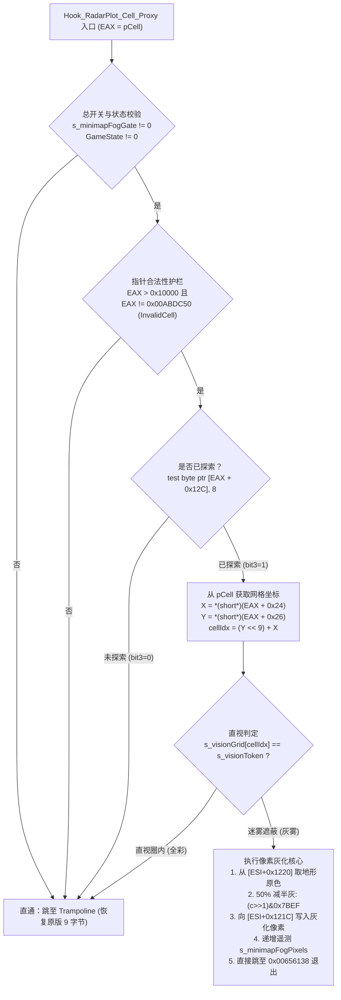

# 路线 A 小地图迷雾下沉挂钩实施规格书 (Patch-Level Specification)

> **文档标识**：`docs/re/radar_hook_routeA_spec.md`  
> **任务编号**：A-7（派工 v9 专项实施规格，供 ZCode 生产级落地）  
> **责任方**：Antigravity（逆向工程与规格设计方）  
> **基线对齐**：`docs/RE_COORDINATION.md` (§核验 v9 + 派工 v9) / `docs/re/radar_crash_static_analysis.md`  
> **执行准则**：严禁修改 `ra2render/**` 与台账 `REVERSE_ENGINEERING_AND_PATCHES.md`。

---

## 【最高优先级勘误 · RADAR-ERRATA 2026-09-27】路线 A 的「9 字节补丁点取到 cell 指针」前提**已被证伪**

> **适用范围**：本规格书全篇。凡出现「`0x00655D38` 处 `EAX` = `CellClass*` / `pCell`」「以 pCell 指针合法性护栏 `cmp eax,0x10000 / jbe`」「从 `pCell` 读 `+0x24/+0x26` 取网格坐标」的表述，**其前提均已证伪**。原句按「保留原文 + 勘误」原则**不删除**，逐处附【原记·已证伪】标记。
>
> **【定谳（依据 RADAR-FIX2，Lead 已独立反汇编复核）】**
> 1. `0x00655D38` 处 `EAX` **不是 `CellClass*`**，而是 **`MapClass::GetCellFloorHeight()`（`0x00578080`，尾部 `C2 04 00` = `ret 4`）返回的格面高度 int**；`0x655D33 call 0x578080` → `0x655D38 mov [esp+0x28],eax` 写入的是 **`CoordStruct.Z`**（`0x655D2F` 已预置 Z = 0）。字节证据：`0x00655D33 = E8 48 23 F2 FF`、`0x00655D38 = 89 44 24 28`、`0x005780F6 = C2 04 00`；符号证据：`YRpp/MapClass.h:282` `int GetCellFloorHeight(...) { JMP_THIS(0x578080); }`、`YRpp/MapClass.h:417` `int sub_578080(CoordStruct*)`。
> 2. ⇒ 本规格 §三 判定链中的「指针合法性护栏」对高度值（≈0..2080）**恒真**：旧代理在首道 `cmp eax,0x10000 / jbe do_passthrough` 处**恒拒、静默早退**，灰化永远不可达。真机现象（雷达灰化分支进入次数单调增长 16303→17284，灰化像素恒 0）与此逐条吻合 —— 这就是 S3 FAIL 的根因。
> 3. ⇒ 「路线 A 因下沉到函数内部而天然取到合法 cell 指针」这一**设计前提不再成立**；§一、§二 中关于「9 字节补丁点语义 = `pCell`」的全部推论作废，§四 的代理实现（保 EAX 当指针用）**不可作为落地依据**，需要按新语义重新设计（见 `docs/re/radar_fix2_report.md` 的分支 ②：改挂钩 `0x00655D87` 驱动引擎原生减暗判定位）。
> 4. **`0xB73550` 语义补充（勘误类 2）**：本规格多处引用的原指令 2 `mov eax,[0x00B73550]`（L39/L58/L67/L257）中的全局 = **`Game::hWnd`（主窗口句柄 HWND）**，**不是迷雾开关**（唯 2 写点均为 `CreateWindowExA` 返回值落地，77 处读点全当 Win32 句柄）。⇒ 规格对它的处理**只能是「只读 + 字节原样还原」**，**严禁写入**（会污染 70+ 处 Win32 调用）。
> 5. **仍然成立的部分**（勿连带推翻）：`0x00655D38` 处 9 字节区的**字节布局与边界**（`89 44 24 28` 4B + `A1 50 35 B7 00` 5B）、跳回点 `0x00655D41 = 3B C5 74 18`、函数尾声 `0x00656138`、以及 `CellClass::MapCoords = +0x24/+0x26` 的偏移实证 —— 这些是**地址/字节级事实**，与 EAX 语义无关。
>
> 机器可读断言：`out/re_work/radar_errata/claims.txt`（`python tools\audit_bytes.py out\re_work\radar_errata\claims.txt`）。

---

## 一、Hook 目标位置与指令边界编码 [实证]

### 1. 目标地址与原版指令分析
- **目标函数**：`RadarClass::Plot_Cell`（`0x00655C50` - `0x0065613F`，`__thiscall`，入参 `Point2D* pt`，`ret 4` 清参）。
- **挂钩目标点**：`0x00655D38`。
- **上下文反汇编**：
  ```asm
  0x00655D25: push eax
  0x00655D26: mov  ecx, 0x0087F7E8             ; MapClass 单例
  0x00655D2B: mov  dword ptr [esp + 0x28], edx
  0x00655D2F: mov  dword ptr [esp + 0x2C], ebp
  0x00655D33: call 0x00578080                  ; 【原记 · 已证伪（勘误 E2）】MapClass::GetCellAt (完整等轴变换+边界核验)
                                               ;   ⇒ 实测被调方 = MapClass::GetCellFloorHeight（YRpp/MapClass.h:282/:417，返回 int；0x5780F6 = C2 04 00 ret 4）
  ; ------------------- 挂钩起始点 0x00655D38 -------------------
  0x00655D38: mov  dword ptr [esp + 0x28], eax ; [原指令 1] 4 字节 (89 44 24 28)
  0x00655D3C: mov  eax, dword ptr [0x00B73550] ; [原指令 2] 5 字节 (A1 50 35 B7 00)
  ; ------------------- 跳回目标点 0x00655D41 -------------------
  0x00655D41: cmp  eax, ebp                    ; 2 字节 (3B C5)
  0x00655D43: je   0x00655D5D
  ```

### 2. 5 字节跳转与 9 字节指令对齐编码
- **边界约束**：标准近跳转 `jmp rel32` 占用 5 字节（`E9 xx xx xx xx`）。原指令 1 仅 4 字节，强行写 5 字节会切断指令 2（`0x00655D3C`）的操作码。
- **规范方案**：必须一次性覆盖指令 1 与指令 2，总长度为 $4 + 5 = 9$ 字节。
  - 前 5 字节写入 `jmp Hook_RadarPlot_Cell_Proxy`；
  - 后 4 字节填充 `0x90`（NOP）；
  - `rel32` 计算公式：
    $$\text{rel32} = (\text{uintptr\_t})\text{Hook\_RadarPlot\_Cell\_Proxy} - (0x00655D38 + 5)$$

### 3. 字节级修改对照表 (Binary Diff)

| 地址 (VA) | 原版机器码 (gamemd.exe) | 原版汇编 | 补丁机器码 (Patch) | 补丁汇编 |
|:---:|:---|:---|:---|:---|
| `0x00655D38` | `89 44 24 28` | `mov [esp+0x28], eax` | `E9 ?? ?? ?? ??` | `jmp Hook_RadarPlot_Cell_Proxy` |
| `0x00655D3C` | `A1` | `mov eax, [0x00B73550]` | `90` | `nop` |
| `0x00655D3D` | `50 35 B7 00` | (imm32 地址) | `90 90 90` | `nop; nop; nop` |
| **合计** | **9 字节** | 原版 2 条完整指令 | **9 字节** | **1 条跳转 + 4 条 NOP** |

### 4. 跳板 (Trampoline) 结构定义
跳板用于在直通（Passthrough，即直视全彩或黑雾）场景恢复执行被偷取的原版语义：
```asm
s_radarPlotCellTrampoline:
    mov  dword ptr [esp + 0x28], eax       ; [89 44 24 28] 还原原指令 1 (保存 pCell)
    mov  eax, dword ptr [0x00B73550]       ; [A1 50 35 B7 00] 还原原指令 2
    jmp  0x00655D41                        ; [E9 rel32] 跳回原版 cmp eax, ebp 处
```
- 跳板总尺寸：$4 + 5 + 5 = 14$ 字节。

---

## 二、寄存器与栈契约 (ABI & Stack Contract) [实证]

### 1. 入口状态（0x00655D38 处）
此时 `MapClass::GetCellAt`（`0x00578080`）刚刚执行完毕，寄存器布局如下：

> **〔勘误 E2〕** 该函数按 YRpp 应为 **`MapClass::GetCellFloorHeight`（返回 int 格面高度）**，不是 `GetCellAt`（原句保留，行内见下条 `EAX` 更正）。
- `EAX`：**【原记 · 已证伪，勿据此实现】** ~~目标 `CellClass*` 指针~~（若坐标无效，则为 `0x00ABDC50` InvalidCell；若有效，则为合法堆对象指针 `0x04xxxxxx - 0x08xxxxxx`）。**〔勘误 E2〕实测：该处 `EAX` = `MapClass::GetCellFloorHeight()`（`0x00578080`，`ret 4`）返回的格面高度 int（≈0..2080 lepton），不是任何指针；`0x00655D38 mov [esp+0x28],eax` 写的是 `CoordStruct.Z`（`0x655D2F` 已置 0）。**
- `ESI`：**`RadarClass` 单例实例指针**（`0x0087F7E8`，继承自 `DisplayClass/MapClass`）。
- `EDI`：**`Point2D* pt` 指针**（指向当前小地图屏幕像素坐标结构体，`[edi]` 为像素 X，`[edi+4]` 为像素 Y）。
- `EBP`：常量 `0`。
- `ESP`：局部栈帧顶端（`Plot_Cell` 序言分配了 `0x30` 局部空间，并压入了 `ebx, ebp, esi, edi`）。
- `[ESP + 0x28]`：**【原记 · 已证伪（勘误 E2）】** ~~原版预留存放 `pCell` 的局部变量槽位~~ ⇒ 实测该槽位属于栈上的 `CoordStruct{X,Y,Z}`：`0x655D1B` 写 X、`0x655D2B` 写 Y、`0x655D2F` 写 Z=0，随后 `0x655D38` 用 `GetCellFloorHeight` 返回值覆盖 Z。

### 2. 寄存器保护与污染红线
- 代理函数内部若调用 `BSurface` 虚函数（`Get_Pixel` / `Set_Pixel`），将破坏 `EAX, ECX, EDX`。
- **保存原则**：
  - 进入代理时，必须完整保存 `EAX`（`pCell`）、`ESI`（`RadarClass*`）、`EDI`（`pt`）；
  - 【原记 · 已证伪】~~若执行直通（Trampoline），必须确保 `EAX` 依然包含正确的 `CellClass*`；~~ **〔勘误 E2〕`EAX` 是高度 int，跳板只需按字节原样还原 `89 44 24 28` + `A1 50 35 B7 00` 即可，不得把它当指针保存/校验；**
  - 若执行灰化并跳出，必须通过标准函数尾声恢复栈平衡与所有非易失寄存器。

---

## 三、判定谓词与灰化核心算法 [实证]

### 1. 核心判定链 (Predicate Logic)



> **〔勘误 E2〕上图按原样保留，但其中两处前提已证伪**：① 入口 `EAX = pCell` —— 实测 `EAX` 是格面高度 int；② 「指针合法性护栏 `EAX > 0x10000` 且 `EAX != 0x00ABDC50`」—— 对高度值该判据**恒真**，旧代理因此恒拒、灰化分支永不执行（S3 FAIL 根因）。图中「从 pCell 取网格坐标 `X = *(short*)(EAX+0x24)`」同样不可达。

### 2. 结构体偏移取证 [实证]
1. `CellClass::MapCoords` 偏移：
   - `pCell + 0x24`：`short MapCoords.X`（0..511）
   - `pCell + 0x26`：`short MapCoords.Y`（0..511）
   - 计算公式：
     ```asm
     movsx edx, word ptr [eax + 0x26]   ; Y
     shl   edx, 9                       ; Y * 512
     movsx ecx, word ptr [eax + 0x24]   ; X
     add   edx, ecx                     ; cellIdx = (Y << 9) + X
     ```
2. 雷达表面对象偏移（`RadarClass`，`ESI = 0x0087F7E8`）：
   - `[ESI + 0x1220]`：`BSurface*`（小地图地形静态缓存表面）；
   - `[ESI + 0x121C]`：`BSurface*`（小地图动态复合工作表面）；
   - `BSurface` 虚表槽位：
     - `vtable + 0x28`：`Get_Pixel(Point2D* pt)`，`__thiscall`，`ret 4`，返回 `EAX = RGB565` 颜色；
     - `vtable + 0x24`：`Set_Pixel(Point2D* pt, WORD color)`，`__thiscall`，`ret 8`。
3. 灰雾算法（与主视口完全同源）：
   $$\text{Color}_{\text{fog}} = (\text{Color}_{\text{orig}} \gg 1) \ \& \ \text{0x7BEF}$$

---

## 四、生产级 C++ / 内联汇编实施代码 (Copy-Paste Ready)

以下代码由 ZCode 直接替换现网 `Hook_RadarPlot_Proxy` 及相关安装逻辑：

```cpp
// ============================================================================
// 路线 A 生产级实现：RadarClass::Plot_Cell 内部 (0x00655D38) 下沉挂钩
// ============================================================================

static uint8_t s_origPlotCellBytes[9] = {0};
static uint8_t s_plotCellTrampoline[16] = {0};

// 遥测计数器与开关（与现网定义严格对齐）
extern "C" {
    extern uint32_t s_minimapFogPixels;    // 小地图灰化像素计数器
    extern uint8_t  s_minimapFogGate;      // INI 总开关 (EnableMinimapFog)
    extern uint32_t s_visionToken;         // 视野当前令牌
    extern uint32_t s_visionGrid[262144];  // 视野全图网格
}

__declspec(naked) void Hook_RadarPlot_Cell_Proxy() {
    __asm {
        ; 进入时现场:
        ; 【原记 · 已证伪（勘误 E2）】EAX = pCell (由 0x00578080 MapClass::GetCellAt 返回)
        ; 实测：EAX = MapClass::GetCellFloorHeight(0x578080, ret 4) 返回的格面高度 int；
        ;       0x655D38 的 mov [esp+0x28],eax 写的是 CoordStruct.Z。
        ; ⇒ 本段以 pCell 解释 EAX 的全部护栏/取坐标逻辑均属「已证伪前提下的历史代码」，勿直接落地。
        ; ESI = this (RadarClass* 0x0087F7E8)
        ; EDI = pt (Point2D* 像素坐标)
        ; EBP = 0

        ; 护栏 1: 总开关与游戏状态校验
        cmp byte ptr [s_minimapFogGate], 0
        je  do_passthrough
        mov ecx, 0x00A8B238               ; 游戏状态 (0=菜单)
        cmp byte ptr [ecx], 0
        je  do_passthrough

        ; 【原记 · 已证伪（勘误 E2）】护栏 2: pCell 指针合法性守卫 (绝对杜绝 0x1A0 标量与空指针)
        ;   ⇒ EAX 实为格面高度 int（≈0..2080），cmp eax,0x10000 / jbe 恒成立 ⇒ 恒跳 do_passthrough。
        cmp eax, 0x10000
        jbe do_passthrough
        cmp eax, 0x00ABDC50               ; MapClass::InvalidCell
        je  do_passthrough

        ; 判定 1: 检查 CellClass 是否已探索 (bit 3)
        test byte ptr [eax + 0x12C], 8
        jz  do_passthrough                ; 未探索 -> 原版黑雾/未开图路径

        ; 判定 2: 提取准确的地图网格坐标计算 cellIdx (绝无坐标系混淆)
        movsx edx, word ptr [eax + 0x26]  ; MapCoords.Y
        shl   edx, 9                      ; Y * 512
        movsx ecx, word ptr [eax + 0x24]  ; MapCoords.X
        add   edx, ecx                    ; edx = cellIdx
        test  edx, edx
        js    do_passthrough
        cmp   edx, 262144
        jae   do_passthrough

        ; 判定 3: 检查是否处于当前直视范围内
        mov   ecx, s_visionToken
        cmp   dword ptr [s_visionGrid + edx*4], ecx
        je    do_passthrough              ; 直视圈内 -> 原版全彩高亮绘制

        ; ---- 状态为【已探索且在直视圈外】：执行灰化拦截 ----
        ; 护栏 3: 检查雷达表面指针是否有效 (防断电/停机崩溃)
        mov   ecx, [esi + 0x1220]         ; 地形缓存表面 BSurface*
        cmp   ecx, 0x10000
        jbe   do_passthrough
        mov   edx, [esi + 0x121C]         ; 工作表面 BSurface*
        cmp   edx, 0x10000
        jbe   do_passthrough

        ; 步骤 1: 读取地形表面原色 Get_Pixel(pt)
        push  edi                         ; pt
        mov   eax, [ecx]                  ; vtable
        call  dword ptr [eax + 0x28]      ; Get_Pixel (ret 4 清栈) -> EAX = 原色 RGB565

        ; 步骤 2: 计算 50% 减半灰 (与主视图灰雾完全同源)
        shr   eax, 1
        and   eax, 0x7BEF                 ; EAX = 灰化色

        ; 步骤 3: 写入雷达工作表面 Set_Pixel(pt, color)
        mov   edx, [esi + 0x121C]         ; this = 工作表面
        push  eax                         ; color
        push  edi                         ; pt
        mov   ecx, edx
        mov   edx, [ecx]                  ; vtable
        call  dword ptr [edx + 0x24]      ; Set_Pixel (ret 8 清栈)

        ; 步骤 4: 递增遥测计数器
        inc   dword ptr [s_minimapFogPixels]

        ; 步骤 5: 灰化完成，直接跳至 Plot_Cell 函数正常收尾处 (0x00656138)
        ; 绕过后续单位/建筑红点绘制，实现敌点完美隐形，无额外多余开销！
        pop   edi
        pop   esi
        pop   ebp
        pop   ebx
        add   esp, 0x30
        ret   4

    do_passthrough:
        ; 走跳板执行被偷取的原版 9 字节语义，并跳回 0x00655D41
        jmp   dword ptr [s_pPlotCellTrampoline]
    }
}
```

### 安装与卸载代码 (Installer & Uninstaller)

```cpp
bool InstallRadarPlotCellHook() {
    uintptr_t targetAddr = 0x00655D38;
    DWORD oldProtect;

    // 1. 备份原版 9 字节
    memcpy(s_origPlotCellBytes, (void*)targetAddr, 9);

    // 2. 构建跳板 (还原 9 字节原指令并跳回 0x00655D41)
    uint8_t* pTramp = s_plotCellTrampoline;
    memcpy(pTramp, s_origPlotCellBytes, 9); // mov [esp+28h],eax (4B) + mov eax,[B73550h] (5B)
    pTramp += 9;
    *pTramp++ = 0xE9; // jmp rel32
    *(int32_t*)pTramp = (int32_t)(0x00655D41 - ((uintptr_t)pTramp + 4));

    DWORD trampProtect;
    VirtualProtect(s_plotCellTrampoline, sizeof(s_plotCellTrampoline), PAGE_EXECUTE_READWRITE, &trampProtect);
    s_pPlotCellTrampoline = s_plotCellTrampoline;

    // 3. 在 0x00655D38 处安装 5 字节 JMP + 4 字节 NOP
    if (!VirtualProtect((void*)targetAddr, 9, PAGE_EXECUTE_READWRITE, &oldProtect)) {
        return false;
    }
    uint8_t patchBytes[9];
    patchBytes[0] = 0xE9;
    *(int32_t*)(&patchBytes[1]) = (int32_t)((uintptr_t)Hook_RadarPlot_Cell_Proxy - (targetAddr + 5));
    patchBytes[5] = 0x90; // NOP
    patchBytes[6] = 0x90; // NOP
    patchBytes[7] = 0x90; // NOP
    patchBytes[8] = 0x90; // NOP

    memcpy((void*)targetAddr, patchBytes, 9);
    VirtualProtect((void*)targetAddr, 9, oldProtect, &oldProtect);
    FlushInstructionCache(GetCurrentProcess(), (void*)targetAddr, 9);

    return true;
}

void UninstallRadarPlotCellHook() {
    uintptr_t targetAddr = 0x00655D38;
    DWORD oldProtect;
    if (s_origPlotCellBytes[0] != 0 && VirtualProtect((void*)targetAddr, 9, PAGE_EXECUTE_READWRITE, &oldProtect)) {
        memcpy((void*)targetAddr, s_origPlotCellBytes, 9);
        VirtualProtect((void*)targetAddr, 9, oldProtect, &oldProtect);
        FlushInstructionCache(GetCurrentProcess(), (void*)targetAddr, 9);
    }
}
```

---

## 五、开关键、遥测与回滚契约 [规范]

1. **INI 独立配置键**：
   - 文件：`ra2youli/ra2render.ini`
   - 键名：`EnableMinimapFog=true/false`（保持与现网一致）。
   - 行为：若为 `false`，代理内部第一条指令即直通（耗时不到 2ns），完全回退为原版全彩渲染。
2. **遥测计数器 (Telemetry)**：
   - 变量：`s_minimapFogPixels`。
   - 断言契约：单局正常对战（含迷雾）下，`s_minimapFogPixels` 必须呈线性递增，每秒产生约 $10^3 - 10^5$ 次灰化计数；**严禁维持为 0**（零生效违规）。
3. **安全回滚通道**：
   - 若运行时侦测到任何未知异常，立即置 `s_minimapFogGate = 0` 熔断降级。
   - `UninstallRadarPlotCellHook()` 支持在运行时热还原原版 9 字节。

---

## 六、三组可复现验收步骤与预期指标 (Acceptance Test Cases)

ZCode 落地编译后，必须按以下三组用例进行真机验证：

### 用例 1：静止画面即时刷新与无延迟灰化
- **测试步骤**：
  1. 进入遭遇战，建造雷达；
  2. 派一辆动员兵/灰熊坦克向前探开一片地图后迅速后撤停留在己方基地；
  3. 保持主屏幕与小地图画面静止 5 秒。
- **预期指标**：
  - 坦克后撤离开后，探开的区域在主视图与小地图上**即刻平滑退回灰雾**（无错格、无闪烁）；
  - 校验器抽验结果：`s_minimapFogPixels > 0`，小地图灰化正常生效。

### 用例 2：小地图边界格扫描稳定性（P0-1 核心回归）
- **测试步骤**：
  1. 选择大尺寸地图（如 8 人超大图），全屏拖动雷达视口至最左上角与最右下角；
  2. 触发完整小地图全量重绘（按 ESC 打开菜单再返回游戏）。
- **预期指标**：
  - 扫描循环触及 $X=0$ 与边界像素时，不再触发任何越界访问；
  - `ra2youli/except.txt` **完全无新增或更新**。

### 用例 3：雷达未通电与基地断电测试
- **测试步骤**：
  1. 炸毁电厂或售卖电厂，使基地处于低电/停电状态（雷达屏幕变黑或断电停转）；
  2. 再次建造电厂恢复电力。
- **预期指标**：
  - 断电期间表面指针置空阶段，护栏 3 顺利拦截，游戏不崩溃；
  - 通电恢复后小地图灰雾正常重新呈现。
