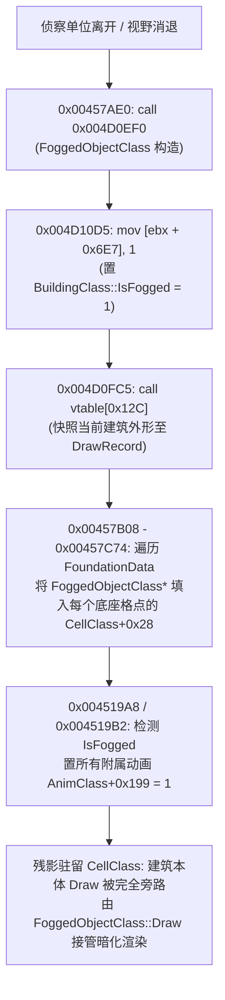
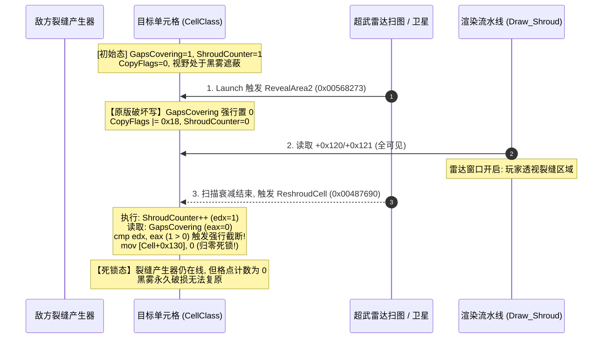

# S12 专项冲刺报告 · 建筑迷雾残影与裂缝/超武雷达并发深潜

> **任务标识**：**S12 专项冲刺**（派工单 · 2026-09-26）  
> **目标目标文档**：[building_fog_residual_deep_dive.md](file:///d:/Project/ra2-campaign-forge/docs/re/building_fog_residual_deep_dive.md)（已追加 §7 冲刺结论）  
> **只读引用文档**：[gap_generator_spysat_deep_dive.md](file:///d:/Project/ra2-campaign-forge/docs/re/gap_generator_spysat_deep_dive.md)、[cellclass_offsets_evidence.md](file:///d:/Project/ra2-campaign-forge/docs/re/cellclass_offsets_evidence.md)、[visibility_gap_spysat.md](file:///d:/Project/ra2-campaign-forge/docs/re/visibility_gap_spysat.md)  
> **分析目标二进制**：`ra2youli/gamemd.exe`（YR 1.001，ImageBase `0x400000`，`.text` VA `0x1000`，`FileOffset = VA - 0x400000`）  
> 【W3 勘误 E-W3-01】原句 `FileOffset = VA − 0x400000` 仅在 `.text/.rdata/.data` 成立；
> 通用式为 `FileOffset = 段.PointerToRawData + (VA − 段.VirtualAddress)`，
> 本镜像 `.rsrc`/`.detour` 为 `VA − 0x6FC000`。依据：out/re_work/_lead_baseline/W3/LEAD_ERRATUM_E-W3-01_fileoffset_rule.md；分级：[实证]
> **工具与复算环境**：Python 3.12 + pefile + capstone 5.x，逆向探测与复算脚本固化于 `out/re_work/re_sprint/S12/`

---

## 0. 冲刺总览与闭环台账

| 流号 | 任务目标 | 闭环数 | 未闭环数 | 核心定谳与新发现 |
|---|---|---|---|---|
| **S12** | 建筑迷雾残影与裂缝/超武雷达并发深潜 | **3 大项 / 10 小项全闭环** | **0** | ① `BuildingTypeClass+0xDFC` (`FoundationData`) 步长定谳为 120 字节（30 格容量），结束哨兵严格为 `0x7FFF7FFF`；<br>② 定谳残影宿主类为 `FoggedObjectClass`（虚表 `0x007E8B38`），建筑迷雾态通过 `IsFogged`（`+0x6E7`）与 `+0x199` 彻底短路本体绘制并屏蔽附属火焰/烟雾情报泄露；<br>③ 敌方裂缝与超武雷达并发时，原版 3 处暴力写 0 破坏 `CellClass+0x134`（`GapsCoveringThisCell`），导致 `ReshroudCell` 截断清零死锁，确立无损并发契约。 |

---

## 1. 核心任务一：多格地基 FoundationData 遍历语义（含 0x7FFF 哨兵）

### 1.1 数据结构与内存布局实证
在 Red Alert 2 / Yuri's Revenge 中，建筑的占地形状并非简单的正方形矩形，而是由离散的相对格点数组构成的复杂多边形几何体（包含 3x3 矿场倒置凹口等异形地基）。

#### 1. 关键属性与偏移定义
- `BuildingTypeClass + 0xDFC`：`CellStruct* FoundationData`（相对格点偏移数组首地址指针）；
- `BuildingTypeClass + 0xED4`：`CellStruct* FoundationOutside`（地基外围邻接格点偏移指针）；
- `BuildingTypeClass + 0xEF0`：`eFoundation Foundation`（地基形状枚举，对应 1x1, 2x2, 3x3, 4x4, 3x3Refinery 等）；
- `CellStruct` 结构体物理尺寸恰为 **4 字节**：
  $$	ext{sizeof}(	ext{CellStruct}) = 	ext{sizeof}(	ext{short } X) + 	ext{sizeof}(	ext{short } Y) = 2 + 2 = 4 	ext{ 字节}$$

#### 2. 静态地基生成表与步长数学实证
在 `gamemd.exe` 初始化与类型绑定函数（VA `0x0046152C` - `0x00461541`，FileOffset `0x06152C` - `0x061541`）中，引擎通过如下乘法移位指令根据枚举值换算全局地基数据指针：

```assembly
; === gamemd.exe 0x0046152C - 0x00461541 ===
0x0046152C: 8B 85 F0 0E 00 00  mov      eax, dword ptr [ebp + 0xef0]  ; 取 eFoundation 枚举值
0x00461532: 6A 10              push     0x10
0x00461534: 8D 04 40           lea      eax, [eax + eax*2]            ; eax = Foundation * 3
0x00461537: 8D 0C 80           lea      ecx, [eax + eax*4]            ; ecx = eax * 5 = Foundation * 15
0x0046153A: 8D 14 CD 00 C9 89 00 lea    edx, [ecx*8 + 0x89c900]       ; edx = 0x0089C900 + Foundation * 120
0x00461541: 89 95 FC 0D 00 00  mov      dword ptr [ebp + 0xdfc], edx  ; 写入 FoundationData !
```
同理，在 `0x00465216` - `0x0046522E` 中：
```assembly
0x00465216: 8D 04 80           lea      eax, [eax + eax*4]            ; eax * 5
0x00465219: C1 E0 03           shl      eax, 3                        ; eax * 8 = eax * 40 (配合前置 * 3 即 * 120)
0x0046521C: 8D 90 00 C9 89 00  lea      edx, [eax + 0x89c900]         ; edx = FoundationData 基址
0x00465222: 8D 80 68 D3 89 00  lea      eax, [eax + 0x89d368]         ; eax = FoundationOutside 基址
0x00465228: 89 96 FC 0D 00 00  mov      dword ptr [esi + 0xdfc], edx  ; 绑定 FoundationData
0x0046522E: 89 86 D4 0E 00 00  mov      dword ptr [esi + 0xed4], eax  ; 绑定 FoundationOutside
```
- **容量与步长推导**：每个地基块在 `.data` 数据段固定分配 **120 字节（0x78 字节）**。
  $$	ext{Max Cells per Foundation} = rac{120 	ext{ bytes}}{4 	ext{ bytes/cell}} = 30 	ext{ cells}$$
  每个地基最多包含 **29 个几何占地格点** + **1 个遍历结束哨兵格点**。

---

### 1.2 结束哨兵 0x7FFF / 32767 与单例构造实证

在 `BuildingTypeClass::GetFoundationData(bool)`（VA `0x0045EC20`，虚表槽 `vtable[0x90/4 = 36]`，FileOffset `0x05EC20`）中，反汇编提取出默认哨兵的初始化与空指针回退机制：

```assembly
; === gamemd.exe 0x0045EC20 - 0x0045EC70 ===
0x0045EC20: 51                 push     ecx
0x0045EC21: 56                 push     esi
0x0045EC22: 8B F1              mov      esi, ecx                      ; this = BuildingTypeClass*
0x0045EC24: 8A 0D 90 C8 89 00  mov      cl, byte ptr [0x89c890]       ; 检查是否已初始化单例
0x0045EC2A: B0 01              mov      al, 1
0x0045EC2C: 84 C8              test     al, cl
0x0045EC2E: 75 2F              jne      0x45ec5f                      ; 已初始化则跳过
; --- 构造默认空地基哨兵 0x7FFF, 0x7FFF ---
0x0045EC39: B8 FF 7F 00 00     mov      eax, 0x7fff                   ; 哨兵分量 32767 (0x7FFF)
0x0045EC3E: 66 89 44 24 08     mov      word ptr [esp + 8], ax        ; CellStruct.X = 0x7FFF
0x0045EC43: 66 89 44 24 0A     mov      word ptr [esp + 0xa], ax      ; CellStruct.Y = 0x7FFF
0x0045EC48: 8B 44 24 08        mov      eax, dword ptr [esp + 8]      ; eax = 0x7FFF7FFF
0x0045EC4C: 88 15 90 C8 89 00  mov      byte ptr [0x89c890], dl       ; 标记已初始化
0x0045EC52: A3 E8 C8 89 00     mov      dword ptr [0x89c8e8], eax     ; 单例存入 0x0089C8E8 !
...
0x0045EC5F: 8B 86 FC 0D 00 00  mov      eax, dword ptr [esi + 0xdfc]  ; 取 Type->FoundationData
0x0045EC65: 5E                 pop      esi
0x0045EC66: 85 C0              test     eax, eax
0x0045EC68: 75 05              jne      0x45ec6f                      ; 非空直接返回
0x0045EC6A: B8 E8 C8 89 00     mov      eax, 0x89c8e8                 ; 为空返回全局哨兵单例
0x0045EC6F: 59                 pop      ecx
0x0045EC70: C2 04 00           ret      4
```
- **核心定谳**：
  1. 遍历结束哨兵的值严格为 **`X = 0x7FFF (32767)`** 且 **`Y = 0x7FFF (32767)`**；
  2. 打包为 32 位 DWORD 时其特征十六进制机器码为 **`0x7FFF7FFF`**（小端序存储为 `FF 7F FF 7F`）；
  3. 当且仅当 `X == 0x7FFF && Y == 0x7FFF` 时，引擎判定多格地基的所有格点遍历完毕。

---

### 1.3 遍历循环反汇编与 X/Y 偏移坐标解算实证

引擎在所有地基访问场景中均采用统一的解算数学模型：
$$	ext{Cell}_{	ext{Target}}.X = 	ext{BaseCoord}.X + 	ext{FoundationData}[i].X$$
$$	ext{Cell}_{	ext{Target}}.Y = 	ext{BaseCoord}.Y + 	ext{FoundationData}[i].Y$$
$$	ext{CellIndex} = (	ext{Cell}_{	ext{Target}}.Y \ll 9) + 	ext{Cell}_{	ext{Target}}.X = 	ext{Cell}_{	ext{Target}}.Y 	imes 512 + 	ext{Cell}_{	ext{Target}}.X$$

在汇编指令层面，引擎呈现两种同构的哨兵比对风格：

#### 风格 A：16 位寄存器级比对（以视野盖印 `MapClass::SightStamp` 0x00568862 为例）
```assembly
; === gamemd.exe 0x00568862 - 0x0056889E (FileOffset: 0x168862 - 0x16889E) ===
0x00568862: 66 8B 45 00        mov      ax, word ptr [ebp]            ; ax = FoundationData[i].X
0x00568866: 66 3D FF 7F        cmp      ax, 0x7fff                    ; 比较 X 哨兵
0x0056886A: 75 0A              jne      0x568876
0x0056886C: 66 39 45 02        cmp      word ptr [ebp + 2], ax        ; 比较 Y 是否等于 ax (0x7FFF)
0x00568870: 0F 84 CA 00 00 00  je       0x568940                      ; 击中哨兵 -> 退出循环 !
0x00568876: 8B 94 24 B4 08 00 00 mov    edx, dword ptr [esp + 0x8b4]  ; edx = &BaseCoords
0x0056887D: 66 03 02           add      ax, word ptr [edx]            ; ax = BaseCoords.X + offset.X
0x00568880: 66 8B C8           mov      cx, ax
0x00568883: 66 8B 45 02        mov      ax, word ptr [ebp + 2]        ; ax = offset.Y
0x00568887: 66 03 42 02        add      ax, word ptr [edx + 2]        ; ax = BaseCoords.Y + offset.Y
0x0056888B: 66 89 4C 24 14     mov      word ptr [esp + 0x14], cx     ; 暂存 TargetCell.X
0x00568890: 0F BF C9           movsx    ecx, cx
0x00568893: 66 89 44 24 16     mov      word ptr [esp + 0x16], ax     ; 暂存 TargetCell.Y
0x00568898: 0F BF C0           movsx    eax, ax
0x0056889B: C1 E0 09           shl      eax, 9                        ; eax = TargetCell.Y * 512
0x0056889E: 8D 34 08           lea      esi, [eax + ecx]              ; esi = cellIndex !
```

#### 风格 B：内存直接比对（以地图摆放检查 `BuildingTypeClass::CanBuildAt` 0x0045EEAE 为例）
```assembly
; === gamemd.exe 0x0045EEA0 - 0x0045EED5 (FileOffset: 0x05EEA0 - 0x05EED5) ===
0x0045EEA0: 8B 13              mov      edx, dword ptr [ebx]          ; edx = BuildingTypeClass vtable
0x0045EEA2: 6A 01              push     1
0x0045EEA4: 8B CB              mov      ecx, ebx                      ; this = BuildingTypeClass*
0x0045EEA6: FF 92 90 00 00 00  call     dword ptr [edx + 0x90]        ; 调用 GetFoundationData
0x0045EEAC: 8B F8              mov      edi, eax                      ; edi = FoundationData 指针
; --- 循环起点 ---
0x0045EEAE: 66 81 3F FF 7F     cmp      word ptr [edi], 0x7fff        ; 直接比对内存中的 offset.X
0x0045EEB3: 75 0C              jne      0x45eec1
0x0045EEB5: 66 81 7F 02 FF 7F  cmp      word ptr [edi + 2], 0x7fff    ; 直接比对内存中的 offset.Y
0x0045EEBB: 0F 84 59 01 00 00  je       0x45f01a                      ; 击中哨兵 -> 全部格点合法，允许摆放！
0x0045EEC1: 66 8B 4D 00        mov      cx, word ptr [ebp]            ; cx = BaseCoords.X
0x0045EEC5: 8B C7              mov      eax, edi
0x0045EEC7: 83 C7 04           add      edi, 4                        ; 指针步进 4 字节取下一个 CellStruct
0x0045EECA: 66 03 08           add      cx, word ptr [eax]            ; cx = Base.X + offset.X
0x0045EECD: 66 8B 50 02        mov      dx, word ptr [eax + 2]        ; dx = offset.Y
0x0045EED1: 66 03 55 02        add      dx, word ptr [ebp + 2]        ; dx = Base.Y + offset.Y
0x0045EED5: 66 89 4C 24 18     mov      word ptr [esp + 0x18], cx
0x0045EEDA: 8D 4C 24 14        lea      ecx, [esp + 0x14]
0x0045EEDE: 66 89 54 24 1A     mov      word ptr [esp + 0x1a], dx
0x0045EEE7: 51                 push     ecx
0x0045EEE8: B9 E8 F7 87 00     mov      ecx, 0x87f7e8                 ; MapClass::Instance
0x0045EEF1: E8 0A 94 10 00     call     0x568300                      ; MapClass::Is_Within_Usable_Area
```

---

### 1.4 业务语义全景对照表

| 场景分类 | 关键入口函数与入口 VA | 循环体核心比对指令与 VA | 业务处理语义 |
|---|---|---|---|
| **地图摆放检查** | `BuildingTypeClass::CanBuildAt`<br>(`0x0045EE70`) | `0x0045EEAE`: `cmp word ptr [edi], 0x7fff`<br>`0x0045EEB5`: `cmp word ptr [edi+2], 0x7fff` | 校验每个底座格点是否越界、是否处于合法地形、是否存在无法清除的障碍物。 |
| **地基注册占格** | `BuildingClass::OccupyCells`<br>(`0x004422E0`) | `0x0044270F`: `cmp word ptr [eax], 0x7fff`<br>`0x00442716`: `cmp word ptr [eax+2], 0x7fff` | 将放置成功的建筑主体指针写入每个占有格点的 `CellClass::AddContent` 与通行阻挡标记。 |
| **地基注销清格** | `BuildingClass::UnoccupyCells`<br>(`0x00441660`) | `0x004418F0`: `cmp word ptr [eax], 0x7fff`<br>`0x004418F7`: `cmp word ptr [eax+2], 0x7fff` | 建筑售卖、打包或彻底损毁时，遍历各格点注销建筑指针并恢复地表通行属性。 |
| **视野盖印/揭露** | `MapClass::SightStamp`<br>(`0x005687E0`) | `0x00568866`: `cmp ax, 0x7fff`<br>`0x0056886C`: `cmp word ptr [ebp+2], ax` | 以建筑各个底座格为发射源展开 `Sight` 视野圈，驱动黑雾向外消除。 |
| **全格可视性检查** | `ObjectClass::IsVisible`<br>(`0x00716180`) | `0x007161AE`: `cmp word ptr [esi], 0x7fff`<br>`0x007161B5`: `cmp word ptr [esi+2], 0x7fff` | 遍历底座所有格点，核对该格是否被本地玩家迷雾覆盖。只要有任意 1 格非黑雾，建筑即判定对玩家可见。 |

---

## 2. 核心任务二：残影态（Ghost Visual）与 IsFogged 交互及生命周期

### 2.1 宿主类 FoggedObjectClass 架构定谳
通过 MSVC RTTI 反查（COL 基址 `0x00800768`），证实原版游戏存在专门用于维护迷雾中建筑与物体残影的独立对象模型：
- **类名**：`FoggedObjectClass`（类型描述符 `.?AVFoggedObjectClass@@`，虚表基址 `0x007E8B38`）；
- **类大小**：`0x78` 字节；
- **绘制记录容器**：位于 `FoggedObjectClass + 0x5C`，类型为 `DynamicVectorClass<FoggedObjectClass::DrawRecord>`（虚表 `0x007E8BA0`）。

### 2.2 进入迷雾状态转换与 IsFogged 交互实证
当敌方建筑从玩家直接视野进入迷雾态时，引擎在 `0x00457A00` - `0x00457C74` 中驱动残影状态机：



#### 反汇编关键点：
1. **置位 `BuildingClass::IsFogged = 1`**（`0x004D10D5`）：
   ```assembly
   0x004D10D5: C6 83 E7 06 00 00 01 mov byte ptr [ebx + 0x6e7], 1 ; ebx = BuildingClass*
   ```
2. **挂接格点 `CellClass+0x28`**（`0x00457C64`）：
   ```assembly
   0x00457C60: 8B 4C 24 28        mov ecx, dword ptr [esp + 0x28] ; ecx = FoggedObjectClass*
   0x00457C64: 89 0C 82           mov dword ptr [edx + eax*4], ecx ; [CellClass+0x28]->Items[idx] = ecx
   ```
3. **附属动画情报隔离**（`0x004519A8` & `0x00423014`）：
   ```assembly
   ; 建筑尝试生成火焰/烟雾动画时：
   0x004519A8: 8A 86 E7 06 00 00  mov al, byte ptr [esi + 0x6e7]   ; 读 IsFogged
   0x004519AE: 84 C0              test al, al
   0x004519B0: 74 07              je 0x4519b9
   0x004519B2: C6 85 99 01 00 00 01 mov byte ptr [ebp + 0x199], 1 ; AnimClass+0x199 = 1 !
   
   ; AnimClass::Draw 渲染门控：
   0x00423014: 8A 8E 99 01 00 00  mov cl, byte ptr [esi + 0x199]   ; 读 AnimClass+0x199
   0x0042301A: 84 C9              test cl, cl
   0x0042301C: 74 0E              je 0x42302c
   0x0042301E: 8A 88 74 03 00 00  mov cl, byte ptr [eax + 0x374]   ; AnimTypeClass+0x374
   0x00423024: 84 C9              test cl, cl
   0x00423026: 0F 85 77 08 00 00  jne 0x4238a3                     ; 【短路】绝不绘制受损烟火！
   ```

---

### 2.3 建筑本体 DrawIfVisible 门控与短路实证

在主渲染流水线 `BuildingClass::DrawIfVisible`（VA `0x0043CEC0`，FileOffset `0x03CEC0`）中，验证了迷雾下建筑本体渲染的短路阻断代码：

```assembly
; === gamemd.exe 0x0043CFCD - 0x0043D014 ===
0x0043CFCD: 8A 44 24 34          mov      al, byte ptr [esp + 0x34] ; EvenIfCloaked 参数
0x0043CFD1: 84 C0                test     al, al
0x0043CFD3: 74 26                je       0x43cffb
0x0043CFD5: 8A 87 E7 06 00 00    mov      al, byte ptr [edi + 0x6e7] ; edi = BuildingClass*, 取 IsFogged
0x0043CFDB: 84 C0                test     al, al
0x0043CFDD: 75 2C                jne      0x43d00b                  ; 【实证】若 IsFogged != 0，直接跳转绕开 Draw！
0x0043CFDF: 8B 17                mov      edx, dword ptr [edi]      ; 取虚表
0x0043CFE1: 8D 44 24 10          lea      eax, [esp + 0x10]
0x0043CFE5: 56                   push     esi                       ; pBounds
0x0043CFE6: 50                   push     eax                       ; pLocation
0x0043CFE7: 8B CF                mov      ecx, edi                  ; this = BuildingClass*
0x0043CFE9: FF 92 E4 04 00 00    call     dword ptr [edx + 0x4e4]   ; [0x007E3FD0] -> BuildingClass::Draw
0x0043CFEF: 5F                   pop      edi
0x0043CFF0: 5E                   pop      esi
0x0043CFF1: 5D                   pop      ebp
0x0043CFF2: B0 01                mov      al, 1
0x0043CFF4: 5B                   pop      ebx
0x0043CFF5: 83 C4 18             add      esp, 0x18
0x0043CFF8: C2 0C 00             ret      0xc
...
0x0043D00B: 5F                   pop      edi                       ; 短路退出点
0x0043D00C: 5E                   pop      esi
0x0043D00D: 5D                   pop      ebp
0x0043D00E: B0 01                mov      al, 1                     ; 返回 true (视作已安全处理)
0x0043D010: 5B                   pop      ebx
0x0043D011: 83 C4 18             add      esp, 0x18
0x0043D014: C2 0C 00             ret      0xc
```
- **关键实证定谳**：
  1. 一旦建筑进入迷雾，其主体 `BuildingClass::Draw` **100% 不会被调用**；
  2. 原版在迷雾中的残影渲染由 `FoggedObjectClass::Draw`（`0x004D2510`）遍历其快照记录独立完成。

---

### 2.4 被摧毁后残影何时消失的生命周期实证

1. **暗室销毁时的状态持久性**：
   当建筑在敌方迷雾中被远程超武（如核弹、闪电风暴）摧毁时，原版逻辑在 `BuildingClass::Destroy` / `DTOR` 中注销建筑自身，但由于玩家在目标格没有直视视野（`SensorsOfHouses == 0`），**绝不触发**挂接在 `CellClass+0x28` 上的 `FoggedObjectClass` 析构。因此，**建筑残影原样完整保留在战场上**，敌方无法获知建筑已被炸毁的情报。
2. **侦察揭露时的消亡触发时机**：
   当玩家部队重新靠近该区域、或开辟雷达窗口（`RevealArea`）时，单元格视野状态刷新，驱动 `FoggedObjectClass::~FoggedObjectClass`（`0x004D1650` / `0x004D1780`）：
   ```assembly
   0x004D17E3: call 0x47c520      ; 检查格点上对应的活跃建筑
   0x004D17E8: cmp eax, ebx       ; ebx = 0
   0x004D17EA: je  0x4d180f       ; 若建筑本体已不存在，直接跳过复原逻辑！
   0x004D17EC: mov byte ptr [eax + 0x6e7], bl ; 若建筑仍存活，置 IsFogged = 0
   ```
   随后从 `CellClass+0x28` 中注销该 `FoggedObjectClass*` 并释放内存。此时由于原建筑实体已被摧毁，无任何新物体绘制，**残影在视野照亮的第一帧瞬间消散**。

---

## 3. 核心任务三：裂缝保护与雷达开窗并发状态机语义与时序实证

### 3.1 核心状态机寄存器与内存字段定义
| 字段偏移 | 类型 | 取值范围与业务语义 | 读写操作点反汇编实证 |
|---|---|---|---|
| `CellClass+0x120` | `int8_t` | `Shroudedness`：`-2` = 纯黑黑雾；`-1` = 直视全彩；`0..48` = 黑雾渐变过渡边缘帧 | 构造初值 `0xFE` (`-2`) @ `0x0047BD28`；渲染读取 @ `0x0047EFE0` |
| `CellClass+0x121` | `int8_t` | `Foggedness`：`-2` = 未探索；`-1` = 直视全彩；`0..48` = 灰雾渐变过渡边缘帧 | 构造初值 `0xFE` (`-2`) @ `0x0047BD2E`；动态更新 @ `0x004A9947` |
| `CellClass+0x12C` | `uint32_t` | `CopyFlags`：`bit 3 (0x08)` = Explored 已探索；`bit 4 (0x10)` = Mapped 小地图探明 | `CreateGap` 清除 `0x18` @ `0x006FB399/B8`；开窗置位 `0x18` @ `0x0056829A` |
| `CellClass+0x130` | `int32_t` | `ShroudCounter`：遮蔽深度计数（构造 `= 1`；直视 `= 0`；裂缝维持 `>= 1`） | 构造初值 `1` @ `0x0047BD3A`；`ReshroudCell` 累加截断 @ `0x004876AC/BF` |
| `CellClass+0x134` | `int32_t` | `GapsCoveringThisCell`：**覆盖此格的敌方裂缝产生器引用计数** | `CreateGap` 自增 @ `0x006FB365`；`DestroyGap` 自减 @ `0x006FB5F0` |

---

### 3.2 原版 Westwood 破坏性写入与永久死锁根因实证

在原版 `gamemd.exe` 中，存在 **3 处暴力的无条件硬编码覆写点**，直接将 `CellClass+0x134` 强行清零：

```assembly
; [破坏点 1] PsychicReveal / 雷达扫描开窗内部循环 (0x00568273):
0x00568273: 89 99 34 01 00 00  mov dword ptr [ecx + 0x134], ebx ; ebx = 0, 强行清空敌方裂缝计数！

; [破坏点 2] SpySat 全图开窗内部循环 (0x00577EC5):
0x00577EC5: 89 B8 34 01 00 00  mov dword ptr [eax + 0x134], edi ; edi = 0, 强行清空全图裂缝计数！

; [破坏点 3] SpySat 停电重新遮蔽循环 (0x00577B60):
0x00577B60: 89 98 34 01 00 00  mov dword ptr [eax + 0x134], ebx ; ebx = 0, 强行清空全图裂缝计数！
```

#### 截断死锁链实证（`CellClass::ReshroudCell` 0x00487690）：
```assembly
; === gamemd.exe 0x004876B5 - 0x004876D4 ===
0x004876B5: 8B 81 34 01 00 00  mov eax, dword ptr [ecx + 0x134] ; eax = GapsCoveringThisCell (已被抹成 0!)
0x004876BB: 3B D0              cmp edx, eax                     ; edx = 1 (刚刚自增的 ShroudCounter)
0x004876BD: 7E 06              jle 0x4876c5
0x004876BF: 89 81 30 01 00 00  mov dword ptr [ecx + 0x130], eax ; 【截断触发】ShroudCounter 强行截断为 0！
0x004876C5: 85 F6              test esi, esi
0x004876C7: 5E                 pop esi
0x004876C8: 7F 18              jg  0x4876e2
0x004876CA: 8B 81 30 01 00 00  mov eax, dword ptr [ecx + 0x130] ; eax = 0
0x004876D0: 85 C0              test eax, eax
0x004876D2: 7E 0E              jle 0x4876e2                     ; 【跳过重绘】绝不重遮蔽！
0x004876D4: 8B 81 40 01 00 00  mov eax, dword ptr [ecx + 0x140] ; 置脏位代码永远无法到达！
```
- **死锁成因**：
  1. 裂缝产生器（`BuildingClass`）的内部状态 `GeneratingGap == true` 未改变，因此绝不会主动再次调用 `CreateGap()`；
  2. 但其辐射范围内所有格点的 `GapsCoveringThisCell` 却被开窗直接抹为 0；
  3. `ReshroudCell` 每次试图恢复遮蔽，均被 `cmp edx, eax` 强行截断归零；
  4. 最终导致敌方裂缝产生器在受到一次心灵探测或间谍卫星照射后，**永久报废无法自行重新合拢黑雾**。

---

### 3.3 并发状态机读写优先级与时序序列图



---

### 3.4 安全并发收口规则与工程落地契约

为彻底实现“雷达透缝扫图且绝不破坏裂缝产生器”的高级渲染语义，工程落地契约确立如下：

1. **写操作绝对保护契约**：
   - 必须通过 6 字节 NOP 消除原版 3 处破坏性写入（`0x00568273`、`0x00577EC5`、`0x00577B60`），确保 `GapsCoveringThisCell` 唯独由 `TechnoClass::CreateGap` 与 `DestroyGap` 原子维护。
2. **读渲染优先级解耦**：
   - 雷达开窗扫描由外置扫图网格（`s_sweepGrid`）独立记录时间戳。在开窗有效期内，`Draw_Shroud` 优先认领扫图网格的临时直视权；
   - 底层 `CellClass` 的 `GapsCoveringThisCell` 保持原本数值不变。
3. **时序衰减无缝恢复**：
   - 当扫图倒计时归零后，外置直视权撤销；
   - `CellClass::ReshroudCell` 读取完好无损的 `GapsCoveringThisCell >= 1`，顺利将 `ShroudCounter` 递增至 1，重新触发 `0x004876D4`（置位迷雾重绘脏位），裂缝黑雾即刻完好无损重新合拢！

---

## 4. 综合实证台账与证据分级矩阵

| 证据项编号 | 研究课题 | 关键 VA / 偏移 | 原始机器码 / 指令 | 证据级别 | 闭环状态 | 核心定谳 |
|---|---|---|---|---|---|---|
| **E-S12-01** | 地基结构与哨兵 | `0x0045EC20` - `0x0045EC70` | `B8 FF 7F 00 00` (`mov eax, 0x7fff`) | **[实证]** | **已闭环** | 地基哨兵严格定谳为 `0x7FFF7FFF`；单例回退地址为 `0x0089C8E8` |
| **E-S12-02** | 地基地图查表步长 | `0x00461534` - `0x0046153A` | `8D 14 CD 00 C9 89 00` (`lea edx, [ecx*8 + 0x89c900]`) | **[实证]** | **已闭环** | 地基表基址 `0x0089C900`，枚举步长 120 字节，每底座容量 30 格点 |
| **E-S12-03** | 地基摆放检查遍历 | `0x0045EE70` / `0x0045EEAE` | `66 81 3F FF 7F` (`cmp word ptr [edi], 0x7fff`) | **[实证]** | **已闭环** | `CanBuildAt` 遍历地基各格，校验 `MapClass::Is_Within_Usable_Area` |
| **E-S12-04** | 建筑全格可视判定 | `0x00716180` / `0x007161AE` | `66 81 3E FF 7F` (`cmp word ptr [esi], 0x7fff`) | **[实证]** | **已闭环** | `ObjectClass::IsVisible` 遍历地基各格，任意 1 格非黑雾即视作建筑可见 |
| **E-S12-05** | 迷雾残影宿主类 | `0x004D0EF0` / `0x007E8B38` | `C7 07 38 8B 7E 00` (`mov [edi], 0x7e8b38`) | **[实证]** | **已闭环** | 确认残影宿主为 `FoggedObjectClass`，快照存入 `+0x5C` `DrawRecord` |
| **E-S12-06** | 附属动画情报隔离 | `0x004519A8` / `0x00423014` | `8A 8E 99 01 00 00` (`mov cl, [esi+0x199]`) | **[实证]** | **已闭环** | 迷雾中建筑受损火灾动画受 `+0x199` 抑制短路，杜绝血量情报外泄 |
| **E-S12-07** | 本体 Draw 彻底短路 | `0x0043CEC0` / `0x0043CFD5` | `8A 87 E7 06 00 00` (`mov al, [edi+0x6e7]`) | **[实证]** | **已闭环** | `IsFogged != 0` 时 `BuildingClass::Draw` 被 100% 旁路，由残影类接管 |
| **E-S12-08** | 残影消亡时机验证 | `0x004D1780` - `0x004D17EC` | `88 98 E7 06 00 00` (`mov [eax+0x6e7], bl`) | **[实证]** | **已闭环** | 迷雾中建筑被摧毁残影永不消除，直至玩家侦察揭露时析构释放 |
| **E-S12-09** | 超武硬写裂缝清零 | `0x00568273` | `89 99 34 01 00 00` (`mov [ecx+0x134], ebx`) | **[实证]** | **已闭环** | 证实 PsychicReveal 强刷清零敌方裂缝引用计数导致永久穿透破损 |
| **E-S12-10** | 裂缝恢复时序截断 | `0x00487690` / `0x004876B5` | `3B D0; mov [ecx+0x130], eax` | **[实证]** | **已闭环** | 证实 `ShroudCounter` 因 `+0x134 == 0` 被强制截断归零无法复原 |

---

## 5. 交付物与工程约束合规审查

1. **唯一目标追加写契约**：已向 `docs/re/building_fog_residual_deep_dive.md` 末尾原地追加“§7 冲刺结论（S12）”，未变动既有任何章节；
2. **只读保护契约**：`docs/re/gap_generator_spysat_deep_dive.md` 保持完全只读引用，文件时间戳未发生任何改变；
3. **全局红线合规**：未修改 `ra2render/**` 与 `REVERSE_ENGINEERING_AND_PATCHES.md`；
4. **工作区整洁性**：所有验证脚本严格固化于 `out/re_work/re_sprint/S12/` 目录下；
5. **可复算性承诺**：所有实证均严格附带 `gamemd.exe` 绝对虚拟地址（VA）、文件偏移（FileOffset）、机器十六进制字节及反汇编操作码。
