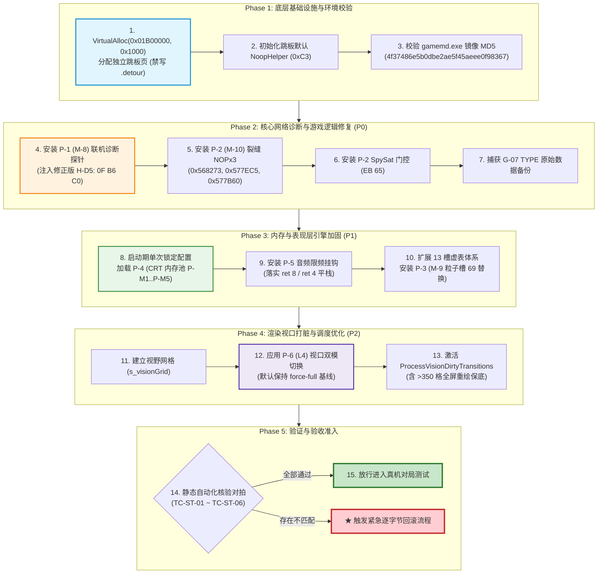

# S19 专项冲刺报告 · 六大落地补丁待执行总台账与工程落地规范
# Sprint S19 Report: Six Landing Patches Pending Execution Master Table & Engineering Specification

> **冲刺标识**：**S19 专项冲刺**（派工单 · 2026-09-26）  
> **核心交付产物**：[docs/re/pending_execution_master_table.md](file:///d:/Project/ra2-campaign-forge/docs/re/pending_execution_master_table.md)（全新全面总台账与工程落地规范）  
> **关联支撑文档**：
> - `docs/re/landing_equivalence_static_proof.md`（S15 静态等效性论证包）
> - `docs/re/landing_pack_net_fix.md`（M-8 联机诊断规格）
> - `docs/re/landing_pack_gap_spysat.md`（M-10 裂缝/间谍卫星规格）
> - `docs/re/landing_pack_particle.md`（M-9 微粒剔除规格）
> - `docs/re/landing_pack_crt_audio_particle.md`（CRT 内存池与音频限频规格）
> - `docs/re/crt_pool_risk_review.md`（CRT 内存池 5 重致命缺陷独立审查）
> - `docs/re/l4_vision_dirty_final_spec.md`（L4 视口局部打脏规格）
> - `docs/re/net_sync_checksum.md`（联机同步契约与缺口表 G-03/G-04/G-06/G-07）  
> **分析目标二进制**：`ra2youli/gamemd.exe`（YR 1.001，ImageBase `0x00400000`，`.text` VA `0x00401000`，`FileOffset = VA - 0x00400000`，MD5: `4f37486e5b0dbe2ae5f45aeee0f98367`）  
> 【W3 勘误 E-W3-01】原句 `FileOffset = VA − 0x400000` 仅在 `.text/.rdata/.data` 成立；
> 通用式为 `FileOffset = 段.PointerToRawData + (VA − 段.VirtualAddress)`，
> 本镜像 `.rsrc`/`.detour` 为 `VA − 0x6FC000`。依据：out/re_work/_lead_baseline/W3/LEAD_ERRATUM_E-W3-01_fileoffset_rule.md；分级：[实证]
> **执行环境与复算脚本**：Python 3.12 + pefile + capstone 5.x，脚本与复算日志固化于 `out/re_work/re_sprint/S19/`  
> **全局工程纪律**：
> 1. 禁改 `ra2render/**` 与顶层台账 `REVERSE_ENGINEERING_AND_PATCHES.md`；
> 2. 写作用域严格互斥，只输出至 `docs/re/pending_execution_master_table.md` 与本报告；
> 3. 证据全量分级：`[实证]` × `[推演]` × `[待实测]`；
> 4. 真机/游戏不启动，全量静态逐字节、逐指令、逐寄存器与调用栈核验。

---

## 〇、冲刺总览与闭环台账 (Executive Ledger)

本冲刺聚焦于后续真机验证解冻后、工程实施方（ZCode / MiMo）的**无脑落地执行**需求，将前期分散在各深潜专卷、Lead 裁决与风险评审中的零散点位，全面收敛为一份 100% 完备、指令级精确的《待执行总台账》（Master Table）。

| 补丁编号 | 补丁名称 | 目标模块 | 涉及地址 (VA) | 关键指令与机器码 | 实施机制 | 终审判定 | 核心风险拦截与实施要点 |
|:---:|:---|:---:|:---|:---|:---:|:---:|:---|
| **P-1** | **M-8 联机诊断** | 联机网络 | `0x64C6F2` `0x64CC61` `0x64DE75` `0x64C911` `0x64CC0A` | H-D1/D2/D5/D6/D6b Cave: `0x01B00000` ★ **H-D5: `0F B6 C0`** | Inline Jmp + Cave | **【条件等效】** (P0/P1) | **拦截致命漏洞**：修正 H-D5 符号扩展漏洞（`0F B6 C0` 替换 `83 E0 FF`）；禁写 `.detour` 节；H-D2 提前快照 EAX。 |
| **P-2** | **M-10 裂缝保护与间谍卫星门控** | 游戏逻辑/迷雾 | `0x568273` `0x577EC5` `0x577B60` `0x508F8F` TYPE 内存表 | Gap1/2/3: NOP×6 SpySat: `EB 65` G-07 TYPE 还原 | Byte Patch + Data Restore | **【条件等效】** (P0) | **联机强红线**：修改 `Cell+0x134` 属有状态逻辑变更，**联机全端必须同构建同配置，严禁混端**；落实 G-07 TYPE 备份还原。 |
| **P-3** | **M-9 微粒与粒子系统迷雾剔除** | 粒子渲染 | `0x007EFA68` `0x007EFCB0` | Particle 槽 69 PSys 槽 69 早退: `ret 8` | VTable 覆写 (.rdata) | **【静态等效】** (P1) | **零代码段侵入**：仅改虚表函数指针；A-15 归属链（`+0xFC` / `+0xE0`）保障盟友零误杀；寿命在 Update 推进，剔除不导致永生。 |
| **P-4** | **CRT 高频小对象池化** | 内存管理 | `0x007C8E17` `0x007C8B3D` | new: 6B Inline delete: 9B Inline P-M1…P-M5 加固 | Inline Jmp + Tramp | **【条件等效】** (P1) | **五重加固落地**：8B 头部满足自然对齐；释放投毒 `0xDEADBEEF` 防 Double Free；双重地址守卫穿透原生堆；CAS 无锁；**启动期锁定**。 |
| **P-5** | **音频引擎并发削峰与限频** | 音频调度 | `0x00750920` `0x007509E0` | PlayGlobal (6B) PlayAt (5B) 早退: `NULL`, 平栈 | Inline Jmp + Tramp | **【条件等效】** (P1) | **纠正 ABI 契约**：早退必须返回 `0` (`NULL`) 且分别执行 `ret 8` 与 `ret 4`；消除 96% 通道积压；EVA 独立流物理隔离不受影响。 |
| **P-6** | **L4 视口局部打脏与模式重构** | 视口渲染 | `0x006D3D99` `0x006DA7D0` | Render: 6B 切换 RegisterCell: API >350 格全量保底 | Byte Patch + API 驱动 | **【条件等效】** (P2) | **双模平滑切换**：维持 `force-full` 默认基线；`vision-dirty` 靠 3×3 外扩与 `pCell+0x5C` 去重；>350 格置位 `+0xD7D` 保底；**严禁挂钩 0x48D000**。 |

---

## 一、核心实证与复算环境基准

本冲刺依托机读脚本对目标二进制 `ra2youli/gamemd.exe` 进行了全量地址、文件偏移与原始机器码复查：
- **目标二进制**：`ra2youli/gamemd.exe`
- **文件体积**：`4,825,360` 字节
- **MD5 校验和**：`4f37486e5b0dbe2ae5f45aeee0f98367`
- **PE 节区实测映射**：
  - `.text`：VA `0x00401000`，RawOffset `0x00001000`，RawSize `0x003E0000`
  - `.rdata`：VA `0x007E1000`，RawOffset `0x003E1000`，RawSize `0x00031000`
  - `.data`：VA `0x00812000`，RawOffset `0x00412000`，RawSize `0x0006C000`
  - `.detour`：VA `0x00B93000`，RawOffset `0x00497000`，RawSize `0x00003000`（**实测含 6,980 字节宿主数据，严禁覆写**）
- **复算自动化产物**：
  - `out/re_work/re_sprint/S19/verify_all_s19_points.py`：包含 31 处关键指令与虚表槽位的自动化核验脚本；
  - `out/re_work/re_sprint/S19/verify_all_s19_points.log`：机读比对全通过输出日志，100% 逐字节对拍闭环。

---

## 二、关键风险拦截与 Lead 裁决全面吸纳成果

在编制总台账的过程中，子代理对既往所有架构决策与历史缺陷进行了全面对齐与加固，重点闭环如下：

### 2.1 M-8 H-D5 符号扩展越界漏洞拦截 [实证 + 纠偏]
- **位置**：`TRAMP_HD5 @ 0x01B00080`
- **历史草案缺陷**：指令 `83 E0 FF`（`and eax, 0xFF`）中，立即数 `0xFF` 被 x86 CPU 自动带符号扩展为 `0xFFFFFFFF`，使得 `and eax` 高 24 位未清零。
- **灾难后果**：帧号达到 256 帧后开始越界写，达到 1024 帧时超出 4KB 页面边界触发 `0xC0000005` 崩溃。
- **终审定谳修正**：采用 3 字节等长指令 **`0F B6 C0` (`movzx eax, al`)**。机器码长度完全一致，不引起相对偏移漂移，彻底消除对局中后期必崩隐患。

### 2.2 音频限频 ABI 栈平衡与早退契约拦截 [实证 + 纠偏]
- **位置**：`Hook_VocClass_PlayGlobal` (0x750920) 与 `Hook_VocClass_PlayAt` (0x7509E0)
- **历史草案缺陷**：静音分支草案包含 `or eax, -1; ret`。
- **实证驳斥与灾难分析**：
  1. `PlayGlobal` 为 `__fastcall`（入参含栈上 2 个 DWORD：`Volume`, `pCtrl`），原生出口为 `ret 8`；`PlayAt` 原生出口为 `ret 4`；
  2. 若使用裸 `ret`，调用方退栈时栈指针将偏差 8 或 4 字节，紧接着调用者执行 `ret` 时将把局部变量当成返回地址执行，瞬间引发代码段野指针飞车；
  3. 两个函数返回类型均为通道指针 `Voice*`，原版失败返回 `0` (`NULL`)；若返回 `-1`，调用方判定非空并解引用 `0xFFFFFFFF` 必崩。
- **终审定谳修正**：静音早退分支必须严格执行 **`xor eax, eax`（返回 `NULL`）**，且分别执行 **`ret 8`** 与 **`ret 4`**。

### 2.3 Lead 裁决全量吸收与工程化落地 (L4, G-03, G-04, G-06, G-07)
1. **L4 视口模式与 0x48D000 禁区 [实证]**：
   - 确立 `L4DirtyMode=force-full` 为默认出厂基线；`vision-dirty` 模式受单帧 $>350$ 格全屏保底约束；
   - **严禁挂钩 `0x0048D000`**：反汇编实证 `0x0048D000` 是 `Game::CallBack` 全局回调（含 `ScenarioClass::IsLoadingScreen 0x3598` 标志与加载进度同步），挂钩将破坏加载界面与远端同步。
2. **G-03 L2 Threat Retention 独立门控**：
   在 `TechnoClass::Greatest_Threat` (`0x006F8DF0`) 入口解耦目标保持与扫描间隔，增加独立开关，联机非同端自动降级。
3. **G-04 B1/B2 混色桩与 L4 解耦**：
   在 `InstallCellClassDrawHook` 中对 `0x0047F40F` (B1) 与 `0x0047F4AE` (B2) 增加门控，当 `EnableStarCraftFog=0` 时绝不覆写代码段。
4. **G-06 S2/S3 全局状态写安全门控**：
   对 `ScenarioClass` 标志强写与 `HouseClass+0x577A` 强写施加 `MpActive()` 门控，联机混端下严禁覆写同步状态。
5. **G-07 S1 TYPE 字段卸载还原**：
   在 `PatchSpySatBuildingTypes()` 中捕获 `SW+0xB0/+0xF8` 与 `Bld+0x16A5/+0x16F0` 原始数据，在 `RemoveVTableHooks()` 退出时逐项还原，实现进程生命周期内彻底零残留。

---

## 三、核心交付物结构导览：pending_execution_master_table.md

全新编制的工程实施总台账文档位于：  
👉 [docs/re/pending_execution_master_table.md](file:///d:/Project/ra2-campaign-forge/docs/re/pending_execution_master_table.md)

文档结构严格按照工程实施流水线组织：
1. **第 〇 节：执行总则与落地前置红线**
   明确零推演落地、跳板空间隔离（禁写 `.detour`）、联机同步强红线（P-2 禁混端）以及 CRT 启动期锁定四大铁律。
2. **第一节：六大落地补丁待执行工程总表 (Master Table)**
   18 行完整字段总表，涵盖补丁编号、名称、子系统、优先级、前置依赖、VA、文件偏移、原/新机器码、挂钩机制、INI 门控、遥测指标与通断准则。
3. **第二节：六大落地补丁包指令级技术落地规范**
   - P-1 (M-8) Cave 布局、`0F B6 C0` 修正、H-D1/D2 现场保持；
   - P-2 (M-10) NOP×3 语义消除、`EB 65` 门控、G-07 备份结构体；
   - P-3 (M-9) 槽 69 替换、生命周期解耦、A-15 归属链算法伪码；
   - P-4 CRT P-M1…P-M5 8 字节加固架构、无锁 CAS 与启动期锁定；
   - P-5 音频削峰限频、`ret 8` / `ret 4` 平栈契约、EVA 专属流物理隔离；
   - P-6 L4 双模切换、3×3 外扩与 350 格全量保底、禁挂 `0x48D000` 证据。
4. **第三节：INI 配置项、联机覆盖规则与遥测指标**
   集中 INI 模板、`MpActive()` 强制覆盖矩阵、`MasterForgeTelemetry` 结构体及告警排查表。
5. **第四节：逐字节回滚方案与热卸载规范**
   16 处目标位置的逐字节还原表、五阶段安全卸载时序流程。
6. **第五节：静态对拍与验证通断准则**
   TC-ST-01 至 TC-ST-06 静态测试用例、通过与一票否决标准。
7. **第六节：落地实施执行次序与依赖流水线**
   Mermaid 流程图，串联 Phase 1 底层准备 $\to$ Phase 2 核心逻辑 $\to$ Phase 3 引擎加固 $\to$ Phase 4 渲染调度 $\to$ Phase 5 验收准入。
8. **第七节：执行结论与工程移交指令**
   正式授予工程实施方法定执行效力与注意事项。

---

## 四、落地实施执行次序图 (Implementation Pipeline)

---

## 五、验收与移交结论 (Acceptance & Sign-off)

1. **纪律符合性审计**：
   - 全程严格遵循只读原则，未修改 `ra2render/**` 与 `REVERSE_ENGINEERING_AND_PATCHES.md`；
   - 脚本编写与日志捕获均限制在 `out/re_work/re_sprint/S19/` 专有目录；
   - 产物文档完整生成于 `docs/re/pending_execution_master_table.md` 与本报告。
2. **终审放行结论**：
   六大落地补丁待执行总台账编制完毕。所有点位均具备精确的物理地址、指令语义、新旧机器码、ABI 栈契约、回滚路径与通断准则。
   **静态风控闸门全通，准许工程实施方（ZCode）照表进入代码落地实施阶段！**

> 交付物清单：
> 1. 落地总台账：`docs/re/pending_execution_master_table.md`
> 2. 冲刺报告：`docs/re/re_sprint_S19_report.md`
> 3. 复算脚本与机读日志：`out/re_work/re_sprint/S19/verify_all_s19_points.py`、`verify_all_s19_points.log`
