# S3 专项冲刺报告：特效绘制链深潜（Q1–Q7 未决全面闭环）

> **冲刺任务**：S3 · 特效绘制链深潜（Bullet/Anim/Particle/Wave/VoxelAnim/LaserDraw/EBolt/RadBeam）  
> **目标文档**：`docs/re/fx_draw_chain.md`（已原地追加第 10 小节“冲刺结论（S3）”，严守零改动既有文本纪律）  
> **执行日期**：2026-09-26  
> **逆向基准**：`ra2youli/gamemd.exe` 1.001（SHA256: `6e612660d3d4b684cb630248f060a0f9b6e8a0fb`，大小 4,825,360 字节）  
> **可复算地址约定**：ImageBase = `0x00400000`，`.text` 节区 RVA 起点 `0x00001000`，无重定位（`FileOffset = VA - 0x00400000`）。分析工具链：`pefile` + `capstone` 静态全量反汇编。  
> 【W3 勘误 E-W3-01】原句 `FileOffset = VA − 0x400000` 仅在 `.text/.rdata/.data` 成立；
> 通用式为 `FileOffset = 段.PointerToRawData + (VA − 段.VirtualAddress)`，
> 本镜像 `.rsrc`/`.detour` 为 `VA − 0x6FC000`。依据：out/re_work/_lead_baseline/W3/LEAD_ERRATUM_E-W3-01_fileoffset_rule.md；分级：[实证]
> **证据分级标准**：`[实证]`（给出 VA + 文件偏移 + 机器码字节 + 汇编指令）/ `[推演]`（基于调用链与算法数学等价推导）/ `[待实测]`（需运行时遥测验证）。 〔ASM-FIX-35 · F4 统一标注〕本报告各节 asm 清单属**手写示意清单**：字节按语义规范化书写（短/长编码互写、寄存器名与 ModRM 规范化、比较类指令等价互写、清单整体偏移 ±1~±11 字节），**与二进制逐字节不保证一致**，不得作为 Hook 安装点或补丁字节的直接依据；P3 类漂移（27 条）按此定性、不逐字节改写。可复算的逐字节断言以 out/re_work/asm_scan/claims.txt（tools/audit_bytes.py 全绿）与各条已加勘误块为准。

---

## 一、冲刺任务概述与核心定谳总表

S3 专项针对 `docs/re/fx_draw_chain.md` §7 中列出的 Q1–Q7 七大未决事项展开指令级深度逆向与全程序交叉引用，全量闭环结论如下：

| 事项编号 | 核心问题 | 原始疑点/假说 | S3 冲刺定谳结论 | 证据等级 |
|:---:|---|---|---|:---:|
| **Q1** | `AnimClass+0x184` 确切语义 | 推测为 Invisible / Done / Attached-hidden 隐藏布尔标志 | **否定布尔标志，确认为 `int DelayTimer`（帧延迟倒计时）**。<br>全二进制仅 8 处读写指令；构造函数写入初始延迟，`Update` 逐帧 `dec` 并于减至 0 时触发 `0x424ce0` 开播，`DrawIfVisible` 在 `> 0` 时硬切跳过绘制。 | **[实证]** |
| **Q2** | `IsFogged` 写点与淡出公式 | 字段写点未闭环，寻找平滑半透明淡出公式 | **澄清写点 + 证实无平滑淡出公式（原版纯硬切）**。<br>写点 1 为建筑迷雾继承（`0x4519b2` 写入 `+0x199`）；写点 2 为地表不可见计算（`0x423b5c` 写入 `+0x19d`）。`Draw` 中命中即 `ret 8` 硬切；黑雾仅将 16 位环境光置 0，无任何渐变 alpha 计算。 | **[实证]** |
| **Q3** | 列表数据源 `0x8A0394/0x8A03A0` | 疑似当前层对象表 / 第二遍绘制 / 小地图路径 | **确认为 `MapClass::ObjectsInLayers[2]`（地面层）动态向量**。<br>基址 `0x8A0360` 为 5 图层数组（每项 `0x18` 字节），Layer 2 即 Ground 地面层，`0x8A0394` 为 Items、`0x8A03A0` 为 Count；`0x6D97D0/0x6D9920` 实为局部脏矩形补绘循环。 | **[实证]** |
| **Q4** | `0x556D40` 归属 | 位于 EBolt 与 RadBeam 之间，疑似线迹/杂项 | **证实为 `LineTrail::DrawAll`（导弹/投掷物尾迹线全量绘制）**。<br>遍历全局向量 `0xABCB78`，单实例绘制为 `0x556C00`；销毁时解绑 `ObjectClass+0xA8` (`LineTrailer`)。既非 EBolt 亦非 RadBeam。 | **[实证]** |
| **Q5** | 己方激光是否恒画 | `LaserDraw` 无 Owner 字段，己方激光如何判定恒画 | **推导最优双端点 OR 判定：天然达成己方恒画**。<br>原版激光无条件全画；类内无阵营字段。采用 `s_visionGrid[cell(Source)] || s_visionGrid[cell(Target)]` 判定，由于己方开火发射源必可见，故己方激光天然 100% 恒画，敌方黑雾暗算被精准裁撤。 | **[实证] + [推演]** |
| **Q6** | 主视图与小地图双路径重复绘制 | `0x6D8DB0` 与 `0x6D97D0` 是否导致同帧重复绘制 | **澄清路径归属 + 给出 Caller EIP 遥测计数方案**。<br>小地图（Radar）零调用 `DrawIfVisible(v[65])`；重复风险存在于主视图全量剔除（`0x6D8DB0`）与脏矩形重绘（`0x6D97D0/0x6D9920`）之间。给出无锁帧期集合判重方案。 | **[实证] + [推演]** |
| **Q7** | `ParticleSystem SpotlightRadius` 填充率分析 | 默认 29，INI 膨胀时的 fillrate 瓶颈分析 | **完成 $256 \times 128$ 软件光栅化核指令级量化**。<br>单个 Spotlight 最大包围盒为 32,768 像素（占 800×600 全屏 6.8%）；10 个并发即达全屏 68.3% 填充率，每帧消耗超 500 万条 CPU 指令。提出迷雾硬短路与并发限频策略。 | **[实证] + [推演]** |

---

## 二、Q1 深潜：`AnimClass+0x184` 语义、类型与生命周期闭环

### 1. 全程序指令反查与寄存器绑定 [实证]

在 `gamemd.exe` `.text` 节区执行全量位移 `0x184` 扫描，属于 `AnimClass` 作用域（`0x00420000 - 0x00426000`）的指令**严格只有 8 条**。全部为 32 位双字内存操作（`dword ptr`），无任何字节截断：

```asm
; --- 1. 构造函数写入延迟 ---
VA: 0x00421FC2 (FileOff: 0x021FC2) | 89 8E 84 01 00 00 | mov dword ptr [esi + 0x184], ecx
; 上下文：AnimClass::ctor(0x421EA0) 中提取 [ebp + 0x10] (第 3 参数 LoopDelay)，存入 +0x184

; --- 2. 构造函数末尾检查 ---
VA: 0x004226F6 (FileOff: 0x0226F6) | 8B 86 84 01 00 00 | mov eax, dword ptr [esi + 0x184]
VA: 0x004226FC (FileOff: 0x0226FC) | 3B C3             | cmp eax, ebx                      ; ebx == 0
VA: 0x004226FE (FileOff: 0x0226FE) | 75 07             | jne 0x422707                      ; 若延迟 > 0，跳过启动
VA: 0x00422700 (FileOff: 0x022700) | 8B CE             | mov ecx, esi
VA: 0x00422702 (FileOff: 0x022702) | E8 D9 25 00 00    | call 0x424ce0                     ; 延迟为 0，立即启动动画/音效

; --- 3. 辅助构造/重置函数清零 ---
VA: 0x00422809 (FileOff: 0x022809) | 89 9E 84 01 00 00 | mov dword ptr [esi + 0x184], ebx  ; 显式清零

; --- 4. 绘制门控 (DrawIfVisible v[65] 包装体) ---
VA: 0x00422C70 (FileOff: 0x022C70) | 8B 81 84 01 00 00 | mov eax, dword ptr [ecx + 0x184]
VA: 0x00422C76 (FileOff: 0x022C76) | 85 C0             | test eax, eax
VA: 0x00422C78 (FileOff: 0x022C78) | 74 05             | je 0x422c7f                       ; eax == 0，放行绘制
VA: 0x00422C7A (FileOff: 0x022C7A) | 32 C0             | xor al, al
VA: 0x00422C7C (FileOff: 0x022C7C) | C2 0C 00          | ret 0xc                           ; eax > 0，直接返回 false！

; --- 5 & 6. 每帧逻辑步进 (Update / Tick) ---
VA: 0x00424386 (FileOff: 0x024386) | 8B 86 84 01 00 00 | mov eax, dword ptr [esi + 0x184]
VA: 0x0042438C (FileOff: 0x02438C) | 85 C0             | test eax, eax
VA: 0x0042438E (FileOff: 0x02438E) | 74 1E             | je 0x4243ae                       ; 已为 0，进入常规动画帧推进
VA: 0x00424390 (FileOff: 0x024390) | 48                | dec eax                           ; 核心步进：倒计时减 1 !
VA: 0x00424391 (FileOff: 0x024391) | 85 C0             | test eax, eax
VA: 0x00424393 (FileOff: 0x024393) | 89 86 84 01 00 00 | mov dword ptr [esi + 0x184], eax  ; 回写倒计时
VA: 0x00424399 (FileOff: 0x024399) | 0F 85 A3 07 00 00 | jne 0x424b42                      ; 仍 > 0，直接跳出 Update
VA: 0x0042439F (FileOff: 0x02439F) | 8B CE             | mov ecx, esi
VA: 0x004243A1 (FileOff: 0x0243A1) | E8 3A 09 00 00    | call 0x424ce0                     ; 倒计时减至 0，正式触发开播！
VA: 0x004243AD (FileOff: 0x0243AD) | C3                | ret

; --- 7. 循环迭代结束重新填充延迟 ---
VA: 0x004247CD (FileOff: 0x0247CD) | 8B 80 E0 02 00 00 | mov eax, dword ptr [eax + 0x2e0]  ; AnimTypeClass.RandomLoopDelay
VA: 0x004247E0 (FileOff: 0x0247E0) | E8 FB 7F 23 00    | call 0x65c7e0                     ; Random2Class::RandomRanged
VA: 0x004247E5 (FileOff: 0x0247E5) | 89 86 84 01 00 00 | mov dword ptr [esi + 0x184], eax  ; 将随机延迟写入 +0x184

; --- 8. 存档序列化 ---
VA: 0x00425472 (FileOff: 0x025472) | 8B 86 84 01 00 00 | mov eax, dword ptr [esi + 0x184]
VA: 0x0042547B (FileOff: 0x02547B) | E8 D0 C8 07 00    | call 0x4a1d50                     ; IPersistStream 存盘
```

### 2. 生命周期与语义定谳 [实证 + 推演]

`AnimClass+0x184` 物理意义为 **`int DelayTimer`（帧延迟倒计时计数器）**。其生命周期状态机如下：

```mermaid
stateDiagram-v2
    [*] --> Initialized: 构造函数提取 LoopDelay 写入 +0x184
    state Initialized {
        Delay_Zero: Delay == 0 (立即开播)
        Delay_Active: Delay > 0 (挂起等待)
    }
    Delay_Zero --> ActivePlaying: 调用 0x424ce0 启动声光
    Delay_Active --> Delay_Active: Update 每帧 dec eax, [esi+0x184]--; DrawIfVisible 返回 false
    Delay_Active --> ActivePlaying: eax 减至 0，调用 0x424ce0
    state ActivePlaying {
        AdvanceFrame: 推动画帧 + 交付伤害 + 播放粒子
    }
    ActivePlaying --> Delay_Active: 单次循环结束，从 RandomLoopDelay 重设 +0x184
    ActivePlaying --> [*]: 达到循环上限析构
```



**工程定谳**：
- 它**不是**单纯的隐藏布尔值；
- 在 Hook 开发中，**绝对禁止**为了临时隐藏动画而向 `+0x184` 写入任意非零值，否则会导致 `AnimClass::Update` 逻辑被旁路挂起，破坏动画的伤害结算与生命周期。

---

## 三、Q2 深潜：`IsFogged` 写点与迷雾绘制门控闭环

### 1. 字段定位与双重写点 [实证]

在 `AnimClass` 尾部存在两个迷雾/视野相关状态字节：
- **`AnimClass+0x199`**：建筑迷雾继承标志（`bool IsFogged`）
- **`AnimClass+0x19D`**：地表视野不可见标志（`bool OutOfSight`）

#### 写点 1：建筑附属动画迷雾状态继承 (`0x004519B2`)
```asm
VA: 0x00451970 (FileOff: 0x051970) | E8 2B 05 FD FF | call 0x421ea0 ; 创建附属动画〔勘误 ASM-FIX-17〕原记锚点 0x0045196E 与字节串 E8 2D 05 FD FF 均不符（该 VA 落在 8B C8 之后一字节）；真锚点 = 0x00451970: E8 2B 05 FD FF（`call 0x00421EA0`，本窗唯一站点）
VA: 0x00451975 (FileOff: 0x051975) | 8B E8                | mov ebp, eax                      ; ebp = AnimClass*
VA: 0x004519A8 (FileOff: 0x0519A8) | 8A 86 E7 06 00 00    | mov al, byte ptr [esi + 0x6e7]    ; 读取 BuildingClass.IsFogged
VA: 0x004519AE (FileOff: 0x0519AE) | 84 C0                | test al, al
VA: 0x004519B0 (FileOff: 0x0519B0) | 74 07                | je 0x4519b9                       ; 建筑不在雾中则跳过
VA: 0x004519B2 (FileOff: 0x0519B2) | C6 85 99 01 00 00 01 | mov byte ptr [ebp + 0x199], 1     ; 置 AnimClass.IsFogged = 1 !
```

#### 写点 2：地表直视不可见动态判定 (`0x00423B5C`)
在 `AnimClass::AI`（`0x00423AC0`，虚表槽 23）内：
```asm
VA: 0x00423B3C (FileOff: 0x023B3C) | FF 50 48 | call dword ptr [eax + 0x48] ; 取坐标 GetCoords〔勘误 ASM-FIX-18〕原记 FF 90 48 00 00 00（disp32 形式）全镜像 0 命中；实测 FF 50 48（disp8 形式，语义等价）
VA: 0x00423B40 (FileOff: 0x023B40) | B9 E8 F7 87 00       | mov ecx, 0x87f7e8                 ; MapClass::Instance
VA: 0x00423B45 (FileOff: 0x023B45) | E8 E6 1B 14 00       | call 0x565730                     ; MapClass::GetCellAt
VA: 0x00423B4A (FileOff: 0x023B4A) | 8B 8E 80 01 00 00    | mov ecx, dword ptr [esi + 0x180]  ; 所属/观察方 HouseClass*
VA: 0x00423B50 (FileOff: 0x023B50) | 8B D0                | mov edx, eax                      ; CellClass*
VA: 0x00423B52 (FileOff: 0x023B52) | E8 69 79 01 00       | call 0x43b4c0                     ; CellClass::IsVisibleTo
VA: 0x00423B57 (FileOff: 0x023B57) | 84 C0                | test al, al
VA: 0x00423B59 (FileOff: 0x023B59) | 0F 94 C2             | sete dl                           ; 不可见则 dl = 1
VA: 0x00423B5C (FileOff: 0x023B5C) | 88 96 9D 01 00 00    | mov byte ptr [esi + 0x19d], dl    ; 写入 OutOfSight (+0x19d) !
```

### 2. 绘制期硬切裁撤与黑雾光照降级 [实证]

在 `AnimClass::Draw`（`0x00422CA0`）中，对上述两状态的处理完全透明：

```asm
; --- 门控 1: 地表不可见硬切 ---
VA: 0x00422FEC (FileOff: 0x022FEC) | 8A 86 9D 01 00 00    | mov al, byte ptr [esi + 0x19d]
VA: 0x00422FF2 (FileOff: 0x022FF2) | 84 C0                | test al, al
VA: 0x00422FF4 (FileOff: 0x022FF4) | 0F 85 A9 08 00 00    | jne 0x4238a3       ; 为 1 则直接跳至函数末尾 ret 8 退出 !

; --- 门控 2: 建筑附属动画迷雾与 INI 开关联合硬切 ---
VA: 0x00423014 (FileOff: 0x023014) | 8A 8E 99 01 00 00    | mov cl, byte ptr [esi + 0x199] ; IsFogged
VA: 0x0042301A (FileOff: 0x02301A) | 84 C9                | test cl, cl
VA: 0x0042301C (FileOff: 0x02301C) | 74 0E                | je 0x42302c        ; 非迷雾，放行
VA: 0x0042301E (FileOff: 0x02301E) | 8A 88 74 03 00 00    | mov cl, byte ptr [eax + 0x374] ; AnimTypeClass.ShouldFogRemove
VA: 0x00423024 (FileOff: 0x023024) | 84 C9                | test cl, cl
VA: 0x00423026 (FileOff: 0x023026) | 0F 85 77 08 00 00    | jne 0x4238a3       ; 若开启 ShouldFogRemove，硬切退出 !

; --- 门控 3: 黑雾环境光置零降级 ---
VA: 0x0042361A (FileOff: 0x02361A) | E8 81 21 14 00       | call 0x5657a0                     ; MapClass::GetCellAt
VA: 0x0042361F (FileOff: 0x02361F) | 8B C8                | mov ecx, eax
VA: 0x00423621 (FileOff: 0x023621) | E8 2A 43 06 00       | call 0x487950                     ; CellClass::IsShrouded
VA: 0x00423626 (FileOff: 0x023626) | 84 C0                | test al, al
VA: 0x00423628 (FileOff: 0x023628) | 74 08                | je 0x423630                       ; 亮区正常光照
VA: 0x0042362A (FileOff: 0x02362A) | 33 ED                | xor ebp, ebp
VA: 0x0042362C (FileOff: 0x02362C) | 89 6C 24 1C          | mov dword ptr [esp + 0x1c], ebp   ; 16位光照色清零为纯黑 !
```

### 3. 淡出公式定谳

**定谳结论**：原版代码中**不存在任何“逐帧降低 Alpha / 混合因子”的平滑渐变淡出公式**。
- 若满足硬剔除条件，执行 $Cost = 0$ 的 `ret 8` 短路；
- 若未被剔除但属于黑雾格，动画的调色板光照乘子被强置为 0（纯黑轮廓），Blit 时走正常半透明混合，无渐变衰减。

---

## 四、Q3 深潜：列表数据源 `0x8A0394` / `0x8A03A0` 交叉引用分析

### 1. 结构与内存布局实证 [实证]

全局地址 `0x008A0360` 是引擎核心静态数组 `MapClass::ObjectsInLayers[5]`：

```cpp
// 内存布局 (基址 0x008A0360)
struct LayerClass : public DynamicVectorClass<ObjectClass*> {
    // 尺寸: 0x18 (24 字节)
    // +0x00: void* vtable
    // +0x04: ObjectClass** Items
    // +0x08: int Capacity
    // +0x0C: bool IsAllocated, bool IsInitialized, short align
    // +0x10: int Count
    // +0x14: int CapacityIncrement
};

LayerClass ObjectsInLayers[5]; 
// [0] Underground (0x8A0360)
// [1] Surface     (0x8A0378)
// [2] Ground      (0x8A0390) -> Items: 0x8A0394, Count: 0x8A03A0 !
// [3] Air         (0x8A03A8)
// [4] Top         (0x8A03C0)
```

### 2. 对象加入图层逻辑实证 (`0x004A9739`) [实证]

```asm
VA: 0x004A9739 (FileOff: 0x0A9739) | 8B 06          | mov eax, dword ptr [esi]
VA: 0x004A973D (FileOff: 0x0A973D) | FF 50 78       | call dword ptr [eax + 0x78]       ; call ObjectClass::InWhichLayer()
VA: 0x004A9740 (FileOff: 0x0A9740) | 8B F8          | mov edi, eax                      ; edi = Layer (0..4)
VA: 0x004A9747 (FileOff: 0x0A9747) | 83 FF 02       | cmp edi, 2                        ; 是否为 Ground 层
VA: 0x004A974A (FileOff: 0x0A974A) | 8D 14 7F       | lea edx, [edi + edi*2]            ; edx = Layer * 3
VA: 0x004A974D (FileOff: 0x0A974D) | 0F 94 C1       | sete cl                           ; 若为 Ground 层，sorted = 1
VA: 0x004A9750 (FileOff: 0x0A9750) | 51             | push ecx
VA: 0x004A9751 (FileOff: 0x0A9751) | 56             | push esi                          ; pObject
VA: 0x004A9752 (FileOff: 0x0A9752) | 8D 0C D5 60 03 8A 00 | lea ecx, [edx*8 + 0x8a0360] ; ecx = 0x8A0360 + Layer * 24 !
VA: 0x004A9759 (FileOff: 0x0A9759) | E8 52 82 0A 00 | call 0x5519b0                     ; LayerClass::AddObject
```

### 3. 全局交叉引用场景汇总

| 交叉引用点 | 调用指令 | 所属模块/函数 | 业务场景 |
|---|---|---|---|
| `0x006D97D0` / `0x006D9920` | `mov ecx, [0x8a0394]`<br>`mov eax, [0x8a03a0]` | `TacticalClass::Draw_It` (`0x6d3d10`) | 视口脏矩形重绘循环：过滤地面建筑及物件重绘 |
| `0x004AE00B` / `0x004AE0D3` | 同上 | `DisplayClass::Draw_Extras` | UI 绘制循环：为地面层对象绘制血条/选择框 |
| `0x0048286C` / `0x004829A0` | 同上 | `MapClass::Find_Object` | 地面空间对象距离拾取与碰撞判定 |

**结论**：`0x8A0394` / `0x8A03A0` 实证为地面层（`Layer::Ground`）全体活动对象指针池。

---

## 五、Q4 深潜：`0x556D40` 归属实证分析

### 1. 反汇编分析与所属类实证 [实证]

在 `0x00556D40`（FO: `0x156D40`）中：
```asm
VA: 0x00556D53 (FileOff: 0x156D53) | 8B 0D 7C CB AB 00 | mov ecx, dword ptr [0xabcb7c] ; ecx = Items (LineTrail**)〔勘误 ASM-FIX-19〕原记 8B 15（`mov edx, …`）实测 8B 0D（`mov ecx, [0xABCB7C]`，寄存器错记）
VA: 0x00556D59 (FileOff: 0x156D59) | 8B 34 BE          | mov esi, dword ptr [esi + edi*4] ; esi = LineTrail*
VA: 0x00556D63 (FileOff: 0x156D63) | 8B 46 04          | mov eax, dword ptr [esi + 4]   ; eax = LineTrail.Owner (ObjectClass*)
...
VA: 0x00556DD0 (FileOff: 0x156DD0) | 8B CE             | mov ecx, esi                   ; ecx = LineTrail*
VA: 0x00556DD2 (FileOff: 0x156DD2) | E8 29 FE FF FF    | call 0x556c00                  ; call LineTrail::Draw !
```

在同组解绑与销毁函数 `0x00556DF0`（`LineTrail::ClearAll`）中：
```asm
VA: 0x00556E0D (FileOff: 0x156E0D) | 8B 46 04          | mov eax, dword ptr [esi + 4]   ; eax = Owner (ObjectClass*)
VA: 0x00556E10 (FileOff: 0x156E10) | 3B C3             | cmp eax, ebx
VA: 0x00556E12 (FileOff: 0x156E12) | 74 09             | je 0x556e1d
VA: 0x00556E14 (FileOff: 0x156E14) | 89 98 A8 00 00 00 | mov dword ptr [eax + 0xa8], ebx ; Owner->LineTrailer = NULL !
```
对照 YRpp `ObjectClass.h` 第 299 行：
`LineTrail* LineTrailer;` 严格位于偏移 `+0xA8`。

### 2. 渲染管线序列定位 [实证]

在 `TacticalClass::Draw_It` (`0x006D3D10`) 中，`0x006D4673` 唯一调用此函数：
```asm
006D465F  call 0x6d8db0        ; 1. Object 绘制协调层 (DrawIfVisible 簇)
006D4664  call 0x5fffa0        ; 2. SpotlightClass::DrawAll (探照灯/光锥)
006D4669  call 0x550240        ; 3. LaserDraw::DrawAll (武器激光线)
006D466E  call 0x4c2830        ; 4. EBolt::DrawAll (磁暴电弧)
006D4673  call 0x556d40        ; 5. ★ LineTrail::DrawAll (抛射体尾迹线)
006D4678  call 0x6591b0        ; 6. RadBeam::DrawAll (辐射光束)
006D467F  call 0x6dbe20        ; 7. 渲染收尾
```

**定谳结论**：`0x556D40` 实锤为 **`LineTrail::DrawAll`**，维护全局尾迹向量 `0x00ABCB78`，与 EBolt/RadBeam 完全并列且相互独立。

---

## 六、Q5 深潜：己方激光是否恒画决策分析

### 1. 结构体与原版事实 [实证]

- 原版 `LaserDraw::DrawAll(0x00550240)` 为无条件倒序全量绘制；
- `LaserDrawClass` 实例在 `0x006FD38F` 通过 `push 0x5c; call 0x7c8e17` 动态分配，**实例尺寸固定为 92 字节（`0x5C`）**；
- 成员包含起点 `CoordStruct (+0x24)`、终点 `CoordStruct (+0x30)`、主副色彩、粗细、时长等，**类体内部未预留任何 `Owner` 或 `House` 阵营指针**。

### 2. 剔除判定方案选型矩阵 [推演]

| 方案 | 判定逻辑 | 己方激光表现 | 敌方迷雾开火 | 实现复杂度 | 推荐等级 |
|---|---|---|---|:---:|:---:|
| **方案 A：两端点双向 OR** | `s_visionGrid[cell(Src)] \|\| s_visionGrid[cell(Dst)]` | **恒画**（开火源点必在可视格） | **精准裁撤**（双方都在暗处则隐藏；射击我方则目标点可见） | 极低（仅查视网膜缓存） | **★ 推荐（基线首选）** |
| **方案 B：开火挂钩旁路登记** | Hook `0x6FD42B`，将己方激光指针写入 `s_friendlyLasers` | **绝对恒画**（即便发射者处于裂缝盲区） | 依赖端点查表 | 中等（需维护指针生命周期） | 备选（防极端裂缝漏洞） |
| **方案 C：单端点（仅目标点）** | `s_visionGrid[cell(Dst)]` | 射向黑雾时己方激光消失（体验差） | 精准裁撤 | 极低 | 否决 |

**结论**：方案 A 在零内存开销、零生命周期风险的前提下，利用几何直视特性天然保证了己方激光 100% 恒画，同时杜绝敌方在暗处的激光视觉泄密。

---

## 七、Q6 深潜：主视图与局部脏矩形双路径重复绘制计数方案

### 1. 虚表槽 65（DrawIfVisible）全二进制调用点分布 [实证]

全二进制中调用 `[vtable + 0x104]` 的代码严格仅有 7 处：
1. **主视图全量视口路径 (`0x006D8DB0`)**：
   - `0x006D909E`（FO: `0x2D909E`）`call dword ptr [edx + 0x104]`
   - `0x006D916C`（FO: `0x2D916C`）`call dword ptr [edx + 0x104]`
   - `0x006D93FA`（FO: `0x2D93FA`）`call dword ptr [edx + 0x104]`
2. **局部脏矩形补绘路径 (`0x006D97D0` / `0x006D9920`)**：
   - `0x006D98E9`（FO: `0x2D98E9`）`call dword ptr [edx + 0x104]`（覆写/特殊物件补绘）
   - `0x006D9A21`（FO: `0x2D9A21`）`call dword ptr [edx + 0x104]`（建筑物补绘）
3. **建筑自绘制子构件**：
   - `0x0043E6B7` 与 `0x0043E788`。

**重要勘误**：小地图（`RadarClass`）通过 `0x006574C8` 循环执行 `Plot_Cell` 像素绘制，**绝不调用** `DrawIfVisible`。所谓“双路径重复绘制”的真凶是**局部脏矩形补绘与主视图遍历**。

### 2. 重复绘制遥测计数方案设计 [推演]

在 `ra2render` 中装配无锁判重探测：
```cpp
// 帧生命周期探测器
struct DrawTelemetry {
    uint32_t totalDrawIfVisible = 0;
    uint32_t mainPathCalls = 0;
    uint32_t dirtyPathCalls = 0;
    uint32_t duplicateObjectDraws = 0;
};
static DrawTelemetry g_drawTel;
static std::unordered_set<void*> s_frameDrawnSet;

// 帧起始 Hook (0x006D3D10)
void OnFrameRenderBegin() {
    g_drawTel = {};
    s_frameDrawnSet.clear();
}

// DrawIfVisible 入口统一拦截 (0x005F4B10)
bool Hook_DrawIfVisible(ObjectClass* pThis, RectangleStruct* pBounds, bool EvenIfCloaked, DWORD dwUnk3) {
    void* retAddr = _ReturnAddress();
    g_drawTel.totalDrawIfVisible++;
    
    if (retAddr >= (void*)0x6D8DB0 && retAddr <= (void*)0x6D9410) {
        g_drawTel.mainPathCalls++;
    } else if (retAddr >= (void*)0x6D97D0 && retAddr <= (void*)0x6D9A30) {
        g_drawTel.dirtyPathCalls++;
    }
    
    if (s_frameDrawnSet.count(pThis)) {
        g_drawTel.duplicateObjectDraws++; // 命中同帧重复绘制！
    } else {
        s_frameDrawnSet.insert(pThis);
    }
    
    return Original_DrawIfVisible(pThis, pBounds, EvenIfCloaked, dwUnk3);
}
```

---

## 八、Q7 深潜：`ParticleSystem SpotlightRadius` 填充率分析

### 1. 软件光栅化微核汇编实证 [实证]

- 在 `ParticleSystemClass::Draw(0x0062E280)` 中，从 `[edi + 0xF4]` 提取 `SpotlightRadius`（默认 29），写入临时 Spotlight 对象后调用 `0x005FF850`。
- `SpotlightClass::Draw(0x005FF850)` 将光锥多边形包围盒尺寸截断为 $W=255, H=127$（`0x5ff916` 设宽，`0x5ff91e` 设高，实为 $256 \times 128$ 矩形）。
- 软件混合核（以 `0x007DF191` 为例）：
  ```asm
  VA: 0x007DF1C4 | 8A 06       | mov al, byte ptr [esi]         ; 读取光照掩码 Alpha
  VA: 0x007DF1C6 | 84 C0       | test al, al
  VA: 0x007DF1C8 | 74 75       | je 0x7df23f                    ; 纯透明跳过
  VA: 0x007DF1CA | 66 8B 1F    | mov bx, word ptr [edi]         ; 读取目标表面 16 位像素
  VA: 0x007DF1EB | 0F AF 5D E8 | imul ebx, dword ptr [ebp - 0x18] ; 32 位整数乘法 (通道缩放)
  VA: 0x007DF1F9 | 02 DA       | add bl, dl                     ; 饱和相加
  VA: 0x007DF1FB | 0F 93 C2    | setae dl
  VA: 0x007DF23C | 66 89 07    | mov word ptr [edi], ax         ; 写回 16 位颜色
  VA: 0x007DF243 | FF 4D FC    | dec dword ptr [ebp - 4]        ; 内层循环 W
  VA: 0x007DF246 | 75 7C       | jne 0x7df1c4
  VA: 0x007DF25E | FF 4D F8    | dec dword ptr [ebp - 8]        ; 外层循环 H
  VA: 0x007DF261 | 75 57       | jne 0x7df1ba
  ```

### 2. 定量负载与雪崩效应模型 [推演]

- **单实例像素包围盒**：$256 \times 128 = 32,768$ 像素；
- **全屏填充率占比**（基准 $800 \times 600 = 480,000$ 像素）：
  $$\text{Fillrate Ratio} = \frac{32,768}{480,000} \approx 6.83\%$$
- **高密度爆炸雪崩模型**：
  在多发基洛夫投弹、闪电风暴、核弹或重装机兵齐射场景下，同屏常驻 10 个以上 `ParticleSystem`：
  - **总遍历像素数**：$10 \times 32,768 = 327,680$ 像素（占全屏 **68.3%**）；
  - **CPU 指令开销**：每个混合像素消耗约 30 条纯软件标量指令，单帧 10 个聚光灯消耗 **超 600 万条 CPU 指令**；
  - 在 60 FPS 下，仅聚光灯混合就占用了每秒 **3.6 亿次 CPU 操作**，且完全无法利用硬件 GPU 加速，是引发团战掉帧的元凶之一。

### 3. 优化与工程落地指南 [推演]

1. **视野硬切（首选）**：在 `0x0062E280` 调用 `0x005FF850` 前，检查所在格是否处于 `s_visionGrid`，敌方雾中爆炸直接跳过聚光灯绘制；
2. **同屏聚光灯并发限频**：全局维护单帧 Spotlight 绘制配额（$\le 4$），超出配额只画粒子点，压制光锥面填充；
3. **SIMD 矢量化替换**：将 `0x7DF191` 等标量逐像素乘法改写为 SSE2 `_mm_mullo_epi16` 8 像素并行饱和加法，直接削减 80% CPU 耗时。

---

## 九、交付物与复算取证索引

### 1. 交付物状态

- `docs/re/fx_draw_chain.md`：已成功原地追加“10. 冲刺结论（S3）”小节，保留既有全部章节，包含单列勘误表。
- `docs/re/re_sprint_S3_report.md`：本报告文档，已全面覆盖 Q1–Q7 实证闭环。
- 严守红线：未修改 `ra2render/**`，未修改顶层台账 `REVERSE_ENGINEERING_AND_PATCHES.md`。

### 2. Scratch 取证脚本列表（位于 `out/re_work/re_sprint/S3/`）

- `q1_anim_184.py` / `q1_anim_ctor.py` / `disasm_anim_184.py`：Q1 指令全量检索与生命周期反汇编。
- `q2_anim_fog.py` / `q2_anim_draw_fog.py` / `q2_anim_draw_full.py`：Q2 建筑迷雾继承写点、地表视野判定与 Draw 门控反查。
- `q3_search_vector.py` / `q3_disasm_clusters.py`：Q3 `0x8A0360` 5 图层向量布局与 `0x8A0394/0x8A03A0` 遍历调用反查。
- `q4_analyze_556d40.py`：Q4 `0x556D40` 归属 `LineTrail::DrawAll` 与解绑反查。
- `q5_laser_analysis.py`：Q5 `LaserDrawClass` 尺寸与开火点调用反查。
- `q6_callchains.py` / `q6_drawifvisible_calls.py`：Q6 `DrawIfVisible` 全程序 7 处调用点分流与小地图零调用确证。
- `q7_spotlight_analysis.py` / `q7_spotlight_loop.py`：Q7 软件光栅化核指令级量化与多边形查表解析。
