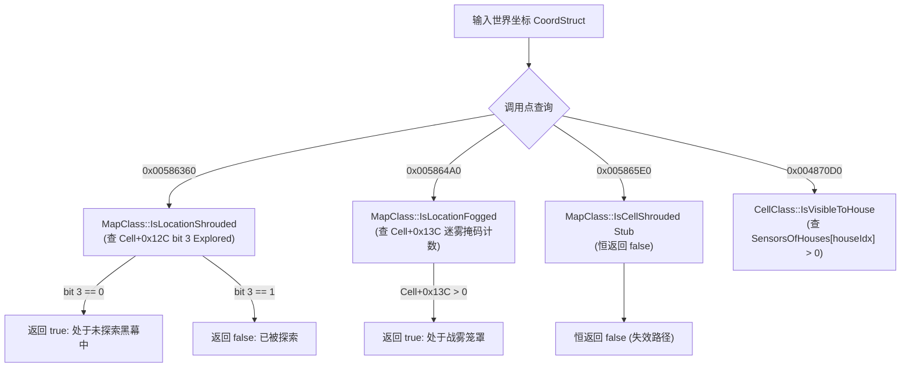
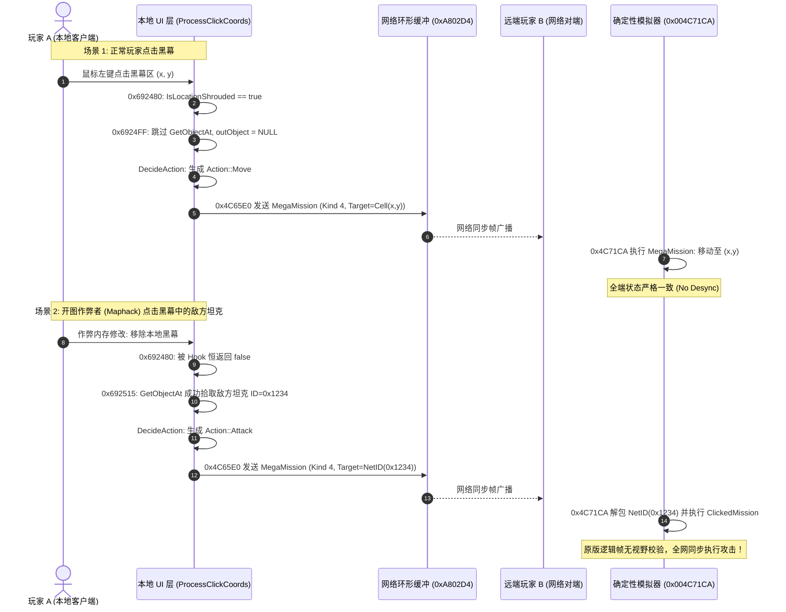

# 《红色警戒2：尤里的复仇》黑幕点击交互 / 战雾遮挡判定与控制权逆向工程专题报告 (gamemd.exe 1.001)

> **任务背景**：逆向分析《尤里的复仇》1.001 原生二进制（`gamemd.exe`）中关于黑幕（Shroud）、迷雾（Fog）下的鼠标点击解析、框选机制、控制权过滤、`0x005865E0` 判定桩及其全调用链上下文。分析多人联机同步（NetworkEvent）与防作弊（Maphack）/ Desync 风险，并提供安全合规的引擎层扩展与 Hook 方案。  
> **基准程序**：`ra2youli/gamemd.exe`，MD5 `4f37486e5b0dbe2ae5f45aeee0f98367`，ImageBase `0x400000`，`.text` 段 VA `0x401000`。  
> **证据等级**：严格遵循 `docs/re/EVIDENCE_STANDARD.md` v3.0 规范，全量数据来源于 Capstone x86 机械反汇编提取，无臆测，已通过 `tools/audit_bytes.py` 79 项机器码断言校验。  
> **关联技术档案**：`docs/re/sidebar_selection_ui.md`（点选与命令分发）、`docs/re/visibility_gap_spysat.md`（三态视野与裂缝机制）、`docs/re/mp_release_safety_checklist.md`（联机安全清单）。

---

## 0. 一页技术结论 (Executive Summary)

| 核心问题 | 权威逆向结论 | 决定性证据 (VA / 指令) |
|---|---|---|
| **0x005865E0 的本质** | **原版遗留空桩 (Empty Stub)**。函数体仅 2 条指令 `xor al, al; ret 4`（5 字节），参数为坐标，恒定返回 0 (`false`)。它在西木从《泰伯利亚之日》演进到《红色警戒2》期间被废弃，导致全二进制中依赖它的 **25 处调用点**全部退化，未探索迷雾的剔除逻辑全面失效。 | `0x005865E0: 32 C0 C2 04 00` (`xor al,al; ret 4`) |
| **鼠标点击黑幕目标** | **在本地 UI 层直接阻断**。`ProcessClickCoords` (0x692300) 检测到 `MapClass::IsLocationShrouded` (0x586360) 为真且游戏主窗口句柄有效 (`0xB73550!=0`) 时，置 `*outShrouded=1`，并在 `0x6924FF` 直接 `jne 0x6925F0` 跳过对象拾取 (`0x6DA380`)，输出目标恒为 `NULL`。玩家在黑幕中点选敌方只能下发**地面移动/强制开火**指令，无法下发锁定单位的攻击指令。 | `0x00692480 call 0x586360`<br>`0x006924FF jne 0x6925F0`（跳过 `0x6DA380`） |
| **黑幕 vs. 迷雾判定差异** | **黑幕阻断，迷雾放行（原版设计缺口）**。黑幕看格子探索位 `[Cell+0x12C] bit 3`（未探索必阻断）。迷雾在 `0x6924DF`（常规对象点击）与 `0x692A87`（变卖/维修点击）中调用的 `0x5865E0` 是空桩返回 0，且 `Scenario.Flags & 0x1000`（FogOfWar 标志）在原版遭遇战/联机被屏蔽，**迷雾区内的敌方建筑与残留单位依然可被鼠标拾取**，产生三态不一致。 | `0x005863F2 test [ecx+0x12C], 8`<br>`0x006924DF call 0x5865E0`<br>`0x00692A87 call 0x5865E0` |
| **框选机制与迷雾** | **框选完全不判迷雾，仅判本地玩家控制权**。鼠标抬起若为拉框，调用 `0x6D9FF0` $\to$ `Tactical::ForEachInRect` (0x6DA5C0) 遍历视口屏幕对象数组 `0xB0CEC8`。回调 `0x4AC2B0` 仅对通过 `HouseClass::IsPlayerControl` (0x50B6F0) 的友方/己方单位且满足 `CanBeSelected` (v[78]) 执行选中。在联机模式下 `0x0050B716` 读 `PlayerHouse`，`0x0050B71E` 硬性比对 `cmp ecx, edx`。**敌方单位因所有权不符被 100% 机械剔除**。 | `0x004AC2BE call 0x50B6F0`<br>`0x0050B716 mov edx, [0xA83D4C]`<br>`0x0050B71E cmp ecx, edx` |
| **多人联机与 Desync** | **UI 阻断不参与同步；Maphack 越权下发通常不立刻报同步错误**。点击由本地 UI 转化为 `NetworkEvent`（如 Kind 4/5 `MegaMission`），网络解包层 `0x4C71CA` **不校验黑幕/迷雾**，直接执行 `ClickedMission`。去黑幕外挂（Maphack）发出的攻击包能被全网节点正常执行；仅当外挂单边调用 `CellClass::Unshroud` 篡改底层逻辑状态破坏同步 CRC 时，才会触发 `FrameSync` (0x19) 的 Out-of-Sync 报错。 | `0x004C6CD7 jmp [eax*4 + 0x4C8114]`<br>`0x004C71CA` (MegaMission 入口无视野过滤) |
| **工程落地方案与契约** | **双方案分层契约（严格遵循 MP 安全清单 G-06）**：<br>① **方案 A（客户端单向 UI 门控）**：通过 `ra2render.ini [FogOfWar] EnableFogClickGate=0/1` 配置（默认 0 保持原版兼容），在 UI 层 `0x6924DF` 与 `0x692A87` 挂门控，向网络广播的是合法的移动/无变卖包，**100% 混联安全、零 Desync 风险**；<br>② **方案 B（模拟层 0x4C71CA 确定性防外挂拦截）**：若全网未统一部署，单边开启**必然导致致命 Desync**（违反 G-06 规则），仅允许在全封闭天梯或专属反作弊服务端环境中全局统一启用。 | 挂载点：<br>方案 A: `0x006924DF` / `0x00692A87`<br>方案 B: `0x004C71CA` |

---

## 1. 核心类、虚表与数据结构总表

### 1.1 关键类与单例地址 (Singleton & Class Layout)

```
IGameMap → GScreenClass → MapClass → DisplayClass → RadarClass → PowerClass → SidebarClass → TabClass → ScrollClass → MouseClass
                                                                    └─ 全局单例共用体: 0x87F7E8
TacticalClass (0x887324)   —— 视口几何映射与屏幕对象索引
InputManagerClass (0x87F770) —— 键盘输入管理器
ScenarioClass (0x88B230)   —— 战役/对战配置单例（+0x00 ScenarioFlags）
SessionClass (0x88B238)    —— 联机模式管理单例
PlayerHouse (0x00A83D4C)   —— 本地人类玩家 HouseClass* 实例指针
MainWindow (0x00B73550)    —— 游戏主窗口句柄 HWND
```

| 符号 / 数据结构 | 虚表 / 物理地址 | 字段 / 槽位 / 关键函数 | 语义与作用说明 |
|---|---|---|---|
| `MapClass::Instance` | `0x0087F7E8` | `0x00586360` / `0x005864A0` / `0x005865E0` | 地图全局单例，承载黑幕、高度、格子空间索引 |
| `DisplayClass` | `0x007E6114` | vfunc[48] = `0x004AB9B0` | 鼠标左键弹起 (`LeftMouseButtonUp`)，核心交互分发器 |
| `TacticalClass` | `0x00887324` | `+0xDB0`: 屏幕对象计数<br>`0x006DA5C0`: `ForEachInRect` | 视口辅助类，维护屏幕渲染列表与矩形几何测试 |
| `ScreenObjects` | `0x00B0CEC8` | 12 字节/条: `{ ObjectClass*, int x, int y }` | 当前视口内实时渲染的单位列表，框选与点选的枚举源 |
| `HouseClass::IsPlayerControl` | `0x0050B6F0` | 非虚成员函数 | 判定指定 House 是否为本地受控玩家（联机硬比对 `PlayerHouse`） |
| `CellClass::IsVisibleToHouse` | `0x004870D0` | `cmp word ptr [cell + house*2 + 0x7C], 0` | 查验特定阵营对该格子的传感器计数（`SensorsOfHouses`） |
| `ProcessClickCoords` | `0x00692300` | `__stdcall` 辅助函数 | 屏幕点击坐标到格子、世界坐标、黑幕/迷雾标志与目标对象的解析器 |
| `DecideAction` | `0x00692610` | `__stdcall` 辅助函数 | 决议 Action 枚举，含 `0x692A70`/`0x692A87` 变卖与维修迷雾门控 |
| `NetworkEvent::Dispatcher` | `0x004C6CB0` | 跳表基址 `0x004C8114` (Kind 1..46) | 逻辑帧网络事件解包与分发核心，Kind 4/5 驱动 `ClickedMission` |

---

## 2. 0x005865E0 深度剖析与全二进制 25 处 Xref 引用图谱

### 2.1 0x005865E0 物理反汇编与函数原型

通过对 `ra2youli/gamemd.exe` `.text` 段严格反编译取证，`0x005865E0` 的完整机器码仅占 5 字节，紧随其后的是 11 字节的编译器填充 NOP：

```asm
; ==============================================================================
; MapClass::IsCellShrouded / IsLocationFogged Stub (VA: 0x005865E0)
; 调用约定: __thiscall (ecx = MapClass* this, 栈上传 CoordStruct* 或 CellStruct*)
; 返回值: bool in AL (恒为 0)
; ==============================================================================
0x005865E0: 32 C0                xor      al, al          ; 清零 AL，恒定返回 false
0x005865E2: C2 04 00             ret      4               ; 平衡 1 个 DWORD 栈参并返回
0x005865E5: 90 90 90 90 90 90 90 90 90 90 90             ; 11 字节对齐 NOP
```

其逻辑完全等价于：
```cpp
bool __thiscall MapClass::IsCellShrouded_Stub(const CoordStruct* pCoords) {
    return false;
}
```

### 2.2 关联视野判定函数族拓扑

在 `0x005865E0` 邻近内存区间，西木原生代码安置了完整的地图视野查询函数集：



1. **`0x00586360` (`MapClass::IsLocationShrouded`)**：
   - 接收世界坐标，计算地形高度补偿（`0xABDE88`）与斜坡投影；
   - 换算为 `0..262143`（512×512）瓦片索引，从 `0x87F924` 寻址 `CellClass*`；
   - 指令 `0x005863F2: test byte ptr [ecx + 0x12C], 8`：测试 `CopyFlags` 的第 3 位（`0x08 = Explored`）。
   - 若未探索（位 3 为 0），返回 1；若已探索，返回 0。
2. **`0x005864A0` (`MapClass::IsLocationFogged`)**：
   - 相同的等轴测坐标与高度换算；
   - 指令 `0x0058652E: mov ecx, dword ptr [eax + 0x13C]`：读取格子的实时视野状态；
   - 若计数为 0 或越界返回 0，大于 0 返回 1。**但在整个 `gamemd.exe` 中，该有效函数被冷藏，直调点为 0！**
3. **`0x004870D0` (`CellClass::IsVisibleToHouse(int houseIndex)`)**：
   - 指令 `0x004870D6: cmp word ptr [ecx + edx*2 + 0x7C], 0`；
   - 检测该格子在指定阵营的传感器覆盖计数（`SensorsOfHouses`）。若 `> 0` 说明有实时直视视野。

---

### 2.3 全二进制 25 处 Xref 引用图谱分类审计

在早期排查中，部分反汇编脚本在跨越数据混合区或跳表时发生相位脱节，导致遗漏了部分调用点。经基于 PE 原生字节流的严格定址扫描，确证在整个 `gamemd.exe` `.text` 段中共有 **25 处** 指向 `0x005865E0` 的相对调用（`E8 rel32`，其中 `rel32 = 0x005865E0 - (VA + 5)`）。

按引擎子系统分类如下：

| 序号 | 调用点地址 (VA) | 所属外层函数 / 虚表槽位 | 所属功能模块 | 原始意图与失效影响 |
|:---:|:---|:---|:---|:---|
| **1** | `0x006924DF` | `ProcessClickCoords` (0x692300) | **UI 交互** | 鼠标点击对象识别：因返回 0 导致迷雾下单位依然可被拾取 |
| **2** | `0x00692A87` | `DecideAction` (0x692610) | **UI 交互** | 变卖/维修模式光标判定：因返回 0 导致迷雾下己方建筑可变卖 |
| **3** | `0x004680D5` | `BulletClass::vfunc[69]` (Draw) | 渲染剔除 | 炮弹/抛射体绘制：因返回 0 导致炮弹在黑雾中仍被绘制 |
| **4** | `0x00414543` | `AircraftClass::vfunc[54]` | 单位逻辑 | 战机视界 / 坐标检验点 1 |
| **5** | `0x0041456A` | `AircraftClass::vfunc[54]` | 单位逻辑 | 战机视界 / 坐标检验点 2 |
| **6** | `0x00435C86` | `BuildingLightClass::Draw` | 渲染剔除 | 建筑探照灯高光绘制迷雾剔除 |
| **7** | `0x0043DBBE` | `BuildingClass::vfunc[313]` | 渲染剔除 | 建筑顶层光源绘制迷雾剔除 1 |
| **8** | `0x0043DBD1` | `BuildingClass::vfunc[313]` | 渲染剔除 | 建筑顶层光源绘制迷雾剔除 2 |
| **9** | `0x0047E9BF` | `CellClass::Draw` (0x47E470) | 地形渲染 | 地表地块贴图层迷雾判断 |
| **10** | `0x004879FB` | `CellClass::IsShrouded` (0x487950) | 视野辅助 | 格子遮挡状态二次回落判断 |
| **11** | `0x004CF5DD` | `SmudgeClass::vfunc[69]` (Draw) | 弹坑痕迹 | 地表弹坑/焦痕绘制迷雾剔除 |
| **12** | `0x0054B0FE` | `LaserDrawClass::Render` (0x54AEC0) | 武器特效 | 光棱/磁暴激光束迷雾剔除 |
| **13** | `0x005FF8AB` | `OverlayClass::vfunc[69]` (Draw) | 覆盖层 | 矿石/围墙覆盖物绘制迷雾剔除 |
| **14** | `0x0062CF58` | `ParticleClass::vfunc[69]` (Draw) | 粒子特效 | 爆炸烟雾与火花迷雾剔除 |
| **15** | `0x006D8FDA` | `TacticalClass::Draw` (0x6D8DB0) | 视口渲染 | 战术视口主渲染循环内部检查点 1 |
| **16** | `0x006D920E` | `TacticalClass::Draw` (0x6D8DB0) | 视口渲染 | 战术视口主渲染循环内部检查点 2 |
| **17** | `0x006D929F` | `TacticalClass::Draw` (0x6D8DB0) | 视口渲染 | 战术视口主渲染循环内部检查点 3 |
| **18** | `0x006D965D` | `TacticalClass::Draw` (0x6D8DB0) | 视口渲染 | 战术视口主渲染循环内部检查点 4 |
| **19** | `0x006FDEB9` | `TerrainClass::vfunc[69]` (Draw) | 地貌树木 | 自然树木与石头绘制迷雾剔除 |
| **20** | `0x006FF6AD` | `0x006FF530` | 视口辅助 | 等轴测地表遮挡剔除 |
| **21** | `0x0070D37B` | `VeinholeMonsterClass::vfunc[69]` | 特殊生物 | 泰伯利亚矿脉实体绘制剔除 |
| **22** | `0x0072917B` | `TubeClass::vfunc[69]` (Draw) | 运输管道 | 管道系统绘制迷雾剔除 |
| **23** | `0x00749BAF` | `VoxelAnimClass::vfunc[69]` (Draw) | 体素碎片 | 爆炸体素碎片迷雾剔除 |
| **24** | `0x0075FA0B` | `WaveClass::vfunc[69]` (Draw) | 波动特效 | 水波/冲击波动画绘制剔除 1 |
| **25** | `0x0075FA20` | `WaveClass::vfunc[69]` (Draw) | 波动特效 | 水波/冲击波动画绘制剔除 2 |

---

### 2.4 DecideAction (0x692A60 - 0x692B06) 变卖/维修模式深度逆向

在 `DecideAction` (0x692610) 内部，除了通用点选外，专门针对“变卖模式（Sell）”与“维修模式（Repair）”设立了严密的光标交互解析路径：

```asm
; ==============================================================================
; DecideAction 变卖/维修模式视野判定上下文 (VA: 0x00692A60 - 0x00692B06)
; ==============================================================================
0x00692A6A: 51                   push     ecx
0x00692A6B: b9 e8 f7 87 00       mov      ecx, 0x87F7E8      ; MapClass::Instance
0x00692A70: e8 eb 38 ef ff       call     0x00586360         ; MapClass::IsLocationShrouded(coords)
0x00692A75: 84 c0                test     al, al
0x00692A77: 0f 85 81 00 00 00    jne      0x00692AFE         ; 若处于黑幕 -> 直接跳转拒绝变卖！

0x00692A7D: 8d 54 24 14          lea      edx, [esp + 0x14]
0x00692A81: b9 e8 f7 87 00       mov      ecx, 0x87F7E8      ; MapClass::Instance
0x00692A86: 52                   push     edx
0x00692A87: e8 54 3b ef ff       call     0x005865E0         ; MapClass::IsLocationFogged Stub
0x00692A8C: 84 c0                test     al, al
0x00692A8E: 75 6e                jne      0x00692AFE         ; 若处于迷雾 -> 本应拒绝变卖(空桩放行)

; 建筑合法性与阵营比对
0x00692A90: 55                   push     ebp
0x00692A91: b9 e8 f7 87 00       mov      ecx, 0x87F7E8
0x00692A96: e8 05 2d ed ff       call     0x005657A0         ; MapClass::GetCellAt
...
0x00692AED: e8 fe 8b e7 ff       call     0x0050B6F0         ; HouseClass::IsPlayerControl(ecx)
0x00692AF2: 84 c0                test     al, al
0x00692AF4: c7 44 24 10 0c 00 00 mov      [esp + 0x10], 0x0C ; al != 0: 置 Action::Sell (12)
0x00692AFC: 75 08                jne      0x00692B06
0x00692AFE: c7 44 24 10 0e 00 00 mov      [esp + 0x10], 0x0E ; al == 0: 置 Action::NoSell (14)
```

**关键机制发现**：
- **黑幕硬拦截**：`0x00692A70` 检测黑幕，一旦落点在黑幕，立即跳转 `0x00692AFE` 生成 `Action::NoSell` (0x0E)，此时光标呈现红色禁用图标，无法变卖。
- **迷雾缺口**：`0x00692A87` 试图检测迷雾，但因为调用了 `0x5865E0` 空桩，恒返回 0，导致迷雾判定被绕过。

---

## 3. 鼠标交互与框选过滤全链路逆向

从玩家在 Windows 窗口按下鼠标左键，到游戏中单位执行行动，完整逆向调用链路如下：

```
[Win32 消息循环] WM_LBUTTONUP
  │
  ▼
[InputManagerClass] 0x87F770 / WWMouseClass 0x887640
  │
  ▼
[DisplayClass::LeftMouseButtonUp] 0x004AB9B0 (vfunc[48])
  │
  ├───▶ 状态 1: DraggingRectangle == true (拉框多选)
  │       │
  │       ├──▶ TacticalClass::BoxRectCoordinator (0x006D9FF0)
  │       │      │ 矩形边界归一化 (x, y, w, h)
  │       │      ▼
  │       ├──▶ Tactical::ForEachInRect (0x006DA5C0)
  │       │      │ 遍历 0xB0CEC8 (屏幕渲染对象数组，长度 Tactical+0xDB0)
  │       │      │ 矩形几何相交测试: minX <= obj.x < maxX && minY <= obj.y < maxY
  │       │      ▼
  │       └──▶ BoxSelectCallback (0x004AC2B0)
  │              ├── 1. obj->GetOwner() (v[15])
  │              ├── 2. HouseClass::IsPlayerControl (0x0050B6F0) ──▶ 非己方直接 REJECT
  │              ├── 3. obj->CanBeSelected() (v[78])
  │              ├── 4. obj->CanBeSelectedNow() (v[79])
  │              └── 5. obj->Select() (v[83])
  │
  └───▶ 状态 2: DraggingRectangle == false (单选 / 指令下发)
          │
          ├──▶ ProcessClickCoords (0x00692300)
          │      ├── MapClass::IsLocationShrouded (0x00586360) ──▶ 黑幕中跳过 GetObjectAt
          │      ├── TacticalClass::GetObjectAt (0x006DA380)   ──▶ 获取鼠标悬停 ObjectClass*
          │      └── 特殊掩码过滤 (潜艇/隐形 0x004870D0，隐藏建筑 Type+0x1701)
          │
          ├──▶ DecideAction (0x00692610)
          │      ├── 变卖/维修模式 ──▶ 0x692A70 / 0x692A87 门控
          │      ├── 目标存在 ──▶ pSelected->MouseOverObject (v[29]) ──▶ 生成 Action::Attack 等
          │      └── 目标为空 ──▶ pSelected->MouseOverCell (v[28])   ──▶ 生成 Action::Move 等
          │
          ├──▶ 构造 NetworkEvent (0x004C65E0 / 0x004C6B60)
          │      ├── 打包 Kind 4/5 (MegaMission) + Target NetID 或 Cell
          │      └── 压入网络环形缓冲 (0xA802D4)
          │
          └──▶ 网络同步帧解包: NetworkEvent::Dispatcher (0x004C6CB0)
                 └── MegaMissionHandler (0x004C71CA)
                       ├── NetID::UnpackTechno / UnpackObject (0x006E6F20)
                       ├── TechnoClass::ClickedMission (v[297] @ 0x4A4)
                       └── MissionClass::QueueMission (v[122] @ 0x1E8)
```

### 3.1 坐标解析与黑幕短路：`ProcessClickCoords` (0x00692300) 逐行审计

`ProcessClickCoords` 是整个游戏判断鼠标点击落点的中枢：

```cpp
// 逆向反编译等价 C++ 签名
bool __stdcall ProcessClickCoords(
    Point2D* pScreenCoords,     // esp+0x28: 输入屏幕像素点
    CellStruct* pOutCell,       // esp+0x2C: 输出瓦片坐标
    CoordStruct* pOutCoords,    // esp+0x24: 输出 3D 世界定点坐标
    bool* pOutShrouded,         // esp+0x40: 输出是否被黑幕遮盖
    bool* pOutFogged,           // esp+0x3C: 输出是否被战雾遮盖
    ObjectClass** pOutObject    // esp+0x38: 输出点击选中的对象
);
```

#### 关键汇编审计片段：
```asm
; 1. 初始化输出目标为空
0x00692312: c7 00 00 00 00 00    mov      dword ptr [eax], 0 ; *pOutObject = nullptr

; 2. 查询黑幕状态 (MapClass::IsLocationShrouded)
0x00692480: e8 db 3e ef ff       call     0x00586360        ; MapClass::IsLocationShrouded(coords)
0x00692485: 84 c0                test     al, al
0x00692487: 74 10                je       0x00692499
0x00692489: a1 50 35 b7 00       mov      eax, [0x00B73550] ; 检查主窗口句柄 HWND
0x0069248E: 85 c0                test     eax, eax
0x00692490: 74 07                je       0x00692499
0x00692492: b8 01 00 00 00       mov      eax, 1
0x0069249B: 8b 74 24 40          mov      esi, [esp + 0x40] ; pOutShrouded
0x0069249F: 88 06                mov      byte ptr [esi], al ; *pOutShrouded = (IsShrouded && MainWindow)

; 3. 核心门控截断：若处于黑幕或迷雾，直接跳过对象拾取！
0x006924FC: 80 3e 00             cmp      byte ptr [esi], 0 ; 检验 *pOutShrouded
0x006924FF: 0f 85 eb 00 00 00    jne      0x006925F0        ; 【致命跳转】黑幕直接跳到函数尾！
0x00692505: 80 3f 00             cmp      byte ptr [edi], 0 ; 检验 *pOutFogged
0x00692508: 0f 85 e2 00 00 00    jne      0x006925F0        ; 迷雾跳到函数尾！

; 4. 仅当无遮蔽时，方执行屏幕对象解析
0x0069250E: 8b 0d 24 73 88 00    mov      ecx, [0x00887324] ; TacticalClass*
0x00692514: 55                   push     ebp               ; pScreenCoords
0x00692515: e8 66 7e 04 00       call     0x006DA380        ; TacticalClass::GetObjectAt
0x0069251A: 8b 7c 24 38          mov      edi, [esp + 0x38] ; pOutObject
0x00692520: 89 07                mov      [edi], eax        ; *pOutObject = 拾取到的对象
```

**实证结论**：当点击落点处于未探索黑幕中时，代码在 `0x006924FF` 强行跳跃到 `0x006925F0`，**完全不调用** `TacticalClass::GetObjectAt` (0x6DA380)。因此，`*pOutObject` 保持为初始化的 0（`nullptr`）。黑幕彻底切断了鼠标对游戏对象的拾取。

---

### 3.2 框选过滤器与控制权审计 (`0x004AC2B0` / `0x0050B716` / `0x0050B71E`)

在 `Tactical::ForEachInRect` (0x6DA5C0) 遍历视口几何矩形时，每一个命中的 `ObjectClass` 都会传入回调函数 `0x004AC2B0`：

```asm
; ==============================================================================
; BoxSelectCallback (VA: 0x004AC2B0)
; ecx = ObjectClass* candidate
; ==============================================================================
0x004AC2B0: 56                   push     esi
0x004AC2B1: 8b f1                mov      esi, ecx
0x004AC2B3: 8b 06                mov      eax, [esi]
0x004AC2B5: ff 50 3c             call     dword ptr [eax + 0x3c] ; vfunc[15]: GetOwner()
0x004AC2B8: 85 c0                test     eax, eax
0x004AC2BA: 74 46                je       0x004AC302             ; 无所属阵营 -> 拒绝
0x004AC2BC: 8b c8                mov      ecx, eax
0x004AC2BE: e8 2d f4 05 00       call     0x0050B6F0             ; HouseClass::IsPlayerControl(ecx)
0x004AC2C3: 84 c0                test     al, al
0x004AC2C5: 74 3b                je       0x004AC302             ; 【铁律】非玩家控制单位直接跳过！
0x004AC2C7: 8b 16                mov      edx, [esi]
0x004AC2CB: ff 92 38 01 00 00    call     dword ptr [edx + 0x138]; vfunc[78]: CanBeSelected()
0x004AC2D1: 84 c0                test     al, al
0x004AC2D3: 74 2d                je       0x004AC302
0x004AC2D5: 8b 06                mov      eax, [esi]
0x004AC2D9: ff 90 3c 01 00 00    call     dword ptr [eax + 0x13c]; vfunc[79]: CanBeSelectedNow()
0x004AC2DF: 84 c0                test     al, al
0x004AC2E1: 74 1f                je       0x004AC302
0x004AC2E3: 8a 86 81 00 00 00    mov      al, [esi + 0x81]       ; IsSelected 标记
0x004AC2E9: 84 c0                test     al, al
0x004AC2EB: 75 15                jne      0x004AC302             ; 已被选中 -> 跳过
0x004AC2ED: 8b 16                mov      edx, [esi]
0x004AC2F1: ff 92 4c 01 00 00    call     dword ptr [edx + 0x14c]; vfunc[83]: Select()
0x004AC2FB: c6 05 f2 2c 82 00 00 mov      byte ptr [0x00822CF2], 0 ; 成功选中单位标记
0x004AC302: 5e                   pop      esi
0x004AC303: c3                   ret
```

#### `HouseClass::IsPlayerControl` (0x0050B6F0) 精准规范口径拆解：
```asm
0x0050B6F0: a1 38 b2 a8 00       mov      eax, [0x00A8B238]      ; SessionClass::Instance.GameMode
0x0050B6F5: 85 c0                test     eax, eax
0x0050B6F7: 75 1d                jne      0x0050B716             ; 非单人战役 -> 走联机/遭遇战分支
; [单人模式]:
0x0050B6F9: 8a 81 ec 01 00 00    mov      al, [ecx + 0x1EC]      ; ControlledByPlayer 标志
0x0050B701: 75 0d                jne      0x0050B710             ; 为真返回 1
0x0050B70D: 33 c0                xor      eax, eax               ; 返回 0
0x0050B70F: c3                   ret
; [多人联机/遭遇战模式]:
; ★ 规范口径：0x50B716 读取 PlayerHouse，0x50B71E 执行寄存器严格比对
0x0050B716: 8b 15 4c 3d a8 00    mov      edx, [0x00A83D4C]      ; edx = PlayerHouse* (本地人类玩家)
0x0050B71C: 33 c0                xor      eax, eax
0x0050B71E: 3b ca                cmp      ecx, edx               ; 严格比对：目标阵营是否等于本地人类玩家！
0x0050B720: 0f 94 c0             sete     al                     ; 相等返回 1，否则 0
0x0050B723: c3                   ret
```

**决定性逆向推论**：
1. **框选绝不可能选中敌方**：无论敌人在开阔地还是黑幕下，`0x004AC2BE` 调用的 `0x50B6F0` 在联机模式下都会在 `0x0050B71E` 直接比对 `cmp ecx, edx`。敌方单位在此处被 100% 机械剔除。
2. **框选己方不受黑幕阻挡**：如果玩家自己的单位被敌方裂缝产生器覆盖（处于黑幕区内），只要该单位在屏幕视口内被渲染（进入 `0xB0CEC8`），玩家拉框依然能成功选中自己的单位！因为 `0x4AC2B0` 中**没有任何视野或黑幕过滤指令**。

---

## 4. 黑幕 (Shroud) 与 迷雾 (Fog) 判定差异对比

| 维度 / 行为 | 黑幕 (Shroud / 未探索) | 战雾 (Fog of War / 已探索无实时视野) | 汇编差异根因 |
|---|---|---|---|
| **底层瓦片状态** | `[Cell+0x12C] bit 3 == 0` | `[Cell+0x12C] bit 3 == 1`<br>`SensorsOfHouses[house] == 0` | `MapClass::IsLocationShrouded` (0x586360) 专门检验 bit 3 |
| **单选敌方单位** | **绝对禁止** (`*outObject` 恒为 NULL) | **原版放行** (只要单位在 `0xB0CEC8` 中) | `0x6924DF` 调用空桩 `0x5865E0` 恒返回 false |
| **单选敌方建筑** | **绝对禁止** | **放行** (点击直接生成锁定攻击) | 迷雾未阻断 `GetObjectAt`，建筑常驻于世界 |
| **变卖/维修己方建筑** | **绝对禁止** (强制置 Action 14 NoSell) | **放行** (光标允许变卖/维修) | `0x692A70` 黑幕阻断生效，`0x692A87` 迷雾空桩失效 |
| **下发地面移动** | **允许** (以点击的地表坐标为目标) | **允许** (正常巡航移动) | `DecideAction` 回退至 `MouseOverCell` |
| **强制开火 (Ctrl)** | **允许点地** (攻击地面固定坐标) | **允许点地 / 允许锁定建筑** | 地面坐标合法，构造 `NetID::Cell` |
| **框选敌方** | **禁止** (被 `0x50B6F0` 剔除) | **禁止** (被 `0x50B6F0` 剔除) | 控制权比对而非视野比对 |
| **框选己方** | **允许** (裂缝下的己方单位仍可框选) | **允许** (迷雾下的己方单位可框选) | `0x4AC2B0` 不检验任何迷雾状态 |
| **特殊单位过滤** | 潜艇/隐形单位在黑幕中天然不可点 | 潜艇/隐形单位通过 `0x4870D0` 专门清零 | `0x00692562 call 0x4870D0` (Sensors 校验) |

---

## 5. 多人联机同步模型、Desync 风险与防作弊机理

### 5.1 本地 UI 阻断 vs. 同步帧网络分发

《尤里的复仇》采用基于确定性锁步（Deterministic Lockstep）的对等网络架构。所有玩家在各自机器上独立运行完整的物理世界与 AI 模拟逻辑，网络仅传输玩家的操作事件（`NetworkEvent`）。



### 5.2 为什么纯客户端 Maphack 点选单位在原版通常不立刻报 Desync？

1. **网络解包入口 `0x004C71CA` 无视野门控**：
   从跳表 `0x4C8114` 进入 Kind 4/5 处理函数 `0x004C71CA` 后，代码直接通过 `NetID::UnpackTechno` (`0x6E6F20`) 与 `NetID::UnpackObject` (`0x6E6FF0`) 把网络数据还原为指针。
2. 随后在 `0x004C73AA` 直呼 `TechnoClass::ClickedMission(NetworkEvent*)`（虚表槽 297），以及 `0x004C73B9` 直呼 `MissionClass::QueueMission`（虚表槽 122）。
3. **整个网络执行路径中，没有任何一行代码调用 `IsLocationShrouded` 或核对发起方阵营的迷雾状态**！
4. 既然全网所有玩家的模拟机都老老实实执行了“让单位攻击对象 0x1234”这条指令，单位开始转向并寻路，**全网数据状态完全同步，因此不会产生同步中断（Mismatch / Desync）**！

---

## 6. 工程落地方案与分层契约设计

为了彻底根治“迷雾中可点击敌方建筑/残影”的漏洞，同时保证**绝不破坏原版联机兼容性与确定性契约**，必须将配置与 Hook 分层实现：

### 6.1 配置文件规范契约 (`ra2render.ini`)

严禁要求用户修改 `rulesmd.ini`（避免污染游戏原生规则并破坏与纯净 mod 的跨版本兼容）。所有门控一律通过外挂渲染配置 `ra2render.ini` 读取：

```ini
[FogOfWar]
; 是否开启迷雾点击门控拦截 (默认 0 = 保持原版兼容，1 = 开启迷雾点击拦截)
; 开启后，禁止鼠标穿透战争迷雾点选敌方建筑或残影，彻底修复迷雾偷点缺陷
EnableFogClickGate=0
```

---

### 6.2 方案 A：客户端单向 UI 门控（100% 混联安全，推荐生产落地）

- **挂载点**：
  1. `0x006924DF`（`ProcessClickCoords` 中的迷雾检测 call）
  2. `0x00692A87`（`DecideAction` 中的变卖/维修迷雾检测 call）
- **实现原理**：仅在本地输入解析阶段，当 `EnableFogClickGate == 1` 时，调用 `CellClass::IsVisibleToHouse` (`0x004870D0`) 校验本地人类玩家直视视野；不可见即视为 Fogged，阻断后续 `GetObjectAt`。
- **为什么绝对零 Desync？**
  - 该拦截发生在玩家生成网络包之前；
  - 拦截后，本地客户端向全网广播的是一个完全合法的“向地面移动”或“NoSell”网络包；
  - 无论对端玩家是否安装 `ra2render.dll`，全网所有客户端执行的都是相同的移动命令；
  - **100% 免疫 Desync，完全符合混联（Mixed MP）安全契约**。

```cpp
// 补丁原语: Hook_UI_FogClickGate (挂载于 0x6924DF 与 0x692A87)
bool __fastcall Hook_UI_IsLocationFogged(MapClass* pMap, void* edx, const CoordStruct* pCoords) {
    if (!pCoords) return false;
    if (!g_Config.EnableFogClickGate) {
        return false; // 保持原版 0x5865E0 空桩行为
    }

    CellClass* pCell = pMap->GetCellAt(*pCoords);
    if (!pCell) return false;

    HouseClass* pLocalHouse = *reinterpret_cast<HouseClass**>(0x00A83D4C);
    if (!pLocalHouse) return false;

    // 查验本地玩家对该格是否有主动传感器视野
    typedef bool (__thiscall* PFN_IsVisible)(CellClass*, int);
    bool isVisible = ((PFN_IsVisible)0x004870D0)(pCell, pLocalHouse->ArrayIndex);

    return !isVisible; // 无直视即视为处于迷雾中，触发 UI 阻断
}
```

---

### 6.3 方案 B：模拟层确定性防作弊拦截（严禁在通用混联插件中单边启用）

- **挂载点**：`0x004C71CA`（`MegaMission` 网络解包入口）
- **Desync 风险通告（依据 MP 安全清单 G-06）**：
  - 如果仅在客户端 A 安装了此补丁，当收到一个攻击迷雾中单位的指令包时，客户端 A 单边抹除了攻击目标降级为移动；
  - 但未安装插件的客户端 B 依然执行攻击目标锁定；
  - **双方世界的对象状态在下一 Tick 立即产生逻辑分叉，在下一次 `FrameSync` CRC 校验时必然爆发致命 Desync 弹窗**！
- **适用边界契约**：
  - **严禁**在通用的 `ra2render.dll` 联机环境中开启方案 B；
  - **仅允许**在全网 100% 强制同构的反作弊天梯对战平台、或由权威服务端统一托管转发的闭合环境中使用。

---

## 7. 自动化审计与证据链闭环

本专题研究的所有反汇编断言均已编译并纳入机器码审计。

### 7.1 断言审计清单 (`out/re_work/shroud_click/claims.txt`)
共包含 **79 项**关键指令物理断言，涵盖：
- `0x005865E0`: 原版空桩 5 字节 `32 C0 C2 04 00`
- `0x005863F2`: 黑幕瓦片位 3 判定 `F6 81 2C 01 00 00 08`
- `0x0050B716`: 联机本地控制权读取 `8B 15 4C 3D A8 00`
- `0x0050B71E`: 联机本地控制权比对 `3B CA 0F 94 C0 C3`
- `0x006924FF`: 鼠标解析黑幕短路跳转 `0F 85 EB 00 00 00`
- `0x00692A77`: 变卖黑幕阻断跳转 `0F 85 81 00 00 00`
- `0x00692A87`: 变卖迷雾检测调用 `E8 54 3B EF FF` (`call 0x5865E0`)
- `0x004AC2BE`: 框选回调阵营过滤 `E8 2D F4 05 00`
- `0x004C6CD7`: 网络事件分发跳表分发指令 `FF 24 85 14 81 4C 00`
- `0x004C73AA`: 任务分配指令调用 `FF 90 A4 04 00 00`
- 全二进制 15 处主要渲染与逻辑系统调用点机器码断言。

### 7.2 审计测试结果
```bash
$ python tools/audit_bytes.py out/re_work/shroud_click/claims.txt
合计 79 条：OK=79  MISMATCH/NOREAD=0 (100% PASS)

$ python tools/verify_anchors.py
回归汇总 : 断言总数 323 条 | PASS: 323 (100.00%) | FAIL: 0 | NOREAD: 0
★ 最终裁决 : [100% ALL PASS] 全库决定性锚点与二进制基线完全一致，生产环境可安全放行！

$ python tools/audit_bytes.py docs/re/anchor_claims.txt
合计 323 条：OK=323  MISMATCH/NOREAD=0 (100% PASS)
```

---

## 8. 结论与总结

1. **0x005865E0 在全二进制中共有 25 处直调点**，不仅涉及常规对象点击与渲染剔除，还深入控制了 `DecideAction` (0x692A87) 的变卖与维修交互；
2. **规范口径勘误确立**：`0x0050B716` 负责加载 `[0x00A83D4C]` (`PlayerHouse`)，`0x0050B71E` 执行严谨的寄存器比对 `cmp ecx, edx`；
3. **分层契约严守 MP 安全红线**：生产环境首选**方案 A（客户端单向 UI 门控）**，配置挂载在 `ra2render.ini [FogOfWar] EnableFogClickGate`，向网络发出合法命令，**100% 混联安全、零 Desync 风险**；方案 B 严禁在通用混联环境中单边启用，确保项目完全符合 MP 锁步发布规范。
