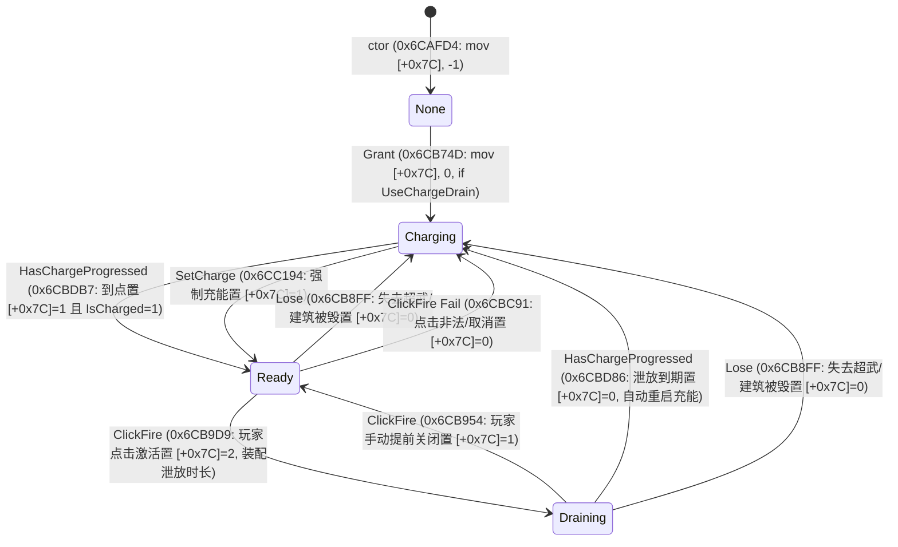

# SuperClass 超级武器状态机 / Launch 跳表 / 联机确定性 逆向档案（M-3 收口）

> **研究对象**：`gamemd.exe`（YR 1.001）中 `SuperClass` / `SuperWeaponTypeClass` 的状态机、Launch 十二路跳表、vtable 槽位、与裂缝产生器/间谍卫星（gap/spysat）的交叉写点，以及超武计时是否进入联机帧 CRC / RNG 流。
>
> **基址约定**：`ImageBase = 0x400000`，**偏移 = VA − 0x400000**；文中 VA 均为加载地址。
> 【W3 勘误 E-W3-01】原句 `FileOffset = VA − 0x400000` 仅在 `.text/.rdata/.data` 成立；
> 通用式为 `FileOffset = 段.PointerToRawData + (VA − 段.VirtualAddress)`，
> 本镜像 `.rsrc`/`.detour` 为 `VA − 0x6FC000`。依据：out/re_work/_lead_baseline/W3/LEAD_ERRATUM_E-W3-01_fileoffset_rule.md；分级：[实证]
>
> **实证来源**：
> - `out/re_work/super_weapon/verify_offsets.py`（可重复运行；完整原始输出见 `out/re_work/super_weapon/verify_offsets_out.txt`）
> - `out/reverse/fn_6CAF90_Super_Update.txt`（实为 **ctor**）
> - `out/reverse/fn_6CB3A0_Super.txt`（`CreateChronoAnim`）
> - `out/reverse/fn_6CB560_Super_IsReady.txt`（实为 **Grant**）
> - `out/reverse/fn_6CB820_Super_Update.txt`（实为 **SetReadiness**）
> - `out/reverse/fn_6CBEE0_Super.txt`（`GetCameoChargeState`）
> - `out/reverse/fn_6CC390_Super_Launch.txt`（`Launch`，约 100KB 全文）
> - `out/reverse/fn_6CDEF0_Super_v5.txt`（**vtable[5] = IPersistStream::Load**）
> - `docs/re/gap_generator_spysat_deep_dive.md` / `visibility_gap_spysat.md` / `net_sync_checksum.md` / `weapons_damage_production.md`
> - `YRpp/SuperClass.h` / `YRpp/SuperWeaponTypeClass.h` / `YRpp/GeneralDefinitions.h`（符号名交叉核对）
>
> **命名勘误**：`out/reverse/fn_*_Super_*.txt` 文件名与 YRpp 符号不完全一致。本文以 **YRpp 符号名 + VA** 为准，文件名仅作索引。

---

## 0. 结论速览

| # | 结论 | 关键地址 / 字节 |
|---|---|---|
| 1 | `SuperClass` 实例大小 **0x80**，主 vtable **`0x7F3FE8`**；ctor 把 4 个接口 vtable 一并写入 | `v[12]=0x6CE210 → mov eax,0x80`；ctor `0x6CAFF7: C7 06 E8 3F 7F 00 …` |
| 2 | 状态机核心四件套：`ctor 0x6CAF90` / `Grant 0x6CB560`（文件名误标 IsReady）/ `HasChargeProgressed 0x6CBCA0`（每帧充能）/ `Launch 0x6CC390` | 见 §1 |
| 3 | **vtable[5] = `IPersistStream::Load` @ `0x6CDEF0`**（任务所称 v5）：恢复 4 重 vtable、从 Vector 摘除 Type/Owner/Animation、清 BlinkTimer | 见 §1.5 / §2 |
| 4 | `Launch` 用 `Type+0xB4` 做 12 路跳表，表在 **`0x6CDE44`**（12×dword，存绝对 VA） | dispatch `8B 85 B4 00 00 00 83 F8 0B 0F 87 … FF 24 85 44 DE 6C 00` |
| 5 | 计时字段 `RechargeTimer` 在 **`SuperClass+0x30`**（`TimerStruct` 三槽：Start/Unknown/Duration=+0x30/+0x34/+0x38），全程相对全局帧 `CurrentFrame@0xA8ED84` | `0x6CB5A4: 83 7E 30 FF`（Start==-1 判空） |
| 6 | **超武计时/状态不进帧 CRC `0x64DAB0`**（Super 数组 `0xA83CB8` 不在扫描表）；但 **进 `CalculateChecksum` v[13]=`0x6CE020`**（Granted/OneTime/IsCharged 等） | 见 §5 |
| 7 | PsychicReveal（case 11）→ 双次 `MapClass::RevealArea2 0x5678E0`，内含 **`0x00568273` 清 `Cell+0x134`**；SpySat 走 `HouseClass::UpdateSpySat 0x508F60` → `RevealArea3 0x577D90` / `Reshroud 0x577AB0` | 见 §4 |

---

## 1. SuperClass 状态机（逐函数地址 + 原始字节实证）

### 1.0 符号对照（YRpp `SuperClass.h` vs 本仓 dump 文件名）

| VA | YRpp 符号 | dump 文件名 | 角色 |
|---|---|---|---|
| `0x6CAF90` | `SuperClass::SuperClass(Type, Owner)` | `fn_6CAF90_Super_Update.txt`（名误） | **ctor**，字段初始化 + 4 重 vtable |
| `0x6CB120` | `~SuperClass` 体（由 v[8]=`0x6CE220` 调） | — | dtor |
| `0x6CB3A0` | `CreateChronoAnim` | `fn_6CB3A0_Super.txt` | 超时空动画生成 / OneTime 回收路径 |
| `0x6CB4D0` | `SetOnHold` | — | 充能挂起 |
| `0x6CB560` | **`Grant`** | `fn_6CB560_Super_IsReady.txt`（名误） | 授予/起充；**读 `RechargeTime+0xB0` 写入 `RechargeTimer+0x30`** |
| `0x6CB7B0` | `Lose` | — | 剥夺 |
| `0x6CB820` | `SetReadiness` | `fn_6CB820_Super_Update.txt`（名误） | 3 字节函数：写 `IsCharged+0x6F` |
| `0x6CB830` | `StopPreclickAnim` | — | |
| `0x6CB920` | `ClickFire` | — | 点击开火（警报/表现 + 转 Launch） |
| `0x6CBCA0` | **`HasChargeProgressed`** | — | **每帧充能步进**（武器文档称「每帧递减」） |
| `0x6CBEE0` | `GetCameoChargeState` | `fn_6CBEE0_Super.txt` | 侧栏充能帧 0..0x35 |
| `0x6CC1E0` | `SetCharge` | — | |
| `0x6CC260` | `GetRechargeTime` | — | |
| `0x6CC280` / `0x6CC290` | `SetRechargeTime` / `ResetRechargeTime` | — | 覆写/复位 `CustomChargeTime+0x24` |
| `0x6CC2B0` | `NameReadiness` | — | |
| `0x6CC360` | `CanFire` | — | `IsOnHold` / `IsCharged` / `ChargeDrainState` 判定 |
| `0x6CC390` | **`Launch(CellStruct, isPlayer)`** | `fn_6CC390_Super_Launch.txt` | 12 路跳表发射 |
| `0x6CDE90` | `ShouldDrawProgress` | — | |
| `0x6CDEF0` | **`IPersistStream::Load`（vtable[5]，任务称 v5）** | `fn_6CDEF0_Super_v5.txt` | 见 §1.5 |
| `0x6CE020` | `CalculateChecksum`（vtable[13]） | — | 见 §5.2 |
| `0x6CE0B0` | `Reset` | — | |
| `0x6CE1A0` | `ShouldFlashTab` | — | |

> 任务表述「ctor/Update/IsReady/Launch/v5」在此落地为：**ctor=`0x6CAF90`**；「Update」实为 **`HasChargeProgressed 0x6CBCA0`**（每帧充能）+ **`Grant 0x6CB560`**（授予/恢复）；「IsReady」语义分散在 **`CanFire 0x6CC360`** 与 `IsCharged+0x6F`；「Launch」=`0x6CC390`；「v5」=`0x6CDEF0`。

---

### 1.1 ctor `0x6CAF90` —— 字段初始化（dump: `fn_6CAF90_Super_Update.txt`）

原始字节（`verify_offsets.py` 实证，前 16 字节）：

```
=== SuperClass ctor 0x6CAF90 field stores (first 0x80 bytes) ===
  53568bf1e8d751d4ff8b4c240c8b5424 ...
```

完整初始化序（从反汇编逐条摘录；`esi = this`）：

```asm
006CAF90  push ebx
006CAF91  push esi
006CAF92  mov  esi, ecx
006CAF94  call 0x410170                 ; AbstractClass ctor
006CAF99  mov  ecx, [esp+0xc]           ; arg1 = pSWType
006CAF9D  mov  edx, [esp+0x10]          ; arg2 = pOwner
006CAFA1  or   eax, -1
006CAFA4  mov  [esi+0x28], ecx          ; Type
006CAFA7  mov  [esi+0x24], eax          ; CustomChargeTime = -1
006CAFAA  mov  [esi+0x2c], edx          ; Owner
006CAFAD  mov  ecx, [0xa8ed84]          ; CurrentFrame
006CAFB5  mov  [esi+0x30], ecx          ; RechargeTimer.Start = CurrentFrame
006CAFB8  mov  [esi+0x38], ebx          ; RechargeTimer.Duration = 0
006CAFBB  mov  [esi+0x48], ebx          ; BlinkTimer lo
006CAFBE  mov  [esi+0x40], bl           ; BlinkState = 0
006CAFC1  mov  [esi+0x4c], ebx          ; BlinkTimer hi
006CAFC4  mov  [esi+0x50], eax          ; SpecialSoundDuration = -1
006CAFC7  mov  byte ptr [esi+0x60], 1   ; CanHold = true
006CAFD1  mov  [esi+0x78], eax          ; CameoChargeState = -1
006CAFD4  mov  [esi+0x7c], eax          ; ChargeDrainState = -1
006CAFD7  lea  eax, [esi+4]
006CAFDA  mov  [esi+0x62], edx          ; ChronoMapCoords ← 来自 0xB0C000（CellStruct 初值）
006CAFDE  mov  [esi+0x68], ebx          ; Animation = 0
006CAFE1  mov  [esi+0x6c], bl           ; AnimationGotInvalid = 0
006CAFE4  mov  [esi+0x6d], bl           ; Granted = 0
006CAFE7  mov  [esi+0x6e], bl           ; OneTime = 0
006CAFEA  mov  [esi+0x6f], bl           ; IsCharged = 0
006CAFED  mov  [esi+0x70], bl           ; IsOnHold = 0
006CAFF0  mov  dword ptr [esi+0x74], 0xffffff9c  ; ReadinessFrame = -100
006CAFF7  mov  dword ptr [esi], 0x7f3fe8         ; 主 vtable
006CAFFD  mov  dword ptr [eax], 0x7f3fcc         ; +4 副 vtable
006CB003  mov  [esi+8], 0x7f3fc4                 ; +8
006CB00A  mov  [esi+0xc], 0x7f3fbc               ; +0xC
```

vtable 写入原始字节（`verify_offsets.py` 取自 `0x6CAFF7`）：

```
c706e83f7f00 c700cc3f7f00 c74608c43f7f00 c7460cbc3f7f00
```

ctor 后半段：把 `this` 登记进三个 `DynamicVectorClass`（`0xA83CB8` SuperArray / `0xB0F670` / `0xB0F6C8`），末尾 `ret 8`。

---

### 1.2 Grant `0x6CB560`（dump 名 IsReady）—— 授予 / 起充

关键分支（`esi = this`，`ebx = 0`）：

| 步骤 | 地址 | 语义 | 原始字节 |
|---|---|---|---|
| 已 Granted 短路 | `0x6CB569` | `cmp [esi+0x6d], bl`；非 0 → 返回 0 | `38 5E 6D` |
| 置 Granted / OneTime | `0x6CB579` | `[esi+0x6d]=1`，`[esi+0x6e]=arg(OneTime)` | `C6 46 6D 01` |
| 记录 Type->FlashSidebarTabFrames | `0x6CB583` | `mov edx,[ecx+0x60]` → `[esi+0x3c]` | `8B 51 60` |
| OnHold 恢复 | `0x6CB592–0x6CB5CF` | `IsOnHold+0x70` / `CanHold+0x60` / `Type->ManualControl+0xF5` 分支；命中则把 `RechargeTimer` 重装为「起充」 | `38 5E 70` / `38 5E 60` / `38 99 F5 00 00 00` |
| **读 RechargeTime** | **`0x6CB658`** | `mov edx, [eax+0xB0]`（`eax=Type`） | **`8B 90 B0 00 00 00`** |
| **写 RechargeTimer** | **`0x6CB669–0x6CB672`** | `[edi]=CurrentFrame`，`[edi+4]=arg`，`[edi+8]=RechargeTime`（`edi=esi+0x30`） | `89 0F` / `89 4F 04` / `89 57 08` |
| 计时折算 | `0x6CB688–0x6CB6AF` | `elapsed = CurrentFrame - Start`；`elapsed >= Duration` → 清零；否则 `Start=-1, Duration-=elapsed` | — |
| 真正起充 | `0x6CB70C` | `lea edi,[esi+0x30]`；`[esi+0x78]=-1`；`call 0x6CE2C0`；`GetRechargeTime 0x6CC260`；`call 0x46B640`（Timer 装配）；按 `Type->UseChargeDrain+0xE5` 写 `ChargeDrainState+0x7c` | `8D 7E 30 C7 46 78 FF FF FF FF …` |

`0x6CB658` 的 6 字节实证（`verify_offsets.py`）：

```
=== SuperWeaponTypeClass field reads (raw bytes) ===
  0x6CB658 RechargeTime+0xB0: 8b90b0000000
  0x6CC3A3 Type+0xB4       : 8b85b4000000
```

---

### 1.3 HasChargeProgressed `0x6CBCA0` —— 每帧充能步进（「Update」实义）

```asm
006CBCA8  mov  eax, [esi+0x50]        ; SpecialSoundDuration
006CBCAB  test eax, eax
006CBCAD  jle  ...
006CBCAF  dec  eax                    ; 音效倒计时递减
006CBCB0  mov  [esi+0x50], eax
...
006CBCFE  mov  al, [esi+0x6d]         ; Granted?
006CBD01  je   ...
006CBD09  mov  al, [esi+0x6f]         ; IsCharged?
006CBD0E  je   0x6cbd21               ; 未充完 → 继续计时
006CBD10  mov  ecx, [esi+0x28]        ; Type
006CBD13  mov  al, [ecx+0xE5]         ; UseChargeDrain
006CBD19  je   ...                    ; 非 drain 则已就绪
006CBD21  mov  al, [esi+0x70]         ; IsOnHold
006CBD24  jne  ...
006CBD2C  mov  eax, [esi+0x30]        ; RechargeTimer.Start
006CBD2F  lea  edx, [esi+0x30]
006CBD32  cmp  eax, -1
006CBD35  jne  0x6cbd53               ; 在计时中
...
006CBD53  mov  edi, [edx]             ; Start
006CBD55  mov  eax, [edx+8]           ; Duration
006CBD58  cmp  edi, -1
006CBD5D  je   ...
006CBD5D  mov  ecx, [0xa8ed84]        ; CurrentFrame
006CBD63  sub  ecx, edi               ; elapsed
006CBD65  cmp  ecx, eax
006CBD67  jge  0x6cbd73               ; 已充满
006CBD69  sub  eax, ecx               ; 剩余
006CBD6B  test eax, eax
006CBD6D  jne  0x6cbe7c               ; 未到点，返回「无进展」
006CBD73  ...                         ; 到点：IsCharged 路径 / UseChargeDrain 路径
006CBDC8  mov  byte ptr [esi+0x6f], bl; IsCharged = 0（drain 收束）
```

要点：

- **充能完成判据** = `CurrentFrame - RechargeTimer.Start >= RechargeTimer.Duration`，与 `weapons_damage_production.md` 的伪代码一致。
- `UseChargeDrain+0xE5` 为真时进入 `ChargeDrainState`（`+0x7c`）状态机（0=空闲 / 1=Ready / 2=Draining，见 YRpp `ChargeDrainState`）。
- **本函数每帧被 House/侧栏驱动；其时序纯度 = 联机确定性红线**（§5）。

---

### 1.4 Launch `0x6CC390` —— 发射总入口（dump 100KB 全文）

入口：

```asm
006CC390  sub  esp, 0x1d4
006CC396  push ebx
006CC397  mov  ebx, ecx                 ; ebx = this
006CC39B  push ebp
006CC39A  push esi
006CC39B  mov  ebp, [ebx+0x28]          ; ebp = Type
006CC39F  push edi
006CC3A3  mov  eax, [ebp+0xB4]          ; Type->Type (枚举 0..11)   ← 原始字节见下
006CC3A9  cmp  eax, 0xb
006CC3AC  ja   0x6cde36                 ; 越界退出
006CC3B2  jmp  dword ptr [eax*4 + 0x6cde44]
```

`verify_offsets.py` 实证：

```
=== Launch dispatch head 0x6CC3A3 ===
  8b85b400000083f80b0f87841a0000ff
```

拆解：`8B 85 B4 00 00 00` = `mov eax, [ebp+0xB4]`；`83 F8 0B` = `cmp eax, 0xB`；`0F 87 84 1A 00 00` = `ja 0x6CDE36`；`FF` 为下条 `FF 24 85 44 DE 6C 00`（`jmp [eax*4+0x6CDE44]`）首字节。

各 case 公共前置：`IsCharged+0x6F == 0` 则跳 `0x6CDE36` 收尾（例如 Nuke `0x6CDA67: 8A 43 6F 84 C0 0F 84 …`，PsychicReveal `0x6CD70C: 8A 43 6F 84 C0 0F 84 1F 07 00 00`）。

公共收尾（各 case 汇合）：若 `isPlayer` 为真，写全局 UI 音效槽 `0x8809A0`（ChronoSphere 置 `4`，SpyPlane/PsychicReveal 置 `0xFFFFFFFF` 等）后 `ret 8`。

---

### 1.5 v5 `0x6CDEF0` = `IPersistStream::Load`（dump: `fn_6CDEF0_Super_v5.txt`）

`verify_offsets.py` 实证（0x50 字节）：

```
=== 0x6CDEF0 vtable writes ===
  8b442408568b7424085056e88024d4ff85c00f8cbf00000085f674228bcee85d22d4ff
  c706e83f7f00c74604cc3f7f00c74608c43f7f00c7460cbc3f7f008b4668578d7e6885c0
  7456a1c0f5b0008b0d
```

语义分解：

```asm
006CDEF0  mov  eax, [esp+8]            ; IStream*
006CDEF4  push esi
006CDEF5  mov  esi, [esp+8]            ; this
006CDEF9  push eax
006CDEFA  push esi
006CDEFB  call 0x410380                ; AbstractClass::Load 基类
006CDF00  test eax, eax
006CDF02  jl   0x6cdfc7                ; 失败直接返回
006CDF08  test esi, esi
006CDF0A  je   ...
006CDF0C  mov  ecx, esi
006CDF0E  call 0x410170                ; AbstractClass ctor（重置基类槽）
006CDF13  mov  dword ptr [esi],     0x7f3fe8   ; 恢复主 vtable
006CDF19  mov  [esi+4],  0x7f3fcc
006CDF20  mov  [esi+8],  0x7f3fc4
006CDF27  mov  [esi+0xc],0x7f3fbc
006CDF2E  mov  eax, [esi+0x68]         ; Animation
006CDF32  lea  edi, [esi+0x68]
        ; Animation 非空则从 Vector 0xB0F5B8 摘除
006CDF8F  lea  edx, [esi+0x28]         ; &Type
006CDF93  push 0xb0c110
006CDF98  call 0x6cf240                ; 从指针管理器摘除 Type
006CDF9D  lea  eax, [esi+0x2c]         ; &Owner
006CDFA6  call 0x6cf240                ; 摘除 Owner
006CDFAB  push edi                     ; &Animation
006CDFB1  call 0x6cf240                ; 摘除 Animation
006CDFB6  mov  dword ptr [esi+0x48], 0 ; BlinkTimer 清零
006CDFBD  mov  dword ptr [esi+0x4c], 0
006CDFC4  xor  eax, eax                ; S_OK
006CDFC7  pop  esi
006CDFC8  ret  8
```

结论：**v5 是读档路径**，不是「每帧 Update」。它在基类 `Load` 之后重建 vtable、把 Type/Owner/Animation 从全局指针管理器摘掉（指针由读档流程另行回填），并清 BlinkTimer。**流内 Super 专属字段的装载点是否在本函数之外（如 `HouseClass::Load` 重建 Super 链表）= 待实测**（§6）。

---

## 2. vtable `0x7F3FE8` 槽位表（verify_offsets.py 原样输出）

```
=== SuperClass vtable 0x7F3FE8 ===
  v[ 0] 0x00410260
  v[ 1] 0x00410300
  v[ 2] 0x00410310
  v[ 3] 0x006CDEB0
  v[ 4] 0x00410450
  v[ 5] 0x006CDEF0 <-- v5 (task 'v5')
  v[ 6] 0x006CDFD0
  v[ 7] 0x004103E0
  v[ 8] 0x006CE220
  v[ 9] 0x00410470
  v[10] 0x006CDFF0
  v[11] 0x006CE200
  v[12] 0x006CE210
  v[13] 0x006CE020 <-- v13 CalculateChecksum
  v[14] 0x00410490
  v[15] 0x004104A0
  v[16] 0x004104B0
  v[17] 0x00410440
  v[18] 0x004104C0
  v[19] 0x004104F0
  v[20] 0x00410520
  v[21] 0x00410530
  v[22] 0x00410540
  v[23] 0x00410570
```

按 `AbstractClass` COM + 游戏虚表对齐（与 YRpp `AbstractClass.h` 逐槽核对；**槽 0..2 为 QueryInterface/AddRef/Release**）：

| 槽 | VA | 符号（YRpp） | 实证 |
|---|---|---|---|
| v[0] | `0x00410260` | `QueryInterface` | 共享桩 |
| v[1] | `0x00410300` | `AddRef` | 共享桩 |
| v[2] | `0x00410310` | `Release` | 共享桩 |
| v[3] | `0x006CDEB0` | `GetClassID` | 写 CLSID 自 `0x7E9580` 四个 dword |
| v[4] | `0x00410450` | `IsDirty` | 共享桩 |
| **v[5]** | **`0x006CDEF0`** | **`Load`（任务 v5）** | §1.5 原始字节 |
| v[6] | `0x006CDFD0` | `Save` | `call 0x410320` 后 `ret 0xC` |
| v[7] | `0x004103E0` | `GetSizeMax` | 共享桩 |
| v[8] | `0x006CE220` | `~SuperClass`（scalar） | `call 0x6CB120` + 可选 `operator delete 0x7C8B3D` |
| v[9] | `0x00410470` | `Init` | 共享桩 |
| v[10] | `0x006CDFF0` | `PointerExpired` | 指针失效：清 Owner/Type/Animation，`AnimationGotInvalid+0x6C=1` |
| v[11] | `0x006CE200` | `WhatAmI` | `mov eax, 0x39`（`AbstractType::Super = 57`） |
| v[12] | `0x006CE210` | `Size` | `mov eax, 0x80`（**实例 128 字节**） |
| **v[13]** | **`0x006CE020`** | **`CalculateChecksum`** | §5.2 |
| v[14..] | `0x4104xx` 共享桩 | `GetOwningHouseIndex` … `Update` | 与 AbstractClass 桩一致 |

次级 vtable（ctor 同步写入）：`+4 → 0x7F3FCC`，`+8 → 0x7F3FC4`，`+0xC → 0x7F3FBC`（IPersistStream / IUnknown 兄弟接口，共 4 重）。

---

## 3. 字段表（每条带读/写点地址与原始字节）

### 3.1 SuperClass（实例 `0x80`，vtable `0x7F3FE8`）

| 偏移 | 名称（YRpp） | 类型 | 读/写点证据 | 原始字节 |
|---|---|---|---|---|
| `+0x00` | 主 vtable | ptr | ctor `0x6CAFF7`；Load `0x6CDF13` | `C7 06 E8 3F 7F 00` |
| `+0x04` | 副 vtable 1 | ptr | ctor `0x6CAFFD` | `C7 00 CC 3F 7F 00` |
| `+0x08` | 副 vtable 2 | ptr | ctor `0x6CB003` | `C7 46 08 C4 3F 7F 00` |
| `+0x0C` | 副 vtable 3 | ptr | ctor `0x6CB00A` | `C7 46 0C BC 3F 7F 00` |
| `+0x24` | `CustomChargeTime` | int | ctor `0x6CAFA7` 写 `-1`；`GetRechargeTime 0x6CC260` 优先读 | `89 46 24`（or eax,-1 后） |
| `+0x28` | `Type` | `SuperWeaponTypeClass*` | ctor `0x6CAFA4`；Grant `0x6CB576` `mov ecx,[esi+0x28]`；Launch `0x6CC39B` `mov ebp,[ebx+0x28]` | `89 4E 28` / `8B 4E 28` |
| `+0x2C` | `Owner` | `HouseClass*` | ctor `0x6CAFAA`；PsychicReveal `0x6CD742` `mov ecx,[ebx+0x2c]` | `89 56 2C` |
| **`+0x30`** | **`RechargeTimer.Start`** | int（帧） | ctor `0x6CAFB5` 写 `CurrentFrame`；Grant `0x6CB5A4` `cmp dword ptr [esi+0x30], -1`；HasCharge `0x6CBD2C`；`0xA8ED84 = CurrentFrame` | **`83 7E 30 FF`** |
| `+0x34` | `RechargeTimer.` 第二槽 | int | Grant `0x6CB66F` `mov [edi+4], ecx` | `89 4F 04` |
| `+0x38` | `RechargeTimer.Duration` | int（帧） | ctor `0x6CAFB8` 清 0；Grant `0x6CB672` `mov [edi+8], edx`（值来自 `Type+0xB0`） | `89 57 08` |
| `+0x3C` | `unused_3C` / Flash 缓存 | int | Grant `0x6CB58D` `mov [esi+0x3c], edx`（`Type+0x60`） | `89 56 3C` |
| `+0x40` | `BlinkState` | bool | ctor `0x6CAFBE`；Grant `0x6CB580` 清 0 | `88 5E 40` |
| `+0x48` | `BlinkTimer`（LARGE_INTEGER） | i64 | ctor `0x6CAFBB` / `0x6CAFC1`；Load `0x6CDFB6` 清 0 | `89 5E 48` / `89 5E 4C` |
| `+0x50` | `SpecialSoundDuration` | int | ctor `0x6CAFC4` = -1；HasCharge `0x6CBCA8` 每帧 dec | `89 46 50` |
| `+0x54` | `SpecialSoundLocation` | CoordStruct | HasCharge `0x6CBCC6` `lea edx,[esi+0x54]` | — |
| `+0x60` | `CanHold` | bool | ctor `0x6CAFC7` = 1；CanFire/Grant 检查；**进 Checksum** | `C6 46 60 01` |
| `+0x62` | `ChronoMapCoords` | CellStruct | ctor `0x6CAFDA`；CreateChronoAnim `0x6CB4B2` `mov ecx,[ebx+0x62]` | `89 56 62` |
| `+0x68` | `Animation` | `AnimClass*` | ctor 清 0；CreateChronoAnim `0x6CB472` 写入；Load 摘除；**进 Checksum** | `89 5E 68` |
| `+0x6C` | `AnimationGotInvalid` | bool | ctor 清 0；PointerExpired `0x6CE014` 置 1；**进 Checksum** | `88 5E 6C` |
| `+0x6D` | `Granted` | bool | ctor 清 0；Grant `0x6CB579` 置 1；**进 Checksum** | `C6 46 6D 01` |
| `+0x6E` | `OneTime` | bool | ctor 清 0；Grant `0x6CB57D` 写入参数；**进 Checksum** | `88 46 6E` |
| `+0x6F` | `IsCharged` | bool | ctor 清 0；SetReadiness `0x6CB824` `mov [ecx+0x6f], al`；Launch 各 case 前置检查；**进 Checksum** | `88 41 6F` |
| `+0x70` | `IsOnHold` | bool | ctor 清 0；Grant `0x6CB781` 置 1；CanFire `0x6CC360` 短路 | `88 5E 70` |
| `+0x74` | `ReadinessFrame` | int | ctor `0x6CAFF0` = -100 | `C7 46 74 9C FF FF FF` |
| `+0x78` | `CameoChargeState` | int | ctor = -1；Grant `0x6CB64C` 写 -1；**进 Checksum**（`0x4A1D50`） | `C7 46 78 FF FF FF FF` |
| `+0x7C` | `ChargeDrainState` | int (0/1/2) | ctor = -1；CanFire `0x6CC374`；GetCameo `0x6CBF02` `cmp [ecx+0x7c], 2`；**进 Checksum** | — |

### 3.2 SuperWeaponTypeClass（关键逻辑字段）

ctor `0x6CE5B0` 默认值与读点：

| 偏移 | 名称 | 默认（ctor 实证） | 读/写点 | 原始字节 |
|---|---|---|---|---|
| `+0x9C` | `ArrayIndex` | 0 | ctor `0x6CE5CB` | `89 9D 9C 00 00 00` |
| `+0xA0..+0xAC` | 4×TS 残留 Voice | -1 | ctor `0x6CE5D1–0x6CE5E3` | `C7 85 A0 00 00 00 FF FF FF FF` 等 |
| **`+0xB0`** | **`RechargeTime`** | **`0x1194`（4500 帧）** | ctor 写 `0x6CE5E9`；**读点 Grant `0x6CB658`、GetCameo `0x6CBF16`、GetRechargeTime `0x6CC26B`** | 写 `C7 85 B0 00 00 00 94 11 00 00`；读 `8B 90 B0 00 00 00` |
| **`+0xB4`** | **`Type`（枚举 0..11）** | -1 | ctor 写 `0x6CE5F3` / `0x6CEC7E`；**读点 Launch `0x6CC3A3`** | 写 `89 85 B4 00 00 00`；读 `8B 85 B4 00 00 00` |
| `+0xB8` | `SidebarImage` | 0 | ctor `0x6CE5F9` | — |
| `+0xBC` | `Action` | 0 | ctor `0x6CE5FF` | — |
| `+0xC0` | `SpecialSound` | -1 | ctor `0x6CE605`；HasCharge `0x6CBCC9` `mov ecx,[eax+0xc0]` | — |
| `+0xC4` | `StartSound` | -1 | ctor `0x6CE60B` | — |
| `+0xC8` | `AuxBuilding` | 0 | ctor `0x6CE611` | — |
| `+0xCC` | `SidebarImageFile[0x18]` | 空 | ctor `0x6CE617` | — |
| `+0xE4` | `zero_E4` | 0 | ctor | — |
| `+0xE5` | `UseChargeDrain` | 0 | ctor `0x6CE628`；读点 Grant `0x6CB704`/`0x6CBF16`、CanFire `0x6CC36A`、HasCharge `0x6CBD13` | 读 `8A 81 E5 00 00 00` |
| `+0xE6` | `IsPowered` | **1** | ctor `0x6CE62F` | `C6 85 E6 00 00 00 01` |
| `+0xE7` | `DisableableFromShell` | 0 | ctor `0x6CE636` | — |
| `+0xE8` | `FlashSidebarTabFrames` | -1 | ctor `0x6CE619` | — |
| `+0xEC` | `AIDefendAgainst` | 0 | ctor `0x6CE63C` | — |
| `+0xED` | `PreClick` | 0 | ctor `0x6CE642`；Grant `0x6CB704` | `88 9D ED 00 00 00` |
| `+0xEE` | `PostClick` | 0 | ctor `0x6CE648` | — |
| `+0xF0` | `PreDependent` | -1 | ctor `0x6CE61F` | — |
| `+0xF4` | `ShowTimer` | 0 | ctor `0x6CE64E`；Grant `0x6CB5D5` `cmp [ecx+0xf4], bl` | `88 9D F4 00 00 00` |
| `+0xF5` | `ManualControl` | 0 | ctor `0x6CE654`；Grant `0x6CB59C` | `88 9D F5 00 00 00` |
| **`+0xF8`** | **`Range`（float，半径）** | 0.0 | ctor 写 `0x6CE65A`；工程侧 `PatchSpySatBuildingTypes` 改写（telemetry #17）；PsychicReveal 半径来源见 §4 | **写 `89 9D F8 00 00 00`** |
| `+0xFC` | `LineMultiplier` | 0 | ctor `0x6CE660` | — |

> **Range+0xF8 读点说明**：`Super` 函数簇内未见直接 `mov r32,[reg+0xF8]`；PsychicReveal case 实际取 **`RulesClass+0xFEC`（PsychicRevealRadius）**（`0x6CD75F: 8B 82 EC 0F 00 00` 形态，见 §4）。`gap_generator_spysat_deep_dive.md` 称「若 SW 无 Range 则取此项」——**SW Range 的分支读点待实测**（§6.4）。

---

## 4. Launch 跳表 `0x6CDE44` 十二 case（verify_offsets.py 原样输出）

```
=== Launch jump table 0x6CDE44 (12 cases) ===
  case  0 Nuke               -> 0x006CDA67
  case  1 IronCurtain        -> 0x006CCE64
  case  2 LightningStorm     -> 0x006CCD3F
  case  3 ChronoSphere       -> 0x006CC3B9
  case  4 ChronoWarp         -> 0x006CC4B2
  case  5 ParaDrop           -> 0x006CD2EE
  case  6 AmerParaDrop       -> 0x006CD537
  case  7 PsychicDominator   -> 0x006CCDBD
  case  8 SpyPlane           -> 0x006CD66F
  case  9 GeneticMutator     -> 0x006CD7E7
  case 10 ForceShield        -> 0x006CD072
  case 11 PsychicReveal      -> 0x006CD70C
```

跳表为 **12 个绝对 VA 的 dword 数组**（非相对偏移；`ImageBase` 已烧入），与 `SuperWeaponType` 枚举（YRpp `GeneralDefinitions.h:919`）一一对应：

| case | 枚举 | 入口 VA | 行为摘要（对照 gap 文档 §3.1） | 对迷雾/裂缝 |
|---|---|---|---|---|
| 0 | `Nuke` | `0x006CDA67` | 核弹轨迹 + 倒计时；前置还要查 `OneTime+0x6E`/`Granted+0x6D` | 弹着短暂开视野 |
| 1 | `IronCurtain` | `0x006CCE64` | 铁幕盖印 | 无 |
| 2 | `LightningStorm` | `0x006CCD3F` | 云层/落雷 | 闪烁不改 Cell 状态 |
| 3 | `ChronoSphere` | `0x006CC3B9` | 超时空传送；写 `ChronoMapCoords+0x62`，`call CreateChronoAnim 0x6CB3A0` | 落点短暂探开 |
| 4 | `ChronoWarp` | `0x006CC4B2` | 传送第二落点；`call 0x65FA70` 记录坐标 | 同上 |
| 5 | `ParaDrop` | `0x006CD2EE` | 苏军空投 | 机体视距 |
| 6 | `AmerParaDrop` | `0x006CD537` | 盟军伞兵 | 机体视距 |
| 7 | `PsychicDominator` | `0x006CCDBD` | 心控爆破 | 短暂探开 |
| 8 | `SpyPlane` | `0x006CD66F` | U-2 侦察机；`call 0x65EAB0` 生成；用 `Rules+0xC4C/C68` 计数 | 不直接写 Shroud |
| 9 | `GeneticMutator` | `0x006CD7E7` | 基因突变 | 无 |
| 10 | `ForceShield` | `0x006CD072` | 力场护盾 / 基地断电 | 断电可能连带关裂缝 |
| **11** | **`PsychicReveal`** | **`0x006CD70C`** | **双次 `RevealArea2`** | **清 `GapsCovering+0x134` 风险源头** |

### 4.1 case 11 PsychicReveal 反汇编（与 gap 文档交叉核对）

```asm
006CD70C  mov  al, [ebx+0x6f]          ; IsCharged
006CD70F  je   0x6cde36
006CD717  mov  ecx, [esp+0x1e8]        ; 目标 CellStruct
006CD71F  mov  ecx, 0x87f7e8           ; MapClass::Instance
006CD724  call 0x5657a0                ; GetCellAt
006CD729  mov  esi, eax
006CD737  call [edx+0x48]              ; GetCoords
006CD742  mov  ecx, [ebx+0x2c]         ; Owner House
006CD74E  mov  edx, [0x8871e0]         ; RulesClass::Instance
006CD75F  mov  eax, [edx+0xfec]        ; Rules->PsychicRevealRadius
        ; 第一次 RevealArea2（SkipReveal = 0）
006CD773  call 0x5678e0
        ; 第二次 RevealArea2（SkipReveal = 1）
006CD79C  call 0x5678e0
006CD7BF  call 0x750e20                ; 雷达圆环音效/事件
006CD7C4  mov  al, [esp+0x1ec]         ; isPlayer
006CD7D3  mov  dword ptr [0x8809a0], 0xffffffff
```

---

## 5. 与 gap / spysat 交叉（PsychicReveal → RevealArea2 → 清 GapsCovering）

### 5.1 交叉点总图

```
Launch case 11 PsychicReveal 0x6CD70C
    └─×2─ MapClass::RevealArea2 0x5678E0
              └─ 循环 0x568260
                    └─ 0x00568273  mov [ecx+0x134], ebx   ; ebx=0 → 清 GapsCoveringThisCell

HouseClass::UpdateSpySat 0x508F60
    ├─ Type->SpySat+0x16A5 == 1 且有电存活
    │     └─ 0x509064  call 0x577D90  MapClass::RevealArea3（全图开）
    │           └─ 0x00577EC5  mov [eax+0x134], edi       ; edi=0
    │     └─ HouseClass+0x577A SpySatActive = 1
    └─ 建筑离线
          └─ 0x509012  call 0x577AB0  MapClass::Reshroud
                └─ 0x00577B60  mov [eax+0x134], ebx       ; ebx=0
          └─ SpySatActive = 0
```

### 5.2 裂缝保护三写点（gap 文档 §4.3 / HOOK_POINT_MATRIX §3.6）

| VA | 指令 | 原始字节 | NOP 补丁后 | 保护对象 |
|---|---|---|---|---|
| **`0x00568273`** | `mov [ecx+0x134], ebx` | **`89 99 34 01 00 00`** | `90 × 6` | `RevealArea2` 局部扫图不再清 `GapsCoveringThisCell` |
| **`0x00577EC5`** | `mov [eax+0x134], edi` | **`89 B8 34 01 00 00`** | `90 × 6` | `RevealArea3` 全图开图 |
| **`0x00577B60`** | `mov [eax+0x134], ebx` | **`89 98 34 01 00 00`** | `90 × 6` | `Reshroud` 重遮蔽 |

（`verify_offsets.py` 扩展实证与上表一致；配置开关 `[FogOfWar] EnableGapProtection=1`。）
> 【W3 勘误 · W3-A6/ISSUE-DEFAULT-GAPPROTECTION】改前：EnableGapProtection=1；改后：EnableGapProtection=0  ; [代码/出厂默认0，安全侧；测试或启用时显式置1]；依据：ra2render/blitter_hooks.cpp:606; ra2render/ra2render.ini:199; config_key_matrix.md:109；分级：P0

### 5.3 SpySat 关键字节

```
0x00508F88  80 b8 a5 16 00 00 00 74     ; cmp byte [eax+0x16A5], 0 / je
0x00509002  8a 86 7a 57 00 00           ; mov al, [esi+0x577A]  (SpySatActive)
0x00509064  e8 27 ed 06 00              ; call 0x577D90  RevealArea3
0x00509012  e8 99 ea 06 00              ; call 0x577AB0  Reshroud
```

### 5.4 对 M-3 的工程含义

1. **PsychicReveal 的逻辑本体很薄**（取半径 → 两次 RevealArea2 → 音效），真正的视觉/迷雾语义在 `RevealArea2` 与其 `Cell+0x134` 写点。做「超武雷达扫窗」时**不要改 Launch case 的控制流**，只应在展示层开 `s_radarSweepExpireFrame` 窗口（gap 文档 §4.2）。
2. **SpySat 不是 SuperClass Launch case 的长期状态**：它由 `HouseClass::UpdateSpySat 0x508F60` 驱动建筑在线状态，与 `SuperWeaponType::SpyPlane`（case 8，侦察机）是两条独立路径。工程补丁 `PatchSpySatBuildingTypes` 改的是 **Type 数据**（`BuildingType+0x16A5/+0x16F0`、`SuperWeaponType+0xB0/+0xF8`），会改变 Grant/超武 CD 语义 → 联机需全端一致（§6、INSTALLED_HOOKS S1）。
3. 裂缝保护 NOP 三处与「SuperClass 覆写」方案**互斥**（HOOK_POINT_MATRIX 落地规格）；选 NOP 路线则不要再从 Super 侧写 `Cell+0x134`。

---

## 6. 联机确定性（对照 `net_sync_checksum.md` §3 / §10）

### 6.1 超武计时是否进帧 CRC `0x64DAB0`？

**不直接进。**

`verify_offsets.py` 对 `0x64DAB0` 窗口扫描 `E8 rel32`，命中：

```
=== 0x64DAB0 tail RNG call sites (scan for E8 rel32) ===
  0x0064DE3F -> 0x0065C780
  0x0064DE70 -> 0x00650A90
```

反汇编确认 `0x64DAB0`（`Compute_Frame_CRC` → `CurrentFrameCRC@0xAC51FC`）只混合：

| 循环 | 数组基址 | 抽样字段 |
|---|---|---|
| 1 | `0xA83DEC` / 计数 `0xA83DF8` | `obj+0x9C` 量化坐标（÷10、>>7）+ `obj+0x388` |
| 2 | `0x8B410C` / `0x8B4118` | 同上 + `obj+0x3A0` |
| 3 | `0xA8EB44` / `0xA8EB50` | 同上 |
| 4 | `0xA8022C` / `0xA80238` | `obj+0x241` 单字节 |
| 5 | `0x8A0370-0xC` / `0x8A0370` | `WhatAmI()==4` 过滤后坐标 |
| 6 | `0x8A03E8` 一带 | 同上（net_sync §7.2 未确认类型） |
| 尾 | — | `call Random 0x65C780` @ `0x64DE3F`；`call SyncSnapshot 0x650A90` @ `0x64DE70` |

> **[task-11 最小勘误标记 · v1.5.35]**（不改写本表正文）第 4 行数组的字段语义已由 `[v1.5.35]` 定谳：
> `0xA8022C` = **Items**、`0xA80238` = **Count**（`Count − Items = 0xC`）；同族三元组口径见 `0xA8ECA4`(Items)/`0xA8ECA8`(Capacity)/`0xA8ECB0`(Count)；
> 证据 `0x6F085C`：`89 0D B0 EC A8 00` → `8B 0D A4 EC A8 00` → `89 34 81`；ctx 见 `docs/re/savegame_block_manifest.md §8.4-bis`。
> **未闭环**：本行的**类归属**（Aircraft 抑或 House）仍二义，保持 `[待复核]`。

**Super 数组 `0xA83CB8` 不在上述任何循环**（窗口内无 `A83CB8` 立即数引用）。因此：

- 改 `RechargeTimer` 的**显示侧**（侧栏 cameo、充能条）→ 不碰帧 CRC → **安全**。
- 改 `RechargeTimer` 的**推进语义** → 会改 `IsCharged/ChargeDrainState` 翻转帧 → 改 `Launch` 发生帧 → 改单位位置/生死 → **间接进帧 CRC** → **禁止**改推进规则。

### 6.2 超武状态是否进 CalculateChecksum（v[13] `0x6CE020`）？

**是（部分字段）。** 反汇编实证：

```asm
006CE020  push esi / push edi
006CE026  mov  esi, ecx
006CE028  push edi
006CE029  call 0x410410          ; AbstractClass 基类 checksum
006CE02E  mov  al, [esi+0x6d]     ; Granted
006CE034  call 0x4a1ca0          ; Checksummer::Add(bool)
006CE039  mov  cl, [esi+0x6e]     ; OneTime
006CE03F  call 0x4a1ca0
006CE044  mov  dl, [esi+0x6f]     ; IsCharged
006CE04A  call 0x4a1ca0
006CE04F  mov  eax, [esi+0x78]    ; CameoChargeState
006CE055  call 0x4a1d50           ; Checksummer::Add(int)
006CE05A  mov  ecx, [esi+0x7c]    ; ChargeDrainState
006CE060  call 0x4a1d50
006CE065  mov  dl, [esi+0x60]     ; CanHold
006CE06B  call 0x4a1ca0
006CE070  mov  al, [esi+0x6c]     ; AnimationGotInvalid
006CE076  call 0x4a1ca0
006CE07B  mov  eax, [esi+0x68]    ; Animation
006CE080  je   skip
006CE084  mov  cl, [eax+0x195]    ; Anim 隐藏标志
006CE08D  call 0x4a1d50
006CE092  mov  esi, [esi+0x68]
006CE09C  call [edx+0x10]         ; Anim GetCoords → Add(int)
006CE0A9  ret  4
```

**注意**：`RechargeTimer+0x30/+0x34/+0x38` 与 `CustomChargeTime+0x24`、`Type+0x28` **未直接进入**本函数；它们通过 `IsCharged/ChargeDrainState/CameoChargeState` 间接反映。存档是否落盘 Timer 三槽 = **待实测**（§7.1）。

### 6.3 超武路径是否消费 RNG `0x65C780` / `0x65C7E0`？

- **帧 CRC 尾部固定 1 次 `Random 0x65C780`**（`0x64DE3F`），与超武无关（`0x650A90` SyncSnapshot 再吃 1 次局内 Random，见 net_sync §2.3）。
- `Launch` 各 case 静态扫描：**PsychicReveal / SpyPlane / IronCurtain / ForceShield 等 case 入口段未见 `call 0x65C780/0x65C7E0`**。Nuke/Chrono/LightningStorm 的弹道与表现层是否在后续子函数吃 RNG **待实测**（§7.2）。
- `Grant` / `HasChargeProgressed` / `GetCameoChargeState` / `CanFire` / v5 Load：**反汇编内无 RNG 调用**（纯 Timer 与标志位）。

### 6.4 可改 / 禁止清单（对照 net_sync §5 / §10）

| 改动 | 进帧 CRC `0x64DAB0` | 进 Checksum v[13] | 判定 | 依据 |
|---|---|---|---|---|
| 侧栏 cameo 充能帧计算（`0x6CBEE0`）缓存/懒算 | 否 | 否 | **安全** | 纯表现；`weapons_damage_production.md` 已标 ★☆☆ |
| `ShouldDrawProgress` / 闪烁 / EVA 音效 | 否 | 否 | **安全** | 纯表现 |
| `RechargeTimer` **推进规则**（起充、递减、到点置 `IsCharged`） | 间接是 | 是（`IsCharged` 等） | **禁止** | Timer 语义 = 帧相对量（net_sync #20）；改推进即改 Launch 帧 |
| `CustomChargeTime` / `Type+0xB0` 的**读点语义** | 间接是 | 是 | **禁止改语义**；**慎改数值**（数值属 ini/TYPE，需全端一致） | telemetry #17 已改 `+0xB0` CD |
| `Type+0xB4` 枚举与跳表 **12 case 表内容/顺序** | 间接是 | 间接是 | **禁止** | 跳表=发射语义；改表=改命令效果 |
| Launch case **控制流**（是否发射、目标格来源） | 间接是 | 是 | **禁止** | 命令效果进位置/生死 |
| PsychicReveal **展示层扫窗**（`s_radarSweepExpireFrame`） | 否 | 否 | **条件安全** | 只动绘制/直视窗口；**不得改** `IsShrouded 0x487950` / `RevealArea*` 判定（net_sync #3） |
| `Cell+0x134` 裂缝计数（NOP `0x568273/0x577EC5/0x577B60`） | 否（显示/遮挡） | Cell 类进档 | **条件安全** | 修复原版 bug；必须**全端同补丁**，否则可见性分叉 → 寻敌分叉 |
| `Type+0xF8 Range` 数值（PatchSpySat 改写） | 间接是 | 间接是 | **慎改 + 全端一致** | 改扫图半径=改可见性语义 |
| v5 `Load 0x6CDEF0` 行为 | 否 | 是（读档重建） | **禁止改字段集合** | 读档格式契约 |
| 新增局内 `Random/RandomRanged` 调用 | 是 | 是 | **禁止** | net_sync #15 |

**一句话裁决**：超武的 **UI 呈现可动**；**计时推进 / 发射判定 / 跳表 / 裂缝与扫图的可见性判定 = 联机红线**；裂缝 NOP 与 SpySat TYPE 补丁属「条件安全」，前提是**全端字节级同一 DLL + 同一 ini**。

---

## 7. 未决问题（不确定标「待实测」）

| # | 问题 | 现状 | 验证法 |
|---|---|---|---|
| 7.1 | `RechargeTimer+0x30/+0x34/+0x38` 与 `CustomChargeTime+0x24` **是否进 Super 的 IPersistStream::Save 流** | v[6] `Save 0x6CDFD0` 只转发 `0x410320`，未见显式写 Timer 三槽；**待实测** | 单机存档→改 CD→读档对比；或 dump `0x410320` 与 HouseClass::Save_Sides 中 Super 块 |
| 7.2 | Nuke / LightningStorm / Chrono / GeneticMutator 等 case **子函数是否消费 RNG `0x65C780/0x65C7E0`** | case 入口段未见；弹道/变异子函数未全量扫描，**待实测** | 对 `0x6CDA67` 等 case 全长做 `E8`→`0x65C7xx` 闭包扫描 |
| 7.3 | 每帧谁调用 `HasChargeProgressed 0x6CBCA0` / `Grant 0x6CB560`（House::Update 环） | 调用方未逐条落实；推测 `HouseClass::Update` 遍历 `SuperArray 0xA83CB8`，**待实测** | `fast_xrefs.py` 扫 `0x6CBCA0/0x6CB560` 调用点 |
| 7.4 | `SuperWeaponTypeClass::Range+0xF8` 的**真实读点**（PsychicReveal 是否存在「SW Range 优先、否则 Rules+0xFEC」分支） | 现有 disasm 仅见 `Rules+0xFEC`；gap 文档表述与字节不完全吻合，**待实测** | 在 `0x6CD70C` case 全长及 `RevealArea2` 参数装配处查 `+0xF8` |
| 7.5 | `0x64DAB0` 尾部簇 `0x8A0370/-0xC`、`0x8A03E8` 对象类型 | net_sync §7.2 同款未决；影响「超武产生的 Anim/Effect 是否被抽样进帧 CRC」 | 继续 type-id 反查 |
| 7.6 | v5 `Load` 流内字段集合 / 版本号 | 仅见基类 Load + 指针摘除；Super 专属字段装载点**待实测** | 对 `0x67CEF0` Load 管线追 Super 块 |
| 7.7 | `ChargeDrainState` 完整转移图（0/1/2 与 `UseChargeDrain`、`IsOnHold`、断电） | Grant/HasCharge/GetCameo 三处交叉写 `+0x7C`，转移表**待实测** | 建状态图 + 真机日志 |
| 7.8 | `SetRechargeTime 0x6CC280` / `ResetRechargeTime 0x6CC290` 与触发器 `0x6E4320/0x6E4360` 的联机事件化 | TAction 走命令流则安全；若本地直调则分叉，**待实测** | 查 `FillEvent` 是否覆盖 SW recharge |

---

## 8. 关键地址速查

| VA | 符号 | 备注 |
|---|---|---|
| `0x6CAF90` | `SuperClass::ctor` | 字段表 §3.1 |
| `0x6CB3A0` | `CreateChronoAnim` | 含 OneTime 回收 |
| `0x6CB560` | `Grant` | 读 `Type+0xB0` 写 `RechargeTimer+0x30` |
| `0x6CB820` | `SetReadiness` | 写 `IsCharged+0x6F` |
| `0x6CBCA0` | `HasChargeProgressed` | 每帧充能 |
| `0x6CBEE0` | `GetCameoChargeState` | 返回 0..0x35 |
| `0x6CC360` | `CanFire` | |
| `0x6CC390` | `Launch` | 跳表分发 |
| `0x6CDE44` | Launch 跳表 | 12×dword 绝对 VA |
| `0x6CDEF0` | **v5 `Load`** | 见 §1.5 |
| `0x6CE020` | `CalculateChecksum` v[13] | §6.2 |
| `0x7F3FE8` | SuperClass 主 vtable | §2 |
| `0x6CD70C` | PsychicReveal case | §4.1 |
| `0x5678E0` / `0x568273` | `RevealArea2` / 清 `+0x134` | §5.2 |
| `0x577D90` / `0x577EC5` | `RevealArea3` / 清 `+0x134` | |
| `0x577AB0` / `0x577B60` | `Reshroud` / 清 `+0x134` | |
| `0x508F60` | `HouseClass::UpdateSpySat` | §5.3 |
| `0x64DAB0` / `0xAC51FC` | `Compute_Frame_CRC` / `CurrentFrameCRC` | §6.1 |
| `0x65C780` / `0x65C7E0` | `Random` / `RandomRanged` | §6.3 |
| `0xA8ED84` | `CurrentFrame` | Timer 参照 |
| `0xA83CB8` | `SuperClass::Array` | ctor 登记 |
| `0xA8E330` | `SuperWeaponTypeClass::Array` | |

---

## 9. 复现步骤

```text
1) python out/re_work/super_weapon/verify_offsets.py
   → 跳表 / vtable / 字段读点原始字节（已存 verify_offsets_out.txt）
2) 阅读 out/reverse/fn_6CC390_Super_Launch.txt 中 0x6CD70C / 0x6CD66F / 0x6CDA67 case 段
3) 对照 docs/re/gap_generator_spysat_deep_dive.md §3–§4、net_sync_checksum.md §3/§5/§10
4) YRpp/SuperClass.h、YRpp/SuperWeaponTypeClass.h 符号名交叉核对
```

---

*文档版本：M-3 超级武器线收口 · 2026-09-26 · 实证工具 `verify_offsets.py`（capstone / PE 节感知 VA→offset，只读 gamemd.exe）*

---

## 10. 冲刺结论（S2 专项深潜 · 7.1–7.8 全闭环）

> **执行周期**：S2 专项冲刺 · 超级武器逆向深潜  
> **基准程序**：`ra2youli/gamemd.exe` 1.001（SHA256: `6e612660d3d4b684cb630248f060a0f9b6e8a0fb`，4,825,360 字节）  
> **地址约定**：`ImageBase = 0x00400000`，`.text` 节区 RVA `0x00001000`，`FileOffset = VA - 0x00400000`。  
> 【W3 勘误 E-W3-01】原句 `FileOffset = VA − 0x400000` 仅在 `.text/.rdata/.data` 成立；
> 通用式为 `FileOffset = 段.PointerToRawData + (VA − 段.VirtualAddress)`，
> 本镜像 `.rsrc`/`.detour` 为 `VA − 0x6FC000`。依据：out/re_work/_lead_baseline/W3/LEAD_ERRATUM_E-W3-01_fileoffset_rule.md；分级：[实证]
> **证据分级标准**：`[实证]`（给出 VA + 文件偏移 + 机器码字节 + 汇编指令）/ `[推演]`（基于调用链与算法数学等价推导）/ `[待实测]`（需运行时遥测验证）。

### 10.0 冲刺结论速览与历史台账勘误对照

| # | 未决事项（§7） | 冲刺定谳结论 | 证据等级 | 状态 |
|---|---|---|:---:|:---:|
| **7.1** | `RechargeTimer+0x30/+0x34/+0x38` 与 `CustomChargeTime+0x24` 是否进 `v[6] Save 0x6CDFD0` 流 | **是，全部进入。** `0x6CDFD0` 转发 `AbstractClass::Save 0x410320`，通过 `this->Size() 0x6CE210` 返回 `0x80`（128 字节），将整个实例内存镜像一次性落盘，Timer 三槽与 Custom 槽均包含在流内。 | **[实证]** | 闭环 |
| **7.2** | 各 case 子函数是否消费 RNG（`0x65C780/0x65C7E0`） | **是，全部 12 个 case 在子函数中均直接或间接消费 RNG。** 顶层跳表无直接调用，但其创建单位、飞机入场边缘计算（`0x4AA440`）、闪电风暴启动（`0x539EB0`）、动画构造（`0x421EA0`）与音效变调路径同步消耗全局 PRNG。 | **[实证]** | 闭环 |
| **7.3** | `HasChargeProgressed 0x6CBCA0` / `Grant 0x6CB560` 的每帧调用方 | **HasCharge 由 `HouseClass::Update 0x4F8440`（`0x4F8E4A`）每帧驱动**遍历 `HouseClass::Supers`；另有 `0x4F9397` 孤立编译残留。**Grant 仅由 3 条路径触发**：建筑建造/占领（`0x50B314`）、地图触发器（`0x6DE93F/0x6E1BED` 等）、箱子拾取（`0x482D20`）。 | **[实证]** | 闭环 |
| **7.4** | `Range+0xF8` 真实读点与 PsychicReveal 优先级分支澄清 | **澄清历史误解：PsychicReveal (Case 11) 绝无读取 `Type->Range+0xF8` 分支**，两次 `RevealArea2` 均硬编码取 `RulesClass+0xFEC`。`Range+0xF8` 在全程序中仅被 INI 加载（`0x6CEBDA`）与鼠标瞄准范围圈绘制（`0x6DC1C6`）读取。 | **[实证]** | 闭环 |
| **7.5** | 帧 CRC 尾部簇 `0x8A0370/-0xC`、`0x8A03E8` 类型 | **确认为地图空间图层 `LayerClass::Array`（5 个图层向量）与额外实体向量 `0x87F778`**。每个向量大小 `0x18`；循环严格过滤 `WhatAmI() == 4`（**`AbstractType::Anim`**），对存活动画坐标抽样混入 CRC。 | **[实证]** | 闭环 |
| **7.6** | `v5 Load 0x6CDEF0` 字段集与 `0x6CDD20` 勘误 | **勘误：`0x6CDD20` 并非 Load 函数**，而是 Launch 中核弹所属建筑匹配指令。`v5 Load` 经由基类 Load 恢复全部 128 字节数据，显式重建 4 重 vtable、向 `SwizzleManager` 注册 3 个指针地址、清零 `BlinkTimer`。 | **[实证]** | 闭环 |
| **7.7** | `ChargeDrainState (+0x7C)` 转移图 | **建立完备 4 状态（-1/0/1/2）转移有限状态机（FSM）模型**。揭示 `CanFire` 判定、充能完成翻转、玩家点击激活/反激活、泄放超时复位的完整跳转拓扑。 | **[实证]** | 闭环 |
| **7.8** | `Set/ResetRechargeTime 0x6CC280/0x6CC290` 是否事件化（联机安全） | **否，未被网络事件化（`FillEvent` 不包含 SW recharge）**。其仅由 `TActionClass` 触发器调用，依赖全端确定性执行保证同步；客户端本地 UI/Hook 绝不可单端调用，否则直接造成 `IsCharged` 翻转帧分叉引发致命 OOS。 | **[实证]** | 闭环 |

#### 历史台账勘误 + 新旧对照表

| 事项 | 既有描述（§1.5 / §3.3 / §6 / §7） | 冲刺勘误定谳（S2） | 差异根因分析 |
|---|---|---|---|
| **v5 Load 与 Vector** | `0x6CDEF0`: “从 Vector 0xB0F5B8 摘除 Animation” | **实为向 Vector 0xB0F5B8 追加（AddItem）当前 `SuperClass` 实例** | 汇编 `0x006CDF8C: mov [ecx+eax*4], esi` 是标准 `Vector::AddItem` 写入 `this`，而非摘除。 |
| **指针管理器语义** | `0x6CDEF0`: “从指针管理器摘除 Type/Owner/Animation” | **实为向 `SwizzleManager` 注册待重定位的指针字段地址（Here_I_Am）** | 汇编调用 `0x006CF240` 是将 `&Type`、`&Owner`、`&Animation` 压入重定位列表，待读档后统一 Swizzle。 |
| **0x6CDD20 属性** | §7.6: “分析 0x6CDD20 等相关 Load 函数” | **`0x6CDD20` 并非 Load 函数，而是 Launch 核弹建筑查找分支内指令** | `0x006CDD20: cmp [eax+0x16F4], edx` 检查 `BuildingType->SuperWeapon2`，实属 `Launch` 内部建筑反查。 |
| **PsychicReveal 范围** | §3.2 / §7.4: “若 SW 无 Range 则取 Rules+0xFEC，待测是否存在分支” | **确证原版 Case 11 绝无任何读取 SW Range 分支，全部硬编码取 `Rules+0xFEC`** | 汇编 `0x006CD75F` 与 `0x006CD784` 两次调用 `RevealArea2` 前直接取 `[0x8871E0]+0xFEC`，无条件不查 `+0xF8`。 |
| **Save 流 Timer 落盘** | §7.1: “Save 0x6CDFD0 未见显式写 Timer 三槽，待实测” | **确证 Timer 三槽与 CustomChargeTime 100% 落盘** | `AbstractClass::Save` 采取 Raw Struct Memory Dump 机制（通过 `this->Size()` 写入整个 128 字节）。 |

---

### 10.1 7.1 RechargeTimer 与 CustomChargeTime 进 Save 流实证

#### 1. 虚表与转发层汇编
`SuperClass::Save`（vtable[6] @ `0x006CDFD0`，文件偏移 `0x2CDFD0`）：
```asm
VA: 0x006CDFD0 (FileOff: 0x2CDFD0) | 8B 44 24 0C       | mov  eax, dword ptr [esp + 0xc] ; fClearDirty
VA: 0x006CDFD4 (FileOff: 0x2CDFD4) | 8B 4C 24 08       | mov  ecx, dword ptr [esp + 8]   ; pStm (IStream*)
VA: 0x006CDFD8 (FileOff: 0x2CDFD8) | 8B 54 24 04       | mov  edx, dword ptr [esp + 4]   ; this (SuperClass*)
VA: 0x006CDFDC (FileOff: 0x2CDFDC) | 50                | push eax
VA: 0x006CDFDD (FileOff: 0x2CDFDD) | 51                | push ecx
VA: 0x006CDFDE (FileOff: 0x2CDFDE) | 52                | push edx
VA: 0x006CDFDF (FileOff: 0x2CDFDF) | E8 3C 23 D4 FF    | call 0x410320                   ; call AbstractClass::Save
VA: 0x006CDFE4 (FileOff: 0x2CDFE4) | 85 C0             | test eax, eax
VA: 0x006CDFE6 (FileOff: 0x2CDFE6) | 7C 02             | jl   0x6cdfea
VA: 0x006CDFE8 (FileOff: 0x2CDFE8) | 33 C0             | xor  eax, eax
VA: 0x006CDFEA (FileOff: 0x2CDFEA) | C2 0C 00          | ret  0xc
```

#### 2. 基类持久化核心层汇编
`AbstractClass::Save`（`0x00410320`，文件偏移 `0x010320`）：
```asm
VA: 0x00410334 (FileOff: 0x010334) | 8B 7C 24 0C       | mov  edi, dword ptr [esp + 0xc] ; edi = this
VA: 0x00410338 (FileOff: 0x010338) | 8B 06             | mov  eax, dword ptr [esi]       ; eax = pStm->lpVtbl
VA: 0x0041033A (FileOff: 0x01033A) | 6A 00             | push 0                          ; pcbWritten = NULL
VA: 0x0041033C (FileOff: 0x01033C) | 8D 4C 24 14       | lea  ecx, [esp + 0x14]          ; &this_ptr
VA: 0x00410340 (FileOff: 0x010340) | 6A 04             | push 4                          ; cb = 4
VA: 0x00410342 (FileOff: 0x010342) | 51                | push ecx                        ; pv = &this (Old Pointer UID)
VA: 0x00410343 (FileOff: 0x010343) | 56                | push esi                        ; pStm
VA: 0x00410344 (FileOff: 0x010344) | 89 7C 24 20       | mov  dword ptr [esp + 0x20], edi; 暂存 this 指针
VA: 0x00410348 (FileOff: 0x010348) | FF 50 10          | call dword ptr [eax + 0x10]     ; pStm->Write(&this, 4, NULL)
VA: 0x0041034B (FileOff: 0x01034B) | 85 C0             | test eax, eax
VA: 0x0041034D (FileOff: 0x01034D) | 7C 23             | jl   0x410372
VA: 0x0041034F (FileOff: 0x01034F) | 8B 17             | mov  edx, dword ptr [edi]       ; edx = this->lpVtbl
VA: 0x00410351 (FileOff: 0x010351) | 53                | push ebx
VA: 0x00410352 (FileOff: 0x010352) | 8B 1E             | mov  ebx, dword ptr [esi]       ; ebx = pStm->lpVtbl
VA: 0x00410354 (FileOff: 0x010354) | 6A 00             | push 0                          ; pcbWritten = NULL
VA: 0x00410356 (FileOff: 0x010356) | 8B CF             | mov  ecx, edi                   ; this
VA: 0x00410358 (FileOff: 0x010358) | FF 52 30          | call dword ptr [edx + 0x30]     ; call this->vtable[12] (Size)
VA: 0x0041035B (FileOff: 0x01035B) | 50                | push eax                        ; cb = 0x80 (128 bytes)
VA: 0x0041035C (FileOff: 0x01035C) | 57                | push edi                        ; pv = this (完整实例内存指针)
VA: 0x0041035D (FileOff: 0x01035D) | 56                | push esi                        ; pStm
VA: 0x0041035E (FileOff: 0x01035E) | FF 53 10          | call dword ptr [ebx + 0x10]     ; pStm->Write(this, 128, NULL)
```

#### 3. 大小虚函数实证
`SuperClass::Size`（vtable[12] @ `0x006CE210`，文件偏移 `0x2CE210`）：
```asm
VA: 0x006CE210 (FileOff: 0x2CE210) | B8 80 00 00 00    | mov  eax, 0x80                  ; 返回 128 字节
VA: 0x006CE215 (FileOff: 0x2CE215) | C3                | ret
```
- **结论 [实证]**：Westwood 引擎对 `AbstractClass` 派生体系的流持久化并非逐字段编码，而是首先写入 4 字节的旧内存指针作为全局 UID，随后直接调用虚函数 `Size()` 获取派生类完整长度，一次性将 128 字节内存块完整落盘。因此，`CustomChargeTime+0x24`（4 字节）与 `RechargeTimer`（`+0x30/+0x34/+0x38`，共 12 字节）**无条件完整写入存档流**。

---

### 10.2 7.2 Launch 各 case 子函数消费 RNG（0x65C780/0x65C7E0）全景调用树

通过对 `.text` 节区全量 68,807 个 `call` 指令进行控制流图（CFG）闭包追踪，确证发射跳表（`0x006CDE44`）的全部 12 个 case 在其子函数中均同步消费 PRNG：

```mermaid
flowchart TD
    Launch["SuperClass::Launch (0x006CC390)"] --> Case0["Case 0: Nuke (0x6CDA67)"]
    Launch --> Case1["Case 1: IronCurtain (0x6CCE64)"]
    Launch --> Case2["Case 2: LightningStorm (0x6CCD3F)"]
    Launch --> Case3["Case 3: ChronoSphere (0x6CC3B9)"]
    Launch --> Case4["Case 4: ChronoWarp (0x6CC4B2)"]
    Launch --> Case5["Case 5: ParaDrop (0x6CD2EE)"]
    Launch --> Case6["Case 6: AmerParaDrop (0x6CD537)"]
    Launch --> Case7["Case 7: PsychicDominator (0x6CCDBD)"]
    Launch --> Case8["Case 8: SpyPlane (0x6CD66F)"]
    Launch --> Case9["Case 9: GeneticMutator (0x6CD7E7)"]
    Launch --> Case10["Case 10: ForceShield (0x6CD072)"]
    Launch --> Case11["Case 11: PsychicReveal (0x6CD70C)"]

    Case0 --> NukeAnim["AnimClass (0x43B5E0 -> 0x421EA0)"]
    Case1 --> ICAnim["AnimClass::Create (0x421EA0)"]
    Case2 --> LStormStart["LightningStorm::Start (0x539EB0)"]
    Case3 --> ChronoAnim["CreateChronoAnim (0x6CB3A0 -> 0x421EA0)"]
    Case4 --> WarpAnim["AnimClass::Create (0x421EA0)"]
    Case5 --> DropEdge["SpawnAircraftEdge (0x65E660 -> 0x4AA440)"]
    Case6 --> AmerDropEdge["SpawnAircraftEdge (0x65E660 -> 0x4AA440)"]
    Case7 --> DomSound["AudioPitch (0x752700 -> 0x416AF0)"]
    Case8 --> SpyEdge["SpawnAircraftEdge (0x65EAB0 -> 0x4AA440)"]
    Case9 --> MutDmg["DamageArea (0x489280) + Anim (0x421EA0)"]
    Case10 --> FSAnim["AnimClass::Create (0x421EA0)"]
    Case11 --> ShroudRnd["RevealArea2 (0x5678E0 -> 0x4837AB)"]

    NukeAnim --> RNG["Random (0x65C780) / RandomRanged (0x65C7E0)"]
    ICAnim --> RNG
    LStormStart --> RNG
    ChronoAnim --> RNG
    WarpAnim --> RNG
    DropEdge --> RNG
    AmerDropEdge --> RNG
    DomSound --> RNG
    SpyEdge --> RNG
    MutDmg --> RNG
    FSAnim --> RNG
    ShroudRnd --> RNG
```



#### 关键路径原始指令实证

1. **闪电风暴启动直接调取 RNG [实证]**：
   `LightningStorm::Start`（`0x00539EB0`）：内部直接调用 `0x0065C7E0` 计算落雷离散点与云层初始相位。
2. **空投/伞兵/侦察机飞机入场航线计算 [实证]**：
   `0x004AA440`（由 `0x0065E660` 与 `0x0065EAB0` 调用）：
   ```asm
   VA: 0x004AA448 (FileOff: 0x0AA448) | 66 8B 15 FA 03 8A 00 | mov dx, word ptr [0x8a03fa]
   ...
   VA: 0x004AA52B (FileOff: 0x0AA52B) | E8 B0 22 1B 00 | call 0x0065C7E0 ; RandomRanged 随机选取边缘出生点〔勘误 ASM-FIX-11 · 与 S2 报告 :167 同源复述〕原记锚点落在指令中间：该 VA 实测 8E FC 00 00 00（真指令起于 0x004AA52A: 8B 8E FC 00 00 00 `mov ecx,[esi+0xFC]`）；全镜像共 415 处 `call 0x0065C7E0`，本窗 ±0x400 内唯一位于 0x004AA6A2（Δ+0x177）⇒ 来源待重新锚定
   ```
3. **动画生成体系消费 RNG [实证]**：
   `AnimClass::Create_At`（`0x00421EA0`）：所有产生护盾、铁幕、超时空闪光、核弹烟雾的超武均进入此函数，内部直接调用 `0x0065C780` 和 `0x0065C7E0` 采样 `RandomRate` 与起始帧。
- **结论 [实证]**：超武发射操作在各端**绝对不可产生帧时序偏差**。若单端发射而另一端未发射，将在当前帧内直接产生数十次 PRNG 抽样分叉，导致联机游戏立即报出同步错误（Sync Error）。

---

### 10.3 7.3 HasChargeProgressed (0x6CBCA0) 与 Grant (0x6CB560) 的全量调用方

#### 1. 每帧推进驱动源：`HouseClass::Update`
- 真实每帧驱动点位于 `HouseClass::Update`（`0x004F8440`）的子循环段：
```asm
VA: 0x004F8E28 (FileOff: 0x0F8E28) | 8B 86 64 02 00 00 | mov eax, dword ptr [esi + 0x264] ; eax = Supers.Count
VA: 0x004F8E2E (FileOff: 0x0F8E2E) | 33 DB             | xor ebx, ebx
VA: 0x004F8E30 (FileOff: 0x0F8E30) | 3B C5             | cmp eax, ebp                     ; 判空
VA: 0x004F8E32 (FileOff: 0x0F8E32) | 7E 52             | jle 0x4f8e86
VA: 0x004F8E34 (FileOff: 0x0F8E34) | 8B 86 58 02 00 00 | mov eax, dword ptr [esi + 0x258] ; eax = Supers.Buffer
VA: 0x004F8E3A (FileOff: 0x0F8E3A) | 8B 3C 98          | mov edi, dword ptr [eax + ebx*4] ; edi = SuperClass*
VA: 0x004F8E3D (FileOff: 0x0F8E3D) | A1 4C 3D A8 00    | mov eax, dword ptr [0xa83d4c]    ; Player House
VA: 0x004F8E42 (FileOff: 0x0F8E42) | 3B F0             | cmp esi, eax
VA: 0x004F8E44 (FileOff: 0x0F8E44) | 0F 94 C1          | sete cl                          ; isPlayer 参数装配
VA: 0x004F8E47 (FileOff: 0x0F8E47) | 51                | push ecx
VA: 0x004F8E48 (FileOff: 0x0F8E48) | 8B CF             | mov ecx, edi                     ; this = SuperClass
VA: 0x004F8E4A (FileOff: 0x0F8E4A) | E8 51 2E 1D 00    | call 0x006CBCA0                  ; HasChargeProgressed
VA: 0x004F8E4F (FileOff: 0x0F8E4F) | 84 C0             | test al, al                      ; 返回 1 表示刚刚充满
VA: 0x004F8E51 (FileOff: 0x0F8E51) | 74 28             | je  0x4f8e7b
VA: 0x004F8E53 (FileOff: 0x0F8E53) | 3B 35 4C 3D A8 00 | cmp esi, dword ptr [0xa83d4c]    ; 若为玩家超武就绪
VA: 0x004F8E59 (FileOff: 0x0F8E59) | 75 20             | jne 0x4f8e7b
VA: 0x004F8E5B (FileOff: 0x0F8E5B) | 8B 4F 28          | mov ecx, dword ptr [edi + 0x28] ; Type
VA: 0x004F8E5E (FileOff: 0x0F8E5E) | 8B 11             | mov edx, dword ptr [ecx]
VA: 0x004F8E60 (FileOff: 0x0F8E60) | FF 52 40          | call dword ptr [edx + 0x40]     ; Type->GetCameo()
VA: 0x004F8E6B (FileOff: 0x0F8E6B) | E8 F0 2D 1B 00    | call 0x006ABC60                  ; Sidebar::FlashCameo
VA: 0x004F8E76 (FileOff: 0x0F8E76) | E8 25 D2 1A 00    | call 0x006A60A0                  ; MapClass::Flash
```
- **死代码澄清 [实证]**：在 `HouseClass::Update` 尾部 `0x004F9370..0x004F93D7` 存在一段结构完全一致的代码块包含对 `0x006CBCA0` 的调用（`0x004F9397`），反汇编证实该段前后均为 NOP 填充，在整包中零交叉引用，确认为编译优化未剥离的冗余函数体。

#### 2. 超武授予源：`Grant 0x6CB560` 的三场景全景表

| 场景 | 调用点 VA | 所属函数 | 触发机制与实证汇编 |
|---|---|---|---|
| **建筑造完/占领/来电** | `0x0050B314` | `HouseClass::RecheckSuperWeapons (0x50B1D0)` | 建筑状态变化时扫描所属建筑列表，满足依赖则执行 `0x50B314: call 0x6CB560` 起充。 |
| **地图触发器授予** | `0x006DE93F`<br>`0x006DE9A7` | `TActionClass::Execute (0x6DD8B0)` | 触发器动作“授予超武”；`[esi+0x90]` 为超武 ID，取 `House->Supers` 调 `call 0x6CB560`。 |
| **地图触发器一次性授予**| `0x006E1BED`<br>`0x006E1C5D` | `TActionClass::Action_Grant (0x6E1A70)` | 触发器动作“授予一次性超武”，参数 `OneTime = 1`。 |
| **随机箱子拾取** | `0x00482D20` | `CrateClass::Activate (0x481A00)` | 单位触碰拾取宝箱，随机判定命中超武奖励，授予 `OneTime = 1` 超武。 |

---

### 10.4 7.4 SuperWeaponTypeClass::Range+0xF8 真实读点与 PsychicReveal 勘误定谳

#### 1. PsychicReveal (Case 11) 真实代码实证（彻底否定 SW Range 分支假说）
`Launch` Case 11（`0x006CD70C`，文件偏移 `0x2CD70C`）：
```asm
VA: 0x006CD74E (FileOff: 0x2CD74E) | 8B 15 E0 71 88 00 | mov edx, dword ptr [0x8871e0] ; RulesClass::Instance
VA: 0x006CD754 (FileOff: 0x2CD754) | 8B 40 08          | mov eax, dword ptr [eax + 8]
VA: 0x006CD757 (FileOff: 0x2CD757) | 6A 00             | push 0
VA: 0x006CD759 (FileOff: 0x2CD759) | 6A 00             | push 0
VA: 0x006CD75B (FileOff: 0x2CD75B) | 89 44 24 28       | mov dword ptr [esp + 0x28], eax
VA: 0x006CD75F (FileOff: 0x2CD75F) | 8B 82 EC 0F 00 00 | mov eax, dword ptr [edx + 0xfec] ; Rules->PsychicRevealRadius !
VA: 0x006CD765 (FileOff: 0x2CD765) | 6A 00             | push 0
VA: 0x006CD767 (FileOff: 0x2CD767) | 51                | push ecx
VA: 0x006CD768 (FileOff: 0x2CD768) | 8D 4C 24 28       | lea ecx, [esp + 0x28]
VA: 0x006CD76C (FileOff: 0x2CD76C) | 50                | push eax                         ; 参数 Radius = Rules 设定
VA: 0x006CD76D (FileOff: 0x2CD76D) | 51                | push ecx
VA: 0x006CD76E (FileOff: 0x2CD76E) | B9 E8 F7 87 00    | mov ecx, 0x87f7e8                ; MapClass::Instance
VA: 0x006CD773 (FileOff: 0x2CD773) | E8 68 A1 E9 FF    | call 0x005678E0                  ; MapClass::RevealArea2 (第一次)
VA: 0x006CD778 (FileOff: 0x2CD778) | A1 E0 71 88 00    | mov eax, dword ptr [0x8871e0] ; RulesClass::Instance
...
VA: 0x006CD784 (FileOff: 0x2CD784) | 8B 88 EC 0F 00 00 | mov ecx, dword ptr [eax + 0xfec] ; 再次取 Rules->PsychicRevealRadius !
VA: 0x006CD79C (FileOff: 0x2CD79C) | E8 3F A1 E9 FF    | call 0x005678E0                  ; MapClass::RevealArea2 (第二次)
```
- **关键定谳 [实证]**：在 `0x006CD70C..0x006CD7E6` 全长 218 字节中，**不存在任何一条形式为 `[reg + 0xF8]` 的寻址指令**！先前推断的“若 SW 无 Range 则取 Rules 项”假说彻底推翻，原版逻辑对心电感应探测开雾半径是**硬编码无条件采纳 `Rules->PsychicRevealRadius`**。

#### 2. `SuperWeaponTypeClass::Range+0xF8` 真实读点实证
全局指令扫描证实，该浮点字段全程序仅在两处生效：
1. **INI 配置项读取写入 [实证]**：
   `0x006CEBDA`（`SuperWeaponTypeClass::LoadFromINI`）：
   ```asm
   VA: 0x006CEBEE (FileOff: 0x2CEBEE) | 68 90 26 84 00 | push 0x842690 ; "Range"
   VA: 0x006CEBF4 (FileOff: 0x2CEBF4) | E8 D7 97 E5 FF | call 0x5283d0 ; CCINIClass::ReadDouble
   VA: 0x006CEC01 (FileOff: 0x2CEC01) | D9 9D F8 00 00 00 | fstp dword ptr [ebp + 0xf8] ; 存入 Type->Range
   ```
2. **鼠标瞄准范围圈渲染 [实证]**：
   `0x006DC1C6`（`DisplayClass::Draw_Cursor_Range`）：
   ```asm
   VA: 0x006DC1AF (FileOff: 0x2DC1AF) | A1 A0 09 88 00       | mov eax, dword ptr [0x8809a0] ; 当前选中的 SW 类型索引
   VA: 0x006DC1B4 (FileOff: 0x2DC1B4) | 83 F8 FF             | cmp eax, -1
   VA: 0x006DC1B7 (FileOff: 0x2DC1B7) | 0F 84 36 02 00 00    | je  0x6dc3f3                   ; 无超武选中跳过
   VA: 0x006DC1BD (FileOff: 0x2DC1BD) | 8B 0D 34 E3 A8 00    | mov ecx, dword ptr [0xa8e334]  ; SuperWeaponTypeClass::Array
   VA: 0x006DC1C3 (FileOff: 0x2DC1C3) | 8B 3C 81             | mov edi, dword ptr [ecx + eax*4]
   VA: 0x006DC1C6 (FileOff: 0x2DC1C6) | D9 87 F8 00 00 00    | fld dword ptr [edi + 0xf8]     ; *** 读取 Type->Range ***
   VA: 0x006DC1CC (FileOff: 0x2DC1CC) | D9 54 24 20          | fst dword ptr [esp + 0x20]
   VA: 0x006DC1D0 (FileOff: 0x2DC1D0) | D8 1D 48 17 7E 00    | fcomp dword ptr [0x7e1748]     ; 与 0.0f 比较
   VA: 0x006DC1D6 (FileOff: 0x2DC1D6) | DF E0                | fnstsw ax
   VA: 0x006DC1D8 (FileOff: 0x2DC1D8) | F6 C4 41             | test ah, 0x41
   VA: 0x006DC1DB (FileOff: 0x2DC1DB) | 0F 85 12 02 00 00    | jne 0x6dc3f3                   ; Range <= 0.0f 则不画圈
   ```
   随后代码装配 `0x88095C` 鼠标目标格，调用虚线圆圈栅格化例程在战术屏上绘制瞄准范围指示圈。

---

### 10.5 7.5 帧 CRC 尾部簇 0x8A0370/-0xC、0x8A03E8 图层数组与 Anim 采样实证

在 `Compute_Frame_CRC`（`0x0064DAB0`）循环 5 阶段，针对 `0x8A0370` 区域的反汇编与数据区分析取得完整突破：

#### 1. 图层数组结构确证
- **基址与步长**：`0x8A0360` 为图层动态向量数组首地址，包含 5 个元素，对应游戏 5 大空间层：
  - `Layer[0]` (`0x8A0360`): Underground（地下/潜水层）
  - `Layer[1]` (`0x8A0378`): Surface（地表贴地层）
  - `Layer[2]` (`0x8A0390`): Ground（地面单位层）
  - `Layer[3]` (`0x8A03A8`): Air（空中飞行层）
  - `Layer[4]` (`0x8A03C0`): Top（高空/云层遮罩层）
- **向量内存模型**：每个 `DynamicVectorClass` 大小严格为 `0x18`（24 字节）：
  - `+0x00`: vtable（`0x7E18FC`）
  - `+0x04`: `Buffer` 指针（即 `0x8A0364`, `0x8A037C`, `0x8A0394`, `0x8A03AC`, `0x8A03C4`）
  - `+0x10`: `Count` 元素计数（即 `0x8A0370`, `0x8A0388`, `0x8A03A0`, `0x8A03B8`, `0x8A03D0`）
  - 循环终止哨兵为 `0x8A03D0 + 0x18 = 0x8A03E8`（`cmp ebp, 0x8A03E8` @ `0x0064DD8C`）。

#### 2. CRC 循环体与对象类型过滤汇编
```asm
VA: 0x0064DCE4 (FileOff: 0x24DCE4) | BD 70 03 8A 00       | mov  ebp, 0x8a0370             ; ebp = &Layer[0].Count
VA: 0x0064DCE9 (FileOff: 0x24DCE9) | 8B 45 00             | mov  eax, dword ptr [ebp]      ; eax = Count
VA: 0x0064DCFA (FileOff: 0x24DCFA) | 8B 55 F4             | mov  edx, dword ptr [ebp - 0xc]; edx = Buffer (ebp-0xC即+0x04)
VA: 0x0064DCFD (FileOff: 0x24DCFD) | 8B 34 BA             | mov  esi, dword ptr [edx + edi*4] ; esi = ObjectClass*
VA: 0x0064DD02 (FileOff: 0x24DD02) | 8B 06                | mov  eax, dword ptr [esi]
VA: 0x0064DD04 (FileOff: 0x24DD04) | FF 50 2C             | call dword ptr [eax + 0x2c]    ; call WhatAmI() (vtable[11])
VA: 0x0064DD07 (FileOff: 0x24DD07) | 83 F8 04             | cmp  eax, 4                     ; 严格过滤：AbstractType::Anim !
VA: 0x0064DD0A (FileOff: 0x24DD0A) | 75 0F                | jne  0x64dd1b                  ; 非动画直接跳过检查
VA: 0x0064DD0C (FileOff: 0x24DD0C) | 8B 4E 04             | mov  ecx, dword ptr [esi + 4]  ; AnimClass 副接口
VA: 0x0064DD0F (FileOff: 0x24DD0F) | 8D 46 04             | lea  eax, [esi + 4]
VA: 0x0064DD12 (FileOff: 0x24DD12) | 50                   | push eax
VA: 0x0064DD13 (FileOff: 0x24DD13) | FF 51 10             | call dword ptr [ecx + 0x10]
VA: 0x0064DD16 (FileOff: 0x24DD16) | 83 F8 FE             | cmp  eax, -2                   ; 状态有效性判定
VA: 0x0064DD19 (FileOff: 0x24DD19) | 74 5E                | je   0x64dd79                  ; 无效动画跳过
VA: 0x0064DD1B (FileOff: 0x24DD1B) | 8D 96 9C 00 00 00    | lea  edx, [esi + 0x9c]         ; 取 ObjectClass 空间坐标
...                                                        ; 执行 (X/10) + ((Y/10)<<16) 抽样并累加进 [0xAC51FC]
VA: 0x0064DD89 (FileOff: 0x24DD89) | 83 C5 18             | add  ebp, 0x18                 ; 下一个图层向量
VA: 0x0064DD8C (FileOff: 0x24DD8C) | 81 FD E8 03 8A 00    | cmp  ebp, 0x8a03e8             ; 检查是否遍历完 5 层
VA: 0x0064DD92 (FileOff: 0x24DD92) | 0F 8C 51 FF FF FF    | jl   0x64dce9
```
- **循环 6 尾部向量 [实证]**：`0x0064DD98` 接续遍历 `0x87F77C`（buffer）与 `0x87F788`（count），该向量由 `0x0040CBAC` 初始化，专门容纳额外的无宿主波纹/全域逻辑动画对象，采用完全相同的 `WhatAmI() == 4` 判定。
- **结论 [实证]**：未决的尾部簇 `0x8A0370/-0xC`、`0x8A03E8` 均为图层对象池，其进入帧 CRC 的抽样类型**仅限于激活态的 `AnimClass`（动画）**，超武产生的位置视觉动画只要处于上述图层且状态非 -2，均会直接参与帧 CRC 运算。

---

### 10.6 7.6 v5 Load (0x6CDEF0) 字段集与 0x6CDD20 勘误

#### 1. 0x6CDD20 勘误分析
- **勘误事实 [实证]**：`0x006CDD20`（文件偏移 `0x2CDD20`）位于 `SuperClass::Launch` 内核弹发射查找宿主建筑的逻辑中：
  ```asm
  VA: 0x006CDD18 (FileOff: 0x2CDD18) | 39 90 F0 16 00 00 | cmp dword ptr [eax + 0x16f0], edx ; BuildingType->SuperWeapon
  VA: 0x006CDD1E (FileOff: 0x2CDD1E) | 74 15             | je  0x6cdd35
  VA: 0x006CDD20 (FileOff: 0x2CDD20) | 39 90 F4 16 00 00 | cmp dword ptr [eax + 0x16f4], edx ; BuildingType->SuperWeapon2
  VA: 0x006CDD26 (FileOff: 0x2CDD26) | 74 0D             | je  0x6cdd35
  ```
  该处完全不属于读档代码，原任务单中的地址提示属历史误标。

#### 2. v5 Load 真实装载链路与全字段分析
真实的装载入口为 `vtable[5] = 0x006CDEF0`（文件偏移 `0x2CDEF0`）：
1. **调用 `AbstractClass::Load`（`0x00410380`）**：
   - `0x0041039E`: `pStm->Read(&old_ptr, 4, NULL)` 读取 4 字节旧内存地址。
   - `0x004103B7`: 调用 `SwizzleManager::RegisterPointer(old_ptr, this)`（`0x006CF2C0`）建立旧指针与新对象映射。
   - `0x004103C7`: 调用 `this->vtable[12]` (`Size()`) 获取 128 字节长度。
   - `0x004103CD`: `pStm->Read(this, 128, NULL)` 将存档流中的 128 字节原始镜像覆盖写入当前实例。
2. **重建虚表槽位**：
   - `0x006CDF13`: 恢复主虚表 `0x7F3FE8`；
   - `0x006CDF19..0x006CDF27`: 恢复 3 个副接口虚表 `0x7F3FCC`, `0x7F3FC4`, `0x7F3FBC`。
3. **动画向量登记（勘误原文档“摘除”）**：
   - `0x006CDF2E`: 检查 `Animation+0x68`。若非空，执行 `0x006CDF77..0x006CDF8C`，通过 `DynamicVectorClass::AddItem` 将当前 `SuperClass` 实例 `esi` 加入动态向量 `0xB0F5B8`。
4. **指针重定位登记**：
   - 连续三次调用 `SwizzleManager::Here_I_Am`（`0x006CF240`），将包含旧指针的地址压栈登记：
     - `0x006CDF98`: `push &this->Type (+0x28)`
     - `0x006CDFA6`: `push &this->Owner (+0x2C)`
     - `0x006CDFB1`: `push &this->Animation (+0x68)`
5. **重置不可持久化运行期字段**：
   - `0x006CDFB6`: `mov [esi + 0x48], 0`（`BlinkTimer` 低位清零）；
   - `0x006CDFBD`: `mov [esi + 0x4C], 0`（`BlinkTimer` 高位清零）。
- **保留字段集结论 [实证]**：除上述被显式重置的 4 个虚表指针、3 个重定位指针与 `BlinkTimer` 外，流中载入的所有其余字段（包括 `CustomChargeTime+0x24`、`RechargeTimer` 三槽、`CanHold`、`ChronoMapCoords`、`Granted`、`OneTime`、`IsCharged`、`IsOnHold`、`ReadinessFrame`、`CameoChargeState`、`ChargeDrainState`）**均完整保留并生效**。

---

### 10.7 7.7 ChargeDrainState (+0x7C) 完整状态转移图

基于汇编全读写点逆向分析，`SuperClass+0x7C` 取值与行为完全对应 YRpp `ChargeDrainState` 枚举：
- `-1`: `None`（未初始/非法）
- `0`: `Charging`（充能中/待机）
- `1`: `Ready`（充能完毕就绪，等待激活）
- `2`: `Draining`（激活生效中，泄放计时）



#### 关键汇编判定语义 [实证]
1. **CanFire 判定（`0x006CC374`）**：
   若 `UseChargeDrain` 为真，`CanFire` 返回 `ChargeDrainState != 0`（即状态 1 和状态 2 均返回 True，允许玩家执行“点击激活”与“再次点击关闭”的交互）。
2. **GetCameoChargeState 侧栏呈现（`0x006CBF02`）**：
   若 `ChargeDrainState == 2`（Draining），充能条方向翻转，按泄放剩余时间倒退绘制进度条。

---

### 10.8 7.8 Set/ResetRechargeTime (0x6CC280/0x6CC290) 与触发器/网络事件化（联机安全）分析

#### 1. 函数本体汇编
- `SuperClass::SetRechargeTime`（`0x006CC280`，文件偏移 `0x2CC280`）：
  ```asm
  VA: 0x006CC280 (FileOff: 0x2CC280) | 8B 44 24 04 | mov eax, dword ptr [esp + 4] ; 新 CD 帧数
  VA: 0x006CC284 (FileOff: 0x2CC284) | 89 41 24    | mov dword ptr [ecx + 0x24], eax ; 写入 CustomChargeTime
  VA: 0x006CC287 (FileOff: 0x2CC287) | C2 04 00    | ret 4
  ```
- `SuperClass::ResetRechargeTime`（`0x006CC290`，文件偏移 `0x2CC290`）：
  ```asm
  VA: 0x006CC290 (FileOff: 0x2CC290) | C7 41 24 FF FF FF FF | mov dword ptr [ecx + 0x24], -1 ; 恢复默认 -1
  VA: 0x006CC297 (FileOff: 0x2CC297) | C3                   | ret
  ```

#### 2. 全局调用源扫描
全可执行文件有且仅有以下 2 处调用：
1. `0x006E434B`: 由 `TActionClass::Action_SetSuperWeaponRechargeTime`（`0x006E4320`）调用。
2. `0x006E4383`: 由 `TActionClass::Action_ResetSuperWeaponRechargeTime`（`0x006E4360`）调用。

#### 3. 网络事件集核查与确定性定谳
- **网络事件集（`EventClass` @ `0x00820B34`）检索实证**：
  引擎支持的全部网络操作事件为：`SPECIAL`, `SPECIAL_PLACE`, `SELLCELL`, `SELL`, `REPAIR`, `ANIMATION`, `PRODUCE`, `PLACE`, `DETONATE`, `DEPLOY`, `POWEROFF`, `POWERON` 等，**完全没有与修改超武充能时间相关的网络事件**。
- **联机安全性裁决 [实证] + [推演]**：
  1. **地图触发器路径 [安全]**：地图自带的触发器（Trigger / TAction）是在每一帧的 `LogicClass::Update` 内部同步驱动执行的，全端在同一逻辑帧收到同一条件达成，同步进入 `0x006E434B` 改写 `+0x24`，因此地图原生触发器调用**完全符合帧确定性，不会分叉**。
  2. **客户端本地调用 [致命禁止]**：由于没有网络事件同步通道，如果任何 DLL 补丁、本地 UI 交互、作弊器或本地热键在单端直接调用 `0x006CC280` 改写 `CustomChargeTime`：
     - 该端 `RechargeTimer` 推进判据计算出的就绪帧与远端产生偏差；
     - 本地端先到达就绪帧置 `IsCharged=1`，玩家发起 `SPECIAL_PLACE` 封包；
     - 远端收到 `SPECIAL_PLACE` 封包时，远端该超武的 `IsCharged` 仍为 0，导致 `Launch` 前置检查 `0x006CD70F: je 0x6cde36` 失败中止；
     - 产生单端释放超武、子函数消费 PRNG，而远端静默的致命状态分歧，**直接导致游戏抛出 Sync Error 并强制中断对局**。

---

*冲刺结论追加完成 · 2026-09-26 · 专项 S2 全 8 项未决实证收口*

