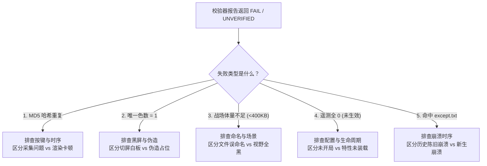

# v1.6.0 真机验收操作手册与判定规程 (Acceptance Runbook)

> **文档标识**：`docs/re/v160_acceptance_runbook.md`  
> **任务编号**：A-9（验收预演与标准化 Runbook）  
> **适用对象**：独立验证方（Antigravity）、实施方（ZCode）、总控核验方（Lead）  
> **核心工具**：[`tools/verify_evidence.py`](file:///d:/Project/ra2-campaign-forge/tools/verify_evidence.py)（标准 v3 自动化校验器）  
> **基线规范**：[`docs/re/EVIDENCE_STANDARD.md`](file:///d:/Project/ra2-campaign-forge/docs/re/EVIDENCE_STANDARD.md)（标准 v3） / `docs/RE_COORDINATION.md` (§核验 v11 + 派工 v11)

---

## 一、一键化自动化校验调用规程

### 1. 标准自动化校验命令 (Standard Invocation)
对 ZCode 交付的最终验收目录执行一键机械核验：

```powershell
python tools/verify_evidence.py out/loadbench/shots/v160_real `
    --log ra2youli/ra2render.log `
    --except-file ra2youli/except.txt `
    --sav-dir ra2youli `
    --json-out out/re_work/evidence_check/v160_final_verdict.json `
    --md-out out/re_work/evidence_check/v160_final_verdict.md
```

### 2. 参数契约说明
- `<evidence_dir>`：必须包含完整的操作步骤截图序列（开局、探索、后撤、读档、菜单退出）；
- `--log <path>`：指向实际运行产生的 `ra2render.log`，用于提取末行遥测计数并做生效性断言；
- `--except-file <path>`：指向 `ra2youli/except.txt`，自动基于**截图最早修改时间下界**执行崩溃碰撞筛查；
- `--sav-dir <path>`：指向游戏存档目录，验证 OLE2 复合文档魔数（`D0 CF 11 E0 A1 B1 1A E1`）；
- `--quiet`：用于 CI/批处理集成，只返回退出代码（`0`=PASS，`1`=FAIL/UNVERIFIED）。

---

## 二、实测证据判定准则总表 (Decision Table)

| 判据维度 | 数据来源 | 阈值要求 / 规范基准 | PASS 条件 | FAIL 条件 | UNVERIFIED 条件 |
|---|---|---|---|---|---|
| **崩溃零容忍** | `ra2youli/except.txt` | 窗口：$[T_{\min}, T_{\max} + 600\text{s}]$ | 窗口内无任何崩溃记录 | 窗口内发生新增/更新崩溃（一票否决） | 缺失日志且无任何运行留痕 |
| **EIP 模块归属** | `except.txt` EIP | `0x54500000 - 0x545F0000` (DLL) | 无崩溃产生 | 崩溃 EIP 落在注入模块区 | 崩溃落在未知系统 DLL |
| **遥测生效性** | `ra2render.log` 末行 | `BuildingCulls > 0`<br>`BulletCulls > 0`<br>`MinimapFogPixels > 0` | 已开启特性的遥测计数均 $> 0$ | — | 配置项开启（=1）但末行遥测计数全为 0 |
| **MD5 唯一性** | PNG 文件二进制 | 同批次截图哈希互异 | 截图 MD5 互不相同 | 任何两步截图 MD5 碰撞（步骤未刷新） | — |
| **单色退化** | 80×80 网格均匀采样 | 唯一色数采样 | 唯一色数 $\ge 200$ | 采样唯一色数 $= 1$（伪造占位图/黑屏） | — |
| **文件体量** | PNG 字节大小 | 菜单 $\approx$ 300–400 KB<br>战场 $\ge$ 400 KB | 战场 $\ge$ 400 KB，菜单正常 | 战场 $< 400$ KB（信息量严重不足） | — |
| **画面色数** | 80×80 网格均匀采样 | 战场建议 $\ge 2,000$ 种色彩 | 战场色彩丰富度充分 | 战场色数 $< 1,500$（疑似假战场） | — |
| **时间线自洽** | 截图 `mtime` 序列 | 物理合理耗时 | 总跨度 $\ge 30$ 秒，序列单调递增 | 耗时 $< 1.0$ 秒（无交互机械快拍） | — |
| **存档一致性** | `.SAV` 文件头 32B | 魔数 `D0 CF 11 E0 A1 B1 1A E1`<br>小端序 `3E 00` | 存档结构完整合规 | 魔数错误或损坏 | 涉及读档项但目录无有效 `.SAV` |

---

## 三、五大常见失败模式与排查决策树 (Failure Mode Triage)



### 模式 1：MD5 哈希重复（疑似按键未生效 / 画面未刷新）
- **现象**：两张或多张截图哈希完全一致（如之前的 `c0/c1` 案例）。
- **如何快速区分采集问题 vs 实现问题**：
  - **采集脚本问题**：截图脚本执行了按键模拟（如按下 ESC 或点击按钮），但未等待 UI 渐变动画完成（需 `Sleep(200)`），过早捕获了同帧画面。
  - **实现/引擎卡顿问题**：游戏主线程陷入死锁、无限循环，或窗口失去焦点导致 DirectDraw 表面停止 Present。
  - **处置方式**：重新人工操作游戏，每步留出 1–2 秒物理观察时间再行截图。

### 模式 2：采样色数 = 1（判定为伪造单色占位图）
- **现象**：80×80 网格采样 6,400 像素仅有 1 种色彩。
- **如何快速区分采集问题 vs 实现问题**：
  - **采集脚本问题**：自动化截屏抓取了最小化的后台窗口、或者全屏切桌面造成的纯黑/纯白位图（尺寸对了但无内容）。
  - **实现/伪造问题**：直接生成纯色 dummy 文件冒充真机截图。
  - **处置方式**：必须在游戏前台活跃、渲染正常时进行屏幕捕获。

### 模式 3：战场体量不足（< 400 KB）
- **现象**：被识别为战场的截图文件大小低于 400 KB，触发 FAIL。
- **如何快速区分采集问题 vs 实现问题**：
  - **命名与分类误判（典型采集问题）**：文件名包含 `skirmish`、`battle` 等关键词，但实际截图为“遭遇战房间设置界面”（例如 `smokeA_nav_1_skirmish.png`）。菜单背景色块简单，本就只有 340 KB，按战场标准被误判。
  - **真实战场信息量匮乏（实现问题）**：游戏虽然进入了战场，但画面全黑（迷雾黑屏、未加载地形）导致 PNG 压缩后体量暴跌。
  - **处置方式**：明确命名规范：菜单类统一命名前缀 `menu_*`、`setup_*`；真正的战场实景命名前缀 `battle_*`、`ingame_*`。

### 模式 4：遥测全 0（特性开启但零生效，判 UNVERIFIED）
- **现象**：`ra2render.ini` 开启了 `EnableMinimapFog=1`、`EnableBuildingFog=1` 等，但 `ra2render.log` 末行遥测计数为 0。
- **如何快速区分采集问题 vs 实现问题**：
  - **游戏生命周期未闭环（采集问题）**：目标进程仅停留在主菜单或遭遇战大厅（如 `smoke_routeA`），根本没有点击“开始游戏”进入对局，渲染与逻辑循环尚未跑过战局帧。
  - **INI 键名不符或默认关闭（实现问题）**：INI 中键名拼写错误，或者如当前状态 `EnableMinimapFog=0` 保守关闭未开启。
  - **Hook 漏装或挂载失效（实施缺陷）**：Hook 挂载点未执行、或虚表指针被其他模块覆盖。
  - **处置方式**：确认 INI 显式置 1，必须进入实际对战至少 30 秒，待产生交火、探路、迷雾变化后再退出游戏取 log。

### 模式 5：命中 `except.txt`（运行期致命崩溃）
- **现象**：校验器侦测到崩溃文件并整批判定为 FAIL。
- **如何快速区分采集问题 vs 实现问题**：
  - **历史陈旧崩溃（已被校验器自动豁免）**：`except.txt` 的修改时间早于当前批次第一张截图的 `mtime`。校验器已具备下界过滤逻辑，会自动输出 `[!NOTE]` 标注为陈旧日志，不予误杀。
  - **当前会话致命崩溃（实现问题）**：崩溃修改时间落在本批截图有效窗口内，且 EIP 落在 `ra2render.dll` 注入区。直接出具红色 `[!CAUTION]`，保存崩溃快照，闭锁闸门。
  - **处置方式**：若属实现缺陷，退回 ZCode 修复后方可重新验收。

---

## 四、放闸准入硬性条件清单 (Gate Release Checklist)

在解除封锁并合并台账前，必须逐项达成以下 7 项硬指标：

- [ ] **1. 路线 A 架构落地**：挂钩点严格下沉至 `0x00655D38`，执行 9 字节安全补丁（5B JMP + 4B NOP）与 14 字节跳板，杜绝任何外部逆向坐标算错风险；
- [ ] **2. INI 显式开启开关**：`ra2youli/ra2render.ini` 中显式配置 `EnableMinimapFog=1`、`EnableBuildingFog=1`、`EnableBulletFog=1`；
- [ ] **3. 连续 3 局无新增崩溃**：实施方提供连续 3 局完整对局（对战/读档/退出）测试，`ra2youli/except.txt` 绝无任何新增或更新（保持 18:09:25 或更早）；
- [ ] **4. 关键遥测末行非零**：`ra2render.log` 末行输出中：
  - `小地图灰化像素 > 0`
  - `建筑剔除 > 0`
  - `弹道剔除 > 0`
- [ ] **5. 全套合规证据包归档**：
  - 截图归档至 `out/loadbench/shots/v160_real/`；
  - 配套真实 `.SAV` 存档并符合 OLE2 魔数规范；
  - 包含完整的 `PROTOCOL.md`（记录分辨率、环境参数、INI 变更历程与哈希）；
- [ ] **6. 机械校验器全绿放行**：执行 `tools/verify_evidence.py`，综合裁决必须为 **PASS**；
- [ ] **7. 独立方人工抽验通过**：小地图灰雾过渡平滑、无重影闪烁、敌点隐匿彻底、基地断电与边缘格绝对稳定。
