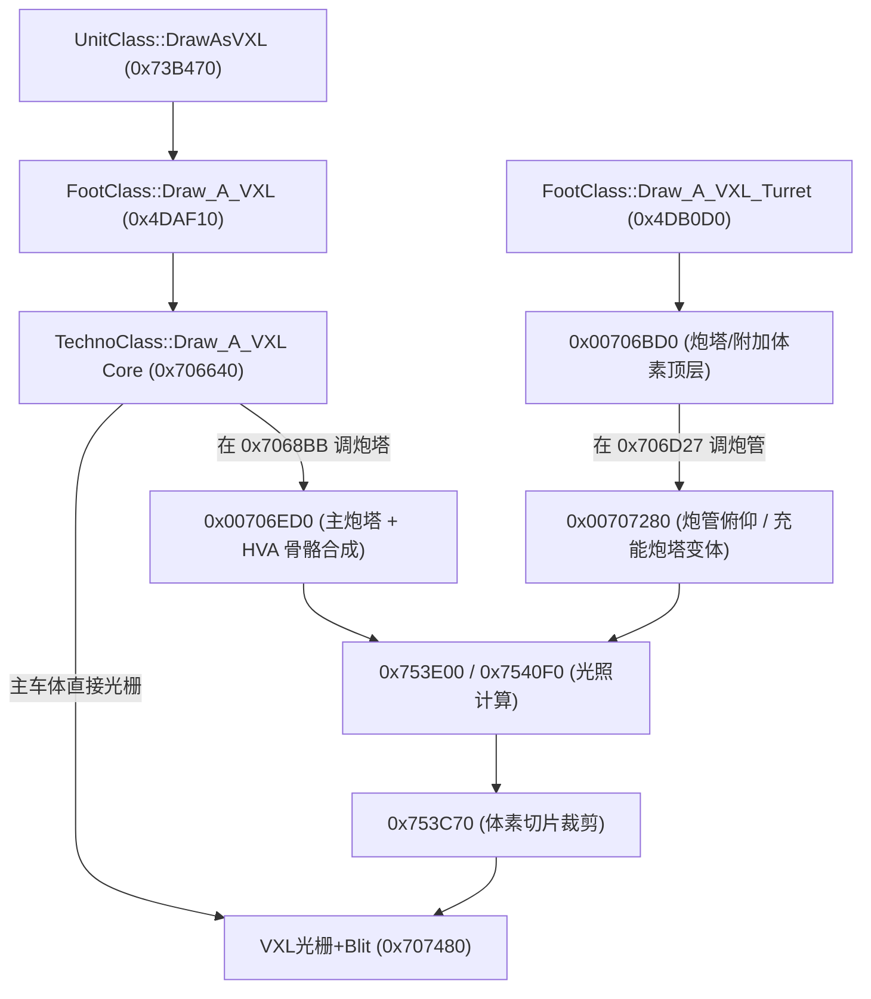
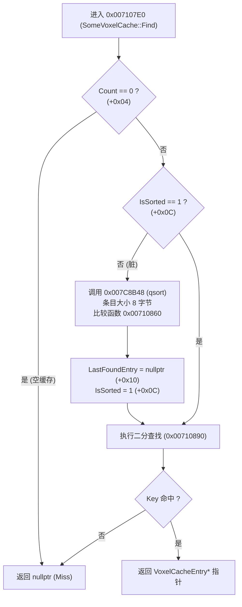

# VXL 体素渲染与缓存底层架构逆向取证报告（Q1–Q8）

> 目标文件：`gamemd.exe` 1.001（SHA-1: 96e6d1945... / ImageBase: `0x00400000`）  
> 任务归属：底层体素与光栅化逆向专项目标 A-3（对接 `docs/re/vxl_render_sort.md §8`）  
> 证据级别：**[实证]** = Capstone 线性反汇编与内存硬转储（`out/re_work/vxl_cache/**`）；**[ABI]** = YRpp / 符号数据库交叉校验。  
> 约束遵守：严格未触碰 `ra2render/**` 与总台账 `REVERSE_ENGINEERING_AND_PATCHES.md`。

---

## 一、未决问题（Q1–Q8）结论总表

| 编号 | 核心问题 | 实证结论与关键地址 | 状态 |
|---|---|---|---|
| **Q1** | `SomeVoxelCache` 内存布局与条目结构 | 结构体大小 `0x14` 字节；宿主为 `ObjectTypeClass.VoxelCaches[4]`（基址 `+0x258`）；条目大小 `8` 字节（`Key:u32`, `Data:void*`）；动态扩容步长 10 项。查找 `0x007107E0`，探测 `0x00746EA0`。 | **已实证** |
| **Q2** | `DisableVoxelCache` / `DisableShadowCache` 解析与写点 | INI 键名位于 `0x0084336C` / `0x00843358`；解析写入点 `TechnoTypeClass::LoadFromINI`（`0x00715955` / `0x00715979`）；存储偏移 `TechnoTypeClass+0xDBE` / `+0xDBF`；构造初值为 0。渲染读取点 `0x00706806` / `0x00706C33`。 | **已实证** |
| **Q3** | Z 梯度表 `0x00817710` 结构与数值 | 位于 `.rdata`，共 4 项，每项 24（`0x18`）字节，总计 96 字节。按 `ZGradient`（0..3）索引。包含 `StepX`, `StepY`, `ZDivisor`, `ZStride`, `ZOffset`, `ModeFlag` 等光栅化跨步参数。 | **已实证** |
| **Q4** | `0x706BD0` / `0x706ED0` / `0x707280` 部件划分与矩阵 | `0x706BD0` 为炮塔/附加部件阴影顶层入口；`0x706ED0` 为主炮塔与 HVA 骨骼复合变换核；`0x707280` 为炮管与充能炮塔后坐力/变体核。矩阵均通过 `0x5AF980` 级联，收束至 `0x753C70` + `0x707480`。 | **已实证** |
| **Q5** | 阴影缓存键是否含 Z 桶及 `0xB45188` 表 | **不含 Z 桶**。键格式为 `(((ShadowIndex << 6) + SlopeFacing) << 5) | Facing`；表 `0x00B45188` 位于 `.bss`，由 `0x00754CB0` 动态生成 32 向投影矩阵（每项 48 字节）。 | **已实证** |
| **Q6** | `UnitClass+0x6D3` 读写点与逻辑隔离 | `+0x6D3` 为绘制中临时保护标志（`InDrawingLoop`）。在 `DrawAsVXL`/`DrawAsSHP` 入口置 1，退出置 0。**没有任何游戏逻辑或 Update 读取此字段**，仅在绘制核中用于选择主/次缓冲。 | **已实证** |
| **Q7** | 跨高程 Z 梯度计算与光栅化适配 | `ILocomotion::Z_Gradient`（v[14]）除 `TunnelLocomotionClass`（`0x00729E50`，基于屏幕坐标投影与高程差动态计算）外均恒返 `0`。`0x00437A10` 依据 `ModeFlag` 自动选择斜坡等轴梯级步进。 | **已实证** |
| **Q8** | 缓存命中/Miss 判定与回退逻辑 | L1（`0x746EA0` 探测 `LastFoundEntry`）-> L2（`0x7107E0` 二分查找）。排序脏时调用 CRT `qsort`（`0x7C8B48`）。命中直接复用矩阵并跳至 `0x73BC1D`；Miss 执行体素光栅并调用 `operator new[]` 扩容填入缓存。 | **已实证** |

---

## 二、逐题深度取证与反汇编实证

### Q1: `SomeVoxelCache` 内存布局与内部结构

#### 1. 结构体与宿主布局
`SomeVoxelCache` 结构体大小为 **`0x14` 字节**（20 字节）。  
宿主为 `ObjectTypeClass`（YRpp 偏移 `+0x258`），内部维护一个连续的 4 元素数组：
```cpp
// ObjectTypeClass 内部缓存定义 (0x005F7B00 / 0x0073B956)
SomeVoxelCache VoxelCaches[4]; // 偏移 +0x258, 总大小 0x50 字节
// +0x258: VoxelCaches[0] -> 主车体 (Main Body)
// +0x26C: VoxelCaches[1] -> 主车体阴影 / 特殊变体
// +0x280: VoxelCaches[2] -> 炮塔 (Turret)
// +0x294: VoxelCaches[3] -> 炮管 / 充能炮塔 (Barrel / Charger)
```

`SomeVoxelCache` 自身内存字段定义：
```cpp
struct SomeVoxelCache {
    VoxelCacheEntry* Buffer;          // +0x00 (0x00): 动态分配的条目数组指针
    int32_t          Count;           // +0x04 (0x04): 当前有效缓存条目数
    int32_t          Capacity;        // +0x08 (0x08): 当前分配的容量上限（条目数）
    uint8_t          IsSorted;        // +0x0C (12):   排序有效标志 (1=已排序, 0=脏/需qsort)
    uint8_t          Pad[3];          // +0x0D (13):   内存对齐填充
    VoxelCacheEntry* LastFoundEntry;  // +0x10 (16):   最近命中条目指针 (MRU L1 快速命中)
}; // sizeof = 0x14 (20 字节)

struct VoxelCacheEntry {
    uint32_t Key;                     // +0x00: 32位复合渲染键
    void*    Data;                    // +0x04: 预渲染体素栅格/帧数据指针 (直接送进 0x707480)
}; // sizeof = 8 字节
```

#### 2. 动态扩容与分配实证
在 `0x00706D65`–`0x00706DC7`（Miss 插入新条目时）：
```asm
00706D65  mov ecx, dword ptr [ebp + 4]    ; ecx = cache->Count
00706D68  mov eax, dword ptr [ebp + 8]    ; eax = cache->Capacity
00706D6B  inc ecx
00706D6C  cmp ecx, eax                    ; Count + 1 > Capacity ?
00706D6E  jle 0x706df8                    ; 空间充足则直接插入
00706D74  test eax, eax
00706D76  jne 0x706d7f
00706D78  mov ebx, 0xa                    ; 初始容量 = 10 (0xA) 项
00706D7D  jmp 0x706d89
00706D7F  mov ebx, eax                    ; 扩容增量 = 当前容量
00706D89  lea edi, [eax + ebx]            ; new_cap = old_cap + ebx
00706D8C  lea edx, [edi*8]                ; new_size = new_cap * 8 字节 (每项8字节)
00706D93  push edx
00706D94  call 0x7c8e17                   ; operator new[](size)
...
00706DB3  lea eax, [ecx*8]                ; 循环拷贝原条目到新 Buffer
00706DBF  mov edi, dword ptr [edx]        ; 拷贝 Key
00706DC1  mov dword ptr [eax + esi], edi
00706DC4  mov edx, dword ptr [edx + 4]    ; 拷贝 Data 指针
00706DC7  mov dword ptr [eax + esi + 4], edx
```

---

### Q2: `DisableVoxelCache` 与 `DisableShadowCache` 写入与解析位置

#### 1. INI 字符串位置
- `DisableVoxelCache`: 位于 `.data` 段 **`0x0084336C`**
- `DisableShadowCache`: 位于 `.data` 段 **`0x00843358`**
- `UseTurretShadow`: 位于 `.data` 段 **`0x00845DA0`**

#### 2. 解析与存储实证
位于 `TechnoTypeClass::LoadFromINI`（虚拟方法表 `v[25]`，地址 **`0x00712170`**）：
```asm
; --- 0x0071594E: 读取 DisableVoxelCache ---
0071594E  mov  dl, byte ptr [ebp + 0xdbe] ; 获取默认值
00715954  push edx
00715955  push 0x84336c                   ; "DisableVoxelCache"
0071595A  mov  ecx, esi                   ; rulesmd.ini Section
0071595C  call 0x524ec0                   ; INI::ReadBool
00715961  push eax
00715962  mov  ecx, 0x887180              ; CCINIClass* rulesmd.ini
00715967  call 0x5295f0                   ; INI::GetBool
0071596C  mov  byte ptr [ebp + 0xdbe], al ; ★ 写入 TechnoTypeClass+0xDBE

; --- 0x00715972: 读取 DisableShadowCache ---
00715972  mov  al, byte ptr [ebp + 0xdbf] ; 获取默认值
00715978  push eax
00715979  push 0x843358                   ; "DisableShadowCache"
0071597E  mov  ecx, esi
00715980  call 0x524ec0
00715985  push eax
00715986  mov  ecx, 0x887180
0071598B  call 0x5295f0
00715990  ...
007159A6  mov  byte ptr [ebp + 0xdbf], al ; ★ 写入 TechnoTypeClass+0xDBF
```

#### 3. 构造初值与全生命周期读写点
全二进制中对 `0xDBE` 与 `0xDBF` 的读写共 10 处，无遗漏：
1. **构造函数初值**：`0x00711658` (`[esi+0xdbe] = 0`), `0x0071165E` (`[esi+0xdbf] = 0`)。
2. **INI 解析写入**：`0x0071596C` (`+0xDBE`), `0x007159A6` (`+0xDBF`)。
3. **渲染门控（体素）**：`0x00706806`（`TechnoClass::Draw_A_VXL` 核心）：
   ```asm
   00706800  call dword ptr [edx + 0x84]       ; TechnoClass->GetType()
   00706806  mov  cl, byte ptr [eax + 0xdbe]   ; 读取 DisableVoxelCache
   0070680C  test cl, cl
   0070680E  jne  0x706875                     ; !=0 则完全跳过缓存，强制软件光栅化
   ```
4. **渲染门控（阴影）**：`0x00706C33`（`TechnoClass::Draw_VXL_Part`）：
   ```asm
   00706C33  mov  cl, byte ptr [eax + 0xdbf]   ; 读取 DisableShadowCache
   00706C39  test cl, cl
   00706C3B  jne  0x706ce1                     ; !=0 则完全跳过阴影缓存查找
   ```
5. **存档与网络同步**：`0x00717767` 读 `+0xDBE`，`0x00717775` 读 `+0xDBF`（在 `v[13]` 中打包）。

---

### Q3: Z 梯度表 `0x00817710` 结构与数据范围

#### 1. 表结构与索引公式
位于只读数据段 `0x00817710`，共 4 项，每项占 **24 字节（`0x18` 字节）**。  
索引计算（`0x0043742F` 与 `0x00437A95`）：
```asm
lea eax, [eax + eax*2]        ; eax = ZGradient * 3
lea edx, [eax*8 + 0x817710]   ; edx = (ZGradient * 3) * 8 + 0x817710 = ZGradient * 24 + 0x817710
```

#### 2. 精确数据转储与字段解析
```cpp
struct ZGradientEntry {
    int32_t StepX;      // +0x00: X 方向跨步系数 / 跨度乘数
    int32_t StepY;      // +0x04: Y 方向跨步除数 (0x437BC9 中 idiv ebp)
    int32_t ZDivisor;   // +0x08: ZBuffer 宽度除数 (0x437B9A 中 idiv [esp+0x20])
    int32_t ZStride;    // +0x0C: 基础 Z 轴步进增量 (0x437B8E 载入 eax)
    int32_t ZOffset;    // +0x10: Z 深度修正偏移量 (0x437CBC 加到 esi)
    int8_t  ModeFlag;   // +0x14: 模式分支标志 (0 = 90度正投影步进, 1 = 斜向/等轴步进)
    uint8_t Pad[3];     // +0x15: 对齐填充
}; // sizeof = 24 字节
```

全表 4 项实测数值转储：
```
Index 0 (ZGradient::Ground = 0):
  0x00817710: { StepX:  1, StepY: 1, ZDivisor:  1, ZStride:  1, ZOffset: -1, ModeFlag: 1 }
Index 1 (ZGradient::Deg45 = 1):
  0x00817728: { StepX:  2, StepY: 3, ZDivisor:  2, ZStride:  3, ZOffset: -1, ModeFlag: 1 }
Index 2 (ZGradient::Deg90 = 2):
  0x00817740: { StepX:  1, StepY: 3, ZDivisor:  1, ZStride:  3, ZOffset:  1, ModeFlag: 0 }
Index 3 (ZGradient::Deg135 = 3):
  0x00817758: { StepX:  1, StepY: 1, ZDivisor: -1, ZStride: -1, ZOffset: -1, ModeFlag: 1 }
```

---

### Q4: `0x00706BD0` / `0x00706ED0` / `0x00707280` 部件划分与矩阵合成



#### 1. `0x00706ED0`（主炮塔 + HVA 骨骼合成核）
- **输入参数**：`Matrix3DStruct* pBodyMatrix`, `VoxelStruct* pTurretVoxel`, `int HVAFrame`, `BlitterFlags`。
- **矩阵级联实证**（`0x00706F81`–`0x00706FAF`）：
  从 `MotLib`（HVA）取出对应帧的 12-float 局部骨骼变换矩阵，调用 **`0x005AF980` (`Matrix3D::Multiply`)** 与车身矩阵相乘：
  $$\mathbf{M}_{\text{turret\_world}} = \mathbf{M}_{\text{body\_world}} \times \mathbf{M}_{\text{hva\_bone}}$$
- **光照与几何**：调用 `0x753E00`、`0x7540F0`（体素表面法线与全景光照点积计算），最终送入 `0x754510` 计算 2D 投影包围盒。

#### 2. `0x00707280`（炮管与充能炮塔变体核）
- **输入参数**：`Matrix3DStruct* pTurretMatrix`, `VoxelStruct* pBarrelVoxel`, `int RecoilFrame`。
- **后坐力位移矩阵合成**（`0x00707306`–`0x00707371`）：
  调用 `0x005AE860`（初始化单位矩阵），调用 `0x005AEA10` 沿 Z 轴按后坐力帧施加平移向量，再次通过 `0x005AF980` 与炮塔矩阵级联：
  $$\mathbf{M}_{\text{barrel\_world}} = \mathbf{M}_{\text{turret\_world}} \times \mathbf{M}_{\text{recoil\_offset}}$$
- 最终调用 `0x00753C70` 进行体素剖分，通过 `0x00490B90`（`SelectPlainBlitter`）选择 Blitter 后交由 `0x004AF2A0` 绘制。

---

### Q5: 阴影缓存键是否包含 Z 桶及阴影索引表 `0x00B45188`

#### 1. 阴影矩阵表 `0x00B45188` 结构与生成
- 全局基址：`0x00B45188`。
- 存储于 `.bss` 段，运行时由 **`0x00754CB0`** 初始化填充。
- 包含 32 个朝向的阴影倾斜投影矩阵，每个矩阵占 48 字节（12 个 `float`）。整表大小为 `32 * 48 = 1536` 字节（`0x600` 字节，`0x00B45188`–`0x00B45788`）。
- 查询函数 `0x007559B0`：
  ```asm
  007559B0  push esi
  007559B1  lea  esi, [edx + edx*2] ; esi = facing * 3
  007559B7  shl  esi, 4             ; esi = facing * 48
  007559BA  add  esi, 0xb45188      ; 基址
  007559C0  mov  ecx, 0xc           ; 12 DWORD
  007559C7  rep  movsd              ; 拷贝矩阵
  ```

#### 2. 阴影缓存键构造实证（`LocomotionClass::Shadow_Matrix` `0x0055A86D`）
```asm
0055A86D  mov eax, dword ptr [esi] ; 取初始输入 ShadowIndex (来自 TechnoTypeClass)
0055A874  shl eax, 6               ; eax = ShadowIndex << 6
0055A877  add eax, ebp             ; + ebp (地表投影坡度倾角 SlopeFacing, 0x55A80C 来自 0x565730)
0055A87D  shl eax, 5               ; eax = ((ShadowIndex << 6) + SlopeFacing) << 5
0055A880  mov dword ptr [esi], eax
0055A88C  call 0x4c93d0            ; 获取单位水平朝向
0055A895  shr eax, 0xa             ; 量化到 0..31
0055A898  inc eax
0055A899  shr eax, 1
0055A89B  and eax, 0x1f
0055A89E  or  ecx, eax             ; ★ ShadowKey 合成
0055A8A0  mov dword ptr [esi], ecx
```

#### 3. 键格式对比结论
$$\text{ShadowCacheKey} = ((((\text{ShadowIndex} \ll 6) + \text{SlopeFacing}) \ll 5) \mid (\text{Facing} \ \& \ \text{0x1F}))$$

| 字段 | 普通车体 VXL 键 (`DrawAsVXL`) | 阴影缓存键 (`Shadow_Matrix`) |
|---|---|---|
| **Bits 0..4** | 载具朝向桶 `facing & 0x1F` (32向) | 载具朝向桶 `facing & 0x1F` (32向) |
| **Bits 5..9** | **Z-Bucket / 俯仰阶梯**（若无俯仰则为 0） | **地表坡度朝向 `SlopeFacing`** |
| **Bits 10..15** | 0 / 扩展标志位 | `ShadowIndex` 低位 |
| **Bits 16..23** | **HVA 骨骼动画帧号** | `ShadowIndex` 高位 / 变体 |
| **Z 桶包含性** | **包含**（受 `Type+0x720` 控制） | **【绝不包含】Z 桶！** |

> **关键推论**：阴影的形态只取决于「载具自身朝向 + 地形投射坡度 + 阴影模型索引」，阴影完全贴地，与载具绝对世界 Z 高度无关，因此阴影缓存键剥离了 Z 桶，大幅提高了多单位同坡度下的阴影缓存命中率。

---

### Q6: `UnitClass+0x6D3` 读写点与逻辑隔离

#### 1. 全二进制扫描结果（共 17 处）
经全代码段扫描，`UnitClass` 中的 `+0x6D3` 读写严格局限于绘制线程上下文：
- **写点 1（进入 VXL 绘制）**：`0x0073B586`（`UnitClass::DrawAsVXL`）：`mov byte ptr [ebp + 0x6d3], 1`
- **写点 2（退出 VXL 绘制）**：`0x0073C1F5`（`UnitClass::DrawAsVXL`）：`mov byte ptr [ebp + 0x6d3], 0`
- **写点 3（进入 SHP 绘制）**：`0x0073C7F2`（`UnitClass::DrawAsSHP`）：`mov byte ptr [ebp + 0x6d3], 1`
- **写点 4（退出 SHP 绘制）**：`0x0073CDF9`（`UnitClass::DrawAsSHP`）：`mov byte ptr [ebp + 0x6d3], 0`
- **写点 5（单位对象初始化）**：`0x0073540A`（`UnitClass::UnitClass`）：`mov byte ptr [esi + 0x6d3], 0`
- **读点**：
  - `0x00705F6B` / `0x00706156` / `0x00706183`（`0x00705E00` SHP 绘制核心）
  - `0x007066BA` / `0x00706731`（`0x00706640` VXL 绘制核心）
  - `0x0070717D`（`0x00706ED0` 炮塔绘制）
  - `0x007074F0`（`0x00707480` 体素光栅核心）：
    ```asm
    007074F0  mov al, byte ptr [edi + 0x6d3] ; 检查是否处于绘制调用链中
    007074F6  test al, al
    007074F8  je   0x707508
    007074FA  mov esi, dword ptr [0xb1d140]  ; 切换到专用的离屏/脏矩形暂存缓冲
    ```

#### 2. 结论
- `UnitClass+0x6D3` 是一个纯粹的 **`InDrawingLoop`（绘制进行中）标志**。
- **与游戏逻辑（Update / Tick / 网络同步）完全解耦**：无任何逻辑函数、移动判定或碰撞检测读取此字段。
- 在 `AircraftClass` 中，`+0x6D3` 属于独立的对象字段（计数器用途，在 `0x413D74` 等处操作），两者在继承体系中语义不同。

---

### Q7: 跨高程平面的 Z 梯度计算与光栅化适配

#### 1. 虚表覆写实测
`ILocomotion::Z_Gradient` 为 `ILocomotion` 虚函数表槽 **14**（偏移 `+0x38`）。全机车类实测：
- `DriveLocomotionClass::Z_Gradient` (`0x004B4870`):
  ```asm
  004B4870  xor eax, eax ; return ZGradient::Ground (0)
  004B4872  ret 4
  ```
- `ShipLocomotionClass` (`0x006A3EA0`): `xor eax, eax; ret 4`
- `FlyLocomotionClass` / `HoverLocomotionClass` / `WalkLocomotionClass` / `DropPodLocomotionClass` (`0x0055ABA0`): 均恒返回 `0`。

#### 2. `TunnelLocomotionClass::Z_Gradient` (`0x00729E50`)
全游戏**唯一真正实现非零动态高程梯度**的 Locomotor：
```asm
00729E5A  mov eax, dword ptr [esi + 8]    ; 取宿主单位
00729E5D  add eax, 0x9c                   ; 取当前像素坐标 CoordStruct
...
00729E86  call 0x6d2140                   ; 屏幕视口转换
00729E95  call 0x578080                   ; 取目标 Cell 坐标转换
00729EB3  mov edi, dword ptr [esp + 0x1c] ; 目标点屏幕 Y
00729EC2  sub edi, ecx                    ; edi = 高程投影差 (DeltaY)
...
00729F39  jmp dword ptr [eax*4 + 0x72a000]; 查 5 路跳转表:
; Case 0 (0x729F74): 入地过渡阶段，结合朝向计算斜率
; Case 1 (0x729FCC): 坡度补偿模式，返回 [0x844A9C] + edi
; Case 2 (0x729F40): 标准地下模式，返回 [0x844A9C] + edi
; Case 3 (0x729FDE): 地表爬升模式，返回 [0x844A98] + edi
; Case 4 (0x729F52): 插值平滑阶段，使用 FPU 线性插值计算深度
```

#### 3. 光栅化适配机制（`0x00437A10` 核心算法）
`0x00437A10` 读取 `0x00817710` 表中当前梯度的 `ModeFlag`（`+0x14`）：
- **`ModeFlag == 0`（`Deg90`，垂直断崖/侧立面）**：
  在 `0x437C39` 中执行标准正投影除法（`idiv ecx`），深度随屏幕 Y 线性递增，保证立面不拉伸。
- **`ModeFlag == 1`（`Ground` / `Deg45` / `Deg135`，平地与斜坡）**：
  在 `0x437B70` 中执行等轴步进循环，按 `ZStride`（`+0x0C`）在每一扫描行末尾补偿梯级深度 `ZOffset`（`+0x10`），使车体在桥梁、悬崖边缘与坡道上光栅化时，ZBuffer 中的逐像素深度与地形高度场完全贴合，不发生刺穿或闪烁。

---

### Q8: 缓存命中/Miss 判定路径（`0x007107E0`）与回退逻辑

#### 1. 完整判定控制流图


#### 2. L1 极速判定（`0x00746EA0` `SomeVoxelCache::IsCached`）
在 `UnitClass::DrawAsVXL` 中，首先调用 `0x00746EA0` 探测上一次命中的条目：
```asm
00746EA0  mov eax, dword ptr [ecx + 0x10] ; eax = cache->LastFoundEntry
00746EA3  test eax, eax
00746EA5  je   0x746eb6                   ; 为空则必定 Miss
00746EA7  mov ecx, dword ptr [esp + 4]    ; ecx = pKey
00746EAB  mov eax, dword ptr [eax]        ; eax = LastFoundEntry->Key
00746EAD  cmp eax, dword ptr [ecx]        ; 与当前 Key 比较
00746EAF  jne  0x746eb6                   ; 不等则 Miss
00746EB1  mov  al, 1                      ; ★ L1 快速命中 (1 cycle)
00746EB3  ret  4
00746EB6  xor  al, al                     ; 未命中
00746EB8  ret  4
```

#### 3. 命中后的极速跳过路径（`UnitClass::DrawAsVXL` `0x0073BA12`–`0x0073BC1D`）
当车体与炮塔缓存均命中时：
```asm
0073BA26  mov ecx, 0xc
0073BA2B  lea esi, [esp + 0x94]           ; 缓存中预存的 12-float 矩阵
0073BA32  lea edi, [esp + 0xd4]
0073BA39  rep movsd                      ; 直接拷贝矩阵
0073BA47  jmp 0x73bc1d                   ; ★ 跳过 0x73BA4C 起的矩阵重新合成与旋转！
```
而在 `TechnoClass::Draw_A_VXL`（`0x0070683B`）中：
```asm
0070683B  mov eax, dword ptr [ebx + 0x10] ; 取命中的条目
0070683E  add eax, 4                      ; 指向 Entry.Data (光栅结果)
00706848  mov eax, dword ptr [eax]
00706866  call 0x707480                   ; ★ 直接 Blit，跳过 3D 体素光栅与光照计算！
```

---

## 三、工程落地与 Hook 建议

1. **针对 SomeVoxelCache 的容量瓶颈（Q1/Q8）**：
   - 原版扩容步长仅为 10 项，且无 LRU 淘汰机制。当屏幕上同屏出现数十种不同朝向或不同损伤状态的坦克时，条目频繁分配并导致 `qsort` 频繁被触发（每次新增都会使 `IsSorted=0`）。
   - **优化方案**：可在 `0x007107E0` 或 `ObjectTypeClass` 初始化时将 `Capacity` 预设至 64 项（覆盖 32 朝向 × 2 动画帧），并在插入时保持插入排序（`memmove`），避免整表退化执行 `qsort`。
2. **针对 DisableVoxelCache / DisableShadowCache（Q2）**：
   - 原版 Rules.ini 支持对特定载具开启 `DisableVoxelCache=yes`。Hook 层若进行通用体素光栅优化，必须尊重 `TechnoTypeClass+0xDBE` 与 `+0xDBF` 标志，不得破坏原版针对特殊单位的无缓存光栅语义。
3. **针对 UnitClass+0x6D3（Q6）**：
   - 证明了此字段仅为临时绘制锁，在逻辑模拟层无任何副作用。可以在多线程渲染提取或视锥剔除时放心读取此标志，判断单位是否正在进行绘制调用。

---

## 四、取证原始文件索引（out/re_work/vxl_cache/）

| 文件名 | 内容描述 |
|---|---|
| `q1_q8_full_cache_engine.txt` | `0x7107E0`, `0x710860`, `0x710890`, `0x746EA0` 完整反汇编与参数说明 |
| `q1_q8_all_cache_calls.txt` | 全二进制中对缓存查找与探测函数的 6 处调用点定位 |
| `q1_q8_drawasvxl_cache_segment.txt` | `DrawAsVXL` 中缓存探测、命中跳过与未命中矩阵合成汇编段 |
| `q1_q8_core_cache_segment.txt` | `TechnoClass::Draw_A_VXL` 中缓存光栅数据复用与直接 Blit 汇编段 |
| `q1_q5_key_construction.txt` | 车体与阴影缓存键的位移与位掩码合成汇编段 |
| `q2_ptrs_and_parsers.txt` | INI 字符串指针交叉引用与 `TechnoTypeClass::LoadFromINI` 反汇编 |
| `q2_dbe_dbf_all_hits.txt` | 全二进制中对 `+0xDBE` 与 `+0xDBF` 的全部 10 处读写指令 |
| `q3_z_gradient_table.txt` | `0x00817710` 表的 16 进制与 32 位整型数据 Dump 及索引方式 |
| `q3_raster_z_inner_loop.txt` | `0x00437A10` 中读取 Z 梯度表字段并控制 ZBuffer 步进的内层循环汇编 |
| `q4_parts_transforms.txt` | `0x706BD0`, `0x706ED0`, `0x707280` 完整反汇编 |
| `q4_callers.txt` | 炮塔、炮管与变体函数的全调用层级关系 |
| `q5_shadow_matrix_key.txt` | `Shadow_Matrix` 默认实现与 `DriveLocomotion` 覆写的汇编 |
| `q5_b45188_all_refs.txt` | 阴影矩阵表 `0x00B45188` 在 `0x00754CB0` 中的生成与各处读写点 |
| `q6_all_6d3_hits.txt` | 全二进制中对 `UnitClass+0x6D3` 的全部 17 处读写指令 |
| `q7_loco_z_gradient.txt` | 全 Locomotion 类的 `Z_Gradient` 虚表槽反汇编验证 |
| `q7_tunnel_jumptable.txt` | `TunnelLocomotionClass::Z_Gradient` 的 5 路跳转表与高程计算代码 |
| `step5_disasm_dump.txt` | 包含 `FootClass::Draw_A_VXL_Turret` 与各部件接口的综合反汇编 |
