# 武器 / 弹头伤害 / 工厂生产队列 逆向

> 逆向对象：`gamemd.exe` 1.001（尤里的复仇），ImageBase=`0x400000`，文件偏移 = VA − `0x400000`
> 【W3 勘误 E-W3-01】原句 `FileOffset = VA − 0x400000` 仅在 `.text/.rdata/.data` 成立；
> 通用式为 `FileOffset = 段.PointerToRawData + (VA − 段.VirtualAddress)`，
> 本镜像 `.rsrc`/`.detour` 为 `VA − 0x6FC000`。依据：out/re_work/_lead_baseline/W3/LEAD_ERRATUM_E-W3-01_fileoffset_rule.md；分级：[实证]
> 目标：摸清开火链、Warhead 伤害分摊、工厂生产与超武/维修计时的逻辑成本，给出可优化插入点（不破坏确定性）。
> 配套反汇编：`out/reverse/fn_6FDD50_Techno_Fire.txt`、`fn_4666E0_Bullet_Update.txt`、`fn_4690B0_Bullet_Detonate.txt`、`fn_489280_DamageArea.txt`、`fn_701900_ReceiveDamage.txt`、`fn_4C9C70_DemandProduction.txt`、`fn_4500F0_FactoryUpdate.txt`、`fn_4F8440_House_Update.txt` 等。
> 相关文档：`targeting_spatial.md`（空间桶 0x887888）、`house_team_ai_update.md`、`fx_draw_chain.md`。

---

【勘误 2026-09-29 · E-2 · landing_audit】本文多处将 `WarheadTypeClass.Verses[11]` 记为 `Warhead+0xB0` / `+0xB0+armor*8`，**偏移错误**。实证：**`Verses[0]` 起于 `+0xA0`**（覆盖 `+0xA0…+0xF7`，11 个 double），**`+0xB0` 实为 `Verses[2]`**（Plate/装甲档位之一）。按 `+0xB0` 写会把第 3 档护甲乘数当数组起点，**静默错位 8 个 double**；按 `+0xB0` 读「全部 11 项」会越读 `+0xF8…+0x107` 非 Verses 字段。勿与超武 `SuperClass` 的 `SW+0xB0 RechargeTime` 混淆（不同类不同字段）。权威：`ARCHITECTURE_ATLAS.md` §16.3〔勘误 R6-E2〕，装载器锚点 `0x75DE06/0x75DE0C/0x75DE48/0x75DE52` + 默认值串 `0x847C40`。下文逐处标注，原文保留不删字。

## 0. 结论速览

| 问题 | 答案 |
| :--- | :--- |
| 开火链入口在哪？ | **`TechnoClass::Fire` 虚函数 v[243] = `0x6FDD50`**（7184 B）。Foot/Unit/Infantry/Aircraft 有薄包装，最终都汇入它；Building 直接用本体。**不是** YRpp 注释里 `TurretControl::Fire(0x70ECE0)`（那是炮塔子对象计时）。 |
| Bullet 如何创建？ | `Fire` 内 `CoCreateInstance` / 类工厂建 `BulletClass`，再调 **`BulletClass::Construct(0x4664C0)`** 填 Type/Target/Owner/Damage/Warhead/Speed/Bright。 |
| 弹道 Update 是热点吗？ | **是**。`BulletClass::Update` = v[23] = **`0x4666E0`**，6432 B / 1804 行，33 个调用目标，含大量浮点与格子查询。高密度弹幕时每帧 O(Bullets)。 |
| 爆炸与伤害分摊？ | `Bullet::Detonate(0x4690B0)`（4704 B）→ **`DamageArea(0x489280)`**（4720 B）做 CellSpread 扫描 → 对每个候选调 `v[0x16C]` = **`ReceiveDamage(0x701900)`**。 |
| CellSpread 复杂度？ | **O(范围环格数 × 每格对象数)**。用预计算环表 `0x7ED3D0`(计数)/`0xABD490`(偏移) 逐格走，再用**全局空间桶 `0x887888`**（与寻敌同一对象，20×20 桶）枚举候选。 |
| Verses 护甲乘数在哪？ | `WarheadTypeClass.Verses[11]`（`double`）位于 **Warhead+0xB0**，下标 0..10 对应 11 种护甲；`CellSpread` 在 **Warhead+0x124**。 |
| 工厂每帧成本？ | `HouseClass::Update(0x4F8440)` 遍历工厂；`FactoryClass` 用 **54 步 ProgressTimer**（硬编码 `0x36`），`DemandProduction/StartProduction/CompletedProduction` 均为 O(队列长)。 |
| 超武充能？ | `SuperClass.RechargeTimer`（+0x30）每帧递减；`0x6CBEE0` 算就绪度，`0x6CBCA0` 减计时 + OneTime 回收。 |
| 最大可优化点？ | ① `DamageArea` 的环×桶双重扫描；② `Bullet::Update` 每弹每帧全量；③ `ReceiveDamage` 对同一目标重复取 Type/House/护甲。**均不得改动 RNG(0x65C7E0) 的调用次数与顺序。** |
| 确定性红线？ | `Randomizer::Random` = **`0x65C7E0`**（全库 415 处直呼）。任何限频/缓存若改变其调用序列，回放必炸。 |

【勘误 2026-09-29 · E-2】Verses 偏移 +0xB0 → **+0xA0**（`Verses[0]` 起于 `+0xA0`；`+0xB0`=`Verses[2]`）。原文保留不删字。（覆盖 L19「Warhead+0xB0」）

---

## 1. 开火链：选定目标 → Weapon → Bullet → 飞行 → 爆炸

### 1.1 虚表与真实入口

`symbols.json` + 各类虚表比对（v[243] = Fire，v[241] = Greatest_Threat，见 `targeting_spatial.md`）：

| 类 | 虚表基址 | v[243] Fire | 与 `0x6FDD50` 关系 |
| :--- | :--- | :--- | :--- |
| TechnoClass | `0x7F4960` | **`0x6FDD50`** | 本体（7184 B） |
| BuildingClass | `0x7E3EBC` | `0x6FDD50` | 直接复用 |
| FootClass | `0x7E8C94` | `0x415EE0` | 薄包装 → `0x6FDD50` |
| UnitClass | `0x7F5C70` | `0x741340` | 包装（补 Unit 特判）→ `0x6FDD50` |
| InfantryClass | `0x7EB058` | `0x51DF60` | 包装 → `0x6FDD50` |
| AircraftClass | `0x7E22A4` | `0x415EE0` | 与 Foot 共享 |

⚠ YRpp `TechnoClass.h` 把 `void Fire()` 标成 `0x70ECE0`，实测该函数只有 17 行，是 **TurretControl 子对象**的计时推进（写 `this+0x10/0x18/0x1c`），与发射无关。真 Fire 是虚表 v[243]。以虚表为准。

### 1.2 `TechnoClass::Fire`（0x6FDD50）骨架

```
Fire(this, pTarget, weaponIndex)
 ├─ 校验 ROF / Ammo / EMP / Cloak / 目标存活
 ├─ SelectWeapon 相关：v[GetWeapon] 取 WeaponStruct → WeaponTypeClass
 ├─ CoCreateInstance / TClassFactory<BulletClass> 建 Bullet
 │    └─ BulletClass::Construct(0x4664C0)     ← 17 处直呼之一
 ├─ 计算开火点（炮口 / Occupant / 建筑占位）
 ├─ 设置 Bullet 速度、InheritedColor、DamageMultiplier（Burst 分摊）
 ├─ 播放 Report/Anim、RevealOnFire、DecloakToFire
 ├─ DecreaseAmmo / ROF 计时写回
 └─ return Bullet*
```

`Construct(0x4664C0)` 签名（YRpp 一致）：

```cpp
void __thiscall BulletClass::Construct(
    BulletTypeClass* pType,      // → this+0xAC
    AbstractClass*   pTarget,    // → this+0x10C
    TechnoClass*     pOwner,     // → this+0xB0
    int              damage,     // → this+0x6C
    WarheadTypeClass* pWarhead,  // → this+0x128
    int              speed,      // → this+0x110
    bool             bright);    // → this+0xE0
// ret 0x1C（7 个栈参，callee 清栈）
```

附带初始化：`DamageMultiplier = 0x100`（`this+0x150`，8.8 定点，爆破时 `imul damage, multiplier; sar 8`）、`SourceCoords` 来自 Owner 的 `+0x21C`(House)→`+0x16054`。

`Construct` 的全部调用方（`asm.py who`）：

| 调用点 | 所属 | 含义 |
| :--- | :--- | :--- |
| `0x469F7F` / `0x46A150` | `Bullet::Detonate` | 爆炸产生子母弹/碎片 |
| `0x46A5A1` / `0x46AA16` | `Bullet::Shrapnel` | 霰弹碎片 |
| `0x46B0A6` | `0x46B050` | Scalable 初始化路径 |
| `0x46B408` | `Bullet::NukeMaker` | 核弹制造者 |
| `0x6FF859` | `BuildingClass::v[243]` | 建筑开火主路径 |

### 1.3 `BulletClass::Update`（v[23] = 0x4666E0）— 飞行热点

- 尺寸 **6432 B / 1804 行**，33 个调用目标，121 个数据/立即数引用。
- 主要工作：
  1. 读 `Type->ROT / Speed / CourseLock / Vertical`，推进 `Velocity`（`Vector3D<double>`，`this+0xE8`）。
  2. 每帧 `MapClass::TryGetCellAt(0x5657A0)` / `IsCellInMap(0x568350)` 做落点与阻挡判断（共 9 次地图查询类调用）。
  3. 命中判定：与 `Target` 距离、`LastMapCoords` 变化、`ArmTimer`（`BulletData` 内）。
  4. 命中 → `Bullet::Fire(0x468D80)` → 内部两次调 `Detonate(0x4690B0)`。
  5. `Scalable` 弹（`BulletClass::ScalableBullets` @ `0x89DE18`）走 `InitScalable(0x46B280)`，按距离缩放 `DamageMultiplier`。
- 也调用全局 `0x7C5F00`（float→int 取整）**20 次**、`0x4CAC40`（快速开方/量级）**14 次**——纯算术，无 RNG。

### 1.4 `BulletClass::Fire`（0x468D80）与 `Detonate`（0x4690B0）

`Fire` 仅 2 处直呼（都在 `Update` 内），内部 2 次调 `Detonate`（正常爆炸 + 兜底落点）。

`Detonate` 调用目标 44 个，关键分支：

```
Detonate(coords)
 ├─ RNG 0x65C7E0 ×2          ← 确定性敏感！散布/随机偏移
 ├─ RadSite 相关 0x65B1E0/0x65B4C0/0x65B4D0/0x65B4F0/0x65B530/0x65B580
 ├─ Warhead 标志位判断（+0x14E Temporal / +0x16C MindControl / +0x14F IvanBomb …）
 ├─ 直击目标：0x710000（Temporal/Parasite 处理，COM 接口）
 ├─ Area 伤害：0x489280 DamageArea(coords, warhead, damage, house, …)
 ├─ Shrapnel 0x46A310 / NukeMaker 0x46B310
 ├─ 后续碎片：0x4664C0 Construct ×2（子母弹）
 └─ 画 Anim、震屏 ShakeX/Y、Rocker
```

弹头字段在 `Detonate` 中的读取集中在 `Warhead+0x124..0x179`（CellSpread / CellInset / PercentAtMax / Sparky / Fire / Radiation / MindControl / Temporal / AffectsAllies 等），与 YRpp `WarheadTypeClass` 布局一致。

---

## 2. Warhead 伤害：Verses、CellSpread、复杂度

### 2.1 `WarheadTypeClass` 布局（实测锚点推算）

YRpp 头文件给出字段序；`CellSpread` 在汇编中以 `float` 于 **`+0x124`** 被 `fld dword` 读取（`DamageArea` 多处）。反推：

| 字段 | 偏移 | 类型 | 说明 |
| :--- | :--- | :--- | :--- |
| *(AbstractTypeClass 尾)* | `0xA8` | | 基类尺寸推算值 |
| `Deform` | `0xA8` | double | 地形变形 |
| **`Verses[11]`** | **`0xB0`** | double[11] | **护甲乘数**，下标 = ArmorType |
| `ProneDamage` | `0x108` | double | |
| `DeformTreshold` | `0x110` | int | |
| `AnimList` | `0x114` | TypeList | |
| `InfDeath` | `0x120` | InfDeath | |
| **`CellSpread`** | **`0x124`** | **float** | **AOE 半径（格）** |
| `CellInset` | `0x128` | float | |
| `PercentAtMax` | `0x12C` | float | 边缘伤害比例 |
| `Wall / Wood / Tiberium / Sparky / Sonic / Fire / …` | `0x130+` | bool 串 | 过滤标志 |
| `Radiation` | `0x156` | bool | |
| `MindControl` | `0x16C` | bool | |
| `AffectsAllies` | `0x178` | bool | |
| `DelayKillFrames / DelayKillAtMax` | `0x134 / 0x138` | int/float | |

【勘误 2026-09-29 · E-2】Verses 偏移 +0xB0 → **+0xA0**（`Verses[0]` 起于 `+0xA0`；`+0xB0`=`Verses[2]`）。原文保留不删字。（覆盖 L128 布局表 `0xB0`）

> 【W3 勘误 · PATCH_SUGGESTIONS BLK-N6-1】改前：`Deform` `0xA8` / `ProneDamage` `0x108`；改后：`Deform` 实测 **`+0x98`**（非 `0xA8`，`+0xA8` 实为 `Verses[1]`，按文档写盘会静默覆写第 2 档护甲乘数）；`ProneDamage` 实测 **`+0xF8`**（非 `0x108`）；`*(AbstractTypeClass 尾)*` 应推为 `+0x98` 之前；依据：`0x0075D785 push "Deform"` → `0x0075D792: fstp qword ptr [esi+0x98]` / `0x0075D991 push "ProneDamage"` → `0x0075D9A4: fstp qword ptr [esi+0xF8]`；分级：[实证]

`Verses[i]` 的地址 = `Warhead + 0xB0 + i*8`。护甲枚举 0..10（None, Flak, Plate, Light, Medium, Heavy, Wood, Steel, Concrete, Special_1, Special_2），INI 里 `Verses=100%,80%,…` 解析为 0.0..N 的 `double`（`100%` → 1.0）。

【勘误 2026-09-29 · E-2】Verses 偏移 +0xB0 → **+0xA0**（`Verses[0]` 起于 `+0xA0`；`+0xB0`=`Verses[2]`）。原文保留不删字。（覆盖 L142 寻址公式）

### 2.2 `DamageArea(0x489280)` — CellSpread 分摊本体

调用约定（从 `Detonate` / `ReceiveDamage` / `Super` 调用点反推）：

```cpp
// ecx = CoordStruct* pCenter（leptons），edx = ?
// 栈参：warhead(+0xC), damage(+0x10), house(+0x8), …
int __thiscall DamageArea(CoordStruct* pCenter, /*edx*/, ...);
```

**算法（两阶段）：**

**阶段 A — 收集候选（O(环格 × 桶对象)）**

```
1. 读 Warhead->CellSpread (warhead+0x124)，×256 转 leptons → radius
2. 中心格 = MapClass::TryGetCellAt(0x5657A0)（coord >>8）
3. 预计算环表：
     ringCount[rad] = *(int*)(0x7ED3D0 + rad*4)      // 每环格数
     ringOff[i]     = *(short*)(0xABD490 + i*4)      // (dx,dy) 对
4. 对每个环格 (dx,dy)：
     cell = TryGetCellAt(center + (dx,dy))
     if cell->OwnerHouse != -1 → 查 0xA83D84 房间表
     对 Cell 链表上每个对象 obj：
        - 过滤：+0x90 可见、+0x74 非 InLimbo、Health(+0x6C)>0
        - 距离 = |obj->Location(+0x9C) − center|（向量差 + 0x41C230）
        - 0x41C380 求模；若 > radius → 丢弃
        - 分配 DamageGroup{obj, dist}（8 B，0x7C8E17 堆分配！）
     同时用全局空间桶 0x887888 → 0x412B40/0x4137A0 枚举粗候选
```

**阶段 B — 结算（O(候选数)）**

```
for each DamageGroup g:
    if g.obj 不再有效 / 已死 → skip
    对建筑物：v[WhatAmI]==6 时按高度差缩放（0x89E870）
    距离衰减：dist <= CellSpread → 线性/PercentAtMax 插值
    约半伤：v[0x54] IsUnderEMP 且 Building → edi >>= 1
    调 g.obj->v[0x16C] = ReceiveDamage(damage, dist, warhead, attacker, house, …)
最后逐个 0x7C8B3D 释放 DamageGroup
```

**复杂度结论：**

| 场景 | 成本 |
| :--- | :--- |
| CellSpread = 0（直击） | O(1) 个目标（`Detonate` 里走 `0x710000` 单点路径） |
| CellSpread = 3..10 | O(环格 ≈ πr² ≈ 28..314) × 每格对象数 |
| 高密度弹幕 + 大范围弹头 | **O(弹数 × r² × 密度)**，且每个候选都 `new`/`delete` 一个 8 B DamageGroup |

⚠ `0x7C8E17` 是引擎堆分配器（`operator new` 包装），DamageGroup 逐个分配是明确的热点。

### 2.3 `ReceiveDamage`（TechnoClass v[91] = 0x701900，5184 B）

```
ReceiveDamage(int* pDamage, …, WarheadTypeClass* pWH, ObjectClass* pAttacker, …)
 ├─ pDamage < 0（治疗）走反向路径
 ├─ 取 Type → 0x50BD30（HouseType 的火力系数，按 WhatAmI 分档 +0x100..0x110）
 ├─ fmul Techno+0x158 (FirepowerMultiplier)
 ├─ fdivr 原始伤害（负伤/治疗时反除）
 ├─ 最小值 clamp：damage < 1 → 1
 ├─ 友军/护盾/EMP/Temporal 早退（Warhead+0x146/0x177/0x178/0x156/0x179…）
 ├─ 0x70D4A0：清空“以我为目标”的引用（遍历 TechnoArray 0xA8EC7C）
 ├─ 护甲乘数：Warhead->Verses[armor]（+0xB0+armor*8）× damage
 ├─ ProneDamage（步兵卧倒）二次修正
 ├─ 写 Health(+0x6C)、EstimatedHealth、触发 AttackedBy / Retaliate
 ├─ 死亡：FireDeathWeapon(0x70D690)、Crew、Debris、Score
 └─ 返回实际扣血
```

【勘误 2026-09-29 · E-2】Verses 偏移 +0xB0 → **+0xA0**（`Verses[0]` 起于 `+0xA0`；`+0xB0`=`Verses[2]`）。原文保留不删字。（覆盖 L208 流程图偏移）

**Verses 应用点**：在 `ReceiveDamage` 的伤害归一化段（`0x701939` 起）完成护甲索引后乘 `qword[warhead+0xB0+armor*8]`；步兵 `ProneDamage` 再乘一次。`0x50BD30` 是 **HouseType 火力系数**（不是 Verses），按 `WhatAmI()-3` 跳表返回 `HouseType+0x100/0x104/0x108/0x10C/0x110` 的 float。

【勘误 2026-09-29 · E-2】Verses 偏移 +0xB0 → **+0xA0**（`Verses[0]` 起于 `+0xA0`；`+0xB0`=`Verses[2]`）。原文保留不删字。（覆盖 L215 `qword[warhead+0xB0+armor*8]`）

### 2.4 Elusive / Spark / 其它弹头标志

| 标志 | Warhead 偏移 | 行为（汇编确认） |
| :--- | :--- | :--- |
| `Sparky` | `0x146` | 命中后点火（`0x70D4A0` 路径清引用） |
| `Fire` | `0x147` | 生成火焰 Anim |
| `Sonic` | — | 震退 + 伤害波 |
| `EMEffect` | `0x156` | 非建筑时跳过 |
| `MindControl` | `0x16C` | `0x41D7E0/0x41D830` 接管逻辑 |
| `IvanBomb` | `0x14F` | `BombClass`（vtable `0x7E3D10`） |
| `Temporal` | `0x14E` | `0x710000` COM 时间武器 |
| `Radiation` | `0x156` | `RadSiteClass`（vtable `0x7F0810`），`Bullet::ApplyRadiationToCell(0x46ADE0)` |
| `Verses` | `0xB0..0x100` | 护甲乘数表 |
| `PercentAtMax` | `0x12C` | 距离衰减斜率 |
| `CellInset` | `0x128` | 有效半径内缩 |

【勘误 2026-09-29 · E-2】Verses 偏移 +0xB0 → **+0xA0**（`Verses[0]` 起于 `+0xA0`；`+0xB0`=`Verses[2]`）。原文保留不删字。（覆盖 L229 `0xB0..0x100`，订正范围 `0xA0..0xF7`）

「Elusive」在 YR 原版无此字段；等价行为由 `Verses=0%` + `AffectsAllies=no` + 目标过滤组合实现。

---

## 3. 工厂生产队列

### 3.1 `FactoryClass` 数据结构（YRpp 已标定）

| 成员 | 偏移 | 说明 |
| :--- | :--- | :--- |
| `ProgressTimer Production` | `+0x20` | **54 步**（`GetBuildTimeFrames`/`CompletedProduction` 里硬编码 `mov esi, 0x36`） |
| `DynamicVectorClass QueuedObjects` | `+0x40` | 排队类型（`TechnoTypeClass*`） |
| `TechnoClass* Object` | `+0x50` | 当前在造实例 |
| `bool OnHold` | `+0x70` | 资金不足暂停 |
| `int Balance` | `+0x60` | 还欠多少钱 |
| `int OriginalBalance` | `+0x64` | 总价 |
| `HouseClass* Owner` | `+0x6C` | |
| `bool IsSuspended / IsManual` | `+0x70/+0x71` | 完成后等放置 |
| 全局数组 | `FactoryClass::Array = 0xA83E30` | |

### 3.2 关键方法（YRpp 地址 + 实测语义）

| 方法 | 地址 | 复杂度 | 说明 |
| :--- | :--- | :--- | :--- |
| `DemandProduction` | `0x4C9C70` | O(队列) | 入队；检查 `Balance`、`OnHold`、容量（`Rules+0xF0` 上限）；调 `0x50B370` 做依赖检查 |
| `SetObject` | `0x4C9E10` | O(1) | 中止当前并塞入已完成对象 |
| `Suspend / Unsuspend` | `0x4C9E60 / 0x4C9EA0` | O(1) | |
| `GetBuildTimeFrames` | `0x4C9FB0` | O(1) | 返回 `0x36 - Production.Value` |
| `AbandonProduction` | `0x4C9FF0` | O(1) | 退款 `Balance` |
| `GetProgress` | `0x4CA120` | O(1) | |
| `IsDone` | `0x4CA130` | O(1) | `Value == 0x36` |
| `GetCostPerStep` | `0x4CA180` | O(1) | `OriginalBalance / (0x36 - Value)`，整数除 |
| `CompletedProduction` | `0x4CA1A0` | O(1) | 满 54 步后置 `IsSuspended=1`、`IsDifferent=1`，写 `Balance=0` |
| `StartProduction` | `0x4CA5A0` | O(队列) | 从 `QueuedObjects` 弹出并 `Place` |
| `RemoveOneFromQueue` | `0x4CA620` | O(队列) | |
| `CountTotal / IsQueued` | `0x4CA670 / 0x4CA6B0` | O(队列) | |

`DemandProduction` 汇编要点：

```
if (pType->WhatAmI() == 7 /*BuildingType*/) AbandonProduction();
if (Object && !OnHold) → 拒绝（已有在造且未暂停）
if (Balance<=0 && !OnHold) → 只在 OnHold 时允许继续
if (shouldQueue) return false;   // 仅入队不启动
if (Count >= Rules->FactoryQueueLimit(+0xF0)) return false;
if (!House->0x50B370(pType)) return false;   // Prerequisite / 科技检查
QueuedObjects.push(pType);
```

### 3.3 每帧生产推进

**`BuildingClass::Update` 内嵌工厂段 = `0x4500F0`（768 B）**：

```
if (Factory(+0x524) && Factory->IsDone()) {
    // 0x550/0x558：延迟放置计时（SpecialItem / 未就绪）
    if (延迟 == 0) {
        item = Factory->0x4CA160();          // 取当前产品
        switch (Building->v[0x100]) {        // 放置结果
          case 0: break;
          case 1: // 需要等（Rules+0x5F8 写延迟帧）
          case 2: // 露天产出
                 House->0x4FB6B0(item);
                 Factory->CompletedProduction();
                 Factory->v[0x20](1);        // Unsuspend
        }
    }
}
```

**`HouseClass::Update`（`0x4F8440`，4000 B / 1173 行）** 每帧还负责：

- 遍历全部 `FactoryClass::Array`（`0xA83E30`）→ 触发 `0x4500F0` 对应逻辑；
- 超武：`0x6CBCA0` ×2（递减 RechargeTimer）；
- 经济：`0x49FAE0` ×7（扣款 / 退款）；
- 队伍 AI：`0x4FE3E0` ×3；
- RNG `0x65C7E0` ×3（**秘密实验室抽签**等）。

**复杂度**：每帧 `O(Houses × Factories × QueueLen)`。队列通常 < 10，真正昂贵的是 `DemandProduction` 被 UI/AI 高频调用时的 `0x50B370` 依赖扫描。

### 3.4 Prerequisite（`HouseClass::CanBuild` = 0x4F7870）

已知地址（任务书给定），实测 **46 KB 反汇编**，是全库最重的可用性检查之一：

```
CanBuild(TechnoTypeClass* pItem, bool buildable, bool ignoreCost)
 ├─ 侧别 / 科技等级 / InfiltratedType
 ├─ Prerequisite 列表：每个 Req → 查 House 的建筑计数表
 ├─ PrerequisiteOverride / AIBuildThis
 ├─ SecretLab / StolenTech
 └─ 返回 bool（可造）+ 必要时写 out
```

**成本**：每次侧边栏刷新、每次 AI 生产决策都会走一遍。高密度时（多 AI × 多工厂 × 频繁点选）是 CPU 热点之一。

### 3.5 维修 / 回充 / 超武计时

| 系统 | 位置 | 机制 |
| :--- | :--- | :--- |
| 建筑维修 | `BuildingClass.RepairProgress`（`+0x628`）、`IsBeingRepaired`（`+0x6E3`）、`NeedsRepairs`（`+0x6D3`） | `ProgressTimer` 逐步回血，耗电耗钱；`0x450540` 切换维修动画 |
| 载具维修（维修厂） | `BuildingClass::UpdateBunker(0x458E50)` + `RepairProgress` | 同上 |
| 超充 / 充能 | `SuperClass.RechargeTimer`（`+0x30`，`TimerStruct`） | `0x6CBEE0` 就绪度 = `(Recharge − elapsed) / Recharge`，用 `Rules+0x760`（SW 充能速率）归一 |
| 超武 OneTime | `OneTime(+0x6C)` | 发射一次后 `0x6CB3A0` 移除 |
| 超武 OnHold | `IsOnHold(+0x6F)` | 停电/被占时挂起，`0x6CB560` 恢复 |
| 建筑充能类（棱镜/超充） | `BuildingClass::PrismChargeState`、`DelayBeforeFiring` | 光棱链式充能 |

`0x6CBCA0`（每帧由 `HouseClass::v[23]=0x4F8440` 调 2 次）：

```
if (RechargeTimer > 0) RechargeTimer--;
if (RechargeTimer == 0) {
    RechargeTimer = -1;
    // 触发就绪音效 / 刷新 Cameo
}
// OneTime 标志 → 从 ShowTimers/Array 移除
```

---

## 4. 热点与可优化点（不改 RNG 序）

### 4.1 热点排序（高密度弹幕场景）

| # | 函数 | 地址 | 为何贵 | 触发频率 |
| :--- | :--- | :--- | :--- | :--- |
| 1 | `DamageArea` | `0x489280` | 环表 O(r²) + 桶枚举 + 每候选 `new` DamageGroup | 每次爆炸 |
| 2 | `BulletClass::Update` | `0x4666E0` | 每弹每帧：浮点、地图查询 ×9、命中判定 | O(Bullets) / 帧 |
| 3 | `ReceiveDamage` | `0x701900` | 每目标：Type/House/Verses/标志位长链 | O(命中数) |
| 4 | `HouseClass::CanBuild` | `0x4F7870` | Prerequisite 全表扫描 | UI/AI 高频 |
| 5 | `TechnoClass::Fire` | `0x6FDD50` | 建弹 + 播音/Anim + Ammo | 每次射击 |
| 6 | `HouseClass::Update` | `0x4F8440` | 工厂/超武/经济全家桶 | 每帧每 House |

### 4.2 可优化点（保守，保确定性）

**A. DamageArea 的 DamageGroup 分配**
- 现状：每个候选 `push 8; call 0x7C8E17`，结束 `0x7C8B3D` 释放。
- 优化：**栈上/线程本地固定数组**（上限如 256）+ 溢出再退到堆。不触碰 RNG，不改对象枚举顺序 → 确定性不变。
- 插入点：`0x489280` 入口 inline hook，或替换 `0x7C8E17` 调用对。

**B. 环表扫描的早退**
- 现状：对每个环格无条件 `TryGetCellAt`。
- 优化：若 `CellSpread ≤ 1` 直接走单格短路；或按 `Cell->ObjectCount==0` 跳过（需保证与原枚举顺序一致的等价性）。
- ⚠ 若跳过顺序改变 `ReceiveDamage` 的调用次序，而 `ReceiveDamage` 内部会碰 RNG（`0x65C7E0` ×5），则**会破坏确定性**。只允许“跳过纯空格且该格无任何对象/Anim/RadSite”这种零副作用跳过。

**C. Bullet::Update 的地图查询缓存**
- 现状：9 次 `TryGetCellAt` / `IsCellInMap`。
- 优化：同帧内坐标未变时缓存 `LastMapCoords` 对应 Cell 指针（纯读缓存）。不能缓存 RNG 结果。
- 可限频：将“落点阻挡检测”从每帧降到每 2 帧——**会改变命中时刻**，破坏确定性，**禁止**。

**D. ReceiveDamage 的字段预取**
- 现状：反复 `v[0x84] GetType` + 读 House/Type。
- 优化：函数入口一次取 `pType`/`pHouse`/`armor` 到局部变量（编译器/手写等价改写）。纯数据整理，安全。

**E. CanBuild 的 Prerequisite 结果缓存**
- 现状：每次全表扫描。
- 优化：House 级 bitmask（1 bit / 建筑类型），建筑增减时更新，查询 O(1)。`CanBuild` 本身不消耗 RNG → 安全。
- 插入点：`0x4F7870` 入口；失效钩子挂 `BuildingClass::Place / Destroyed`。

**F. 超武计时**
- 现状：每帧每 Super 递减 + `0x6CBEE0` 重算浮点就绪度。
- 优化：就绪度仅在 UI 请求时计算（`CameoChargeState`），逻辑侧只比 `RechargeTimer`。安全（纯表现）。

**G. 工厂队列**
- 现状：`CountTotal/IsQueued` 线性扫 `QueuedObjects`。
- 优化：每类型计数器 `short count[TypeIndex]`，入队出队时增减。`DemandProduction` 不碰 RNG → 安全。

### 4.3 明确禁止

| 操作 | 原因 |
| :--- | :--- |
| 限频 `Bullet::Update` 的命中检测 | 改变爆炸帧 → 后续 RNG 序全乱 |
| 合并多个 `DamageArea` 的候选枚举 | `ReceiveDamage` 内有 RNG（InfDeath 随机、死亡随机） |
| 改 `0x65C7E0` 调用次数/顺序 | 415 处直呼，全局 `Randomizer` 状态机 |
| 并行化 `DamageArea` 阶段 B | `ReceiveDamage` 写共享 House/Techno 状态 |
| 缓存 `Verses` 以外的 `Warhead` 可变字段 | `WarheadTypeClass` 运行期可被改写 |

---

## 5. Hook / 优化插入点

| 优先级 | 目标 | 地址 | 方式 | 确定性风险 |
| :--- | :--- | :--- | :--- | :--- |
| ★★★ | `DamageArea` | `0x489280` | inline hook 入口，替换分配器 + 可选预过滤 | 低（不动 RNG） |
| ★★★ | `TechnoClass::Fire` | `0x6FDD50` | 入口 hook（统计 / 节流 UI 播放） | 低 |
| ★★☆ | `BulletClass::Update` | `0x4666E0` | 入口 hook 做预算裁剪（仅跳过**纯视觉**分支） | 中（勿动命中） |
| ★★☆ | `ReceiveDamage` | `0x701900` | 入口 hook 做伤害统计/日志 | 低 |
| ★★☆ | `HouseClass::CanBuild` | `0x4F7870` | 入口 hook + Prerequisite 缓存 | 低 |
| ★☆☆ | `FactoryClass::DemandProduction` | `0x4C9C70` | 队列计数器 | 低 |
| ★☆☆ | `SuperClass` 计时 | `0x6CBCA0` | 就绪度懒计算 | 低 |
| ★☆☆ | 空间桶 | `0x887888` / `0x412B40` | 与 `targeting_spatial.md` 同一插入点，可服务伤害+寻敌 | 低 |

**与现网 `blitter_hooks.cpp` 的关系**：该文件目前装的是渲染/寻敌虚表 hook。武器链应**改挂共享本体地址**（`0x489280` / `0x6FDD50` / `0x4666E0`），而不是逐类虚表——否则 Infantry/Building/Aircraft 的覆盖缺口会重演（同 `targeting_spatial.md` §1.3）。

### 确定性检查清单

1. 不增删任何 `0x65C7E0`（`Randomizer::Random`）调用。
2. 不改变 `TechnoClass::Array / BulletClass::Array / FactoryClass::Array` 的遍历顺序。
3. 不改变 `ReceiveDamage` 对目标的调用顺序（DamageGroup 排序必须与原版一致）。
4. 只缓存**纯派生量**（坐标→Cell、Prerequisite 布尔、就绪度百分比）。
5. 回放验证：同一录像 + 优化 DLL，帧末 `Randomizer` 状态与全对象 Health 哈希必须逐帧一致。

---

## 6. 函数索引（速查）

| 符号 | 地址 | 角色 |
| :--- | :--- | :--- |
| `TechnoClass::Fire` (v[243]) | `0x6FDD50` | 开火主入口 |
| `BulletClass::Construct` | `0x4664C0` | 填弹 |
| `BulletClass::Update` (v[23]) | `0x4666E0` | 飞行 |
| `BulletClass::Fire` | `0x468D80` | 命中引爆 |
| `BulletClass::Detonate` | `0x4690B0` | 爆炸 |
| `BulletClass::Shrapnel` | `0x46A310` | 碎片 |
| `BulletClass::ApplyRadiationToCell` | `0x46ADE0` | 辐射 |
| `BulletClass::InitScalable` | `0x46B280` | 可缩放弹 |
| `BulletClass::NukeMaker` | `0x46B310` | 核弹 |
| `DamageArea` | `0x489280` | **CellSpread 分摊** |
| `TechnoClass::ReceiveDamage` (v[91]) | `0x701900` | **单目标结算** |
| `TechnoClass::FireDeathWeapon` | `0x70D690` | 死亡武器 |
| `HouseClass::CanBuild` | `0x4F7870` | **Prerequisite** |
| `HouseClass::Update` (v[23]) | `0x4F8440` | 经济/工厂/超武 |
| `FactoryClass::DemandProduction` | `0x4C9C70` | 入队 |
| `FactoryClass::StartProduction` | `0x4CA5A0` | 开造 |
| `FactoryClass::CompletedProduction` | `0x4CA1A0` | 满 54 步 |
| `FactoryClass::GetCostPerStep` | `0x4CA180` | 每步扣款 |
| `BuildingClass` 工厂段 | `0x4500F0` | 放置/产出 |
| `SuperClass::0x6CBEE0` | `0x6CBEE0` | 就绪度 |
| `SuperClass::0x6CBCA0` | `0x6CBCA0` | 每帧充能 |
| `SuperClass::0x6CB3A0` | `0x6CB3A0` | OneTime 移除 |
| `Randomizer::Random` | `0x65C7E0` | **全局 RNG** |
| 快速开方 | `0x4CAC40` | 距离/量级 |
| 角度量化 | `0x4CACB0` | 0x2000 分度 |
| 空间桶枚举 | `0x412B40` / `0x4137A0` | 候选对象 |
| `MapClass::TryGetCellAt` | `0x5657A0` | 格子查询 |
| 堆分配 / 释放 | `0x7C8E17` / `0x7C8B3D` | DamageGroup 等 |

---

## 7. 未尽事项

- `Verses` 的**精确乘法指令**在 `ReceiveDamage` 归一化段内（`0x701939` 起）与 `0x50BD30` 火力系数连用；若需逐指令标注，可对 `0x701900` 做 3000 行完整 dump 后二次定位 `qword[warhead+0xB0+armor*8]`。
- 【勘误 2026-09-29 · E-7】原文 `+0xB0` → **+0xA0**。本行未被 landing_pack_preflight_audit E-2 行号清单收录，系全库扫描新发现。原文保留不删字。
- `CanBuild(0x4F7870)` 的 Prerequisite 子表细节（`0x50B370` 依赖检查）尚未展开。
- `BombClass`（Ivan 炸弹）与 `RadSiteClass` 的 Update 路径本文只列地址，未做成本分析。
- `RulesClass` 相关全局：`0x8871E0`（Rules 实例）、`+0xF0`（工厂队列上限）、`+0x760`（超武充能速率）、`+0x5F8`（产出延迟）。

---

*本文地址均以 ImageBase `0x400000` 计；文件偏移 = VA − `0x400000`。反汇编原文见 `out/reverse/`。*
> 【W3 勘误 E-W3-01】原句 `FileOffset = VA − 0x400000` 仅在 `.text/.rdata/.data` 成立；
> 通用式为 `FileOffset = 段.PointerToRawData + (VA − 段.VirtualAddress)`，
> 本镜像 `.rsrc`/`.detour` 为 `VA − 0x6FC000`。依据：out/re_work/_lead_baseline/W3/LEAD_ERRATUM_E-W3-01_fileoffset_rule.md；分级：[实证]

---

# § 冲刺结论（S24）：武器—伤害—生产管线与 PRNG 消费序取证

> **冲刺编号**：S24（武器—伤害—命中—生产全管线深潜与随机数确定性审计）  
> **调查基准**：`ra2youli/gamemd.exe`（官方 1.001 原版，MD5: `4f37486e5b0dbe2ae5f45aeee0f98367`）  
> **基准参数**：`ImageBase = 0x00400000`，`.text` 虚拟基址 = `0x00401000`，物理文件偏移：`FileOffset = VA - 0x00400000`  
> 【W3 勘误 E-W3-01】原句 `FileOffset = VA − 0x400000` 仅在 `.text/.rdata/.data` 成立；
> 通用式为 `FileOffset = 段.PointerToRawData + (VA − 段.VirtualAddress)`，
> 本镜像 `.rsrc`/`.detour` 为 `VA − 0x6FC000`。依据：out/re_work/_lead_baseline/W3/LEAD_ERRATUM_E-W3-01_fileoffset_rule.md；分级：[实证]
> **产出资产**：`out/re_work/damage_pipeline/`（90 条决定性断言 `claims.txt`、全管线反汇编 `pipeline_disasm_dump.txt`、RNG 审计报告 `rng_calls_detail.txt` 及 10 组验证分析脚本）  
> **证据等级规范**：`[实证]`（VA + FileOffset + 机器码 + Capstone 反汇编 + xref 闭环）/ `[推演]`（ABI / 数据流逻辑推导）/ `[待实测]`（极端联机并发动态压测）

---

## 一、既有档案勘误对照块（保留原文 vs 新文实证）

> [!IMPORTANT]
> 根据 S24 对 `gamemd.exe` 二进制的穷尽反汇编取证，前序研究在随机数消费归属与生产管线机制上存在 3 处关键认知偏差，依据项目纪律在此建立勘误对照，以实测机器码与寄存器事实为唯一准则：

### 勘误 1：`BulletClass::Detonate (0x004690B0)` 的 RNG 实例归属与确定性影响
- **既有正文（§1.4 原文）**：
  > `Detonate(coords) ├─ RNG 0x65C7E0 ×2 ← 确定性敏感！散布/随机偏移`
- **S24 实证更正** `[实证]`：
  `0x004690F5` 和 `0x00469126` 的调用目标虽为 `Randomizer::RandomRanged` (`0x0065C7E0`)，但其传参寄存器为 `mov ecx, 0x00886B88`，所操作的实例是**局外全局随机发生器 `Randomizer::Global`**，而非局内同步发生器 `ScenarioClass::Random`（`*(0x00A8B230)+0x218`）。
  其生成的返回值分别写入 `dword ptr [0x0087F7EC]` (`ShakeX`) 与 `dword ptr [0x0087F7F0]` (`ShakeY`)，仅用于驱动视口震屏视觉效果（渲染层平移，由 `0x004F481A` 等处读取），**完全属于客户端本地表现层（Local Client-Side FX），不进帧 CRC、不进状态校验、不消耗同步随机序列**！
  真正的局内同步 PRNG 消费位于后续的残骸生成（`0x00469D2F`, `0x00469D73`）、爆炸动画选型（`0x00469E85`）与空爆/子母弹发射（`0x00469F9B`, `0x0046A16D`）。

### 勘误 2：`TechnoClass::ReceiveDamage (0x00701900)` 的 RNG 频次与表现/逻辑混淆
- **既有正文（§4.2 B / §4.3 原文）**：
  > `ReceiveDamage 内部会碰 RNG（0x65C7E0 ×5）`
- **S24 实证更正** `[实证]`：
  `ReceiveDamage` 内部反汇编确证包含 **9 处** RNG 调用点，其性质必须严格二分：
  1. **表现层随机（4 处，调用 `0x00886B88` Global RNG，不影响同步）**：`0x00702174` 与 `0x007021E4`（受创及特殊语音列表随机）、`0x007026B8`（30% 概率触发重伤呼救判定）、`0x007026DE`（重伤呼救语音索引选型）；
  2. **逻辑层同步 PRNG（5 处，调用 `ScenarioClass::Random`，严禁扰动）**：`0x007022C8`（阵亡残骸生成总数 `RandomRanged(MinDebris, MaxDebris-1)`）、`0x0070232B`（残骸抛射物理初速 `Random()`）、`0x00702473`（残骸体素模型选型 `RandomRanged(0, DebrisTypes.Count-1)`）、`0x0070253A`（残骸次级爆炸动画选型 `RandomRanged(0, DebrisAnims.Count-1)`）、`0x007029D7`（受损中度冒烟/火花粒子系统选型）。

### 勘误 3：`FactoryClass` 生产管线与 PRNG 消费性定谳
- **既有正文（§0 / §3.3 原文）**：
  > 未明确生产管线各环节是否消耗 PRNG，留存联机分叉疑虑。
- **S24 实证更正** `[实证]`：
  `FactoryClass` 核心全族方法（`DemandProduction 0x004C9C70`, `GetBuildTimeFrames 0x004C9FB0`, `CompletedProduction 0x004CA1A0`, `StartProduction 0x004CA5A0`, `GetCostPerStep 0x004CA180`, `GetProgress 0x004CA120`, `IsDone 0x004CA130`）以及建筑工厂状态机更新（`BuildingClass::FactoryUpdate 0x004500F0`）**完全不包含任何 RNG/PRNG 调用（调用数为 0）**。
  生产时长由 `TechnoClass::GetBuildTime (0x006F47A0)` 计算出固定总帧数后，经由 `0x004C9FC0` 处硬编码定点乘数 `0x4BDA12F7`（即严格整除 54）计算出每步帧率，全程为绝对确定性的整数/定点数时钟推进。**“建造完成时刻”为确定性时钟函数，绝对不消耗 PRNG**。

---

## 二、必答问题逐项结论与系统级论证

### 1. 命中判定链真实调用关系与分支语义（真随机 vs 确定性概率表）

```mermaid
flowchart TD
    Fire["TechnoClass::Fire (0x006FDD50)"] -->|"SprayAttack 判定 (+0x691)"| SprayCheck{"SprayAttack == true?"}
    SprayCheck -->|"是 且 +0x3B8==0"| PRNG_Barrel["[PRNG-P01] 0x6FE0D2: 枪口选型 (0..7)"]
    SprayCheck -->|"否 / 递增"| BulletCreate["CoCreateInstance -> BulletClass::Construct (0x004664C0)"]
    PRNG_Barrel --> BulletCreate
    
    BulletCreate --> InaccCheck{"Inaccurate (+0x2A2) && Arcing (+0x29B)?"}
    InaccCheck -->|"否: 精确弹道"| Fly["BulletClass::Update (0x004666E0) [0 PRNG]"]
    InaccCheck -->|"是"| FlakCheck{"FlakScatter (+0x2A3) && !Level (+0x29E)?"}
    FlakCheck -->|"是: 防空破片散布"| PRNG_Flak["[PRNG-P02/P03] 0x6FE717 + 0x6FE756: 半径与角度散布"]
    FlakCheck -->|"否: 常规抛物散布"| PRNG_Inacc["[PRNG-P04/P05] 0x6FE81C + 0x6FE838: 半径与角度散布"]
    PRNG_Flak --> Fly
    PRNG_Inacc --> Fly

    Fly --> TargetValid{"目标存活且未失效?"}
    TargetValid -->|"丢失目标"| LoseTarget["BulletClass::LoseTarget (0x00468430)<br>[PRNG-P06/P07] 0x4687C9 + 0x468802: 落地散布"]
    TargetValid -->|"命中目标"| BulletFire["BulletClass::Fire (0x00468D80)"]
    LoseTarget --> BulletFire

    BulletFire --> ClusterCheck{"Cluster (+0x2AC) > 0?"}
    ClusterCheck -->|"是: 多段集束引爆"| ClusterLoop["循环引爆 Detonate (0x004690B0)<br>[PRNG-P08] 0x469057: 弹着点扰动"]
    ClusterCheck -->|"否: 单发直接引爆"| Detonate["BulletClass::Detonate (0x004690B0)"]
    ClusterLoop --> Detonate

    Detonate --> LocalFX["[局外RNG] 0x4690F5 + 0x469126: ShakeX/Y 震屏"]
    LocalFX --> AOECheck{"Warhead.CellSpread (+0x124) > 0?"}
    AOECheck -->|"是: 范围AOE"| DamageArea["DamageArea (0x00489280)"]
    AOECheck -->|"否: 点伤害"| DirectHit["直击 ReceiveDamage (0x00701900)"]

    DamageArea --> TerrainRoll["[PRNG-P16~P22] 弹坑/焦痕/围墙/残骸/粒子系统 概率判定"]
    TerrainRoll --> GroupLoop["遍历环格与空间桶候选对象 (DamageGroup)"]
    GroupLoop --> ReceiveDmg["TechnoClass::ReceiveDamage (0x00701900)"]
    DirectHit --> ReceiveDmg

    ReceiveDmg --> VersesCalc["Verses 护甲乘数结算 (+0xB0+armor*8)"]
    VersesCalc --> DeathCheck{"Health (+0x6C) <= 0?"}
    DeathCheck -->|"存活 (State 1/2)"| SurvivePath["[局外RNG] 语音 + [PRNG-P27] 冒烟粒子"]
    DeathCheck -->|"致死 (State 4)"| DeathPath["[PRNG-P23~P26] 残骸数量/抛射/模型/爆炸动画<br>+ 0x0070D4A0 清空仇恨引用"]
```



【勘误 2026-09-29 · E-2】Verses 偏移 +0xB0 → **+0xA0**（`Verses[0]` 起于 `+0xA0`；`+0xB0`=`Verses[2]`）。原文保留不删字。（覆盖 L563 mermaid 标签）

#### 分支机制判定结论表：
| 执行阶段 | 入口地址 | 机制定性 | 控制字段 / 条件分支 | PRNG 消费性 | 确定性评级 |
| :--- | :--- | :--- | :--- | :--- | :--- |
| **开火枪口选型** | `0x006FDD50` | **真随机** | `TechnoType+0x691` (`SprayAttack`) 开启且 `+0x3B8==0` | 消耗 1 次（0..7） | `[实证]` |
| **弹道散布判定** | `0x006FE663` | **真随机** | `BulletType+0x2A2` (`Inaccurate`) 且 `+0x29B` (`Arcing`) | 消耗 2 次（半径+方位角） | `[实证]` |
| **脱靶落地散布** | `0x00468430` | **真随机** | 飞行途中目标指针失效或悬空 | 消耗 2 次（落地偏移半径+角度） | `[实证]` |
| **集束弹着点扰动** | `0x00468D80` | **真随机** | `BulletType+0x2AC` (`Cluster`) > 0 且处于活动态 | 循环每段消耗 1 次（256..512 leptons） | `[实证]` |
| **震屏晃动计算** | `0x004690B0` | **局外伪随机** | 弹头 `ShakeXlo/hi`, `ShakeYlo/hi` 配置 | 消耗 Global RNG（不进同步序列） | `[实证]` |
| **弹头破片与残骸**| `0x004690B0` | **真随机** | `Warhead+0x1C4` (`MaxDebris`) > 0 | 消耗 1 + N 次（总量 + 各破片速度） | `[实证]` |
| **空爆二次激发** | `0x004690B0` | **真随机** | `BulletType+0x294` (`Airburst`) 开启 | 每次创建子弹消耗 1 次（0..32 角度） | `[实证]` |
| **地形弹坑/焦痕** | `0x00489280` | **确定性概率**| `Rules.CraterPercent`, `Rules.ScorchPercent` | 掷骰 1 次与阈值比对 | `[实证]` |
| **围墙/桥梁摧毁** | `0x00489280` | **确定性概率**| `OverlayType` 判定，`Rules.WallPercent` 比对 | 掷骰 1 次与阈值比对 | `[实证]` |
| **护甲乘数结算** | `0x00701900` | **确定性静态表**| `Warhead+0xB0+armor*8`（11 种护甲绝对寻址） | **0 PRNG（纯浮点乘法）** | `[实证]` |
| **单位击毁残骸** | `0x00701900` | **真随机** | 单位生命值归零（State 4 阵亡通道） | 消耗 4 次（数量、抛射、模型、动画） | `[实证]` |
| **仇恨引用清扫** | `0x0070D4A0` | **确定性迭代**| 遍历全局 `TechnoArray` (`0x00A8EC7C`) | **0 PRNG（纯指针清零）** | `[实证]` |

【勘误 2026-09-29 · E-7】原文 `+0xB0` → **+0xA0**。本行未被 landing_pack_preflight_audit E-2 行号清单收录，系全库扫描新发现。原文保留不删字。（覆盖 L581 护甲乘数结算行）
【勘误 2026-09-29 · E-2】Verses 偏移 +0xB0 → **+0xA0**（`Verses[0]` 起于 `+0xA0`；`+0xB0`=`Verses[2]`）。原文保留不删字。

---

### 2. PRNG 消费序全谱系编号总表与客户端一致性审计

#### 2.1 全管线局内同步 PRNG（ScenarioClass::Random）调用点清单 `[实证]`
以下调用点均经由 `mov ecx, dword ptr [0x00A8B230]; add ecx, 0x218`（或 `lea ecx, [eax+0x218]`）将局内单例挂入 `thiscall`：

| 序 | 调用点 VA | FileOffset | 原始机器码 | Capstone 反汇编 | 调用目标与函数归属 | 抽样区间 / 语义契约 |
|:--:|:---:|:---:|:---|:---|:---|:---|
| **P01** | `0x006FE0D2` | `0x002FE0D2` | `E8 09 E7 F5 FF` | `call 0x0065C7E0` | `RandomRanged` @ `TechnoClass::Fire` | `[0, 7]`：`SprayAttack` 多喷管初试槽位抽签 |
| **P02** | `0x006FE717` | `0x002FE717` | `E8 C4 E0 F5 FF` | `call 0x0065C7E0` | `RandomRanged` @ `TechnoClass::Fire` | `[0, Rules.InaccurateScatter]`：FlakScatter 极径抖动 |
| **P03** | `0x006FE756` | `0x002FE756` | `E8 85 E0 F5 FF` | `call 0x0065C7E0` | `RandomRanged` @ `TechnoClass::Fire` | `[0, 0x7FFFFFFE]`：FlakScatter 极角方位抽样 |
| **P04** | `0x006FE81C` | `0x002FE81C` | `E8 BF DF F5 FF` | `call 0x0065C7E0` | `RandomRanged` @ `TechnoClass::Fire` | `[0, Rules.InaccurateScatter/2]`：常规 Inaccurate 半径 |
| **P05** | `0x006FE838` | `0x002FE838` | `E8 A3 DF F5 FF` | `call 0x0065C7E0` | `RandomRanged` @ `TechnoClass::Fire` | `[0, 0x7FFFFFFE]`：常规 Inaccurate 极角方位抽样 |
| **P06** | `0x004687C9` | `0x000687C9` | `E8 12 40 1F 00` | `call 0x0065C7E0` | `RandomRanged` @ `BulletClass::LoseTarget` | `[0, Rules.InaccurateScatter*2]`：脱靶迫降散布半径 |
| **P07** | `0x00468802` | `0x00068802` | `E8 D9 3F 1F 00` | `call 0x0065C7E0` | `RandomRanged` @ `BulletClass::LoseTarget` | `[0, 0x7FFFFFFE]`：脱靶迫降散布角度 |
| **P08** | `0x00469057` | `0x00069057` | `E8 84 37 1F 00` | `call 0x0065C7E0` | `RandomRanged` @ `BulletClass::Fire` | `[0x100, 0x200]`：Cluster 子弹连续弹着点位移扰动 |
| **P09** | `0x00469D2F` | `0x00069D2F` | `E8 AC 2A 1F 00` | `call 0x0065C7E0` | `RandomRanged` @ `BulletClass::Detonate` | `[MinDebris, MaxDebris-1]`：弹头爆炸残骸产生件数 $N$ |
| **P10** | `0x00469D73` | `0x00069D73` | `E8 08 2A 1F 00` | `call 0x0065C780` | `Random` @ `BulletClass::Detonate` | `[0, 2^32-1]`：残骸三维初速度向量扰动（循环 $N$ 次） |
| **P11** | `0x00469E85` | `0x00069E85` | `E8 56 29 1F 00` | `call 0x0065C7E0` | `RandomRanged` @ `BulletClass::Detonate` | `[0, Rules.ExplosionAnimList.Count-1]`：爆炸烟火选型 |
| **P12** | `0x00469F9B` | `0x00069F9B` | `E8 40 28 1F 00` | `call 0x0065C7E0` | `RandomRanged` @ `BulletClass::Detonate` | `[0, 0x20]`：Airburst 第一路子母弹抛射散布角 |
| **P13** | `0x0046A16D` | `0x0006A16D` | `E8 6E 26 1F 00` | `call 0x0065C7E0` | `RandomRanged` @ `BulletClass::Detonate` | `[0, 0x20]`：Airburst 第二路次级破片抛射散布角 |
| **P14** | `0x0046A966` | `0x0006A966` | `E8 75 1E 1F 00` | `call 0x0065C7E0` | `RandomRanged` @ `BulletClass::Shrapnel` | `[-2, 2]`：霰弹碎片坐标 X 轴整数偏移微调 |
| **P15** | `0x0046A980` | `0x0006A980` | `E8 5B 1E 1F 00` | `call 0x0065C7E0` | `RandomRanged` @ `BulletClass::Shrapnel` | `[-2, 2]`：霰弹碎片坐标 Y 轴整数偏移微调 |
| **P16** | `0x00489FF5` | `0x00089FF5` | `E8 E6 27 1D 00` | `call 0x0065C7E0` | `RandomRanged` @ `DamageArea` | `[1, Rules.CraterPercent]`：爆点地表凹陷弹坑判定 |
| **P17** | `0x0048A179` | `0x0008A179` | `E8 62 26 1D 00` | `call 0x0065C7E0` | `RandomRanged` @ `DamageArea` | `[1, Rules.ScorchPercent]`：爆点地表黑色焦痕判定 |
| **P18** | `0x0048A245` | `0x0008A245` | `E8 96 25 1D 00` | `call 0x0065C7E0` | `RandomRanged` @ `DamageArea` | `[1, Rules.WallPercent]`：围墙/防御工事破损掷骰 1 |
| **P19** | `0x0048A29F` | `0x0008A29F` | `E8 3C 25 1D 00` | `call 0x0065C7E0` | `RandomRanged` @ `DamageArea` | `[1, Rules.WallPercent]`：桥梁/高地段破损掷骰 2 |
| **P20** | `0x0048A394` | `0x0008A394` | `E8 47 24 1D 00` | `call 0x0065C7E0` | `RandomRanged` @ `DamageArea` | `[0, 99] < 15`：全局地面残骸（Debris）15% 概率激发 |
| **P21** | `0x0048A3E3` | `0x0008A3E3` | `E8 F8 23 1D 00` | `call 0x0065C7E0` | `RandomRanged` @ `DamageArea` | `[0, 99] < 25`：爆炸扬尘粒子系统 25% 概率挂载 |
| **P22** | `0x0048A5D7` | `0x0008A5D7` | `E8 04 22 1D 00` | `call 0x0065C7E0` | `RandomRanged` @ `DamageArea` | `[0, Warhead.AnimList.Count-1]`：弹头爆炸主画选型 |
| **P23** | `0x007022C8` | `0x003022C8` | `E8 13 A5 F5 FF` | `call 0x0065C7E0` | `RandomRanged` @ `TechnoClass::ReceiveDamage` | `[MinDebris, MaxDebris-1]`：阵亡单位残骸散落数量 $M$ |
| **P24** | `0x0070232B` | `0x0030232B` | `E8 50 A4 F5 FF` | `call 0x0065C780` | `Random` @ `TechnoClass::ReceiveDamage` | `[0, 2^32-1]`：单位残骸抛射速度扰动（循环 $M$ 次） |
| **P25** | `0x00702473` | `0x00302473` | `E8 68 A3 F5 FF` | `call 0x0065C7E0` | `RandomRanged` @ `TechnoClass::ReceiveDamage` | `[0, TechnoType.DebrisTypes.Count-1]`：残骸模型选型 |
| **P26** | `0x0070253A` | `0x0030253A` | `E8 A1 A2 F5 FF` | `call 0x0065C7E0` | `RandomRanged` @ `TechnoClass::ReceiveDamage` | `[0, Rules.DebrisAnims.Count-1]`：残骸坠地着火动画 |
| **P27** | `0x007029D7` | `0x003029D7` | `E8 04 9E F5 FF` | `call 0x0065C7E0` | `RandomRanged` @ `TechnoClass::ReceiveDamage` | `[0, Systems.Count-1]`：机体中破冒烟/火花粒子挂载 |

#### 2.2 局外本地表现 RNG（Randomizer::Global @ 0x00886B88）调用点清单 `[实证]`
以下调用点经由 `mov ecx, 0x00886B88` 装载全局实例，**不影响联机同步**：
- `0x004690F5`：`Randomizer::RandomRanged(ShakeXlo, ShakeXhi)` $\to$ `0x0087F7EC`（ShakeX 视口偏移）
- `0x00469126`：`Randomizer::RandomRanged(ShakeYlo, ShakeYhi)` $\to$ `0x0087F7F0`（ShakeY 视口偏移）
- `0x00702174`：`Randomizer::Random()` $\to$ `TechnoType+0x4BC` 语音列表索引（单位受创语音）
- `0x007021E4`：`Randomizer::Random()` $\to$ `TechnoType+0x510` 语音列表索引（被特定武器击中惨叫）
- `0x007026B8`：`Randomizer::RandomRanged(0, 99) < 30` $\to$ 单位重伤（血量红血）求救广播概率
- `0x007026DE`：`Randomizer::Random()` $\to$ `TechnoType+0x4DC` 求救语音条目随机抽样

#### 2.3 “同一发子弹 / 同一发爆炸”各端消费随机数的次数与顺序矩阵 `[推演]`

| 场景分类 | 开火阶段 (Fire) | 飞行/脱靶 (Update) | 爆炸初段 (Detonate) | 范围结算 (DamageArea) | 承伤与死亡 (ReceiveDamage) | 单发总消费区间 (PRNG次数) |
|:---|:---:|:---:|:---:|:---:|:---:|:---:|
| **① 常规直射弹药 (如犀牛主炮)**<br>`Inaccurate=no, CellSpread=0, 无残骸` | 0 | 0 | 0 | 0 | 目标存活: 0<br>目标致死: 4 | **0（存活）/ 4（致死）** |
| **② 抛物线火炮 (如天启/V3/无畏)**<br>`Inaccurate=yes, Arcing=yes, CellSpread>0` | 2 (P04+P05) | 0 | 1+N (P09+P10)<br>+1 (P11) | 3~7 (P16~P22) | 每个被杀伤致死目标各耗 4 次 (P23~P26) | **6 + N + 4 × Deaths** |
| **③ 防空破片弹 (如防空步兵/防空炮)**<br>`FlakScatter=yes, Arcing=yes` | 2 (P02+P03) | 0 | 1+N + 1 | 3~7 (P16~P22) | 每个空中/地面致死目标各耗 4 次 | **6 + N + 4 × Deaths** |
| **④ 集束子母弹 (Cluster=3, Airburst=yes)** | 0 | 0 | 3 × [1 + 1 (P12+P13)] | 3 次 Detonate 分别执行 | 每发子弹及衍生碎片致死目标各累加 | **动态叠加（严格等于各子弹之和）** |
| **⑤ 诱导脱靶 (飞机被击毁/目标瞬间消亡)**| 0 | 2 (P06+P07) | 1 (落地引爆) | 视弹头 CellSpread | 地面误伤目标 | **3 + AOE + Deaths** |

> **确定性红线结论**：
> 在同一帧内，若所有客户端的逻辑状态一致，则“一发子弹从出膛到结算”消耗局内 PRNG 的**调用总次数与调用点分支绝对全等**。各客户端间绝不存在“一端消耗了 PRNG 而另一端静默跳过”的随机漂移。

#### 2.4 潜在 desync 分叉点（遍历序 / 指针序 / 浮点比较）深度审计

> [!WARNING]
> 尽管代码逻辑在数学上具备确定性，但在 x86-32 多端运行环境下，以下三处实现细节是导致联机 desync 的最大潜在温床：

1. **候选对象枚举序（Iteration Order in DamageArea 0x00489280）** `[实证]`
   - `DamageArea` 首先以 `CellSpread` 展开预计算同心环表（`0x007ED3D0` / `0x00ABD490`），再从地图格子内链表（`CellClass.FirstObject`）与 20×20 全局空间桶（`0x00887888`）中提取候选单位；
   - 提取出的候选单位指针被逐个 `push` 进临时堆数组 `DamageGroup`。若多个单位位于同一爆炸范围内且在同一帧被摧毁，每个单位都会在 `ReceiveDamage` 中连续触发 4 次 PRNG 消费（P23~P26）；
   - **致命分叉机制**：如果各客户端由于历史帧单位生成/移动次序的微小差异，导致 `CellClass` 格子链表内对象的物理挂载顺序不同，**则各端调用 `ReceiveDamage` 的先后次序就会发生置换**！虽然最终死亡单位相同，但单位 A（MaxDebris=5）与单位 B（MaxDebris=2）消费 PRNG 的时序被颠倒，**导致局内随机数流彻底脱轨（Desync）**。
   - **治理契约**：任何针对 `DamageArea` 候选搜寻的现代化优化（如空间哈希加速），必须在结算前**强制按 `AbstractClass.RTTI / UniqueID / Coords` 执行决定性全序重排**，严禁直接按内存枚举序派发伤害！

2. **浮点边缘判定与 FPU 精度（Floating-Point Comparison at AOE Boundary）** `[推演]`
   - `DamageArea` 计算目标与爆心欧式距离：
     `radius = (float)CellSpread * 256.0f;`  
     `dist = sqrt(dx*dx + dy*dy + dz*dz);`
   - 判断条件为：`fld dword ptr [radius]; fcomp dword ptr [dist]; fnstsw ax;`
   - **致命分叉机制**：若某单位恰好位于 `dist == radius` 的几何边界上，由于 MSVC 6.0 代码生成时浮点寄存器（ST0 80 位扩展精度）与内存写回（32 位单精度截断）在不同 CPU 微架构（如 Intel 与 AMD）上的舍入模式差异，可能导致 Client A 判定 `dist <= radius`（目标受创并阵亡，消耗 4 次 PRNG），而 Client B 判定 `dist > radius`（目标未受创，0 消耗）。**单次浮点舍入差异将瞬间摧毁对局同步性**。

3. **指针清空序与内存地址敏感性（Pointer Sorting in 0x0070D4A0）** `[实证]`
   - 当单位阵亡时，`0x0070D4A0` 逆序遍历 `TechnoArray`（`0x00A8EC7C`，容量 `0x00A8EC88`），检测每个现有作战单位的当前目标 `Target (+0x2B4)` 是否等于死者指针；
   - 此处循环仅做指针全等比对（`cmp dword ptr [esi+0x2b4], ebp`）并重置索敌任务，内部 **0 PRNG 消费**；遍历序不改写游戏状态机数值，仅改写目标指针引用。该处为安全路径，不引发 PRNG 乱序。

---

### 3. 散布与初速数学模型（WeaponTypeClass / BulletTypeClass）

#### 3.1 `WeaponTypeClass` 核心字段偏移表 `[实证]`
通过反汇编 `WeaponTypeClass::LoadFromINI` (`0x00771E90`) 与构造函数 (`0x00771C70`)，确证各物理参数的绝对结构体偏移：

| 偏移 | 类型 | 符号名 | INI 键名 | 物理量纲与读取汇编锚点 |
|:---:|:---:|:---|:---|:---|
| `+0x98` | `int` | `AmbientDamage` | `AmbientDamage` | 环境灼伤/辐射基础伤害量 |
| `+0x9C` | `int` | `Burst` | `Burst` | 连发发数，`0x007722CE: mov [esi+0x9c], eax` |
| `+0xA0` | `ptr` | `Projectile` | `Projectile` | 绑定的 `BulletTypeClass*` 指针 |
| `+0xA4` | `int` | `Damage` | `Damage` | 单发标称伤害，`0x007722E8: mov [esi+0xa4], eax` |
| `+0xA8` | `int` | `Speed` | `Speed` | 弹道标称飞行速度（leptons/frame），`0x00772302` |
| `+0xAC` | `ptr` | `Warhead` | `Warhead` | 绑定的 `WarheadTypeClass*` 弹头指针 |
| `+0xB0` | `int` | `ROF` | `ROF` | 射击冷却帧数，`0x0077231C: mov [esi+0xb0], eax` |
| `+0xB4` | `int` | `Range` | `Range` | 最大射程（浮点转定点 `round(ini * 256.0)`），`0x00772336` |
| `+0xB8` | `int` | `MinimumRange` | `MinimumRange` | 最小射程盲区（`round(ini * 256.0)`），`0x0077235B` |

#### 3.2 弹道初速计算公式（`CalculateSpeed @ 0x007729F0`）`[实证]`
反汇编 `0x007729F0` 显示西木引擎弹道初速计算的完整闭环：
```cpp
// 0x007729F0 逆向等价源码
void __thiscall WeaponTypeClass::CalculateSpeed(WeaponTypeClass* this)
{
    BulletTypeClass* pProj = this->Projectile; // +0xA0
    if (!pProj) return;

    // 若弹体具有制导转向能力 (ROT > 0)，速度由寻的机动系统管辖，跳过初速推算
    if (pProj->ROT > 0) return; // +0x2DC

    // 读取全局重力常数 RulesClass.Gravity (+0x16B8 @ 0x008871E0)
    double gravity = (double)(*(int*)((char*)RulesClass::Instance + 0x16B8));

    // 检测是否为悬浮弹体 (Floater +0x295)
    if (pProj->Floater) {
        gravity = Call_0048ACF0(gravity); // 悬浮弹头重力修正
    }

    // 结合射程 Range (+0xB4) 求解抛物线到达速度
    // 0x0048AB90(gravity, range): v = sqrt(range * gravity / sin(2*theta))
    int computedSpeed = Call_0048AB90(this->Range, gravity);

    // 回写 WeaponTypeClass.Speed (+0xA8)
    this->Speed = computedSpeed; // 0x00772A42
}
```

#### 3.3 散布数学方程（`FlakScatter` 与 `Inaccurate`）`[实证]`
在 `TechnoClass::Fire` (`0x006FE6E0`..`0x006FE8D4`) 中，散布坐标偏移 $(\Delta x, \Delta y)$ 按如下公式严格计算：
1. **FlakScatter 模式（破片散布，`0x006FE717` / `0x006FE756`）**：
   $$r = \text{RandomRanged}(0, \text{Rules.InaccurateScatter}) \times \frac{\text{Distance}}{\text{Weapon.Range}}$$
   $$\theta = \text{RandomRanged}(0, \text{0x7FFFFFFE}) \times \frac{2\pi}{\text{0x7FFFFFFE}}$$
   $$\Delta x = r \cdot \cos(\theta), \quad \Delta y = r \cdot \sin(\theta)$$
   *(注：三角函数经由 `0x004CACB0` 查表量化，步长为 8192 个角度槽位)*
2. **Inaccurate 模式（常规火炮散布，`0x006FE81C` / `0x006FE838`）**：
   $$r = \text{RandomRanged}(0, \lfloor\text{Rules.InaccurateScatter} / 2\rfloor)$$
   $$\theta = \text{RandomRanged}(0, \text{0x7FFFFFFE}) \times \frac{2\pi}{\text{0x7FFFFFFE}}$$
   $$\Delta x = r \cdot \cos(\theta), \quad \Delta y = r \cdot \sin(\theta)$$

---

### 4. 工厂生产管线帧计数与 PRNG 消费审计

#### 4.1 生产管线核心机制汇编定谳
对 `FactoryClass` 及其相关推进逻辑的反汇编结果确立以下硬性事实：

```
[UI 点击 / AI 决策]
       │
       ▼
DemandProduction (0x004C9C70)
  ├─ 检查资金与上限 (Rules.FactoryQueueLimit +0xF0)
  ├─ 科技前置条件检查 HouseClass::CanBuild (0x004F7870)
  └─ 排入 QueuedObjects (+0x40)  --> [0 PRNG]
       │
       ▼
StartProduction (0x004CA5A0)
  ├─ 从队列弹出 TechnoTypeClass
  ├─ 实例构造与挂载 (this+0x58 = pObject)
  └─ 初始化建造步数 ProgressTimer (+0x20 = 0)  --> [0 PRNG]
       │
       ▼
GetBuildTimeFrames (0x004C9FB0) ★帧率换算微内核★
  ├─ 调用 TechnoClass::GetBuildTime (0x006F47A0) 取建造总帧数 (TotalFrames)
  ├─ 乘魔数 0x4BDA12F7: edx = (TotalFrames * 0x4BDA12F7) >> 36
  │    (数学等价于: edx = TotalFrames / 54)
  └─ 钳位: clamp(edx, 1, 255)  --> 每推进 1 步所需的定常逻辑帧数  --> [0 PRNG]
       │
       ▼
BuildingClass::FactoryUpdate (0x004500F0) [每逻辑帧推进]
  ├─ 读取全局 CurrentFrame (0x00A8ED84)
  ├─ 比对冷却定时器: (CurrentFrame - StartFrame) >= DelayFrames
  └─ 扣款 GetCostPerStep (0x004CA180) 并递增 Production.Value (+0x24)  --> [0 PRNG]
       │
       ▼
CompletedProduction (0x004CA1A0)
  ├─ 比对硬编码完成阈值: Production.Value == 0x36 (54 步)
  ├─ 满额置位: IsSuspended = true (+0x70), IsDifferent = true (+0x5D)
  └─ 记录建造完工帧: [edi] = CurrentFrame (0x00A8ED84)  --> [0 PRNG]
```

#### 4.2 为什么“建造完成时刻”绝对确定？`[实证]`
1. **除以 54 的魔数优化**：`0x004C9FC0` 处的 `mov eax, 0x4BDA12F7; imul edx; sar edx, 4;` 是 MSVC 编译器针对无符号除以常数 54 的典型定点乘法优化（$2^{36} / 54 \approx 1271017007.4 = \text{0x4BDA12F7}$）。该数学运算在所有 x86 CPU 上结果逐位完全一致；
2. **总建造时间确定性**：`TechnoClass::GetBuildTime (0x006F47A0)` 内部完全由单位造价（`Cost`）、所属阵营建造系数（`HouseType.CostMult`）与多重工厂加速比率（`Rules.MultipleFactory`）通过定点算术确定，不存在任何分支扰动；
3. **完成时刻无 PRNG 介入**：整个生产更新闭环没有任何一条 `call 0x0065C780` 或 `call 0x0065C7E0`。建造完成帧严格满足：
   $$\text{Frame}_{\text{Done}} = \text{Frame}_{\text{Start}} + 54 \times \text{clamp}\left(\left\lfloor \frac{\text{TotalBuildFrames}}{54} \right\rfloor, 1, 255\right)$$
   因此，**生产管线在所有客户端上的完成时刻具有 100% 锁步确定性**。

---

## 三、决定性证据锚点表（S24 专项断言）

本冲刺在 `out/re_work/damage_pipeline/claims.txt` 中沉淀了 **90 条** 关键指令断言，覆盖武器开火、弹体行进、引爆判定、伤害扩散、承伤致死与工厂生产全生命周期，全部经由 `tools/audit_bytes.py` 自动化 100% 验证通过：

```
==============================================================================================================
  S24 武器—伤害—生产管线决定性锚点审计摘要（抽取自 out/re_work/damage_pipeline/claims.txt）
==============================================================================================================
0x006FDD50 = 83 EC 6C                   # TechnoClass::Fire 虚表入口 v[243] [实证]
0x006FE0D2 = E8 09 E7 F5 FF             # TechnoClass::Fire SprayAttack 局内PRNG [call 0x65c7e0] [实证]
0x006FE717 = E8 C4 E0 F5 FF             # TechnoClass::Fire FlakScatter 半径局内PRNG [call 0x65c7e0] [实证]
0x006FE756 = E8 85 E0 F5 FF             # TechnoClass::Fire FlakScatter 角度局内PRNG [call 0x65c7e0] [实证]
0x006FE81C = E8 BF DF F5 FF             # TechnoClass::Fire Inaccurate 半径局内PRNG [call 0x65c7e0] [实证]
0x006FE838 = E8 A3 DF F5 FF             # TechnoClass::Fire Inaccurate 角度局内PRNG [call 0x65c7e0] [实证]
0x004664C0 = 83 EC 18                   # BulletClass::Construct 构造入口 [实证]
0x004666E0 = 83 EC 7C                   # BulletClass::Update 飞行推进虚表入口 v[23] [实证]
0x004687C9 = E8 12 40 1F 00             # BulletClass::LoseTarget 半径局内PRNG [call 0x65c7e0] [实证]
0x00468802 = E8 D9 3F 1F 00             # BulletClass::LoseTarget 角度局内PRNG [call 0x65c7e0] [实证]
0x00468D80 = 83 EC 30                   # BulletClass::Fire 命中引爆入口 [实证]
0x00469057 = E8 84 37 1F 00             # BulletClass::Fire Cluster 位移局内PRNG [call 0x65c7e0] [实证]
0x004690B0 = 83 EC 78                   # BulletClass::Detonate 爆炸与伤害总入口 [实证]
0x004690F5 = E8 E6 36 1F 00             # BulletClass::Detonate 震屏 ShakeX 局外Global RNG [call 0x65c7e0] [实证]
0x00469126 = E8 B5 36 1F 00             # BulletClass::Detonate 震屏 ShakeY 局外Global RNG [call 0x65c7e0] [实证]
0x00469D2F = E8 AC 2A 1F 00             # BulletClass::Detonate 残骸件数局内PRNG [call 0x65c7e0] [实证]
0x00469D73 = E8 08 2A 1F 00             # BulletClass::Detonate 残骸物理速度局内PRNG [call 0x65c780] [实证]
0x00469E85 = E8 56 29 1F 00             # BulletClass::Detonate 爆炸动画选型局内PRNG [call 0x65c7e0] [实证]
0x00469F9B = E8 40 28 1F 00             # BulletClass::Detonate 空爆散布角局内PRNG [call 0x65c7e0] [实证]
0x0046A16D = E8 6E 26 1F 00             # BulletClass::Detonate 次级碎片角局内PRNG [call 0x65c7e0] [实证]
0x0046A966 = E8 75 1E 1F 00             # BulletClass::Shrapnel 霰弹X偏移局内PRNG [call 0x65c7e0] [实证]
0x0046A980 = E8 5B 1E 1F 00             # BulletClass::Shrapnel 霰弹Y偏移局内PRNG [call 0x65c7e0] [实证]
0x00489280 = 55                         # DamageArea 范围伤害AOE总入口 [实证]
0x00489FF5 = E8 E6 27 1D 00             # DamageArea 地表弹坑判定局内PRNG [call 0x65c7e0] [实证]
0x0048A179 = E8 62 26 1D 00             # DamageArea 地表焦痕判定局内PRNG [call 0x65c7e0] [实证]
0x0048A245 = E8 96 25 1D 00             # DamageArea 围墙段1损坏判定局内PRNG [call 0x65c7e0] [实证]
0x0048A29F = E8 3C 25 1D 00             # DamageArea 围墙段2损坏判定局内PRNG [call 0x65c7e0] [实证]
0x0048A394 = E8 47 24 1D 00             # DamageArea 爆炸残骸 15% 概率局内PRNG [call 0x65c7e0] [实证]
0x0048A3E3 = E8 F8 23 1D 00             # DamageArea 扬尘粒子 25% 概率局内PRNG [call 0x65c7e0] [实证]
0x0048A5D7 = E8 04 22 1D 00             # DamageArea 弹头多动画选型局内PRNG [call 0x65c7e0] [实证]
0x00701900 = 83 EC 6C                   # TechnoClass::ReceiveDamage 承伤虚表入口 v[91] [实证]
0x0070202E = 8B 46 6C                   # TechnoClass::ReceiveDamage 读取生命值 Health (+0x6C) [实证]
0x00702049 = FF 24 BD 24 2D 70 00       # TechnoClass::ReceiveDamage 状态跳转表分派 [实证]
0x00702174 = E8 07 A6 F5 FF             # TechnoClass::ReceiveDamage 受伤语音局外Global RNG [实证]
0x007022C8 = E8 13 A5 F5 FF             # TechnoClass::ReceiveDamage 阵亡残骸件数局内PRNG [call 0x65c7e0] [实证]
0x0070232B = E8 50 A4 F5 FF             # TechnoClass::ReceiveDamage 阵亡残骸物理局内PRNG [call 0x65c780] [实证]
0x00702473 = E8 68 A3 F5 FF             # TechnoClass::ReceiveDamage 阵亡残骸模型局内PRNG [call 0x65c7e0] [实证]
0x0070253A = E8 A1 A2 F5 FF             # TechnoClass::ReceiveDamage 阵亡爆炸动画局内PRNG [call 0x65c7e0] [实证]
0x007029D7 = E8 04 9E F5 FF             # TechnoClass::ReceiveDamage 受损冒烟粒子局内PRNG [call 0x65c7e0] [实证]
0x0070D4A0 = 55                         # TechnoClass::ReceiveDamage_Helper_70D4A0 清仇恨入口 [实证]
0x004C9C70 = 83 EC 0C                   # FactoryClass::DemandProduction 生产请求入队入口 [实证]
0x004C9FB0 = 8B 49 58                   # FactoryClass::GetBuildTimeFrames 每步帧数入口 [实证]
0x004C9FB9 = E8 E2 A7 22 00             # FactoryClass::GetBuildTimeFrames 调 GetBuildTime [实证]
0x004C9FC0 = B8 F7 12 DA 4B             # FactoryClass::GetBuildTimeFrames 乘倒数常数 0x4BDA12F7 (除以54) [实证]
0x004CA1A0 = 83 EC 0C                   # FactoryClass::CompletedProduction 生产完成检验入口 [实证]
0x004CA1A5 = B8 36 00 00 00             # FactoryClass::CompletedProduction 比较 54步 完成阈值 (0x36) [实证]
0x004CA1C6 = 8B 35 84 ED A8 00          # FactoryClass::CompletedProduction 读取全局 CurrentFrame [实证]
0x004CA5A0 = 56                         # FactoryClass::StartProduction 启动生产出队入口 [实证]
0x004500F0 = 83 EC 0C                   # BuildingClass::FactoryUpdate 建筑每帧推进工厂入口 [实证]
0x00450126 = 8B 0D 84 ED A8 00          # BuildingClass::FactoryUpdate 比对 CurrentFrame 与延迟帧 [实证]
0x004501D0 = 8B 3D 84 ED A8 00          # BuildingClass::FactoryUpdate 记录产出起始 CurrentFrame [实证]
0x006F47A0 = 83 EC 08                   # TechnoClass::GetBuildTime 总建造时间计算入口 [实证]
==============================================================================================================
```

---

## 四、未闭环清单与后续指引

1. **`Verses` 护甲乘数流水线指令级仿真** `[推演]`
   - **未闭环现状**：已确证 Verses 位于 `Warhead+0xB0+armor*8`（双精度浮点），但在 `ReceiveDamage` 归一化段内其与 `Techno+0x158` (`FirepowerMultiplier`)、`HouseType+0x100` 火力加成及老练度（Veteran/Elite）在寄存器流水线上的暂存顺序尚需建立指令级仿真闭环。
   - 【勘误 2026-09-29 · E-2】Verses 偏移 +0xB0 → **+0xA0**（`Verses[0]` 起于 `+0xA0`；`+0xB0`=`Verses[2]`）。原文保留不删字。（覆盖 L845「已确证 Warhead+0xB0+armor*8」）
   - **未闭环原因**：静态反汇编可读出计算链条，但各修饰因子的极小值截断（`damage < 1 -> 1`）在极端边界下的行为需要模拟器逐指令验证。
   - **下一步取证路径**：在后续代码生成阶段，使用独立 Python 逆向模拟器注入伪造的 `TechnoClass` 与 `WarheadTypeClass` 内存布局，比对浮点截断与整数转换的一致性。

2. **`CellSpread` 临界边界受创判定（FPU 精度边界）** `[待实测]`
   - **未闭环现状**：已定位 `fcomp` 判定点，但在真实联机环境下不同 CPU 平台对临界单位（`dist == radius`）的微小舍入差异概率尚待量化。
   - **未闭环原因**：本冲刺遵循严格纪律，不启动游戏、不做动态进程注入，无法在真机上诱发浮点边界溢出。
   - **下一步取证路径**：构造专用联机地图，部署处于临界坐标（以 1 lepton 步长微调）的受害单位，运行自动化录像回放比对两端的 `CurrentFrameCRC`。

3. **`CanBuild (0x004F7870)` 科技树依赖前置表展开** `[实证]`
   - **未闭环现状**：已确证 `CanBuild` 自身 0 PRNG 消费，但其内部 46 KB 汇编包含复杂的前置建筑计数扫描（`0x0050B370`）。
   - **下一步取证路径**：建议设立独立冲刺专项（如 S25），对 `HouseClass::CanBuild` 与 AI 建筑选择评估器进行专题图谱化展开。

---

# 五、冲刺结论（S26）：RNG 实例归属与 ecx 装载严格代数证明 + 生产管线扩域零随机认证

> **冲刺编号**：S26（武器—伤害—生产管线与确定性 PRNG 深度攻坚第二阶段）  
> **审计基线**：`ra2youli/gamemd.exe`（MD5: `4f37486e5b0dbe2ae5f45aeee0f98367`，ImageBase: `0x400000`，`.text` RVA: `0x00401000`，FileOffset = VA − `0x400000`）  
> 【W3 勘误 E-W3-01】原句 `FileOffset = VA − 0x400000` 仅在 `.text/.rdata/.data` 成立；
> 通用式为 `FileOffset = 段.PointerToRawData + (VA − 段.VirtualAddress)`，
> 本镜像 `.rsrc`/`.detour` 为 `VA − 0x6FC000`。依据：out/re_work/_lead_baseline/W3/LEAD_ERRATUM_E-W3-01_fileoffset_rule.md；分级：[实证]
> **前置依赖**：`docs/re/weapons_damage_production.md`（S24 结论）、`docs/re/net_sync_checksum.md`、`docs/re/EVIDENCE_STANDARD.md`  
> **自动化验证**：`tools/audit_bytes.py out/re_work/damage_pipeline/claims_s26.txt`（**171/171 条 100% OK**）

---

## 1. 攻坚背景与 Randomizer thiscall ABI 契约

在西木引擎（Westwood 3D/2D Engine）的 MSVC 6.0 编译体系中，随机数生成器由类 `Randomizer` 实现。其核心方法包含无参成员函数 `Randomizer::Random`（`0x0065C780`）与双参区间成员函数 `Randomizer::RandomRanged`（`0x0065C7E0`）。
二者在二进制层面严格遵循 x86-32 **`__thiscall`** 规范：
- **`ecx` 寄存器**：必须在 `call` 执行前被装载为指向 `Randomizer` 实例的有效内存基址；
- **实例内部状态**：
  - `+0x00`：`bool Disabled`（标志位，置 1 时返回 0）；
  - `+0x04`：`int Next1`（主游标偏移）；
  - `+0x08`：`int Next2`（辅助游标偏移）；
  - `+0x0C`：`int Table[250]`（西木减法混淆随机数表，共 250 个 32 位双字，跨距 1000 字节）。
- **对象二元分立原则**：
  1. **局内同步单例（`ScenarioClass::Random`）**：挂载于全局战局单例 `ScenarioClass::Instance`（全局指针位于 `0x00A8B230`）的 `+0x218` 偏移处。该实例的状态推进直接参与逻辑判定，并被每一逻辑帧的同步校验微内核所采样；
  2. **局外独立全局对象（`Randomizer::Global`）**：静态驻留于 `.data` 段 `0x00886B88`。仅用于单机本地表现层（如本地视口震屏晃动、受创呻吟语音选型、UI 随机粒子），完全不推进局内随机数流。

本冲刺针对全管线判定的 **33 处随机数调用点**（27 处局内同步 PRNG + 6 处局外表现 RNG），对调用前的 `ecx` 寄存器装载路径进行逐字节、逐指令的反汇编与代数解引用回溯，确证不存在任何混淆调用。

---

## 2. 全管线 33 处 RNG 实例归属与 ecx 装载严格代数证明总表 `[实证]`

下表记录了全管线 33 处调用点之前的完整 `ecx` 装载机器码、Capstone 反汇编指令、寻址代数公式与实例归属：

| 序号 | 调用点 VA | FileOffset | 指令与目标函数 | ecx 装载前置机器码与汇编指令 | 寻址代数推导与解引用路径 | 实例归属判定 | 业务语义与确定性约束 |
|:---:|:---:|:---:|:---|:---|:---|:---:|:---|
| **P01** | `0x006FE0D2` | `0x002FE0D2` | `call 0x65c7e0`<br>`RandomRanged` | `0x6FE0C3: A1 30 B2 A8 00` (`mov eax, [0xa8b230]`)<br>`0x6FE0CC: 8D 88 18 02 00 00` (`lea ecx, [eax+0x218]`) | $ecx = *(\text{0xA8B230}) + \text{0x218}$ | **局内同步 PRNG** `[实证]` | `TechnoClass::Fire` 多枪管 `SprayAttack` 初试喷管槽位抽样（值域 `[0, 7]`） |
| **P02** | `0x006FE717` | `0x002FE717` | `call 0x65c7e0`<br>`RandomRanged` | `0x6FE70A: A1 30 B2 A8 00` (`mov eax, [0xa8b230]`)<br>`0x6FE711: 8D 88 18 02 00 00` (`lea ecx, [eax+0x218]`) | $ecx = *(\text{0xA8B230}) + \text{0x218}$ | **局内同步 PRNG** `[实证]` | `TechnoClass::Fire` 防空破片 `FlakScatter` 弹道极径偏移距离抽样 |
| **P03** | `0x006FE756` | `0x002FE756` | `call 0x65c7e0`<br>`RandomRanged` | `0x6FE73F: 8B 15 30 B2 A8 00` (`mov edx, [0xa8b230]`)<br>`0x6FE74C: 8D 8A 18 02 00 00` (`lea ecx, [edx+0x218]`) | $ecx = *(\text{0xA8B230}) + \text{0x218}$ | **局内同步 PRNG** `[实证]` | `TechnoClass::Fire` 防空破片 `FlakScatter` 弹道极角方位抽样（值域 `[0, 0x7FFFFFFE]`） |
| **P04** | `0x006FE81C` | `0x002FE81C` | `call 0x65c7e0`<br>`RandomRanged` | `0x6FE803: 8B 0D 30 B2 A8 00` (`mov ecx, [0xa8b230]`)<br>`0x6FE809: 81 C1 18 02 00 00` (`add ecx, 0x218`) | $ecx = *(\text{0xA8B230}) + \text{0x218}$ | **局内同步 PRNG** `[实证]` | `TechnoClass::Fire` 常规抛物线 `Inaccurate` 弹道散布半径抽样 |
| **P05** | `0x006FE838` | `0x002FE838` | `call 0x65c7e0`<br>`RandomRanged` | `0x6FE821: 8B 15 30 B2 A8 00` (`mov edx, [0xa8b230]`)<br>`0x6FE832: 8D 8A 18 02 00 00` (`lea ecx, [edx+0x218]`) | $ecx = *(\text{0xA8B230}) + \text{0x218}$ | **局内同步 PRNG** `[实证]` | `TechnoClass::Fire` 常规抛物线 `Inaccurate` 散布极角方位抽样 |
| **P06** | `0x004687C9` | `0x000687C9` | `call 0x65c7e0`<br>`RandomRanged` | `0x4687AB: 8B 15 30 B2 A8 00` (`mov edx, [0xa8b230]`)<br>`0x4687BA: 8D 8A 18 02 00 00` (`lea ecx, [edx+0x218]`) | $ecx = *(\text{0xA8B230}) + \text{0x218}$ | **局内同步 PRNG** `[实证]` | `BulletClass::LoseTarget` 脱靶迫降散布半径（`2 * InaccurateScatter`） |
| **P07** | `0x00468802` | `0x00068802` | `call 0x65c7e0`<br>`RandomRanged` | `0x4687EB: 8B 15 30 B2 A8 00` (`mov edx, [0xa8b230]`)<br>`0x4687F8: 8D 8A 18 02 00 00` (`lea ecx, [edx+0x218]`) | $ecx = *(\text{0xA8B230}) + \text{0x218}$ | **局内同步 PRNG** `[实证]` | `BulletClass::LoseTarget` 脱靶迫降方位极角抽样（值域 `[0, 0x7FFFFFFE]`） |
| **P08** | `0x00469057` | `0x00069057` | `call 0x65c7e0`<br>`RandomRanged` | `0x469042: A1 30 B2 A8 00` (`mov eax, [0xa8b230]`)<br>`0x469051: 8D 88 18 02 00 00` (`lea ecx, [eax+0x218]`) | $ecx = *(\text{0xA8B230}) + \text{0x218}$ | **局内同步 PRNG** `[实证]` | `BulletClass::Fire` 集束炸弹 `Cluster` 衍生弹着点微调偏移（`[256, 512]` leptons） |
| **L01** | `0x004690F5` | `0x000690F5` | `call 0x65c7e0`<br>`RandomRanged` | `0x4690F0: B9 88 6B 88 00` (`mov ecx, 0x886b88`) | $ecx = \text{0x00886B88}$（全局独立指针） | **局外本地 RNG** `[实证]` | `BulletClass::Detonate` 爆点视口水平震颤计算（`ShakeXlo` 到 `ShakeXhi`） |
| **L02** | `0x00469126` | `0x00069126` | `call 0x65c7e0`<br>`RandomRanged` | `0x469121: B9 88 6B 88 00` (`mov ecx, 0x886b88`) | $ecx = \text{0x00886B88}$（全局独立指针） | **局外本地 RNG** `[实证]` | `BulletClass::Detonate` 爆点视口垂直震颤计算（`ShakeYlo` 到 `ShakeYhi`） |
| **P09** | `0x00469D2F` | `0x00069D2F` | `call 0x65c7e0`<br>`RandomRanged` | `0x469D23: 8B 0D 30 B2 A8 00` (`mov ecx, [0xa8b230]`)<br>`0x469D29: 81 C1 18 02 00 00` (`add ecx, 0x218`) | $ecx = *(\text{0xA8B230}) + \text{0x218}$ | **局内同步 PRNG** `[实证]` | `BulletClass::Detonate` 弹头爆炸残骸数量抽样（`[MinDebris, MaxDebris-1]`） |
| **P10** | `0x00469D73` | `0x00069D73` | `call 0x65c780`<br>`Random` | `0x469D5C: 8B 0D 30 B2 A8 00` (`mov ecx, [0xa8b230]`)<br>`0x469D6B: 81 C1 18 02 00 00` (`add ecx, 0x218`) | $ecx = *(\text{0xA8B230}) + \text{0x218}$ | **局内同步 PRNG** `[实证]` | `BulletClass::Detonate` 残骸粒子抛射速度向量伪随机微调（循环 $N$ 次） |
| **P11** | `0x00469E85` | `0x00069E85` | `call 0x65c7e0`<br>`RandomRanged` | `0x469E78: A1 30 B2 A8 00` (`mov eax, [0xa8b230]`)<br>`0x469E7F: 8D 88 18 02 00 00` (`lea ecx, [eax+0x218]`) | $ecx = *(\text{0xA8B230}) + \text{0x218}$ | **局内同步 PRNG** `[实证]` | `BulletClass::Detonate` 弹头爆炸主视觉动画候选选型（`[0, AnimList.Count-1]`） |
| **P12** | `0x00469F9B` | `0x00069F9B` | `call 0x65c7e0`<br>`RandomRanged` | `0x469F8C: A1 30 B2 A8 00` (`mov eax, [0xa8b230]`)<br>`0x469F95: 8D 88 18 02 00 00` (`lea ecx, [eax+0x218]`) | $ecx = *(\text{0xA8B230}) + \text{0x218}$ | **局内同步 PRNG** `[实证]` | `BulletClass::Detonate` 空爆弹（`Airburst`）第一路次级弹体散射角抽样（值域 `[0, 32]`） |
| **P13** | `0x0046A16D` | `0x0006A16D` | `call 0x65c7e0`<br>`RandomRanged` | `0x46A15D: 8B 0D 30 B2 A8 00` (`mov ecx, [0xa8b230]`)<br>`0x46A167: 81 C1 18 02 00 00` (`add ecx, 0x218`) | $ecx = *(\text{0xA8B230}) + \text{0x218}$ | **局内同步 PRNG** `[实证]` | `BulletClass::Detonate` 空爆弹第二路衍生子弹生成角抽样（值域 `[0, 32]`） |
| **P14** | `0x0046A966` | `0x0006A966` | `call 0x65c7e0`<br>`RandomRanged` | `0x46A953: A1 30 B2 A8 00` (`mov eax, [0xa8b230]`)<br>`0x46A95C: 8D 88 18 02 00 00` (`lea ecx, [eax+0x218]`) | $ecx = *(\text{0xA8B230}) + \text{0x218}$ | **局内同步 PRNG** `[实证]` | `BulletClass::Shrapnel` 霰弹碎片生成绝对坐标 X 轴微调（值域 `[-2, 2]`） |
| **P15** | `0x0046A980` | `0x0006A980` | `call 0x65c7e0`<br>`RandomRanged` | `0x46A96B: 8B 0D 30 B2 A8 00` (`mov ecx, [0xa8b230]`)<br>`0x46A97A: 81 C1 18 02 00 00` (`add ecx, 0x218`) | $ecx = *(\text{0xA8B230}) + \text{0x218}$ | **局内同步 PRNG** `[实证]` | `BulletClass::Shrapnel` 霰弹碎片生成绝对坐标 Y 轴微调（值域 `[-2, 2]`） |
| **P16** | `0x00489FF5` | `0x00089FF5` | `call 0x65c7e0`<br>`RandomRanged` | `0x489FE6: 8B 15 30 B2 A8 00` (`mov edx, [0xa8b230]`)<br>`0x489FEF: 8D 8A 18 02 00 00` (`lea ecx, [edx+0x218]`) | $ecx = *(\text{0xA8B230}) + \text{0x218}$ | **局内同步 PRNG** `[实证]` | `DamageArea` 地表凹陷弹坑生成概率判定（`[1, Rules.CraterPercent]`） |
| **P17** | `0x0048A179` | `0x0008A179` | `call 0x65c7e0`<br>`RandomRanged` | `0x48A16C: A1 30 B2 A8 00` (`mov eax, [0xa8b230]`)<br>`0x48A173: 8D 88 18 02 00 00` (`lea ecx, [eax+0x218]`) | $ecx = *(\text{0xA8B230}) + \text{0x218}$ | **局内同步 PRNG** `[实证]` | `DamageArea` 地表焦黑焦痕生成概率判定（`[1, Rules.ScorchPercent]`） |
| **P18** | `0x0048A245` | `0x0008A245` | `call 0x65c7e0`<br>`RandomRanged` | `0x48A238: A1 30 B2 A8 00` (`mov eax, [0xa8b230]`)<br>`0x48A23F: 8D 88 18 02 00 00` (`lea ecx, [eax+0x218]`) | $ecx = *(\text{0xA8B230}) + \text{0x218}$ | **局内同步 PRNG** `[实证]` | `DamageArea` 围墙段覆盖物摧毁判定掷骰 1（`[1, Rules.WallPercent]`） |
| **P19** | `0x0048A29F` | `0x0008A29F` | `call 0x65c7e0`<br>`RandomRanged` | `0x48A292: A1 30 B2 A8 00` (`mov eax, [0xa8b230]`)<br>`0x48A299: 8D 88 18 02 00 00` (`lea ecx, [eax+0x218]`) | $ecx = *(\text{0xA8B230}) + \text{0x218}$ | **局内同步 PRNG** `[实证]` | `DamageArea` 桥梁段覆盖物摧毁判定掷骰 2（`[1, Rules.WallPercent]`） |
| **P20** | `0x0048A394` | `0x0008A394` | `call 0x65c7e0`<br>`RandomRanged` | `0x48A385: A1 30 B2 A8 00` (`mov eax, [0xa8b230]`)<br>`0x48A38E: 8D 88 18 02 00 00` (`lea ecx, [eax+0x218]`) | $ecx = *(\text{0xA8B230}) + \text{0x218}$ | **局内同步 PRNG** `[实证]` | `DamageArea` 爆点生成地面静态残骸物（Debris）15% 概率判定（`[0, 99] < 15`） |
| **P21** | `0x0048A3E3` | `0x0008A3E3` | `call 0x65c7e0`<br>`RandomRanged` | `0x48A3D4: A1 30 B2 A8 00` (`mov eax, [0xa8b230]`)<br>`0x48A3DD: 8D 88 18 02 00 00` (`lea ecx, [eax+0x218]`) | $ecx = *(\text{0xA8B230}) + \text{0x218}$ | **局内同步 PRNG** `[实证]` | `DamageArea` 爆炸扬尘火花粒子系统挂载 25% 概率判定（`[0, 99] < 25`） |
| **P22** | `0x0048A5D7` | `0x0008A5D7` | `call 0x65c7e0`<br>`RandomRanged` | `0x48A5C7: 8B 15 30 B2 A8 00` (`mov edx, [0xa8b230]`)<br>`0x48A5D1: 8D 8A 18 02 00 00` (`lea ecx, [edx+0x218]`) | $ecx = *(\text{0xA8B230}) + \text{0x218}$ | **局内同步 PRNG** `[实证]` | `DamageArea` 弹头多动画（`AnimList`）循环选型（`[0, Count-1]`） |
| **L03** | `0x00702174` | `0x00302174` | `call 0x65c780`<br>`Random` | `0x702169: B9 88 6B 88 00` (`mov ecx, 0x886b88`) | $ecx = \text{0x00886B88}$（全局独立指针） | **局外本地 RNG** `[实证]` | `TechnoClass::ReceiveDamage` 单位受创呼叫语音选型（`VoiceDamaged +0x4BC`） |
| **L04** | `0x007021E4` | `0x003021E4` | `call 0x65c780`<br>`Random` | `0x7021D9: B9 88 6B 88 00` (`mov ecx, 0x886b88`) | $ecx = \text{0x00886B88}$（全局独立指针） | **局外本地 RNG** `[实证]` | `TechnoClass::ReceiveDamage` 单位特殊死法/惨叫语音选型（`VoiceSpecial +0x510`） |
| **P23** | `0x007022C8` | `0x003022C8` | `call 0x65c7e0`<br>`RandomRanged` | `0x7022BA: 8B 0D 30 B2 A8 00` (`mov ecx, [0xa8b230]`)<br>`0x7022C2: 81 C1 18 02 00 00` (`add ecx, 0x218`) | $ecx = *(\text{0xA8B230}) + \text{0x218}$ | **局内同步 PRNG** `[实证]` | `TechnoClass::ReceiveDamage` 阵亡单位四溅破片残骸件数抽样（`[Min, Max-1]`） |
| **P24** | `0x0070232B` | `0x0030232B` | `call 0x65c780`<br>`Random` | `0x7022FE: A1 30 B2 A8 00` (`mov eax, [0xa8b230]`)<br>`0x702305: 05 18 02 00 00` (`add eax, 0x218`)<br>`0x70230C: 89 44 24 24` (`mov [esp+0x24], eax`)<br>`0x702316: 8B 4C 24 24` (`mov ecx, [esp+0x24]`) | $ecx = [esp+0x24] = *(\text{0xA8B230}) + \text{0x218}$ | **局内同步 PRNG** `[实证]` | `TechnoClass::ReceiveDamage` 阵亡残骸三维初速度物理向量微调（循环 $M$ 次） |
| **P25** | `0x00702473` | `0x00302473` | `call 0x65c7e0`<br>`RandomRanged` | `0x702466: A1 30 B2 A8 00` (`mov eax, [0xa8b230]`)<br>`0x70246D: 8D 88 18 02 00 00` (`lea ecx, [eax+0x218]`) | $ecx = *(\text{0xA8B230}) + \text{0x218}$ | **局内同步 PRNG** `[实证]` | `TechnoClass::ReceiveDamage` 单位阵亡残骸飞溅物理模型选型（`[0, DebrisTypes.Count-1]`） |
| **P26** | `0x0070253A` | `0x0030253A` | `call 0x65c7e0`<br>`RandomRanged` | `0x70252D: A1 30 B2 A8 00` (`mov eax, [0xa8b230]`)<br>`0x702534: 8D 88 18 02 00 00` (`lea ecx, [eax+0x218]`) | $ecx = *(\text{0xA8B230}) + \text{0x218}$ | **局内同步 PRNG** `[实证]` | `TechnoClass::ReceiveDamage` 阵亡残骸坠地着火动画选型（`[0, DebrisAnims.Count-1]`） |
| **L05** | `0x007026B8` | `0x003026B8` | `call 0x65c7e0`<br>`RandomRanged` | `0x7026B3: B9 88 6B 88 00` (`mov ecx, 0x886b88`) | $ecx = \text{0x00886B88}$（全局独立指针） | **局外本地 RNG** `[实证]` | `TechnoClass::ReceiveDamage` 单位受重创濒死（红血）求救广播 30% 概率触发判定 |
| **L06** | `0x007026DE` | `0x003026DE` | `call 0x65c780`<br>`Random` | `0x7026D9: B9 88 6B 88 00` (`mov ecx, 0x886b88`) | $ecx = \text{0x00886B88}$（全局独立指针） | **局外本地 RNG** `[实证]` | `TechnoClass::ReceiveDamage` 重创求救语音条目抽样（`VoiceAttack/Scream +0x4DC`） |
| **P27** | `0x007029D7` | `0x003029D7` | `call 0x65c7e0`<br>`RandomRanged` | `0x7029C1: 8B 0D 30 B2 A8 00` (`mov ecx, [0xa8b230]`)<br>`0x7029CA: 81 C1 18 02 00 00` (`add ecx, 0x218`) | $ecx = *(\text{0xA8B230}) + \text{0x218}$ | **局内同步 PRNG** `[实证]` | `TechnoClass::ReceiveDamage` 机体受创冒烟、漏电与火花粒子系统挂载选型 |

---

## 3. P24 特异性暂存恢复机制与五大装载范式剖析 `[实证]`

反汇编回溯揭示，MSVC 编译器在生成这 33 处 `ecx` 挂入代码时，严格受限于局部寄存器生命周期，表现出五种极其决定性的装载范式：

### 3.1 范式 I：`mov eax, [0x00A8B230]; lea ecx, [eax + 0x218]`（14 处）
最标准的编译器代码生成模板。先通过绝对地址寻址将 `ScenarioClass::Instance` 载入 `eax`，再通过单条 `lea ecx, [eax + 0x218]` 完成基址偏移合成，直接挂入 `ecx`。
- **代表点**：P01、P02、P08、P11、P12、P14、P17、P18、P19、P20、P21、P25、P26，以及下文揭示的每帧同步探针 `0x00650A90`。

### 3.2 范式 II：`mov edx, [0x00A8B230]; lea ecx, [edx + 0x218]`（5 处）
当 `eax` 已被上文的算术除法指令（如 `idiv` 商数）或被除数占用时，编译器自动选择 `edx` 暂存单例基址，再通过 `lea ecx, [edx + 0x218]` 赋予 `ecx`。
- **代表点**：P03、P05、P06、P07、P16、P22。

### 3.3 范式 III：`mov ecx, [0x00A8B230]; add ecx, 0x218`（7 处）
当寄存器严重吃紧且不需要保留原有 `ecx` 时，编译器直接将单例指针写入目标寄存器 `ecx`，随后执行立即数加法 `add ecx, 0x218` 原地完成寻址。
- **代表点**：P04、P09、P10、P13、P15、P23、P27。

### 3.4 范式 IV：P24 跨虚表调用之栈帧安全暂存与回填机制 `[实证]`
P24（`0x0070232B`）是全引擎中最为复杂精妙的一处 PRNG 调用。在触发该调用前，单位必须先调用所属对象类型的虚函数 `v[33]`（`call dword ptr [edx + 0x84]`，取残骸三维力学模型）。
由于虚函数调用约定会无条件破坏 `ecx`（作为虚函数被调用者的 `this` 指针），编译器在发起虚函数调用**之前**就提前计算了同步 PRNG 的地址并推入栈帧：
```x86
0x007022FE: A1 30 B2 A8 00       mov      eax, dword ptr [0x00A8B230]  ; 读取 ScenarioClass::Instance
0x00702303: 8B 16                mov      edx, dword ptr [esi]         ; 读取虚表指针
0x00702305: 05 18 02 00 00       add      eax, 0x218                   ; eax = &ScenarioClass::Random
0x0070230A: 8B CE                mov      ecx, esi                     ; ecx = 单位 this 指针
0x0070230C: 89 44 24 24          mov      dword ptr [esp + 0x24], eax  ; ★将 PRNG 指针安全封存进局部栈帧★
0x00702310: FF 92 84 00 00 00    call     dword ptr [edx + 0x84]       ; 执行虚函数 (破坏了 eax, ecx, edx)
0x00702316: 8B 4C 24 24          mov      ecx, dword ptr [esp + 0x24]  ; ★从栈帧完整还原 PRNG 指针到 ecx★
0x0070231A: 05 30 03 00 00       add      eax, 0x330                   ; 调整模型速度结构体指针
0x0070231F: 8D 2C BD 00 00 00 00 LEA      ebp, [edi*4]
0x00702326: 8B 78 04             mov      edi, dword ptr [eax + 4]
0x00702329: 03 FD                add      edi, ebp
0x0070232B: E8 50 A4 F5 FF       call     0x0065C780                   ; ★Randomizer::Random() thiscall★
```
**严格证明**：从 `0x00702316` 回填 `ecx` 到 `0x0070232B` 发起 `call` 之间，指令序列仅操作了 `eax`、`ebp`、`edi`，**`ecx` 寄存器全程未受任何修改**！这在汇编代数上确凿无疑地证明了 P24 的 `ecx` 绝对来自 `[0x00A8B230] + 0x218`。

### 3.5 局外表现范式：静态立即数装载 `mov ecx, 0x00886B88`（6 处）
在全部 6 处局外调用中（震屏 ShakeX/ShakeY、受创惨叫语音、红血求救判定与语音），编译器全部无一例外地编译为：
`B9 88 6B 88 00` $\implies$ `mov ecx, 0x00886B88`。
它完全绕过了战局单例指针 `0x00A8B230`，不读取战局状态，不步进局内随机数流，从而保证了单机画面表现与语音播放的随机性绝不渗透进联机锁步契约。

---

## 4. 帧同步锁步机制与 PRNG 消费深度耦合证明 `[实证] + [推演]`

### 4.1 帧 CRC 计算微内核与每帧固定抽样 `0x00650A90`
在主逻辑帧（`MainLogicFrame @ 0x0055D360`）末尾，系统通过 `0x0055DE40 call 0x00647260` 触发网络同步驱动总函数 `NetFrameSync`。
在 `NetFrameSync` 内部，首要任务即调用 `Compute_Frame_CRC (0x0064DAB0)`：
1. **轻量状态混合**：遍历全图步兵（`0xA83DEC`）、载具（`0x008B410C`）、建筑（`0x00A8EB44`）等全部作战对象，提取其空间坐标（$X/10, Y/10$）、朝向与血量档位，通过西木经典的累加移位多项式（`acc = acc*2 + sign(acc) + term`，`0x0064DB3E`）计算出初始 CRC；
2. **PRNG 状态探针注入（`0x0064DE70 call 0x00650A90`）**：在 `Compute_Frame_CRC` 即将返回前的最后一条指令处，显式调用 `0x00650A90`：
```x86
0x00650A90: 55                   push     ebp
0x00650A91: 8B EC                mov      ebp, esp
...
0x00650A99: A0 80 48 B0 00       mov      al, byte ptr [0x00B04880]    ; ExtraSyncInfo 开关
0x00650AA4: 84 C0                test     al, al
0x00650AAA: 75 1D                jne      0x00650AC9                   ; 若开启则走 0xAC6660 详尽转储
0x00650AAC: A1 30 B2 A8 00       mov      eax, dword ptr [0x00A8B230]  ; ScenarioClass::Instance
0x00650AB1: 8D 88 18 02 00 00    lea      ecx, [eax + 0x218]           ; ecx = &ScenarioClass::Random
0x00650AB7: E8 C4 BC 00 00       call     0x0065C780                   ; ★抽取 1 次局内 PRNG★
0x00650ABC: A3 6C A2 AF 00       mov      dword ptr [0x00AFA26C], eax  ; 回存到 Frame_Random_Sample
0x00650AC8: C3                   ret      
```
**关键事实定谳**：无论 `ExtraSyncInfo` 是否开启，`0x00650A90` 在每一逻辑帧都**必须且仅必须从 `ScenarioClass::Random` 中抽取正好 1 次随机数**！

### 4.2 历史环存储与跨网络报文比对
1. **写入近史环（`0x00647334`）**：计算完毕的 `CurrentFrameCRC (0x00AC51FC)` 被立即写入环形缓冲区：
   $$\text{LatestFramesCRC}[\text{CurrentFrame} \ \& \ \text{0xFF}] = \text{CurrentFrameCRC}$$
2. **广播 FrameInfo 封包**：发送端在 `0x00649CA0 Build_FrameInfo` 中，将本地算得的 `CurrentFrameCRC` 封装进 `NetworkEvent`（`Kind = 0x1C`，偏移 `+0x07` 为 `Checksum` 字段）；
3. **校验比对（`0x0064C6E2`）**：在对端客户端的命令队列消费器 `Queue_ValidateExecute (0x0064C380)` 中：
```x86
0x0064C6E2: 8B 14 B5 74 44 B0 00 mov      edx, dword ptr [esi*4 + 0x00B04474] ; 读取本地历史 CRC
0x0064C6E9: 8B B4 40 0B 42 8B 00 mov      esi, dword ptr [eax + eax*2 + 0x8b420b] ; 读取网络包 Checksum
0x0064C6F0: 3B D6                cmp      edx, esi                            ; 本地 vs 远端
0x0064C6F2: 0F 85 69 05 00 00    jne      0x0064CC61                          ; ★分叉即炸：跳转 Desync 崩溃处理★
```

### 4.3 为什么 PRNG 次数或顺序分叉必定瞬间导致 Desync？`[推演]`
设在第 $F$ 帧中，Client A 与 Client B 由于某种逻辑扰动（如开火散布、残骸生成或伤害枚举序不一致），导致局内 PRNG 产生分叉：
1. **步进游标失步**：`ScenarioClass::Random` 内部维护的是一个 250 阶的滞后斐波那契/减法生成器表。一旦 Client A 比 Client B 多消耗了一次随机数，其内部游标偏移 `Next1 (+0x04)` 与 `Next2 (+0x08)` 便永久产生 $\Delta = 1$ 的位移；
2. **雪崩扩散**：
   - **直接探测**：在帧尾 `0x00650A90` 采样点，双方抽取的 `Frame_Random_Sample` 将立即呈现完全不同的数值；
   - **间接影响**：所有依赖 PRNG 的后续开火极角（P03/P05）、残骸模型（P25）、弹坑生成（P16/P17）将发生全面数值分叉，导致作战单位的位移坐标与血量扣减在亚像素/像素级发生实质漂移；
3. **CRC 绝缘击穿**：在第 $F$ 帧或紧随其后的第 $F+1$ 帧，Client A 计算出的 `CurrentFrameCRC` 将与 Client B 产生剧烈数值分歧；
4. **硬性中断**：当网络回环到达延迟帧 $F + \text{Delay}$ 时，`0x0064C6F0` 处的 `cmp edx, esi` 判定失败，立刻击发 `jne 0x0064CC61`：
   - 触发 `0x0064DEA0` 写入 `SYNC0.TXT` / `SYNC1.TXT` 转储诊断文件；
   - 弹窗报错 `TXT_OUT_OF_SYNC`，向对局全体玩家宣告不同步并强制挂起游戏引擎。

---

## 5. 生产管线全域扩展扫描与绝对零随机认证 `[实证]`

为彻底粉碎“红警2建造时间在某些特定条件下存在微小随机浮动”的民间伪科学谣言，审计组对生产管线涉及的核心与扩展代码段进行了 100% 覆盖率的全指令深度扫描。

### 5.1 扩域扫描覆盖范围与指标统计
- **区域一：`FactoryClass` 生产全域（`0x004C9000 - 0x004CB000`，共 8,192 字节）**
  - 扫描指令总数：**3,340 条**；
  - 扫描调用指令（`call`）总数：**139 条**；
  - 提取出直接调用函数目标：**38 个**；
  - **命中 RNG 调用总数：0 处（严格为 0）**。
- **区域二：`BuildingClass` 建筑工厂推进全域（`0x0044FF00 - 0x00450400`，共 1,280 字节）**
  - 扫描指令总数：**424 条**；
  - 扫描调用指令（`call`）总数：**36 条**；
  - 提取出直接调用函数目标：**17 个**；
  - **命中 RNG 调用总数：0 处（严格为 0）**。

### 5.2 扫描出的直接调用目标函数分类清单
所有 55 个直接调用目标函数均属于严格确定性辅助微内核，无一具有随机数特征：
1. **内存与容器操作**：`0x004068E0`（空桩）、`0x007C5F00`（`operator new`）、`0x007C8E17`（`memcpy`）、`0x007C8FB0`（`memset`）；
2. **科技树与资金检查**：`0x004F7870` / `0x0050B370`（`CanBuild` 前置扫描）、`0x004F9790`（资金扣划）、`0x0050B6F0`（阵营属性比对）；
3. **单位建造时长计算**：`0x006F47A0`（`TechnoClass::GetBuildTime`，由造价、阵营系数、多厂系数进行定点相乘）；
4. **建造推进与出厂控制**：`0x004CA180`（`GetCostPerStep`）、`0x004CA1A0`（`CompletedProduction`）、`0x004CA5A0`（`StartProduction`）。

### 5.3 结论定谳
红警2/尤里复仇引擎的建造管线是**绝对确定性的离散时间步进状态机**。
每一步所需帧数由数学公式：
$$\text{StepFrames} = \text{clamp}\left(\left\lfloor \frac{\text{TotalBuildFrames}}{54} \right\rfloor, 1, 255\right)$$
完全定死。在全生命周期的任何环节，**绝对不存在哪怕 1 字节的 PRNG 消耗**。

---

## 6. S26 专项决定性汇编断言（抽取自 `claims_s26.txt`）

在 S24 原有 90 条断言的基础上，S26 专项在 `out/re_work/damage_pipeline/claims_s26.txt` 中扩充沉淀至 **171 条** 绝对断言，全部经由 `tools/audit_bytes.py` 自动化 100% 验证通过：

```
==============================================================================================================
  S26 专项新增决定性锚点审计摘要（抽取自 out/re_work/damage_pipeline/claims_s26.txt）
==============================================================================================================
0x006FE0C3 = A1 30 B2 A8 00          # TechnoClass::Fire P01 读取 ScenarioClass::Instance [mov eax, [0xa8b230]] [实证]
0x006FE0CC = 8D 88 18 02 00 00       # TechnoClass::Fire P01 计算 &ScenarioClass::Random 偏移+0x218 装载ecx [lea ecx, [eax+0x218]] [实证]
0x006FE70A = A1 30 B2 A8 00          # TechnoClass::Fire P02 读取 ScenarioClass::Instance [mov eax, [0xa8b230]] [实证]
0x006FE711 = 8D 88 18 02 00 00       # TechnoClass::Fire P02 计算 &ScenarioClass::Random 偏移+0x218 装载ecx [lea ecx, [eax+0x218]] [实证]
0x006FE73F = 8B 15 30 B2 A8 00       # TechnoClass::Fire P03 读取 ScenarioClass::Instance [mov edx, [0xa8b230]] [实证]
0x006FE74C = 8D 8A 18 02 00 00       # TechnoClass::Fire P03 计算 &ScenarioClass::Random 偏移+0x218 装载ecx [lea ecx, [edx+0x218]] [实证]
0x006FE803 = 8B 0D 30 B2 A8 00       # TechnoClass::Fire P04 读取 ScenarioClass::Instance [mov ecx, [0xa8b230]] [实证]
0x006FE809 = 81 C1 18 02 00 00       # TechnoClass::Fire P04 累加 &ScenarioClass::Random 偏移+0x218 装载ecx [add ecx, 0x218] [实证]
0x004690F0 = B9 88 6B 88 00          # BulletClass::Detonate L01 装载局外独立 Randomizer::Global 到ecx [mov ecx, 0x886b88] [实证]
0x00469121 = B9 88 6B 88 00          # BulletClass::Detonate L02 装载局外独立 Randomizer::Global 到ecx [mov ecx, 0x886b88] [实证]
0x00469D5C = 8B 0D 30 B2 A8 00       # BulletClass::Detonate P10 读取 ScenarioClass::Instance [mov ecx, [0xa8b230]] [实证]
0x00469D6B = 81 C1 18 02 00 00       # BulletClass::Detonate P10 累加 &ScenarioClass::Random 偏移+0x218 装载ecx [add ecx, 0x218] [实证]
0x00702169 = B9 88 6B 88 00          # TechnoClass::ReceiveDamage L03 装载局外独立 Randomizer::Global 到ecx [mov ecx, 0x886b88] [实证]
0x007022FE = A1 30 B2 A8 00          # TechnoClass::ReceiveDamage P24 提前读取 ScenarioClass::Instance [mov eax, [0xa8b230]] [实证]
0x00702305 = 05 18 02 00 00          # TechnoClass::ReceiveDamage P24 计算偏移+0x218 [add eax, 0x218] [实证]
0x0070230C = 89 44 24 24             # TechnoClass::ReceiveDamage P24 栈暂存PRNG指针 [mov [esp+0x24], eax] [实证]
0x00702316 = 8B 4C 24 24             # TechnoClass::ReceiveDamage P24 恢复PRNG指针到ecx挂入thiscall [mov ecx, [esp+0x24]] [实证]
0x0064DAC3 = A3 FC 51 AC 00          # Compute_Frame_CRC 初始化清零 CurrentFrameCRC (0x00AC51FC) [mov [0xac51fc], eax] [实证]
0x0064DE70 = E8 1B 2C 00 00          # Compute_Frame_CRC 尾部调用 0x00650A90 从局内PRNG抽样 [call 0x650a90] [实证]
0x00650AAC = A1 30 B2 A8 00          # 0x00650A90 读取全局 ScenarioClass::Instance [mov eax, [0xa8b230]] [实证]
0x00650AB1 = 8D 88 18 02 00 00       # 0x00650A90 装载 &ScenarioClass::Random 偏移+0x218 到ecx [lea ecx, [eax+0x218]] [实证]
0x00650AB7 = E8 C4 BC 00 00          # 0x00650A90 每帧消耗 1 次局内PRNG [call 0x65c780] [实证]
0x00650ABC = A3 6C A2 AF 00          # 0x00650A90 记录帧PRNG抽样值到 0x00AFA26C [mov [0xafa26c], eax] [实证]
0x00647321 = 8B 0D 84 ED A8 00       # NetFrameSync 读取当前帧号 CurrentFrame (0x00A8ED84) [mov ecx, [0xa8ed84]] [实证]
0x00647327 = 8B 15 FC 51 AC 00       # NetFrameSync 读取本帧计算好的 CurrentFrameCRC (0x00AC51FC) [mov edx, [0xac51fc]] [实证]
0x00647334 = 89 14 85 74 44 B0 00    # NetFrameSync 存入历史环 LatestFramesCRC[CurrentFrame & 0xFF] [mov [eax*4+0xb04474], edx] [实证]
0x0064C6E2 = 8B 14 B5 74 44 B0 00    # Queue_ValidateExecute 读取环形历史帧CRC [mov edx, [esi*4+0xb04474]] [实证]
0x0064C6F0 = 3B D6                   # Queue_ValidateExecute 比对本地CRC与接收网络包CRC [cmp edx, esi] [实证]
0x0064C6F2 = 0F 85 69 05 00 00       # Queue_ValidateExecute CRC不一致触发 0x0064CC61 写入SYNC.TXT并报desync [jne 0x64cc61] [实证]
0x004C9003 = 8B CE                   # FactoryClass 扩域起始段装载 this 指针 [mov ecx, esi] [实证]
0x004CA120 = 8B 41 24                # FactoryClass::GetProgress 读取当前建造步数入口 [mov eax, [ecx+0x24]] [实证]
0x004CA130 = 8B 51 58                # FactoryClass::IsDone 判断是否步数达到54步入口 [mov edx, [ecx+0x58]] [实证]
0x004CA180 = 8B 41 58                # FactoryClass::GetCostPerStep 读取单位计算每步扣款额入口 [mov eax, [ecx+0x58]] [实证]
0x004C9FEA = C3                      # FactoryClass::GetBuildTimeFrames 返回单步所需帧数 [ret] [实证]
0x0044FF07 = 8B 46 34                # BuildingClass 工厂管线前置段读取工厂指针 (+0x34) [mov eax, [esi+0x34]] [实证]
0x004503E0 = C3                      # BuildingClass 工厂管线后置段返回 [ret] [实证]
==============================================================================================================
```
