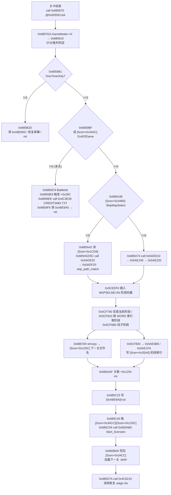

# W59 · 静态定谳：YR 多关战役链（>2 关）推进机制与 EndOfGame 判定路径

- 卡号 **W59** ｜ 执行者 Hy4（子代理，非 Lead）｜ 起始 `2026-11-13T22:31:09+08:00`
- 目标二进制：`D:\Project\ra2-campaign-forge\ra2bench\gamemd.exe`
- **实测 SHA-256 `[本次实测]`**：`73201cc021497c9567742f718bf1dc78c22e9ae16c7e7365354b65f3fcf67476`
  （size 4,825,360 B；与卡片给定值 **MATCH=YES**，故未停手）
- 口径：**本卡只出静态判定与写法建议，不声称「三关链已验证」。**
- 纪律声明：`I launched 0 / attached 0` —— 未启动 `gamemd.exe`、未 attach、未读活进程内存、未注入。
  目录列表中可见 `lead\next_re_20261112_r02\.game_instance.lock` 以及其它卡的 gamemd 实例，
  **观察到的 gamemd 属其他卡、未触碰**；该 lock 全程未取、未写、未删。
  只写 `W59_endofgame_chain\`；未写 `ra2youli`/`ra2forge`/`ra2opt`/`ra2bench`；未改 `W21`–`W58`；`git` 未调用。
- 工具说明：会话技能表里的 `reverse-engineer-anything`（REA）MCP 工具**未在本会话注册**；其
  `npx rea-agents setup` 会写本卡目录之外的配置并破坏「纯离线只读」纪律，故**未运行**。
  本卡按卡片指定路线执行：消费 W50 的 `text_insns.pkl` + 自写离线 Python/Capstone 脚本。

---

## 0. 结论速览（六问一句话答案）

| # | 问题 | 一句话答案 | 强度 |
|---|---|---|---|
| 1 | EndOfGame 触发/消费者 | 地图 `[Basic] EndOfGame` 被 `Read_INI` 写入 `[Scen+0x34AC]`(BYTE)，`0x006859BF` 在 `post_victory_dispatch(0x685670)` 读它分派「战役终止→CREDITSMD.TXT/回壳」还是「推进下一关」；另有全局 `[0xA8E9A0]` 由 `0x00685C23` 写、`0x0069BAB0` 读以锁存会话态 | `[本次实测]`（字节+分支）/ `[静态推断]`（全局语义） |
| 2 | >2 关链怎么决定第三关 | **实际被调用的是 `MAPSELMD.INI` 阶段表**：`0x5CEEF0` 载入阶段向量 → `stage_get_by_index([Scen+0x35A0])` 取当前阶段 → 选中子阶段的 `Scenario=` 经 `0x686700` 写入 `[Scen+0x125C]` → `Start_Scenario(0x683AB0)` 按该文件名加载。`NextScenario` 只是 `skip_path_match` 内的匹配过滤器，`BATTLEMD.INI [Battles]` 只提供常量 `BattleIdx` | `[本次实测]`（call xref）；`[静态推断]`（自动选支细节） |
| 3 | `scen_stage_idx` 对应谁 | 全局 `Scen*` 在 `[0xA8B230]`，字段 `+0x35A0` 是 **WORD**；推进写入点是 `0x005AE0B8`（skip 路径）/ `0x005AE1FA`（交互路径），值来自 `call 0x5CF830`；读点 `0x005ADFD7` → `call 0x5CF810`；跨关经 `0x4C6180`/`0x4C6210` 存/取 | `[本次实测]` |
| 4 | 阶段表数据结构与上限 | `DynamicVectorClass<MapStage*>`：`+0x4` 指针数组、`+0x10` 计数，无编译期数组维数；索引经 `and eax,0xffff` 截为 16 位 WORD，越界 `stage_get_by_index` 返回 0 → `Invalid stage!` → `MSG:UnableMapSelect` 弹窗。INI 数字键枚举有**硬上限 100**（`0x5CF04F`/`0x5CF367` 两处 `cmp reg,0x64`） | `[本次实测]` |
| 5 | EndOfGame 与下一关的先后 | **推进在前，EndOfGame 是终止闸**：`0x6859C7` 的 `je 0x685A10` 在 `EndOfGame==0` 时进入推进分支；`EndOfGame!=0` 时先跳到 `0x6859C9` 走结尾分支、**根本不执行**推进。即「每关先尝试推进，末关用 `EndOfGame=yes` 截断」 | `[本次实测]` |
| 6 | ra2forge 3 关链最小改动面 | 三张图 `[Basic]`：`M1/M2` 写 `EndOfGame=no` + `NextScenario=<下一图>`，`M3` 写 `EndOfGame=yes`；散装投一份**完整合法** `MAPSELMD.INI`（官方全文 + 3 个追加阶段，阵营段键 1..100 连续、阶段段 `Scenario=` 与数字子项连续从 1 起）；保持 `SkipMapSelect=no`（已真机证过的路径）；不要改 `BATTLEMD.INI [Battles]` 序号、不要手设 `scen_stage_idx` | `[静态推断]`（未真机验证） |

---

## 1. 证据基线与记号

- 全部反汇编引用格式：`VA 0x004xxxxx` + 该处 1–3 条指令原文；**关键索引的文件偏移 = VA − 0x400000**（`.text` RVA=FOFF=0x1000，`W29_override_order\OVERRIDE_ORDER.md:7` `[转引]`；W50 `step1_scan.stdout.txt:4-10` `[转引]`）。
- 记号：`[本次实测]` = 本卡自跑脚本所得字节/反汇编；`[本次读码]` = 本卡直接阅读既有脚本/文件；
  `[静态推断]` = 由字节链推得但未获符号级/运行时证明；`[转引]` = 已签发事实，附出处路径/行号。

### 1.1 消费的既有证据（不重扫）

`[本次读码]` `W50_endofgame_chain\EVIDENCE\`：
`step1_scan.py`、`step2_scan.py`、`step3_dumps.py`、`step4_helpers.py`；
`step1_scan.stdout.txt`、`step2_scan.stdout.txt`(645 行)、`step3_dumps.txt`(1628 行)、`step4_helpers.txt`(647 行)；
`text_insns.pkl`(58,728,041 B)。

**W50 数据质量必须如实说明 `[本次实测]`**：W50 的 `step1_scan.py` 线性反汇编在
`0x0046F59D` 处停下（仅 155,215 条，`step1_scan.stdout.txt:11`），因此它自己的
`scan_disp` / `scan_call` 对 `0x34AC`/`0x34B0`/`0x35A0` 及所有 `0x5xxxxx`/`0x6xxxxx`
目标函数**全部返回 0 命中**（`step1_scan.stdout.txt:13-45`）—— 那是**扫描未覆盖，不是「没有引用」**。
`text_insns.pkl` 才是全量缓存：本卡用自写脚本复核得到
`rows=1,394,120`、`min VA=0x00401000`、`max VA=0x007E0FFD`、`monotonic=True`、唯一 VA 数=1,394,120
（`w59_static.stdout.txt:10-35` `[本次实测]`），覆盖整段 `.text`（VA 0x401000..0x7E038D）。
⇒ 该缓存是「遇不可解码字节后逐字节续扫」的韧性线性扫描，**不是流敏感/递归反汇编**；
因此 xref **计数**可能含数据区误解码的假阳性，本卡所有结论都锚定在具体 VA 的
**逐字节校验指令**上（20/20 断言通过，`w59_static.stdout.txt:5893-5914`）。

> 附带：`W50` 三份 `.txt` 末尾均带 `PermissionError` traceback（`step2_scan.stdout.txt:641-645`、
> `step3_dumps.txt:1624-1628`、`step4_helpers.txt:643-647`）——即卡片所述「死在出报告环节」。
> 正文数据完整，本卡按 `[转引]` 使用并与自跑结果交叉核对。

### 1.2 已签发事实（`[转引]`）

| 事实 | 出处 |
|---|---|
| Q2 闭合：追加 `[Nod] 8=...` 后 `A2_loaded`，`scen_stage_idx=8`；负对照用官方 5,573 B 则弹窗；作用域仍是借 `[SOV1]` 入口 | `REVIEW\LEAD_VERDICT_Q2_CLOSED.md:9-22,40-60` |
| `scen_stage_idx=8` 按 `[Scen+0x35A0]` 读，「当前阶段索引」语义**非符号级证明**，下标可能差一格 | `REVIEW\LEAD_VERDICT_Q2_CLOSED.md:57-60` |
| `MapSelect::Init` 判定链：`SkipMapSelect=no → 0x5ADD10 → 0x5AE100 → 0x5AE220 → 0x5CF760`；`=yes → 0x5ADF20 → 0x5CF810`；两路都要求 `MAPSELMD.INI` 认识该图；`Start_Scenario(0x683AB0)` 不经过 MapSelect | `REVIEW\LEAD_VERDICT_map_start_root_cause.md:42-62` |
| W51 更正：`=yes` 候选不匹配时静默 `AL=0`（`0x5AE0CD..0x5AE0F1`），不打印 `Invalid stage!` | `REVIEW\LEAD_VERDICT_map_start_root_cause.md:6-18,151-177` |
| W34 结论：阵营段键 1..100 连续、首个缺口即停；阶段段候选子项是数字键、值为阶段名 | `REVIEW\LEAD_VERDICT_map_start_root_cause.md:111` |
| 散装优先：`CCFileClass::Get_File(0x473D10)` 先试磁盘，命中即跳过 `MixFileClass::Find(0x5B4430)`；`BATTLEMD*.INI` 通配枚举后合并到全局表 `0xA83CF8`，同 ID 后装载者覆写 | `W29_override_order\OVERRIDE_ORDER.md:19-22,33-55` `[转引]` |
| `NextScenario` 写法不是成因（官方与我方同为裸文件名+扩展名）；ra2forge 的 `ECH02.MAP` 为 `NextScenario=` 空 + `EndOfGame=yes` | `W28_nextscenario_form\NEXTSCENARIO_FORM.md:15-16,91` `[转引]` |
| W39 部署的 `MAPSELMD.INI`(6,108 B) 追加了 2 个 `[RA2F_ECH0x_...]` 阶段段，首个含 `2=RA2F_ECH02_1E0DEBE8` | `W39_mapselmd_live2\out\MAPSELMD.INI.w39_deployed`（本卡只读尾部 40 行）`[转引]` |

### 1.3 本卡自跑脚本（全部 exit 0）

| 脚本 | stdout | 内容 |
|---|---|---|
| `EVIDENCE\w59_static.py` | `w59_static.stdout.txt` / `.console.txt` | 全量 xref（call / imm32 / disp32）、字符串、函数全量转储、20 条字节断言 |
| `EVIDENCE\w59_detail.py` | `w59_detail.stdout.txt` / `.console.txt` | 全局 xref、BATTLEMD 枚举、INI 字面量、预置闸 |
| `EVIDENCE\w59_detail3.py` | `w59_detail3.stdout.txt` / `.console.txt` | `0x686700`、数字键循环、状态机括号函数、子项写入上下文 |
| `EVIDENCE\w59_pass4.py` | `w59_pass4.stdout.txt` / `.console.txt` | 数字键循环退出段、`0x528C00`、inner2 反查 |

`EVIDENCE\exit_codes.txt` 记录四条命令均 `EXIT_CODE=0`。所有脚本只 `open(...,"rb")` 读取
`gamemd.exe` / `text_insns.pkl`，只写 `W59_endofgame_chain\EVIDENCE\`。

---

## 2. 逐问定谳

### Q1 · EndOfGame 的触发与消费者

**A 层（主体，证据充分）：地图级 `EndOfGame` 字段 `[Scen+0x34AC]` (BYTE)**

`Scen` 单例指针在全局 `0x00A8B230`（`mov ecx, dword ptr [0xa8b230]` 贯穿全函数）。
`[Basic]` 段名字符串为 `0x0082BF9C='Basic'`（`w59_detail.stdout.txt:57` `[本次实测]`）。

写点：

```
VA 0x0068A10E  68 38 e1 83 00          push 0x83e138          ; "EndOfGame"  (FOFF 0x28A10E)
VA 0x0068A11A  e8 d1 f4 e9 ff          call 0x5295f0          ; INI_GetBool([Basic])
VA 0x0068A11F  88 86 ac 34 00 00       mov byte ptr [esi + 0x34ac], al   ; ★写 EndOfGame  (FOFF 0x28A11F)
```
字符串 `0x0083E138='EndOfGame'`，全 `.text` 仅 2 处 imm32 引用：`0x0068A10E`（读 INI）、
`0x0068B143`（写 INI）（`w59_static.stdout.txt:124-126` `[本次实测]`）。
另两处归零：`VA 0x005C3902  c6 80 ac 34 00 00 00  mov byte ptr [eax+0x34ac],0`
（新局/初始化，FOFF 0x1C3902）、`VA 0x0068386F  88 9d ac 34 00 00  mov byte ptr [ebp+0x34ac],bl`
（ScenarioClass 构造清零，FOFF 0x28386F）`[本次实测]`。
读点（除 INI/存档）：`0x006859BF`（状态机分派）、`0x0068B136`（Write_INI 保存）、
`0x0068BA41`（序列化）`[本次实测]`。

消费者 = `post_victory_dispatch` **`0x00685670`**，唯一调用点
`VA 0x0055D14A  e8 21 85 12 00  call 0x685670`（FOFF 0x15D14A）
（`w59_static.stdout.txt:41-42` `[本次实测]`）。

**附带更正（本卡自查）**：脚本字段标签把 `[Scen+0x34AE]` 误标为「carry-over/special」，
按 INI 键 xref 实为 **`SkipScore`** —— `VA 0x0068A1C4  68 fc e0 83 00  push 0x83e0fc`
（字符串 `'SkipScore'`）→ `0x0068A1D5  mov [esi+0x34ae], al`（`step3_dumps.txt:1318-1324`
`[转引]`；`w59_detail3.stdout.txt:272` 字符串值 `[本次实测]`）。
而 `VA 0x0068594B  8a 81 ae 34 00 00  mov al, byte ptr [ecx + 0x34ae]` /
`VA 0x00685953  75 10  jne 0x685965` 正是**结算屏显示闸门**：`SkipScore!=0` 时跳过
`0x6C8E70`/`0x6C8E80` 两个调用（`w59_detail.stdout.txt:959-968` `[本次实测]`）。
⇒ 「弹结算屏」这一侧的直接读点是 `[Scen+0x34AE]`，「战役是否终止」的读点是
`[Scen+0x34AC]`，两者是**不同字段**，不要混为一谈。

状态机分支：

```
VA 0x0068599E  e8 fd 9d e1 ff          call 0x49f7a0
VA 0x006859A5  0f 84 82 01 00 00       je 0x685b2d             ; 非胜利 → 0x685B2D 清 [0xA8E9A0]=0 后返回
VA 0x006859B1  8a 81 af 34 00 00       mov al, byte ptr [ecx + 0x34af]  ; OneTimeOnly
VA 0x006859B9  0f 85 6e 01 00 00       jne 0x685b2d            ; 一次性图 → 同上返回
VA 0x006859BF  8a 81 ac 34 00 00       mov al, byte ptr [ecx + 0x34ac]  ; ★EndOfGame  (FOFF 0x2859BF)
VA 0x006859C5  84 c0                   test al, al
VA 0x006859C7  74 47                   je 0x685a10             ; ==0 → 推进下一关  (FOFF 0x2859C7)
VA 0x006859C9  8b 89 cc 34 00 00       mov ecx, dword ptr [ecx + 0x34cc] ; !=0 → BattleIdx → 结尾
VA 0x006859EE  e8 3d e4 e3 ff          call 0x4c3e30           ; CREDITSMD.TXT / 战役结尾序列
VA 0x006859F9  c6 05 a0 e9 a8 00 00    mov byte ptr [0xa8e9a0], 0
VA 0x00685A02  ff 52 10                 call dword ptr [edx + 0x10]      ; 恢复屏幕 → ret
```
`0x4C3E30` 头：`mov eax,[0x887310] ... push 0x82084C`（`='CREDITSMD.TXT'`，
`w59_detail3.stdout.txt:262` `[本次实测]`）→ 判定其为**战役结束/职员表序列**，
即「弹结算屏 / 回主菜单」一侧。另一处 `0x4C3E30` 调用点 `0x0052DED8`
同样位于结束分支（`w59_detail.stdout.txt:830-847` `[本次实测]`）。

**B 层（辅助，语义未定谳）：全局「本局结束/胜利」BYTE `[0x00A8E9A0]`**

- 写：`VA 0x00685C23  a2 a0 e9 a8 00  mov byte ptr [0xa8e9a0], al`（`al = call 0x49F7A0` 的返回，
  FOFF 0x285C23）；其它写点 `0x0052D9D7`(=1)、`0x0055FD9A`(=al)、`0x006475BE`(=al)、
  `0x0078EC41`(=1)，清除点 `0x006858EA`/`0x006859F9`/`0x00685B33`/`0x00685BC7` 等，
  全 `.text` 共 123 处 xref（`w59_detail.stdout.txt:71-195` `[本次实测]`）。
- 读并锁存会话态：`VA 0x0069BABE  a0 a0 e9 a8 00  mov al, byte ptr [0xa8e9a0]` /
  `VA 0x0069BAC7  c6 81 d8 30 00 00 01  mov byte ptr [ecx + 0x30d8], 1`
  （`w59_detail3.stdout.txt:179-192` `[本次实测]`）。`0x69BAB0` 恰在
  `0x0055D154`（`call 0x685670` 返回后第一条相关调用）被调用，参数 `ecx=0xA8B238`。
- ⚠️ `0x49F7A0` 在本镜像是 3 字节桩：`VA 0x0049F7A0  b0 01  mov al,1` /
  `VA 0x0049F7A2  c3  ret`（`w59_detail.stdout.txt:854-856` `[本次实测]`），
  故 `0x68599E`、`0x685C1C`、`0x55CFE1` 三处该调用恒返回 1。**`0xA8E9A0` 与
  `[session+0x30D8]` 的确切语义未获符号级证明** → 见 `UNKNOWNS.md U1`。
- ⇒ Q1 的「弹结算屏/回主菜单」判定，本卡**锚定 A 层 `[Scen+0x34AC]` 分支**（证据充分）；
  B 层只作为「另有一个全局结束态与其消费者」记录，不外推。

**Q1 强度**：`[本次实测]`（写点/读点/分支字节/调用点）；`[静态推断]`（把 `0x4C3E30`
等同于「回主菜单」、以及 B 层语义）。

---

### Q2 · >2 关的链式推进：实际被调用的是哪一条

**结论 `[本次实测]` + `[静态推断]`：是 `MAPSELMD.INI` 阶段表，不是 `BATTLEMD.INI [Battles]`
序号，也不是「裸 `NextScenario` 直接加载」。**

用 call xref 证明（`w59_static.stdout.txt:41-116` `[本次实测]`）：

| 被调函数 | 唯一/全部调用点 | 说明 |
|---|---|---|
| `0x00685670` post_victory_dispatch | `0x0055D14A` | 关卡结束状态机 |
| `0x005CEEF0` MAPSELMD_loader | `0x005ADFA0`, `0x005AE2BE` | **仅 2 处**，都在 MapSelect 两路径内 |
| `0x005CF810` stage_get_by_index | `0x005ADFE1`, `0x005AE401` | 阶段向量按索引取 |
| `0x005CF830` stage_get_index_wrapper | `0x005AE0AF`, `0x005AE1F5` | 反查阶段索引 → 写 `[Scen+0x35A0]` |
| `0x005CF6B0` stage_find_by_name | `0x005AE032`, `0x005AE1B7` | 子项名 → 阶段 |
| `0x005CF760` stage_find_by_scenario | `0x005AE13C`, `0x005AE30C` | `Scenario=` 反查当前阶段 |
| `0x005ADD10` MapSelect_interactive_wrapper | `0x00685A74` | `SkipMapSelect=no` |
| `0x005ADE20` skip_path_wrapper | `0x00685A52`, `0x00685A5C` | `SkipMapSelect=yes` |
| `0x00683AB0` Start_Scenario | `0x0052E718`, `0x0052E745`, **`0x00685C54`**, `0x00685C71`, `0x00686296`, `0x006864FC` | 链式推进用 `0x685C54` |
| `0x00686700` 文件名 setter | `0x005AE0A5`, `0x005AE1ED` | 写 `[Scen+0x125C]` |

字段/字符串归属 `[本次实测]`：
- `0x00689FCA push 0x83E19C ('NextScenario')` → 读入 `[Scen+4]`（char[0x104]）；
  `0x00689FE8 push 0x83E18C ('AltNextScenario')` → 读入 `[Scen+0x108]`
  （`w59_detail.stdout.txt:904-920`）。写回在 `0x0068B0B3`/`0x0068B0CC`。
  全 `.text` 各仅 2 处 imm32 引用（读 INI + 写 INI），**没有第三处把
  `[Scen+4]` 直接当文件名去加载**（`w59_static.stdout.txt:139-146`）。
- `0x00683AF0  a1 fc 3c a8 00  mov eax, dword ptr [0xa83cfc]` /
  `0x00683AF5  8b 2c 90  mov ebp, dword ptr [eax + edx*4]` /
  `0x00683AF8  81 c5 9c 00 00 00  add ebp, 0x9c`
  → `BATTLEMD.INI [Battles]` 合并表按 `BattleIdx` 取条目 `+0x9C` 的**默认图名**；
  `VA 0x00683B0A  89 91 cc 34 00 00  mov dword ptr [ecx + 0x34cc], edx`
  → `Start_Scenario` 把 `BattleIdx` 写回 `[Scen+0x34CC]`（FOFF 0x283B0A）。
  但 `0x683AC8` 起先判断传入的图名 `ecx` 是否非空：非空就直接用传入名，
  **不查 BATTLEMD 表**。链式推进点 `0x685C40` 传的是 `[Scen+0x125C]`（非空），
  故 `[Battles]` 不参与决定下一关。`[本次实测]`
- `MAPSELMD.INI` 字面量 `0x00830370` 全 `.text` 仅 1 处引用：
  `VA 0x005CEF62  68 70 03 83 00  push 0x830370`（FOFF 0x1CEF62），即 loader 内部
  `call dword ptr [eax+8]` 打开该文件（`w59_static.stdout.txt:147-150`）。
- `BATTLEMD.INI` 字面量 `0x00826198` 仅 2 处：`0x0052CC4E`, `0x0052CCCD`
  （`FindFirstFileA("BATTLEMD*.INI")` 通配枚举与回落，`w59_detail.stdout.txt:771-828`），
  **与关卡推进函数 `0x685670` 无任何 call/数据边**。`[本次实测]`

**被实际调用的那条链（字节链，`[本次实测]`）**：

```
关卡结束 → 0x685670 (call @0x55D14A)
  → EndOfGame==0 → 0x685A10
      → [Scen+0x34B0]==0 ? call 0x5ADD10 (交互) : call 0x5ADE20 (skip)
          → call 0x5CEEF0 载入 MAPSELMD.INI 阶段向量 (MapSelect对象 +0x50)
          → 0x5CF760 用 [Scen+0x125C] 反查当前阶段 / 0x5CF810 按 [Scen+0x35A0] 取阶段
          → 0x5CF6B0 按子项名找子阶段
          → VA 0x00686700: strncpy([Scen+0x125C], 子阶段.Scenario=, 0x104)   ★下一关文件名
          → VA 0x005AE0B8 / 0x005AE1FA: mov word ptr [ebx+0x35A0], ax        ★阶段索引
  → 0x685AA9  8b 90 54 12 00 00   mov edx,[eax+0x1254] ; inc ; mov [eax+0x1254],edx  (关数+1)
  → 0x685C40  mov ecx,[eax+0x34cc] ; lea ecx,[eax+0x125c] ; call 0x683AB0   ★按文件名启动下一关
```

`0x686700` 全文（`w59_detail3.stdout.txt:5-19` `[本次实测]`）：
```
VA 0x00686700  8b 44 24 04        mov eax, dword ptr [esp + 4]
VA 0x0068670B  68 04 01 00 00     push 0x104
VA 0x00686711  8d 86 5c 12 00 00  lea eax, [esi + 0x125c]
VA 0x00686718  e8 b3 2a 14 00     call 0x7c91d0        ; strncpy([Scen+0x125C], arg, 0x104)
VA 0x00686720  c6 86 5f 13 00 00 00 mov byte ptr [esi + 0x135f], 0
```

`NextScenario` 的真实角色（**弱于直觉**）：它只是 `skip_path_match(0x5ADF20)` 内的
**匹配过滤器**。`0x685A4C`/`0x685A59` 取 `[Scen+0x108]`(AltNextScenario) 或
`[Scen+4]`(NextScenario) 作为 `edx` 传给 `0x5ADE20` → `0x5ADF20` 在
`0x5AE025..0x5AE098` 遍历当前阶段的候选子项，把子阶段的 `Scenario=` 与该串比较，
命中才用 `0x686700` 写文件名；不命中则 `0x5AE0CD..0x5AE0F5` 静默 `AL=0`
（W51 更正 `[转引]`，本卡 `w59_static.stdout.txt:5709-5793` 复核）。
⇒ **`NextScenario` 写法本身不构成链**（与 W28 `[转引]` 一致），链由阶段表提供。

**Q2 强度**：`[本次实测]` — call xref、字段/字符串引用、`0x686700`、`Start_Scenario`。
`[静态推断]` — `SkipMapSelect=no` 下 `inner2(0x5AE220)`/`inner1(0x5AE100)` 的**自动选支细节**
（究竟是走 `stage_get_by_index(0x5CF810)` 全表枚举、还是 `[stage+0x58]` 首子项），
静态未能唯一确定 → `UNKNOWNS.md U2`。这不改变「阶段表是实际被调用的那条」的结论，
因为两条候选支路都在 `0x5CEEF0` 载入的阶段向量上工作。

---

### Q3 · `scen_stage_idx` 对应哪个全局 / 哪个函数写

`[本次实测]`：**全局指针 `[0x00A8B230]`（Scen*），字段偏移 `+0x35A0`，宽度 WORD（16 位）**。
绝对地址 = `*(WORD*)( *(DWORD*)0x00A8B230 + 0x35A0 )`。

9 处 disp32 引用（`w59_static.stdout.txt:251-260` `[本次实测]`）：

| VA | 文件偏移 | 指令 | 角色 |
|---|---|---|---|
| `0x004C61F5` | `0x0C61F5` | `66 8b 91 a0 35 00 00  mov dx, word ptr [ecx + 0x35a0]` → `mov [esi+0x40],dx` | 存档：读出到状态块 `+0x40` |
| `0x004C62EB` | `0x0C62EB` | `66 89 90 a0 35 00 00  mov word ptr [eax + 0x35a0], dx` | 读档恢复（3 个分支：`0x4C62EB`/`FC`/`0x4C630D`） |
| `0x004C62FC` | `0x0C62FC` | 同上 | 读档恢复 |
| `0x004C630D` | `0x0C630D` | `66 89 88 a0 35 00 00  mov word ptr [eax + 0x35a0], cx` | 读档恢复 |
| `0x005ADDE2` | `0x1ADDE2` | `66 8b 87 a0 35 00 00  mov ax, word ptr [edi + 0x35a0]` | 日志 `MapSelect: Scenario - %s, Stage - %ld` |
| `0x005ADFD7` | `0x1ADFD7` | `66 8b 85 a0 35 00 00  mov ax, word ptr [ebp + 0x35a0]` → `push eax` → `call 0x5CF810` | **读：作为 stage_get_by_index 的索引** |
| `0x005AE0B8` | `0x1AE0B8` | `66 89 83 a0 35 00 00  mov word ptr [ebx + 0x35a0], ax` | **写①：skip 路径** |
| `0x005AE1FA` | `0x1AE1FA` | `66 89 83 a0 35 00 00  mov word ptr [ebx + 0x35a0], ax` | **写②：交互路径** |
| `0x006839C7` | `0x2839C7` | `66 89 9d a0 35 00 00  mov word ptr [ebp + 0x35a0], bx` | 构造清零（`bx=0`） |

写入值来源（两处写点前 3 条，`[本次实测]`）：
```
VA 0x005AE0A5  e8 54 86 0d 00  call 0x686700        ; 先写文件名 [Scen+0x125C]
VA 0x005AE0AF  e8 7c 17 02 00  call 0x5cf830        ; stage_get_index_wrapper(子阶段) -> AX
VA 0x005AE0B8  66 89 83 a0 35 00 00  mov word ptr [ebx + 0x35a0], ax
```
```
VA 0x005AE1ED  e8 0e 85 0d 00  call 0x686700
VA 0x005AE1F5  e8 36 16 02 00  call 0x5cf830
VA 0x005AE1FA  66 89 83 a0 35 00 00  mov word ptr [ebx + 0x35a0], ax
```
⇒ `scen_stage_idx` = **引擎自己在 MapSelect 里算出的「选中阶段在阶段向量中的下标」**，
由 `stage_get_index_wrapper(0x5CF830)` 返回，不是外部 INI 字段、不是 ra2forge 可写的量。

跨关持久化 `[本次实测]`：`post_victory_dispatch` 在
`VA 0x00685A9F  e8 dc 06 e4 ff  call 0x4c6180`（存档，内含 `0x4C61F5` 读出）
与 `VA 0x00685D7A  e8 91 04 e4 ff  call 0x4c6210`（读档，内含 `0x4C62EB` 写回）
成对工作；因此推进后的值能活到下一关被 RPM 读到。

对 W39 `scen_stage_idx=8` 的口径 `[转引]`：`REVIEW\LEAD_VERDICT_Q2_CLOSED.md:57-60`
已明确**降回 `[转引]`**、拒绝「引擎选中了第 8 阶段」的符号级宣称，并指出 0-based 下
`8=RA2F_ECH01` 占索引 7、`9=RA2F_ECH02` 占索引 8，下标可能差一格。
本卡补上的是**「这个 WORD 由谁写、写到哪个全局」**这一层 `[本次实测]` 证据，
不复活该值的语义宣称 → `UNKNOWNS.md U3`。

**Q3 强度**：`[本次实测]`（9 处引用 + 2 处写入指令 + 存/读档调用对）。

---

### Q4 · `MapSelect` 阶段表的数据结构与上限

**数据结构 `[本次实测]`**：`MapSelect` 对象 `+0x50` 处是一个
`DynamicVectorClass<MapStage*>`（Westwood 容器），由 `stage_*` 系列访问：
- `stage_get_by_index(0x5CF810)` 与 `stage_find_by_name(0x5CF6B0)` 都读
  `mov edx/eax, dword ptr [ecx + 0x10]` = **元素计数**，
  `mov ecx, dword ptr [ecx + 4]` = **指针数组基址**，元素为 4 字节 `MapStage*`。
- 追加阶段：`VA 0x005CF03F  8b 45 10  mov eax,[ebp+0x10]`（旧计数）/
  `VA 0x005CF045  8d 48 01  lea ecx,[eax+1]` / `VA 0x005CF048  89 4d 10  mov [ebp+0x10],ecx` /
  `VA 0x005CF04B  89 34 82  mov dword ptr [edx + eax*4], esi`
  （`w59_static.stdout.txt:5281-5285`）；容量不足时 `0x5CF036  ff 52 08  call dword ptr [edx+8]`
  （容器 `Resize` 虚函数）扩容。`MapStage_ctor(0x5CF8E0)` 里 3 个容器初始化时
  `VA 0x005CF936  b9 0a 00 00 00  mov ecx, 0xa`（增长步长 10，非硬上限）
  （`w59_static.stdout.txt:5375-5399`）。
⇒ **没有编译期数组维数**；阶段数受内存与 16 位索引限制。

**硬上限 `[本次实测]`**：INI 数字键枚举有 **100** 的硬顶，两处独立循环：
```
VA 0x005CEF98  bf 01 00 00 00  mov edi, 1              ; 阵营段键从 1 开始  (FOFF 0x1CEF98)
VA 0x005CF04E  47              inc edi
VA 0x005CF04F  83 ff 64        cmp edi, 0x64           ; ★100  (FOFF 0x1CF04F)
VA 0x005CF052  7f 1d           jg 0x5cf071             ; >100 退出
```
```
VA 0x005CF2B1  bd 01 00 00 00  mov ebp, 1              ; 阶段段数字键从 1 开始  (FOFF 0x1CF2B1)
VA 0x005CF2EB  0f 94 c3        sete bl                 ; 键缺失 → 退出（首个缺口即停）
VA 0x005CF2FE  0f 85 d9 00 00 00 jne 0x5cf3dd
VA 0x005CF366  45              inc ebp
VA 0x005CF367  83 fd 64        cmp ebp, 0x64           ; ★100  (FOFF 0x1CF367)
VA 0x005CF36A  7f 71           jg 0x5cf3dd
```
`[BOUND]` 全扫描确认 `0x5CEEF0..0x5CF5F0` 内 `imm∈[8,0x400]` 的 `cmp` 只有这两条
（`w59_static.stdout.txt:5842-5844` `[本次实测]`）。与 W34 的「阵营段键 1..100 连续、
首个缺口即停」`[转引]` 一致。**但 W34 另称「阶段段候选子项是数字键 0..255」
（`REVIEW\LEAD_VERDICT_map_start_root_cause.md:111`）与本卡实测的 `1..100` 不符**
→ `DISAGREE.md D2`。

**索引宽度与越界 `[本次实测]`**（`w59_static.stdout.txt:5819-5829`）：
```
VA 0x005CF810  8b 44 24 04        mov eax, dword ptr [esp + 4]     ; 索引入参  (FOFF 0x1CF810)
VA 0x005CF814  8b 51 10           mov edx, dword ptr [ecx + 0x10]  ; 计数
VA 0x005CF817  25 ff ff 00 00     and eax, 0xffff                  ; ★截成 16 位 WORD
VA 0x005CF81C  3b d0              cmp edx, eax
VA 0x005CF81E  7f 05              jg 0x5cf825
VA 0x005CF820  33 c0              xor eax, eax                     ; ★越界 → 返回 NULL
VA 0x005CF822  c2 04 00           ret 4
VA 0x005CF825  8b 49 04           mov ecx, dword ptr [ecx + 4]
VA 0x005CF828  8b 04 81           mov eax, dword ptr [ecx + eax*4]
```
理论可寻址上限 65535 个阶段；但 INI 侧每个阵营段/每个阶段段最多 100 个数字键，
且 `[Scen+0x35A0]` 是 WORD。

**越界后果 `[本次实测]` + `[转引]`**：`stage_get_by_index` 返回 0 →
- skip 路径 `0x005ADFE8  test ebx,ebx / 0x005ADFEA  jne 0x5ae00c`，否则
  `0x005ADFF3  push 0x82c134` = `'MapSelect: Invalid stage!\n'` → 返回 AL=0 →
  `0x005ADEE0  mov ecx,0x82c108` = `'MSG:UnableMapSelect'` → `0x005ADEFA  call 0x5d3490` 弹窗；
- 交互路径 `0x005AE31C  test edi,edi / 0x005AE31E  jne ...`，否则同样打
  `Invalid stage!` → `0x005ADDB5` 弹同一标签（W31/W51 已列 `[转引]`）。
两个 wrapper 的 `MSG:UnableMapSelect` xref 全 `.text` 恰 2 处：`0x005ADDB5`、`0x005ADEE0`
（`w59_static.stdout.txt:158-160` `[本次实测]`）。⇒ **越界/未登记不会静默跳关，
而是弹「無法啟始選取地圖！」并停住**（与 Q2 闭合的负对照 `[转引]` 一致）。

---

### Q5 · EndOfGame 与下一关的关系：谁先谁后

**结论 `[本次实测]`：推进在前；`EndOfGame` 是「截断推进」的终止闸，不是「推进之后才置位」的结果。**

`post_victory_dispatch(0x685670)` 控制流（全部 `[本次实测]`，`w59_static.stdout.txt:4772-4976`）：

```
0x685670  入口（清 [0xA8ED5C]/[0xA8E378]、触发/计时/计分准备）
   │
0x6857EA  mov eax,[0xa8b238] ; test eax,eax ; je 0x685915   ← GameMode==0 进入单机战役分支
   │
0x685915  ... 计分/胜利判定 0x49F7A0（本镜像恒 1）
0x6859B1  [Scen+0x34AF] OneTimeOnly != 0 → 0x685B2D（清 [0xA8E9A0]=0、恢复屏幕、ret）
0x6859BF  ★mov al,[ecx+0x34ac]  EndOfGame
0x6859C7  je 0x685A10 ───────────── EndOfGame==0 → 【推进分支】
   │ EndOfGame!=0
   ├─ 0x6859C9  mov ecx,[ecx+0x34cc] (BattleIdx)
   ├─ 0x6859E9  call 0x5bf260  (触发该 battle 的 +0x29C 结尾触发器)
   ├─ 0x6859EE  call 0x4c3e30  (CREDITSMD.TXT / 战役结尾)
   ├─ 0x6859F9  mov byte ptr [0xa8e9a0], 0
   └─ 0x685A02  call [0x887640]+0x10 (恢复屏幕) → ret   ← 不加载任何下一关
   │
【推进分支 0x685A10】
0x685A38  mov al,[ecx+0x34b0]  SkipMapSelect
   ├─ !=0 → 0x685A42 读 [Scen+0x1CD9] → 0x685A52 call 0x5ADE20(AltNextScenario)
   │                                   或 0x685A5C call 0x5ADE20(NextScenario)
   └─ ==0 → 0x685A63 → 0x685A74 call 0x5ADD10 (交互式 MapSelect)
       两条都：0x5CEEF0 载入 MAPSELMD.INI → 0x686700 写 [Scen+0x125C]
                              → 0x5AE0B8/0x5AE1FA 写 [Scen+0x35A0]
0x685A9F  call 0x4c6180   （存档，含读出 stage idx）
0x685AA9  8b 90 54 12 00 00 / 0x685AAF 42 / 0x685AB0 89 90 54 12 00 00
          ★[Scen+0x1254] 关数 +1
0x685C1C  call 0x49F7A0 ; 0x685C23 mov byte ptr [0xa8e9a0], al ; jne 0x685C40
0x685C40  mov eax,[0xa8b230] ; 0x685C47 mov ecx,[eax+0x34cc] ; 0x685C4E lea ecx,[eax+0x125c]
0x685C54  ★call 0x683AB0  Start_Scenario([Scen+0x125C], [Scen+0x34CC])  → 加载下一关
0x685D7A  call 0x4c6210  （读档，含写回 stage idx）
```

顺序判定依据：**唯一的 `EndOfGame` 读指令 `0x6859BF` 在推进分支入口 `0x685A10` 之前**，
且其 `je` 的目标正是推进分支；`EndOfGame!=0` 时走 `0x6859C9..0x685A0F` 直接 `ret`，
**控制流上根本到不了 `0x685C54` 的 `Start_Scenario`**。`[本次实测]`

因此正常通关序列是：
`M1 结算屏 → Continue → (EndOfGame=no) 推进 M2 → M2 结算屏 → Continue → (EndOfGame=no) 推进 M3
→ M3 结算屏 → Continue → (EndOfGame=yes) 结尾/回壳`。
**不是**「EndOfGame 触发后引擎再去找下一关」，也**不是**「先推进再置 EndOfGame」。
`EndOfGame` 是**地图加载时由 INI 预设的静态标志**（`0x68A11F`），在关卡结束帧被读取。

与既有事实一致 `[转引]`：`LEAD_VERDICT_map_start_root_cause.md:71` 记录官方 14 张 MD 图中
仅 `ALL07SMD`/`SOV07TMD` 为 `EndOfGame=yes`（末关）；W28 `:91` 记录 ra2forge 的
`ECH02.MAP` = `NextScenario=` 空 + `EndOfGame=yes`。

⚠️ 静态边界：结算屏 `GUI:Continue` 的点击处理帧、`0x49F7A0` 恒 1 的桩对真实分支的影响、
以及 `0x685C1C` 之后 `[0xA8E9A0]` 的实际语义，本卡未做运行时观测 → `UNKNOWNS.md U4/U1`。

**Q5 强度**：`[本次实测]`（分支字节、跳转目标、写点顺序）；`[静态推断]`（把整个
`0x685670` 一次调用等同于「结算屏→Continue→推进」，未观测 GUI 帧）。

---

### Q6 · 让 ra2forge 产出的 3 关链跑通：最小改动面（只给静态判定，不真机验证）

**目标**：`M1 → M2 → M3`，末关终止。以下均为 `[静态推断]`，依据为 Q1–Q5 的字节链。

#### 6.1 三张地图 `[Basic]` 段（键名经 `0x0082BF9C='Basic'` 确认 `[本次实测]`）

| 图 | `EndOfGame` | `NextScenario` | `SkipMapSelect` | 依据 |
|---|---|---|---|---|
| M1 | `no` | `M2.MAP`（裸文件名+扩展名） | `no` | `0x6859C7 je 0x685A10`；`0x68A11F` 写 `+0x34AC` |
| M2 | `no` | `M3.MAP` | `no` | 同上（第二关结束仍需进推进分支） |
| M3 | **`yes`** | 空（或任意，反正不读） | `no`（或 yes，不进推进分支） | `0x6859C9` 终止路径 |

- **不要**给 M1/M2 写 `EndOfGame=yes`：会在第一次 Continue 就截断链。
- **不要**改 `NextScenario` 的写法（W28 `[转引]` 已证不是成因）；但**值必须是下一张图的实际文件名**，
  因为 `skip_path_match` 拿它做匹配过滤器（`0x685A59`）。
- 推荐 `SkipMapSelect=no`：这是 W39 真机已证过的路径 `[转引]`；`=yes` 路径额外要求
  阶段段候选子项的 `Scenario=` 与 `NextScenario` 精确匹配，W39 的 `skip_yes` 臂失败
  （`REVIEW\LEAD_VERDICT_Q2_CLOSED.md:32,84-87` `[转引]`）。
- `AltNextScenario` / `[Scen+0x1CD9]` 决定用哪一支；不确定时保持与 `NextScenario` 一致或置空。

#### 6.2 `MAPSELMD.INI`（**唯一必须补齐的结构性缺口**）

- 必须**散装投放一份完整合法文件**：官方 5,573 B 全文 + 追加阶段；散装优先于 MIX
  （`W29_override_order\OVERRIDE_ORDER.md:19-24` `[转引]`）。
  只放我方条目的最小文件会让 `0x5CEF62` 打开失败 / `0x5CEF8E` 判空 →
  `"MapSelect: There isn't any stages!"`（`0x00830304` `[本次实测]`）。
- 追加阶段登记在**入口所属阵营段**（W39 借 `[SOV1]` 入口 → `[Nod]` `[转引]`），
  键号从现有末尾**连续 +1**，且 `1..100` 内（`0x5CF04F` `[本次实测]`），
  **首个缺口即停**（`0x5CEFD4 sete bl` / `0x5CEFE7 jne 0x5cf073` `[本次实测]`）。
- 每个追加阶段段必须含 `Scenario=<该关 .MAP 文件名>`（`stage_find_by_scenario 0x5CF760`
  按 `[stage+4]` 反查 `[转引]` `LEAD_VERDICT_map_start_root_cause.md:110`；
  本卡 `w59_static.stdout.txt:1502-1561` 复核 `[本次实测]`），
  以及 `Description`/`VoiceOver`/`MapVQ`/`Overlays`/`Targets`/`ClickMap` 等官方同构字段。
- 非末关阶段段要有**数字子项，键从 `1` 起连续**（`0x5CF2B1 mov ebp,1` /
  `0x5CF2FE 首个缺口退出` / `0x5CF367 cmp ebp,0x64` `[本次实测]`），
  值 = 下一阶段段名；`skip_path_match` 会 `stage_find_by_name` 该子项并比对 `Scenario=`。
  ⚠️ W39 部署文件用的是 `2=RA2F_ECH02_1E0DEBE8`（无 `1=`）`[转引]`，按本卡
  对循环字节的解读会造成「0 个候选子项」→ 这很可能是 `skip_yes` 失败的结构性原因，
  但**该因果未获符号级/运行时证明** → `UNKNOWNS.md U5`、`DISAGREE.md D3`。
  对 `SkipMapSelect=no` 路径，W39 已证该写法能推进，故**不要把它当作已定谳的必修项**。
- 阶段数 3 远小于任何上限（100 键 / 65535 索引），无需担心越界。

#### 6.3 不要动的东西（最小改动面的「不动」部分）

- `BATTLEMD.INI [Battles]` 序号：`[Scen+0x34CC]`（`BattleIdx`）在整条链里是**常量**
  （W39 `scen_battle_idx=1` 前后不变 `[转引]`），只用于 side/score/theme 与
  `Start_Scenario` 的默认图名回落；`0x685C54` 传的是非空的 `[Scen+0x125C]`，
  **不查 `[Battles]` 表来决定下一关**（`0x683AC8..0x683AF8` `[本次实测]`）。
- `scen_stage_idx`（`[Scen+0x35A0]`）：引擎自算自写，**不可由包预设**
  （`0x5CF830` → `0x5AE0B8`/`0x5AE1FA` `[本次实测]`）。
- `gamemd.exe`：本卡未发现任何需要 patch 的分支；`0x49F7A0` 恒 1 的桩在本镜像
  使胜利/继续判定恒通过，静态看不构成阻塞。
- `NextScenario` 大小写/路径形式（W28 `[转引]`）。

#### 6.4 给后续真机卡的精确观察点（写法建议，非验证结论）

| 观察量 | 绝对/相对地址 | 期望（静态判定） | 何时采 |
|---|---|---|---|
| `Scen*` 全局 | `0x00A8B230` | 常量指针，先取它 | 全程 |
| 当前/下一关文件名 | `*(DWORD*)0xA8B230 + 0x125C`，char[0x104] | `ECH01.MAP → ECH02.MAP → ECH03.MAP`；`0x685C54` 前必须已是下一关名 | 每次点 Continue 前后 |
| `scen_stage_idx` | `+0x35A0`，**WORD** | 随阶段推进递增；由 `0x5AE0B8`/`0x5AE1FA` 写 | 推进后 |
| `EndOfGame` | `+0x34AC`，BYTE | M1/M2=0，M3=1；`0x6859BF` 读它 | 结算屏出现时 |
| `SkipMapSelect` | `+0x34B0`，BYTE | 0（走 `0x5ADD10`） | 结算屏出现时 |
| `BattleIdx` | `+0x34CC`，DWORD | 链内不变；`Start_Scenario` 在 `0x683B0A` 写回 | 每关加载时 |
| 关数计数 | `+0x1254`，DWORD | `0x685AAF inc edx` → 每次推进 +1 | 推进后 |
| 全局结束态 | `0x00A8E9A0`，BYTE | `0x685C23` 写、`0x69BABE` 读（语义未定谳） | 状态机返回后 |
| 失败出口 | `0x005ADDB5` / `0x005ADEE0` → `MSG:UnableMapSelect` | 命中即「阶段表未登记/索引越界」 | 出错时 |

**最该盯的一个地址**：`*(DWORD*)0x00A8B230` 取出 `Scen*` 后读 `Scen+0x125C`
（`0x00685C4E lea ecx,[eax+0x125c]` 是 `Start_Scenario` 的实参，
`w59_static.stdout.txt:4928-4929` `[本次实测]`）——
W39 已证 `scen_filename` 由 `ECH01.MAP` 变 `ECH02.MAP` 是「最硬、最无歧义」的推进指标
（`REVIEW\LEAD_VERDICT_Q2_CLOSED.md:50-56` `[转引]`），本卡从字节链解释了**为什么**：
`0x686700` 把选中子阶段的 `Scenario=` 拷进这个缓冲，`0x683AB0` 再按它加载。

---

## 3. 控制流图



等价 ASCII（便于无 mermaid 环境）：

```
[关卡结束 0x685670]
   |
   +-- [Scen+0x34AF] OneTimeOnly != 0 ----------> 清 0xA8E9A0 / ret
   |
   +-- [Scen+0x34AC] EndOfGame != 0 ------------> 结尾触发器 + 0x4C3E30(CREDITSMD.TXT) / ret
   |                                                （不加载下一关）
   +-- [Scen+0x34AC] EndOfGame == 0 ------------> je 0x685A10 【推进】
            |
            +-- [Scen+0x34B0]==0 -> 0x5ADD10 交互 MapSelect
            +-- [Scen+0x34B0]!=0 -> 0x5ADE20 -> 0x5ADF20 skip_path_match
            |        edx = [Scen+4] NextScenario 或 [Scen+0x108] AltNextScenario
            +-- 两者都: 0x5CEEF0 载入 MAPSELMD.INI
                      0x5CF760/0x5CF810/0x5CF6B0 解析阶段
                      0x686700 -> [Scen+0x125C] = 子阶段.Scenario=
                      0x5CF830 -> [Scen+0x35A0] = 子阶段索引 (WORD)
            |
            +-- 0x685AAF [Scen+0x1254]++  (关数)
            +-- 0x685C23 [0xA8E9A0] = 0x49F7A0()
            +-- 0x685C54 Start_Scenario([Scen+0x125C],[Scen+0x34CC]) -> 下一关
```

---

## 4. 写入点表（VA / FOFF / 指令 / 语义）

> 文件偏移 = VA − 0x400000。

| 目标 | VA | FOFF | 指令 | 语义 | 强度 |
|---|---|---|---|---|---|
| `[Scen+0x34AC]` EndOfGame BYTE | `0x0068A11F` | `0x28A11F` | `88 86 ac 34 00 00  mov byte ptr [esi+0x34ac], al` | 从 `[Basic] EndOfGame` 读入 | `[本次实测]` |
| 同上 | `0x005C3902` | `0x1C3902` | `c6 80 ac 34 00 00 00  mov byte ptr [eax+0x34ac], 0` | 新局初始化清零 | `[本次实测]` |
| 同上 | `0x0068386F` | `0x28386F` | `88 9d ac 34 00 00  mov byte ptr [ebp+0x34ac], bl` | 构造清零 | `[本次实测]` |
| 同上（读） | `0x006859BF` | `0x2859BF` | `8a 81 ac 34 00 00  mov al, byte ptr [ecx+0x34ac]` | **状态机分派** | `[本次实测]` |
| 同上（读） | `0x0068B136` | `0x28B136` | `8a 83 ac 34 00 00  mov al, byte ptr [ebx+0x34ac]` | Write_INI 保存 | `[本次实测]` |
| `[Scen+0x34B0]` SkipMapSelect | `0x0068A211` | `0x28A211` | `88 86 b0 34 00 00  mov byte ptr [esi+0x34b0], al` | INI 读入 | `[本次实测]` |
| 同上（读） | `0x00685A38` | `0x285A38` | `8a 81 b0 34 00 00  mov al, byte ptr [ecx+0x34b0]` | 选交互/skip 路径 | `[本次实测]` |
| `[Scen+0x34AF]` OneTimeOnly | `0x0068A1F3` | `0x28A1F3` | `88 86 af 34 00 00  mov byte ptr [esi+0x34af], al` | INI 读入 | `[本次实测]` |
| 同上（读） | `0x006859B1` | `0x2859B1` | `8a 81 af 34 00 00  mov al, byte ptr [ecx+0x34af]` | 一次性图闸 | `[本次实测]` |
| `[Scen+0x34CC]` BattleIdx DWORD | `0x00683B0A` | `0x283B0A` | `89 91 cc 34 00 00  mov dword ptr [ecx+0x34cc], edx` | **Start_Scenario 写回** | `[本次实测]` |
| 同上 | `0x0052E098` | `0x12E098` | `89 81 cc 34 00 00  mov dword ptr [ecx+0x34cc], eax` | 进入战役时设定 | `[本次实测]` |
| 同上 | `0x005C3877` | `0x1C3877` | `c7 81 cc 34 00 00 ff ff ff ff  mov ...,0xffffffff` | 重置为 -1 | `[本次实测]` |
| `[Scen+0x35A0]` stage idx WORD | `0x005AE0B8` | `0x1AE0B8` | `66 89 83 a0 35 00 00  mov word ptr [ebx+0x35a0], ax` | **skip 路径写** | `[本次实测]` |
| 同上 | `0x005AE1FA` | `0x1AE1FA` | `66 89 83 a0 35 00 00  mov word ptr [ebx+0x35a0], ax` | **交互路径写** | `[本次实测]` |
| 同上 | `0x004C62EB` / `FC` / `0x4C630D` | `0x0C62EB` / `0x0C62FC` / `0x0C630D` | `66 89 90 a0 35 00 00` | 读档恢复 | `[本次实测]` |
| 同上 | `0x006839C7` | `0x2839C7` | `66 89 9d a0 35 00 00  mov word ptr [ebp+0x35a0], bx` | 构造清零 | `[本次实测]` |
| 同上（读） | `0x005ADFD7` | `0x1ADFD7` | `66 8b 85 a0 35 00 00  mov ax, word ptr [ebp+0x35a0]` | → `call 0x5CF810` 取阶段 | `[本次实测]` |
| 同上（读，存档） | `0x004C61F5` | `0x0C61F5` | `66 8b 91 a0 35 00 00  mov dx, word ptr [ecx+0x35a0]` | → `[状态块+0x40]` | `[本次实测]` |
| `[Scen+0x125C]` 文件名 | `0x00686718` | `0x286718` | `e8 b3 2a 14 00  call 0x7c91d0` | `strncpy(dst=[Scen+0x125C], src, 0x104)` | `[本次实测]` |
| `[Scen+4]` NextScenario | `0x00689FD6` | `0x289FD6` | `e8 35 ea e9 ff  call 0x528a10` | `INI_GetString([Basic],"NextScenario",buf=[Scen+4],0x104)` | `[本次实测]` |
| `[Scen+0x108]` AltNextScenario | `0x00689FF4` | `0x289FF4` | `e8 17 ea e9 ff  call 0x528a10` | 同上，键 `AltNextScenario` | `[本次实测]` |
| `[Scen+0x1254]` 关数 | `0x00685AAF` / `0x00685AB0` | `0x285AAF` / `0x285AB0` | `42  inc edx` / `89 90 54 12 00 00  mov [eax+0x1254],edx` | 每次推进 +1 | `[本次实测]` |
| `[0xA8E9A0]` 全局结束态 BYTE | `0x00685C23` | `0x285C23` | `a2 a0 e9 a8 00  mov byte ptr [0xa8e9a0], al` | `al=call 0x49F7A0()` | `[本次实测]` |
| 同上 | `0x0052D9D7` | `0x12D9D7` | `c6 05 a0 e9 a8 00 01  mov byte ptr [0xa8e9a0], 1` | 另一路置 1 | `[本次实测]` |
| 同上（读） | `0x0069BABE` | `0x29BABE` | `a0 a0 e9 a8 00  mov al, byte ptr [0xa8e9a0]` | 状态机返回后锁存 `[session+0x30D8]` | `[本次实测]` |
| `[session+0x30D8]` | `0x0069BAC7` | `0x29BAC7` | `c6 81 d8 30 00 00 01  mov byte ptr [ecx+0x30d8], 1` | 语义未定谳（U1） | `[本次实测]` |
| `0x49F7A0` 桩 | `0x0049F7A0` | `0x09F7A0` | `b0 01  mov al,1` / `0x0049F7A2 c3 ret` | 恒返回 1 | `[本次实测]` |
| 阶段键硬上限 | `0x005CF04F` | `0x1CF04F` | `83 ff 64  cmp edi, 0x64` / `0x005CF052 7f 1d jg` | 阵营段键 ≤100 | `[本次实测]` |
| 子项键硬上限 | `0x005CF367` | `0x1CF367` | `83 fd 64  cmp ebp, 0x64` / `0x005CF36A 7f 71 jg` | 阶段段数字键 ≤100 | `[本次实测]` |
| 索引宽度/越界 | `0x005CF817`–`0x005CF822` | `0x1CF817`–`0x1CF822` | `25 ff ff 00 00 and eax,0xffff` … `33 c0 xor eax,eax; ret 4` | 16 位索引 / 越界返回 NULL | `[本次实测]` |

---

## 5. 交付物索引

- 本报告 `ENDOFGAME_CHAIN.md`
- `UNKNOWNS.md`（未定谳项与依据不足说明）
- `DISAGREE.md`（与已签发事实的差异）
- `STARTED.txt` / `HEARTBEAT.txt`
- `EVIDENCE\w59_static.py` + `.stdout.txt` + `.console.txt`
- `EVIDENCE\w59_detail.py` + `.stdout.txt` + `.console.txt`
- `EVIDENCE\w59_detail3.py` + `.stdout.txt` + `.console.txt`
- `EVIDENCE\w59_pass4.py` + `.stdout.txt` + `.console.txt`
- `EVIDENCE\exit_codes.txt`（4 条命令 `EXIT_CODE=0`）

**再次声明**：本卡为纯静态判定，未启动/未 attach 任何 `gamemd.exe`，未取
`.game_instance.lock`，**不声称「三关链已验证」**；三关链的真机验证须由后续真机卡完成。
