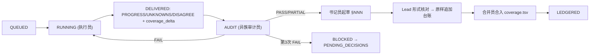

# R14 可持续运转计划 v2：全面逆向《红色警戒2》（纯派发 Lead · 最大并行 · 真机串行）

> 编制：2026-11-17（v2，取代 v1）｜上游：`lead\next_re_20261116_r13\TECHNICAL_REPORT.md`、`R13_COMMON.md`、台账 `lead\GOAL_THREE_TARGETS_20261018.md`（最新 **§928**）、`re_atlas\STATUS.md`（子系统覆盖表）
> 本目录：`PLAN_R14_SUSTAINED.md`（本文）· `KICKOFF_R14.md`（初始提示词）· `STATUS_BOARD.md`（运行态）· `R14_CARDS.md`（卡模板与首批卡）· `COVERAGE\`（全镜像覆盖表，Phase 0 建立）

---

## 0 · 范围与目标

**目标从“三条线”扩展为“整个 `gamemd.exe` 的系统化逆向”**：把 `function_atlas.tsv`（`lead\next_re_20261112_r10\W130_atlas\`，**12,916 个函数**）中的每个函数归入子系统、命名、给出语义分级，并为每个子系统产出一份可引用的知识文档（类布局、函数表、数据流、INI 键、真机验证）。原三条线（①卡顿 ②-a 守卫 ②-b 重叠 ③DLC）作为子系统 S07/S12/S02 的内部卡继续推进。

### 0.1 现有进度（截至 §928 与 re_atlas R-064）
| 已有成果 | 位置 |
|---|---|
| ① 卡顿定量闭环（Blitter 61.9% + 每格矿石价值 21.6%；绘制六道过滤；`[5]LayerClass` 渲染层） | 台账 §917–§928、`TECHNICAL_REPORT.md` |
| ②-a 守卫已修（真机 A/B 通过）；②-b 机制查清、成因 `[未证]` | 同上 |
| ③ DLC 引擎侧闭环（`BATTLEMD*.INI` 通配） | §910 |
| 全局骨架：RTTI/虚表、槽 11=`WhatAmI`/槽 12=`GetSize`（69 类零冲突）、`AbstractType` 74 项 | `re_atlas\kb\00`、`20`、`22` |
| 地图/触发器/脚本/Team 派发层（Action 145 / Team 65 / Event 49）、类布局 | `re_atlas\kb\10`、`11`、`21` |
| INI 与规则加载结题（2,426 键调用点、TypeClass 7 层 613 键） | `re_atlas\kb\30` |
| 大量早期专题文档（质量参差，**只能当线索，须复核**） | `docs\re\*.md`（约 300 篇） |
| **未开始**：战斗/武器、AI 决策、超级武器、存档、UI、网络、其余模块 | `re_atlas\STATUS.md` 子系统表 |

> [!WARNING]
> 定位时另一个 Lead 会话仍在写台账（08:49 写 §928）。R14 启动前须停掉旧会话；R14 用 `lead\LEAD_LOCK` 防并发。

---

## 1 · 子系统地图（全面逆向的工作分解）

| ID | 子系统 | 现状 | 起点语料（线索，须复核） |
|---|---|---|---|
| S01 | 启动 / WinMain / 主循环 / 帧时钟 | 部分 | `clock_frame_loop.md`、台账 E3 段 |
| S02 | CRT / 内存池 / SBH / 异常与崩溃守卫 | 部分（②-a） | `crt_*`、`sbh_*`、`except_*` |
| S03 | 文件系统 / MIX / CCFile / 压缩加密 | 部分 | `fs_mix_load_chain*.md` |
| S04 | INI / 规则加载 | **结题**（残余 A-40..A-42） | `re_atlas\kb\30` |
| S05 | 对象模型：Abstract→Object→Techno→Foot 族布局与虚表 | 部分 | `re_atlas\kb\11/20/21/22`、`cellclass_offsets_evidence.md` |
| S06 | 地图 / CellClass / MapClass / 地形 / 覆盖物 / 矿石 | 部分 | `cellclass_offsets_evidence.md`、§923 |
| S07 | 渲染：表面 / Blitter / 调色板 / SHP / VXL / 光照 / 层排序 | **深**（①） | `R1_render_blit.md`、`blitter_*`、`vxl_*`、`rle_blit_family.md` |
| S08 | 迷雾 / Shroud / 可见性 / 雷达小地图 | 部分 | `fog_*`、`radar_*`、`unit_visibility_mechanism.md` |
| S09 | UI：侧栏 / 菜单 / 对话框 / 输入 / 选择 / 命令派发 | 未开始 | `sidebar_selection_ui.md`、`ui_command_dispatch_deep_dive.md`、`R8_ui_crt.md` |
| S10 | Mission 系统 / 单位行为 AI（Foot/Unit/Infantry/Aircraft/Building::AI） | 部分 | `R3_ai_hooks.md` |
| S11 | Locomotor / 寻路（Drive/Walk/Fly/Jumpjet/Ship/Teleport…） | 部分 | `pathfinding_*.md`、W164 |
| S12 | 生产 / 经济 / 工厂 / 建造放置 | 部分（②-b） | `weapons_damage_production.md`、§911–§916 |
| S13 | 战斗：Weapon / Warhead / Bullet / Verses / 伤害 / 目标选择 | 未开始 | `weapons_damage_*.md`、`warhead_*`、`targeting_*.md`、`R6_weapons_mix.md` |
| S14 | House / AI 决策 / TeamClass / Script / TaskForce / AITrigger | 部分 | `house_team_ai_*.md` |
| S15 | 触发器 / Tag / TEvent / TAction | **深**（R2-1） | `re_atlas\kb\10`、`trigger_*.md` |
| S16 | 超级武器 | 未开始 | `superweapon_re.md`、`sw_*`、`gap_*` |
| S17 | 存档 / 读档 / 序列化 / Swizzle | 未开始 | `savegame_block_manifest.md`、`trigger_save_pollution.md`、`re_atlas\kb\21` |
| S18 | 网络 / 事件队列 / 同步校验 / 联机 | 未开始（**只读**） | `net_sync_*.md`、`MP_SAFETY_REVIEW.md` |
| S19 | 音频 / EVA / 音乐 / VQA 视频 | 部分 | `audio_*.md` |
| S20 | 粒子 / Anim / 特效 | 部分 | `fx_draw_chain.md`、`bullet_particle_fog_deep_dive.md`、`R7_vxl_fx_gap.md` |
| S21 | 战役流程 / 关卡载入 / 得分 / 剧情 | 未开始 | `a3_campaign_*.md` |
| S22 | 随机数 / 数学 / 字符串 / 第三方库与外部 DLL 接口 | 部分 | `rng_residual_u3_deep_dive.md`、`crt_callgraph.md` |

**每个子系统的“结题”标准（DoD）**
1. `COVERAGE\coverage.tsv` 中归属本子系统的函数 ≥ 90% 有名字与一行语义，且 ≥ 50% 达 `[已证]`；
2. 核心类的完整字段布局（偏移/类型/读写者），与 `GetSize` 一致；
3. 关键数据流（入口 → 每帧更新 → 销毁/存档）调用链图；
4. 涉及的 INI 键与全局变量表；
5. 至少 1 张真机卡验证了 2 条以上关键运行时事实（不适合真机的子系统须说明理由）；
6. `KB\Sxx_<名称>.md` 交付并通过异族审计；台账有对应结题节。

---

## 2 · 阶段

| 阶段 | 内容 | 并行度 |
|---|---|---|
| **P0 普查**（首轮立即开始） | 按地址把 12,916 个函数切 **10 片**（每片约 1,300 个），并行做自动归类：RTTI/虚表归属、字符串、源文件名字串（如 `TAction.CPP`）、导入 API、调用图邻接 ⇒ 每函数给出“子系统候选 + 置信度 + 依据”。再派 1 张合并卡生成 `COVERAGE\coverage.tsv` 与覆盖面板 | 10 并行 + 1 串行合并 |
| **P1 子系统主攻** | 每个子系统开一条“轨道”，轨道内按“类布局 → 函数命名 → 数据流 → 专题”切卡；**所有静态卡跨子系统并行** | 尽可能多（见 §4） |
| **P2 真机验证** | 每个子系统的运行时事实由真机卡验证；**全局串行**（单游戏实例） | 1 |
| **P3 交叉收口** | 子系统间接口（如 S12↔S06 格链表、S13↔S07 子弹绘制）、矛盾裁决、知识库总装（`KB\00_INDEX.md`） | 并行 |

P1/P2/P3 不是严格先后：P0 合并完成后 P1 全面铺开；任何子系统一旦有可验证的运行时假设，就往真机队列压卡。

---

## 3 · 角色与模型路由

| 角色 | 模型（provider = magpie-anthropic） | 职责 | 禁止 |
|---|---|---|---|
| **Lead（主会话）** | DeepSeek-V4.1-Flash | 读看板 → 选卡 → 派发 → 收件 → 派审计/书记/合并 → 原样追加台账 → 更新看板 → 卫生门禁 | 跑 capstone/Ghidra/pefile/真机；读原始证据；写或复算任何技术结论 |
| **执行员（主力）** | **`work/cn:hy4flash-free`** | 静态卡、真机卡、普查卡、KB 撰写 | 写域外写文件；写台账；写共享表（只写 delta） |
| 执行员（溢出/备援） | `work/cn:hy4flash` | free 档限流/报错时接手；并发超出 free 档承载时分流 | 同上 |
| **独立审计员** | **`work/cn:deepseek-v4.1-flash`**（high） | 对每卡 1–3 个核心数字自写脚本独立复算，出 `VERDICT.md` | 复用执行员代码 |
| 书记员 | `work/cn:hy4flash-free` | 起草台账节 `_drafts\§NNN.md`；每 5 轮刷新 `R14_COMMON.md` | 新增输入以外结论 |
| 合并员 | `work/cn:hy4flash-free` | 把各卡 `coverage_delta.tsv` 串行合入 `COVERAGE\coverage.tsv`，冲突写 `COVERAGE\CONFLICTS.tsv` | 改判冲突（只登记） |
| 规划员 | `work/cn:deepseek-v4.1-flash`（high） | 按覆盖缺口为各子系统生成新卡 | 直接派发 |
| 卫生员 | `work/cn:hy4flash-free` | 每轮卫生门禁 | 写任何文件（报告除外） |

**路由规则**：执行类 `hy4flash-free` → `hy4flash` → `deepseek-v4.1-flash`；**审计与执行必须异族**（执行落到 DeepSeek 时审计改 `hy4flash`）；Hy4 两档只传 `high` 或不传；新会话先做三模型空跑验证，不用路由检查工具代替真实派发。

---

## 4 · 调度规则（最大并行 + 真机串行）

1. **滚动派发，不按批等待**：任何一个子代理返回，Lead 立即处理它（收件/派审计/派书记），并立刻从队列补派一张新卡，保持“在途子代理数”接近上限。
2. **静态并行上限**：初始 **12** 个在途执行员（含审计、书记等所有非真机子代理共 ≤ 16）。若出现限流/超时，上限 −4 并把溢出改走 `hy4flash`；连续 3 轮无限流，上限 +2（最高 24）。看板记录当前上限。
3. **写域隔离**：每卡独占 `lead\next_re_20261117_r14\<卡号>_<短名>\`；共享产物（`coverage.tsv`、`KB\Sxx_*.md`、`R14_COMMON.md`）只能由**指定的单个串行角色**写（合并员/该子系统 KB 卡/书记员），其他卡只交 delta。
4. **真机串行**：全局只有一个真机槽，由 `lead\next_re_20261117_r14\LIVE_LOCK` 表示。真机卡按 `LIVE_QUEUE` 顺序一次派一张；上一张交付且卫生员确认 `except.txt` 与游戏文件未变、无残留 `gamemd.exe` 进程后，才派下一张。真机卡运行期间，静态卡照常并行。
5. **Ghidra 资源**：同时运行的 Ghidra 头less 实例 ≤ 4（其余静态卡用 capstone/pefile）；项目副本从 `lead\next_re_20261116_r11\_ghidra\W150` 复制到 `_ghidra\<卡号>`，用完由卡自己删除副本（只删自己的）。
6. **队列水位**：QUEUED 静态卡 < 当前并行上限时，派规划员（可多个，按子系统分片）补卡；真机队列空且有子系统出现可验证假设时，规划员补真机卡。
7. **优先级**：②-b 成因（S12）> P0 普查 > 未开始子系统的类布局卡（S09/S13/S16/S17/S18/S21）> 其余子系统深化 > 交叉收口 > 文档卫生。

---

## 5 · 每卡生命周期

- Lead 收件只读 `PROGRESS.md`（≤60 行）、`UNKNOWNS.md`、`DISAGREE.md`；
- 台账节由书记员按卡起草，Lead 只做形式核对（节号=最大+1、分级+证据路径、执行/审计模型、更正标题）后**按完成顺序逐个**追加；
- 多张卡同时到达时，书记员可并行起草，但 Lead 追加时每次重新确认当前最大节号。

---

## 6 · 真机授权（用户 2026-11-17 09:00 当轮明示）

> 用户原话：“**可以真机**……需要真机的子代理串行派发”。

**常设授权范围（R14 期间有效，直至用户撤回）**
- 启动/关闭 `ra2youli\gamemd.exe`（只关闭本卡启动的进程）；
- **只读**读取游戏进程内存、线程上下文采样（`ReadProcessMemory`/`Wow64GetThreadContext`/`GetProcessTimes`）、StackWalk、MiniDump；
- 合成鼠标/键盘输入（进局、建造、选单位、下命令等）；
- 读取游戏目录内的日志/`except.txt`。

**不在授权内（需另行问用户）**：写进程内存、DLL 注入/Hook、修改 `gamemd.exe`/`ddraw.dll`/`ra2youli\` 下任何文件（游戏自身写 `RA2MD.INI` 除外）、联网对战。
Lead 首轮须把本授权逐字登记到 `lead\PENDING_DECISIONS.md` “已裁决记录”段与看板“授权记录”。

---

## 7 · 持续性设计

1. **单一运行态**：Lead 每次决策前只重读 `STATUS_BOARD.md`；会话重启/压缩后从看板续跑。看板超过 200 行时，派书记员把已 LEDGERED 卡移到 `BOARD_ARCHIVE.md`。
2. **Lead 上下文预算**：不读原始证据；每卡收件 ≤60 行。上下文吃紧时提醒用户 `/compact` 或按 `KICKOFF_R14.md` 开新会话。
3. **自动补卡**：按 §4-6 水位触发规划员；goal 不因队列空结束。
4. **失败分级**：子代理报错 → 路由降级；同卡 2 次未交付 → 拆小；审计 3 次 FAIL → BLOCKED。
5. **定期固化**：每 5 轮刷新 `R14_COMMON.md`（事实底座 + 作废索引 + 纪律）；每 10 轮出一次 `COVERAGE\PANEL.md` 覆盖面板与 `TECHNICAL_REPORT` 增量。
6. **停机条件**：全部子系统达 DoD；或剩余卡全部 BLOCKED 且已问过用户；或用户叫停。

---

## 8 · 硬约束

1. 不改 `gamemd.exe`/`ddraw.dll`/`ra2youli\` 下任何文件；不 `git commit`/`push`。
2. 真机仅限 §6 授权范围；越界项须当轮问用户。
3. 台账 append-only，只由 Lead 追加书记员草稿。
4. 写域互不重叠；共享产物单写者。
5. 引用旧结论先查作废索引（`R13_COMMON.md §1`，W179 后为 `R14_COMMON.md`）；`docs\re\` 旧文档一律视为“线索”，进入台账前必须重新取证。
6. `R13_COMMON §6` 18 条纪律写入每张卡尾部。
7. Lead 纯派发：想“看一眼/算一下”时改派卡。
8. 单 Lead 锁 `lead\LEAD_LOCK`；单真机锁 `LIVE_LOCK`。
