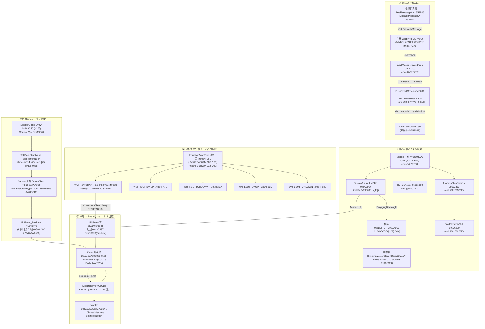

# S09-F1 FLOW — 输入消息 → 命令派发 → 侧栏点击 → 生产请求 → Event

> 卡号 S09-F1｜目标 `gamemd.exe` SHA-256 `73201CC0…F67476`，ImageBase `0x400000`
> 全部地址本卡用 capstone 5.0.7 (`skipdata=True`) + pefile 从镜像重新取证；线索文档只作定位提示。
> 图中每个箭头对应下表一条「调用点地址」（call/jmp 指令 VA）。

## 每跳调用点地址表（按图中箭头）

| # | 源函数 | 调用点 VA | 目标 | 语义 |
|---|---|---|---|---|
| 1 | 主循环 | 0x53EB16 / 0x53EB99 | `PeekMessageA`(IAT 0x7E1484) | 输入泵取消息 |
| 2 | 主循环 | 0x53E8A1 | `DispatchMessageA`(IAT 0x7E14C0) | 派发到 WndProc |
| 3 | WinMain 区 0x777CA5 | 0x777CA5 | `RegisterClassA` | 注册 WNDCLASS.lpfnWndProc=0x7775C0 |
| 4 | WndProc 0x7775C0 | **0x7779CB** | `InputManager::WndProc` 0x54F790 | 消息入 InputManager (ecx=[0x87F770]) |
| 5 | WndProc 0x7775C0 | **0x777640** | Mouse 主处理 0x6930A0 | ecx=0x87F7E8，传 uMsg/wParam/lParam |
| 6 | 0x54F790 | 0x54F8EF / 0x54F94D→0x54F8EB | `PushEventCode` 0x54F200 | LDOWN/LUP 事件码入环 |
| 7 | 0x54F790 | 0x54F8F6 / 0x54F99E | `PushWord` 0x54F1C0 | x/y 坐标入环 |
| 8 | 0x54F790 | 0x54F8B9 / 0x54F91D / 0x54FAEA / 0x54FAF0 | 左按下/左抬起/右按下/右抬起 | 跳表 0x54FB4C / 0x54FB64 |
| 9 | 主循环 0x55DEE0 | **0x55E04E** | `GetEvent` 0x54F050 | 事件出环(最多 10 条/帧) |
| 10 | 0x6930A0 | **0x69325E** | `ProcessClickCoords` 0x692300 | 像素→格/对象解析 |
| 11 | 0x6930A0 | **0x693271** | `DecideAction` 0x692610 | 决定 Action |
| 12 | 0x6930A0 | **0x69328B** | `DisplayClass::LMBUp` 0x4AB9B0 | 点选/框选收口 |
| 13 | 0x692300 | **0x69238E** | `PixelCoordToCell` 0x6D6590 | 屏幕像素→格 (scroll origin 在内) |
| 14 | 0x692300 | 0x6923D3 | `PixelCoordToCoord` 0x6D2280 | 像素→世界坐标(12B) |
| 15 | 0x4AB9B0 | 内部 | 框选 0x6D9FF0→0x6DA5C0 | 扫 0xB0CEC8 O(N) |
| 16 | 0x6DA5C0 | 0x6DA65C | `call 0x732D00` + v[0x2C]/v[0x138]/v[0x14C] | 选择过滤 (House 闸 0x50B6F0 @0x6DA6C0) |
| 17 | 0x6AAD00 | **0x6AAD8E** | `GetTechnoType` 0x48DCD0 | ItemType/Index→BuildingType/UnitType |
| 18 | 0x6AAD00 | 0x6AB02A/0x6AB12B/0x6AB1FF/0x6AB231/0x6AB349/0x6AB511/0x6AB76E | `FillEvent_Produce` 0x4C6970 | 生产事件 (共 9 点) |
| 19 | 0x6AA600 | 0x6AA7E7/0x6AA8CD | `FillEvent_Produce` 0x4C6970 | 生产事件 (另 2 点) |
| 20 | 0x4AB9B0 | **0x4AC187** | `FillEvent_Generic` 0x4C65E0 | 移动/攻击/选择→事件 |
| 21 | FillEvent 族 | 0x4434B3 等 | 写环 0xA802D4 | `lea edi,[ecx*3+0xA802D4]` |
| 22 | 回放层 | 0x64C911/0x64CC0A | `Dispatcher` 0x4C6CB0 | Kind-1→jt 0x4C8114 |

## 关键公式 / 常量

- **屏幕→格** `0x6D6590`：`wx = pixel.x + [this+0xB0] − [0x886FA0]`；`wy = pixel.y + [this+0xB4] − [0x886FA4]`；
  经 `[this+0xDE4]` 变换矩阵(`0x5AFB80`)→ `_ftol(0x7C5F00)` → `sar 8`(/256) 得格坐标。调用者 `0x692300` 先加 scroll 再调，内部再减，净用 `[this+0xB0]/[this+0xB4]`。
- **Tab 索引** `0x6A61B3`：tabStride = `((t<<5−t)*8+ t)*4*4 = 3988 = 0xF94`；`CameoCount @ tab+0x54`，`Cameos @ tab+0x58`，`stride 0x34`，`cmp count,0x4B(75)`。
- **选中集** `0xA8EC78` = `DynamicVectorClass<ObjectClass*>`：Items `+4`=0xA8EC7C，Count `+0x10`=0xA8EC88，vft `0x7E17AC`(临时)/growth 0xA。
- **Event 环** Count 0xA802C8(上限 0x80)，Wr 0xA802D0(&0x7F)，Body 0xA802D4(步长见 E09 `lea ecx*3`)。
