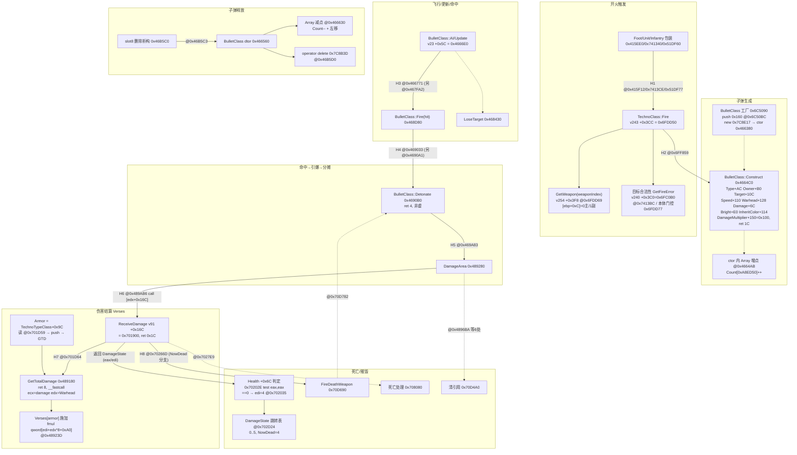

# S13-F1 FLOW — 开火→子弹→飞行→命中→伤害结算(Verses)→死亡 完整调用图

> 目标 `ra2youli\gamemd.exe` SHA-256 `73201CC0…F67476`，ImageBase 0x400000，只读。capstone 5.0.7 `skipdata=True`；
> 类名取 S13-K1 RTTI 实测（非头文件名推断）；虚表槽数从 .rdata 定界直读（非 vtables_v2.json）；
> 站点归属用「函数区间包含」（fn_at），非 entry_at_or_before。所有地址均经逐字符反汇编核对。
> **链上跳数 = 8（主链，见下表 H1–H8）**；辅助跳（分配/释放/清引用）单列。

## 1. mermaid 调用图

## 2. 每跳调用点地址表（主链 H1–H8，链上跳数=8）

| 跳 | 语义 | 调用点地址 | 目标 | 目标入口 | 证据 |
|---|---|---|---|---|---|
| H1 | Foot/Aircraft 包装→Fire 本体 | `0x415F12` | 直呼 | `0x6FDD50` | `EVIDENCE/fire_slots_wrappers.txt` |
| H1 | Unit 包装→Fire 本体 | `0x7413CE` | 直呼 | `0x6FDD50` | 同上 |
| H1 | Infantry 包装→Fire 本体 | `0x51DF77` | 直呼 | `0x6FDD50` | 同上 |
| H2 | Fire→Construct（子弹填装） | `0x6FF859` | `E8 62 6C D6 FF` | `0x4664C0` | `EVIDENCE/call_sites.tsv` |
| H3 | AI/Update→Fire(hit) 命中 | `0x466771`（另 `0x467FA2`） | 直呼 | `0x468D80` | 同上 |
| H4 | Fire(hit)→Detonate 引爆 | `0x469033`（另 `0x4690A1`） | 直呼 | `0x4690B0` | 同上 |
| H5 | Detonate→DamageArea 分摊 | `0x469A83` | 直呼 | `0x489280` | 同上 |
| H6 | DamageArea→ReceiveDamage | `0x489AB6` | `FF 92 6C 01 00 00` = `call [edx+0x16C]` | `0x701900`(v91) | `EVIDENCE/resolve_chain_gaps.txt` |
| H7 | ReceiveDamage→GetTotalDamage（Verses 应用） | `0x701D64` | `E8 17 74 D8 FF` | `0x489180` | `EVIDENCE/trace_precision.txt` |
| H8 | ReceiveDamage→FireDeathWeapon（死亡分支） | `0x70266D` | `E8 1E B0 00 00` | `0x70D690` | `EVIDENCE/trace_death.txt` |

> H1 为类相关跳：Building/Foot 的 v243 直接就是本体 `0x6FDD50`（无此跳），Unit/Infantry/Aircraft 经包装器到达。
> 主链长度按「Fire 本体→死亡」计 = **8 跳（H1–H8）**；H1 视类而存在。

## 3. 辅助跳 / 生命周期锚点

| 语义 | 调用点/站点 | 值 | 证据 |
|---|---|---|---|
| 子弹分配大小 | `0x6C50BC push 0x160` → `0x6C50C1 new` → `0x6C50CF ctor` | **0x160 = 352 B** | `EVIDENCE/trace_alloc_weapon_array.txt` |
| Array 增点 | `0x4664AB mov [0xA8ED50],ecx`（ctor 内 Count++）；Items 写 `0x4664B7 mov [ecx+eax*4],esi` | 容器 0xA8ED40 / Count 0xA8ED50 | `EVIDENCE/fn_Bullet_ctor_00466380.txt` |
| Array 减点 | `0x466630 mov [0xA8ED50],ecx`（dtor 0x466560 内 Count--，随后左移） | 同上 | `EVIDENCE/trace_array_factory.txt` |
| 子弹释放 | `0x46B5C3 call 0x466560`（slot8 dtor 包装）→ `0x46B5D0 call 0x7C8B3D` | new/delete 配对 0x7C8E17/0x7C8B3D | `EVIDENCE/trace_alloc_weapon_array.txt` |
| 清目标引用 | DamageArea→0x70D4A0 @ `0x4896BA`/`0x48A044`/`0x48A1C8`/`0x48A265`/`0x48A2BF`/`0x48A319` | 6 处直呼（**不在 ReceiveDamage 内**） | `EVIDENCE/call_sites.tsv` |
| 死亡武器再引爆 | FireDeathWeapon→Detonate @ `0x70D782` | 直呼 | `EVIDENCE/call_sites.tsv` |

## 4. Verses 索引映射的维度依据（映射已闭合）

| 项 | 值 | 证据 |
|---|---|---|
| 倍率矩阵 | `double[11] @ WarheadTypeClass+0xA0..+0xF7`（88 B） | loader `lea ebx,[esi+0xA0]`@0x75DE06、`mov ebp,0xB`@0x75DE0C、`fstp qword[ebx]`@0x75DE48、`add ebx,8`@0x75DE52；ctor `lea esi,[ebp+0xA0]`+`mov ecx,0x14; rep movsd`@0x75D194/0x75D1A7（见 `EVIDENCE/verify_verses.txt`）——**与 S13-K1 §7 定位一致，核对通过** |
| 维度 11 的来源 | `enum Armor` 恰 11 个值 None=0..Special_2=10（`ref/yrpp/GeneralDefinitions.h:444-456`） | 索引上限 10 × stride 8 = 80，落在 0xA0+80=0xF0 末元素，覆盖至 0xF7，与 88 B 完全吻合 |
| 索引寄存器溯源 | `GetTotalDamage` 内 `edi`=WarheadTypeClass*（2nd fastcall 参数 edx @0x489187 `mov edi,edx`）；`edx`=Armor @0x489229 `mov edx,[esp+0x18]`；乘算 `fmul [edi+edx*8+0xA0]`@0x48923D | `EVIDENCE/trace_precision.txt`（全部写入点已回溯，满足纪律 3） |
| Armor 来源 | `call [type+0x84]`(GetType,slot33) → `mov ecx,[eax+0x9C]`@0x701D59 → `push ecx` → GetTotalDamage | 同上；`+0x9C` 是 TechnoTypeClass 的 Armor 字段（本卡读点实证；命名由 11 维枚举支撑） |
| 9 处 FPU 索引访存 | 0x48923D(V1,伤害缩放)、0x6F36FE/0x6F3731(V2)、0x6F7D3D(V3)、0x6FCB6A(V4)、0x708AF7(V5)、0x70CEB2/0x70CEC7/0x70CF49(V6) | 全 .text skipdata 扫描命中 9，与 `warhead_abi_verses_deform_deep_dive.md` 一致（经本卡重新取证） |

## 5. 与卡面候选假设的对照

| 卡面猜测 | 实测 | 判定 |
|---|---|---|
| Fire `+0x154` slot 85 或相近 | slot 85(+0x154)=`0x70E2B0`（TurretControl 计时），真 Fire=slot 243(+0x3CC)=`0x6FDD50` | **否证**（见 `EVIDENCE/fire_slots_wrappers.txt`） |
| BulletClass::AI 每帧更新 | v23(+0x5C)=`0x4666E0`，命中分支 @0x466771 | 证实 |
| Verses=double[11]@+0xA0 | 三通道复核一致 | 证实（S13-K1 定位无误） |
