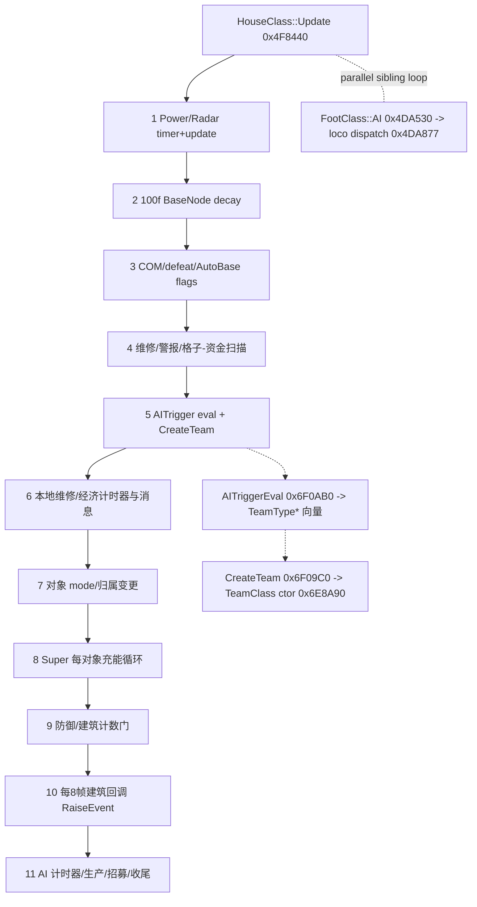

# S14-F1 · House/AI/Team 数据流

> 目标：`ra2youli\gamemd.exe`，ImageBase `0x400000`。Channel A = capstone 5.0.7 `skipdata=True` 全 `.text` 线性解码 + 原始 `E8/68` 扫描（`work/wbase.py`）；Channel B = Ghidra 12.1.4 headless `-noanalysis` API 反汇编（`EVIDENCE/G01_ghidra_disasm.txt`）。两通道不同源。
> 分级：`[已证]` = 两通道地址/机器码一致且有读写点；`[静态推断]` = 调用链有门控、缺每帧计数。

## 1. `HouseClass::Update` 主链（11 个主调度子步骤）

`0x4F8440` 入口，`0x4F9366 ret`；`0x4F842E ret` + NOP 是前函数尾，故区间包含判定用 `[0x4F8440,0x4F9367)`。`0x4F8440` 是 HouseClass vtable `0x7EA8A0` slot 23（`0x7EA8FC`），RTTI COL→TD=`.?AVHouseClass@@`（`E14`）。

| # | 门控/入口 | 调用点（VA） | 目标 / 语义 | 级 |
|---|---|---|---|---|
| 1 | `+0x2A4/+0x2AC`、`+0x2B0/+0x2B8` timer；`+0x5778/+0x5779` 脏 | `0x4F84E5`, `0x4F8505`, `0x4F850C` | `0x508C30` UpdatePower；`0x508DF0`/`0x508F60` 电力/雷达重算 | 已证 |
| 2 | `CurrentFrame % 100 == 0`，`+0x5614>0` | 无调用；`0x4F852A..0x4F8549` | `+0x5608` BaseNode 计数逐项衰减 | 已证 |
| 3 | `+0x57E0` 非空；GameMode/Defeat/AutoBase | `0x4F8561`；`0x4F858B..0x4F85B7` | COM `vtbl[+0x10]`；置 `+0x1F3/+0x1EE/+0x1EF` | 已证 |
| 4 | `+0x1F7/+0x1F8/+0x1F6` timer；`CurrentFrame%15==0` | `0x4F860F/861C/8636/8649/864E`, `0x4F8736/8743/875F/8772/8777`, `0x4F87FA`, `0x4F8888/889A/8908`, `0x4F895E/8965/899F/89F0` | 维修/警报、全局随机、取格 `0x5657A0`、`0x47C3D0`、Techno 虚调用；经济/威胁上下文扫描 | 已证 |
| 5 | `+0x5798/+0x57A0` TeamDelayTimer；非 Defeat/非 HouseType `+0x1A6` | `0x4F8A6A`, `0x4F8A78`, `0x4F8A92`, `0x4F8AAD` | `0x6F0AB0` AITrigger 评估；`0x50E830`/`0x50F830` 结果整理；逐个 `0x6F09C0` CreateTeam | 已证 |
| 6 | 仅本地 House (`[0xA83D4C]==this`)；多个 timer | `0x4F8B2B`, `0x4F8B6C`, `0x4F8BA0`, `0x4F8BAA`, `0x4F8BCB`, `0x4F8C0B`, `0x4F8CB4/8CD4/8CF5`, `0x4F8D14/8D2C/8D4F/8D5C/8D7D/8D88` | 修理/资金/文本提示/消息计时器 | 已证 |
| 7 | `+0x53DC` 接口非空 | `0x4F8DBF`, `0x4F8DCD` | `vtbl[+0x2C]` 查询、`vtbl[+0x124]` mode 2 摘挂（建筑 locomo） | 已证 |
| 8 | `+0x57A4/+0x57AC` 90 帧 timer 或 `+0x246` 首帧；`+0x264` 计数 | `0x4F8E4A` | `0x6CBCA0` `SuperClass::HasChargeProgressed`，循环 `[0x4F8E28,0x4F8E84)` 每 Super 恰 1 次 | 已证 |
| 9 | GameMode≠0、`+0x1F5==0`、`CurrentFrame>0`、HouseType 未禁止 | `0x4F8EE4/8EF7/8F0A`, `0x4F8F2D/8F3A/8F47`, `0x4F8F6E`, `0x4F8F7B`, `0x4F8F82` | 统计基地防御/兵力；`0x4FC6D0`/`0x4FC0B0` 重建路径 | 已证 |
| 10 | `CurrentFrame % 8 == 0`，`+0x48-1>=0` | `0x4F8FB6` | `0x6E53A0(item, …,8,0,0)` 建筑/Tag 事件回调 | 已证 |
| 11 | `+0x5634/+0x563C` timer；二次 `%8==0`、AIMode | `0x4F9017`, `0x4F90AE`, `0x4F90D4`, `0x4F90F2`, `0x4F910B`, `0x4F9156`, `0x4F9198`, `0x4F919F`, `0x4F91E2/920A/9232`, `0x4F9242/924B/9252/9259/9260`, `0x4F92AB`, `0x4F92D2`, `0x4F92E2`, `0x4F92F6`, `0x4F92FD`, `0x4F935A` | `0x4FD500` AI_TryFireSW；`0x4FE3E0` 建造；`0x4FEA60/4FEEE0/4FF210` 招募；工厂 `vtbl[+0x94]` 下单；`0x50AF10/0x50B1D0` 收尾 | 已证（门控为静态推断） |

`House::Update` 每次调用中，Super 循环位置明确：第 8 步，紧接“本地维修/经济计时器+对象 mode 变更”之后、“防御/建筑计数门+8 帧回调+生产招募”之前。全 `.text` 对 `0x6CBCA0` 仅 2 个直接调用点：`0x4F8E4A`（活）、`0x4F9397`（`0x4F9370` 死双生）；`0x4F8E4A` 到 `ret 0x4F9366` 之间无 `ret`，区间归属成立（`E01/E14`、S16-K1 审计）。

## 2. AITrigger 评估与触发

入口 `0x6F0AB0`（`ret 4`，size `0x508`），唯一活调用点 `0x4F8A6A`（`E01/E02/G01`）。流程：`0x6F2230` 初始化 → `0x65C7E0` 烧 `RandomRanged(1,100)` → 检查 `House+0x565C` 与 `+0x1F2` → 统计 Team/BaseDefense → 遍历 `AITriggerTypeClass::Array` `0xA8B204`/`0xA8B210`，每项 `0x41E720 ConditionMet` → 权重 `+0xB8` `ftol` → 权重 `==5000` 特权清表 → 轮盘 `0x65C7E0(1,Σw)` → 把命中 Trigger 的 `Team1(+0xDC)`/`Team2(+0xE0)` 加入结果向量（`0x6F0D5B/0x6F0DA9` 调 `[vtable+8]`）。**本函数不创建 Team**；调用方在 `0x4F8AAD` 对每个返回 TeamType 调 `0x6F09C0`。

字段锚定（INI 为 `[AITriggerTypes]` 的 CSV 位，不是命名键；`work/t2_keys.py` 全镜像字符串扫描未发现 `Team1/ConditionType/Comparator/Amount` 字面量）：

| 偏移 | YRpp/语义 | INI 锚 | 写点 / 读点 |
|---|---|---|---|
| `+0x64` | Name | CSV 第 1 列 `%s` | `0x41F5FC..0x41F60F` / `0x41FB52` |
| `+0x98` | ConditionType | CSV 第 5 列 `%d` | `0x41F74A` / `0x41E7B1`, `0x41E8F6` 跳表 `0x41EACC` |
| `+0xA0/+0xA8` | OwnerHouseType / HouseIndex | CSV 第 3 列 `%s`（`<all>/<none>/house`） | `0x41F643/66A/F6FA` / `0x41E855/871` |
| `+0xAC/+0xB0` | SideIndex / TechLevel | CSV 第 12 列、第 4 列 | `0x41F962`, `0x41FA90` / `0x41E88D`, `0x41E8D7` |
| `+0xB8/+0xC0/+0xC8` | Weight_Current/Minimum/Maximum | CSV 第 8–10 列 `%lf` | `0x41F8AC/F8DE/F910` / `0x6F0C61`, `0x41FDB3..` |
| `+0xD0..+0xD4` | Skirmish/BaseDefense/Easy/Normal/Hard | CSV 第 11、13、15–17 列 | `0x41F936/988/FA0A/FA30/FA56` / `0x41E7E1..0x41E84A` |
| `+0xD8` | ConditionObject | CSV 第 6 列 `%s` | `0x41F7E4` / `0x41F23E`, `0x41EFxx` |
| `+0xDC/+0xE0` | **Team1 / Team2** | CSV 7 个 `%s` 列中的两个（第 2 列及 `0x41F9E4` 后置解析列） | `0x41F66A`, `0x41F9E4` / `0x6F0D26`, `0x6F0D78`, `0x41E726/73A` |
| `+0xE4` | **Amount** | CSV 第 7 列 64-hex blob 的 dword0 | `0x41F86F` 写入 `[ebp+edi+0xE4]` / `0x41F261`, `0x41F2A9` |
| `+0xE8` | **Comparator** | 同一 hex blob 的 dword1 | 同上 / `0x41F248` 跳表 `0x41F2C4`：`0:<,1:<=,2:==,3:>=,4:>,5:!=` |
| `+0x104/+0x108` | TimesSuccess / TimesExecuted | — | `0x41E3F5/FB` / `0x41FD61..0x41FEC0` |

ConditionMet 另外直接检查 `House+0x1D4/+0x1E8/+0x34->0xB8` 与 `Rules+0x1394/+0x13CC/+0x13B0/+0x17F3`（`E03`），并用 `+0x98` 跳到 7 类条件：`Enemy/Owner/Civilian owns`、`Credits`、`IronCurtain`、`Chronosphere`。

## 3. Team 创建

`0x6F09C0`（`TeamTypeClass::CreateTeam`，`ret 4`）：`push 0xA0 @0x6F0A4D` → `operator new 0x7C8E17 @0x6F0A52` → 构造 `0x6E8A90 @0x6F0A64`；实参压栈 `push 0 / push House* / push TeamType* @0x6F0A52..0x6F0A61`。`[已证]` **分配大小 0xA0 = 160 B**（两通道同一机器码 `68 a0 00 00 00`）。

`0x6E8A90` ctor 关键写点：`+0x24=TeamTypeClass*`（`0x6E8AA7`）、`+0x2C=HouseClass* owner`（`0x6E8AAD`）、`+0x50=CurrentFrame`（`0x6E8ACD`）、`+0x54=FirstUnit=0`（`0x6E8AD0`）、`+0x84=0`（`0x6E8B2C`）、`+0x70=Tag*`（`0x6E8D99`，仅当 TeamType`+0xD0` 非空，另分配 `0x38` @`0x6E8D76`）、`+0x28=ScriptClass*`（`0x6E8DBB`，`0x6913C0`，另分配 `0x30` @`0x6E8D9C`）。成员链为 `FootClass*` 单链，头在 `+0x54`（dtor `0x6E8DE0 @0x6E8E6E..0x6E8E86` 以 `while([esi+0x54]) call 0x6EA870 LiberateMember`，`E16`）。

## 4. RulesClass AI 数值字段（`[0x8871E0]` 指向对象）

口径：9 个 AI/作弊相关数值字段（6 double + 3 int）；每个都有键串 `push` + INI 读取调用 + `[esi+off]` 写点（`E13`、`G01`）。`IgnoreGlobalAITriggers` 不列入：其写点 `[Scenario+0x34B4] > RulesClass 0x18C0`。

| 键 | 偏移 | 类型 | push → 写点 |
|---|---|---|---|
| `CampaignMoneyDeltaEasy` | `+0xDFC` | int | `0x670167 → 0x670174` |
| `CampaignMoneyDeltaHard` | `+0xE00` | int | `0x670187 → 0x670194` |
| `WallBuildSpeedCoefficient` | `+0x758` | double | `0x671877 → 0x671884` |
| `AITriggerSuccessWeightDelta` | `+0xC0` | double | `0x6718EC → 0x6718F9` |
| `AITriggerFailureWeightDelta` | `+0xC8` | double | `0x671913 → 0x671920` |
| `AITriggerTrackRecordCoefficient` | `+0xD0` | double | `0x67193A → 0x671947` |
| `BuildSpeed` | `+0x1748` | double | `0x670D1B → 0x670D28` |
| `AIAlternateProductionCreditCutoff` | `+0x1300` | int | `0x66FDF3 → 0x66FE00` |
| `AIUseTurbineUpgradeProbability` | `+0x13E8` | double | `0x66FE19 → 0x66FE26` |

⚠️ `RulesClass+0xC0/C8/D0` 与上表 AITriggerTypeClass 同号偏移**不是同一对象**；后者是 Weight_Minimum/Maximum/未用，前者是全局权重增量。

## 5. 与 `0x4DA877` 的层级

两条**并列循环**，不是嵌套：
- `HouseClass::Update = 0x4F8440` 在 HouseClass vtable `0x7EA8A0` slot 23；主逻辑路径 `0x55DE81` 帧号+1 → `0x55DE9A call 0x55E160` → `0x55E269 call [eax+0x5C]`（`0x55E160` 区间包含该站点）。
- `FootClass::AI = 0x4DA530` 在 FootClass vtable `0x7E8C94` slot 23；派生 wrapper `0x414BB0`/`0x51BAB0`/`0x7360C0` 分别在 Aircraft/Infantry/Unit vtable slot 23（`E14`，RTTI TD 名逐字符核对）。`0x4DA877` 位于 `0x4DA530` 函数区间内；R14_COMMON §1 已证该点每帧都跑（`frame%16` 只跳过 `[0x4DA56E,0x4DA63B)`）。
- 全 `.text` 对 `0x4DA530` 的直接调用点只有 `0x414DA3`/`0x51BC9F`/`0x73647B`，均不在 `0x4F8440` 区间；`0x4F8440` 的 94 个调用指令中无 `0x4DA530`/`0x4DA877`。等价间接形式：两函数各只有 1 个 vtable 指针，分别属于不同 RTTI 类，House 对象不会经 Foot vtable 派发。

“每次 `House::Update` 每 Super 恰 1 次” `[已证]`；“House::Update 每帧恰 1 次”仍为 `[静态推断]`（主循环条件处有多处跳过，见 `E07:0x55DE4F..0x55DE81`），不把 EIP 权重当频率。
