# S16-K1 · SuperWeaponTypeClass / SuperClass 布局与充能状态机

> 卡号 S16-K1｜证据全部本卡自取，`EVIDENCE/E01..E12` 未截断；`work/` 可复跑。
> 分级：`[已证]`=本卡字节+读写双支撑；`[静态推断]`=字节实证但语义靠上下文；`[未证]`=仅有写点/无读点或语义不明。
> 字段数口径：下表每个**具名行**计 1 字段；多字节数组（4 vptr、Coord/CellStruct、0x18 字符串）整体计 1 行。

## 1. 双通道定位（纪律 1）

| 类 | RTTI TypeDescriptor | 主 vftable | 通道 A（atlas `entry+size`） | 通道 B（raw capstone `call/jmp` + 序言/ret 区间，`skipdata=True`） |
|---|---|---|---|---|
| `SuperClass` | `0x8423E0` `.?AVSuperClass@@` | `0x7F3FE8` (COL `0x80B610`, off 0, 24 slots) | ctor `0x6CAF90+389`, GetSize `0x6CE210+6` | ctor 序言 `53 56 8B F1 E8…`；GetSize `B8 80 00 00 00 C3`；vft 写点 `0x6CAFF7` |
| `SuperWeaponTypeClass` | `0x842600` `.?AVSuperWeaponTypeClass@@` | `0x7F4090` (COL `0x80B6C8`, off 0, 28 slots) | ctor `0x6CE5B0+336`, INI loader `0x6CEA20+1085` | factory `0x6BF510`：`push 0x100; call 0x7C8E17; mov ecx,eax; call 0x6CE5B0`；vft 写点 `0x6CE666` |

- `SuperClass` v[11]=`0x6CE200`→`mov eax,0x39`（WhatAmI=57），v[12]=`0x6CE210`→`mov eax,0x80`（**GetSize=0x80**）。
- `SuperWeaponTypeClass` v[10]=`0x6CE8F0`→`mov eax,0x20`（WhatAmI=32），v[11]=`0x6CE900`→`mov eax,0x100`（**GetSize=0x100**），v[12]=`0x6CE910`=CalculateChecksum（**不是 GetSize**，与 SuperClass 槽位错开 1）。分配点 `0x6BF53C push 0x100`。
- 注意：`function_atlas.tsv` 在 `0x4F830C..0x4F93E0` 有洞，`HouseClass::Update 0x4F8440` 与 `0x4F9370` 均不在 atlas；本卡用通道 B（序言+无 ret 包含）定位，`0x4F8E4A` 归属 `0x4F8440`（`ret` 数 0）。

## 2. SuperClass 字段表（**27 字段**，GetSize `0x80`）

| # | 偏移 | 宽 | 类型 | 写者站点 | 读者站点 | 语义 / INI 锚 | 级 |
|---|---|---|---|---|---|---|---|
| 1 | +0x00 | 4 | vptr | `6CAFF7` ctor；`6CDF13` Load | 间接调用 | 主 vtable `7F3FE8` | 已证 |
| 2 | +0x04 | 4 | vptr | `6CAFFD`；`6CDF19` | 间接 | 副 vtable `7F3FCC` | 已证 |
| 3 | +0x08 | 4 | vptr | `6CB003`；`6CDF20` | 间接 | 副 vtable `7F3FC4` | 已证 |
| 4 | +0x0C | 4 | vptr | `6CB00A`；`6CDF27` | 间接 | 副 vtable `7F3FBC` | 已证 |
| 5 | +0x24 | 4 | int | `6CAFA7`=-1；`6CC284`/`6CC290` | `6CC260`/`6CB649` | `CustomChargeTime`（-1=用 Type 默认） | 已证 |
| 6 | +0x28 | 4 | ptr | `6CAFA4` ctor | `6CB576`/`6CBD10`/`6CC39B` | `Type` = SuperWeaponTypeClass* | 已证 |
| 7 | +0x2C | 4 | ptr | `6CAFAA` ctor | `6CB5DD`/`6CD742` | `Owner` = HouseClass* | 已证 |
| 8 | **+0x30** | 4 | int(帧) | `6CAFB5`=CurrentFrame；`6CB5AF`/`6CBDA1` | `6CB5A4`(cmp -1)/`6CBD2C` | **`RechargeTimer.Start`**；-1=已折叠 | 已证 |
| 9 | +0x34 | 4 | int | `6CB66F`=入参 | Timer 折叠链 | `RechargeTimer` 第二槽（StartTime；判定不读） | 静态推断 |
| 10 | **+0x38** | 4 | int(帧) | `6CAFB8`=0；`6CB672`/`6CBDAA` | `6CBD55` | **`RechargeTimer.Duration`**（=剩余） | 已证 |
| 11 | +0x3C | 4 | int | `6CB58D`←Type+0x60 | 未找到 | Flash 缓存（写点有，读点未证） | 未证 |
| 12 | +0x40 | 1 | bool | `6CAFBE`=0；`6CB580` | Checksum `6CE065` | `BlinkState` | 静态推断 |
| 13 | +0x48 | 4 | i32 | `6CAFBB`/`6CDFB6`=0 | 未找到 | `BlinkTimer` lo | 静态推断 |
| 14 | +0x4C | 4 | i32 | `6CAFC1`/`6CDFB8`=0 | 未找到 | `BlinkTimer` hi | 静态推断 |
| 15 | +0x50 | 4 | int | `6CAFC4`=-1；`6CBCB0`/`6CB CBD` | `6CBCA8` | `SpecialSoundDuration`（每逻辑帧 dec） | 已证 |
| 16 | +0x54 | 12 | CoordStruct | `6CAFCB`←`0xB0C000` 初值 | `6CBCC6` lea | `SpecialSoundLocation` | 静态推断 |
| 17 | +0x60 | 1 | bool | `6CAFC7`=1 | `6CB597`/`6CE065` | `CanHold` | 已证 |
| 18 | +0x62 | 4 | CellStruct | `6CAFDA`←`0xB0C000` | `4FAE7F` (PostClick 复制) | `ChronoMapCoords` | 已证 |
| 19 | +0x68 | 4 | ptr | `6CAFDE`=0；`6CB6CB` | `6CBCE3`/`6CE07B` | `Animation` (AnimClass*) | 已证 |
| 20 | +0x6C | 1 | bool | `6CAFE1`=0；`6CB6EF` | `6CB6D7`/`6CE070` | `AnimationGotInvalid` | 已证 |
| 21 | +0x6D | 1 | bool | `6CAFE4`=0；`6CB579`=1 | `6CB569`/`6CBCFE` | **`Granted`** | 已证 |
| 22 | +0x6E | 1 | bool | `6CAFE7`=0；`6CB57D`=arg | `6CB6F2`/`6CE039` | `OneTime` | 已证 |
| 23 | +0x6F | 1 | bool | `6CAFEA`=0；`6CB824`/`6CBDBA`/`6CBDCC` | `6CBD09`/`6CC37D`/Launch cases | **`IsCharged`（就绪）** | 已证 |
| 24 | +0x70 | 1 | bool | `6CAFED`=0；`6CB781`/`6CB5CF` | `6CB592`/`6CBD21`/`6CC360` | `IsOnHold` | 已证 |
| 25 | +0x74 | 4 | int(帧) | `6CAFF0`=-100；`6CBE6F`=CurrentFrame | `6CE1D6` | `ReadinessFrame` | 已证 |
| 26 | +0x78 | 4 | int | `6CAFD1`=-1；`6CB64C`/`6CBE8F` | `6CBE83`/`6CE04F` | `CameoChargeState`（UI 脏缓存） | 已证 |
| 27 | +0x7C | 4 | int | `6CAFD4`=-1；`6CB74D`=0；`6CBD86`=0；`6CBDB7`=1 | `6CBD80`/`6CC374`/`6CE05A` | **`ChargeDrainState`** (-1/0/1/2) | 已证 |

最大偏移 + 宽度 = `0x7C+4 = 0x80` = GetSize `0x80` ✅（E02/E11）。

## 3. SuperWeaponTypeClass 字段表（**31 字段**，GetSize `0x100`）

| # | 偏移 | 宽 | 类型 | 写者站点 | 读者站点 | INI 键 / 语义 | 级 |
|---|---|---|---|---|---|---|---|
| 1 | +0x00 | 4 | vptr | `6CE666` ctor；`6CEFEF` Load | 间接 | 主 vtable `7F4090` | 已证 |
| 2 | +0x04 | 4 | vptr | `6CE66D` | 间接 | `7F4074` | 已证 |
| 3 | +0x08 | 4 | vptr | `6CE673` | 间接 | `7F406C` | 已证 |
| 4 | +0x0C | 4 | vptr | `6CE67A` | 间接 | `7F4064` | 已证 |
| 5 | +0x98 | 4 | int | `6CE68C`←全局 | `6CE91E` | `ArrayIndex` | 已证 |
| 6 | +0x9C | 4 | int | ctor=0；loader `6CEA8C` | 未找到 | INI `WeaponType`（经 `0x772FA0`） | 静态推断 |
| 7 | +0xA0 | 4 | int | ctor `6CE5D1`=-1 | `6CE93A`(Checksum) | Voice 槽 0（键未锚） | 未证 |
| 8 | +0xA4 | 4 | int | ctor `6CE5D7`=-1 | `6CE948` | Voice 槽 1 | 未证 |
| 9 | +0xA8 | 4 | int | ctor `6CE5DD`=-1 | `6CE95C` | Voice 槽 2 | 未证 |
| 10 | +0xAC | 4 | int | ctor `6CE5E3`=-1 | `6CE96C` | Voice 槽 3 | 未证 |
| 11 | **+0xB0** | 4 | int(帧) | ctor `6CE5E9`=0x1194；loader `6CED8B` | `6CB658`/`6CC26B`/`6CB D95` | **`RechargeTime`**；INI double × `[7F4100]`=900.0 | 已证 |
| 12 | **+0xB4** | 4 | int 枚举 | ctor=-1；loader `6CEC7E`（12 名表 `8425C0`） | `6CC3A3`/`6CBDD7` | **`Type`** (0..11 → 12 case) | 已证 |
| 13 | +0xB8 | 4 | int | ctor `6CE5F9`=0 | 未找到 | `[未证]` | 未证 |
| 14 | +0xBC | 4 | int | ctor=0；loader `6CEAAF` | `6CE92C` | **`Action`** | 已证 |
| 15 | +0xC0 | 4 | int | ctor=-1；loader `6CEBB8` | `6CBCC9` | `SpecialSound` | 已证 |
| 16 | +0xC4 | 4 | int | ctor=-1；loader `6CEBE5` | 未找到 | `StartSound` | 静态推断 |
| 17 | +0xC8 | 4 | int | ctor=0；loader `6CED2E` | 未找到 | `AuxBuilding`（即 `SW.AuxBuildings` 概念，见 DISAGREE） | 静态推断 |
| 18 | +0xCC | 24 | char[24] | loader `6CEDF6` + `.SHP` `6CEE0F` | `6CEE17` | `SidebarImage` 文件名 | 已证 |
| 19 | +0xE4 | 1 | byte | ctor 区（rep stos） | 未找到 | `[未证]` | 未证 |
| 20 | +0xE5 | 1 | bool | ctor=0；loader `6CED51` | `6CB745`/`6CBD13`/`6CC36A` | **`UseChargeDrain`** | 已证 |
| 21 | +0xE6 | 1 | bool | ctor=1；loader `6CEABA` | `6CE972` | **`IsPowered`** | 已证 |
| 22 | +0xE7 | 1 | bool | ctor=0；loader `6CEADA` | `6CE980` | `DisableableFromShell` | 已证 |
| 23 | +0xE8 | 4 | int | ctor=-1；loader `6CEAFD` | `6CE1C4` | `FlashSidebarTabFrames` | 已证 |
| 24 | +0xEC | 1 | bool | ctor=0；loader `6CEB08` | `6CE98E` | `AIDefendAgainst` | 已证 |
| 25 | +0xED | 1 | bool | ctor=0；loader `6CEB28` | `6CB704` | **`PreClick`** | 已证 |
| 26 | +0xEE | 1 | bool | ctor=0；loader `6CEB4B` | `4FAE68`/`6CBB0D` | **`PostClick`** | 已证 |
| 27 | +0xF0 | 4 | int | ctor=-1；loader `6CECE9` | `4FAE72` | `PreDependent` | 已证 |
| 28 | +0xF4 | 1 | bool | ctor=0；loader `6CEB5C` | `6CB5D5` | `ShowTimer` | 已证 |
| 29 | +0xF5 | 1 | bool | ctor=0；loader `6CED68` | `6CB59C`/`6CB641` | `ManualControl` | 已证 |
| 30 | +0xF8 | 4 | float | ctor=0；loader `6CEC01` (`fstp`) | 未找到（PsychicReveal 不读） | **`Range`** | 静态推断 |
| 31 | +0xFC | 4 | int | ctor=0；loader `6CEC13` | 未找到 | `LineMultiplier` | 静态推断 |

最大偏移 + 宽度 = `0xFC+4 = 0x100` = GetSize `0x100` = 工厂 `push 0x100` ✅（E02/E05/E07）。

## 4. 充能状态机（mermaid）

```mermaid
stateDiagram-v2
    [*] --> Ungranted: ctor 6CAF90 (Granted=0, IsCharged=0)
    Ungranted --> Charging: Grant 6CB560 (Granted=1@6CB579; Timer.Start=CF@6CB5AF; Duration=RechargeTime@6CB672; DrainState=0@6CB74D)
    Charging --> Charging: HasChargeProgressed 6CBCA0 remaining>0 (6CBD65 jge未命中 → 6CBE7C, Cameo缓存更新)
    Charging --> Ready: remaining==0 (6CBD67 jge) & !UseChargeDrain → IsCharged=1@6CBDCC
    Charging --> Ready: UseChargeDrain & DrainState!=2 → DrainState=1@6CBDB7, IsCharged=1@6CBDBA
    Ready --> Draining: ClickFire 6CB920 case1 → DrainState=2@6CBD9 (via 6CB9D9)
    Draining --> Charging: remaining==0 & DrainState==2 → DrainState=0@6CBD86, Timer重装@6CBDA1/07/0A
    Ready --> Ungranted: Lose/OneTime回收 (6CBB15 IsCharged=0, 6CBB20 OneTime=0)
    Ready --> [*]: Launch 6CC390 → 12路case → 效果执行
```

- 到点判定：`6CBD5D mov ecx,[0xA8ED84]; 6CBD63 sub ecx,edi(Start); 6CBD65 cmp ecx,eax(Duration); 6CBD67 jge 6CBD73`。
- 折叠表示：`Start==-1` 时 `remaining=Duration`（`6CBD32/35`→`6CBD37`）；挂起 `SetOnHold 6CB4D0` 写回剩余。
- **每帧驱动**：`0x55DE81` 写 `CurrentFrame+1` → `0x55DE9A call 0x55E160` → `0x55E269 call [eax+0x5C]`（House vftable `0x7EA8A0` slot 23 = `0x4F8440` House::Update）→ `0x4F8E28..0x4F8E4A` 遍历 `House+0x258/0x264` 每 Super 调一次 `0x6CBCA0`。调用点共 **2**：`0x4F8E4A`（活）+ `0x4F9397`（`0x4F9370` 死双生，0 直接调用/0 imm32）；故逻辑帧频 = 每 House 每 Super **1 次/帧**（E08/E10）。**未用 EIP 权重**。
- 全局倍率：**存在** `[0x8871E0]+0x760` = `RulesClass::ChargeToDrainRatio`（double，INI 键 `ChargeToDrainRatio` @`0x83B828`，写点 `0x67185D fstp qword [esi+0x760]`）。用于 `6CBF64/6CBF72`（cameo 比例）与 `6CBA1D`（ClickFire drain 时长）；AI 阈值另在 `Rules+0xD70`（`0x41F158`）。`RechargeTime` 的 INI→帧换算另有常数 `[0x7F4100]=900.0`（loader `6CED80 fmul`）。

## 5. 启动链（追到效果层）

`UI/命令派发 0x4FAE50`（House 方法，取 `House+0x258[SW索引]`，处理 `PostClick/PreDependent` 链）→ `call 0x6CB920 ClickFire`（仅 1 调用者 `4FAE97`）→ 3 处 `call 0x6CC390 Launch`（`6CBA41`/`6CBA6D`/`6CBB05`）→ `6CC3A3 mov eax,[Type+0xB4]; cmp eax,0xB; jmp [eax*4+0x6CDE44]` → 12 case 效果入口（Nuke `6CDA67`… PsychicReveal `6CD70C` → 2× `MapClass::RevealArea2 0x5678E0`，`6CD773`/`6CD79C`）。按钮原始消息入口 = UNKNOWN（见 UNKNOWNS.md）。

## 6. 一致性结论

两类字段表最大偏移+宽度均**恰好等于** GetSize/分配大小（`SuperClass 0x80==0x80`；`SuperWeaponTypeClass 0x100==0x100`），无越界、无空洞未解释（+0x10..+0x23 / +0xE4 等基类/RESERVED 区已单列或标未证）。
