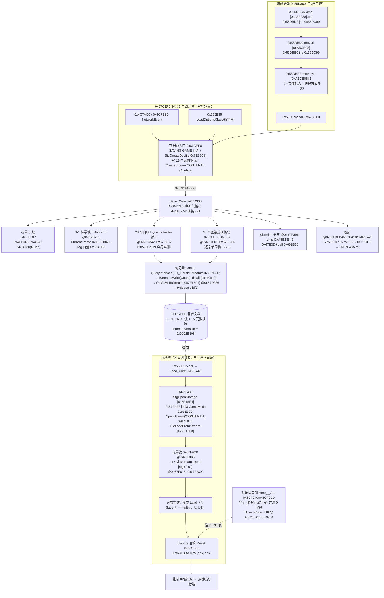

# S17-F1 · 存档/读档调用链（FLOW）

> 卡号 S17-F1｜2026-11-17｜静态（capstone 5.0.7 skipdata=True + pefile + Ghidra 12.1.4 `-noanalysis` 双通道）
> 目标 `ra2youli\gamemd.exe` SHA-256 `73201CC0…F67476` · ImageBase `0x400000` · 文件只读
> 所有地址为 VA。证据见 `EVIDENCE\`，可复跑脚本见 `work\`。等级只用 `[已证]`/`[静态推断]`/`[未证]`。

## 0. 三条顶层结论（先读）

1. **存档总入口 = `0x67CEF0`（存档文件构造器，1040 B，4 调用者）**；其核心序列化器 = **`0x67D300`（Save_Core，4411 B，唯一调用者 `0x67D1AF`）**。
   - ⚠️ 线索 `savegame_block_manifest.md` 把 `0x67CEF0` 标成 "Game::Load"、把 `0x67D0C0` 标成 "Game::Save 外层" —— **均错**，见 `DISAGREE.md` D1/D2。`0x67D0C0` 落在 `0x67CEF0` 函数体内部（0 调用者），`0x67CEF0` 内 `StgCreateDocfile` + `SAVING GAME` 日志 + `call 0x67D300` 三重证据坐实它是**写档**。
2. **被逐个序列化的类 = 35 个函数式块 + 28 个内联向量块 + 标量块**；类间顺序 = `Save_Core` 里写死的调用序（不是数据驱动调度表）。34/35 块的**类名静态不可定**（`.bss` 对象 + RTTI 描述符无文件内引用），只给对象 VA + 调度点，见 `UNKNOWNS.md` U1。
3. **Swizzle = 自研 Here_I_Am/Reset 指针重定位**（不是 OLE 自动）：对象构造期 `Here_I_Am 0x6CF240` 登记 `{原指针, &字段}` 并把字段清 0；读档重建后 `Reset 0x6CF350` 按原指针排序匹配、`0x6CF3BA mov [edx],eax` 回填新指针。

## 1. 调用链总图

## 2. 每跳调用点地址速查

| 跳 | 调用点 VA | 目标 | 语义 | 等级 |
|---|---|---|---|---|
| 写档门控 | `0x55DBCD`/`0x55DBD3`/`0x55DBD9`/`0x55DBE0`/`0x55DBEE` | — | mode==0 且一次性标志未置 | `[已证]` |
| 进写档外层 | `0x55DC92` | `0x67CEF0` | game-loop 首次自动存档 | `[已证]` |
| 进核心 | `0x67D1AF` | `0x67D300` | Save_Core 唯一调用者 | `[已证]` |
| 头块 | `0x67D310`/`0x67D31B`/`0x67D327` | `0x689310`/`0x4C6340`/`0x674730` | 全局元数据 / 0x44B 原样写 / Rules | `[已证]` |
| 标量块 S-1 | `0x67D421` | `0x67F7E0` | CurrentFrame + Tag 向量 | `[已证]` |
| 内联向量块 ×28 | `0x67D342`…`0x67E1C2` | `call [reg+0x10]` | IStream::Write(Count) + 逐元素 OLE | `[已证]` |
| 模板块 #1..#35 | `0x67DF0F`..`0x67E3AA` | `0x67FDF0`+`0x80·i` | 逐字节同构 127B 向量序列化 | `[已证]` |
| Skirmish 分支 | `0x67E3BD`→`0x67E3D9` | `0x69B560` | 仅 mode==5 写 Session.Options | `[已证]` |
| 落盘 | `0x67CF42` | `[0x7E15C8]` | StgCreateDocfile | `[已证]` |
| 进读档核心 | `0x559DC5` | `0x67E440` | Load_Core 唯一直接调用者 | `[已证]` |
| 打开容器 | `0x67E489` | `[0x7E15E4]` | StgOpenStorage | `[已证]` |
| 读 CONTENTS | `0x67E56C`/`0x67E572` | `OpenStream` | "CONTENTS" UTF-16LE @`0x83D5A8` | `[已证]` |
| 标量读 | `0x67E8B5` | `0x67F9C0` | CurrentFrame 读回 | `[已证]` |
| Swizzle 注册 | `0x6CF240`(slot4)/`0x6CF2C0`(slot6) | — | 登记指针字段 + 清 0 | `[已证]` |
| Swizzle 回填 | `0x6CF350`(slot3 经 `0x6CF230`) | — | 排序匹配 + `0x6CF3BA` 回填 | `[已证]` |

## 3. Save 序列化顺序（mode==0 写档分支）

写完档时 `Save_Core 0x67D300` 内**写死的发射顺序**（按地址升序，`EVIDENCE\analysis_boundary_iat.txt` §4 全 52 call）：

1. `0x67D310 call 0x689310` — 场景/全局元数据
2. `0x67D31B call 0x4C6340` — 原样写 0x44 字节（对象 `0x8A38E0`）
3. `0x67D327 call 0x674730` — RulesClass 块
4. `0x67D3B1 call 0x5BE6D0` — 辅助
5. `0x67D421 call 0x67F7E0` — **S-1 标量块**（CurrentFrame `0xA8ED84` + Tag 向量 `0x8B40C8`）
6. `0x67D43A call 0x551B20` — 辅助
7. **28 个内联 DynamicVector 块**：`0x67D342` 起，Count 全局依次 `0x8B4160,0x8B413C,0xA83C9C,0xA8022C,0x8B410C,0xA83CE4,0xA8E34C,0xA83DEC,0xA83C6C,0xA8EB44,0xA8B21C,0xA8E394,0xA8E9AC,0xA8E8D4,0xA8ECB0,0x8B40EC,0x8B41CC,0x8872B4,0xB0E784,0xB0E724,0x8B417C,0xA8EAEC,0xA8B204,0xB0E65C,0xB0F1A4,0xA83D54,0x8B41E4,0x8B41F0`（28/28 实测，布局 Count==Items+0xC）
8. **35 个函数式模板块**（`0x67FDF0+0x80·i`），实参对象 VA 依序见 `PROGRESS.md` 结论表；类名仅 #17 `Save_Sides`(`0x6805F0`, `0x8B4120` SideClass 向量) 可定
9. `0x67E3BD` mode==5 → `0x67E3D9 call 0x69B560` — Skirmish Session.Options
10. `0x67E3FB/0x67E410/0x67E429` — 收尾 `0x751620`/`0x7533B0`/`0x721010`，`0x67E43A ret`

> 每元素序列化原语（模板块与内联块同构）：`IStream::Write(4,&Count)` → `for i<Count: QueryInterface(IID_IPersistStream@0x7F7C80) → OleSaveToStream([0x7E15F4]) → Release`；无独立 length 字段，Count 即长度；对象寻址 = OLE CLSID，镜像内无裸地址落盘。

## 4. Load 序列化顺序（读档分支）

`Load_Core 0x67E440`：

1. `0x67E4E3 call 0x6812D0` → `0x67E4E8 mov [0xA8B238],eax`（GameMode 回填）
2. `0x67E489 StgOpenStorage` → `0x67E56C/0x67E572 OpenStream("CONTENTS")` → `0x67E5D0 OleRun`
3. `0x67E840 mov edi,[0x7E15F8]`（OleLoadFromStream 缓存）
4. `0x67E8B5 call 0x67F9C0` — 标量读（CurrentFrame 等）
5. **15 处 `IStream::Read [reg+0xC]`**（`0x67E615`/`0x67E831`/`0x67E880`/`0x67E91A`/`0x67E958`/`0x67E996`/`0x67E9D4`/`0x67EA12`/`0x67EA50`/`0x67EA8E`/`0x67EACC` …）逐类读回
6. 对象按 OLE CLSID 重建（与 Save 侧**不一一对应**：Save 35 模板块 vs Load 16 助手入口，见 `UNKNOWNS.md` U4）
7. `Reset 0x6CF350` 做 swizzle 回填（由 `0x67E4F2`/`0x67E680 call 0x6CF230` 触发）

## 5. Swizzle 流程（读档后指针重定位）

| 环节 | 函数/地址 | 机制 | 等级 |
|---|---|---|---|
| 单例 | `0xB0C110` = `SwizzleManagerClass::Instance` | 静态初始化器 `0x6CF0C8` 写 vptr `0x7F4108` | `[已证]` |
| vtable | `0x7F4108` | slot3=`0x6CF230`(Reset 壳)→`0x6CF350`；slot4=`0x6CF240`(Here_I_Am 2 参)；slot6=`0x6CF2C0`(3 参) | `[已证]` |
| 登记（存/构造期） | `0x6CF240` | `ebx=[edi]`(原指针)；`[edx+eax*8]=ebx`, `[edx+eax*8+4]=edi`(&字段)；**`0x6CF2A8 mov [edi],0` 清字段**；表项 = `{DWORD 原值, void* 字段址}` 8 B | `[已证]` |
| 双表 | `+0x4`=`Swizzles_Old`, `+0x1C`=`Swizzles_New` | 两个 0x18B 向量；`0x6CF269`/`0x6CF2CD` 分别取址 | `[已证]` |
| 回填（读档后） | `0x6CF350` | 对两表按 `cmp 0x6CF320` 排序（`qsort` 8 B 元素）→ 原值相等则 **`0x6CF3BA mov [edx],eax` 写回字段** → 清两表 | `[已证]` |
| 字段范围（样本） | `TEventClass` ctor `0x71F8C0`：`0x71F908`+`0x28`、`0x71F916`+`0x30`、`0x71F924`+`0x54` | 3 个字段登记；全镜像 Here_I_Am 直接调用点 **476**（rel32 扫描） | `[已证]` |

> 口径说明：`Here_I_Am` **每次调用处理 1 个 void\* 字段**（`void** ppField` 单参）；审计可直接复算的数字 = **TEventClass 3 字段（+0x28/+0x30/+0x54）**，全镜像 476 个登记点。表项本身 2 个 dword（原值 + 字段址）。

## 6. `0x67D300` 门控证据地址（复核，不重做）

| 证据点 | 字节 | 指令 | 作用 |
|---|---|---|---|
| `0x55DBCD` | `393d38b2a800` | `cmp dword [0xA8B238],edi` | mode vs 0（`edi==0`，§894 已证） |
| `0x55DBD3` | `0f85c0000000` | `jne 0x55DC99` | mode≠0 跳过写档 |
| `0x55DBD9` | `a008ceab00` | `mov al,[0xABCE08]` | 一次性标志 |
| `0x55DBDE`/`0x55DBE0` | `84c0`/`0f85b3000000` | `test al,al` / `jne 0x55DC99` | 已写则跳过 |
| `0x55DBEE` | `c60508ceab0001` | `mov byte [0xABCE08],1` | 置一次性标志 |
| `0x55DC92` | `e859f21100` | `call 0x67CEF0` | 唯一进 `0x67D300` 路径 |

双通道（capstone `EVIDENCE\analysis_deep.txt` §D + Ghidra `EVIDENCE\ghidra_dump.log` gating 段）逐条一致。⇒ §894 结论成立：`0x67D300` 只在 mode==0 且首次时经 `0x67CEF0` 跑一次，非每帧。

## 7. 存档文件块结构（静态可推部分）

| 层 | 结构 | 证据 | 等级 |
|---|---|---|---|
| 容器 | OLE2/CFB 复合文档，头 `D0 CF 11 E0 A1 B1 1A E1` | `StgCreateDocfile`/`StgOpenStorage` + 15 流名 | `[静态推断]`（签名字节来自线索文档真机档，本卡 P2 只读静态） |
| 元数据流 | `Version`(4), `Internal Version`(4)=`0x0002B898`@`0x83D560`, `Start/Last Save/Play Time`(8×3), `Executable Name`(16), `Player Name`×2, `Scenario Number`/`Campaign`/`GameType`(4×3), `Scenario Description` | 外层 `0x67CEF0` 的 `0x681080..0x6812E0` setter 族 | `[静态推断]` |
| 状态流 | `CONTENTS`（UTF-16LE 名 @`0x83D5A8`），含 35 块 + 28 向量 + 标量块 | `0x67E56C OpenStream` | `[已证]` |
| 块通用格式 | `[u32 LE Count][Count × 对象]`；元素 = OLE CLSID 子存储（`OleSaveToStream`），无裸指针、无独立 length | 模板 `0x67FDF0` 反汇编（双通道） | `[已证]` |
| 版本闸位置 | 写在 OLE 元数据流 `Internal Version`（**不在 CONTENTS 内**）；读侧 `0x681080` 是 setter 非比较 | `0x681080 = 8b442404 8901 c20400` | `[已证]`（静态）；流布局细节 `[未证]`（P2） |

> 推不出的部分见 `UNKNOWNS.md`：CONTENTS 内部逐块字节布局（magic/块 id 表）静态不可定名，需 P2 真机 dump 或 OLE 解析。
