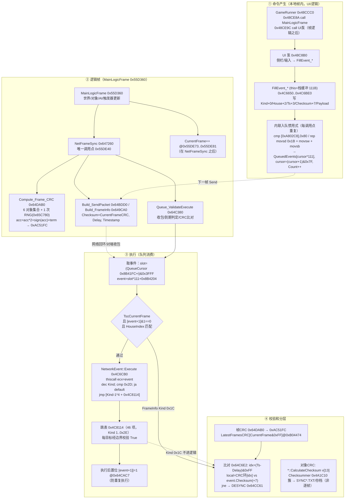

# S18-F1 · 事件队列（EventClass / NetworkEvent）数据流 FLOW

> 目标 `ra2youli\gamemd.exe` SHA-256 `73201CC0…F67476`，ImageBase `0x400000`，只读静态分析。
> 双通道：通道 1 = capstone 5.0.7 `skipdata=True` + pefile（自写 PE 解析，不依赖 atlas）；
> 通道 2 = Ghidra 12.1.4 SLEIGH `-noanalysis`（`EVIDENCE\ghidra_dump.log`）。两通道逐指令一致。
> **命名澄清**：卡片所称 "EventClass" 在网络语境 = 二进制里的 111B 网络事件结构；
> YRpp 名 `NetworkEvent`（`YRpp\NetworkEvents.h`），ares 名 `EventClass`（`out\re_work\...\ares_ref\...\EventClass.h`）。
> RTTI 里另有 **TEventClass**（`.?AVTEventClass@@` @`0x844700`，触发器事件，非网络事件），
> 其 Swizzle 字段 `+0x28/+0x30/+0x54` 属 TEventClass，**不属网络 EventClass**（详见 PROGRESS/DISAGREE）。

## 1. 全链路 mermaid 调用图

## 2. 每跳调用点地址表

| # | 跳 | 调用点/地址 | 语义 | 证据 |
|---|---|---|---|---|
| 1 | GameRunner→MainLogicFrame | `0x48CE8A` call `0x55D360` | 每逻辑帧入口 | `final_verify.txt` |
| 2 | GameRunner→UI泵 | `0x48CE9C` call `0x48C8B0` | 命令收集在帧逻辑**之后** | `final_verify.txt` |
| 3 | UI泵→FillEvent_Noopt | `0x48CA43/0x48CAC4/0x48CBC0` call `0x4C66C0` | 本地命令填充 | `callers.txt` |
| 4 | 侧栏→FillEvent_Produce | `0x6AA7E7` 等 9 点 call `0x4C6970` | 生产/暂停/放弃 | `callers.txt` |
| 5 | Display→FillEvent_SellCell | `0x4AC1B2` call `0x4C6650` | 出售格 | `callers.txt` |
| 6 | FillEvent_Place | `0x4ABB55/0x6A8EE8/0x6AB3FC` call `0x4C6AE0` | 放置建筑 | `callers.txt` |
| 7 | FillEvent_SWPlace | `0x4AC23A/0x6AAF3C` call `0x4C6B60` | 超武放置 | `callers.txt` |
| 8 | 入队（内联） | `0x48CA48..0x48CA9C`（+ 多处同构） | 111B 拷入 QueuedEvents，Count/游标推进 | `enqueue_add.txt` |
| 9 | MainLogicFrame→NetFrameSync | `0x55DE40` call `0x647260`（唯一） | 联机同步驱动 | `callers.txt`/`crc_frame.txt` |
| 10 | NetFrameSync→帧CRC | `0x64731C`/`0x647684` call `0x64DAB0` | 算本帧 CRC | `final_verify.txt` |
| 11 | CRC 尾部 RNG | `0x64DE33` `[0xA8B230]+0x218`→`call 0x65C780` | 每帧 1 次局内 RNG | `crc_detail.txt` |
| 12 | CRC→CurrentFrameCRC | `mov [0xAC51FC],…`（14 写） | `0x64DB4A` 等 | `crc_frame.txt` |
| 13 | NetFrameSync→校验执行 | `0x6474A0/0x6475AE/0x64822F` call `0x64C380` | 收包+到期+比对 | `final_verify.txt` |
| 14 | NetFrameSync→Build_FrameInfo | `0x647FB4` call `0x649CA0` | 发包（含 CRC/Delay） | `final_verify.txt` |
| 15 | Build_SendPacket | `0x64A426` call `0x64BDD0` | 组包发送 | `callers.txt` |
| 16 | ValidateExec→Execute | `0x64C911`/`0x64CC0A` call `0x4C6CB0`（2 处） | 事件分派 | `callers.txt` |
| 17 | Execute 分派 | `0x4C6CCD dec; 0x4C6CCE cmp 0x2D; 0x4C6CD7 jmp [eax*4+0x4C8114]` | 46 项 | `explore0.txt`/`ghidra_dump.log` |
| 18 | 执行后置 executed 位 | `0x64CAC0..0x64CACA` `or cl,1` | `[event+1]|=1` | `execflag.txt` |
| 19 | desync 比对 | `0x64C6E2 cmp; 0x64C6F2 jne 0x64CC61`（`idx=(Ts−Delay)&0xFF` @`0x64C6CC..E2`） | CRC 不等→desync | `edx_trace.txt`/`decode_correction.txt` |
| 20 | desync 报告 | `0x64735F call 0x6516F0` / `0x647368 call 0x64DEA0` | SYNC*.TXT | `final_verify.txt` |
| 21 | CurrentFrame++ | `0x55DE73 mov; 0x55DE7E inc; 0x55DE81 mov [0xA8ED84]` | 帧推进（同步之后） | `crc_frame.txt` |

## 3. 队列容器与事件尺寸（复算锚点）

| 容器 | 基址 | 容量/步长 | 索引/游标 | 类型 |
|---|---|---|---|---|
| 本地待发 `QueuedEvents` | `0xA802D4` | 128 × 111B | Count `0xA802C8`（上限 0x80）/ 写游标 `0xA802D0`（&0x7F）/ 时戳数组 `0xA83A54` | `NetworkEvent[128]`（栈缓冲中转 + 内联 rep movsd 0x1B+movsw+movsb 复制 111B） |
| 网络命令环 `Queue` | `0x8B4204` | 0x4000 × 111B（slot&0x3FFF） | Count `0x8B41F8` / 读游标 `0x8B41FC` | `NetworkEvent[0x4000]` |
| MegaMission 二级缓冲 | `0xA83EDC` | 0x100 × 111B | Count `0xA83ED0`（<0x100 才收）/ 游标 `0xA83ED8` | `NetworkEvent[0x100]` |

> 111B = `0x1B*4 + 2 + 1`；事件指针换算 `slot*37*3 + base`（`lea [eax+eax*8]` + `lea [eax+edx*4]` 得 ×37，再 `[eax+eax*2]` 得 ×3）。
> 复制用 `rep movsd ecx=0x1B`（108B）+ `movsw`（2B）+ `movsb`（1B）= **111B**（`enqueue_add.txt` 多处同构）。
