# S19-F1 · 音效 / EVA / 音乐 / VQA 调度链

> 卡号 S19-F1｜目标 `ra2youli\gamemd.exe`（SHA-256 `73201CC0…F67476`，ImageBase `0x400000`，只读）
> 证据分级：`[已证]`=本次双通道/指令级实证；`[静态推断]`=单通道或需运行时确认；`[未证]`=尚缺证据。
> 双通道：通道 A = capstone 5.0.7 全 `.text` 线性反汇编（`skipdata=True`，1,394,120 指令 / 跳过 66 字节）；
> 通道 B = Ghidra 12.1.4 项目 `gamemd_auto`（`-noanalysis`）引用模型（见 `EVIDENCE/ghidra_xref_*.txt`）。
> 工作脚本 `work/*.py`，原始反汇编 `EVIDENCE/*.txt`。

## 1. 调用图（mermaid）

```mermaid
flowchart TD
    subgraph 主循环["主循环 (S01)"]
        ML["Game::MainLoop 0x52D9A0"]
        UHC["Game::UnknownCall 0x48D080 (169 sites/71 fns)"]
        LF["AudioFrameUpdate 0x406F70"]
        ML --> UHC --> LF
        ML -.每帧/事件.-> EVAT["EVA_* 事件触发点<br/>0x449C30 / 0x445F80 / ..."]
        ML -.过场时.-> MOVIE["Play_Movie → Bink 0x432C70"]
    end

    subgraph 总入口["音频总入口"]
        DS["dsound.dll #1 = DirectSoundCreate<br/>IAT 0x7E1050 → thunk 0x7C89DA"]
        INIT["AudioInit(this) 0x409470 (atlas gap)<br/>call thunk @0x40948E; SetCooperativeLevel @0x4094B6<br/>CreateThread(0x4095B0) @0x409511"]
        FEED["DirectSound 混音/喂缓冲线程 0x4095B0<br/>GetStatus +0x24 / GetCurPos +0x10 / Stop +0x48<br/>Lock +0x2C / Unlock +0x4C / Restore +0x50 / Sleep(0x21)"]
        DS --> INIT --> FEED
    end

    LF -->|"33ms 门 @0x406FB2 cmp eax,0x21"| UPD["0x4041D0 样本衰减/Limit 强斩"]
    LF -->|"@0x406FBC"| V3D["0x750EC0 3D 音效列表 tick"]
    LF -->|"@0x406FC1"| EVT["EVA::FrameUpdate 0x752760"]
    LF -->|"@0x406FCB"| ETH["Theme::AI 0x7209D0"]
    LF -->|"@0x406FD0"| STR["CD/流式 WAV 0x7B84D0"]

    subgraph VOC["VocClass (音效, 一次性)"]
        PG["VocClass::PlayGlobal 0x750920<br/>116 sites / 66 caller fns"]
        PA["VocClass::PlayAt 0x7509E0<br/>97 sites / 65 caller fns"]
        PIA["VocClass::PlayIndexAtPos 0x750E20<br/>18 sites / 10 caller fns"]
        VA["VoiceAlloc 0x405190 (300-slot pool)"]
        PG --> VA; PA --> VA; PIA --> PA
    end
    EVAT --> PG

    subgraph EVA["EVA (独立流, 非 300 槽池)"]
        QV["EVA::QueueVoice 0x752700<br/>77 sites / 42 caller fns<br/>ECX=EVA_* 名串, EDX=优先级"]
        ENQ["入队判决 0x752480<br/>名→索引表 [0xB1D4A4]/[0xB1D4B0] via stricmp 0x7C8D20"]
        EVT["EVA::FrameUpdate 0x752760 (call @0x406FC1 链)"]
        PW["AudioStream::PlayWAV 0x407B60<br/>5 sites / 4 caller fns"]
        QV --> ENQ --> EVT --> PW
    end
    EVAT -.->|"mov ecx,0x819030 'EVA_StructureSold'<br/>call 0x752700 @0x449CE5"| QV

    subgraph MUS["音乐 / AudioStream (流式)"]
        TAI["Theme::AI 0x7209D0 (caller=0x406F70)"]
        TQ["Theme::QueueSong 0x720B20 (30 sites/13 fns)"]
        TP["Theme::PlaySong 0x720BB0 (12 sites/8 fns)"]
        TS["Theme::Stop 0x720EA0 (27 sites/10 fns)"]
        ASP["AudioStream::PlayWAV 0x407B60"]
        TAI --> TQ --> TP --> ASP; TS --> ASP
        THM["INI key 'Theme' @0x824194"] -.4 xrefs.-> TQ
    end
    ETH --> TAI; TAI --> TQ

    subgraph MOV["VQA/Bink 过场（阻塞主循环）"]
        BM["Play_Movie → BinkOpen 0x432750"]
        LOOP["Bink 播放主循环 0x432C70<br/>回边 0x432D21/0x432E03/0x432E0C/0x432E21 → 0x432CB8<br/>PeekMessage 0x53E770 / GetMessage 0x53E730<br/>Translate/Dispatch / BinkDoFrame 0x432E40 / Sleep(0x21)"]
        ADV["VQAClass::Advance_Frame 0x759C30 (2 callers)"]
        BM --> LOOP --> ADV
    end
    MOVIE --> BM
```

## 2. 每跳调用点地址表

| 跳 | 调用点 VA | 目标 | 语义 | 分级 |
|---|---|---|---|---|
| dsound IAT | — | `0x7C89DA` jmp `[0x7E1050]` | DirectSoundCreate (ordinal 1) | `[已证]` |
| DS init | `0x40948E` | `0x7C89DA` | 创建 IDirectSound（唯一调用点，atlas gap 内） | `[已证]` |
| DS init | `0x4094B6` | `call [vptr+0x18]` | SetCooperativeLevel(hwnd, DSSCL_PRIORITY=2) | `[已证]` |
| DS init | `0x409511` | `call [0x7E11F8]` | CreateThread(proc=0x4095B0) 喂缓冲线程 | `[已证]` |
| 主循环→音频 | `0x48D08C` | `0x406F70` | AudioFrameUpdate（通道A 2 sites 之一） | `[已证]` |
| 主循环→音频 | `0x607F0A` | `0x406F70` | 第二入口 fn 0x6071E0 | `[已证]` |
| 33ms 门 | `0x406FB2` | `cmp eax,0x21` | >33ms 才推进；重入锁 `[0x87E75C]` | `[已证]` |
| 帧内 1 | `0x406FB7` | `0x4041D0` | 样本衰减 + Limit 事后强斩 (`0x404D80`) | `[已证]` |
| 帧内 2 | `0x406FBC` | `0x750EC0` | 3D 音效列表 tick | `[已证]` |
| 帧内 3 | `0x406FC1` | `0x752760` | EVA 流推进 | `[已证]` |
| 帧内 4 | `0x406FCB` | `0x7209D0` | Theme::AI（`mov ecx,0xA83D10`） | `[已证]` |
| 帧内 5 | `0x406FD0` | `0x7B84D0` | CD/流式 WAV | `[已证]` |
| 音效播放 | 116 sites / 66 fns | `0x750920` | PlayGlobal（ECX=SoundID） | `[已证]` |
| 音效播放 | 97 sites / 65 fns | `0x7509E0` | PlayAt（ECX=SoundID, EDX=Coord*） | `[已证]` |
| 音效播放 | 18 sites / 10 fns | `0x750E20` | PlayIndexAtPos | `[已证]` |
| Voice 分配 | 4 sites/4 fns | `0x405190` | 300 槽池分配（零抢占） | `[已证]` |
| EVA 触发 | `0x449CE5` | `0x752700` | `mov ecx,0x819030` ("EVA_StructureSold")；`push -1` | `[已证]` |
| EVA 名→索引 | `0x75271F` | `0x7C8D20` | stricmp(名, EVA 表项) | `[已证]` |
| EVA 入队 | `0x752740`/`0x752754` | `0x752480` | ECX=索引/-1，EDX=优先级，栈参 | `[已证]` |
| EVA→播放 | 0x752760 内 | `0x407B60` | AudioStream::PlayWAV（专用流，非池） | `[已证]` |
| Theme 停止 | 27 sites/10 fns | `0x720EA0` | Theme::Stop（调 0x407F40/0x408070） | `[已证]` |
| VQA/Bink | `0x432CB8` 回边环 | `0x432E40` | BinkDoFrame；内部自建消息泵 | `[已证]` |
| VQA advance | `0x5C0095`/`0x5C031D` | `0x759C30` | VQAClass::Advance_Frame（每帧调用） | `[已证]` |

## 3. `VocClass` 字段表（24 字段；0x148 B）

> 写者来自 `0x750440` INI 解析函数（13 个 setter 全由它调用）与运行时函数；读者来自 Voice 生命周期 `0x4041D0`/`0x405190`。INI 键地址经逐字符读取核对。类名取已入账交叉事实，非新 RTTI 发现（类无自身 TD）。

| 偏移 | 宽 | INI 键 | 语义 | 写者 | 读者 |
|---|---|---|---|---|---|
| +0x00 | 12 | — | 链表头 Next/Prev/Magic | 链操作 | 链操作 |
| +0x0C | 4 | — | SamplesOK（样本挂载成功） | ctor/load | `[静态推断]` |
| +0x10 | 4 | Control | 循环/随机/中断/攻击/衰减位 | `0x406570` | `0x4042AF,0x405729,0x4057DF,0x4058CC,0x406650` |
| +0x14 | 4 | Type | 声学类型位（VIOLENT/GLOBAL/SCREEN/LOCAL/PLAYER） | `0x4065C0` | `0x750B2D` (via `0x405160`) |
| +0x18 | 40 | Volume | 音量结构（基准+衰减斜率） | `0x406550` | `0x4052E0`(VoiceAlloc) |
| +0x40 | 4 | Priority | 优先级 0..4 | `0x406540` | `0x4044A9,0x40565D,0x4059D0` |
| +0x44 | 4 | — | ActiveInstanceCount（活跃实例数） | `0x40423B,0x4042ED` | `0x4042E7` |
| +0x48 | 4 | Limit | 并发硬上限（事后强斩） | `0x4065D0` | `0x4042EA` |
| +0x4C | 4 | Loop | 循环次数 | `0x406640` | `0x4057E9,0x40665C` |
| +0x50 | 4 | Range | 3D 最大可听射程 | `0x4065E0` | `0x750AC0` helper |
| +0x54 | 4 | MinVolume | 最小音量阈值(float) | `0x4065F0` | `0x750AC0` helper |
| +0x58 | 4 | Delay(低) | MinDelay（循环最小间隔） | `0x406600` | `0x40573D` |
| +0x5C | 4 | Delay(高) | MaxDelay | `0x406600` | `0x405740` |
| +0x60 | 4 | FShift(低) | MinFDelta | `0x406610` | `0x40567A` |
| +0x64 | 4 | FShift(高) | MaxFDelta | `0x406610` | `0x405677` |
| +0x68 | 4 | VShift | 音量抖动 0..100（clamp） | `0x406620` | `0x405697` |
| +0x6C | 32 | `[SectionName]` | Name ASCII | load | `0x40517E` |
| +0x8C | 8 | — | 同音效 Voice 活跃链表头/尾 | `0x40422D` | `0x404274,0x4042CA` |
| +0x98 | 4 | — | LastResetTick（帧内唯一重置标记） | `0x40424B` | `0x404225` |
| +0x9C | 128 | — | SampleIndices int[32] | load | playback |
| +0x11C | 4 | — | NumSamples | load | sample select |
| +0x138 | 4 | Attack | 淡入帧 | `0x406520` | `0x406570` |
| +0x13C | 4 | Decay | 淡出帧 | `0x406530` | `0x406570` |
| +0x140 | 8 | — | Reserved / 对齐到 0x148 | — | — |

## 4. 关键判据

1. **VocClass vs AudioController/AudioStream**：VocClass 是**一次性音效描述**（按 ID 触发一次，走 300 槽池 `0x87E2A8`）；AudioStream 是**流式 PCM 通道**（主题曲/EVA/过场 WAV，`[0xB1D4CC]`），由 `0x407B60` 播放，不占池；AudioController 是**对象上的声道句柄容器**（`GetVoice 0x406130` / `ShutUp 0x406060`），提供"一槽一声"复用。
2. **Theme= 切换**：INI 键 "Theme"@`0x824194`（4 imm xrefs）→ `Theme::QueueSong 0x720B20` / `Theme::PlaySong 0x720BB0`；停止走 `Theme::Stop 0x720EA0`（`call 0x407F40` 停流）。
3. **EVA→音效ID**：EVA 不是直接数 ID，而是 `ECX=EVA_* 名串` 经 `0x7C8D20` stricmp 与表 `[0xB1D4A4]`（项数 `[0xB1D4B0]`）比对得索引，再交 `0x752480` 入队。
4. **VQA 阻塞主循环**：`[已证]` 是。播放函数 `0x432C70` 自持消息泵（Peek/GetMessage + Translate/Dispatch）并有 4 条回边到 `0x432CB8`，直到电影结束/跳过才返回；期间主游戏循环 `0x52D9A0` 不推进。`VQAClass::Advance_Frame 0x759C30` 是被该环调用的推进器（非相反）。
5. **音量存储**：`GameOptionsClass::Instance=0xA8EB60`（只读交叉线索 YRpp）；本次 `fld dword` 实证浮点字段在 `0xA8EB98/0xA8EB9C/0xA8EBA0`（+0x38/+0x3C/+0x40），INI 键串 "ScoreVolume"/"VoiceVolume"/"Audio"/"SoundVolume" 位于 `0x832Fxx`/`0x8330xx`（表驱动读取）；与 YRpp 头声明的 +0x30/+0x34/+0x38 **不一致**，见 `DISAGREE.md`。注意 `RulesClass` 单例在 `0x87F7E8`/`0x8871E0`，非音量宿主。
