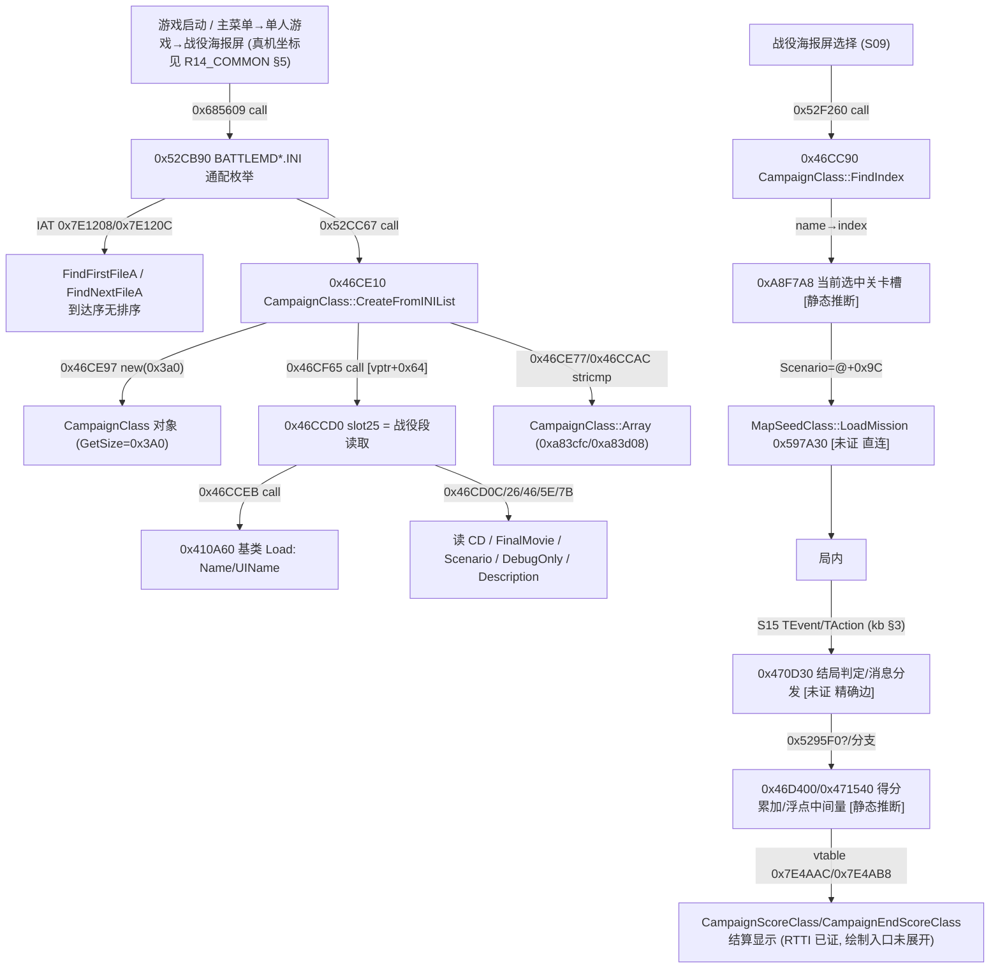

# S21-F1 FLOW — 战役选择 → 关卡载入 → 胜负判定 → 得分/结算 调用链

> 每跳标注：调用点地址（调用指令所在 VA）→ 目标函数 → 一句语义 → 分级。
> 证据统一见 `EVIDENCE/FLOW_EVIDENCE.md`（分 §A–§E）。分级只取 `[已证]`/`[静态推断]`/`[未证]`。
> ⚠️ 本卡为静态卡，未跑真机；真机坐标（主菜单 720,220 → 单人游戏 720,304 → 開始遊戲 710,264，见 R14_COMMON §5）只作背景，不作为本链证据。

## Mermaid 调用图

## 每跳明细表

| # | 调用点地址 | 目标函数 | 一句语义 | 分级 |
|---|---|---|---|---|
| 1 | 0x685609 | 0x52CB90 | 启动期枚举所有散装 `BATTLEMD*.INI`（FS-only，到达序） | [已证]（调用点+被调函数字节实证） |
| 2 | 0x52CBA0 / 0x52CCAA（IAT 0x7E1208/0x7E120C） | FindFirstFileA / FindNextFileA | 通配 `BATTLEMD*.INI` 遍历，跳过 0x116 属性 | [已证] |
| 3 | 0x52CC67 | 0x46CE10 | 对每个 INI 归并 `[Battles]` 段 | [已证] |
| 4 | 0x46CE97 | 0x7C8E17 (operator new) | 新建 `CampaignClass`，分配 0x3a0 | [已证] |
| 5 | 0x46CF65 | 0x46CCD0 (via vtable slot25) | 按战役名（+0x24）读该战役段 | [已证] |
| 6 | 0x46CCEB | 0x410A60 | 基类 Load 读 Name/UIName | [已证] |
| 7 | 0x46CD0C/0x46CD26/0x46CD46/0x46CD5E/0x46CD7B | 0x5276D0/0x4757D0/0x528A10/0x5295F0/0x529160 | 读 CD/FinalMovie/Scenario/DebugOnly/Description 五键 | [已证] |
| 8 | 0x46CE77 / 0x46CCAC | 0x7C8D20 (_stricmp) | 按 `CampaignClass+0x24` 名判重/查找 | [已证] |
| 9 | 0x52F260 | 0x46CC90 | 战役名 → 关卡序号（列表选择 → 内部 index） | [已证]（调用点）；目的槽 0xA8F7A8 [静态推断] |
| 10 | —（场景值写 0xA8F7A8 @ 0x52F38D） | 关卡载入 | 选中 index → `Scenario=@+0x9C` 地图名 → 载入 | [未证]（直连 LoadMission 0x597A30 未定位） |
| 11 | —（S15 kb §3，复用） | 0x71E940 TEventClass::HasOccured | 触发器事件判定 → 胜负动作 | [已证]（S15 已入账，本卡引用） |
| 12 | 0x470D58 / 0x470D6F（0x470D30 函数内） | 0x622B50 / 0x7E1474 | 结局判定前置门控 + 状态读取 → 消息 ID 分支 | [静态推断]（精确胜负条件边未证） |
| 13 | 0x46CEB5→vtable / 0x46D330 / 0x46D350 | 0x46D330/0x46D350/0x471500/0x471520 | 结算类构造/析构、vptr 0x7E4AAC/0x7E4AB8 | [已证]（RTTI + 指令实证） |
| 14 | 0x734E60（经 0x46D3E6/0x470D16） | 计分格式化 | TXT_TIME_FORMAT_HOURS 时间/分数格式化 | [已证] |
| 15 | 0x46D400 / 0x46D430 / 0x471540 | 得分累加 | 全局 0x89E000(8项) + 浮点 0x89E120/0x89E170/0x89E158 | [静态推断] |
| 16 | vtable 0x7E4AAC / 0x7E4AB8 | CampaignScoreClass / CampaignEndScoreClass | 结算界面数据对象 | [已证] 类+表；绘制入口 [未证] |

## 链上跳数（核心数字）

**配置→选择子链 = 9 跳有明确调用点**（#1–#9，逐一有 VA）；完整 4 段链共 16 跳，其中 [已证] 10 / [静态推断] 4 / [未证] 2。
可独立复算：`grep -n "0x52CC67\\|0x46CF65\\|0x46CCEB\\|0x46CE77\\|0x52F260" EVIDENCE/FLOW_EVIDENCE.md` 对读 `work/` 脚本输出。
