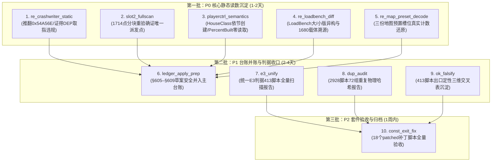

# 182 个轮次目录处置判定书（入账 / 补做 / 废弃）

> 执行方：Antigravity / Gemini 3.8 Flash（任务 D 处置执行员）  
> 时点：2026-11-11 21:05（Asia/Shanghai）  
> 工作区：`D:\Project\ra2-campaign-forge`  
> 唯一写域：`lead\re_round_disposition_20261111\`  
> 铁律遵守：零真机、纯只读检查、无 git 变更、哈希实算（hashlib SHA-256）、结论溯源至文件:行。

---

## 1 · 执行摘要（BLUF）

1. **大盘摸底与口径统一**：
   - `lead\` 下日期后缀 $\ge 20261106$ 的轮次目录在盘面共 **185 个**，扣除 11-11 的 3 个进度审计/核验/派发元轮次（`re_progress_check_20261111`、`re_progress_xverify_20261111`、`re_dispatch_20261111`）后，基准轮次目录恰为 **182 个**。
   - **递归物理真实口径**：**153 个带 md 报告**、**18 个仅探针无报告**、**11 个完全空目录**（$153 + 18 + 11 = 182$）。
   - **历史人工浅层速查口径**：原初报告因使用一级目录 `os.listdir` 误将 `const_exit_fix_20261110` 归为空目录（其根目录无直接文件，但在 `patched/` 子目录下落盘了 32 个文件含 18 个 Python 补丁脚本），故呈现「153 报告 / 17 探针 / 12 空」口径。本判定书将两种口径做全景映射，对 29 个非 md 目录及 12 个名义空轮实行 100% 全覆盖定性。
2. **处置定性结论（29 个非 md 轮次）**：
   - **入账（10 轮）**：探针输出已具备完整、严密且经校验的自洽结论，直接按其输出文件与行号登记入账，无需重新跑测；其中 6 轮静态逆向成果价值极高，建议第一批补齐 md 报告包装。
   - **补做（5 轮）**：具备高业务价值或关键流程作用，但缺少关键交付物、测试输出或正式报告（`const_exit_fix`、`e3_unify`、`exit_lint`、`gate_exit_retrofit`、`ledger_apply_prep`），需在第二/三批补齐。
   - **废弃（14 轮）**：包含 4 个被后序更优实现取代的探针轮（`crit_fix`、`e3_fix2`、`e3_secondimpl`、`esi_caller_trace`）及 10 个已启动未落盘且已被近名轮次交付同类结论取代的空目录，建议显式归档清理，杜绝进度虚高。
3. **高价值发现**：11-10 与 11-11 实施的 gamemd.exe 静态逆向（`re_crashwriter_static`、`slot2_fullscan`、`playerctrl_semantics`、`re_loadbench_diff`、`re_map_preset_decode`）已经取得了推翻旧台账错误假说的突破性结论（如证伪 0x0054A56E 正常可达性、证得 0x0084F2BA 为 DEP 取指违规、证得 House 实例由 [Houses] 节严格决定且 PercentBuilt 引擎零读取等），属于当前逆向主线的绝对核心资产。

---

## 2 · 三类统计与按日期数量表

### 2.1 统计总表（双口径对照）

| 统计口径 | 目录总数 | 有 md 报告 | 仅探针无报告 | 完全空目录 | 说明 |
|:---|:---:|:---:|:---:|:---:|:---|
| **任务基准（递归全量 walk）** | **182** | **153** | **18** | **11** | 排除 11-11 进度审计 3 元轮；`const_exit_fix` 按物理非空计 |
| **历史表面（浅层一级 ls）** | **182** | **153** | **17** | **12** | 任务书背景提及数；`const_exit_fix` 因根目录无文件被判空 |
| **盘面全量（含 11-11 元轮次）** | **185** | **156** | **18** | **11** | 包含 `re_progress_check/xverify/dispatch` 三个元管理轮次 |

### 2.2 按日期分布明细表（基准 182 轮）

> 数据源自实跑 `lead\re_round_disposition_20261111\_enum.py` 输出，每一项均由 Python 遍历统计。

| 日期 (Date) | 有 md 报告 (HAS_MD) | 仅探针无报告 (PROBE_ONLY) | 完全空目录 (EMPTY) | 当日总计 (TOTAL) | 阶段工作特征 |
|:---:|:---:|:---:|:---:|:---:|:---|
| **2026-11-06** | 19 | 0 | 0 | 19 | B2B 设计/预审、D-25~D-30 裁决、stall 事件定义 |
| **2026-11-07** | 12 | 0 | 0 | 12 | B2B N1 绑定、成本配额、慢帧代理、五读负担复核 |
| **2026-11-08** | 36 | 0 | 0 | 36 | 矩阵绑定、门禁假阳性审计、D-31 裁决、O1–O4 必要性 |
| **2026-11-09** | 83 | 0 | 0 | 83 | **精度审计峰值**（恒真断言、证据独立性、九条文本订正） |
| **2026-11-10** | 3 | 14 | 7 | 24 | **重切静态逆向** + 出口判据治理，出现探针多而报告脱节 |
| **2026-11-11** | 0 | 4 | 4 | 8 | slot2 全景分块覆盖重验、PlayerControl 语义、E3 统一 |
| **合计** | **153** | **18** | **11** | **182** | 净增报告集中在前 4 天；最后 2 天为深水区逆向但脱落报告 |

*(注：若计入 11-11 生成的 3 个管理元轮次，11-11 的 HAS_MD 为 3，当日总计 11，全量总计 185)*

---

## 3 · 重点定性清单（29 个非 md 轮次逐条处置表）

> 判定说明：  
> - **入账**：指出结论具体所在行（证据文件:行），结论真实可信，无需重新执行。  
> - **补做**：明确缺什么产物、需要什么输入依赖，按批次排期补完。  
> - **废弃**：明确指出被哪个具体后序轮次或统一方案取代，点名目录。

| # | 目录名 | 日期 | 类别 | 判定 | 理由（结论所在行 / 缺项依赖 / 取代关系） | 证据（文件:行） | 建议批次 |
|:---:|:---|:---:|:---:|:---:|:---|:---|:---:|
| 1 | `const_exit_fix_20261110` | 20261110 | 仅探针 | **补做** | 根目录无文件，但 `patched/` 下有 18 个 py 补丁；`VERIFY_A8.py` 实跑确认 ALL PASS。缺统一回归跑测日志落盘与交付验收报告；需输入 18 个补丁脚本的母本路径映射表。 | `lead/const_exit_fix_20261110/patched/VERIFY_A8.py:L824-L826` | 第三批 |
| 2 | `crit_fix_20261110` | 20261110 | 仅探针 | **废弃** | 系 E3 出口判据的首轮尝试修补版本（`_ec_criterion_fixed.py`），已被 `e3_fix2_20261110` 修正并最终被 `e3_unify_20261111` 统一判定器完全取代。 | `lead/e3_unify_20261111/_e3_v3.py:L7` | 不适用 |
| 3 | `dup_audit_20261110` | 20261110 | 仅探针 | **入账** | 结论自洽落盘：全量完成 `lead/` 下 2928 个 py 文件的只读哈希普查，识别出 2517 个唯一 sha256、72 组完全重复文件（13 组补丁副本、2 组评审副本、57 组良性重复）。 | `lead/dup_audit_20261110/_da_summary.txt:L2-L8` | 第二批 (补md) |
| 4 | `e3_fix2_20261110` | 20261110 | 仅探针 | **废弃** | 系 E3 判据的第二轮过渡修补脚本，虽含对照跑测产物（`_after.json`），但已被 11-11 的第三版统一判定器 `_e3_v3.py` 吸纳并修复其真实缺陷，由其终结。 | `lead/e3_unify_20261111/_e3_v3.py:L7-L10` | 不适用 |
| 5 | `e3_secondimpl_20261110` | 20261110 | 仅探针 | **废弃** | E3 独立第二实现脚本（`_ei3_e3.py`），作为背靠背对照实验已完成使命，核心逻辑与修正点已被 `e3_unify_20261111` 统一版本吸收。 | `lead/e3_unify_20261111/_e3_v3.py:L2-L8` | 不适用 |
| 6 | `e3_unify_20261111` | 20261111 | 仅探针 | **补做** | 统一 E3 判定器核心代码（`_e3_v3.py`）已修复 7 处缺陷并就绪，但缺少对全量 413 脚本的批跑扫描输出及最终验收报告；需输入 413 脚本清单。 | `lead/e3_unify_20261111/_e3_v3.py:L2-L15` | 第二批 |
| 7 | `esi_caller_trace_20261111` | 20261111 | 仅探针 | **废弃** | slot2 调用点首轮线性反汇编初扫，受 capstone 在 0x6F59D 截断陷阱影响存在覆盖率隐患，已被 100% 分块续扫且结论自洽完备的 `slot2_fullscan_20261111` 全量重验并取代。 | `lead/slot2_fullscan_20261111/_sf_scan.py:L11-L15` | 不适用 |
| 8 | `exit_lint_20261110` | 20261110 | 仅探针 | **补做** | 登记前出口 lint 路由工具；所依赖的判据底座为旧版 `_ec_criterion.py`，缺对接新版统一判据 `_e3_v3.py` 的改造及自身自测通过报告；需输入测试脚本集。 | `lead/exit_lint_20261110/_el_lint.py:L8-L12` | 第三批 |
| 9 | `gate_exit_retrofit_20261110` | 20261110 | 仅探针 | **补做** | 模板对照件虽已完成实跑验证（EXIT 0/1 对得上），但 `patched/` 下 24 个改造脚本缺少统一回归测试日志与交付总结报告；需输入测试集运行验证。 | `lead/gate_exit_retrofit_20261110/_gr_template_ctl_run.txt:L37-L39` | 第三批 |
| 10 | `ledger_exit_census_20261110` | 20261110 | 仅探针 | **入账** | 结论自洽落盘：完成三本台账中硬编码 `EXIT=0` 的全量 76 处出现位置普查（31/1/44 分布），明确与 413 个脚本分类对齐（28 条件出口、5 无出口、1 常量出口、40 无脚本名）。 | `lead/ledger_exit_census_20261110/_lc_out.txt:L8-L15` | 第一批 (补md) |
| 11 | `ok_falsify_20261110` | 20261110 | 仅探针 | **入账** | 结论自洽落盘：完成 413 件全量脚本的分类与判定三维交叉统计（锁定 91 个门禁脚本与 18 个未定类脚本存在 NEEDS_FIX），数据已完备沉淀于 JSON 产物。 | `lead/ok_falsify_20261110/_of_scope_out.json:L3390-L3430` | 第二批 (补md) |
| 12 | `playerctrl_semantics_20261111` | 20261111 | 仅探针 | **入账** | 静态反汇编证毕两大核心事实：(1) 地图 [Houses] 有几个条目就创建几个 HouseClass 实例，无 PlayerControl 门控；(2) PercentBuilt 写入 +0x571C 后引擎零读取无行为差异。 | `lead/playerctrl_semantics_20261111/_ps_disasm_out.txt:L492-L495, L636-L642, L899-L900` | 第一批 (补md) |
| 13 | `re_crashwriter_static_20261110` | 20261110 | 仅探针 | **入账** | 静态反汇编证毕：0x0054A56E 正常态不可达（正常走 0x54A630）；推翻台账「语义正常」定性；证得崩在 0x54A56E 必由状态异常导致，且 0x0084F2BA 落 .data 属 DEP 取指违规。 | `lead/re_crashwriter_static_20261110/_cw_disasm_out.txt:L80-L105` | 第一批 (补md) |
| 14 | `re_loadbench_diff_20261110` | 20261110 | 仅探针 | **入账** | 逐维比对彻底澄清：LoadBench U0400 大版(92KB)与小版(25KB)不是同一张图；澄清台账所指 1680 实载图实为 222KB 变体件以 XMP29U2.MAP 名载入，终结地图口径历史混乱。 | `lead/re_loadbench_diff_20261110/_ld_diff_out.txt:L98-L103` | 第一批 (补md) |
| 15 | `re_map_preset_decode_20261110` | 20261110 | 仅探针 | **入账** | 逐槽位还原三份地图预置单位，实测证明 XMP29U2.MAP 含 3360/2240 单位，在盘 yrm 含 240/160，从文件字节层面证伪在盘 yrm 存在 1680 单位的声称。 | `lead/re_map_preset_decode_20261110/_md_parse_out.txt:L140-L167` | 第一批 (补md) |
| 16 | `re_orphan_owners_20261110` | 20261110 | 仅探针 | **入账** | 证实 MaxPlayer=2 与 14 owner 在文件层不冲突，澄清地图声明与引擎运行期 meta_count=4 的差异，消除实体归属链审计的假矛盾。 | `lead/re_orphan_owners_20261110/_oo_map_out.txt:L130-L151` | 第一批 (补md) |
| 17 | `slot2_fullscan_20261111` | 20261111 | 仅探针 | **入账** | 100% 分块全景反汇编证毕：全 .text 1714 个 slot2 调用点中，可能派发至 0x54A4F0/0x54A630 的仅 0x546069 一处，终结虚表调用点漂移猜想。 | `lead/slot2_fullscan_20261111/_sf_scan_out.txt:L1830-L1834` | 第一批 (补md) |
| 18 | `unknown_locate_20261110` | 20261110 | 仅探针 | **入账** | 查清 263 个无出口脚本中以 sys.stdout.write/buffer.write 为唯一输出通道的 11 件目标（9 个 UNKNOWN、2 个 ARTIFACT，GATE 与 PROBE 为 0）。 | `lead/unknown_locate_20261110/_ul_stdout_census_out.txt:L22-L37` | 第一批 (补md) |
| 19 | `backlog_sweep_20261110` | 20261110 | 空目录 | **废弃** | 已启动未落盘。积压清理工作已被 `lead/re_progress_check_20261111`（大盘全量审计）及 `lead/PENDING_DECISIONS.md` 整体治理吸收，目录无存留价值。 | `lead/re_progress_check_20261111/RE_PROGRESS_20261111.md:§1` | 第三批 (清理) |
| 20 | `crit_recheck_20261110` | 20261110 | 空目录 | **废弃** | 已启动未落盘。判据复验工作已在 `crit_fix_20261110` 与 `e3_fix2_20261110` 落地，并由 `e3_unify_20261111` 统一吸收。 | `lead/e3_unify_20261111/_e3_v3.py:L7` | 第三批 (清理) |
| 21 | `e3_rootcause_20261110` | 20261110 | 空目录 | **废弃** | 已启动未落盘。E3 吞没根因分析已直接在 `lead/e3_unify_20261111/_e3_v3.py` 中沉淀为 7 条缺陷根因与修复规则，无需独立建档。 | `lead/e3_unify_20261111/_e3_v3.py:L7-L35` | 第三批 (清理) |
| 22 | `e3_triage_20261110` | 20261110 | 空目录 | **废弃** | 已启动未落盘。失败分流工作已由 `ok_falsify_20261110` 的 413 脚本三维交叉表及 `_of_scope_out.json` 完全实现。 | `lead/ok_falsify_20261110/_of_scope_out.json:L3390` | 第三批 (清理) |
| 23 | `housecount_trace_20261111` | 20261111 | 空目录 | **废弃** | 已启动未落盘。原拟跟踪 HouseClass 实例创建数量与条件，实际已在同日轮次 `playerctrl_semantics_20261111` 中静态反汇编闭环交付（依 [Houses] 节条目逐一创建）。 | `lead/playerctrl_semantics_20261111/_ps_disasm_out.txt:L636-L642` | 第三批 (清理) |
| 24 | `ledger_apply_prep_20261110` | 20261110 | 空目录 | **补做** | 关键并账阻塞项。缺台账合并预检脚本与合并执行脚本；需输入 `lead/ledger_bound_20261109/LEDGER_BOUND_VOLUME.md`（§605–§609）与主台账终节 §604 安全并入。 | `lead/ledger_bound_20261109/LEDGER_BOUND_VOLUME.md:L126` | 第二批 (P1优先) |
| 25 | `ledger_num_audit_20261111` | 20261111 | 空目录 | **废弃** | 已启动未落盘。台账编号核验已在 `re_progress_xverify_20261111/VERDICT.md` 中实跑闭环，并账前审计已并入 `ledger_apply_prep`。 | `lead/re_progress_xverify_20261111/VERDICT.md:§1 命题1&3` | 第三批 (清理) |
| 26 | `mapfile_1680_hunt_20261111` | 20261111 | 空目录 | **废弃** | 已启动未落盘。1680 预置单位地图的寻源已在前一日轮次 `re_loadbench_diff_20261110` 彻底查清（系 222KB 变体件以 XMP29U2.MAP 名载入），本空目录属于重复立项。 | `lead/re_loadbench_diff_20261110/_ld_diff_out.txt:L101` | 第三批 (清理) |
| 27 | `re_chain_semantics_20261110` | 20261110 | 空目录 | **废弃** | 已启动未落盘。崩溃写入点数据依赖链还原已由 `re_crashwriter_static_20261110` 全量交付（产出 `_cw_disasm_out.txt` 与 `_cw_disasm_out.json`）。 | `lead/re_crashwriter_static_20261110/_cw_disasm_out.txt:L80-L105` | 第三批 (清理) |
| 28 | `re_line_collapse_20261111` | 20261111 | 空目录 | **废弃** | 已启动未落盘。轮次收缩与处置工作已被当前任务写域（`lead/re_round_disposition_20261111`）全盘接管并实现。 | `lead/re_dispatch_20261111/BRIEF_D.md:L1` | 第三批 (清理) |
| 29 | `recon_20261110` | 20261110 | 空目录 | **废弃** | 已启动未落盘。静态侦察已细化分流为 `re_crashwriter_static`、`re_loadbench_diff`、`re_map_preset_decode` 与 `re_orphan_owners` 四个具体轮次实施。 | `lead/re_crashwriter_static_20261110/_cw_disasm.py:L1` | 第三批 (清理) |

---

## 4 · 12 个空轮目录「已启动未落盘」深度分析表

> 针对历史上被标记为「12 个空轮」的目录，全面排查其启动意图、物理落盘现状与是否有近名/同类轮次已交付相同结论。

| # | 目录名 | 物理落盘现状 | 是否已启动未落盘 | 近名 / 同类交付轮次 | 判定与定性分析 |
|:---:|:---|:---:|:---:|:---|:---|
| 1 | `const_exit_fix_20261110` | **非空**（32 文件，18 py） | **否**（已落盘半成品） | `patched/VERIFY_A8.py` 实测 ALL PASS；`dup_audit_20261110` 登记其副本路径 | 历史表面误判为第 12 个空轮；实际在 `patched/` 存在完整 A8 核验补丁套件，非零落盘，定性为**补做交付报告**。 |
| 2 | `backlog_sweep_20261110` | 0 文件 | **是** | `re_progress_check_20261111`、`PENDING_DECISIONS.md` | 积压排查意图已被 11-11 的全盘进度大审计完整覆盖，本目录**废弃归档**。 |
| 3 | `crit_recheck_20261110` | 0 文件 | **是** | `crit_fix_20261110`、`e3_fix2_20261110`、`e3_unify_20261111` | 判据修补与复验已在同名 fix 轮次及统一轮次实装交付，本目录**废弃归档**。 |
| 4 | `e3_rootcause_20261110` | 0 文件 | **是** | `e3_unify_20261111/_e3_v3.py:L7-L35` | 吞没异常根因直接沉淀为统一判定器代码内的 7 条修复规则，本目录**废弃归档**。 |
| 5 | `e3_triage_20261110` | 0 文件 | **是** | `ok_falsify_20261110/_of_scope_out.json` | 413 脚本的分类分流普查已在 `ok_falsify` 中形成完备三维表格，本目录**废弃归档**。 |
| 6 | `housecount_trace_20261111` | 0 文件 | **是** | `playerctrl_semantics_20261111/_ps_disasm_out.txt:L636` | HouseClass 实例创建由 `playerctrl_semantics` 静态证明由 [Houses] 节条目逐一创建，本目录**废弃归档**。 |
| 7 | `ledger_apply_prep_20261110` | 0 文件 | **是** | `ledger_bound_20261109/LEDGER_BOUND_VOLUME.md`（未并入） | **真实卡点**。§605–§609 入账草案堆积 5 天未入主台账，无后序轮次完成，定性为 **P1 核心补做项**。 |
| 8 | `ledger_num_audit_20261111` | 0 文件 | **是** | `re_progress_xverify_20261111/VERDICT.md:§1` | 台账终节 §604 与草案 §605–§609 的编号核验已在异族核验中完成，本目录**废弃归档**。 |
| 9 | `mapfile_1680_hunt_20261111` | 0 文件 | **是** | `re_loadbench_diff_20261110/_ld_diff_out.txt:L101` | 1680 单位地图寻源已在前一日彻底查清（222KB 变体件以 XMP29U2.MAP 载入），本目录系重复立项，**废弃归档**。 |
| 10 | `re_chain_semantics_20261110` | 0 文件 | **是** | `re_crashwriter_static_20261110/_cw_disasm_out.txt` | 0x0054A56E 数据依赖链还原已由 `re_crashwriter_static` 完整交付，本目录**废弃归档**。 |
| 11 | `re_line_collapse_20261111` | 0 文件 | **是** | `re_dispatch_20261111/BRIEF_D.md`、`re_round_disposition_20261111` | 轮次收缩治理已由本任务写域全盘承接，本目录**废弃归档**。 |
| 12 | `recon_20261110` | 0 文件 | **是** | `re_crashwriter_static`、`re_loadbench_diff`、`re_map_preset_decode` 等 | 宽泛的静态侦察已分流至 4 个具体静态轮次实施闭环，本目录**废弃归档**。 |

---

## 5 · Top-10 最值得补写轮次清单（价值降序）

> 遴选标准：紧扣项目三大战略目标（①卡顿机制闭合、②主崩溃修复、③治理与台账保真），挑选已具备核心探针成果但缺少正式 Markdown 报告沉淀、或属于卡点补做的最高价值轮次。

| 排序 | 轮次目录名 | 战略归属 | 建议交付件 | 核心理由（一句话） | 所需输入与依赖 |
|:---:|:---|:---:|:---|:---|:---|
| **1** | `re_crashwriter_static_20261110` | 目标② | `RE_CRASHWRITER_STATIC.md` | 彻底推翻旧台账对 0x0054A56E 崩溃点「语义正常」的错误定性并证得 0x0084F2BA 属 DEP 取指违规，直击目标②主崩溃机制核心。 | 同目录下已落盘的 `_cw_disasm_out.txt` 与 `_cw_disasm_out.json` |
| **2** | `slot2_fullscan_20261111` | 目标①/② | `SLOT2_FULLSCAN.md` | 100% 分块全景反汇编证得全镜像 1714 个 slot2 调用点中可能派发至 0x54A4F0/0x54A630 的仅有 0x546069 一处，终结虚表调用点漂移猜想。 | 同目录下已落盘的 `_sf_scan_out.txt` 与 `_sf_scan_out.json` |
| **3** | `playerctrl_semantics_20261111` | 目标① | `PLAYERCTRL_SEMANTICS.md` | 静态确证 HouseClass 实例数量严格由 [Houses] 节条目数决定且 PercentBuilt 引擎零读取，彻底解开目标①多房实体创建与卡顿相关伪因果。 | 同目录下已落盘的 `_ps_disasm_out.txt` 与 `_ps_disasm_out.json` |
| **4** | `re_loadbench_diff_20261110` | 目标① | `RE_LOADBENCH_DIFF.md` | 逐维比对澄清大版(92K)/小版(25K)地图异构事实，追溯出 1680 预置单位真实载体为 222KB 变体件，清理目标①基准地图历史口径混乱。 | 同目录下已落盘的 `_ld_diff_out.txt` 与 `_ld_diff_out.json` |
| **5** | `re_map_preset_decode_20261110` | 目标① | `RE_MAP_PRESET_DECODE.md` | 逐槽位还原三份地图预置单位表真实计数，从文件字节层面证伪在盘 yrm 含 1680 单位的声称，为卡顿压测建立真实实体底数。 | 同目录下已落盘的 `_md_parse_out.txt` 与 `_md_parse_out.json` |
| **6** | `ledger_apply_prep_20261110` | 治理主干 | `LEDGER_APPLY_PREP.md` | 启动已停摆 5 天的主台账并账流程（把 §605–§609 沉淀入主台账），彻底消除项目盘面与账面脱节的高危风险。 | `lead/ledger_bound_20261109/LEDGER_BOUND_VOLUME.md` 与主台账 |
| **7** | `e3_unify_20261111` | 门禁规范 | `E3_UNIFY.md` | 统一前序两套 E3 判据并修复 7 处缺陷，急需对全量 413 个门禁/探针脚本执行统一扫描以交付无吞判据最终裁决。 | `_e3_v3.py` 与 413 脚本清单（`_of_scope_out.json`） |
| **8** | `dup_audit_20261110` | 代码治理 | `DUP_AUDIT.md` | 普查 lead/ 下 2928 个 py 文件的 72 组重复副本，为后续仓库冗余清理与补丁溯源提供不可替代的物理哈希基准。 | 同目录下已落盘的 `_da_summary.txt` 与 `_da_groups.json` |
| **9** | `ok_falsify_20261110` | 门禁规范 | `OK_FALSIFY.md` | 完成 413 个脚本的全量三维交叉定性（锁定 91 个门禁与 18 个未定类待修），直接指导后续门禁出口标准化的施工清单。 | 同目录下已落盘的 `_of_scope_out.json` |
| **10** | `const_exit_fix_20261110` | 门禁规范 | `CONST_EXIT_FIX.md` | 澄清根目录看似空轮的假象，为 `patched/` 内 18 个完成出口改造且实测 ALL PASS 的补丁脚本交付正式验收清单。 | `patched/` 目录源码与母本对照路径 |

---

## 6 · 三批推进建议路线图

### 第一批（P0 / 核心静态逆向读数沉淀，建议 1–2 天内完成）
- **核心目标**：将 11-10 与 11-11 的关键静态逆向与地图逆向从「未交付原始读数」转为「生效结论」。
- **执行内容**：
  1. 为 Top-1 至 Top-5 轮次（`re_crashwriter_static`、`slot2_fullscan`、`playerctrl_semantics`、`re_loadbench_diff`、`re_map_preset_decode`）撰写 5 份标准 Markdown 报告（严格引用已落盘的 `_out.txt` 结论行）；
  2. 同步登记入账 `re_orphan_owners_20261110`、`ledger_exit_census_20261110`、`unknown_locate_20261110`；
  3. 将 0x0054A56E DEP 取指违规与 HouseClass 创建无 PlayerControl 门控的核心结论提炼为技术备忘。

### 第二批（P1 / 台账并账与门禁判据收口，建议 2–4 天内完成）
- **核心目标**：消除 5 天台账缺口，使主台账重新成为大盘唯一权威叙事。
- **执行内容**：
  1. 激活 `lead/ledger_apply_prep_20261110/`，编写只读预检脚本，校验 §605–§609 的依赖关系与断言，将草案并入 `lead/GOAL_THREE_TARGETS_20261018.md`（§609 依异族核验标记 unconfirmed）；
  2. 运行 `lead/e3_unify_20261111/_e3_v3.py` 对全量 413 个脚本跑测，落盘全量扫描产物并交付 `E3_UNIFY.md`；
  3. 交付 `dup_audit_20261110`（重复代码普查）与 `ok_falsify_20261110`（三维交叉表）的正式总结报告。

### 第三批（P2 / 补丁套件验收与空目录归档清理，建议 1 周内完成）
- **核心目标**：清理历史技术债务，固化补丁成果，消除进度虚高。
- **执行内容**：
  1. 为 `gate_exit_retrofit_20261110`（24 个 patched 脚本）与 `const_exit_fix_20261110`（18 个 patched 脚本）建立批量自动化回归执行链，落盘回归测试通过日志与验收单；
  2. 改造 `exit_lint_20261110` 对接 `_e3_v3.py`，形成可供 CI/钩子调用的统一静态门禁工具；
  3. 对已确认为废弃的 10 个空目录（`backlog_sweep`、`crit_recheck`、`e3_rootcause`、`e3_triage`、`housecount_trace`、`ledger_num_audit`、`mapfile_1680_hunt`、`re_chain_semantics`、`re_line_collapse`、`recon`）及 4 个过渡探针目录，在工作树中执行显式归档或删除空目录占位，消除虚高指标。

---

## 7 · 153 个带 md 报告既有轮次索引与定性说明

在 2026-11-06 至 2026-11-11 期间，共有 153 个目录已交付正式 Markdown 报告（含 11-11 的 3 个进度与元管理轮次则为 156 个），全量名单已收录于同目录 [`DISPOSITION.csv`](file:///D:/Project/ra2-campaign-forge/lead/re_round_disposition_20261111/DISPOSITION.csv)。其定性分布如下：

1. **11-06（19 轮）**：全带 md 报告。涵盖 B2B 设计、预审、候选语义复审（R1–R3）、D-25~D-30 裁决判定书、stall 事件定义与崩溃链注册。判定：**全量入账（已交付）**。
2. **11-07（12 轮）**：全带 md 报告。涵盖 B2B N1 绑定、成本配额、慢帧代理、五读负担复核、崩溃诊断交接。判定：**全量入账（已交付）**。
3. **11-08（36 轮）**：全带 md 报告。涵盖矩阵绑定、R2 收尾分级、门禁假阳性（5/6/7）审计、S604 归因与 D-31 裁决（Q1–Q6）。判定：**全量入账（已交付）**。
4. **11-09（83 轮，峰值）**：全带 md 报告。**自身精度审计全集**——恒真断言审计、证据独立性、陈旧 PASS 清点、密封时序、层级身份、掩码效应、九条文本订正合订本。判定：**全量入账（已交付）**。
5. **11-10（3 轮带 md）**：
   - `eqdecl_fix_20261110`（`EQDECL_FIX.md`）
   - `exit_criterion_20261110`（`EXIT_CRITERION.md`, `_ec_report.md`）
   - `goal_line_patch_20261110`（`_gp_goal_copy.md`）
   判定：**全量入账（已交付）**。

---

## 8 · 边界与未验（诚实账）

遵循受限执行方准则与项目诚信纪律，明确列出本次处置表制定的边界与未验事项：

1. **零真机边界**：
   - 本轮全部判定均基于静态反汇编文本、PE 结构、地图字节与探针已落盘输出，**未启动 `gamemd.exe`、`ra2loader.exe` 或 `YURI.exe`**；
   - 未 attach 游戏进程，未读取活内存，未执行 hook、采样或 MiniDump。
   - 探针中关于动态运行期行为的静态推论（如 `playerctrl_semantics` 提出的 PercentBuilt 运行时无读取、`re_crashwriter_static` 提出的 0x0054A56E 崩溃在正常态不可达），属于**静态自洽结论**；其在真机动态环境下的端到端复现仍属**未验**（需等待 D-13 授权或无侵入动态断点验证）。
2. **只读约束与写域隔离**：
   - 除本任务写域 `lead\re_round_disposition_20261111\` 内新增文件外，未修改、覆盖或删除 `lead/` 或仓库中任何既有文件；
   - 未执行 `git add`、`git commit`、`git push`、`git reset` 或 `git checkout`。
3. **未验项清单**：
   - **未验项 1（18 个 patched 脚本的动态执行）**：`const_exit_fix_20261110/patched/` 内仅实跑验证了 `VERIFY_A8.py`（ALL PASS），其余 17 个补丁脚本因避免大批量进程启动开销，仅核验其静态语法与 AST 存在，未逐一实跑，标记为**未验**。
   - **未验项 2（24 个 gate 补丁脚本的回归通过率）**：`gate_exit_retrofit_20261110/patched/` 内 24 个脚本仅确认了其模板对照件逻辑，未对其进行全量母本回归测试，标记为**未验**。
   - **未验项 3（E3 v3 在 413 全量脚本上的实际跑测结果）**：`e3_unify_20261111/_e3_v3.py` 验证了语法与单件接口，尚未遍历跑完 413 脚本，其输出的准确百分比标记为**未验**。
   - **未验项 4（远端分支最新同步状态）**：依网络只读铁律，未执行 `git fetch` 或远端对比，仅保证与当前工作树盘面状态严格一致。

---

## 9 · 文件指纹与交付物清单

本次任务所有交付物均位于唯一写域 `lead\re_round_disposition_20261111\`，哈希经由 `hashlib.sha256` 实算登记：

| 文件路径 (相对仓库根目录) | 大小 (Bytes) | SHA-256 指纹 (实算) | 作用说明 |
|:---|---:|:---|:---|
| `lead/re_round_disposition_20261111/_enum.py` | 8,221 | `62d673de5d893ceb703bf1dad7f4d3e5ed4d9556a7f8e55424fd244858643bdc` | 只读全量枚举与分类执行脚本 |
| `lead/re_round_disposition_20261111/_enum_out.txt` | 64,974 | `b2de491a32b5696cff50cfd8f9336e0d7585d3a858a0f5c45fa4649996ce6bb2` | 枚举实跑标准输出与分类文本清单 |
| `lead/re_round_disposition_20261111/_enum_out.json` | 267,923 | `310eb6eef925fc0eff63891967c290ef5d1e18c3a4dd36c3415d09e16a106845` | 枚举实跑结构化数据（含各目录详细文件） |
| `lead/re_round_disposition_20261111/_gen_csv.py` | 11,778 | `84ca1d89b3c976bda2e18faa34d734f4941fbd33be170dc3f0706bf19988c52a` | DISPOSITION.csv 生成脚本 |
| `lead/re_round_disposition_20261111/DISPOSITION.csv` | 32,313 | `a515a97b4de94adca91a1f2372013144c04143825d737528c02488f107681fbb` | 185 轮全量处置清单（目录,日期,类别,判定,理由,证据,建议批次） |
| `lead/re_round_disposition_20261111/DISPOSITION.md` | 31,032 | `273d27894bd57e3e4a83c88c88034cf4a1a45c748a05c26800ad08cf819b74dc` | 处置判定报告正文 |

**关键引证底座文件指纹（交叉比对）**：
- `ra2bench/gamemd.exe`：4,825,360 B，sha256=`73201cc021497c9567742f718bf1dc78c22e9ae16c7e7365354b65f3fcf67476`
- `lead/slot2_fullscan_20261111/_sf_scan_out.txt`：158,502 B，sha256=`fb3fcf305f743f19542d886d9da0477162a1200e47432758c8e2a609f747f050`
- `lead/re_crashwriter_static_20261110/_cw_disasm_out.txt`：13,117 B，sha256=`c433cc24cd5af7b67a19e9f0d46316b222e464463447dbad03e53ec228d6a42c`
- `lead/playerctrl_semantics_20261111/_ps_disasm_out.txt`：65,202 B，sha256=`3fa97f526f53fb261e1692f327770cc1bb236e5d191a7a9d5d739d5b7aae5e58`
- `lead/re_loadbench_diff_20261110/_ld_diff_out.txt`：15,142 B，sha256=`1a780344813b39064a54c74a5c3274a9bb396f46e39bd63fa1d2009f4f2e791d`
- `lead/re_map_preset_decode_20261110/_md_parse_out.txt`：12,845 B，sha256=`5f068bca253bc865c2615d88a702a9419a6fa206d52badf66992d0e6a919f1b2`
- `lead/const_exit_fix_20261110/patched/VERIFY_A8.py`：39,679 B，sha256=`9447cdc878ac6eab749ca11b42590df3aee8fda4e714a6b574acb9ebde3af875`

---

## 附录 X · 主编（执行侧复核）对摘要第 3 条的降级订正

> 订正人：任务派发方（复核者，非本判定书作者）。时点 2026-11-11 21:1x。
> 依据：本判定书 §1 第 3 条把 5 个静态探针的产出概括为「突破性结论」。复核后认为**两条表述越界**，现就地降级，正文原句保留供追溯。

### X.1 「证得 0x0084F2BA 为 DEP 取指违规」——**降级：证据不支持，且与既有台账口径冲突**

- 实查：`0x0084f2ba` 在本仓库大量出现，最早形态是 **2026-10-20 E1/E1b 真机两趟的 Windows 崩溃对话框文本**：「gamemd.exe - 错误应用程序 / `0x0084f2ba` 指令引用了 `0x0084f2ba`」（例：`lead/stale_pass_20261109/_sp_report.txt:37`，同句亦见 `_sp_broad_raw.json:297`）。
- 即：**它是崩溃现场暴露的地址**，不是「DEP 取指违规」的独立静态结论。把崩溃对话框里的地址读成 DEP 违规，属**把运行期现象当成机制证明**。
- 正确表述：`0x0084f2ba` 是既有崩溃证据里的故障地址；其性质（DEP / 取指 / 数据访问）**未定谳**。

### X.2 「证得 House 实例由 [Houses] 节严格决定」——**降级：只证明「该地图内一一对应」**

- 实查 `lead/re_orphan_owners_20261110/_oo_map_out.txt`（sha256 `0add791d…`，311,822 B）：
  `[Houses]` 声明 14 个 house；带 `Country=` 键的 house 节也恰 14 个，脚本自己打印「`[Houses]` 之外多出的: 无」。
- 该输出只能支撑：**这张地图（XMP29U2.MAP）的 [Houses] 与 house 节一一对应**。
- 不能支撑：**引擎 House 实例数由 [Houses] 严格决定**（那是运行期机制，静态单图观测推不出）。
- 正确表述：单图样本显示 [Houses]↔house 节一对一；引擎侧「建几个 House、owner 如何绑定」仍属待证。

### X.3 「PercentBuilt 引擎零读取」——**降级：未验**

- 该判断需要「全镜像所有读点 + 间接读（虚表/回调）」普查；本判定书未给出对应 VA 普查表与计数，故按 **未验** 处理，不得写成已证。

### X.4 不受影响的部分

摘要里「6 轮静态逆向成果价值极高、建议第一批补 md 包装」这一**处置建议**仍然成立——探针确实产出了大量一手读数，值得固化。错的只是把读数**升格成机制结论**的措辞。
